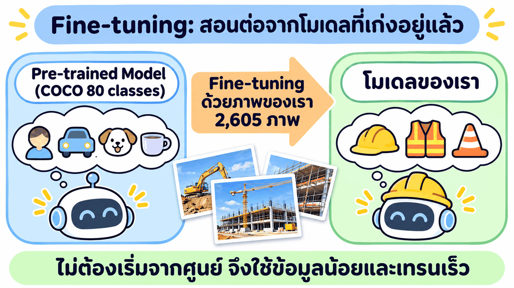
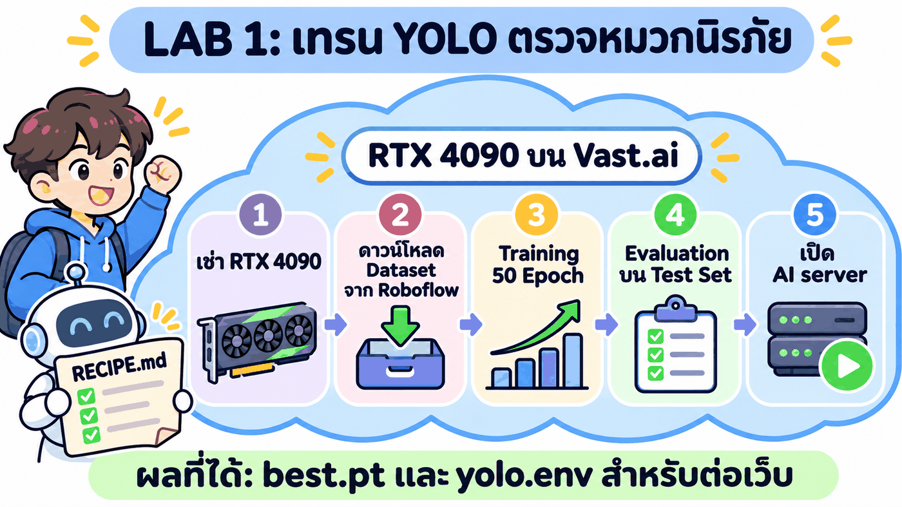
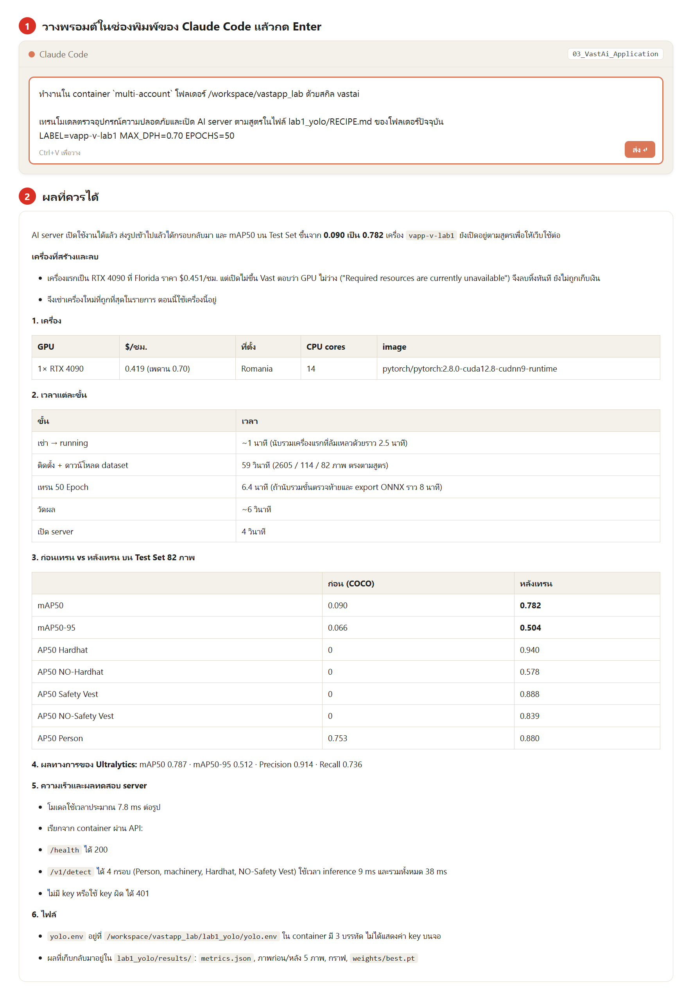
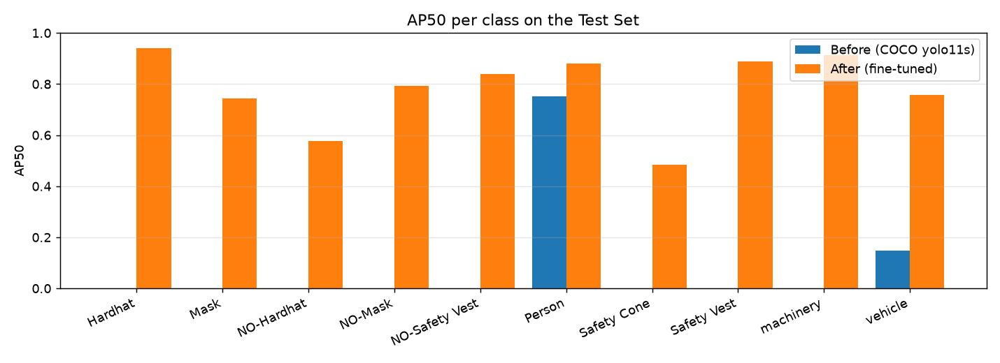
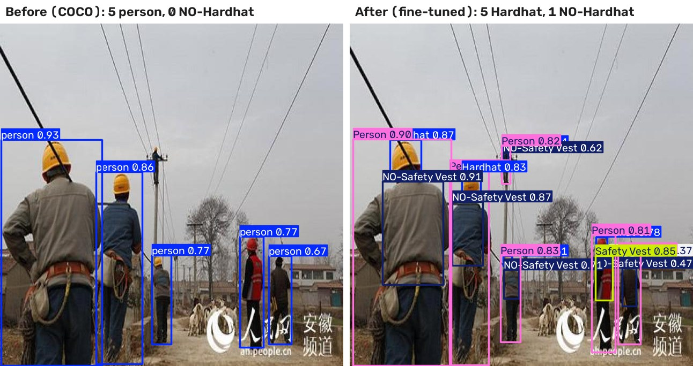
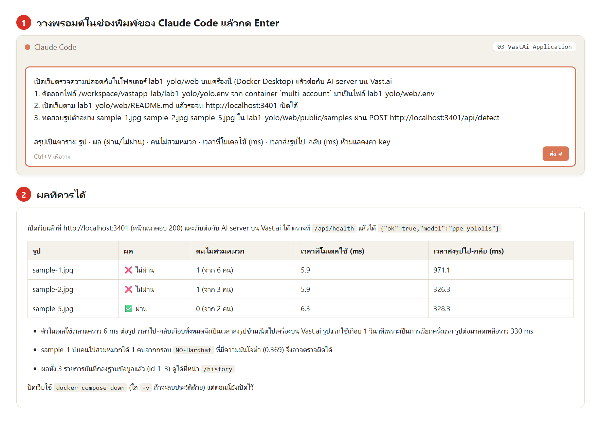

# LAB 1 · เทรน YOLO ตรวจหมวกนิรภัย แล้วต่อเข้าเว็บ

[← กลับหน้ารวมของบท](../README.md) · เปิด Claude Code ที่โฟลเดอร์ของบท `03_VastAi_Application` ("โฟลเดอร์ปัจจุบัน" ในพรอมต์หมายถึงโฟลเดอร์นั้น) · ทำ [LAB 0](../README.md#lab-0--เตรียม-key-3-ตัว) ก่อน

## ทำไปเพื่ออะไร


โมเดลสำเร็จรูปรู้จัก "คน" แต่ไม่รู้จัก "หมวกนิรภัย" หรือ "ไม่สวมหมวก" · คำถามของ LAB นี้คือ **เช่า GPU มาเทรนต่อด้วยข้อมูลของเราไม่กี่นาที แล้วโมเดลดีขึ้นแค่ไหน**

## ทฤษฎีที่ต้องรู้

**1 · Object Detection** รูป 1 รูปได้หลายกรอบ แต่ละกรอบมี คลาส + Confidence + ตำแหน่ง


**2 · Fine-tuning** เริ่มจากโมเดลที่เทรนมาแล้ว (Pre-trained) แล้วเทรนต่อด้วยข้อมูลของเรา จึงใช้ข้อมูลน้อยและเวลาน้อย



**3 · Training / Validation / Test Set** เทรนด้วยชุดหนึ่ง เลือกโมเดลด้วยอีกชุด และ **ตัดสินผลด้วยชุดที่โมเดลไม่เคยเห็น**


**4 · IoU และ mAP** กรอบที่ทำนายทับกรอบเฉลยมากพอจึงนับว่าถูก · mAP คือคะแนนรวมของทุกคลาส (0–1 ยิ่งสูงยิ่งดี)


| ตัวชี้วัด | ความหมาย |
|---|---|
| mAP50 | นับว่าถูกเมื่อ IoU ≥ 0.5 |
| mAP50-95 | เฉลี่ยเกณฑ์ IoU 0.5 ถึง 0.95 · เข้มกว่า ตัวเลขจึงต่ำกว่า |
| AP50 รายคลาส | คะแนนของคลาสเดียว ใช้ดูว่าคลาสไหนยังอ่อน |

**5 · ระบบที่จะได้** เว็บอยู่บนเครื่องเรา ส่วนโมเดลอยู่บนเครื่องเช่า · API key อยู่ฝั่ง server ของเว็บ ไม่ถูกส่งถึงเบราว์เซอร์


## การทดลอง

| หัวข้อ | รายละเอียด |
|---|---|
| Dataset | [Construction Site Safety](https://universe.roboflow.com/roboflow-universe-projects/construction-site-safety) v28 จาก Roboflow Universe (CC BY 4.0) · Training 2,605 · Validation 114 · Test 82 ภาพ |
| คลาส (10) | Hardhat · NO-Hardhat · Safety Vest · NO-Safety Vest · Mask · NO-Mask · Person · Safety Cone · machinery · vehicle |
| เทียบ A กับ B | **ก่อนเทรน** = `yolo11s` ที่เทรนบน COCO · **หลังเทรน** = โมเดลเดิมเทรนต่อ 50 Epoch |
| วัดผล | Test Set 82 ภาพ ด้วยโค้ดเดียวกันทั้งสองโมเดล |
| เครื่อง | RTX 4090 1 ใบ · เพดาน $0.70/ชม. |



LAB นี้มี 3 พรอมต์ ต้องทำให้ครบในรอบเดียว · รายละเอียดทั้งหมดอยู่ในไฟล์สูตร [lab1_yolo/RECIPE.md](RECIPE.md)

## ขั้นที่ 1 · เช่าเครื่อง เทรน วัดผล และเปิด AI server

```text
ทำงานใน container `multi-account` โฟลเดอร์ /workspace/vastapp_lab ด้วยสกิล vastai

เทรนโมเดลตรวจอุปกรณ์ความปลอดภัยและเปิด AI server ตามสูตรในไฟล์ lab1_yolo/RECIPE.md ของโฟลเดอร์ปัจจุบัน
LABEL=vapp-v-lab1 MAX_DPH=0.70 EPOCHS=50
```


*ใช้เวลา 20–40 นาที · เทรนจริง 6.4 นาที ที่เหลือคือติดตั้งและคัดลอกไฟล์กลับ*

**ผลบน Test Set 82 ภาพ**

| ตัวชี้วัด | ก่อนเทรน (COCO) | หลังเทรน |
|---|---|---|
| mAP50 | 0.090 | **0.782** |
| mAP50-95 | 0.066 | **0.504** |
| เวลาโมเดลต่อรูป | 7.5 ms | 7.8 ms |



**ตัวอย่างจริง 1 ภาพ** · ซ้ายก่อนเทรน เห็นแค่ `person` 5 คน · ขวาหลังเทรน เห็น Hardhat 5 และ NO-Hardhat 1



**อ่านผลอย่างไร**

- ก่อนเทรน โมเดลได้คะแนนเฉพาะคลาสที่ COCO มี (Person 0.75) คลาสอื่นได้ 0 เพราะ **โมเดลไม่มีคลาสนั้น** ไม่ใช่เพราะมองไม่เห็น
- เทรนเพียง **6.4 นาที** ด้วยภาพ 2,605 ภาพ ก็ได้ mAP50 0.78 เพราะโมเดลรู้จักขอบและรูปร่างมาก่อนแล้ว
- **ค่าเฉลี่ยสูงไม่ได้แปลว่าดีทุกคลาส**: NO-Hardhat ได้ 0.58 ทั้งที่เป็นคลาสสำคัญที่สุดของงานนี้ (ตัวอย่างน้อย และหน้าตาคล้ายศีรษะทั่วไป) · ก่อนใช้งานจริงต้องเก็บภาพคลาสนี้เพิ่ม
- mAP50 บน Validation ขึ้นเร็วช่วงแรก แล้วเริ่มแบนหลัง Epoch 35 ([กราฟ](results/images/curves.png)) = เทรนนานกว่านี้ได้เพิ่มไม่มาก

## ขั้นที่ 2 · เปิดเว็บแล้วทดสอบ 3 รูป

```text
เปิดเว็บตรวจความปลอดภัยในโฟลเดอร์ lab1_yolo/web บนเครื่องนี้ (Docker Desktop) แล้วต่อกับ AI server บน Vast.ai
1. คัดลอกไฟล์ /workspace/vastapp_lab/lab1_yolo/yolo.env จาก container `multi-account` มาเป็นไฟล์ lab1_yolo/web/.env
2. เปิดเว็บตาม lab1_yolo/web/README.md แล้วรอจน http://localhost:3401 เปิดได้
3. ทดสอบรูปตัวอย่าง sample-1.jpg sample-2.jpg sample-5.jpg ใน lab1_yolo/web/public/samples ผ่าน POST http://localhost:3401/api/detect

สรุปเป็นตาราง: รูป · ผล (ผ่าน/ไม่ผ่าน) · คนไม่สวมหมวก · เวลาที่โมเดลใช้ (ms) · เวลาส่งรูปไป-กลับ (ms) ห้ามแสดงค่า key
```


*ใช้เวลาประมาณ 1 นาที*

จากนั้นเปิด **http://localhost:3401** → กดรูปตัวอย่าง หรืออัปโหลดรูปเอง


| อัปโหลดรูป → ได้ผล | ผลตรวจ 2 รูป และหน้าประวัติ |
|---|---|
|  |  |

ผลทุกครั้งถูกเก็บใน PostgreSQL ดูได้ที่หน้า **ประวัติ**


**อ่านผลอย่างไร**

- **โมเดลใช้ 6 ms แต่ผู้ใช้รอ 330 ms** เวลาเกือบทั้งหมดคือการส่งรูปข้ามอินเทอร์เน็ตไปเครื่องเช่า (รอบนี้อยู่โรมาเนีย) · รูปแรกช้ากว่าเพราะเปิดการเชื่อมต่อใหม่
- รูปแรกถูกตัดสิน "ไม่ผ่าน" จากกรอบ NO-Hardhat ที่ Confidence เพียง 0.369 · เว็บตัดที่ 0.35 ถ้าตั้งสูงขึ้นจะเตือนผิดน้อยลง แต่หลุดมากขึ้น
- เว็บเปิดด้วย `docker compose up -d --build` ในโฟลเดอร์ [lab1_yolo/web](web/README.md) · ค่าเชื่อมต่อ AI server อยู่ในไฟล์ `.env` ที่คัดลอกจาก `yolo.env`

## ขั้นที่ 3 · ลบเครื่องและดูค่าใช้จ่าย (ห้ามข้าม)

```text
ทำงานใน container `multi-account` โฟลเดอร์ /workspace/vastapp_lab ด้วยสกิล vastai

ปิดทุกอย่างของ LAB 1
1. ลบเครื่อง vapp-v-lab1 แล้วตรวจว่าไม่มีเครื่องป้ายนี้ค้างในบัญชี (ห้ามแตะเครื่องอื่น)
2. ปิดเว็บใน lab1_yolo/web ของโฟลเดอร์ปัจจุบันด้วย docker compose down (เก็บประวัติไว้)
3. สรุปค่าใช้จ่ายของเครื่อง vapp-v-lab1: อายุเครื่อง · ราคาต่อชั่วโมง · ยอดที่ถูกคิดจริง
```


**อ่านผลอย่างไร**

- ต้องเห็นว่า **ไม่มีเครื่องป้ายนี้เหลือ** แล้วเปิดหน้า [Instances](https://cloud.vast.ai/instances/) ดูอีกครั้ง
- เทรนจริง 6.4 นาที แต่เครื่องเปิดอยู่ 41 นาที · **เงินเดินตลอดเวลาที่เครื่องเปิด** ไม่ใช่เฉพาะตอนเทรน
- รอบนี้คัดลอกไฟล์โมเดล 57 MB กลับมาใช้ 20 นาที เพราะเครื่องที่เช่าส่งไฟล์ออกช้า · ถ้าต้องดึงไฟล์ใหญ่กลับ ให้ดูความเร็วอัปโหลดของเครื่องตอนเลือกด้วย
- โมเดลที่เทรนได้ถูกเก็บไว้ที่ `lab1_yolo/results/weights/best.pt` · LAB 2 ใช้ Dataset ชุดเดียวกันนี้

---

## ไฟล์ในโฟลเดอร์นี้

| ไฟล์ / โฟลเดอร์ | คืออะไร |
|---|---|
| `RECIPE.md` | ไฟล์สูตรที่ AI ทำตาม |
| `PROMPTS.md` | พรอมต์ทั้ง 3 ขั้นสำหรับคัดลอก |
| `get_data.py · train.py · eval.py · serve.py` | สคริปต์ดาวน์โหลด Dataset เทรน วัดผล และเปิด AI server |
| `web/` | เว็บตรวจความปลอดภัยหน้างาน (Next.js + PostgreSQL + `docker-compose.yml`) พอร์ต 3401 |
| `results/` | ผลจากการรันจริง: ตัวเลข กราฟ ภาพก่อน/หลัง โมเดล `best.pt` ภาพหน้าจอและ GIF ของเว็บ |
| `image/` | ภาพประกอบของ LAB นี้ |
