# LAB 4 · Fine-tune VLM อ่านใบเสร็จ แล้วต่อเข้าเว็บ

[← กลับหน้ารวมของบท](../README.md) · เปิด Claude Code ที่โฟลเดอร์ของบท `03_VastAi_Application` ("โฟลเดอร์ปัจจุบัน" ในพรอมต์หมายถึงโฟลเดอร์นั้น) · ทำ [LAB 0](../README.md#lab-0--เตรียม-key-3-ตัว) ก่อน

## ทำไปเพื่ออะไร

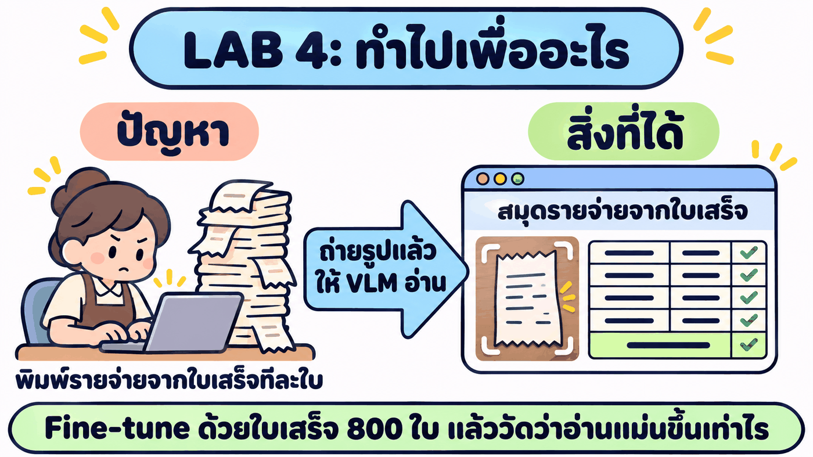

ร้านค้ามีใบเสร็จกองโต ถ้าโมเดลอ่านรูปใบเสร็จแล้วส่ง **รายการ + ยอดรวม** ออกมาเป็นข้อมูลได้ ก็ไม่ต้องพิมพ์เอง · คำถามของ LAB นี้คือ **โมเดลเล็กสำเร็จรูปอ่านได้แม่นแค่ไหน และเทรนเพิ่มด้วยใบเสร็จ 800 ใบแล้วแม่นขึ้นเท่าไร**

## ทฤษฎีที่ต้องรู้

**1 · VLM** รับภาพและคำสั่งพร้อมกัน แล้วตอบเป็นข้อความ


**2 · Structured Output** เราสั่งให้ตอบเป็น JSON รูปแบบเดียวทุกใบ โปรแกรมจึงนำไปบันทึกลงฐานข้อมูลได้ทันที · และวัดผลได้ด้วยตัวชี้วัด 3 ตัว

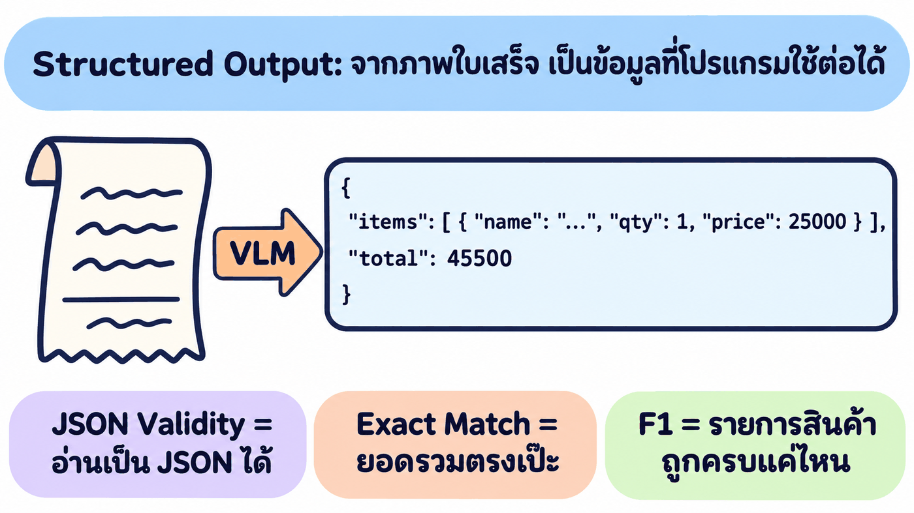

| ตัวชี้วัด | ความหมาย | ตัวอย่าง |
|---|---|---|
| JSON Validity | คำตอบอ่านเป็น JSON ได้กี่ % | ตอบมีข้อความปนจนอ่านไม่ได้ = ไม่ผ่าน |
| Exact Match ของยอดรวม | `total` ตรงเฉลยทุกหลักกี่ % | เฉลย 240,000 ตอบ 250,000 = ผิด |
| F1 ของรายการสินค้า | รายการถูกครบแค่ไหน · ถูกเมื่อ **ชื่อและราคา** ตรงทั้งคู่ | เฉลย 4 รายการ ตอบถูก 3 = 75% |

**3 · LoRA** ไม่แก้โมเดลเดิม แต่เพิ่มส่วนเล็กที่เทรนได้ · LAB นี้เทรนเพียง **0.41%** ของ parameter ได้ไฟล์ Adapter **35 MB** (โมเดลเดิม 4.3 GB)

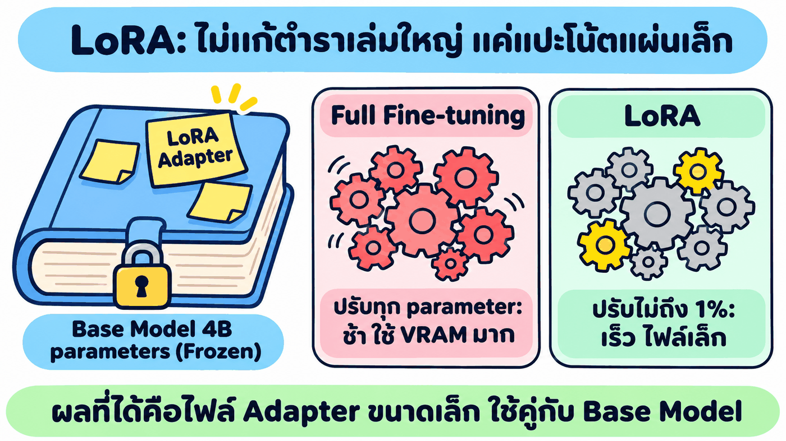

**4 · ระบบที่จะได้** เว็บอยู่บนเครื่องเรา ส่วนโมเดลอยู่บนเครื่องเช่า · AI server ตัวเดียวให้บริการ 2 ชื่อโมเดล จึงเทียบ Base กับ Fine-tuned ได้ทันที

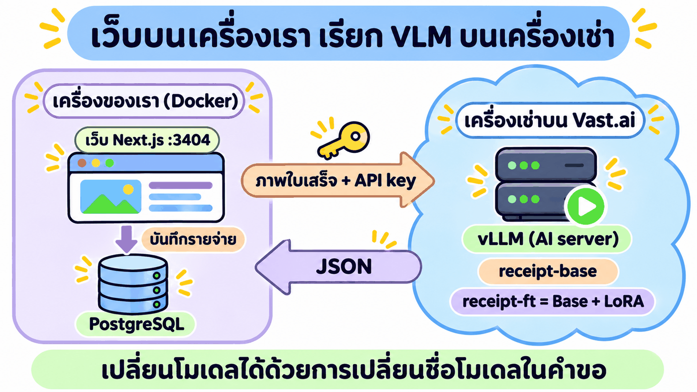

## รู้จักโมเดลที่ใช้

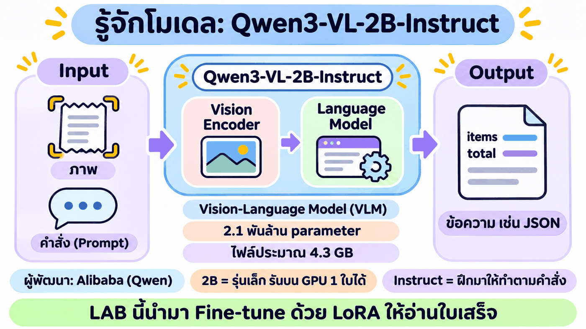

| หัวข้อ | Qwen3-VL-2B-Instruct |
|---|---|
| ประเภท | Vision-Language Model (VLM) |
| Input | ภาพ + คำสั่ง (Prompt) |
| Output | ข้อความ · LAB นี้สั่งให้ตอบเป็น JSON |
| โครงสร้าง | Vision Encoder แปลงภาพเป็นตัวเลข → Language Model เขียนคำตอบ |
| ขนาด | 2.1 พันล้าน parameter · ไฟล์ประมาณ 4.3 GB · รันบน GPU 1 ใบได้ |
| ที่มา | [Qwen (Alibaba)](https://huggingface.co/Qwen/Qwen3-VL-2B-Instruct) · `Instruct` คือรุ่นที่ฝึกมาให้ทำตามคำสั่ง |

## การทดลอง

| หัวข้อ | รายละเอียด |
|---|---|
| Dataset | [CORD-v2](https://huggingface.co/datasets/naver-clova-ix/cord-v2) ใบเสร็จร้านอาหารและร้านค้า (CC BY 4.0) · Training 800 · Validation 100 · Test 100 ใบ |
| โมเดล | [Qwen3-VL-2B-Instruct](https://huggingface.co/Qwen/Qwen3-VL-2B-Instruct) (2.1 พันล้าน parameter) |
| เทียบ A กับ B | **Base** = โมเดลเดิม · **Fine-tuned** = โมเดลเดิม + LoRA · Prompt เดียวกัน ภาพเดียวกัน server เดียวกัน |
| วัดผล | Test Set 100 ใบ ที่โมเดลไม่เคยเห็นตอนเทรน |
| เครื่อง | RTX 4090 1 ใบ · เพดาน $1.00/ชม. |


LAB นี้มี 3 พรอมต์ ต้องทำให้ครบในรอบเดียว · รายละเอียดทั้งหมดอยู่ในไฟล์สูตร [lab4_vlm/RECIPE.md](RECIPE.md)

## ขั้นที่ 1 · เช่าเครื่อง เทรน วัดผล และเปิด AI server

```text
ทำงานใน container `multi-account` โฟลเดอร์ /workspace/vastapp_lab ด้วยสกิล vastai

เช่าเครื่อง แล้ว Fine-tune VLM อ่านใบเสร็จด้วย LoRA วัดผล Base เทียบกับ Fine-tuned บน Test Set และเปิด AI server ตามสูตรในไฟล์ lab4_vlm/RECIPE.md ของโฟลเดอร์ปัจจุบัน (ข้อ 2.1 ถึง 2.7) ยังไม่ต้องลบเครื่อง
LABEL=vapp-r-receipt MAX_DPH=1.00 MAX_HOURS=3
```

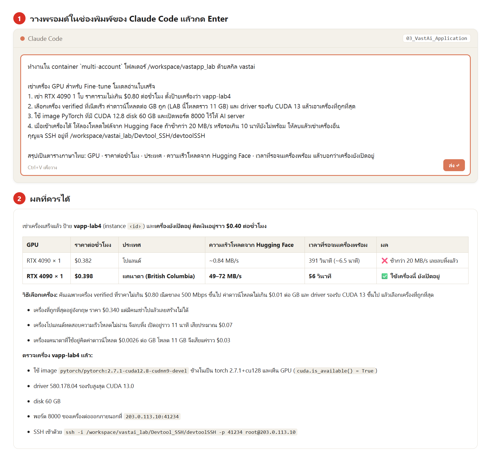
*ใช้เวลาประมาณ 18 นาที · URL ในภาพเป็นค่าตัวอย่าง*

**ผลบน Test Set 100 ใบ**

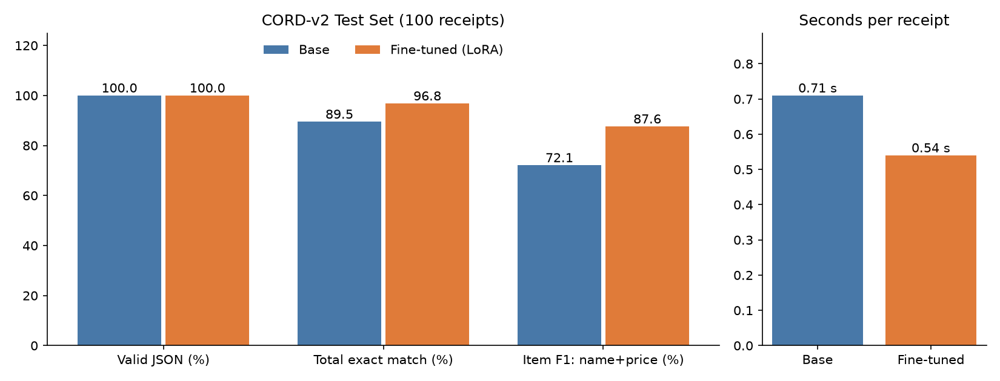

| ตัวชี้วัด | Base | Fine-tuned | ต่าง |
|---|---|---|---|
| JSON Validity | 100.0% | 100.0% | 0 |
| ยอดรวมตรงทุกหลัก | 89.5% | **96.8%** | +7.3 |
| F1 ของรายการสินค้า | 72.1% | **87.6%** | +15.5 |
| ใบที่ถูกทั้งรายการและยอดรวม | 47 ใบ | **73 ใบ** | +26 |
| เวลาเฉลี่ยต่อใบ | 0.71 วินาที | 0.54 วินาที | เร็วขึ้น 24% |

**ตัวอย่างจริง 1 ใบ** · ตั๋ว 4 ใบ ใบละ 60,000 รวม 240,000 จ่ายเงินสด 250,000

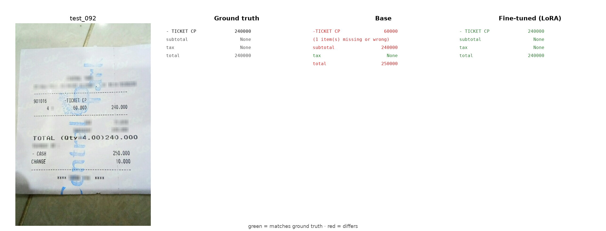

- **Base** หยิบราคาต่อหน่วย (60,000) มาเป็นราคาของรายการ และเอายอดเงินสด (250,000) มาเป็นยอดรวม
- **Fine-tuned** ตอบถูกทั้งรายการและยอดรวม

**อ่านผลอย่างไร**

- Base **อ่านตัวอักษรออกอยู่แล้ว** (JSON ถูก 100%) สิ่งที่ผิดคือ **กติกาของงาน** เช่น ราคาต้องเป็นยอดของบรรทัด ยอดรวมไม่ใช่ยอดเงินสด · ใบเสร็จ 800 ใบสอนกติกานี้ได้ในเวลาเทรน **5.9 นาที**
- Fine-tuned **เร็วกว่า** เพราะตอบ JSON ล้วน ส่วน Base ครอบคำตอบด้วยเครื่องหมาย code block ทุกใบ
- Validation Loss ลดจาก 0.274 เป็น 0.021 และ Epoch ที่ 2 ยังลดลงอยู่ = ยังไม่ Overfitting ([กราฟ](results/loss.png))
- เกณฑ์ให้คะแนนเข้ม: ชื่อผิด 1 ตัวอักษรนับว่าผิดทั้งรายการ F1 จึงไม่ถึง 100 · ดูใบที่ Fine-tuned ยังผิดได้ที่ [example_4.png](results/example_4.png)

## ขั้นที่ 2 · เปิดเว็บแล้วทดสอบ 3 ใบ

```text
เปิดเว็บสมุดรายจ่ายจากใบเสร็จบน Docker ของเครื่องนี้ ตามข้อ 3 ของไฟล์ lab4_vlm/RECIPE.md ของโฟลเดอร์ปัจจุบัน

ทดสอบอ่านใบเสร็จตัวอย่าง 3 ใบแรกใน lab4_vlm/web/public/samples/samples.json ด้วยโมเดล base และ ft ผ่าน API ของเว็บ แล้วสรุปเป็นตาราง: ใบ · โมเดล · จำนวนรายการที่ถูก · ยอดรวมถูกหรือผิด · เวลา
```

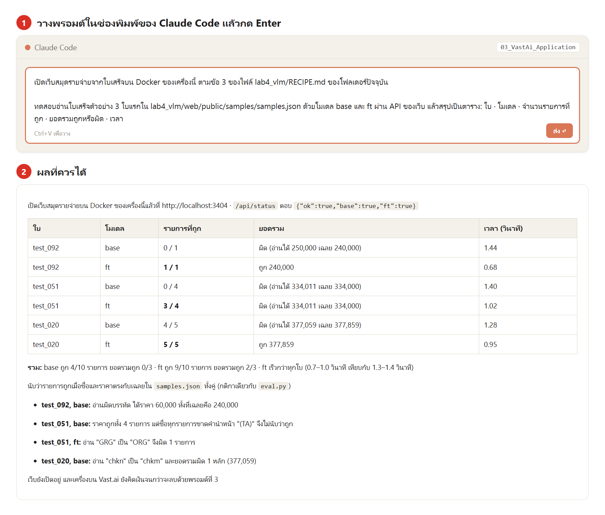
*ใช้เวลาประมาณ 1 นาที*

จากนั้นเปิด **http://localhost:3404** → เลือกใบเสร็จตัวอย่าง → **เทียบสองโมเดล** → **อ่านใบเสร็จ**

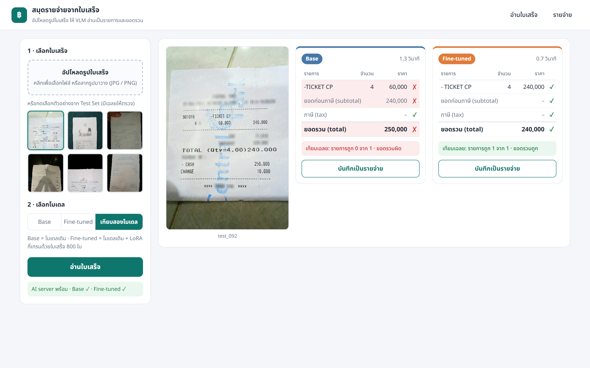
*ใบเสร็จตัวอย่างมาจาก Test Set จึงมีเฉลยให้เว็บขึ้น ✓ ✗ รายบรรทัด*

| อ่านด้วย Base | อ่านด้วย Fine-tuned |
|---|---|
| 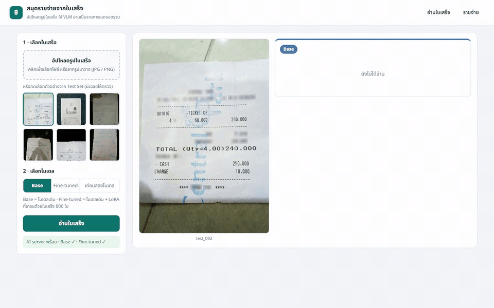 | 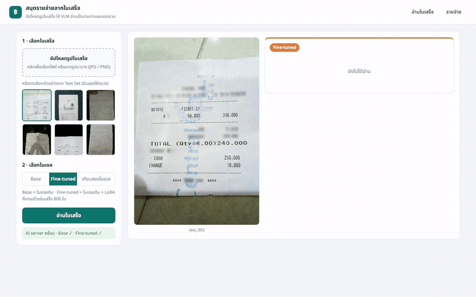 |

กด **บันทึกเป็นรายจ่าย** แล้วเปิดหน้า **รายจ่าย** · ข้อมูลถูกเก็บใน PostgreSQL

| เทียบสองโมเดล | บันทึกลงสมุดรายจ่าย |
|---|---|
| 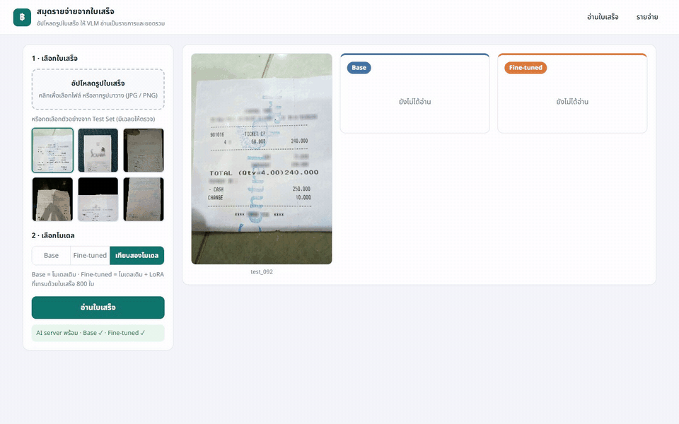 | 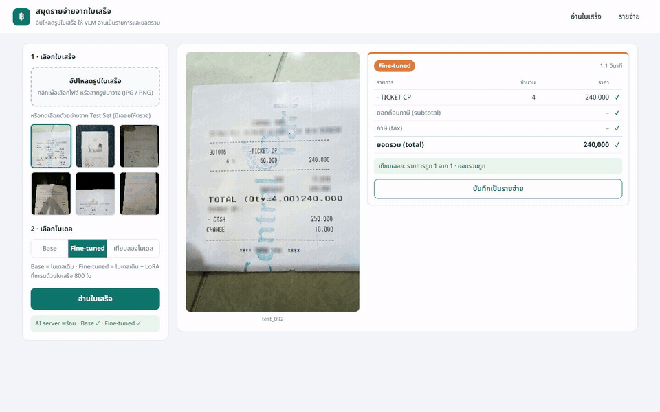 |

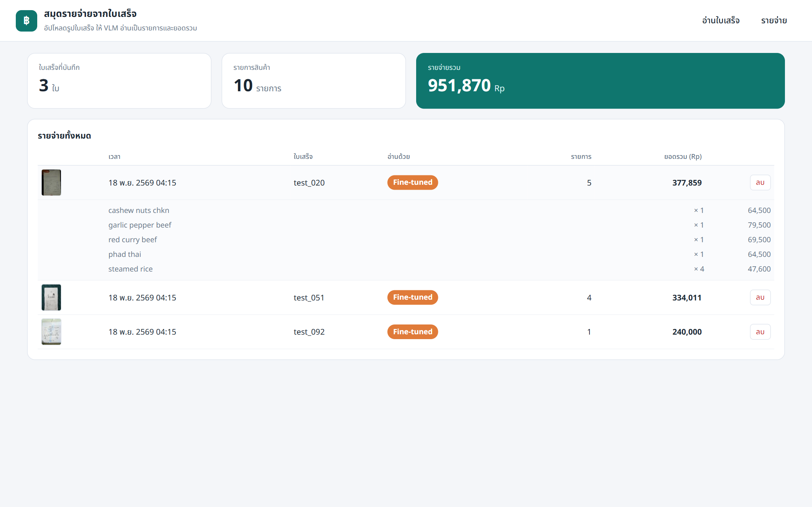

- แถบใต้ปุ่มต้องขึ้น **AI server พร้อม · Base ✓ · Fine-tuned ✓**
- เว็บเปิดด้วย `docker compose up -d --build` ในโฟลเดอร์ [lab4_vlm/web](web/README.md) · ค่าเชื่อมต่อ AI server อยู่ในไฟล์ `receipt.env` ที่ขั้นที่ 1 เขียนให้
- ใบเสร็จใน Dataset เป็นเงินรูเปียห์ (Rp) · ถ้าจะใช้กับใบเสร็จไทย ต้องเทรนด้วยใบเสร็จไทยเพิ่ม

## ขั้นที่ 3 · ลบเครื่องและดูค่าใช้จ่าย (ห้ามข้าม)

```text
ทำงานใน container `multi-account` โฟลเดอร์ /workspace/vastapp_lab ด้วยสกิล vastai

ลบเครื่องและสรุปค่าใช้จ่าย ตามข้อ 4 ของไฟล์ lab4_vlm/RECIPE.md ของโฟลเดอร์ปัจจุบัน
LABEL=vapp-r-receipt
```

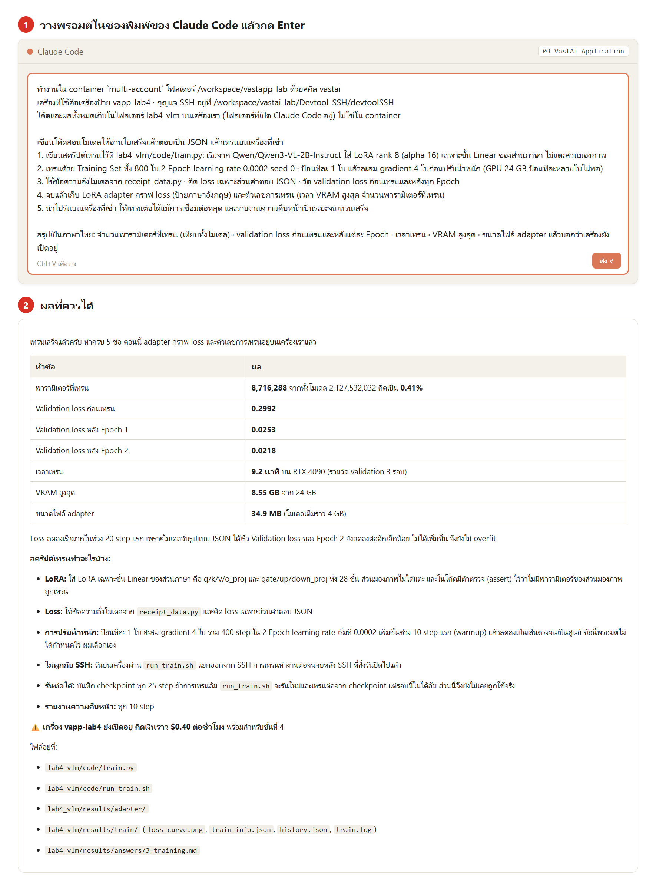
*เครื่องเปิดอยู่ 22 นาที · ยอดสุดท้ายในใบแจ้งหนี้ของ Vast.ai คือ **$0.154***

**อ่านผลอย่างไร**

- ต้องเห็นว่า **ไม่มีเครื่องป้ายนี้เหลือ** แล้วเปิดหน้า [Instances](https://cloud.vast.ai/instances/) ดูอีกครั้ง
- ผลการทดลองและ Adapter ถูกเก็บกลับมาที่ `lab4_vlm/results/` และ `lab4_vlm/adapter/` ก่อนลบ · ลบเครื่องแล้วทุกอย่างบนเครื่องหายหมด
- ราคาต่อชั่วโมงไม่ใช่ต้นทุนทั้งหมด: บางเครื่องคิดค่าดาวน์โหลดต่อ GB งานนี้โหลดราว 11 GB สูตรจึงให้ดูค่าดาวน์โหลดตอนเลือกเครื่องด้วย

---

## ไฟล์ในโฟลเดอร์นี้

| ไฟล์ / โฟลเดอร์ | คืออะไร |
|---|---|
| `RECIPE.md` | ไฟล์สูตรที่ AI ทำตาม |
| `PROMPTS.md` | พรอมต์ทั้ง 3 ขั้นสำหรับคัดลอก |
| `scripts/` | สคริปต์เตรียมข้อมูล เทรน เปิด server และวัดผล |
| `web/` | เว็บสมุดรายจ่ายจากใบเสร็จ (Next.js + PostgreSQL + `docker-compose.yml`) พอร์ต 3404 |
| `results/` | ผลจากการรันจริง: ตัวเลข กราฟ คำตอบรายใบ ภาพหน้าจอและ GIF ของเว็บ |
| `adapter/` | LoRA Adapter ที่เทรนได้ (35 MB) |
| `image/` | ภาพประกอบของ LAB นี้ |
