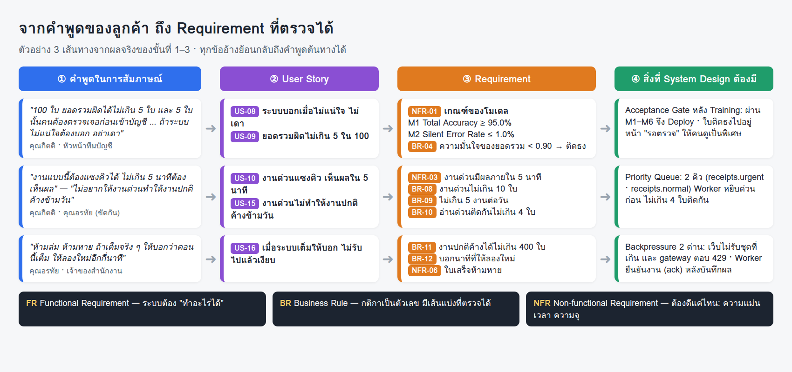
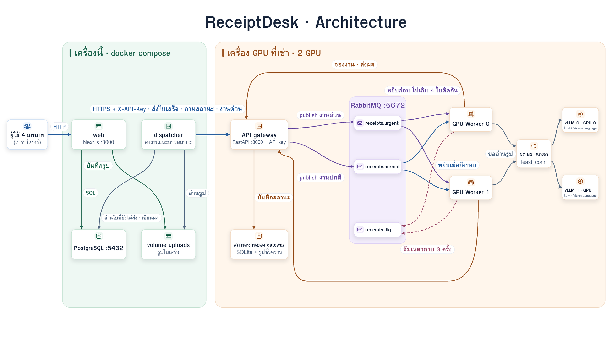
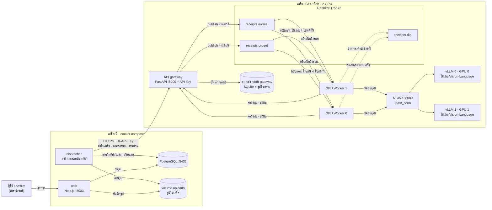
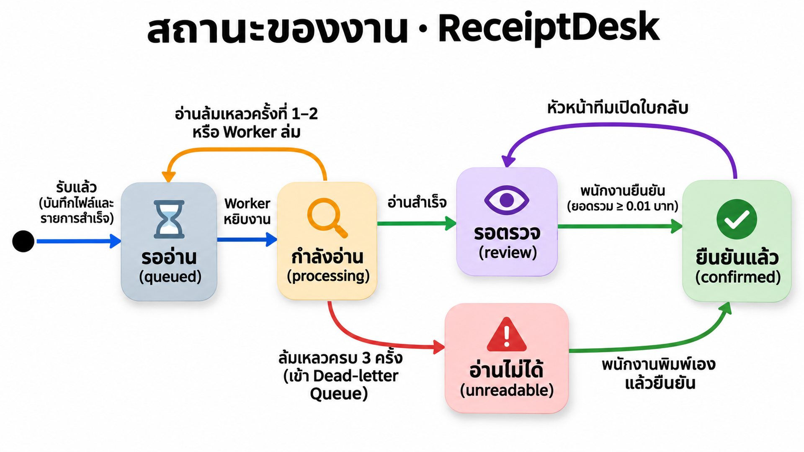
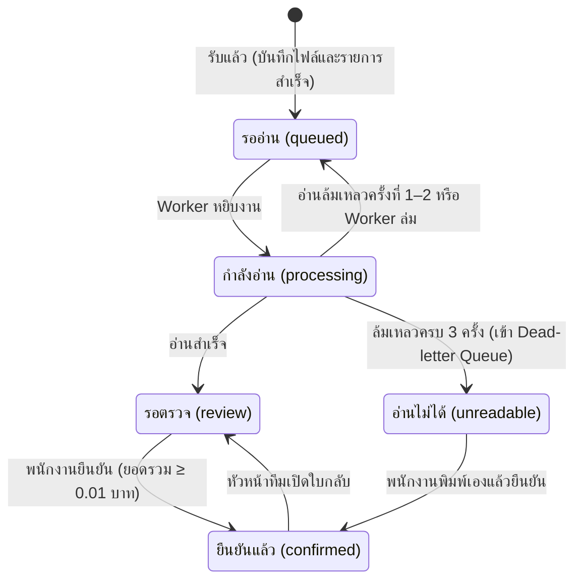
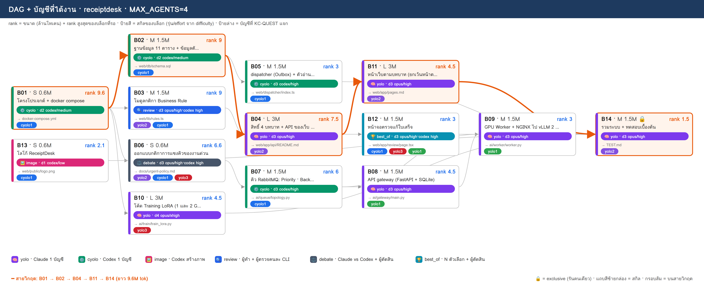
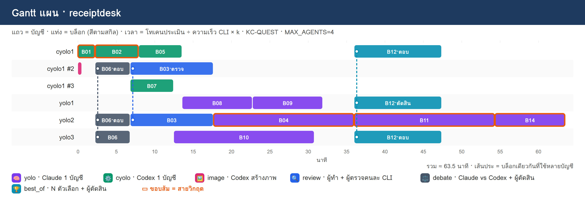
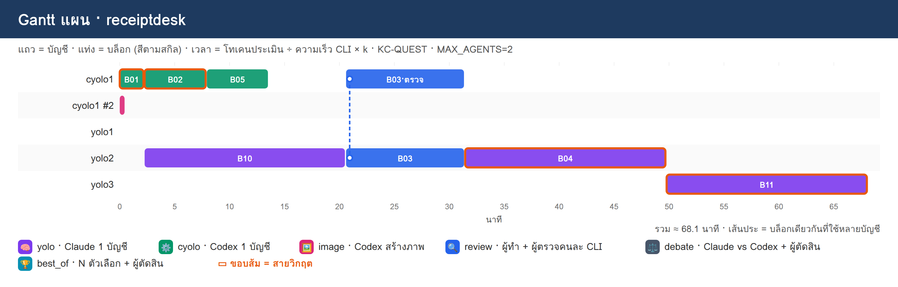
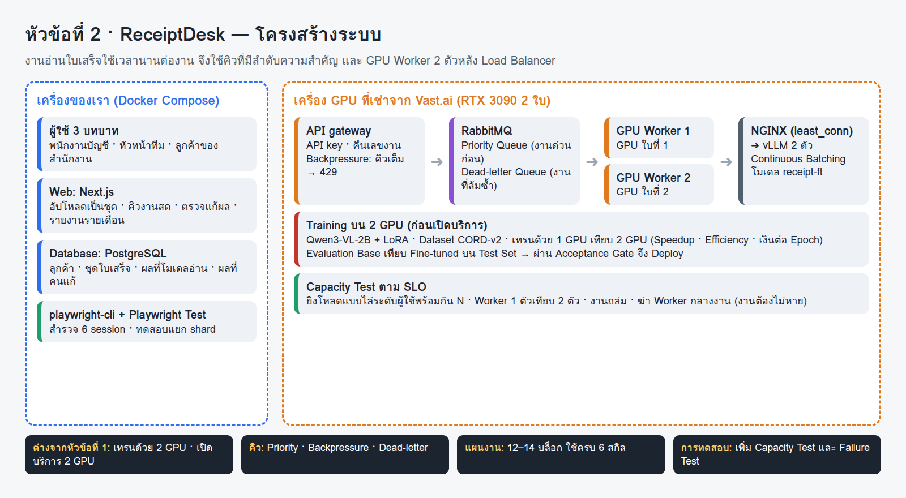

# หัวข้อที่ 2 · ReceiptDesk — บริการอ่านใบเสร็จสำหรับสำนักงานบัญชี

[← กลับหน้ารวมของบท](../README.md) · ทำ [หัวข้อที่ 1](../01_sitesafe_inspect/README.md) ก่อน · เปิด Claude Code ที่โฟลเดอร์ `02_receipt_desk` · พรอมต์อยู่ใน [PROMPTS.md](PROMPTS.md)


*(ภาพจำลอง · บริษัทและบุคคลในหัวข้อนี้เป็นตัวอย่างสมมติ)*

---

## 1 · เรื่องราวของลูกค้า

สำนักงานบัญชี ใส่ใจการบัญชี ดูแลบัญชีให้ร้านค้าและบริษัทขนาดเล็ก 60 ราย

**ลูกค้าถ่ายรูปใบเสร็จส่งมา**


ร้านค้าส่งรูปใบเสร็จมาทาง LINE และอีเมล รวมกันเดือนละราว 6,000 ใบ

**พนักงานพิมพ์ยอดทีละใบ**


พนักงาน 4 คนพิมพ์ชื่อร้าน วันที่ รายการ ราคา และยอดรวม ใบละประมาณ 2 นาที

**สิ้นเดือน: งานเข้าพร้อมกัน ทำถึงสามทุ่ม และยอดเริ่มผิด**


บางวันใบเสร็จเข้ามา 800 ใบ ยอดที่พิมพ์ผิดคือบัญชีที่ผิด

**คำถามของหัวข้อนี้: เมื่องานเข้าพร้อมกันเกินความจุของ GPU ทีม AI ออกแบบ สร้าง และพิสูจน์ระบบที่งานไม่หายและรอไม่เกิน SLO ได้อย่างไร**

---

## 2 · การสัมภาษณ์ลูกค้า


ทีมพัฒนาไปสัมภาษณ์ 4 คน

| | ผู้ให้สัมภาษณ์ | สิ่งที่พูด |
|---|---|---|
|  | **คุณอรทัย**<br>เจ้าของสำนักงาน | "อยากให้อัปโหลดรูปใบเสร็จแล้วระบบอ่านออกมาเป็นข้อมูลเลย พนักงานแค่ตรวจว่าถูกไหมแล้วกดยืนยัน"<br>"ถ้าพนักงานต้องตรวจทุกช่องทุกใบเหมือนเดิมก็ไม่ได้ประหยัดเวลา"<br>"ห้ามล่ม ห้ามหาย ถ้าเต็มจริง ๆ ให้บอกว่าตอนนี้เต็ม ให้ลองใหม่อีกกี่นาที" |
|  | **คุณพิมพ์**<br>พนักงานบัญชี | "ขออัปโหลดทีละเป็นชุดนะคะ ชุดละร้อยใบก็มี"<br>"ชุดร้อยใบ รอสักครึ่งชั่วโมงก็ได้ค่ะ ขอแค่ใบเสร็จไม่หาย" |
|  | **คุณกิตติ**<br>หัวหน้าทีมบัญชี | "100 ใบ ยอดรวมผิดได้ไม่เกิน 5 ใบ และ 5 ใบนั้นคนต้องตรวจเจอก่อนเข้าบัญชี"<br>"ถ้าระบบไม่แน่ใจต้องบอก อย่าเดา"<br>"งานแบบนี้ต้องแซงคิวได้ ไม่เกิน 5 นาทีต้องเห็นผล" |
|  | **คุณสมชาย**<br>เจ้าของร้านอาหาร (ลูกค้าของสำนักงาน) | "ผมอยากอัปโหลดเองเลยครับ … อยากเห็นสรุปรายจ่ายของร้านผมรายเดือน"<br>"ผมจะรู้ได้ไงว่าใบที่ส่งไปถึงแล้ว" |

*(ภาพบุคคลเป็นภาพจำลอง)*

**สังเกต:** คุณกิตติต้องการให้งานด่วนแซงคิว แต่คุณอรทัยไม่อยากให้งานปกติค้างข้ามวัน · คุณกิตติต้องการให้คนตรวจเจอยอดผิดทุกใบ แต่คุณอรทัยไม่อยากให้ตรวจทุกช่องทุกใบ · บันทึกฉบับเต็ม: [INTERVIEW.md](INTERVIEW.md)

---

## 3 · ระยะ A · จากคำพูดเป็น Requirement



| ลำดับ | เอกสาร | ตอบคำถาม | ผลจริง |
|---|---|---|---|
| ① | [INTERVIEW.md](INTERVIEW.md) | ลูกค้าพูดว่าอะไร | 4 คน |
| ② | [USER-STORIES.md](docs/USER-STORIES.md) | ใครต้องการอะไร เพื่ออะไร | 24 ข้อ |
| ③ | [REQUIREMENTS.md](docs/REQUIREMENTS.md) | ระบบต้องทำอะไร กติกาคืออะไร ต้องดีแค่ไหน | FR 31 · BR 14 · NFR 10 |
| ④ | [DESIGN.md](docs/DESIGN.md) | ระบบมีส่วนใดบ้าง คุยกันอย่างไร | 11 ตาราง · 33 API |

### ขั้นที่ 1 · User Story จากบันทึกการสัมภาษณ์

```text
จากบันทึกการสัมภาษณ์ลูกค้าใน ./INTERVIEW.md เขียน User Story ไว้ที่ ./docs/USER-STORIES.md
1. เขียนรูปแบบ "ในฐานะ… ฉันต้องการ… เพื่อ…" ให้ครบทุกบทบาทที่ลูกค้าพูดถึง ทุกข้อมีรหัส US-01… ระดับ Must / Should / Could และเกณฑ์ยอมรับที่ตรวจได้
2. ทุกข้อต้องอ้างคำพูดในบันทึกที่เป็นที่มา ห้ามเพิ่มความต้องการที่ลูกค้าไม่ได้พูด
3. รวบรวมจุดที่ลูกค้าพูดขัดกันเอง และคำถามที่ต้องถามลูกค้าเพิ่ม เป็น 2 ตารางท้ายไฟล์
4. แยกสิ่งที่ลูกค้าบอกว่ายังไม่ทำในรุ่นแรกไว้ในหัวข้อ "นอกขอบเขต"
(ยังไม่ออกแบบระบบ ยังไม่เขียนโค้ด)
สรุปเป็นตารางภาษาไทย: จำนวน User Story แยกตามระดับ · จำนวนจุดที่ขัดกัน · จำนวนคำถาม
```

**ผลจริง** (ประมาณ 3 นาที)

| รายการ | จำนวน |
|---|---|
| User Story ระดับ Must | 16 |
| User Story ระดับ Should | 7 |
| User Story ระดับ Could | 1 |
| จุดที่ลูกค้าพูดขัดกันเอง | 6 |
| คำถามที่ต้องถามลูกค้าเพิ่ม | 14 |

**อ่านผลอย่างไร**
- User Story ครบ 4 บทบาท: พนักงานบัญชี 7 ข้อ · หัวหน้าทีม 6 ข้อ · เจ้าของสำนักงาน 8 ข้อ · ลูกค้าของสำนักงาน 3 ข้อ
- จุดขัดกัน 6 จุด มากกว่าหัวข้อที่ 1 (4 จุด) เพราะมีผู้ให้สัมภาษณ์ 4 คนที่ต้องการต่างกัน
- US-24 มาจากคำถามของคุณสมชายที่ไม่มีใครตอบในห้องประชุม ("ผมจะรู้ได้ไงว่าใบที่ส่งไปถึงแล้ว") AI เก็บเป็นความต้องการ ไม่ปล่อยผ่าน

### ขั้นที่ 2 · Requirement

```text
จาก User Story ใน ./docs/USER-STORIES.md เขียน Requirement ไว้ที่ ./docs/REQUIREMENTS.md
1. Functional Requirement (FR-01…) ทุกข้ออ้างรหัส User Story
2. Business Rule (BR-01…) ทุกข้อเป็นตัวเลขที่ตรวจได้ พร้อมค่าตัวอย่างที่ ต่ำกว่า / เท่ากับ / สูงกว่า เส้นแบ่ง
3. Non-functional Requirement (NFR-01…) ให้มีอย่างน้อย 6 เรื่อง: เกณฑ์ของโมเดล · SLO ของงานปกติและงานด่วน · ความจุช่วงสิ้นเดือน · ใบเสร็จห้ามหาย · ความเป็นส่วนตัวของข้อมูล · ความคุ้มของการเพิ่ม GPU
4. เกณฑ์ของโมเดล: แปลงคำว่า "100 ใบ ยอดรวมผิดได้ไม่เกิน 5 ใบ" และ "ถ้าไม่แน่ใจต้องบอก อย่าเดา" เป็นตัวชี้วัดที่วัดได้บน Test Set
5. กติกาของงานด่วน: ใครตั้งได้ แซงคิวอย่างไร และงานปกติต้องไม่ค้างเกินเท่าใด
6. จุดที่ลูกค้าขัดกันเอง ให้เลือกทางที่เสี่ยงน้อยที่สุด แล้วบันทึกเป็น "ข้อสมมติ" พร้อมเหตุผล
(ยังไม่เขียนโค้ด)
สรุปเป็นตารางภาษาไทย: จำนวน FR · BR · NFR · ข้อสมมติ และเกณฑ์ของโมเดลกับ SLO ที่ใช้
```

**ผลจริง** (ประมาณ 4 นาที): FR 31 ข้อ · BR 14 ข้อ · NFR 10 ข้อ · ข้อสมมติ 16 ข้อ

**BR · Business Rule** (ตัวอย่าง 5 จาก 14 ข้อ)

| รหัส | กติกา | ต่ำกว่าเส้นแบ่ง | เท่ากับ | สูงกว่า |
|---|---|---|---|---|
| BR-01 | 1 ชุดมีได้ 1–100 ไฟล์ | 99 → รับ | 100 → รับ | 101 → ปฏิเสธทั้งชุด |
| BR-04 | ความมั่นใจของยอดรวมต่ำกว่า 0.90 → ติดธง "ไม่แน่ใจยอดรวม" | 0.89 → ติดธง | 0.90 → ไม่ติดธง | 0.91 → ไม่ติดธง |
| BR-06 | ยืนยันได้เมื่อยอดรวมตั้งแต่ 0.01 บาท | 0.00 → ยืนยันไม่ได้ | 0.01 → ยืนยันได้ | 0.02 → ยืนยันได้ |
| BR-08 | งานด่วน 1 งานมีได้ไม่เกิน 10 ใบ | 9 → ตั้งด่วนได้ | 10 → ตั้งด่วนได้ | 11 → ตั้งไม่ได้ |
| BR-09 | ตั้งงานด่วนได้ไม่เกิน 5 งานต่อวัน | ตั้งไปแล้ว 4 → งานที่ 5 ตั้งได้ | — | ตั้งไปแล้ว 5 → งานที่ 6 ตั้งไม่ได้ |

**NFR-01 · เกณฑ์ของโมเดล — แปลงคำพูดเป็นตัวชี้วัดบน Test Set**

| ตัวชี้วัด | แปลงจากคำพูด | เกณฑ์ผ่าน |
|---|---|---|
| M1 Total Accuracy | "100 ใบ ยอดรวมผิดได้ไม่เกิน 5 ใบ" | ≥ 95.0% |
| M2 Silent Error Rate (ยอดผิดและไม่ติดธง) | "5 ใบนั้นคนต้องตรวจเจอ" + "อย่าเดา" | ≤ 1.0% |
| M3 Flag Recall | "ถ้าไม่แน่ใจต้องบอก" | ≥ 80.0% |
| M4 Flag Rate | "ตรวจทุกช่องทุกใบก็ไม่ได้ประหยัดเวลา" | ≤ 20.0% |

**SLO และกติกาของงานด่วน**

| เรื่อง | เกณฑ์ |
|---|---|
| SLO งานปกติ | ชุด 100 ใบมีผลครบภายใน 30 นาที · ทุกกรณีไม่เกิน 120 นาที |
| SLO งานด่วน | มีผลครบภายใน 5 นาที แม้คิวงานปกติเต็ม |
| ใครตั้งงานด่วนได้ | หัวหน้าทีมคนเดียว |
| แซงคิวอย่างไร | อ่านใบด่วนก่อน แต่ติดกันได้ไม่เกิน 4 ใบ แล้วต้องสลับใบปกติ 1 ใบ (BR-10) |
| ความคุ้มของการเพิ่ม GPU | เพิ่มเป็น 2 ใบถือว่าคุ้มเมื่อ Speedup ≥ 1.6 เท่า หรือ 1 ใบทำ SLO ไม่ได้แต่ 2 ใบทำได้ |

**อ่านผลอย่างไร**
- คำว่า "ยอดรวมต้องถูก" ไม่ได้กลายเป็นตัวชี้วัดเดียว แต่เป็น 4 ตัว: M1 วัดว่าอ่านถูกแค่ไหน ส่วน M2–M4 วัดว่าโมเดล "รู้ตัวว่าไม่แน่ใจ" ดีแค่ไหน
- จุดที่คุณกิตติกับคุณอรทัยขัดกันเรื่องการตรวจ AI เลือกทางกลาง: พนักงานตรวจช่องยอดรวมทุกใบ และตรวจทุกช่องเฉพาะใบติดธง แล้วจดเป็นข้อสมมติให้ลูกค้ายืนยัน
- ตัวเลขที่ลูกค้าไม่ได้ให้ เช่น เส้นความมั่นใจ 0.90 เพดานคิว 400 ใบ และอัตราอ่าน 4 ใบต่อนาทีต่อ Worker เป็นค่าที่ AI ตั้งและบอกชัดว่าเป็นข้อสมมติ ยังไม่ได้วัดจริง

### ขั้นที่ 3 · System Design และข้อมูลทดสอบ

```text
จาก Requirement ใน ./docs/REQUIREMENTS.md ออกแบบระบบไว้ที่ ./docs/DESIGN.md และข้อมูลทดสอบไว้ที่ ./docs/TEST-DATA.md
ระบบมี 2 ฝั่ง: เว็บ Next.js + PostgreSQL รันด้วย docker compose บนเครื่องนี้ และฝั่ง AI บนเครื่อง GPU ที่เช่า 2 ใบ ซึ่งมี API gateway, RabbitMQ, GPU Worker 2 ตัว และโมเดล Vision-Language อ่านใบเสร็จที่เปิดด้วย vLLM 2 ตัวหลัง NGINX
1. แผนภาพ Mermaid 4 ภาพ: Architecture · ER Diagram · ลำดับการทำงานตั้งแต่อัปโหลดชุดใบเสร็จจนพนักงานยืนยันผล · สถานะของงาน
2. API Contract ระหว่างเว็บกับ gateway: ส่งใบเสร็จ · ถามสถานะ · งานด่วน · คิวเต็มตอบอย่างไร · ใช้ API key อย่างไร
3. การออกแบบคิว 3 เรื่อง: Priority Queue ให้งานด่วนแซงได้โดยงานปกติไม่ค้างเกินกำหนด · Backpressure เมื่อคิวเต็ม · Dead-letter Queue สำหรับใบที่อ่านไม่ได้
4. งานต้องไม่หายเมื่อ Worker ล่ม และ Worker ที่เหลือต้องทำงานต่อได้
5. เว็บต้องมี /api/health ทางรีเซ็ตข้อมูลทดสอบ และ data-testid ทุกปุ่มและช่องกรอก
6. เว็บต้องมีโหมด BUG_MODE=1 ที่ทำให้ Business Rule ผิด 3 ข้อ (เลือกเอง) เก็บรายชื่อ 3 ข้อนั้นไว้ที่ ./docs/BUGS-SECRET.md ที่เดียว
7. ข้อมูลทดสอบ: ผู้ใช้ทุกบทบาท ลูกค้าของสำนักงาน และกรณีขอบของทุก Business Rule พร้อมผลที่คาดหวังที่คำนวณให้ดู
(ยังไม่เขียนโค้ด)
สรุปเป็นตารางภาษาไทย: จำนวนตาราง · จำนวน API · จำนวนแถวข้อมูลทดสอบ · คำถามที่การออกแบบยังตอบไม่ได้
```

**ผลจริง** (ประมาณ 9 นาที): ตาราง 11 · API 33 · ข้อมูลทดสอบ 96 แถว · คำถามที่การออกแบบยังตอบไม่ได้ 9 ข้อ

**Architecture** (จาก [DESIGN.md](docs/DESIGN.md))



แผนภาพเดียวกันในรูปแบบ Mermaid จากเอกสารออกแบบ (กล่อง 15 กล่อง เส้น 21 เส้น เท่ากัน):



**สถานะของงาน**



แผนภาพเดียวกันในรูปแบบ Mermaid จากเอกสารออกแบบ (5 สถานะ เส้น 8 เส้น เท่ากัน):



**การออกแบบคิว 3 เรื่อง**

| เรื่อง | การออกแบบ | ตอบ Requirement |
|---|---|---|
| Priority Queue | 2 คิว `receipts.urgent` และ `receipts.normal` · Worker หยิบใบด่วนก่อน แต่ไม่เกิน 4 ใบติดกัน | NFR-03 · BR-10 |
| Backpressure | 2 ด่าน: เว็บไม่รับทั้งชุดเมื่องานปกติค้างเกิน 400 ใบ พร้อมบอกนาทีที่ให้ลองใหม่ · gateway ตอบ `429` | BR-11 · BR-12 |
| Dead-letter Queue | ใบที่ล้มเหลวครบ 3 ครั้งไปที่ `receipts.dlq` แล้วไปอยู่หน้า "อ่านไม่ได้ ให้คนพิมพ์เอง" | BR-07 |
| งานไม่หายเมื่อ Worker ล่ม | Worker หยิบทีละ 1 ใบ และ ack หลังบันทึกผล · Worker ที่เหลือหยิบงานต่อเอง | NFR-06 |

**อ่านผลอย่างไร**
- AI ไม่ใช้คิวเดียวที่มีระดับความสำคัญ แต่ใช้ 2 คิว เพราะคิวเดียวบังคับกติกา "ด่วนติดกันไม่เกิน 4 ใบ" ไม่ได้ งานปกติจะถูกแซงไม่สิ้นสุด
- ฝั่งเว็บเป็นเจ้าของข้อมูลจริง ใบนับว่า "รับแล้ว" เมื่อไฟล์อยู่ในเครื่องนี้ เครื่อง GPU จึงถูกลบได้โดยใบไม่หาย
- คำถามที่การออกแบบยังตอบไม่ได้ เช่น "โมเดลอ่านได้ถึง 4 ใบต่อนาทีต่อ Worker จริงหรือไม่" ต้องวัดบนเครื่องจริง

## 4 · ระยะ B · วางแผนงานให้ทีม AI

### ขั้นที่ 4 · แตกงานเป็นบล็อก วาด DAG และ Gantt

```text
ทำงานใน container `multi-account` ด้วยสกิล dag-planner
โจทย์: สร้างระบบตาม Requirement และ System Design ในโฟลเดอร์ ./docs
1. แตกงานเป็น 12–14 บล็อก ชื่อแผน receiptdesk
2. ต้องครอบคลุม: โครงโปรเจกต์ · ฐานข้อมูลและข้อมูลตั้งต้น · กติกา Business Rule กับสิทธิ์และ API ของเว็บ · dispatcher กับตัวอ่านจำลอง · API gateway · คิว RabbitMQ (Priority Queue, Backpressure, Dead-letter Queue) · GPU Worker · โค้ด Training ด้วย LoRA บน 1 และ 2 GPU กับโค้ด Evaluation · หน้าเว็บ · โลโก้ · รวมระบบและทดสอบเบื้องต้น
3. ใช้ให้ครบ 6 สกิล: บล็อกกติกา Business Rule ใช้ review (ผู้ทำกับผู้ตรวจคนละ CLI รอบตรวจไม่เกิน 3) · บล็อกออกแบบกติกาการแซงคิวของงานด่วนใช้ debate · บล็อกหน้าจอตรวจแก้ใบเสร็จใช้ best_of · บล็อกอื่นใช้ yolo, cyolo หรือ image
4. ให้เวลาทำงานต่อบล็อกพอสำหรับงานจริง: ขนาด S 15 นาที · M 30 นาที · L 45 นาที
5. วางแผนด้วยบัญชี yolo1, yolo2, yolo3, cyolo1 เท่านั้น จำนวน agent พร้อมกันไม่เกิน 4
6. คัดลอกไฟล์บล็อก ภาพ DAG ภาพ Gantt และไฟล์แผน มาไว้ที่ ./plan
(วางแผนเท่านั้น ห้ามรันจริง ห้ามแสดงข้อมูลล็อกอินของบัญชี)
สรุปเป็นตารางภาษาไทย: บล็อก · สกิล · ขนาด · รอบล็อกใด · บัญชี · เริ่ม–จบ (นาที) แล้วบอก Critical Path และเวลารวมของแผน
```

**ผลจริง** (ประมาณ 3 นาที): 14 บล็อก · ครบ 6 สกิล · เวลารวมของแผนประมาณ 63.5 นาที





| บล็อก | สกิล | ขนาด | รอบล็อกใด | บัญชี |
|---|---|---|---|---|
| B01 โครงโปรเจกต์ + docker compose | cyolo | S | – | cyolo1 |
| B02 ฐานข้อมูล 11 ตาราง + ข้อมูลตั้งต้น | cyolo | M | B01 | cyolo1 |
| B03 โมดูลกติกา Business Rule | **review** | M | B01 | yolo2 (ทำ) · cyolo1 (ตรวจ) |
| B04 สิทธิ์ 4 บทบาท + API ของเว็บ | yolo | L | B02, B03 | yolo2 |
| B05 dispatcher + ตัวอ่านจำลอง | cyolo | M | B02 | cyolo1 |
| B06 ออกแบบกติกาการแซงคิวของงานด่วน | **debate** | S | B01 | yolo2, cyolo1 (ตอบ) · yolo3 (ตัดสิน) |
| B07 คิว RabbitMQ: Priority · Backpressure · Dead-letter | cyolo | M | B06 | cyolo1 |
| B08 API gateway | yolo | M | B07 | yolo1 |
| B09 GPU Worker + NGINX ไป vLLM 2 ตัว | yolo | M | B07, B08 | yolo1 |
| B10 โค้ด Training LoRA (1 และ 2 GPU) + Evaluation | yolo | L | B01 | yolo3 |
| B11 หน้าเว็บตามบทบาท | yolo | L | B04 | yolo2 |
| B12 หน้าจอตรวจแก้ใบเสร็จ | **best_of** | M | B04 | cyolo1, yolo3 (ตอบ) · yolo1 (ตัดสิน) |
| B13 โลโก้ ReceiptDesk | image | S | – | cyolo1 |
| B14 รวมระบบ + ทดสอบเบื้องต้น | yolo | M | B05, B09–B13 | yolo2 |

**อ่านผลอย่างไร**
- สกิลใหม่ 2 ตัวอยู่ตรงจุดที่ "ไม่มีคำตอบเดียว": กติกาการแซงคิว (B06) ให้ Claude กับ Codex เสนอคนละแบบแล้วมีผู้ตัดสิน · หน้าจอตรวจแก้ (B12) ให้ทำ 2 แบบแล้วเลือกแบบที่ดีกว่า
- B06 เป็นงานออกแบบที่ต้องเสร็จก่อนโค้ดคิว (B07): ตัดสินใจก่อน เขียนโค้ดทีหลัง
- เวลารวม 63.5 นาที สั้นกว่าแผนของหัวข้อที่ 1 (112.5 นาที) ทั้งที่บล็อกมากกว่า เพราะแผนนี้ใช้ตัวปรับเวลา k ที่วัดจากการรันจริงของหัวข้อที่ 1 และมีบัญชีเพิ่ม 1 บัญชี

### ขั้นที่ 5 · What-if ก่อนตัดสินใจรัน

```text
ทำงานใน container `multi-account` ด้วยสกิล dag-planner
ใช้ไฟล์บล็อกของแผน receiptdesk ที่มีอยู่แล้ว ห้ามแก้บล็อก
1. วางแผนเพิ่มอีก 2 แบบ: ชื่อแผน receiptdesk-2 ใช้ agent พร้อมกันไม่เกิน 2 · ชื่อแผน receiptdesk-nocodex ใช้เฉพาะบัญชี yolo1, yolo2, yolo3 (ไม่มี Codex)
2. เทียบ 3 แผน: เวลารวม · Critical Path · บัญชีที่งานหนักที่สุด · บล็อกที่วางไม่ได้หรือถูกลดคุณภาพ
3. แนะนำว่าควรรันแผนใด พร้อมเหตุผล 2–3 บรรทัด แล้วเก็บภาพ Gantt ของ 2 แผนใหม่ไว้ที่ ./plan/whatif
(วางแผนเท่านั้น ห้ามรันจริง ห้ามแสดงข้อมูลล็อกอินของบัญชี)
สรุปเป็นตารางภาษาไทย: แผน · agent พร้อมกัน · บัญชี · เวลารวม (นาที) · Critical Path · ข้อจำกัด
```

**ผลจริง** (ประมาณ 2 นาที)



| แผน | agent พร้อมกัน | บัญชี | วางได้ | เวลารวม | ข้อจำกัด |
|---|---|---|---|---|---|
| receiptdesk | 4 | Claude 3 + Codex 1 | 14/14 | 63.5 นาที | `yolo2` งานหนักที่สุด |
| receiptdesk-2 | 2 | Claude 3 + Codex 1 | 8/14 | 68.1 นาที (ยังไม่เสร็จ) | `debate` และ `best_of` ใช้ 3 agent เกินเพดาน |
| receiptdesk-nocodex | 4 | Claude 3 | 0/14 | วางไม่ได้ | ไม่มีผู้รับงาน `cyolo`, `image` และไม่มีผู้ตรวจต่าง CLI |

**อ่านผลอย่างไร**
- What-if ใช้เวลา 2 นาทีและไม่ใช้โทเคนของทีม: รู้ข้อจำกัดของทีมก่อนเสียเงิน
- สกิล `debate` และ `best_of` ต้องการ agent พร้อมกันอย่างน้อย 3 ตัว ทีมที่ตั้งเพดานไว้ 2 จึงสร้างระบบนี้ไม่จบ
- ทีมที่ไม่มี Codex เริ่มไม่ได้ตั้งแต่บล็อกแรก: แผนนี้ผูกกับการมี CLI 2 ชนิด
- เลือกรันแผน `receiptdesk` (4 agent)

---

## ภาพรวมระบบ



| ส่วน | ใช้อะไร | แนวคิดมาจาก |
|---|---|---|
| โมเดล | Qwen3-VL-2B + LoRA เทรนด้วย Dataset [CORD-v2](https://huggingface.co/datasets/naver-clova-ix/cord-v2) | [LAB 2](../../02_VastAi_Application/lab2_vlm/README.md) |
| Training | GPU 1 ใบ เทียบ 2 ใบ: Speedup · Efficiency · เงินต่อ Epoch | [LAB 4](../../02_VastAi_Application/lab4_multigpu/README.md) |
| Inference | vLLM 2 ตัว (Continuous Batching) หลัง NGINX `least_conn` | [LAB 7](../../02_VastAi_Application/lab7_llm_chat/README.md) |
| คิวงาน | RabbitMQ: Priority Queue · Backpressure · Dead-letter Queue · GPU Worker 2 ตัว | [LAB 8](../../02_VastAi_Application/lab8_job_queue/README.md) · [LAB 9](../../02_VastAi_Application/lab9_hybrid/README.md) |
| เว็บ | Next.js + PostgreSQL ใน Docker | [Sabai Spa](../../../00_week01/04_sabai-spa-web-and-testplan-from-interview/README.md) |

## สิ่งที่ยากขึ้นจากหัวข้อที่ 1

| เรื่อง | หัวข้อที่ 1 | หัวข้อที่ 2 |
|---|---|---|
| Requirement | ลูกค้า 3 คน · FR 22 · BR 7 · NFR 8 | ลูกค้า 4 คน รวมผู้ใช้ภายนอก · FR 31 · BR 14 · NFR 10 |
| เกณฑ์ของโมเดล | Recall และ Precision ของคลาสเดียว | 6 ตัวชี้วัด รวมการวัดว่าโมเดลรู้ตัวว่าไม่แน่ใจ |
| Training | GPU 1 ใบ | GPU 2 ใบ และวัดว่าคุ้มเงินหรือไม่ |
| ระบบคิว | คิวงาน 1 คิว Worker 1 ตัว | Priority · Backpressure · Dead-letter · Worker 2 ตัว |
| แผนงานของทีม | 10 บล็อก · สกิล yolo, cyolo, image, review | 12–14 บล็อก · เพิ่ม `debate` และ `best_of` |
| การทดสอบ | Functional Test + Bug Hunt | เพิ่ม Capacity Test ตาม SLO และ Failure Test |

## ขั้นถัดไปของหัวข้อนี้

| ระยะ | ขั้น | ทำอะไร |
|---|---|---|
| B · Planning | 4 | แตกงาน 12–14 บล็อก ใช้ครบ 6 สกิล → DAG + Gantt |
| | 5 | What-if: ลดจำนวน agent และตัดบัญชี Codex แล้วเลือกแผนที่จะรัน |
| C · Build · Train · Deploy | 6 | Agent Team สร้างระบบตามแผน → แผนเทียบของจริง |
| | 7 | รันต่อเฉพาะบล็อกที่ยังไม่เสร็จ |
| | 8 | เช่า GPU 2 ใบ และเตรียม Dataset |
| | 9 | เทรน 1 GPU เทียบ 2 GPU · Acceptance Gate |
| | 10 | Deployment: vLLM 2 ตัว + NGINX + RabbitMQ + Worker 2 ตัว + เว็บ |
| | 11 | Capacity Test ตาม SLO: Worker 1 ตัวเทียบ 2 ตัว · งานด่วน · คิวเต็ม · หยุด Worker กลางงาน |
| D · Verification | 12 | Test Charter 6 ข้อ และ Exploration พร้อมกัน 6 session |
| | 13 | Test Plan 8 กลุ่ม และการตรวจไขว้ข้าม CLI |
| | 14 | Playwright Test แยก shard และ Test Report |
| | 15 | Bug Hunt และรายงานส่งมอบ |
| | 16 | ลบเครื่องและสรุปค่าใช้จ่าย (ห้ามข้าม) |
| ปิดท้าย | 17 | ปรับสกิล `agent-team-delivery` เป็นเวอร์ชัน 1 |
| | 18 | ลองใช้สกิล (ถึงระยะ Planning) |

## ไฟล์ในโฟลเดอร์นี้

| ไฟล์ | คืออะไร |
|---|---|
| `INTERVIEW.md` | บันทึกการสัมภาษณ์ลูกค้า (ข้อมูลนำเข้าของขั้นที่ 1) |
| `PROMPTS.md` | พรอมต์ของระยะ A |
| `docs/` | เอกสารของระยะ A จากรอบจริง |
| `image/` | ภาพประกอบ |
