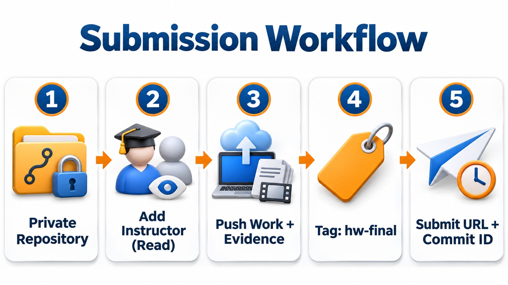
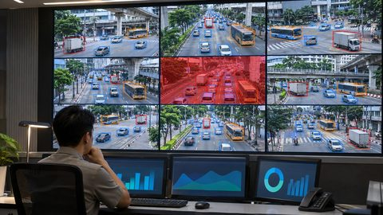
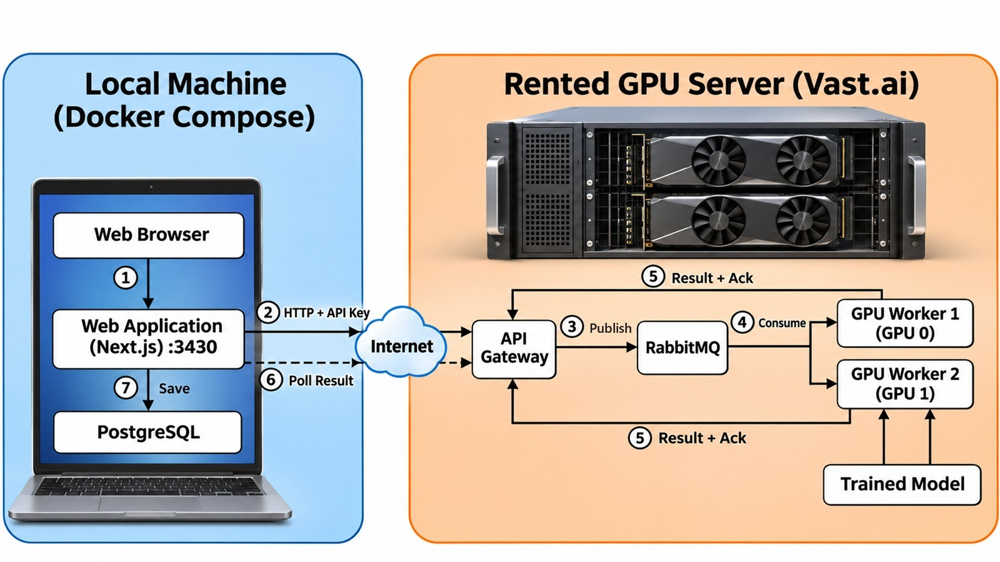
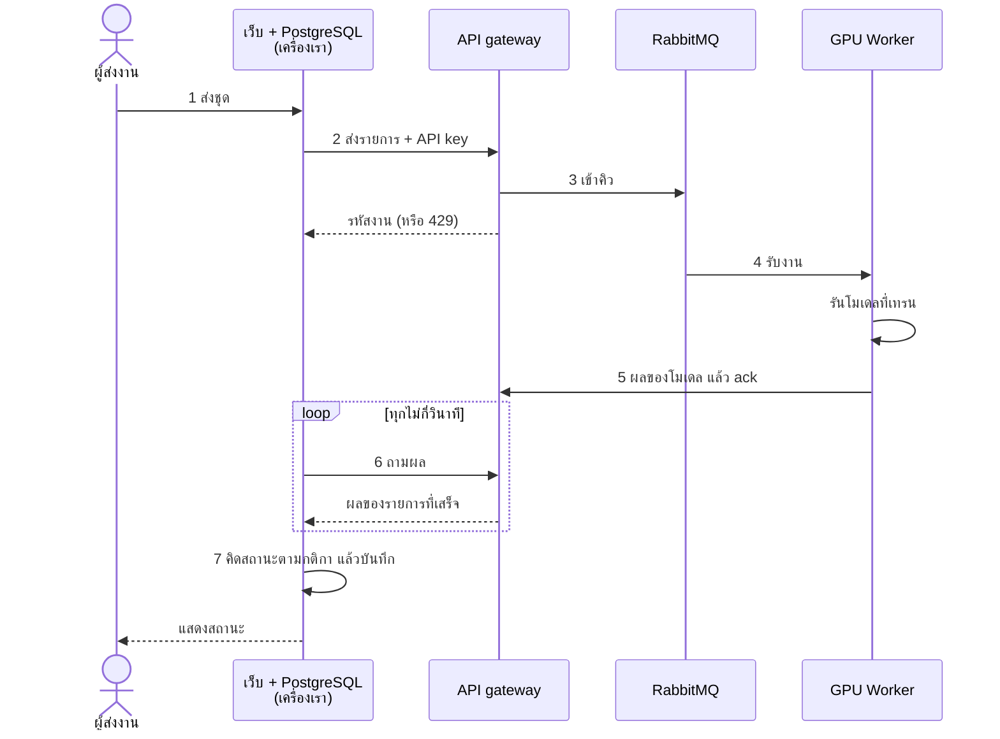
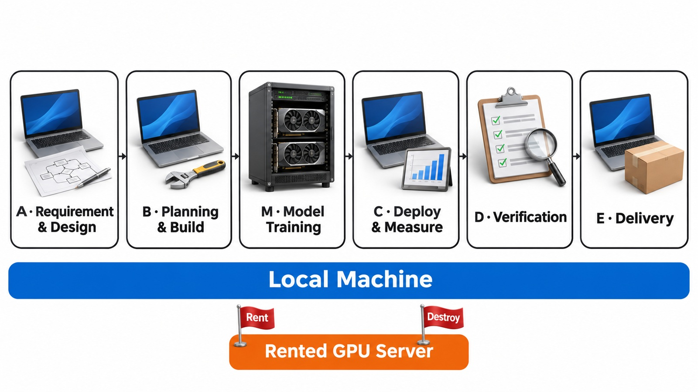

# การบ้าน Week 03 · เทรนโมเดล สร้าง และทดสอบระบบ AI บน GPU ด้วย Agent Team


*ภาพจำลอง*

การบ้านนี้ใช้ความรู้จากบท [02_VastAi_Application](../02_VastAi_Application/README.md) และ [03_Agent_Team_End_to_End](../03_Agent_Team_End_to_End/README.md)

ทุกข้อมีการ **เทรนโมเดล** (Fine-tune จากโมเดลสำเร็จรูป) บน GPU ที่เช่า แล้วนำโมเดลที่เทรนไปใช้ในระบบจริง · งานหลักคือ **เทรนและวัดผลให้ชัด · ออกแบบระบบ · เขียน Test Case**

การบ้านนี้เป็น **งานกลุ่ม** มี 10 โจทย์สำหรับ 10 กลุ่ม กลุ่มละ 1 โจทย์ไม่ซ้ำกัน

## วิธีส่งงาน


*ภาพจำลอง*

1. สร้าง GitHub repository แบบ **Private** ชื่อ `cwn-w03-hw-g<เลขกลุ่ม 2 หลัก>` และเพิ่มสมาชิกทุกคนเป็น Collaborator
2. เชิญบัญชี GitHub ของผู้สอน (ประกาศในชั้นเรียน) เป็น Collaborator สิทธิ์ Read
3. วางงานและหลักฐานทั้งหมดตาม [โครงของ repository ที่ส่ง](#โครงของ-repository-ที่ส่ง) แล้ว push ขึ้น GitHub (หลักฐาน push 4 จุดขณะทำงาน ตามหัวข้อ [หลักฐานที่ต้องเก็บ](#หลักฐานที่ต้องเก็บ))
4. ติด tag ชื่อ `hw-final` ที่ commit ที่ต้องการให้ตรวจ แล้ว push ทั้ง commit และ tag
5. ส่ง **URL ของ repository** และ **รหัส commit ของ tag `hw-final`** ในช่องทางที่ผู้สอนประกาศ ก่อนกำหนดส่ง

ผู้ตรวจตรวจเฉพาะ commit ของ tag `hw-final` · ส่งช้าหัก 10 คะแนนต่อวัน และช้าเกิน 3 วันไม่รับ · ก่อนส่งให้ทำ [ตรวจตัวเองก่อนส่ง](#ตรวจตัวเองก่อนส่ง) ให้ครบ

## โจทย์ที่มีให้เลือก

ทุกโจทย์มีโครงเดียวกัน ต่างกันที่ข้อมูล โมเดล และกติกา

1. ผู้ส่งงานส่งรายการเข้าเว็บเป็นชุด (ภาพหรือข้อความ)
2. โมเดลที่กลุ่มเทรนเองประมวลผลทีละรายการบน GPU ที่เช่า
3. เว็บแปลงผลของโมเดลเป็นสถานะ `OK` · `WARN` · `ALERT` · `INVALID` ตามกติกาของโจทย์
4. ผู้ตรวจทานดูรายการที่ต้องจัดการก่อน และแก้ผลที่โมเดลตอบผิดได้
5. เว็บสรุปเป็นรายงานรายวันของแต่ละหน่วยงาน

ข้อ 1–6 ใช้ Dataset ใหม่ · ข้อ 7–8 ใช้ Dataset เดียวกับ LAB ในบท 02 และ 03 · ข้อ 9–10 ใช้ Dataset จาก Roboflow Universe · ทุกชุดเป็น Dataset สาธารณะที่ดาวน์โหลดได้โดยไม่ต้องขอสิทธิ์ (ข้อ 7 · 9 · 10 ใช้ `ROBOFLOW_API_KEY` ที่สมัครฟรี) · ผู้สอนประกาศว่ากลุ่มไหนทำข้อไหน

<table>
<tr>
<td width="50%" valign="top">
<a href="problems/01_roadcount.md"></a>
<h3><a href="problems/01_roadcount.md">ข้อ 1 · RoadCount</a></h3>
เจ้าหน้าที่จราจรอัปโหลดภาพจากกล้องตามแยก → โมเดลตรวจจับและนับรถยนต์ รถบัส รถบรรทุก → ระบบบอกว่าแยกไหนหนาแน่นหรือมีรถบรรทุกกีดขวาง ให้หัวหน้าเวรจัดการก่อน
<br><br>
<b>สิ่งที่เทรน:</b> Object Detection<br>
<b>Dataset:</b> <a href="https://huggingface.co/datasets/Francesco/vehicles-q0x2v"><code>Francesco/vehicles-q0x2v</code></a>
</td>
<td width="50%" valign="top">
<a href="problems/02_voice_of_customer.md"></a>
<h3><a href="problems/02_voice_of_customer.md">ข้อ 2 · VoiceOfCustomer</a></h3>
ทีมดูแลลูกค้าวางข้อความจากโซเชียลเป็นชุด → โมเดลจำแนกเป็น บวก · กลาง · ลบ · คำถาม พร้อมความมั่นใจ → ข้อความเชิงลบที่โมเดลมั่นใจสูงขึ้นเป็นงานที่ต้องตอบทันที
<br><br>
<b>สิ่งที่เทรน:</b> Text Classification<br>
<b>Dataset:</b> <a href="https://huggingface.co/datasets/pythainlp/wisesight_sentiment"><code>pythainlp/wisesight_sentiment</code></a>
</td>
</tr>
<tr>
<td width="50%" valign="top">
<a href="problems/03_invoiceflow.md"></a>
<h3><a href="problems/03_invoiceflow.md">ข้อ 3 · InvoiceFlow</a></h3>
พนักงานบัญชีอัปโหลดภาพใบแจ้งหนี้ → โมเดลอ่านเลขที่ วันที่ ผู้ขาย และยอดเงินออกมาเป็นข้อมูล → ระบบตรวจว่ายอดก่อนภาษีบวกภาษีเท่ากับยอดรวม และแจ้งใบที่ยอดไม่ลงตัวหรือยอดสูง
<br><br>
<b>สิ่งที่เทรน:</b> Vision-Language Model (LoRA)<br>
<b>Dataset:</b> <a href="https://huggingface.co/datasets/katanaml-org/invoices-donut-data-v1"><code>katanaml-org/invoices-donut-data-v1</code></a>
</td>
<td width="50%" valign="top">
<a href="problems/04_shopsnap.md"></a>
<h3><a href="problems/04_shopsnap.md">ข้อ 4 · ShopSnap</a></h3>
ร้านค้าอัปโหลดรูปสินค้า → โมเดลจำแนกหมวดหมู่ เพศ และสี แล้ว LLM เขียนคำบรรยายขายภาษาไทย → สินค้าที่โมเดลไม่มั่นใจหรือเป็นสินค้าควบคุมถูกส่งให้คนตรวจก่อนลงขาย
<br><br>
<b>สิ่งที่เทรน:</b> Image Classification<br>
<b>Dataset:</b> <a href="https://huggingface.co/datasets/ashraq/fashion-product-images-small"><code>ashraq/fashion-product-images-small</code></a>
</td>
</tr>
<tr>
<td width="50%" valign="top">
<a href="problems/05_photofind.md"></a>
<h3><a href="problems/05_photofind.md">ข้อ 5 · PhotoFind</a></h3>
ช่างภาพอัปโหลดภาพข่าว → ระบบเขียนคำบรรยายและแปลงภาพเป็น Embedding → บรรณาธิการพิมพ์ข้อความเพื่อค้นภาพ และระบบแจ้งภาพที่ซ้ำกับของเดิม
<br><br>
<b>สิ่งที่เทรน:</b> Embedding ภาพ-ข้อความ<br>
<b>Dataset:</b> <a href="https://huggingface.co/datasets/nlphuji/flickr_1k_test_image_text_retrieval"><code>nlphuji/flickr_1k_test_image_text_retrieval</code></a>
</td>
<td width="50%" valign="top">
<a href="problems/06_stormeye.md"></a>
<h3><a href="problems/06_stormeye.md">ข้อ 6 · StormEye</a></h3>
เจ้าหน้าที่อัปโหลดภาพดาวเทียมของอาคารหลังพายุ → โมเดลให้ความน่าจะเป็นที่อาคารเสียหาย → ระบบจัดลำดับอาคารที่ต้องส่งทีมกู้ภัยก่อน และ LLM สรุปสถานการณ์ของแต่ละชุด
<br><br>
<b>สิ่งที่เทรน:</b> Image Classification<br>
<b>Dataset:</b> <a href="https://huggingface.co/datasets/jonathan-roberts1/Satellite-Images-of-Hurricane-Damage"><code>jonathan-roberts1/Satellite-Images-of-Hurricane-Damage</code></a>
</td>
</tr>
<tr>
<td width="50%" valign="top">
<a href="problems/07_sitegate.md"></a>
<h3><a href="problems/07_sitegate.md">ข้อ 7 · SiteGate</a></h3>
หัวหน้ากะอัปโหลดภาพคนงานหน้าประตูไซต์ → โมเดลตรวจจับคนที่ไม่ใส่หมวกนิรภัย หน้ากาก หรือเสื้อสะท้อนแสง → ระบบบอกว่าภาพไหนต้องแก้ไขก่อนเข้าพื้นที่
<br><br>
<b>สิ่งที่เทรน:</b> Object Detection<br>
<b>Dataset:</b> <a href="https://universe.roboflow.com/roboflow-universe-projects/construction-site-safety"><code>construction-site-safety</code></a> รุ่น 28 (Roboflow)
</td>
<td width="50%" valign="top">
<a href="problems/08_receiptrush.md"></a>
<h3><a href="problems/08_receiptrush.md">ข้อ 8 · ReceiptRush</a></h3>
เลขานุการอัปโหลดภาพใบเสร็จ → โมเดลอ่านรายการและยอดรวมออกมาเป็นข้อมูล → ระบบตรวจว่ายอดรวมตรงกับรายการและไม่เกินวงเงิน ก่อนส่งเบิก
<br><br>
<b>สิ่งที่เทรน:</b> Vision-Language Model (LoRA)<br>
<b>Dataset:</b> <a href="https://huggingface.co/datasets/naver-clova-ix/cord-v2"><code>naver-clova-ix/cord-v2</code></a>
</td>
</tr>
<tr>
<td width="50%" valign="top">
<a href="problems/09_bloodcount.md"></a>
<h3><a href="problems/09_bloodcount.md">ข้อ 9 · BloodCount</a></h3>
นักเทคนิคการแพทย์อัปโหลดภาพสเมียร์เลือด → โมเดลตรวจจับและนับเม็ดเลือดแดง เม็ดเลือดขาว และเกล็ดเลือด → ระบบคัดภาพที่จำนวนผิดปกติให้ผู้เชี่ยวชาญดูซ้ำ
<br><br>
<b>สิ่งที่เทรน:</b> Object Detection<br>
<b>Dataset:</b> <a href="https://universe.roboflow.com/roboflow-100/bccd-ouzjz/dataset/2"><code>bccd-ouzjz</code></a> รุ่น 2 (Roboflow)
</td>
<td width="50%" valign="top">
<a href="problems/10_coolercheck.md"></a>
<h3><a href="problems/10_coolercheck.md">ข้อ 10 · CoolerCheck</a></h3>
พนักงานขายอัปโหลดภาพจากกล้องในตู้แช่ → โมเดลตรวจจับและนับขวด 3 ยี่ห้อ → ระบบบอกว่าตู้ไหนของใกล้หมดหรือยี่ห้อไหนหมด เพื่อจัดรอบเติมสินค้า
<br><br>
<b>สิ่งที่เทรน:</b> Object Detection<br>
<b>Dataset:</b> <a href="https://universe.roboflow.com/roboflow-100/soda-bottles/dataset/4"><code>soda-bottles</code></a> รุ่น 4 (Roboflow)
</td>
</tr>
</table>

ภาพในตารางเป็นภาพจำลอง · กดที่ภาพหรือชื่อข้อเพื่อเปิดโจทย์ · กดที่ชื่อ Dataset เพื่อเปิดหน้าของ Dataset

แต่ละข้อ **คะแนนเต็ม 100** · ไม่จำกัดงบเช่า GPU แต่ต้องรายงานค่าใช้จ่ายจริง

## ระบบที่ต้องสร้าง (เหมือนกันทุกข้อ)

ระบบมี 2 ฝั่งที่อยู่คนละเครื่องและเชื่อมกันผ่านอินเทอร์เน็ต: **เครื่องเรา** (เว็บและฐานข้อมูล) กับ **เครื่อง GPU ที่เช่า** (คิวงานและโมเดล)


*ภาพจำลอง · หมายเลขในภาพตรงกับตารางการเชื่อมต่อด้านล่าง*

### ส่วนประกอบ

| ส่วน | อยู่ที่ | หน้าที่ |
|---|---|---|
| เว็บ (Next.js) | เครื่องเรา พอร์ต 3430 | หน้าจอทั้งหมด · ตรวจสิทธิ์และขนาดชุด · **แปลงผลของโมเดลเป็นสถานะ** ตามกติกา · รายงานรายวัน |
| PostgreSQL | เครื่องเรา | เก็บบัญชีผู้ใช้ รายการ ผลของโมเดล สถานะ และประวัติการแก้ผล |
| API gateway | เครื่อง GPU | ประตูเดียวที่เปิดออกอินเทอร์เน็ต · ตรวจ API key · รับงานเข้าคิว · ปฏิเสธเมื่อคิวเต็ม · เก็บผลไว้ให้เว็บมารับ |
| RabbitMQ | เครื่อง GPU | คิวงาน: คิวงานด่วน คิวงานปกติ และ Dead-letter Queue |
| GPU Worker 2 ตัว | เครื่อง GPU ตัวละ 1 GPU | รับงานจากคิวทีละงาน · รันโมเดล · ส่งผล แล้วจึงยืนยันงาน (ack) |
| โมเดลที่เทรน | Hugging Face Hub | Worker ดาวน์โหลด weights ที่กลุ่มเทรนเองมาโหลดตอนเริ่มทำงาน |

### การเชื่อมต่อ: เส้นทางของงาน 1 ชุด

| ลำดับ | จาก → ถึง | เชื่อมด้วย | ส่งอะไร |
|---|---|---|---|
| 1 | เบราว์เซอร์ → เว็บ | HTTP ที่ `127.0.0.1:3430` | ไฟล์หรือข้อความของชุด และเครื่องหมาย "ด่วน" |
| 2 | เว็บ → API gateway | HTTP ไปยัง IP และพอร์ตสาธารณะของเครื่องที่เช่า พร้อม API key ใน header | รายการของชุด · ได้รหัสงานกลับมา หรือรหัส 429 เมื่อคิวเต็ม |
| 3 | API gateway → RabbitMQ | AMQP ภายในเครื่อง GPU | ข้อความ 1 ข้อความต่อ 1 รายการ แยกคิวงานด่วนกับคิวงานปกติ |
| 4 | RabbitMQ → GPU Worker | AMQP ภายในเครื่อง GPU | งานทีละ 1 งานต่อ Worker |
| 5 | GPU Worker → API gateway | ภายในเครื่อง GPU | ผลของโมเดล (เช่น จำนวนรถ) จากนั้น Worker จึง ack |
| 6 | เว็บ → API gateway | HTTP เส้นเดิม เว็บถามผลเป็นระยะ (polling) | ผลของรายการที่เสร็จแล้ว |
| 7 | เว็บ → PostgreSQL | เครือข่ายภายในของ `docker compose` | ผลของโมเดล และสถานะที่เว็บคิดได้ |

สิ่งที่ต้องเข้าใจก่อนออกแบบ

- **เครื่อง GPU เรียกกลับมาหาเครื่องเราไม่ได้** เพราะเครื่องเราไม่มี IP สาธารณะ · เว็บจึงเป็นฝ่ายเรียก API gateway เสมอ ทั้งตอนส่งงาน (ลำดับ 2) และตอนถามผล (ลำดับ 6)
- **เครื่อง GPU เปิดออกอินเทอร์เน็ตพอร์ตเดียว** คือ API gateway · RabbitMQ และ Worker คุยกันภายในเครื่องเท่านั้น
- **กติกาคิดที่เว็บ** · Worker ส่งกลับเฉพาะผลของโมเดล เว็บเป็นผู้แปลงเป็นสถานะ · โค้ดกติกาจึงเป็นชุดเดียวกันทั้งโหมดจำลองและโหมด GPU
- **ที่อยู่ของเครื่อง GPU เปลี่ยนทุกครั้งที่เช่า** · เว็บอ่านจากไฟล์ `.env`: `GATEWAY_URL` และ `GATEWAY_API_KEY`



### ระบบมี 2 โหมด

ระบบเดียวกันต้องรันได้ 2 แบบ โดยเปลี่ยนเฉพาะค่าในไฟล์ `.env`

| ส่วน | โหมดจำลอง (`AI_MODE=mock`) | โหมด GPU (`AI_MODE=gpu`) |
|---|---|---|
| เว็บ + PostgreSQL | เครื่องเรา | เครื่องเรา |
| API gateway + RabbitMQ | container บนเครื่องเรา | เครื่องที่เช่า |
| Worker 2 ตัว | Worker จำลอง ตอบจากชื่อไฟล์หรือข้อความนำหน้า | Worker จริง รันโมเดลบน GPU |
| ใช้เมื่อ | พัฒนา · ทดสอบในระยะ D · ผู้ตรวจให้คะแนนหมวด V | ระยะ C และการอัดฉากโหมด GPU |
| ค่าใช้จ่าย | ไม่มี | ค่าเช่า GPU |

### ลำดับของงานทั้งการบ้าน


*ภาพจำลอง · เช่าเครื่องเมื่อเริ่มระยะ M และลบเครื่องเมื่อจบระยะ C · ระยะอื่นทำบนเครื่องเราด้วยโหมดจำลอง*

### ข้อกำหนด

| ส่วน | ข้อกำหนด |
|---|---|
| เว็บ | Next.js + PostgreSQL รันด้วย `docker compose` บนเครื่องเรา · พอร์ต **3430** |
| เครื่อง GPU | 1 เครื่อง มี GPU รุ่นเดียวกัน **2 ใบ** · ไม่จำกัดรุ่น ขนาด VRAM และราคา (เลือกให้พอกับโมเดลของโจทย์ เช่น ใบละ 24–32 GB) · ป้าย `hw-g<เลขกลุ่ม 2 หลัก>` เช่น `hw-g03` |
| บนเครื่อง GPU | API gateway (ต้องใช้ API key) + RabbitMQ + **GPU Worker 2 ตัว** ตัวละ 1 GPU |
| โมเดล | โมเดลตั้งต้นเป็นโมเดลสำเร็จรูป (pretrained) เลือกเองได้ · **ต้อง Fine-tune ด้วยชุดเทรนของโจทย์** บนเครื่องที่เช่า (ระยะ M) · ระบบต้องใช้โมเดลที่เทรนเองนี้ · ห้ามใช้รายการของชุดวัดผลในการเทรน |
| วิธีสร้าง | ทีม AI เขียนโค้ดทั้งหมด (รวมสคริปต์เทรน) ด้วยสกิล `dag-planner` และ `agent-team` · 10–12 บล็อก · ใช้อย่างน้อย 4 สกิล · มีบล็อก `review` อย่างน้อย 1 บล็อก |

## คำที่ใช้ทั้งการบ้าน

| คำ | ความหมาย |
|---|---|
| รายการ (item) | สิ่งที่ผู้ใช้ส่งเข้าระบบ 1 ชิ้น: ภาพ 1 ไฟล์ หรือข้อความ 1 ข้อความ ตามโจทย์ |
| ชุด (batch) | รายการที่ส่งพร้อมกันในการกดส่ง 1 ครั้ง |
| หน่วยงาน (unit) | กลุ่มของผู้ส่งงาน มี 2 หน่วย: `U1` และ `U2` |
| สถานะ | ผลของรายการ มี 7 ค่าตามตารางด้านล่าง |

| สถานะ | ความหมาย |
|---|---|
| `QUEUED` · `PROCESSING` | รออยู่ในคิว · กำลังประมวลผล |
| `OK` | ปกติ ไม่ต้องทำอะไร |
| `WARN` | ต้องมีคนดู |
| `ALERT` | ต้องจัดการทันที |
| `INVALID` | ข้อมูลใช้ไม่ได้ ระบบตัดสินไม่ได้ |
| `ERROR` | ประมวลผลไม่สำเร็จหลังลองครบ 3 ครั้ง |

## กติกากลาง (ใช้ทุกข้อ)

แต่ละโจทย์มีกติกาเฉพาะเพิ่มอีก 4 ข้อ (R1–R4) ที่บอกว่าผลจากโมเดลแบบไหนได้สถานะอะไร

| รหัส | เรื่อง | กติกา |
|---|---|---|
| G1 | ขนาดชุด | ชุดละ 1–30 รายการ · 31 รายการถูกปฏิเสธทั้งชุด |
| G2 | ขนาดรายการ | ภาพ: JPG หรือ PNG ไม่เกิน 5 MB (5 × 1024 × 1024 ไบต์พอดีรับได้) · ข้อความ: 1–500 ตัวอักษร (บรรทัดว่างคือ 0 ตัวอักษร) · มีรายการใดผิดขนาดหรือผิดชนิด ถูกปฏิเสธทั้งชุด |
| G3 | งานด่วน | ผู้ส่งงานติ๊ก "ด่วน" ได้ทั้งชุด · ชุดด่วนมีได้ไม่เกิน 5 รายการ |
| G4 | ลำดับคิว | งานด่วนถูกประมวลผลก่อนงานปกติ · หลังงานด่วนติดกัน 3 งาน ต้องทำงานปกติ 1 งาน ถ้ามีงานปกติรออยู่ · นับลำดับจากเวลาที่เริ่มประมวลผล รวม Worker ทุกตัว |
| G5 | ลองใหม่ | รายการที่ประมวลผลไม่สำเร็จถูกลองรวม 3 ครั้ง แล้วย้ายเข้า Dead-letter Queue สถานะเป็น `ERROR` · ผู้ส่งงานส่งรายการนั้นใหม่ได้ |
| G6 | งานห้ามหาย | Worker ยืนยันงาน (ack) หลังบันทึกผลแล้วเท่านั้น · Worker หยุดกลางงาน ทุกรายการต้องได้ผลครบ ไม่ขาด ไม่ซ้ำ |
| G7 | คิวเต็ม | งานค้างในคิวตั้งแต่ 200 รายการ ชุดใหม่ถูกปฏิเสธด้วยรหัส 429 พร้อมบอกเวลาที่ให้ลองใหม่ (Retry-After) |
| G8 | ลำดับสถานะ | รายการที่เข้าหลายเงื่อนไข ใช้สถานะที่สำคัญที่สุด: `INVALID` > `ALERT` > `WARN` > `OK` |
| G9 | การแก้ผล | ผู้ตรวจทานเท่านั้น · เหตุผลยาว ≥ 10 ตัวอักษร · เก็บสถานะเดิม ผู้แก้ และเวลา |
| G10 | อัตราปกติรายวัน | `OK ÷ (OK + WARN + ALERT) × 100` ทศนิยม 1 ตำแหน่ง · ใช้สถานะหลังการแก้ผล · ไม่นับ `INVALID` และ `ERROR` · ตัวหารเป็น 0 แสดง `NA` · วันของรายการคือวันที่ส่ง ตามเวลาประเทศไทย (Asia/Bangkok) |
| G11 | สีแดงในรายงาน | อัตราปกติ **ต่ำกว่า** เกณฑ์ของโจทย์ → แดง · เท่ากับเกณฑ์ไม่แดง |
| G12 | สิทธิ์ | ผู้ส่งงาน: ส่งและดูผลของหน่วยงานตัวเอง · ผู้ตรวจทาน: ดูทุกหน่วยงาน แก้ผล ดูรายงาน · ผู้ดูแลระบบ: ดูสถานะคิวอย่างเดียว |

ค่าขอบที่เป็นทศนิยมหรือร้อยละ ให้เทียบด้วยจำนวนเต็ม (เช่น 0.80 เทียบเป็น 80) เพื่อไม่ให้ผลผิดจากความคลาดเคลื่อนของเลขทศนิยม
จำนวนตัวอักษรนับเป็น Unicode code point หลังตัดช่องว่างหัวท้าย (สระและวรรณยุกต์ไทยนับเป็น 1 ตัวอักษรต่อ 1 ตัว)

## งานที่ต้องทำ

งานทั้งหมดอยู่ใต้โฟลเดอร์ `hw/` ของ repository ที่ส่ง · พรอมต์ทุกขั้นที่ใช้จริงเก็บใน `hw/PROMPTS.md` · คำตอบของ AI แต่ละขั้นเก็บใน `hw/results/answers/`
รหัสของขั้น (A1 · B2 · C3 …) ตรงกับรหัสหัวข้อใน [เกณฑ์คะแนน](#เกณฑ์คะแนน-100-คะแนนต่อข้อ) · กติกากลางใช้รหัส G · กติกาเฉพาะของโจทย์ใช้รหัส R

### ระยะ A · Requirement และ Design

| ขั้น | ทำอะไร | ไฟล์ที่ส่ง |
|---|---|---|
| A1 | เขียน User Story ≥ 15 เรื่องจากเรื่องราวในโจทย์ พร้อมลำดับความสำคัญ (Must / Should / Could) | `docs/USER-STORIES.md` |
| A2 | เขียน Requirement: FR · BR (G1–G12 และ R1–R4) · NFR ≥ 6 ข้อ · ตาราง User Story → Requirement · กติกาที่มีตัวเลขทุกข้อต้องมี **ค่าขอบ 3 จุด** (ต่ำกว่า · เท่ากับ · สูงกว่า) | `docs/REQUIREMENTS.md` |
| A3 | commit งาน A1–A2 แล้วจึงทำ **คำขอเปลี่ยนแปลง CR-01** ในโจทย์: วิเคราะห์ว่ากระทบ User Story · Requirement · หน้าจอ ข้อไหน แล้วแก้ A1–A2 | `docs/CHANGE-IMPACT.md` |
| A4 | ออกแบบระบบ: แผนภาพ Mermaid 4 ภาพ (Architecture · ER · Sequence · State) · API contract · การออกแบบคิว (G4–G7) · [ข้อกำหนดเพื่อการตรวจ](#ข้อกำหนดเพื่อการตรวจ) · โหมด `BUG_MODE=1` ที่ทำให้กติกาผิด 3 ข้อ · ข้อมูลทดสอบ | `docs/DESIGN.md` · `docs/TEST-DATA.md` · `docs/BUGS-SECRET.md` |

### ระยะ B · Planning

| ขั้น | ทำอะไร | ไฟล์ที่ส่ง |
|---|---|---|
| B1 | แตกงานเป็น 10–12 บล็อก ใช้อย่างน้อย 4 สกิล มีบล็อก `review` อย่างน้อย 1 บล็อก | `plan/blocks.json` |
| B2 | วาง DAG และ Gantt · บอกบล็อกที่เสี่ยงที่สุดพร้อมเหตุผล | `plan/PLAN.md` · `plan/dag.png` · `plan/gantt-plan.png` |
| B3 | อนุมัติแล้วให้ทีมรันจริง · รันต่อเฉพาะบล็อกที่ไม่เสร็จ · ทำรายงานแผนเทียบของจริง (เวลา · จำนวนรอบ · token ต่อบล็อก) | `plan/REPORT.md` · `plan/gantt-actual.png` · `app/` |

### ระยะ M · Model Training

เทรนบนเครื่องที่เช่า ก่อนเปิด Worker · เวลาเทรนรวมไม่เกิน **60 นาที** · ชุดเทรน ชุดวัดผล โมเดลตั้งต้น และ Baseline ของแต่ละโจทย์อยู่ในไฟล์โจทย์ · ไฟล์ทั้งหมดอยู่ใน `results/train/`

| ขั้น | ทำอะไร | ไฟล์ที่ส่ง |
|---|---|---|
| M1 | เตรียมข้อมูล: เช่าเครื่อง · ดาวน์โหลด · สรุปจำนวนและการกระจายของแต่ละประเภท · แบ่ง Validation ของตัวเองจากชุดเทรนเพื่อเลือก checkpoint · พิสูจน์ว่า **ไม่มีรายการของชุดวัดผลอยู่ในชุดเทรน** ด้วย sha256 | `DATA-CARD.md` · `split.json` |
| M2 | เทรน: บันทึกค่าที่ตั้ง · ค่า loss และตัวชี้วัดของ Validation ทุก epoch พร้อมเวลา · วาดกราฟ · อัปโหลด weights ขึ้น Hugging Face Hub แล้วบันทึก sha256 | `train-config.json` · `train-log.csv` · `curves.png` · `model-card.json` |
| M3 | เทียบก่อนและหลังเทรน: วัด Baseline ของโจทย์ด้วยชุดวัดผลเดียวกับขั้น C2 แล้วเทียบตัวชี้วัดทุกตัวกับโมเดลที่เทรน | `baseline-predictions.jsonl` · `compare.json` |
| M4 | วิเคราะห์ความผิดพลาด: เลือก 10 รายการที่โมเดลที่เทรนแล้วยังตอบผิด จัดกลุ่มตามสาเหตุ แล้วเสนอสิ่งที่ควรทำต่อ · บอกว่าพบ Overfitting หรือไม่ โดยอ้างกราฟ | `COMPARE.md` |

โมเดลที่เทรนแล้วไม่จำเป็นต้องดีกว่า Baseline คะแนนให้กับการวัดที่ถูกและการอธิบายตามจริง

### ระยะ C · Deploy และวัดผลบน GPU จริง

ผู้ตรวจไม่เช่า GPU · ทุกขั้นของระยะนี้ต้องเก็บหลักฐานตามหัวข้อ [หลักฐานที่ต้องเก็บ](#หลักฐานที่ต้องเก็บ) ขณะเครื่องยังเปิดอยู่

| ขั้น | ทำอะไร | ไฟล์ที่ส่ง |
|---|---|---|
| C1 | เปิด gateway + RabbitMQ + Worker 2 ตัว ต่อกับเว็บ · ส่งรายการจริง 5 รายการ แล้วตรวจว่าผลในฐานข้อมูลตรงกับผลจาก gateway | `results/deploy/E2E.md` |
| C2 | **วัดคุณภาพ AI:** ส่งชุดวัดผลของโจทย์ผ่านระบบที่ใช้โมเดลจากระยะ M เก็บคำตอบทุกรายการ แล้วคิดตัวชี้วัดตามสูตรในโจทย์ | `results/quality/predictions.jsonl` · `results/quality/quality.json` |
| C3–C6 | **ทดสอบระบบ 4 เรื่อง** (T1 = C3 · T2 = C4 · T3 = C5 · T4 = C6) ด้วยสคริปต์ใน `test/system/` · รันในโหมดจำลองบนเครื่องเราก่อน แล้วรันสคริปต์ชุดเดียวกันกับเครื่อง GPU · สรุปลง `summary.json` | `test/system/` · `results/system/summary.json` · `results/system/raw/` · `results/system/mock/summary.json` |

การทดสอบของขั้น C3–C6

| รหัส | การทดสอบ | เกณฑ์ผ่าน |
|---|---|---|
| T1 งานด่วน | ส่งงานปกติ 100 รายการ แล้วส่งงานด่วน 10 รายการตามเข้าไปขณะคิวยังค้าง | งานด่วน p95 ≤ 60 วินาที · งานปกติเสร็จครบใน 10 นาที · งานด่วนไม่ถูกทำติดกันเกิน 3 งานขณะมีงานปกติรอ |
| T2 Worker หยุด | ส่ง 60 รายการ แล้วหยุด Worker 1 ตัวกลางงาน จากนั้นเปิดกลับ | เสร็จ 60 · หาย 0 · ซ้ำ 0 |
| T3 Dead-letter | ส่งรายการเสีย 2 รายการปนกับรายการดี 8 รายการ | รายการเสียถูกลอง 3 ครั้งแล้วเข้า Dead-letter Queue · รายการดีเสร็จครบ 8 |
| T4 คิวเต็ม | ส่งต่อเนื่อง 400 รายการให้เร็วที่สุด | มีชุดที่ถูกปฏิเสธด้วย 429 พร้อม Retry-After · รายการที่ระบบรับไว้เสร็จครบทุกรายการ |

### ระยะ D · Verification

| ขั้น | ทำอะไร | ไฟล์ที่ส่ง |
|---|---|---|
| D1 | เขียน Test Charter ≥ 4 ใบ แล้วสำรวจเว็บด้วย `playwright-cli` | `test/CHARTERS.md` · `test/EXPLORATION.md` |
| D2 | เขียน Test Plan ≥ 35 Test Case (รหัส `TC-…`) · ทุก FR และ BR มี Test Case · มีตารางค่าขอบของกติกาที่มีตัวเลขทุกข้อ · มี Exit Criteria ที่วัดได้ | `test/TEST-PLAN.md` |
| D3 | ให้ CLI อีกค่ายตรวจไขว้ Test Plan แล้วแก้ข้อที่รุนแรงสูง | `test/PLAN-REVIEW.md` |
| D4 | **รอบที่ 1:** เขียนและรัน Playwright Test · แยกผลที่ไม่ผ่านเป็น เว็บผิด / แผนผิด / สคริปต์ผิด · ทำรายการข้อบกพร่อง | `test/e2e/` · `test/evidence/` · `test/TEST-REPORT-R1.md` · `test/DEFECTS.md` |
| D5 | **รอบที่ 2:** ส่งข้อบกพร่องให้ทีม AI แก้ (ห้ามแก้ผลที่คาดหวังให้ตรงกับเว็บ) แล้วรันทุก Test Case ซ้ำ · ทำตารางเทียบ 2 รอบรายข้อ และระบุ Test Case ที่เคยผ่านแล้วกลับไม่ผ่าน | `test/TEST-REPORT-R2.md` |
| D6 | รันชุดทดสอบกับเว็บที่เปิด `BUG_MODE=1` โดยยังไม่เปิดดู `BUGS-SECRET.md` แล้วสรุปว่าจับได้กี่ข้อจาก 3 | `test/BUG-HUNT.md` |

### ปิดงาน

| ขั้น | ทำอะไร | ไฟล์ที่ส่ง |
|---|---|---|
| E1 | ลบเครื่อง ตรวจว่าไม่มีเครื่องป้าย `hw-…` เหลือ หยุดเว็บ ทำตารางค่าใช้จ่ายจากใบแจ้งหนี้ (GPU · disk · รับส่งข้อมูล · รวม) | `results/cost.md` |
| E2 | เขียนรายงานส่งมอบ: สรุปผู้บริหาร · ตาราง User Story → Requirement → Test Case → ผลรอบที่ 2 · ผลคุณภาพ AI · ผล T1–T4 · สิ่งที่ยังไม่ผ่าน · **ข้อสรุปว่าส่งมอบได้หรือไม่** ตาม Exit Criteria | `DELIVERY.md` |
| E3 | **ตรวจหลักฐานด้วยตัวเอง:** ตรวจ EV1–EV12 ทีละข้อ เติมผลลงตาราง แล้วสร้างรายการ sha256 ของไฟล์หลักฐานทุกไฟล์ | `evidence/EVIDENCE.md` · `evidence/MANIFEST.sha256` |

## หลักฐานที่ต้องเก็บ

ผู้ตรวจ **ไม่เช่า GPU** งานบน GPU จึงถูกตรวจจากหลักฐานใน repository เท่านั้น · หลักฐานทุกไฟล์ push ขึ้น GitHub พร้อมงาน
หลักการ: เก็บ **ข้อมูลดิบ** ที่ผู้ตรวจคำนวณซ้ำได้ · นักศึกษาตรวจตัวเองก่อน แล้วชี้ให้ผู้ตรวจดูว่าหลักฐานของแต่ละข้ออยู่ไฟล์ไหน

| ชั้น | ยืนยันว่า | เก็บที่ |
|---|---|---|
| 1 · เครื่อง | เช่าเครื่อง GPU 2 ใบจริง ใช้งานจริง และลบแล้ว | `evidence/machine/` |
| 2 · คำตอบ | โมเดลถูกเทรนจริง และคำตอบของชุดวัดผลมาจากโมเดลนั้นบน Worker 2 ตัว | `results/train/` · `results/quality/` |
| 3 · คิว | การทดสอบ T1–T4 เกิดขึ้นจริง และตัวเลขสรุปถูก | `results/system/raw/` |
| 4 · เว็บ | เว็บทำงานจริงทั้งโหมดจำลองและโหมด GPU | `evidence/playlist/` · `evidence/gif/` |
| 5 · เส้นเวลา | ทำตามลำดับจริงขณะเครื่องเปิดอยู่ | การ push 4 จุด |

### ชั้น 1 · เครื่อง (`evidence/machine/`)

| ไฟล์ | เนื้อหา | เก็บเมื่อ |
|---|---|---|
| `instance-start.json` · `instance-mid.json` · `instance-end.json` | ข้อมูลดิบของเครื่องจาก Vast.ai (รหัสเครื่อง · ป้าย `hw-…` · รุ่นและจำนวน GPU · ราคาต่อชั่วโมง · เวลาเริ่ม) | หลังเช่า (ก่อนเทรน) · ระหว่างขั้น C2 · ก่อนลบ |
| `nvidia-smi.csv` | บันทึกทุก 30 วินาทีตลอดขั้น M2 และ C2 ถึง C6: เวลา · รหัส GPU (UUID) · ร้อยละการใช้งาน · หน่วยความจำที่ใช้ | ตลอดการวัด |
| `invoice.json` · `invoice.png` | ใบแจ้งหนี้ของเครื่องนี้ แบบข้อมูลดิบและภาพหน้าจอ | หลังลบเครื่อง |
| `instances-running.png` · `instances-empty.png` | หน้า Instances ขณะเครื่องเปิด และหลังลบ | ขั้น C1 · ขั้น E1 |
| `destroy.txt` | ผลของคำสั่งลบเครื่อง และผลตรวจว่าไม่มีเครื่องป้าย `hw-…` เหลือ | ขั้น E1 |

ก่อน commit ให้ลบค่าของ key ที่เป็นความลับออกจากไฟล์ JSON (เช่น `extra_env` · `jupyter_token` · `onstart`) และเบลออีเมล ยอดเครดิต และข้อมูลการชำระเงินในภาพ

### ชั้น 2 · คำตอบ (`results/train/` และ `results/quality/`)

- ไฟล์ของระยะ M ทั้งหมด: `split.json` มี sha256 ของทุกรายการในชุดเทรน · `train-log.csv` มีเวลาของทุก epoch · `model-card.json` มีที่อยู่และ sha256 ของ weights
- `predictions.jsonl` มี field เพิ่มตาม [รูปแบบของไฟล์ผล](#รูปแบบของไฟล์ผล): คำตอบดิบของโมเดล · Worker · รหัส GPU · เวลาเริ่มและจบ · sha256 ของข้อมูลเข้า
- `repro/` มีสคริปต์ `run_one.py` ที่รับข้อมูลเข้า 1 รายการแล้วพิมพ์คำตอบดิบ โดยใช้ weights ที่เทรนจาก Hugging Face Hub · คำสั่ง (prompt) · การเตรียมข้อมูล ชุดเดียวกับ Worker และรันได้ทั้งบน CPU และ GPU · มี `README.md` บอกวิธีรัน
- ตั้งค่าโมเดลให้ตอบแบบคงที่ (temperature 0 หรือ confidence threshold ค่าเดียว) เพื่อให้รันซ้ำแล้วได้คำตอบเดิม
- ผู้ตรวจสุ่มรายการจากชุดวัดผลไปรันซ้ำด้วย `run_one.py` แล้วเทียบกับ `predictions.jsonl`

### ชั้น 3 · คิว (`results/system/raw/`)

- `events.jsonl` — 1 บรรทัดต่อ 1 เหตุการณ์ของทุกรายการในการทดสอบ T1–T4 ตาม [รูปแบบของไฟล์ผล](#รูปแบบของไฟล์ผล)
- `queue-snapshots.jsonl` — จำนวนงานค้างในคิวหลัก และใน Dead-letter Queue ทุก 5 วินาทีระหว่างการทดสอบ
- ทุกค่าใน `summary.json` ต้องคำนวณได้จาก 2 ไฟล์นี้
- สคริปต์ใน `test/system/` ต้องรันได้ทั้งกับเว็บโหมดจำลองบนเครื่องเรา และกับเครื่อง GPU · ผลของโหมดจำลองเก็บที่ `results/system/mock/summary.json` · ผู้ตรวจรันสคริปต์ชุดนี้ซ้ำในโหมดจำลอง

### ชั้น 4 · เว็บ (`evidence/playlist/` และ `evidence/gif/`)

เขียน Playwright Playlist 1 ชุดที่เล่น 8 ฉากตามลำดับและอัดวิดีโอ แล้วแปลงแต่ละฉากเป็นไฟล์ GIF

| ฉาก | โหมด | สิ่งที่ต้องเห็นในภาพ | ไฟล์ |
|---|---|---|---|
| S1 | จำลอง | ล็อกอินครบ 4 บทบาท · รหัสผิดเข้าไม่ได้ | `S1-login.gif` |
| S2 | จำลอง | ส่งชุดที่มีค่าขอบของ R1–R4 แล้วได้สถานะตามกติกา | `S2-rules.gif` |
| S3 | จำลอง | ชุดที่ถูกปฏิเสธ: 31 รายการ · ด่วน 6 รายการ · รายการเกินขนาด | `S3-reject.gif` |
| S4 | จำลอง | แก้ผล → รายงานรายวันเปลี่ยน → ดาวน์โหลด CSV | `S4-override-report.gif` |
| S5 | GPU | ส่งรายการจริง 5 รายการของขั้น C1 จนได้ผลจากโมเดล | `S5-real-e2e.gif` |
| S6 | GPU | หน้า `/queue` ระหว่าง T1: งานด่วนถูกทำก่อนขณะงานปกติค้าง | `S6-t1-urgent.gif` |
| S7 | GPU | หน้า `/queue` ระหว่าง T2: Worker หยุด 1 ตัว แล้วกลับมา งานเสร็จครบ | `S7-t2-worker.gif` |
| S8 | GPU | หน้า `/queue` ระหว่าง T4: งานค้างถึง 200 แล้วชุดใหม่ถูกปฏิเสธ | `S8-t4-full.gif` |

- ทุกฉากต้องเห็น **ป้ายกำกับ** ท้ายหน้าเว็บ (`build-stamp`) ที่บอกป้าย `hw-…` · โหมด · รหัส commit · เวลา
- ฉากโหมดจำลองติดป้าย `@mock` ฉากโหมด GPU ติดป้าย `@gpu` · ผู้ตรวจรันฉาก `@mock` ซ้ำบนเครื่องตัวเอง ทุกฉากต้องผ่าน
- GIF กว้าง 960 พิกเซล · ฉากละไม่เกิน 60 วินาที และไม่เกิน 8 MB · หยุดค้างที่ผลสำคัญ 3 วินาที · โฟลเดอร์ `evidence/` รวมไม่เกิน 80 MB

### ชั้น 5 · เส้นเวลา

push หลักฐานขึ้น GitHub **4 จุด** ขณะทำงาน โดยขึ้นต้นข้อความ commit ด้วย `evidence:` · ผู้ตรวจใช้เวลา push ที่ GitHub บันทึกไว้ (หน้า Activity ของ repository) เทียบกับช่วงเวลาที่เครื่องเปิด

| จุด | push เมื่อ | ต้องมีไฟล์ |
|---|---|---|
| P1 | เทรนเสร็จและต่อเว็บสำเร็จ (จบขั้น C1) | `instance-start.json` · `instances-running.png` · `train-log.csv` · `model-card.json` · `E2E.md` |
| P2 | วัดคุณภาพ AI เสร็จ (จบขั้น C2) | `predictions.jsonl` · `quality.json` · `instance-mid.json` |
| P3 | ทดสอบ T1–T4 เสร็จ (จบขั้น C6) | `events.jsonl` · `summary.json` · `nvidia-smi.csv` · `instance-end.json` |
| P4 | ลบเครื่องแล้ว (จบขั้น E1) | `destroy.txt` · `instances-empty.png` · `invoice.json` |

### ตารางตรวจตัวเอง (`evidence/EVIDENCE.md`)

เติมตารางนี้ครบ 12 แถว: รหัส · ไฟล์หลักฐาน · ค่าที่พบ · ผ่านหรือไม่ผ่าน · ผู้ตรวจตรวจซ้ำตามตารางเดียวกัน ข้อที่ไม่ผ่านให้เขียนตามจริงพร้อมสาเหตุ

| รหัส | สิ่งที่ตรวจ | ตรวจจาก |
|---|---|---|
| EV1 | เครื่องมี GPU รุ่นเดียวกัน 2 ใบ · ป้าย `hw-…` ถูก | `instance-start.json` |
| EV2 | บันทึก GPU ครอบคลุมช่วงเวลาของขั้น M2 และ C2 ถึง C6 และ GPU ทั้ง 2 ใบมีการใช้งานมากกว่า 0 | `nvidia-smi.csv` |
| EV3 | เวลาเริ่มและจบของทุกคำตอบอยู่ในช่วงที่เครื่องเปิด | `predictions.jsonl` · `instance-*.json` |
| EV4 | Worker แต่ละตัวทำงานอย่างน้อย 30% ของชุดวัดผล · รหัส GPU ในคำตอบตรงกับ 2 ใบใน `nvidia-smi.csv` · งานของ Worker เดียวกันไม่มีเวลาซ้อนกัน | `predictions.jsonl` · `nvidia-smi.csv` |
| EV5 | ตัวชี้วัดที่คำนวณซ้ำจากคำตอบดิบ (`raw`) ตรงกับ `quality.json` | `predictions.jsonl` · `quality.json` |
| EV6 | ทุกค่าใน `summary.json` คำนวณซ้ำจากเหตุการณ์ได้ตรงกัน | `events.jsonl` · `queue-snapshots.jsonl` |
| EV7 | สคริปต์ T1–T4 ชุดเดียวกันผ่านในโหมดจำลอง | `results/system/mock/summary.json` |
| EV8 | GIF ครบ 8 ฉาก เห็นป้ายกำกับ ขนาดไม่เกินกำหนด · ฉาก `@mock` รันซ้ำผ่าน | `evidence/gif/` · `evidence/playlist/` |
| EV9 | ราคาต่อชั่วโมง × เวลาที่เปิด ต่างจากค่า GPU ในใบแจ้งหนี้ไม่เกิน 10% · ยอดรวมตรงกับ `cost.md` | `instance-*.json` · `invoice.json` · `cost.md` |
| EV10 | push ครบ 4 จุดตามลำดับ P1 → P4 · ไม่มีเครื่องเหลือ · `MANIFEST.sha256` ตรงกับไฟล์จริง | ประวัติ git · `destroy.txt` · `MANIFEST.sha256` |
| EV11 | ไม่มี sha256 ของรายการในชุดวัดผลอยู่ในชุดเทรน | `split.json` · `predictions.jsonl` |
| EV12 | เวลาของทุก epoch อยู่ในช่วงที่เครื่องเปิด · เวลาเทรนรวม ≤ 60 นาที · sha256 ของ weights ตรงกับไฟล์บน Hugging Face Hub | `train-log.csv` · `model-card.json` · `instance-*.json` |

## ข้อกำหนดเพื่อการตรวจ

ผู้ตรวจเปิดเว็บของเราเองโดย **ไม่มี GPU** แล้วทดสอบด้วย Playwright · เว็บจึงต้องทำตามข้อกำหนดนี้ทุกข้อ ใส่ข้อกำหนดนี้ใน `docs/DESIGN.md` เพื่อให้ทีม AI สร้างตาม

### 1 · การเปิดระบบ

```bash
cd hw/app
cp .env.example .env
docker compose up -d --build
```

- 3 คำสั่งนี้ต้องเปิดเว็บที่ `http://127.0.0.1:3430` ได้ภายใน 5 นาที โดยไม่ต้องแก้ไฟล์ใด
- ค่าใน `.env.example` เป็น **โหมดจำลอง**: `AI_MODE=mock` · `ENABLE_TEST_RESET=1` · `TEST_RESET_KEY=hw-reset-key` · `BUG_MODE=0` · `MOCK_DELAY_MS=1000` · `STUDENT_TAG=hw-g<เลขกลุ่ม 2 หลัก>`
- ในโหมดจำลอง `docker compose` เปิด API gateway + RabbitMQ + **Worker จำลอง 2 ตัว** (service ชื่อ `worker-1` และ `worker-2`) บนเครื่องเดียวกับเว็บ · ใช้โค้ดคิวชุดเดียวกับที่รันบนเครื่อง GPU ต่างกันเฉพาะส่วนที่เรียกโมเดล · Worker จำลองใช้เวลา `MOCK_DELAY_MS` มิลลิวินาทีต่อรายการ
- `GET /api/health` ตอบ 200 พร้อม `{"status":"ok"}`
- `POST /api/test/reset` พร้อม header `X-Test-Key: hw-reset-key` ล้างรายการ ผล และรายงานทั้งหมด แต่คงบัญชีผู้ใช้ไว้

### 2 · บัญชีทดสอบ

รหัสผ่านของทุกบัญชีคือ `Hw-test-pass` (ใช้ได้เฉพาะโหมดจำลอง)

| ชื่อผู้ใช้ | บทบาท | หน่วยงาน |
|---|---|---|
| `staff1` | ผู้ส่งงาน | `U1` |
| `staff2` | ผู้ส่งงาน | `U2` |
| `reviewer1` | ผู้ตรวจทาน | ทุกหน่วยงาน |
| `admin1` | ผู้ดูแลระบบ | — |

### 3 · ตัวประมวลผลจำลอง (AI_MODE=mock)

ในโหมดจำลอง ผลของโมเดลมาจาก **ชื่อไฟล์หรือข้อความนำหน้า** ตามรูปแบบที่โจทย์แต่ละข้อกำหนด · งานยังต้องผ่านคิว และชุดขนาด 30 รายการได้ผลครบภายใน 30 วินาที
ชื่อไฟล์มีข้อความต่อท้ายรูปแบบได้ เช่น `_a` หรือ `_cat` ก่อนนามสกุลไฟล์
รายการที่มีคำว่า `poison` ต้องประมวลผลไม่สำเร็จทุกครั้ง **ทั้งโหมดจำลองและโหมด GPU** (ใช้ทดสอบ G5 และ T3)

### 4 · หน้าเว็บและ data-testid

| หน้า | เส้นทาง | `data-testid` ที่ต้องมี |
|---|---|---|
| เข้าสู่ระบบ | `/login` | `login-username` · `login-password` · `login-submit` · `login-error` |
| ส่งงาน | `/submit` | `submit-files` (input type=file เลือกหลายไฟล์) **หรือ** `submit-text` (textarea 1 บรรทัดต่อ 1 ข้อความ) · `submit-urgent` (checkbox) · `submit-send` · `submit-error` |
| ผล | `/results` | `result-row` (1 แถวต่อ 1 รายการ) · ในแถวมีปุ่ม `override-open` (เห็นเฉพาะผู้มีสิทธิ์) |
| แก้ผล | กล่องโต้ตอบ | `override-status` (select) · `override-reason` · `override-submit` · `override-error` |
| รายงานรายวัน | `/report` | `report-date` (input type=date) · `report-row` (1 แถวต่อ 1 หน่วยงาน) · `report-export-csv` |
| สถานะคิว | `/queue` | `queue-depth` (งานค้างในคิวหลัก) · `queue-dlq` (งานใน Dead-letter Queue) · `worker-row` (1 แถวต่อ 1 Worker มี `data-worker` และ `data-state`) |
| ทุกหน้า | — | `build-stamp` ท้ายหน้า แสดง `STUDENT_TAG` · `AI_MODE` · รหัส commit แบบสั้น · เวลาของเซิร์ฟเวอร์ (โหมด GPU แสดงรหัสเครื่องของ Vast.ai ด้วย) |

| องค์ประกอบ | แอตทริบิวต์ที่ต้องมี |
|---|---|
| `result-row` | `data-item` (ชื่อไฟล์ หรือลำดับของข้อความในชุด) · `data-unit` · `data-urgent` (`true`/`false`) · `data-status` · `data-original-status` |
| `report-row` | `data-unit` · `data-ok-rate` (เช่น `90.0` หรือ `NA`) · `data-alert` (`red`/`none`) · `data-total` · `data-n-ok` · `data-n-warn` · `data-n-alert` · `data-n-invalid` · `data-n-error` |

- หน้า `/results` แสดงทุกรายการที่ผู้ใช้มีสิทธิ์เห็นในหน้าเดียว **ไม่แบ่งหน้า** (อย่างน้อย 200 แถว) รายการใหม่อยู่บน
- หน้า `/report` เปิดมาเป็นวันนี้ตามเวลาประเทศไทย · `total` คือจำนวนรายการที่ได้สถานะสุดท้ายแล้ว (`OK` + `WARN` + `ALERT` + `INVALID` + `ERROR`) ไม่นับ `QUEUED` และ `PROCESSING`
- คำขอที่ถูกปฏิเสธต้องแสดงข้อความใน `submit-error` หรือ `override-error` และ **ไม่บันทึกรายการใดในชุดนั้น**
- ผู้ใช้ที่ไม่มีสิทธิ์เข้าหน้าใด ต้องถูกพากลับ `/login` หรือได้รหัส 403
- ไฟล์ CSV จาก `report-export-csv` มีคอลัมน์ตามลำดับนี้: `date,unit,total,ok,warn,alert,invalid,error,ok_rate`

### 5 · สิ่งที่ผู้ตรวจจะทดสอบ (15 รายการ รายการละ 1 คะแนน)

ผู้ตรวจใช้ข้อมูลของตัวเองที่ตั้งชื่อตามรูปแบบจำลองของโจทย์ ค่าที่ใช้จริงไม่เปิดเผยล่วงหน้า

| รหัส | ทดสอบอะไร | กติกา |
|---|---|---|
| V1 | เปิดระบบได้ · `/api/health` · ล็อกอินได้ครบ 4 บัญชี · รหัสผิดเข้าไม่ได้ | — |
| V2 | รายการปกติได้ `OK` และผ่านคิวจนได้ผล | — |
| V3–V6 | กติกาเฉพาะของโจทย์ R1 · R2 · R3 · R4 ที่ค่าขอบ ต่ำกว่า · เท่ากับ · สูงกว่า | R1–R4 |
| V7 | รายการที่เข้าหลายเงื่อนไขได้สถานะตามลำดับ | G8 |
| V8 | ขนาดรายการ: พอดีขีดจำกัดและเกิน | G2 |
| V9 | ขนาดชุด: 30 และ 31 รายการ | G1 |
| V10 | งานด่วน: 5 รายการได้ · 6 รายการถูกปฏิเสธ · `data-urgent` ถูกต้อง | G3 |
| V11 | การแก้ผล: สิทธิ์ · เหตุผล 9 และ 10 ตัวอักษร · สถานะเดิมยังอยู่ | G9 |
| V12 | อัตราปกติและสีแดง: ต่ำกว่า · เท่ากับเกณฑ์ · ไม่นับ `INVALID` · เปลี่ยนตามการแก้ผล | G10 · G11 |
| V13 | ไฟล์ CSV: คอลัมน์ถูก และตัวเลขตรงกับแอตทริบิวต์ของ `report-row` | CR-01 |
| V14 | สิทธิ์: `staff2` ไม่เห็นรายการของ `U1` · `admin1` ส่งงานและแก้ผลไม่ได้ | G12 |
| V15 | รายการ `poison` ได้ `ERROR` และรายการอื่นในชุดเดียวกันได้ผลครบ | G5 |

## รูปแบบของไฟล์ผล

**`results/train/split.json`** — `train` · `val` · `eval` แต่ละค่าเป็นรายการของ `{"id", "sha256"}`

**`results/train/train-config.json`** — `base_model` · `method` (เช่น `full` · `lora`) · `epochs` · `batch_size` · `learning_rate` · `image_size` (ถ้ามี) · `seed` · `gpus`

**`results/train/train-log.csv`** — 1 บรรทัดต่อ 1 epoch: `epoch` · `finished_at` (เวลา UTC รูปแบบ ISO 8601) · `train_loss` · `val_loss` · `val_metric`

**`results/train/model-card.json`** — `hub_repo` · `revision` · `files` (รายการของ `name` · `sha256` · `bytes`) · `base_model` · `train_seconds` · `best_epoch`

**`results/train/baseline-predictions.jsonl`** — 1 บรรทัดต่อ 1 รายการของชุดวัดผล: `id` · `truth` · `prediction` จาก Baseline ของโจทย์

**`results/train/compare.json`** — `metrics_baseline` · `metrics_trained` (ชื่อตัวชี้วัดเดียวกับ `quality.json`) · `delta`

**`results/quality/predictions.jsonl`** — 1 บรรทัดต่อ 1 รายการของชุดวัดผล: `id` · `truth` · `prediction` · `seconds` (รูปแบบของ `truth` และ `prediction` อยู่ในโจทย์แต่ละข้อ) และ field หลักฐาน: `raw` (คำตอบดิบของโมเดลก่อนแปลง) · `worker` · `gpu_uuid` · `started_at` · `finished_at` (เวลา UTC รูปแบบ ISO 8601) · `input_sha256`

**`results/system/raw/events.jsonl`** — 1 บรรทัดต่อ 1 เหตุการณ์: `ts` (เวลา UTC รูปแบบ ISO 8601) · `test` (`t1`–`t4`) · `batch` · `item` · `urgent` · `event` · `worker` · `attempt` โดย `event` เป็นค่าใดค่าหนึ่ง: `accepted` · `rejected_429` · `started` · `done` · `retry` · `dead_lettered` · `worker_stopped` · `worker_started`

**`results/quality/quality.json`** — `dataset` · `items` · `model` · `metrics` (ชื่อและค่าตามโจทย์) · `thresholds` · `verdict` (`pass` หรือ `fail`)

**`results/system/summary.json`**

| กลุ่ม | key |
|---|---|
| `t1_urgent` | `normal_sent` · `urgent_sent` · `urgent_p95_s` · `normal_all_done_s` · `max_consecutive_urgent` · `pass` |
| `t2_kill` | `sent` · `done` · `lost` · `duplicated` · `redelivered` · `pass` |
| `t3_dlq` | `poison_sent` · `dead_lettered` · `attempts_each` · `good_sent` · `good_done` · `pass` |
| `t4_backpressure` | `sent` · `accepted` · `rejected_429` · `retry_after_s` · `accepted_done` · `pass` |

**`plan/blocks.json`** — รายการบล็อก แต่ละบล็อกมี `id` · `title` · `size` (`S`/`M`/`L`) · `depends_on` · `skill` · `output` · `done`

ผู้ตรวจคำนวณตัวชี้วัดใน `quality.json` และ `compare.json` ซ้ำจาก `predictions.jsonl` และ `baseline-predictions.jsonl` และคำนวณทุกค่าใน `summary.json` รวมทั้ง `pass` ซ้ำจาก `events.jsonl`

## เกณฑ์คะแนน (100 คะแนนต่อข้อ)

หัวข้อย่อยได้คะแนนตามตัวเลขในวงเล็บเมื่อทำครบเงื่อนไขนั้น · คะแนนให้กับ **วิธีวัดที่ถูกต้องและรายงานตามจริง** ไม่ได้ให้กับตัวเลขที่สวย

### A · Requirement และ Design (13)

| รหัส | หัวข้อ | คะแนน | ได้คะแนนเมื่อ |
|---|---|---|---|
| A1 | User Story | 2 | ≥ 15 เรื่อง ทุกเรื่องมีลำดับความสำคัญ (1) · ไม่มีเรื่องที่โจทย์ไม่ได้กล่าวถึง (1) |
| A2 | Requirement | 4 | มี FR · BR ครบ G1–G12 และ R1–R4 · NFR ≥ 6 · ตาราง User Story → Requirement (2) · กติกาที่มีตัวเลขทุกข้อมีค่าขอบ 3 จุด (2) |
| A3 | วิเคราะห์ผลกระทบ | 3 | `CHANGE-IMPACT.md` ระบุ User Story · Requirement · หน้าจอ ที่ CR-01 กระทบ (2) · A1–A2 ถูก commit ก่อนการแก้ตาม CR-01 (1) |
| A4 | Design | 4 | แผนภาพครบ 4 ภาพ (1) · API contract และการออกแบบคิว G4–G7 (1) · ข้อกำหนดเพื่อการตรวจครบ 5 ส่วน (1) · `TEST-DATA.md` และ `BUGS-SECRET.md` ระบุกติกาที่ผิด 3 ข้อ (1) |

### B · Planning (8)

| รหัส | หัวข้อ | คะแนน | ได้คะแนนเมื่อ |
|---|---|---|---|
| B1 | บล็อกงาน | 3 | `blocks.json` มี 10–12 บล็อก ครบทุก field · ≥ 4 สกิล · มี `review` ≥ 1 · `depends_on` ไม่วนเป็นวง |
| B2 | แผน | 2 | มี `PLAN.md` · `dag.png` · `gantt-plan.png` และระบุบล็อกที่เสี่ยงที่สุดพร้อมเหตุผล |
| B3 | แผนเทียบของจริง | 3 | `REPORT.md` มีเวลา · จำนวนรอบ · token ของทุกบล็อก (1) · มี `gantt-actual.png` (1) · อธิบายบล็อกที่คลาดจากแผนมากที่สุด (1) |

### M · Model Training (10)

| รหัส | หัวข้อ | คะแนน | ได้คะแนนเมื่อ |
|---|---|---|---|
| M1 | ข้อมูล | 2 | `DATA-CARD.md` มีจำนวนและการกระจายของแต่ละประเภท (1) · `split.json` ครบ และผ่าน EV11 (1) |
| M2 | การเทรน | 3 | `train-config.json` และ `train-log.csv` ครบทุก epoch พร้อมกราฟ (1) · ผ่าน EV12 (1) · `model-card.json` ชี้ weights ที่ดาวน์โหลดได้และ sha256 ตรง (1) |
| M3 | ก่อนและหลังเทรน | 3 | `baseline-predictions.jsonl` ครบตามจำนวนของชุดวัดผล (1) · ค่าใน `compare.json` ตรงกับที่ผู้ตรวจคำนวณซ้ำ คลาดไม่เกิน 1% (2) |
| M4 | วิเคราะห์ความผิดพลาด | 2 | `COMPARE.md` มี 10 รายการที่ตอบผิดพร้อมสาเหตุ (1) · มีข้อสรุปเรื่อง Overfitting ที่อ้างกราฟ และสิ่งที่ควรทำต่อ (1) |

### C · Deploy และวัดผลบน GPU จริง (25)

หมวดนี้ตรวจจากหลักฐานทั้งหมด · ไม่มีหลักฐานชั้น 1 (เครื่อง) หมวดนี้ได้ 0 · หัวข้อที่หลักฐานขัดกันเองได้ 0

| รหัส | หัวข้อ | คะแนน | ได้คะแนนเมื่อ |
|---|---|---|---|
| C1 | ต่อระบบจริง | 3 | `E2E.md` แสดง 5 รายการ: ผลจาก gateway · ผลในฐานข้อมูล · เวลา ตรงกันทั้ง 5 (2) · ฉาก S5 เห็นรายการทั้ง 5 ได้ผลในโหมด GPU (1) |
| C2 | คุณภาพ AI | 8 | `predictions.jsonl` ครบตามจำนวนของชุดวัดผลและครบทุก field หลักฐาน ผ่าน EV3–EV4 (3) · ตัวชี้วัดใน `quality.json` ตรงกับที่ผู้ตรวจคำนวณซ้ำจาก `raw` คลาดไม่เกิน 1% (3) · `verdict` ตรงกับเกณฑ์ของโจทย์ และรายการที่ผู้ตรวจสุ่มรันซ้ำตรงกันอย่างน้อย 80% (2) |
| C3 | T1 งานด่วน | 4 | ค่าใน `summary.json` คำนวณซ้ำจาก `events.jsonl` ได้ตรงกัน · `pass` ตรงเกณฑ์ · สคริปต์เดียวกันผ่านเมื่อผู้ตรวจรันในโหมดจำลอง (ผลบน GPU ไม่ผ่านแต่รายงานตามจริงพร้อมสาเหตุ ได้ 3) |
| C4 | T2 Worker หยุด | 4 | เช่นเดียวกับ C3 |
| C5 | T3 Dead-letter | 3 | เงื่อนไขเดียวกับ C3 (ผลบน GPU ไม่ผ่านแต่รายงานตามจริงพร้อมสาเหตุ ได้ 2) |
| C6 | T4 คิวเต็ม | 3 | เช่นเดียวกับ C5 |

### D · Verification (20)

| รหัส | หัวข้อ | คะแนน | ได้คะแนนเมื่อ |
|---|---|---|---|
| D1 | Charter และการสำรวจ | 3 | Charter ≥ 4 ใบ (1) · `EXPLORATION.md` มีสิ่งที่พบของทุก Charter และเขียนผลที่คาดก่อนลอง (2) |
| D2 | Test Plan | 5 | ≥ 35 Test Case (1) · ทุก FR และ BR มี Test Case ตามตาราง Traceability (2) · ตารางค่าขอบครบทุกกติกาที่มีตัวเลข (1) · Exit Criteria วัดได้ (1) |
| D3 | ตรวจไขว้ | 2 | `PLAN-REVIEW.md` มาจาก CLI อีกค่าย และข้อที่รุนแรงสูงถูกแก้ครบ |
| D4 | ทดสอบรอบที่ 1 | 3 | ผลรายข้อ และหลักฐานของทุกข้อที่ไม่ผ่าน (1) · แยกสาเหตุ เว็บ / แผน / สคริปต์ (1) · `DEFECTS.md` มีรหัส ความรุนแรง ขั้นตอนทำซ้ำ (1) |
| D5 | แก้แล้วทดสอบซ้ำ | 5 | ข้อบกพร่องถูกส่งให้ทีม AI แก้ ตามที่เห็นในพรอมต์ (1) · ตารางเทียบ 2 รอบรายข้อ (1) · ระบุ Test Case ที่กลับไม่ผ่าน หรือยืนยันว่าไม่มี (1) · ผลที่คาดหวังไม่ถูกแก้ระหว่าง 2 รอบ ตามประวัติ git (2) |
| D6 | Bug Hunt | 2 | ระบุว่าจับได้กี่ข้อจาก 3 พร้อม Test Case ที่จับได้ (1) · ข้อที่จับไม่ได้มีคำอธิบายสาเหตุ หรือจับได้ครบ (1) |

### V · ผู้ตรวจทดสอบเว็บในโหมดจำลอง (15)

รายการ V1–V15 รายการละ 1 คะแนน · ถ้าเปิดระบบด้วย 3 คำสั่งไม่ได้ภายใน 5 นาที หมวดนี้ได้ 0

### E · ปิดงานและส่งมอบ (9)

| รหัส | หัวข้อ | คะแนน | ได้คะแนนเมื่อ |
|---|---|---|---|
| E1 | ลบเครื่องและค่าใช้จ่าย | 4 | ผลการลบและผลตรวจว่าไม่มีเครื่องเหลือ (2) · `cost.md` แยก 3 ส่วน (GPU · disk · รับส่งข้อมูล) พร้อมภาพใบแจ้งหนี้ที่เบลอข้อมูลส่วนตัว (1) · ยอดรวมตรงกับใบแจ้งหนี้ ผ่าน EV9 (1) |
| E2 | รายงานส่งมอบและหลักฐาน | 5 | สรุปผู้บริหารและรายการที่ยังไม่ผ่าน (1) · ตาราง User Story → Requirement → Test Case → ผล (1) · ข้อสรุปส่งมอบได้/ไม่ได้ ตรงกับ Exit Criteria และผลรอบที่ 2 (1) · `EVIDENCE.md` ครบ EV1–EV12 และผลตรงกับที่ผู้ตรวจตรวจซ้ำ (1) · GIF ครบ 8 ฉาก และฉาก `@mock` รันซ้ำผ่าน (1) |

## การหักคะแนน

| กรณี | หัก |
|---|---|
| ส่งช้า | 10 คะแนนต่อวัน · ช้าเกิน 3 วันไม่รับ |
| มี API key · token · รหัสผ่านจริง · ไฟล์ `.env` ใน repository | 10 คะแนน และต้องยกเลิก key นั้นทันที |
| ใช้รายการของชุดวัดผลในการเทรน หรือระบบไม่ได้ใช้โมเดลที่เทรนเอง | หมวด M และหัวข้อ C2 ได้ 0 |
| ตัวเลขในรายงานไม่ตรงกับไฟล์ผลดิบ | หัวข้อย่อยนั้นได้ 0 |
| ไม่มีหลักฐานชั้น 1 (เครื่อง) | หมวด C ได้ 0 |
| หลักฐานขัดกันเอง (เช่น เวลาของคำตอบอยู่นอกช่วงที่เครื่องเปิด) | หัวข้อที่เกี่ยวข้องได้ 0 และถูกเรียกสาธิตสด |
| หลักฐานที่สร้างขึ้นโดยไม่ได้รันจริง | ได้ 0 ทั้งข้อ |
| ไม่มีหลักฐานว่าลบเครื่องแล้ว | หัวข้อ E1 ได้ 0 |
| คัดลอกผลหรือไฟล์ของผู้อื่น | ได้ 0 ทั้งผู้คัดลอกและผู้ให้คัดลอก |

## โครงของ repository ที่ส่ง

```text
cwn-w03-hw-g<เลขกลุ่ม>/
├── submission.json          group · problem (หมายเลขโจทย์) · members (student_id · full_name ของทุกคน)
└── hw/
    ├── PROMPTS.md · DELIVERY.md
    ├── docs/        USER-STORIES · REQUIREMENTS · CHANGE-IMPACT · DESIGN · TEST-DATA · BUGS-SECRET
    ├── plan/        blocks.json · PLAN.md · REPORT.md · dag.png · gantt-plan.png · gantt-actual.png
    ├── app/         โค้ดที่ทีม AI เขียน + docker-compose.yml + .env.example
    ├── results/     answers/ · deploy/E2E.md · cost.md
    │                train/     DATA-CARD.md · split.json · train-config.json · train-log.csv · curves.png
    │                           model-card.json · baseline-predictions.jsonl · compare.json · COMPARE.md
    │                quality/   predictions.jsonl · quality.json · repro/
    │                system/    summary.json · raw/ · mock/summary.json
    ├── evidence/    EVIDENCE.md · MANIFEST.sha256 · machine/ · playlist/ · gif/
    └── test/        CHARTERS · EXPLORATION · TEST-PLAN · PLAN-REVIEW · e2e/ · evidence/ · system/
                     TEST-REPORT-R1 · DEFECTS · TEST-REPORT-R2 · BUG-HUNT
```

ผู้สอนอาจสุ่มเรียกสาธิตสด 5 นาที (เปิดเว็บโหมดจำลอง และอธิบายหลักฐานของตัวเอง)

ถ้าผู้สอนให้กลุ่มใดทำ 2 ข้อ ใช้โฟลเดอร์ `hw1/` และ `hw2/` แทน `hw/` และใช้พอร์ต 3430 กับ 3431

## ตรวจตัวเองก่อนส่ง

- [ ] เปิดเว็บด้วย 3 คำสั่งในโฟลเดอร์ที่ clone ใหม่ได้ โดยไม่มี GPU
- [ ] ลองส่งรายการตามรูปแบบจำลองของโจทย์ แล้วได้สถานะตามกติกา R1–R4 ที่ค่าขอบ
- [ ] `predictions.jsonl` และ `baseline-predictions.jsonl` มีจำนวนบรรทัดเท่ากับชุดวัดผล และชุดเทรนไม่มีรายการของชุดวัดผล
- [ ] weights บน Hugging Face Hub ดาวน์โหลดได้ และ sha256 ตรงกับ `model-card.json`
- [ ] A1–A2 ถูก commit ก่อนการแก้ตาม CR-01
- [ ] ผลที่คาดหวังของ Test Case ไม่ถูกแก้ระหว่างรอบที่ 1 กับรอบที่ 2
- [ ] push หลักฐานครบ 4 จุด (P1–P4) ขณะทำงาน และ `EVIDENCE.md` เติมครบ EV1–EV12
- [ ] GIF ครบ 8 ฉาก เห็นป้ายกำกับ และฉาก `@mock` รันซ้ำผ่านในโฟลเดอร์ที่ clone ใหม่
- [ ] สคริปต์ `test/system/` รัน T1–T4 ผ่านในโหมดจำลอง
- [ ] ไฟล์ JSON ของเครื่องไม่มีค่า `extra_env` · token · key
- [ ] ลบเครื่องแล้ว และหน้า [Instances](https://cloud.vast.ai/instances/) ว่าง
- [ ] ไม่มี key · token · ไฟล์ `.env` ใน repository (มีได้เฉพาะ `.env.example`)

## ต้องมีก่อน

- ทำบท 02 ถึง LAB 0 แล้ว (ไฟล์ `.env` มี `VAST_API_KEY` และ `HF_TOKEN`)
- container `multi-account` รันอยู่ มีสกิล `vastai` · `dag-planner` · `agent-team` และมีบัญชีพร้อมอย่างน้อย Claude 2 บัญชี + Codex 1 บัญชี
- Docker Desktop และ Claude Code บนเครื่องนี้

> ⚠️ **เสียเงินจริง** — ตั้งเพดานราคาต่อชั่วโมงทุกครั้งที่เช่า ลบเครื่องทันทีที่วัดเสร็จ แล้วดูหน้า [Instances](https://cloud.vast.ai/instances/) ว่าว่าง
