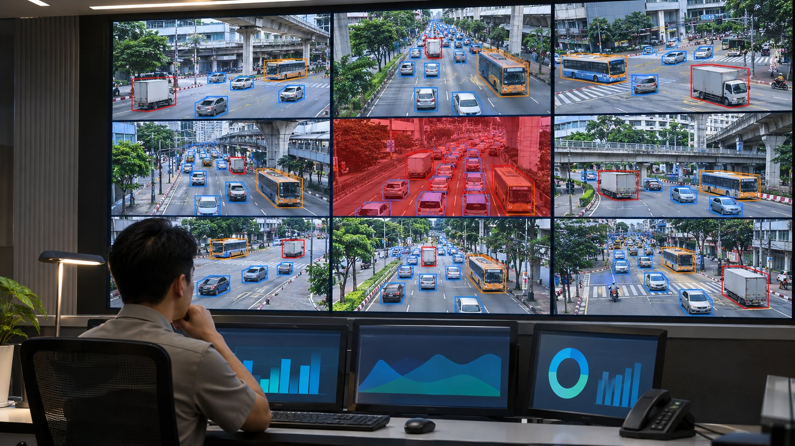
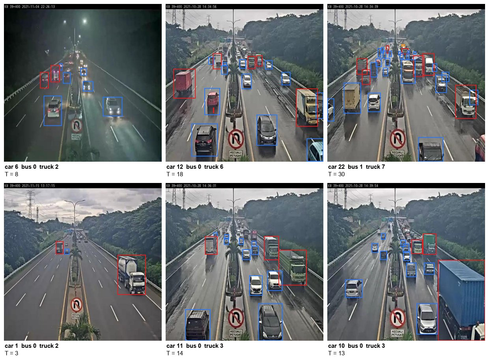

# โจทย์ 1 · RoadCount — นับรถจากภาพถนน

*ภาพจำลอง*

อ่าน [โจทย์กลาง](../README.md) ก่อน · ไฟล์นี้บอกเฉพาะสิ่งที่ต่างกันของโจทย์ข้อนี้

## เรื่องราว

ศูนย์ควบคุมจราจรของเมืองมีกล้องตามแยก 40 จุด เจ้าหน้าที่แต่ละเขตดึงภาพนิ่งมาเป็นชุด แล้วต้องนับรถเองว่าแยกไหนเริ่มติด
ศูนย์ต้องการเว็บ **RoadCount**: อัปโหลดภาพเป็นชุด → ระบบนับรถแยก 3 ชนิด → บอกระดับความหนาแน่นของแต่ละภาพ → หัวหน้าเวรแก้ผลได้ → รายงานรายวันต่อเขต

| บทบาทในโจทย์กลาง | ในเรื่องนี้คือ |
|---|---|
| ผู้ส่งงาน (`staff1` · `staff2`) | เจ้าหน้าที่เขต 1 (`U1`) และเขต 2 (`U2`) |
| ผู้ตรวจทาน (`reviewer1`) | หัวหน้าเวรศูนย์ควบคุม |
| งานด่วน | ภาพจากแยกที่มีรายงานอุบัติเหตุ |

## Dataset

| เรื่อง | ค่า |
|---|---|
| ชื่อ | [`Francesco/vehicles-q0x2v`](https://huggingface.co/datasets/Francesco/vehicles-q0x2v) บน Hugging Face |
| ชุดวัดผล | split `test` (966 ภาพ) ใช้ **800 ภาพแรก** ตามลำดับในไฟล์ |
| ภาพ | JPG ขนาด 640 × 640 · เฉลี่ย 13.9 คันต่อภาพ · มากสุด 42 คัน |
| ขนาดไฟล์ | split `test` ราว 54 MB |
| เฉลย | กรอบของรถ 12 ชนิด ในคอลัมน์ `objects.category` |

รวมรถ 12 ชนิดในเฉลยเป็น 3 กลุ่ม ตามเลข `category` นี้

| กลุ่ม | เลข `category` ในเฉลย |
|---|---|
| `car` | 5 |
| `bus` | 1 · 3 · 4 · 7 |
| `truck` | 2 · 6 · 8 · 9 · 10 · 11 · 12 |

### ตัวอย่างข้อมูลจริง

*6 ภาพแรกของ split `test` · กรอบวาดจากเฉลย: น้ำเงิน = `car` · ส้ม = `bus` · แดง = `truck` · ตัวเลขใต้ภาพคือค่า `truth` ของภาพนั้น*

## โมเดลและการเทรน (ระยะ M)

| เรื่อง | ค่า |
|---|---|
| โมเดลตั้งต้น | โมเดล Object Detection สำเร็จรูปที่รู้จักรถยนต์ รถบัส รถบรรทุก เช่น YOLO11s ที่เทรนด้วย COCO |
| ชุดเทรน | split `train` 2,634 ภาพ (แปลงเฉลย 12 ชนิดเป็น 3 กลุ่มตามตารางด้านบนก่อนเทรน) · split `validation` 458 ภาพใช้เลือก checkpoint |
| สิ่งที่เทรน | Fine-tune ให้ตรวจจับ 3 กลุ่ม: `car` · `bus` · `truck` |
| Baseline | โมเดลตั้งต้นที่ยังไม่เทรน โดยใช้ประเภท car · bus · truck ของ COCO |
| ค่าที่ต้องเลือกเอง | จำนวน epoch · ขนาดภาพ · confidence threshold หนึ่งค่าที่ใช้ตลอด |

**ผลจากโมเดลต่อ 1 ภาพ:** `car` · `bus` · `truck` (จำนวนคัน)
กำหนดให้ T = car + bus + truck และ H = bus + truck

## กติกาเฉพาะ R1–R4

| รหัส | เรื่อง | กติกา |
|---|---|---|
| R1 | ความหนาแน่น | T ≤ 15 → `OK` · T ตั้งแต่ 16 ถึง 30 → `WARN` · T ≥ 31 → `ALERT` |
| R2 | สัดส่วนรถใหญ่ | T ≥ 1 และ H ÷ T > 40% → อย่างน้อย `WARN` (40% พอดีไม่มีผล) |
| R3 | รถบรรทุกกีดขวาง | truck ≥ 8 → `ALERT` |
| R4 | ภาพเล็กเกิน | ด้านสั้นของภาพ < 320 พิกเซล → `INVALID` (ตรวจจากภาพจริงเสมอ แม้ในโหมดจำลอง) |

**เกณฑ์สีแดงของรายงาน (G11):** อัตราปกติ < 70.0

## รูปแบบจำลอง (AI_MODE=mock)

ชื่อไฟล์ `c<car>_b<bus>_t<truck>` เช่น `c12_b1_t3.jpg` = รถยนต์ 12 · รถบัส 1 · รถบรรทุก 3 · มีข้อความต่อท้ายได้ เช่น `c12_b1_t3_a.jpg`
ชื่อไฟล์แบบอื่น = รถยนต์ 5 คัน

| ชื่อไฟล์ | T | H ÷ T | สถานะ | เพราะ |
|---|---|---|---|---|
| `c15_b0_t0.jpg` | 15 | 0% | `OK` | R1 |
| `c16_b0_t0.jpg` | 16 | 0% | `WARN` | R1 |
| `c3_b1_t1.jpg` | 5 | 40% | `OK` | R2 เท่ากับ 40% พอดี |
| `c2_b1_t2.jpg` | 5 | 60% | `WARN` | R2 |
| `c2_b0_t8.jpg` | 10 | 80% | `ALERT` | R3 |

## การวัดคุณภาพ AI (ขั้น C2)

| เรื่อง | ค่า |
|---|---|
| `truth` | `{"car": n, "bus": n, "truck": n}` นับจากเฉลย |
| `prediction` | `{"car": n, "bus": n, "truck": n}` จากระบบ |
| ตัวชี้วัด 1 | `wape_car` · `wape_bus` · `wape_truck` = Σ\|prediction − truth\| ÷ Σ truth × 100 ของแต่ละกลุ่ม รวม 800 ภาพ |
| ตัวชี้วัด 2 | `status_agreement` = ร้อยละของภาพที่สถานะจาก `prediction` ตรงกับสถานะจาก `truth` (คิดด้วย R1–R3) |
| เกณฑ์รับ | `wape_car` ≤ 35 **และ** `status_agreement` ≥ 75 → `pass` |

## คำขอเปลี่ยนแปลง CR-01 (ทำในขั้น A3)

> "ผมต้องส่งตัวเลขให้ผู้ว่าทุกเย็น ขอปุ่มดาวน์โหลดรายงานรายวันเป็นไฟล์ CSV ด้วยครับ" — ผู้อำนวยการศูนย์

คอลัมน์ของไฟล์ CSV อยู่ใน [โจทย์กลาง](../README.md#4--หน้าเว็บและ-data-testid)
