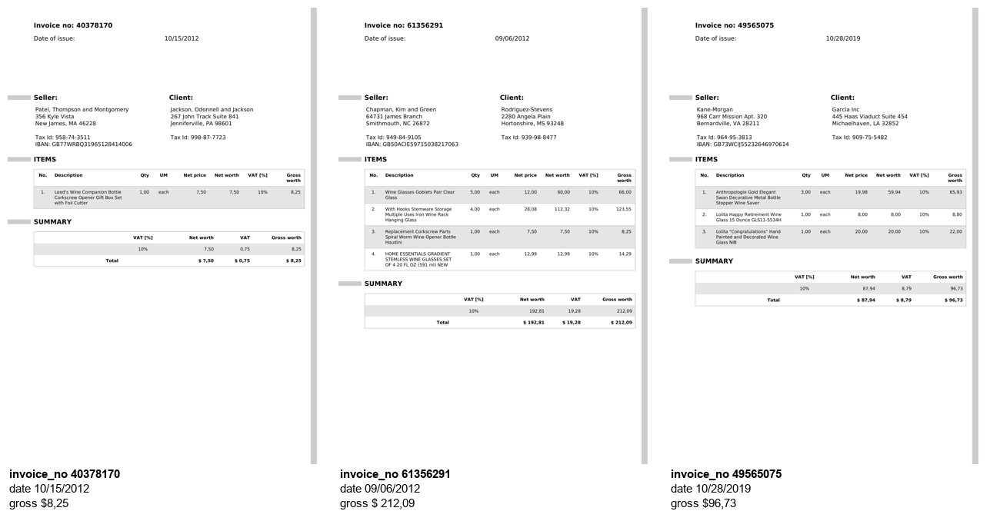

# โจทย์ 3 · InvoiceFlow — อ่านใบแจ้งหนี้ด้วย Vision-Language Model

*ภาพจำลอง*

อ่าน [โจทย์กลาง](../README.md) ก่อน · ไฟล์นี้บอกเฉพาะสิ่งที่ต่างกันของโจทย์ข้อนี้

## เรื่องราว

ฝ่ายบัญชีของบริษัทนำเข้าสินค้าได้ใบแจ้งหนี้จากผู้ขายเดือนละหลายร้อยใบ พนักงานต้องพิมพ์เลขที่ วันที่ และยอดเงินเข้าระบบเอง และเคยจ่ายเงินตามใบที่ยอดไม่ลงตัวมาแล้ว
บริษัทต้องการเว็บ **InvoiceFlow**: อัปโหลดภาพใบแจ้งหนี้เป็นชุด → ระบบอ่านเป็นข้อมูล → ตรวจว่ายอดลงตัว → ผู้จัดการบัญชีแก้ผลได้ → รายงานรายวันต่อแผนก

| บทบาทในโจทย์กลาง | ในเรื่องนี้คือ |
|---|---|
| ผู้ส่งงาน (`staff1` · `staff2`) | พนักงานบัญชีแผนกจัดซื้อ (`U1`) และแผนกคลังสินค้า (`U2`) |
| ผู้ตรวจทาน (`reviewer1`) | ผู้จัดการบัญชี |
| งานด่วน | ใบแจ้งหนี้ที่ครบกำหนดจ่ายวันนี้ |

## Dataset

| เรื่อง | ค่า |
|---|---|
| ชื่อ | [`katanaml-org/invoices-donut-data-v1`](https://huggingface.co/datasets/katanaml-org/invoices-donut-data-v1) บน Hugging Face · สัญญาอนุญาต MIT |
| ชุดวัดผล | **split `validation` 50 ใบ + split `test` 26 ใบ = 76 ใบ** (split `train` 425 ใบใช้เทรน) |
| ภาพ | JPG ขนาด 2481 × 3508 (ควรย่อก่อนส่งให้โมเดล) |
| ขนาดไฟล์ | ทั้งชุดราว 198 MB |
| เฉลย | คอลัมน์ `ground_truth` เป็น JSON: `gt_parse.header` (`invoice_no` · `invoice_date` · `seller` · `client` · …) และ `gt_parse.summary` (`total_net_worth` · `total_vat` · `total_gross_worth`) |

**การแปลงยอดเงินในเฉลยเป็นตัวเลข:** ตัด `$` และช่องว่างออก แล้วเปลี่ยน `,` เป็นจุดทศนิยม เช่น `"$ 192,81"` → 192.81

### ตัวอย่างข้อมูลจริง

*3 ใบแรกของ split `train` · ข้อความใต้ภาพคือค่าในเฉลย · ยอดเงินในเฉลยใช้เครื่องหมาย `,` เป็นจุดทศนิยม*

## โมเดลและการเทรน (ระยะ M)

| เรื่อง | ค่า |
|---|---|
| โมเดลตั้งต้น | Vision-Language Model สำเร็จรูป เช่น `Qwen/Qwen3-VL-2B-Instruct` หรือรุ่นที่ใหญ่กว่า |
| ชุดเทรน | split `train` 425 ใบ · แบ่ง Validation ของตัวเองจากชุดนี้เพื่อเลือก checkpoint |
| สิ่งที่เทรน | Fine-tune ด้วย LoRA ให้ตอบเป็น JSON ตามช่องข้อมูลของโจทย์ |
| Baseline | โมเดลตั้งต้นที่ยังไม่เทรน ใช้คำสั่ง (prompt) เดียวกัน |
| ค่าที่ต้องเลือกเอง | จำนวน epoch · LoRA rank · ขนาดภาพที่ย่อ |

**ผลจากโมเดลต่อ 1 ใบ:** `invoice_no` · `invoice_date` · `seller` · `client` · `net` · `vat` · `gross`
กำหนดให้ M = จำนวนช่องที่อ่านไม่ได้ ใน 4 ช่อง: `invoice_no` · `invoice_date` · `seller` · `client`

## กติกาเฉพาะ R1–R4

| รหัส | เรื่อง | กติกา |
|---|---|---|
| R1 | ยอดลงตัว | \|net + vat − gross\| ≤ 0.01 → ไม่มีผล · > 0.01 → `ALERT` |
| R2 | ยอดสูง | gross ≥ 10,000.00 → อย่างน้อย `WARN` (ต้องขออนุมัติ) · 9,999.99 ไม่มีผล |
| R3 | ข้อมูลไม่ครบ | M = 0 ไม่มีผล · M = 1 → `WARN` · M ≥ 2 → `ALERT` |
| R4 | ไม่มียอดรวม | อ่าน gross ไม่ได้ หรือ gross ≤ 0 → `INVALID` |

**เกณฑ์สีแดงของรายงาน (G11):** อัตราปกติ < 80.0

## รูปแบบจำลอง (AI_MODE=mock)

ชื่อไฟล์ `n<net>_v<vat>_g<gross>_m<M>` โดยยอดเงินเป็นหน่วยสตางค์ (เซนต์) เช่น `n19281_v1928_g21209_m0.jpg` = net 192.81 · vat 19.28 · gross 212.09 · อ่านครบทุกช่อง
`g0` = อ่าน gross ไม่ได้ · ชื่อไฟล์แบบอื่น = net 100.00 · vat 7.00 · gross 107.00 · M = 0

| ชื่อไฟล์ | สถานะ | เพราะ |
|---|---|---|
| `n10000_v700_g10700_m0.jpg` | `OK` | ยอดลงตัว |
| `n10000_v700_g10701_m0.jpg` | `OK` | R1 ต่าง 0.01 พอดี |
| `n10000_v700_g10702_m0.jpg` | `ALERT` | R1 ต่าง 0.02 |
| `n900000_v99999_g999999_m0.jpg` | `OK` | R2 ต่ำกว่า 10,000.00 อยู่ 0.01 |
| `n900000_v100000_g1000000_m0.jpg` | `WARN` | R2 เท่ากับ 10,000.00 พอดี |
| `n10000_v700_g10700_m1.jpg` | `WARN` | R3 |
| `n10000_v700_g0_m0.jpg` | `INVALID` | R4 |

## การวัดคุณภาพ AI (ขั้น C2)

| เรื่อง | ค่า |
|---|---|
| `truth` | `{"invoice_no": "...", "invoice_date": "...", "gross": 0.00}` |
| `prediction` | รูปแบบเดียวกับ `truth` |
| ตัวชี้วัด | `acc_invoice_no` · `acc_invoice_date` · `acc_gross` = ร้อยละของใบที่ตรงกับเฉลย (ข้อความตัดช่องว่างหัวท้ายแล้วต้องตรงทุกตัวอักษร · ยอดเงินคลาดได้ไม่เกิน 0.005) และ `acc_all` = ร้อยละของใบที่ถูกครบ 3 ช่อง |
| เกณฑ์รับ | ทั้ง 3 ช่องได้ ≥ 85 → `pass` |

## คำขอเปลี่ยนแปลง CR-01 (ทำในขั้น A3)

> "ผู้สอบบัญชีขอดูตัวเลขรายวัน ขอปุ่มดาวน์โหลดรายงานรายวันเป็นไฟล์ CSV ด้วยครับ" — ผู้อำนวยการฝ่ายการเงิน

คอลัมน์ของไฟล์ CSV อยู่ใน [โจทย์กลาง](../README.md#4--หน้าเว็บและ-data-testid)
