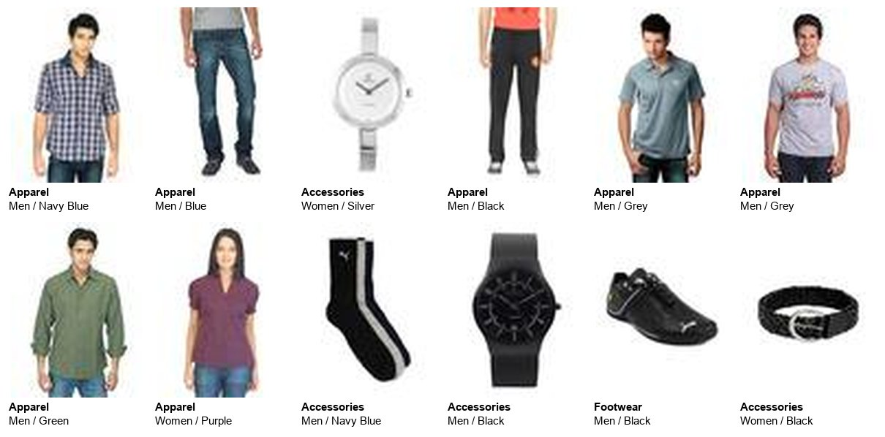

# โจทย์ 4 · ShopSnap — ถ่ายรูปสินค้า ได้ข้อมูลพร้อมลงขาย

*ภาพจำลอง*

อ่าน [โจทย์กลาง](../README.md) ก่อน · ไฟล์นี้บอกเฉพาะสิ่งที่ต่างกันของโจทย์ข้อนี้

## เรื่องราว

ตลาดออนไลน์แห่งหนึ่งมีร้านค้าลงสินค้าใหม่วันละหลายพันชิ้น ร้านค้ากรอกหมวดหมู่ผิดบ่อยจนลูกค้าค้นไม่เจอ และเขียนคำบรรยายสั้นเกินไป
ตลาดต้องการเว็บ **ShopSnap**: อัปโหลดรูปสินค้าเป็นชุด → Vision-Language Model บอกหมวดหมู่ เพศ และสี → LLM เขียนคำบรรยายขายภาษาไทย → ผู้ตรวจรายการแก้ผลได้ → รายงานรายวันต่อร้าน

| บทบาทในโจทย์กลาง | ในเรื่องนี้คือ |
|---|---|
| ผู้ส่งงาน (`staff1` · `staff2`) | ร้านค้า A (`U1`) และร้านค้า B (`U2`) |
| ผู้ตรวจทาน (`reviewer1`) | เจ้าหน้าที่ตรวจรายการสินค้าของตลาด |
| งานด่วน | สินค้าที่ร่วมแคมเปญลดราคาวันนี้ |

## Dataset

| เรื่อง | ค่า |
|---|---|
| ชื่อ | [`ashraq/fashion-product-images-small`](https://huggingface.co/datasets/ashraq/fashion-product-images-small) บน Hugging Face |
| ชุดวัดผล | split `train` (44,072 ชิ้น) ใช้ **800 ชิ้นแรก** ตามลำดับในไฟล์ |
| ภาพ | JPG ขนาดเล็ก 60 × 80 พิกเซล (ภาพเล็กเป็นส่วนหนึ่งของความท้าทาย) |
| ขนาดไฟล์ | ทั้งชุดราว 271 MB · 800 ชิ้นแรกอยู่ในไฟล์ parquet ไฟล์แรก |
| เฉลย | คอลัมน์ `masterCategory` · `gender` · `baseColour` (และ `articleType` · `productDisplayName` ใช้อ้างอิงได้) |

### ตัวอย่างข้อมูลจริง

*12 ชิ้นแรกของ split `train` (ขยายจากภาพจริงขนาด 60 × 80 พิกเซล) · ใต้ภาพคือเฉลย: `masterCategory` และ `gender` / `baseColour`*

## โมเดลและการเทรน (ระยะ M)

| เรื่อง | ค่า |
|---|---|
| โมเดลตั้งต้น | โมเดลภาพสำเร็จรูป เช่น ViT หรือ Image Encoder ของ CLIP · และ LLM สำเร็จรูปสำหรับเขียนคำบรรยาย (LLM ไม่ต้องเทรน) |
| ชุดเทรน | split `train` แถวที่ 1,001–9,000 (8,000 ชิ้น) · แบ่ง Validation ของตัวเองจากชุดนี้เพื่อเลือก checkpoint |
| สิ่งที่เทรน | Fine-tune ให้จำแนก 3 เรื่องจากภาพ: `category` · `gender` · `colour` |
| Baseline | Vision-Language Model หรือ CLIP สำเร็จรูปที่ยังไม่เทรน (Zero-shot) |
| ค่าที่ต้องเลือกเอง | จำนวน epoch · learning rate · ขนาดภาพที่ขยาย |

`confidence` คือความน่าจะเป็นของ `category` ที่โมเดลเลือก

**ผลจากโมเดลต่อ 1 ชิ้น:** `category` · `gender` · `colour` · `confidence` (0.00–1.00 ของ `category`) · `description` (คำบรรยายภาษาไทย)
กำหนดให้ L = จำนวนตัวอักษรของ `description`

## กติกาเฉพาะ R1–R4

| รหัส | เรื่อง | กติกา |
|---|---|---|
| R1 | ความมั่นใจของหมวดหมู่ | confidence ≥ 0.80 → `OK` · ตั้งแต่ 0.50 แต่น้อยกว่า 0.80 → `WARN` · < 0.50 → `ALERT` |
| R2 | ความยาวคำบรรยาย | L ตั้งแต่ 20 ถึง 200 ไม่มีผล · L < 20 หรือ L > 200 → อย่างน้อย `WARN` |
| R3 | สินค้าควบคุม | `category` เป็น `Personal Care` → อย่างน้อย `WARN` (ต้องมีคนตรวจก่อนลงขาย) |
| R4 | ภาพเล็กเกิน | ด้านสั้นของภาพ < 50 พิกเซล → `INVALID` (ตรวจจากภาพจริงเสมอ แม้ในโหมดจำลอง) |

**เกณฑ์สีแดงของรายงาน (G11):** อัตราปกติ < 75.0

## รูปแบบจำลอง (AI_MODE=mock)

ชื่อไฟล์ `k<หมวด>_f<confidence × 100>_d<L>` โดยหมวดเป็น `A` (Apparel) · `C` (Accessories) · `F` (Footwear) · `P` (Personal Care)
เช่น `kA_f80_d120.jpg` = Apparel · confidence 0.80 · คำบรรยาย 120 ตัวอักษร · ชื่อไฟล์แบบอื่น = `kA_f90_d100`

| ชื่อไฟล์ | สถานะ | เพราะ |
|---|---|---|
| `kA_f80_d120.jpg` | `OK` | R1 เท่ากับ 0.80 พอดี |
| `kA_f79_d120.jpg` | `WARN` | R1 |
| `kF_f49_d120.jpg` | `ALERT` | R1 |
| `kC_f90_d19.jpg` | `WARN` | R2 |
| `kC_f90_d200.jpg` | `OK` | R2 เท่ากับ 200 พอดี |
| `kP_f95_d120.jpg` | `WARN` | R3 |

## การวัดคุณภาพ AI (ขั้น C2)

| เรื่อง | ค่า |
|---|---|
| `truth` | `{"category": "...", "gender": "...", "colour": "..."}` จากเฉลย |
| `prediction` | รูปแบบเดียวกับ `truth` (ให้โมเดลเลือกจากรายการค่าที่มีในชุดวัดผล) |
| ตัวชี้วัด | `acc_category` · `acc_gender` · `acc_colour` = ร้อยละของชิ้นที่ตรงกับเฉลย (ไม่สนตัวพิมพ์เล็กใหญ่) |
| เกณฑ์รับ | `acc_category` ≥ 85 **และ** `acc_gender` ≥ 60 **และ** `acc_colour` ≥ 40 → `pass` |

## คำขอเปลี่ยนแปลง CR-01 (ทำในขั้น A3)

> "ทีมดูแลร้านค้าขอตัวเลขไปทำสรุป ขอปุ่มดาวน์โหลดรายงานรายวันเป็นไฟล์ CSV ด้วยค่ะ" — ผู้จัดการฝ่ายร้านค้า

คอลัมน์ของไฟล์ CSV อยู่ใน [โจทย์กลาง](../README.md#4--หน้าเว็บและ-data-testid)
