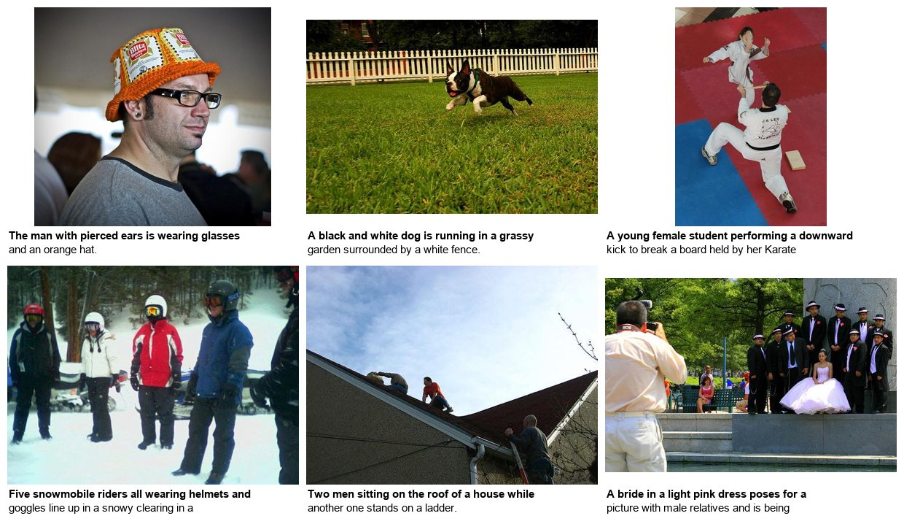

# โจทย์ 5 · PhotoFind — คลังภาพที่ค้นด้วยข้อความ

*ภาพจำลอง*

อ่าน [โจทย์กลาง](../README.md) ก่อน · ไฟล์นี้บอกเฉพาะสิ่งที่ต่างกันของโจทย์ข้อนี้

## เรื่องราว

สำนักข่าวมีคลังภาพหลายแสนภาพ ช่างภาพอัปโหลดโดยไม่ใส่คำอธิบาย บรรณาธิการจึงหาภาพไม่เจอ และมีภาพซ้ำจำนวนมาก
สำนักข่าวต้องการเว็บ **PhotoFind**: อัปโหลดภาพเป็นชุด → ระบบเขียนคำบรรยายภาพและสร้าง Embedding → ตรวจภาพซ้ำ → บรรณาธิการภาพแก้ผลได้ → **ค้นภาพด้วยข้อความ** → รายงานรายวันต่อโต๊ะข่าว

| บทบาทในโจทย์กลาง | ในเรื่องนี้คือ |
|---|---|
| ผู้ส่งงาน (`staff1` · `staff2`) | ช่างภาพโต๊ะข่าวกีฬา (`U1`) และโต๊ะข่าวท้องถิ่น (`U2`) |
| ผู้ตรวจทาน (`reviewer1`) | บรรณาธิการภาพ |
| งานด่วน | ภาพข่าวด่วนที่ต้องใช้ภายในชั่วโมงนี้ |

## Dataset

| เรื่อง | ค่า |
|---|---|
| ชื่อ | [`nlphuji/flickr_1k_test_image_text_retrieval`](https://huggingface.co/datasets/nlphuji/flickr_1k_test_image_text_retrieval) บน Hugging Face |
| ชุดวัดผล | split `test` (1,000 ภาพ) ใช้ **300 ภาพสุดท้าย** ตามลำดับในไฟล์ (700 ภาพแรกใช้เทรน) |
| ภาพ | JPG ขนาดราว 500 × 460 พิกเซล |
| ขนาดไฟล์ | ทั้งชุดราว 142 MB |
| เฉลย | คอลัมน์ `caption` มีคำบรรยายภาษาอังกฤษ 5 ประโยคต่อภาพ · คอลัมน์ `filename` เป็นชื่อภาพ |

### ตัวอย่างข้อมูลจริง

*6 ภาพแรกของ split `test` · ข้อความใต้ภาพคือคำบรรยายประโยคแรก (6 ภาพนี้อยู่ในชุดเทรน)*

## โมเดลและการเทรน (ระยะ M)

| เรื่อง | ค่า |
|---|---|
| โมเดลตั้งต้น | โมเดล Embedding ภาพ-ข้อความสำเร็จรูป เช่น ตระกูล CLIP หรือ SigLIP · และ Vision-Language Model สำเร็จรูปสำหรับเขียนคำบรรยาย (ไม่ต้องเทรน) |
| ชุดเทรน | **700 ภาพแรก** ของ split `test` พร้อมคำบรรยาย 5 ประโยคต่อภาพ (3,500 คู่) · แบ่ง Validation ของตัวเองจากชุดนี้เพื่อเลือก checkpoint |
| สิ่งที่เทรน | Fine-tune โมเดล Embedding แบบ Contrastive Learning (เทรนทั้งโมเดลหรือ LoRA) |
| Baseline | โมเดล Embedding ตั้งต้นที่ยังไม่เทรน |
| ค่าที่ต้องเลือกเอง | จำนวน epoch · learning rate · batch size |

**ผลจากโมเดลต่อ 1 ภาพ:** `caption` (คำบรรยาย) · `embedding` · `max_similarity` (ความคล้ายสูงสุดกับภาพที่มีอยู่แล้วของหน่วยงานเดียวกัน ค่า 0.00–1.00 · ภาพแรกของหน่วยงานได้ 0.00)
กำหนดให้ W = จำนวนคำใน `caption` และ S = `max_similarity`

## กติกาเฉพาะ R1–R4

| รหัส | เรื่อง | กติกา |
|---|---|---|
| R1 | ภาพซ้ำ | S ≥ 0.98 → `ALERT` และไม่นำเข้าคลังค้นหา |
| R2 | ภาพคล้ายมาก | S ตั้งแต่ 0.90 แต่น้อยกว่า 0.98 → `WARN` · S < 0.90 ไม่มีผล |
| R3 | คำบรรยายสั้นเกิน | W < 5 → อย่างน้อย `WARN` · W = 5 ไม่มีผล |
| R4 | ภาพเล็กเกิน | ด้านสั้นของภาพ < 100 พิกเซล → `INVALID` (ตรวจจากภาพจริงเสมอ แม้ในโหมดจำลอง) |

**เกณฑ์สีแดงของรายงาน (G11):** อัตราปกติ < 80.0

## หน้าค้นภาพ (เพิ่มจากโจทย์กลาง)

| หน้า | เส้นทาง | `data-testid` ที่ต้องมี |
|---|---|---|
| ค้นภาพ | `/search` | `search-input` · `search-submit` · `search-result` (สูงสุด 10 แถว มี `data-item` และ `data-rank` เริ่มที่ 1) |

- ค้นเจอเฉพาะภาพสถานะ `OK` และ `WARN` · ผู้ส่งงานค้นได้เฉพาะภาพของหน่วยงานตัวเอง
- ในโหมดจำลอง ผลการค้นคือภาพที่ **ชื่อไฟล์มีข้อความที่ค้น** เรียงตามชื่อไฟล์

## รูปแบบจำลอง (AI_MODE=mock)

ชื่อไฟล์ `w<W>_s<S × 100>` เช่น `w8_s45.jpg` = คำบรรยาย 8 คำ · ความคล้ายสูงสุด 0.45 · ชื่อไฟล์แบบอื่น = `w8_s10`

| ชื่อไฟล์ | สถานะ | เพราะ |
|---|---|---|
| `w8_s89.jpg` | `OK` | ต่ำกว่า R2 |
| `w8_s90.jpg` | `WARN` | R2 เท่ากับ 0.90 พอดี |
| `w8_s97.jpg` | `WARN` | R2 |
| `w8_s98.jpg` | `ALERT` | R1 เท่ากับ 0.98 พอดี |
| `w4_s10.jpg` | `WARN` | R3 |
| `w5_s10.jpg` | `OK` | R3 เท่ากับ 5 พอดี |

## การวัดคุณภาพ AI (ขั้น C2)

นำ 300 ภาพของชุดวัดผลเข้าคลังของหน่วยงานเดียว แล้วใช้ **คำบรรยายประโยคแรก** ของแต่ละภาพเป็นคำค้น รวม 300 คำค้น

| เรื่อง | ค่า |
|---|---|
| `truth` | ชื่อไฟล์ของภาพที่เป็นเจ้าของคำบรรยายนั้น |
| `prediction` | รายการชื่อไฟล์ 10 อันดับแรกที่ระบบคืน |
| ตัวชี้วัด | `recall_at_1` · `recall_at_5` · `recall_at_10` = สัดส่วนของคำค้นที่ภาพเฉลยอยู่ใน 1 · 5 · 10 อันดับแรก และ `search_p95_s` = เวลาค้น p95 |
| เกณฑ์รับ | `recall_at_5` ≥ 0.90 **และ** `search_p95_s` ≤ 1.0 → `pass` |

ระหว่างวัดห้ามปิดกติกา R1–R2 · ภาพที่ได้ `ALERT` จะไม่อยู่ในคลัง และนับเป็นคำค้นที่หาไม่เจอ

## คำขอเปลี่ยนแปลง CR-01 (ทำในขั้น A3)

> "ผมต้องรายงานจำนวนภาพที่เข้าคลังทุกวัน ขอปุ่มดาวน์โหลดรายงานรายวันเป็นไฟล์ CSV ด้วยครับ" — หัวหน้ากองบรรณาธิการ

คอลัมน์ของไฟล์ CSV อยู่ใน [โจทย์กลาง](../README.md#4--หน้าเว็บและ-data-testid)
