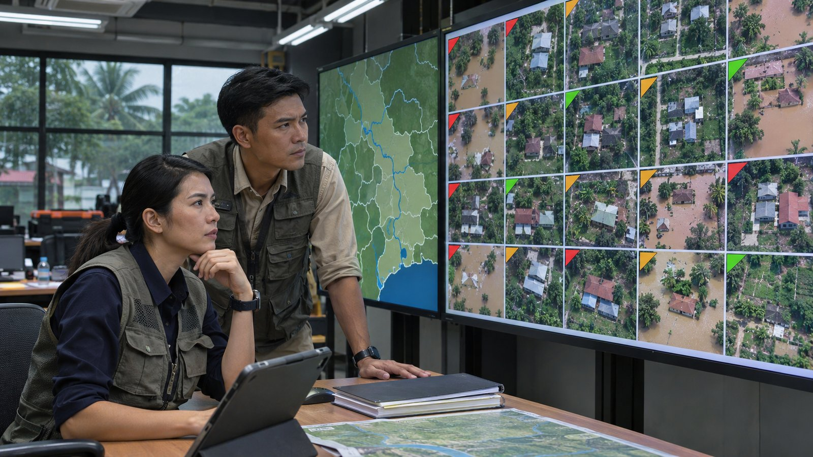
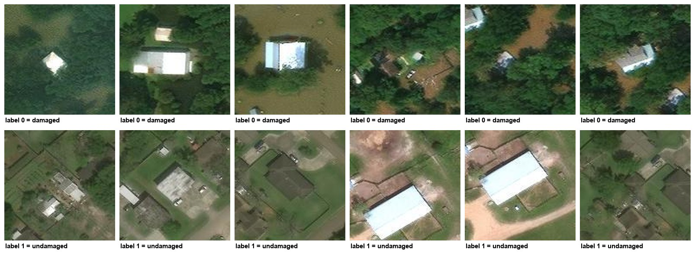

# โจทย์ 6 · StormEye — ประเมินความเสียหายจากภาพดาวเทียมหลังพายุ

*ภาพจำลอง*

อ่าน [โจทย์กลาง](../README.md) ก่อน · ไฟล์นี้บอกเฉพาะสิ่งที่ต่างกันของโจทย์ข้อนี้

## เรื่องราว

หลังพายุเข้า ศูนย์บรรเทาสาธารณภัยได้ภาพดาวเทียมของอาคารหลายพันหลัง เจ้าหน้าที่ต้องเปิดดูทีละภาพเพื่อจัดลำดับการส่งทีมกู้ภัย ซึ่งใช้เวลาเป็นวัน
ศูนย์ต้องการเว็บ **StormEye**: อัปโหลดภาพอาคารเป็นชุด → โมเดลจำแนกภาพประเมินว่าเสียหายหรือไม่ → LLM เขียนสรุปสถานการณ์ของชุดเป็นภาษาไทย → หัวหน้าศูนย์แก้ผลได้ → รายงานรายวันต่อพื้นที่

| บทบาทในโจทย์กลาง | ในเรื่องนี้คือ |
|---|---|
| ผู้ส่งงาน (`staff1` · `staff2`) | เจ้าหน้าที่พื้นที่ชายฝั่ง (`U1`) และพื้นที่ตอนใน (`U2`) |
| ผู้ตรวจทาน (`reviewer1`) | หัวหน้าศูนย์บรรเทาสาธารณภัย |
| งานด่วน | ภาพของพื้นที่ที่มีผู้แจ้งขอความช่วยเหลือ |

## Dataset

| เรื่อง | ค่า |
|---|---|
| ชื่อ | [`jonathan-roberts1/Satellite-Images-of-Hurricane-Damage`](https://huggingface.co/datasets/jonathan-roberts1/Satellite-Images-of-Hurricane-Damage) บน Hugging Face · สัญญาอนุญาต CC BY 4.0 |
| ชุดวัดผล | split `train` (10,000 ภาพ) ใช้ **400 ภาพแรกที่ `label` = 0 และ 400 ภาพแรกที่ `label` = 1** ตามลำดับในไฟล์ รวม 800 ภาพ |
| ภาพ | JPG ขนาด 128 × 128 พิกเซล |
| ขนาดไฟล์ | ทั้งชุดราว 27 MB |
| เฉลย | คอลัมน์ `label`: 0 = อาคารเสียหายหรือน้ำท่วม (`damaged`) · 1 = อาคารไม่เสียหาย (`undamaged`) |

### ตัวอย่างข้อมูลจริง

*แถวบน: `label` = 0 (เสียหายหรือน้ำท่วม) · แถวล่าง: `label` = 1 (ไม่เสียหาย) · ขยายจากภาพจริงขนาด 128 × 128 พิกเซล*

## โมเดลและการเทรน (ระยะ M)

| เรื่อง | ค่า |
|---|---|
| โมเดลตั้งต้น | โมเดลจำแนกภาพสำเร็จรูป เช่น ViT · ConvNeXt หรือ YOLO11 แบบ Classification · และ LLM สำเร็จรูปสำหรับเขียนสรุป (LLM ไม่ต้องเทรน) |
| ชุดเทรน | ภาพลำดับที่ 401–2,400 ของแต่ละ `label` (รวม 4,000 ภาพ) · แบ่ง Validation ของตัวเองจากชุดนี้เพื่อเลือก checkpoint |
| สิ่งที่เทรน | Fine-tune ให้จำแนก 2 ประเภท: `damaged` · `undamaged` |
| Baseline | Vision-Language Model หรือ CLIP สำเร็จรูปที่ยังไม่เทรน (Zero-shot) |
| ค่าที่ต้องเลือกเอง | จำนวน epoch · learning rate · การเพิ่มข้อมูล (Augmentation) |

Worker ต้องประเมินแต่ละภาพ **2 ครั้ง**: ภาพต้นฉบับ และภาพที่กลับซ้ายขวา เพื่อดูว่าโมเดลตอบคงเส้นคงวาหรือไม่
`cloud` ไม่ได้มาจากโมเดล แต่คำนวณจากภาพ: สัดส่วนของพิกเซลที่ค่าสีทั้ง 3 ช่อง (R · G · B) ตั้งแต่ 230 ขึ้นไป

**ผลจากโมเดลต่อ 1 ภาพ:** `p1` (ความน่าจะเป็นที่เสียหายจากภาพต้นฉบับ) · `p2` (จากภาพกลับด้าน) · `cloud` (สัดส่วนของภาพที่เมฆบัง คำนวณจากภาพ) ทุกค่าอยู่ในช่วง 0.00–1.00
กำหนดให้ P = (p1 + p2) ÷ 2 และ D = \|p1 − p2\|

## กติกาเฉพาะ R1–R4

| รหัส | เรื่อง | กติกา |
|---|---|---|
| R1 | ระดับความเสียหาย | P < 0.40 → `OK` · P ตั้งแต่ 0.40 แต่น้อยกว่า 0.70 → `WARN` · P ≥ 0.70 → `ALERT` |
| R2 | โมเดลตอบไม่คงที่ | D > 0.20 → อย่างน้อย `WARN` (0.20 พอดีไม่มีผล) |
| R3 | เมฆบัง | cloud > 0.60 → `INVALID` (0.60 พอดีไม่มีผล) |
| R4 | ภาพเล็กเกิน | ด้านสั้นของภาพ < 100 พิกเซล → `INVALID` (ตรวจจากภาพจริงเสมอ แม้ในโหมดจำลอง) |

**เกณฑ์สีแดงของรายงาน (G11):** อัตราปกติ < 50.0

**สรุปสถานการณ์ของชุด:** เมื่อทุกรายการในชุดได้ผลแล้ว ระบบแสดงสรุปภาษาไทย 1 ย่อหน้าต่อชุดในหน้า `/results` (`data-testid="batch-summary"`) และต้องมีจำนวนรายการของแต่ละสถานะที่ตรงกับผลจริง

## รูปแบบจำลอง (AI_MODE=mock)

ชื่อไฟล์ `p<p1 × 100>_q<p2 × 100>_c<cloud × 100>` เช่น `p70_q70_c10.jpg` = p1 0.70 · p2 0.70 · เมฆ 0.10 · ชื่อไฟล์แบบอื่น = `p10_q10_c0`
ในโหมดจำลอง สรุปสถานการณ์ของชุดเป็นข้อความตายตัวที่มีจำนวนรายการของแต่ละสถานะ

| ชื่อไฟล์ | P | D | สถานะ | เพราะ |
|---|---|---|---|---|
| `p39_q39_c0.jpg` | 0.39 | 0.00 | `OK` | R1 |
| `p40_q40_c0.jpg` | 0.40 | 0.00 | `WARN` | R1 เท่ากับ 0.40 พอดี |
| `p70_q70_c0.jpg` | 0.70 | 0.00 | `ALERT` | R1 เท่ากับ 0.70 พอดี |
| `p20_q40_c0.jpg` | 0.30 | 0.20 | `OK` | R2 เท่ากับ 0.20 พอดี |
| `p10_q32_c0.jpg` | 0.21 | 0.22 | `WARN` | R2 |
| `p90_q90_c61.jpg` | 0.90 | 0.00 | `INVALID` | R3 และ G8 |

## การวัดคุณภาพ AI (ขั้น C2)

| เรื่อง | ค่า |
|---|---|
| `truth` | `"damaged"` หรือ `"undamaged"` |
| `prediction` | `{"p1": 0.00, "p2": 0.00, "cloud": 0.00}` |
| การตัดสิน | ทายว่า `damaged` เมื่อ P ≥ 0.50 |
| ตัวชี้วัด | `recall_damaged` = ภาพเสียหายที่ทายถูก ÷ ภาพเสียหายทั้งหมด · `precision_damaged` = ภาพเสียหายที่ทายถูก ÷ ภาพที่ทายว่าเสียหายทั้งหมด · `f1_damaged` |
| เกณฑ์รับ | `recall_damaged` ≥ 0.85 **และ** `precision_damaged` ≥ 0.80 → `pass` |

## คำขอเปลี่ยนแปลง CR-01 (ทำในขั้น A3)

> "ผมต้องส่งตัวเลขให้ผู้ว่าราชการจังหวัดทุกเย็น ขอปุ่มดาวน์โหลดรายงานรายวันเป็นไฟล์ CSV ด้วยครับ" — ผู้อำนวยการศูนย์

คอลัมน์ของไฟล์ CSV อยู่ใน [โจทย์กลาง](../README.md#4--หน้าเว็บและ-data-testid)
