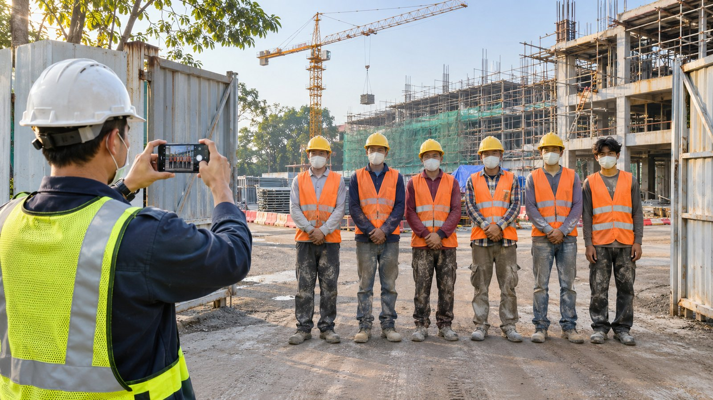
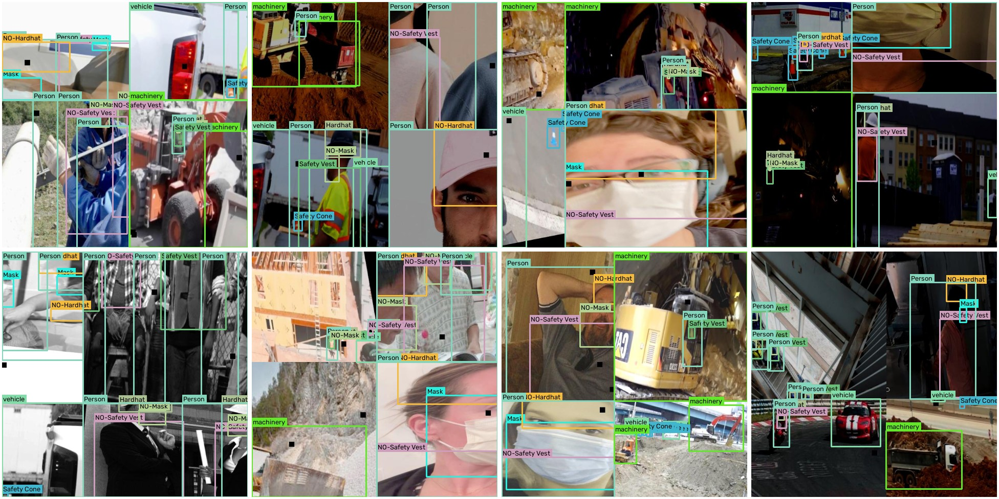

# โจทย์ 7 · SiteGate — ตรวจอุปกรณ์ความปลอดภัยก่อนเข้าไซต์งาน

*ภาพจำลอง*

อ่าน [โจทย์กลาง](../README.md) ก่อน · ไฟล์นี้บอกเฉพาะสิ่งที่ต่างกันของโจทย์ข้อนี้
โจทย์ข้อนี้ใช้ **Dataset เดียวกับ LAB 1 ของบท 02** และหัวข้อที่ 1 ของบท 03

## เรื่องราว

บริษัทรับเหมาก่อสร้างมีไซต์งาน 2 แห่ง ทุกเช้าหัวหน้ากะถ่ายภาพคนงานที่ประตูก่อนเข้าไซต์ แล้วผู้จัดการความปลอดภัยต้องเปิดดูทีละภาพว่าใครไม่ใส่หมวก ไม่ใส่หน้ากาก หรือไม่ใส่เสื้อสะท้อนแสง
บริษัทต้องการเว็บ **SiteGate**: อัปโหลดภาพเป็นชุด → ระบบตรวจอุปกรณ์ 3 อย่าง → บอกผลของแต่ละภาพ → ผู้จัดการแก้ผลได้ → รายงานรายวันต่อไซต์

| บทบาทในโจทย์กลาง | ในเรื่องนี้คือ |
|---|---|
| ผู้ส่งงาน (`staff1` · `staff2`) | หัวหน้ากะไซต์ 1 (`U1`) และไซต์ 2 (`U2`) |
| ผู้ตรวจทาน (`reviewer1`) | ผู้จัดการความปลอดภัย |
| งานด่วน | ภาพของทีมที่ยืนรอเข้าพื้นที่อยู่หน้าประตู |

## Dataset

| เรื่อง | ค่า |
|---|---|
| ชื่อ | [`construction-site-safety`](https://universe.roboflow.com/roboflow-universe-projects/construction-site-safety) รุ่น 28 บน Roboflow Universe · สัญญาอนุญาต CC BY 4.0 |
| การดาวน์โหลด | ใช้ `ROBOFLOW_API_KEY` (สมัครฟรี ตามบท 02 LAB 0) รูปแบบ YOLO |
| ชุดวัดผล | **Validation Set 114 ภาพ + Test Set 82 ภาพ = 196 ภาพ** (Training Set ใช้เทรน) |
| ภาพ | JPG ขนาด 640 × 640 |
| เฉลย | กรอบของ 10 ประเภท ที่ใช้ในโจทย์นี้: `Person` · `NO-Hardhat` · `NO-Mask` · `NO-Safety Vest` |

### ตัวอย่างข้อมูลจริง

*8 ภาพจาก Training Set พร้อมกรอบจากเฉลย · ภาพใน Training Set ถูกตัดต่อหลายภาพเข้าด้วยกัน (Mosaic Augmentation) ส่วนภาพใน Validation Set และ Test Set เป็นภาพเดี่ยว*

## โมเดลและการเทรน (ระยะ M)

| เรื่อง | ค่า |
|---|---|
| โมเดลตั้งต้น | โมเดล Object Detection สำเร็จรูป เช่น YOLO11s ที่เทรนด้วย COCO |
| ชุดเทรน | Training Set ของ Dataset รุ่น 28 · แบ่ง Validation ของตัวเองจาก Training Set เพื่อเลือก checkpoint |
| สิ่งที่เทรน | Fine-tune ใหม่ในการบ้านนี้ โดยเปลี่ยนค่าจาก LAB 1 อย่างน้อย 1 อย่าง (เช่น ขนาดโมเดล · ขนาดภาพ · จำนวน epoch) แล้วบอกเหตุผล |
| Baseline | ไฟล์ `best.pt` จาก LAB 1 ของบท 02 · ถ้าไม่มีแล้วใช้ checkpoint หลัง epoch ที่ 3 ของการเทรนครั้งนี้ |
| ค่าที่ต้องเลือกเอง | จำนวน epoch · ขนาดภาพ · confidence threshold หนึ่งค่าที่ใช้ตลอด |

**ผลจากโมเดลต่อ 1 ภาพ:** P (จำนวน `Person`) · NH (จำนวน `NO-Hardhat`) · NM (จำนวน `NO-Mask`) · NV (จำนวน `NO-Safety Vest`)

## กติกาเฉพาะ R1–R4

| รหัส | เรื่อง | กติกา |
|---|---|---|
| R1 | หมวกนิรภัย | NH ≥ 1 → `ALERT` |
| R2 | หน้ากาก | NM = 0 ไม่มีผล · NM = 1 → `WARN` · NM ≥ 2 → `ALERT` |
| R3 | เสื้อสะท้อนแสง | NV = 0 ไม่มีผล · NV ≥ 1 และ NV ÷ P ≤ 50% → `WARN` · NV ÷ P > 50% → `ALERT` |
| R4 | จำนวนคน | P = 0 → `INVALID` · P ตั้งแต่ 1 ถึง 15 ตรวจตามปกติ · P ≥ 16 → `INVALID` (ให้ถ่ายแยกกลุ่ม) |

**เกณฑ์สีแดงของรายงาน (G11):** อัตราปกติ < 90.0

## รูปแบบจำลอง (AI_MODE=mock)

ชื่อไฟล์ `p
_nh<NH>_nm<NM>_nv<NV>` เช่น `p6_nh0_nm1_nv3.jpg` = คน 6 · ไม่ใส่หมวก 0 · ไม่ใส่หน้ากาก 1 · ไม่ใส่เสื้อ 3
ชื่อไฟล์แบบอื่น = `p3_nh0_nm0_nv0`

| ชื่อไฟล์ | สถานะ | เพราะ |
|---|---|---|
| `p5_nh0_nm0_nv0.jpg` | `OK` | ใส่ครบทุกคน |
| `p5_nh1_nm0_nv0.jpg` | `ALERT` | R1 |
| `p5_nh0_nm1_nv0.jpg` | `WARN` | R2 |
| `p4_nh0_nm0_nv2.jpg` | `WARN` | R3 เท่ากับ 50% พอดี |
| `p4_nh0_nm0_nv3.jpg` | `ALERT` | R3 |
| `p16_nh1_nm0_nv0.jpg` | `INVALID` | R4 และ G8 |

## การวัดคุณภาพ AI (ขั้น C2)

วัดระดับภาพ: ภาพหนึ่งเป็น "บวก" เมื่อมี `NO-Hardhat` อย่างน้อย 1 กรอบ

| เรื่อง | ค่า |
|---|---|
| `truth` | `{"P": n, "NH": n, "NM": n, "NV": n}` นับจากเฉลย |
| `prediction` | รูปแบบเดียวกับ `truth` |
| ตัวชี้วัด 1 | `recall_no_hardhat` = ภาพบวกที่ระบบได้ NH ≥ 1 ÷ ภาพบวกทั้งหมด · `precision_no_hardhat` = ภาพบวกที่ระบบได้ NH ≥ 1 ÷ ภาพทั้งหมดที่ระบบได้ NH ≥ 1 |
| ตัวชี้วัด 2 | `status_agreement` = ร้อยละของภาพที่สถานะจาก `prediction` ตรงกับสถานะจาก `truth` (คิดด้วย R1–R4) |
| เกณฑ์รับ | `recall_no_hardhat` ≥ 0.80 **และ** `precision_no_hardhat` ≥ 0.80 → `pass` |

รายงานจำนวนภาพบวกใน `quality.json` ด้วย (`positives`) · ถ้าภาพบวกมีน้อยกว่า 30 ภาพ ให้เขียนใน `DELIVERY.md` ว่าตัวเลขนี้เชื่อถือได้แค่ไหน และต้องเก็บภาพเพิ่มเท่าไร

## คำขอเปลี่ยนแปลง CR-01 (ทำในขั้น A3)

> "ผมต้องส่งตัวเลขให้เจ้าของโครงการทุกเย็น ขอปุ่มดาวน์โหลดรายงานรายวันเป็นไฟล์ CSV ด้วยครับ" — ผู้จัดการโครงการ

คอลัมน์ของไฟล์ CSV อยู่ใน [โจทย์กลาง](../README.md#4--หน้าเว็บและ-data-testid)
