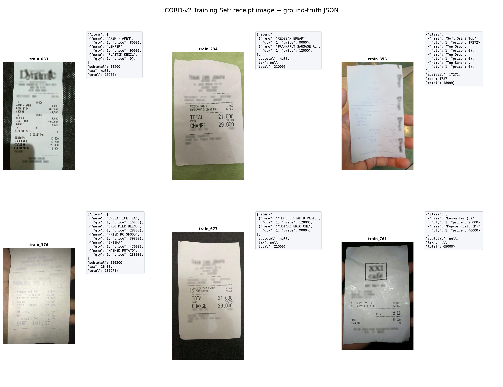

# โจทย์ 8 · ReceiptRush — อ่านใบเสร็จเพื่อเบิกค่าใช้จ่าย

*ภาพจำลอง*

อ่าน [โจทย์กลาง](../README.md) ก่อน · ไฟล์นี้บอกเฉพาะสิ่งที่ต่างกันของโจทย์ข้อนี้
โจทย์ข้อนี้ใช้ **Dataset เดียวกับ LAB 2 · LAB 5 · LAB 8 ของบท 02** และหัวข้อที่ 2 ของบท 03

## เรื่องราว

บริษัทที่ปรึกษามีพนักงานออกไปพบลูกค้าทุกวัน ทุกสิ้นเดือนฝ่ายบุคคลได้ใบเสร็จค่าอาหารและค่าเดินทางเป็นพันใบ ต้องพิมพ์ยอดเองทีละใบ และเคยจ่ายเงินเบิกเกินวงเงินโดยไม่รู้ตัว
บริษัทต้องการเว็บ **ReceiptRush**: อัปโหลดภาพใบเสร็จเป็นชุด → ระบบอ่านรายการและยอดรวม → ตรวจยอดกับวงเงิน → หัวหน้าฝ่ายแก้ผลได้ → รายงานรายวันต่อแผนก

| บทบาทในโจทย์กลาง | ในเรื่องนี้คือ |
|---|---|
| ผู้ส่งงาน (`staff1` · `staff2`) | เลขานุการแผนกขาย (`U1`) และแผนกที่ปรึกษา (`U2`) |
| ผู้ตรวจทาน (`reviewer1`) | หัวหน้าฝ่ายบุคคล |
| งานด่วน | ใบเสร็จของพนักงานที่ต้องปิดรอบเบิกวันนี้ |

## Dataset

| เรื่อง | ค่า |
|---|---|
| ชื่อ | [`naver-clova-ix/cord-v2`](https://huggingface.co/datasets/naver-clova-ix/cord-v2) บน Hugging Face · สัญญาอนุญาต CC BY 4.0 |
| ชุดวัดผล | **split `validation` 100 ใบ + split `test` 100 ใบ = 200 ใบ** (split `train` 800 ใบใช้เทรน) |
| ภาพ | ใบเสร็จร้านอาหารจากอินโดนีเซีย ถ่ายด้วยมือถือ ยอดเงินเป็นจำนวนเต็ม |
| เฉลย | คอลัมน์ `ground_truth` เป็น JSON: `gt_parse.menu` (รายการ) และ `gt_parse.total.total_price` (ยอดรวม) |

**การแปลงยอดเงินในเฉลยเป็นตัวเลข:** ตัดจุดและจุลภาคที่คั่นหลักพันออก เช่น `"60.000"` → 60000

### ตัวอย่างข้อมูลจริง

*6 ใบจาก split `train` พร้อมเฉลยที่จัดรูปแบบแล้ว · ภาพมีทั้งเอียง ยับ มืด และจาง · ข้อมูลร้านค้าในภาพถูกเบลอมาจากต้นทาง*

## โมเดลและการเทรน (ระยะ M)

| เรื่อง | ค่า |
|---|---|
| โมเดลตั้งต้น | Vision-Language Model สำเร็จรูป เช่น `Qwen/Qwen3-VL-2B-Instruct` |
| ชุดเทรน | split `train` 800 ใบ · แบ่ง Validation ของตัวเองจากชุดนี้เพื่อเลือก checkpoint |
| สิ่งที่เทรน | Fine-tune ด้วย LoRA ใหม่ในการบ้านนี้ ให้ตอบเป็น JSON ที่มีรายการและยอดรวม |
| Baseline | โมเดลตั้งต้นที่ยังไม่เทรน ใช้คำสั่ง (prompt) เดียวกัน |
| ค่าที่ต้องเลือกเอง | จำนวน epoch · LoRA rank · ขนาดภาพที่ย่อ |

**ผลจากโมเดลต่อ 1 ใบ:** `items` (รายการ มี `name` · `qty` · `price`) และ `total`
กำหนดให้ I = จำนวนรายการ · S = ผลรวมของ `price` ทุกรายการ · T = `total`

## กติกาเฉพาะ R1–R4

| รหัส | เรื่อง | กติกา |
|---|---|---|
| R1 | เกินวงเงิน | T ≥ 500,000 → อย่างน้อย `WARN` (ต้องขออนุมัติ) · 499,999 ไม่มีผล |
| R2 | ยอดไม่ตรงรายการ | \|S − T\| มากกว่า 1% ของ T → อย่างน้อย `WARN` (1% พอดีไม่มีผล) |
| R3 | ไม่มีรายการ | I = 0 → `ALERT` |
| R4 | ไม่มียอดรวม | อ่าน T ไม่ได้ หรือ T ≤ 0 → `INVALID` |

**เกณฑ์สีแดงของรายงาน (G11):** อัตราปกติ < 80.0

## รูปแบบจำลอง (AI_MODE=mock)

ชื่อไฟล์ `i<I>_s<S>_t<T>` เช่น `i3_s60000_t60000.jpg` = 3 รายการ · ผลรวมรายการ 60,000 · ยอดรวม 60,000
`t0` = อ่านยอดรวมไม่ได้ · ชื่อไฟล์แบบอื่น = `i2_s21000_t21000`

| ชื่อไฟล์ | สถานะ | เพราะ |
|---|---|---|
| `i3_s60000_t60000.jpg` | `OK` | ยอดตรง ไม่เกินวงเงิน |
| `i3_s499999_t499999.jpg` | `OK` | R1 ต่ำกว่าวงเงิน 1 |
| `i3_s500000_t500000.jpg` | `WARN` | R1 เท่ากับวงเงินพอดี |
| `i3_s99000_t100000.jpg` | `OK` | R2 ต่าง 1% พอดี |
| `i3_s98999_t100000.jpg` | `WARN` | R2 |
| `i0_s0_t60000.jpg` | `ALERT` | R3 |
| `i3_s60000_t0.jpg` | `INVALID` | R4 |

## การวัดคุณภาพ AI (ขั้น C2)

| เรื่อง | ค่า |
|---|---|
| `truth` | `{"total": n, "items": n}` (ยอดรวม และจำนวนรายการ จากเฉลย) |
| `prediction` | `{"total": n, "items": n}` จากระบบ · คำตอบที่ไม่ใช่ JSON ให้บันทึกเป็น `null` |
| ตัวชี้วัด | `json_valid_pct` = ร้อยละของใบที่โมเดลตอบเป็น JSON ถูกรูปแบบ · `total_exact_pct` = ร้อยละของใบที่ยอดรวมตรงทุกหลัก · `items_exact_pct` = ร้อยละของใบที่จำนวนรายการตรง |
| เกณฑ์รับ | `json_valid_pct` ≥ 99 **และ** `total_exact_pct` ≥ 85 → `pass` |

## คำขอเปลี่ยนแปลง CR-01 (ทำในขั้น A3)

> "ฝ่ายบัญชีขอตัวเลขไปกระทบยอดทุกวัน ขอปุ่มดาวน์โหลดรายงานรายวันเป็นไฟล์ CSV ด้วยค่ะ" — ผู้อำนวยการฝ่ายบุคคล

คอลัมน์ของไฟล์ CSV อยู่ใน [โจทย์กลาง](../README.md#4--หน้าเว็บและ-data-testid)
