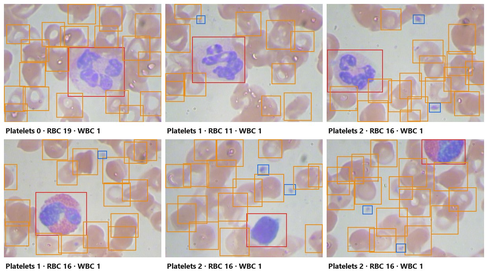

# โจทย์ 9 · BloodCount — นับเม็ดเลือดจากภาพกล้องจุลทรรศน์

*ภาพจำลอง*

อ่าน [โจทย์กลาง](../README.md) ก่อน · ไฟล์นี้บอกเฉพาะสิ่งที่ต่างกันของโจทย์ข้อนี้

## เรื่องราว

ห้องปฏิบัติการของโรงพยาบาลชุมชนตรวจสเมียร์เลือดวันละหลายร้อยแผ่น นักเทคนิคการแพทย์ต้องนับเซลล์ในแต่ละภาพเองเพื่อคัดว่าแผ่นไหนต้องให้ผู้เชี่ยวชาญดูซ้ำ
ห้องปฏิบัติการต้องการเว็บ **BloodCount**: อัปโหลดภาพจากกล้องจุลทรรศน์เป็นชุด → ระบบนับเซลล์ 3 ชนิด → บอกว่าภาพไหนต้องดูซ้ำ → หัวหน้าห้องปฏิบัติการแก้ผลได้ → รายงานรายวันต่อหอผู้ป่วย

กติกาของโจทย์ข้อนี้เป็นกติกาสมมุติเพื่อการเรียน ไม่ใช่เกณฑ์ทางการแพทย์

| บทบาทในโจทย์กลาง | ในเรื่องนี้คือ |
|---|---|
| ผู้ส่งงาน (`staff1` · `staff2`) | นักเทคนิคการแพทย์ของหอผู้ป่วยใน (`U1`) และแผนกผู้ป่วยนอก (`U2`) |
| ผู้ตรวจทาน (`reviewer1`) | หัวหน้าห้องปฏิบัติการ |
| งานด่วน | ภาพของผู้ป่วยจากห้องฉุกเฉิน |

## Dataset

| เรื่อง | ค่า |
|---|---|
| ชื่อ | [`bccd-ouzjz`](https://universe.roboflow.com/roboflow-100/bccd-ouzjz/dataset/2) รุ่น 2 ของ Roboflow 100 บน Roboflow Universe · สัญญาอนุญาต CC BY 4.0 |
| การดาวน์โหลด | ใช้ `ROBOFLOW_API_KEY` (สมัครฟรี ตามบท 02 LAB 0) รูปแบบ YOLO · ขนาดราว 8 MB |
| ชุดเทรน | **Training Set 255 ภาพ** |
| ชุดวัดผล | **Validation Set 73 ภาพ + Test Set 36 ภาพ = 109 ภาพ** |
| ภาพ | JPG ขนาด 640 × 480 จากกล้องจุลทรรศน์ |
| เฉลย | กรอบของ 3 ประเภท: `Platelets` (เกล็ดเลือด) · `RBC` (เม็ดเลือดแดง) · `WBC` (เม็ดเลือดขาว) |
| จำนวนต่อภาพในชุดวัดผล | `RBC` เฉลี่ย 11.2 (มากสุด 25) · `WBC` เฉลี่ย 1.0 (มากสุด 2) · `Platelets` เฉลี่ย 1.0 (มากสุด 5) |

### ตัวอย่างข้อมูลจริง

*6 ภาพแรกของ Validation Set · กรอบวาดจากเฉลย: ส้ม = `RBC` · แดง = `WBC` · น้ำเงิน = `Platelets` · ตัวเลขใต้ภาพคือค่า `truth` ของภาพนั้น*

## โมเดลและการเทรน (ระยะ M)

| เรื่อง | ค่า |
|---|---|
| โมเดลตั้งต้น | โมเดล Object Detection สำเร็จรูป เช่น YOLO11s ที่เทรนด้วย COCO |
| สิ่งที่เทรน | Fine-tune ด้วย Training Set ให้ตรวจจับ 3 ประเภท · แบ่ง Validation ของตัวเองจาก Training Set เพื่อเลือก checkpoint |
| Baseline | checkpoint หลัง epoch ที่ 3 ของการเทรนครั้งเดียวกัน |
| ค่าที่ต้องเลือกเอง | จำนวน epoch · ขนาดภาพ · confidence threshold หนึ่งค่าที่ใช้ตลอด |

**ผลจากโมเดลต่อ 1 ภาพ:** `rbc` · `wbc` · `plt` (จำนวนเซลล์)
กำหนดให้ T = rbc + wbc + plt

## กติกาเฉพาะ R1–R4

| รหัส | เรื่อง | กติกา |
|---|---|---|
| R1 | เม็ดเลือดขาวมาก | wbc ≤ 1 ไม่มีผล · wbc = 2 → `WARN` · wbc ≥ 3 → `ALERT` |
| R2 | เกล็ดเลือดจับกลุ่ม | plt ≤ 3 ไม่มีผล · plt ≥ 4 → อย่างน้อย `WARN` |
| R3 | เม็ดเลือดแดงน้อย | rbc ≥ 8 ไม่มีผล · rbc ตั้งแต่ 5 ถึง 7 → `WARN` · rbc < 5 → `ALERT` |
| R4 | ภาพใช้ไม่ได้ | T = 0 หรือ T > 40 → `INVALID` (T = 40 ตรวจตามปกติ) |

**เกณฑ์สีแดงของรายงาน (G11):** อัตราปกติ < 70.0

## รูปแบบจำลอง (AI_MODE=mock)

ชื่อไฟล์ `r<rbc>_w<wbc>_p<plt>` เช่น `r11_w1_p2.jpg` = เม็ดเลือดแดง 11 · เม็ดเลือดขาว 1 · เกล็ดเลือด 2
ชื่อไฟล์แบบอื่น = `r12_w1_p1`

| ชื่อไฟล์ | T | สถานะ | เพราะ |
|---|---|---|---|
| `r11_w1_p1.jpg` | 13 | `OK` | ไม่เข้ากติกาใด |
| `r11_w2_p1.jpg` | 14 | `WARN` | R1 |
| `r11_w3_p1.jpg` | 15 | `ALERT` | R1 |
| `r11_w1_p4.jpg` | 16 | `WARN` | R2 เท่ากับ 4 พอดี |
| `r7_w1_p1.jpg` | 9 | `WARN` | R3 |
| `r4_w1_p1.jpg` | 6 | `ALERT` | R3 |
| `r40_w1_p0.jpg` | 41 | `INVALID` | R4 |

## การวัดคุณภาพ AI (ขั้น C2)

| เรื่อง | ค่า |
|---|---|
| `truth` | `{"rbc": n, "wbc": n, "plt": n}` นับจากเฉลย |
| `prediction` | `{"rbc": n, "wbc": n, "plt": n}` จากระบบ |
| ตัวชี้วัด 1 | `wape_rbc` · `wape_wbc` · `wape_plt` = Σ\|prediction − truth\| ÷ Σ truth × 100 ของแต่ละประเภท รวม 109 ภาพ |
| ตัวชี้วัด 2 | `acc_wbc` = ร้อยละของภาพที่จำนวน `wbc` ตรงกับเฉลย |
| ตัวชี้วัด 3 | `status_agreement` = ร้อยละของภาพที่สถานะจาก `prediction` ตรงกับสถานะจาก `truth` (คิดด้วย R1–R4) |
| เกณฑ์รับ | `wape_rbc` ≤ 25 **และ** `acc_wbc` ≥ 85 → `pass` |

## คำขอเปลี่ยนแปลง CR-01 (ทำในขั้น A3)

> "ผมต้องส่งสถิติให้ผู้อำนวยการโรงพยาบาลทุกสัปดาห์ ขอปุ่มดาวน์โหลดรายงานรายวันเป็นไฟล์ CSV ด้วยครับ" — หัวหน้ากลุ่มงานเทคนิคการแพทย์

คอลัมน์ของไฟล์ CSV อยู่ใน [โจทย์กลาง](../README.md#4--หน้าเว็บและ-data-testid)
