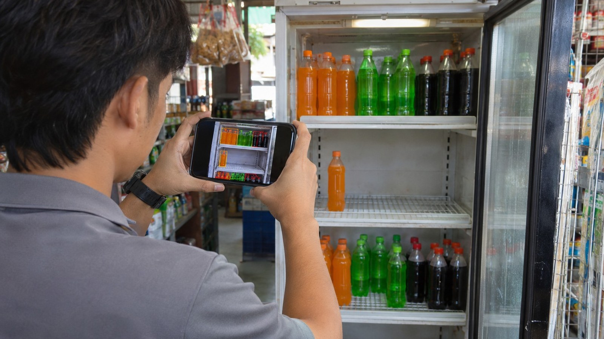
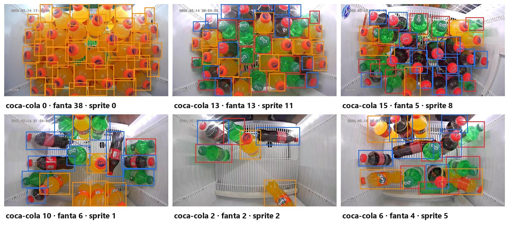

# โจทย์ 10 · CoolerCheck — นับขวดเครื่องดื่มในตู้แช่

*ภาพจำลอง*

อ่าน [โจทย์กลาง](../README.md) ก่อน · ไฟล์นี้บอกเฉพาะสิ่งที่ต่างกันของโจทย์ข้อนี้

## เรื่องราว

ผู้จัดจำหน่ายเครื่องดื่มวางตู้แช่ไว้ตามร้านค้ากว่า 2,000 ร้าน พนักงานขายต้องเปิดตู้นับขวดเองทีละร้านเพื่อดูว่าต้องเติมยี่ห้อไหน ร้านที่ของหมดจึงรู้ช้าและเสียยอดขาย
บริษัทต้องการเว็บ **CoolerCheck**: อัปโหลดภาพจากกล้องในตู้แช่เป็นชุด → ระบบนับขวดแยก 3 ยี่ห้อ → บอกว่าตู้ไหนต้องเติม → หัวหน้าเขตแก้ผลได้ → รายงานรายวันต่อเขตขาย

| บทบาทในโจทย์กลาง | ในเรื่องนี้คือ |
|---|---|
| ผู้ส่งงาน (`staff1` · `staff2`) | พนักงานขายเขตเหนือ (`U1`) และเขตใต้ (`U2`) |
| ผู้ตรวจทาน (`reviewer1`) | หัวหน้าเขตขาย |
| งานด่วน | ตู้ของร้านที่โทรแจ้งว่าของหมด |

## Dataset

| เรื่อง | ค่า |
|---|---|
| ชื่อ | [`soda-bottles`](https://universe.roboflow.com/roboflow-100/soda-bottles/dataset/4) รุ่น 4 ของ Roboflow 100 บน Roboflow Universe · สัญญาอนุญาต CC BY 4.0 |
| การดาวน์โหลด | ใช้ `ROBOFLOW_API_KEY` (สมัครฟรี ตามบท 02 LAB 0) รูปแบบ YOLO · ขนาดราว 635 MB |
| ชุดเทรน | **Training Set 1,547 ภาพ** |
| ชุดวัดผล | **Validation Set 486 ภาพ + Test Set 216 ภาพ = 702 ภาพ** |
| ภาพ | JPG ขนาด 1920 × 1080 จากกล้องมุมกว้างในตู้แช่ (ควรย่อก่อนส่งให้โมเดล) |
| เฉลย | กรอบของ 3 ประเภท: `coca-cola` · `fanta` · `sprite` |
| จำนวนต่อภาพ | Training Set เฉลี่ย 27.6 ขวด · Validation Set เฉลี่ย 19.2 ขวด · Test Set เฉลี่ย 12.0 ขวด (มากสุด 41 ขวด) |

ภาพใน Training Set ส่วนมากเป็นตู้ที่เต็ม ส่วนชุดวัดผลมีตู้ที่ของเหลือน้อยจำนวนมาก การกระจายของข้อมูล 2 ชุดจึงต่างกัน ซึ่งเป็นส่วนหนึ่งของความท้าทาย

### ตัวอย่างข้อมูลจริง

*6 ภาพจาก Validation Set · กรอบวาดจากเฉลย: น้ำเงิน = `coca-cola` · ส้ม = `fanta` · แดง = `sprite` · ตัวเลขใต้ภาพคือค่า `truth` ของภาพนั้น*

## โมเดลและการเทรน (ระยะ M)

| เรื่อง | ค่า |
|---|---|
| โมเดลตั้งต้น | โมเดล Object Detection สำเร็จรูป เช่น YOLO11s ที่เทรนด้วย COCO |
| สิ่งที่เทรน | Fine-tune ด้วย Training Set ให้ตรวจจับ 3 ประเภท · แบ่ง Validation ของตัวเองจาก Training Set เพื่อเลือก checkpoint |
| Baseline | checkpoint หลัง epoch ที่ 3 ของการเทรนครั้งเดียวกัน |
| ค่าที่ต้องเลือกเอง | จำนวน epoch · ขนาดภาพ · confidence threshold หนึ่งค่าที่ใช้ตลอด |

**ผลจากโมเดลต่อ 1 ภาพ:** `cola` · `fanta` · `sprite` (จำนวนขวด)
กำหนดให้ T = cola + fanta + sprite และ N = จำนวนของยี่ห้อที่เหลือน้อยที่สุด

## กติกาเฉพาะ R1–R4

| รหัส | เรื่อง | กติกา |
|---|---|---|
| R1 | สต็อกรวม | T ≥ 20 → `OK` · T ตั้งแต่ 10 ถึง 19 → `WARN` · T < 10 → `ALERT` |
| R2 | ยี่ห้อหมด | N = 0 → `ALERT` |
| R3 | ยี่ห้อใกล้หมด | N = 1 หรือ 2 → อย่างน้อย `WARN` · N ≥ 3 ไม่มีผล |
| R4 | ภาพใช้ไม่ได้ | T = 0 หรือ T > 45 → `INVALID` (T = 45 ตรวจตามปกติ) |

**เกณฑ์สีแดงของรายงาน (G11):** อัตราปกติ < 60.0

## รูปแบบจำลอง (AI_MODE=mock)

ชื่อไฟล์ `a<cola>_f<fanta>_s<sprite>` เช่น `a9_f7_s5.jpg` = `coca-cola` 9 · `fanta` 7 · `sprite` 5
ชื่อไฟล์แบบอื่น = `a8_f8_s8`

| ชื่อไฟล์ | T | N | สถานะ | เพราะ |
|---|---|---|---|---|
| `a8_f6_s6.jpg` | 20 | 6 | `OK` | R1 เท่ากับ 20 พอดี |
| `a8_f6_s5.jpg` | 19 | 5 | `WARN` | R1 |
| `a3_f3_s3.jpg` | 9 | 3 | `ALERT` | R1 |
| `a12_f12_s0.jpg` | 24 | 0 | `ALERT` | R2 |
| `a12_f12_s2.jpg` | 26 | 2 | `WARN` | R3 |
| `a20_f20_s6.jpg` | 46 | 6 | `INVALID` | R4 |

## การวัดคุณภาพ AI (ขั้น C2)

| เรื่อง | ค่า |
|---|---|
| `truth` | `{"cola": n, "fanta": n, "sprite": n}` นับจากเฉลย |
| `prediction` | `{"cola": n, "fanta": n, "sprite": n}` จากระบบ |
| ตัวชี้วัด 1 | `wape_cola` · `wape_fanta` · `wape_sprite` และ `wape_total` = Σ\|prediction − truth\| ÷ Σ truth × 100 ของแต่ละยี่ห้อ และของ T รวม 702 ภาพ |
| ตัวชี้วัด 2 | `status_agreement` = ร้อยละของภาพที่สถานะจาก `prediction` ตรงกับสถานะจาก `truth` (คิดด้วย R1–R4) |
| เกณฑ์รับ | `wape_total` ≤ 10 **และ** `status_agreement` ≥ 80 → `pass` |

## คำขอเปลี่ยนแปลง CR-01 (ทำในขั้น A3)

> "ฝ่ายวางแผนจัดส่งขอตัวเลขทุกเช้า ขอปุ่มดาวน์โหลดรายงานรายวันเป็นไฟล์ CSV ด้วยค่ะ" — ผู้จัดการฝ่ายขาย

คอลัมน์ของไฟล์ CSV อยู่ใน [โจทย์กลาง](../README.md#4--หน้าเว็บและ-data-testid)
