# ทฤษฎี · SkillOpt: ปรับสกิลเหมือนเทรนโมเดล

บทนี้อธิบายงานวิจัยต้นทางของแนวคิด Skill Optimization และเทียบกับการเทรนโมเดลด้วย Gradient Descent ทีละส่วน

| | |
|---|---|
| เปเปอร์ | *SkillOpt: Executive Strategy for Self-Evolving Agent Skills* (Yang และคณะ, Microsoft Research, 2026) |
| อ่านต้นฉบับ | [arXiv:2605.23904](https://arxiv.org/abs/2605.23904) · [หน้าโครงการ](https://microsoft.github.io/SkillOpt/) · [โค้ด](https://github.com/microsoft/SkillOpt) |
| แนวคิดในประโยคเดียว | ล็อกโมเดลไว้ แล้ว **เทรนข้อความของสกิล** ด้วยวงรอบแบบเดียวกับการเทรนโมเดล |
| ภาพในบทนี้ | วาดขึ้นใหม่เพื่ออธิบาย ไม่ใช่ภาพจากเปเปอร์ · ภาพต้นฉบับ (Figure 1 และ 2) ดูได้ที่หน้าโครงการ |

**อ่านตามลำดับนี้**

| ส่วน | ตอบคำถาม |
|---|---|
| [1 · การเทรนโมเดล](#1--การเทรนโมเดลด้วย-gradient-descent) | Gradient Descent ทำงานอย่างไร (ทบทวน) |
| [2 · แนวคิดของเปเปอร์](#2--แนวคิดของเปเปอร์-เทรนสกิล-ไม่เทรนน้ำหนัก) | ทำไมเทรนสกิลแทนน้ำหนัก |
| [3 · เทียบทีละแนวคิด](#3--เทียบทีละแนวคิด) | อะไรใน SkillOpt ตรงกับอะไรในการเทรนโมเดล |
| [4 · ภูมิประเทศของความผิดพลาด](#4--ภูมิประเทศของความผิดพลาด-figure-1-ของเปเปอร์) | ทำไมต้องแก้ทีละก้าวเล็ก และตรวจทุกก้าว |
| [5 · โจทย์ในรูปสมการ](#5--โจทย์ในรูปสมการ) | เปเปอร์นิยามปัญหาอย่างไร |
| [6 · หนึ่งก้าวของ SkillOpt](#6--หนึ่งก้าวของ-skillopt-figure-2-ของเปเปอร์) | Forward · Backward · Gate ทำอะไร |
| [7 · Algorithm 1](#7--algorithm-1) | อัลกอริทึมเต็ม และค่าตั้งต้น |
| [8 · ผลในเปเปอร์](#8--ผลในเปเปอร์) | ได้ผลแค่ไหน ส่วนไหนสำคัญ |
| [9 · เทียบกับ LAB ของบทนี้](#9--เทียบกับ-lab-ของบทนี้) | LAB `money-coder` ตรงกับเปเปอร์ตรงไหน ต่างตรงไหน |

---

# 1 · การเทรนโมเดลด้วย Gradient Descent

ต้องเข้าใจส่วนนี้ก่อน เพราะ SkillOpt ยืมโครงของมันมาทั้งชุด

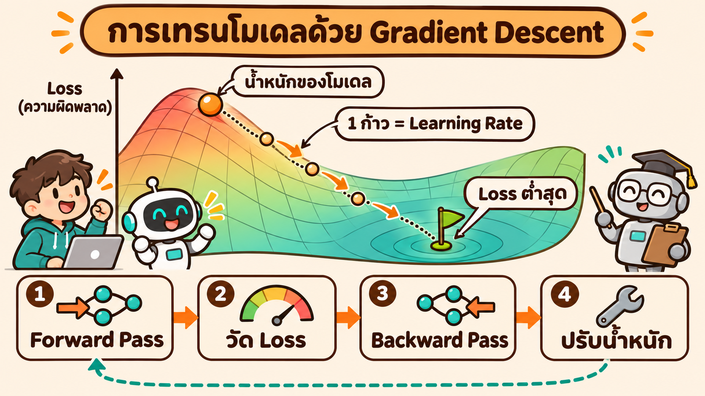

**ภาพในใจ:** โมเดลคือลูกบอลบนเนินเขา ความสูงของเนินคือ **Loss** (ความผิดพลาด) การเทรนคือการพาลูกบอลเดินลงไปหาจุดต่ำสุด ทีละก้าว

**1 ก้าวของการเทรน มี 4 ขั้น**

| ขั้น | ทำอะไร | เปรียบเหมือน |
|---|---|---|
| 1 Forward Pass | ป้อนข้อมูลให้โมเดล ได้คำตอบ | ทำข้อสอบ |
| 2 วัด Loss | เทียบคำตอบกับเฉลย ได้ตัวเลขความผิดพลาด | ตรวจข้อสอบ |
| 3 Backward Pass | คำนวณ **Gradient** = น้ำหนักแต่ละตัวต้องขยับทางไหน Loss จึงจะลด | ดูว่าผิดเพราะอะไร |
| 4 ปรับน้ำหนัก | ขยับน้ำหนักไปตาม Gradient เล็กน้อย | แก้วิธีทำ |

สูตรของขั้นที่ 4

$$\theta \leftarrow \theta - \eta \cdot \nabla_\theta \, \text{Loss}$$

**อ่านเป็นภาษาคน:** น้ำหนักใหม่ = น้ำหนักเดิม ลบด้วย (ขนาดก้าว × ทิศที่ทำให้ Loss เพิ่ม)

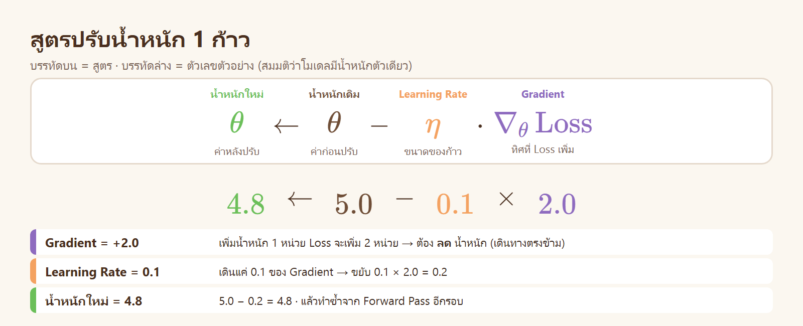

| สัญลักษณ์ | อ่านว่า | ความหมาย |
|---|---|---|
| $\theta$ | theta | น้ำหนักของโมเดล = สิ่งที่ถูกปรับ |
| $\nabla_\theta \, \text{Loss}$ | Gradient | ทิศที่ทำให้ Loss เพิ่มเร็วที่สุด จึงเดินทางตรงข้าม |
| $\eta$ | eta | **Learning Rate** = ขนาดของ 1 ก้าว |

**ทำไมต้องลบ:** Gradient ชี้ไปทางที่ Loss **เพิ่ม** เราต้องการให้ Loss ลด จึงเดินทางตรงข้าม

**ทำไมต้องคูณ $\eta$:** Gradient บอกทิศ ณ จุดที่ยืนอยู่เท่านั้น ถ้าเดินไกลเกินไป ทิศนั้นอาจไม่ถูกแล้ว จึงเดินทีละน้อยแล้วคำนวณใหม่

SkillOpt ใช้เหตุผลชุดเดียวกัน: ข้อเสนอแก้สกิลถูกต้อง ณ สกิลรุ่นปัจจุบันเท่านั้น จึงแก้ทีละไม่กี่ข้อ แล้ววัดใหม่ (ข้อ 6)

**คำที่ใช้คู่กับการเทรน**

| คำ | ความหมาย | ถ้าไม่มีจะเกิดอะไร |
|---|---|---|
| **Learning Rate** | ขนาดของก้าว | ใหญ่ไป = กระโดดข้ามหุบเขา ผลไม่นิ่ง · เล็กไป = ช้า |
| **Minibatch** | ข้อมูลกลุ่มเล็กที่ใช้ต่อ 1 ก้าว | กลุ่มเล็ก = เร็วแต่ทิศแกว่ง · กลุ่มใหญ่ = ทิศนิ่งแต่ช้า |
| **Epoch** | ใช้ข้อมูลฝึกครบ 1 รอบ | – |
| **Validation Set** | ข้อมูลที่ไม่ใช้ฝึก ใช้ตรวจว่าโมเดลดีขึ้นจริง | โมเดลจำข้อมูลฝึก (Overfitting) โดยไม่มีใครรู้ |
| **Checkpoint** | สำเนาของน้ำหนักที่ Validation ดีที่สุด | ได้โมเดลรุ่นสุดท้าย ซึ่งอาจไม่ใช่รุ่นที่ดีที่สุด |
| **Momentum** | จำทิศของก้าวก่อน ๆ มาช่วยก้าวปัจจุบัน | ทิศแกว่งไปมาตามข้อมูลแต่ละกลุ่ม |
| **Test Set** | ข้อมูลที่เปิดใช้ครั้งเดียวตอนรายงานผล | ผลที่รายงานดีเกินจริง |

---

# 2 · แนวคิดของเปเปอร์: เทรนสกิล ไม่เทรนน้ำหนัก

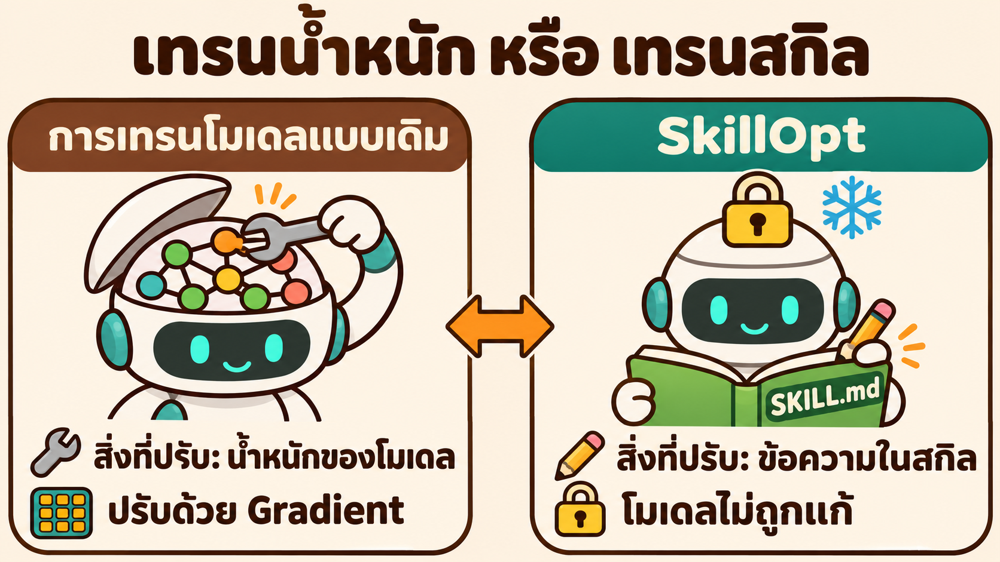

เปเปอร์ตั้งคำถามว่า ถ้าสิ่งที่ Agent ขาดคือ **วิธีทำงาน** (หาข้อมูลอย่างไร ใช้เครื่องมืออย่างไร ตอบรูปแบบไหน) ทำไมต้องไปแก้น้ำหนักของโมเดล

| | การเทรนโมเดลแบบเดิม | SkillOpt |
|---|---|---|
| สิ่งที่ถูกปรับ | น้ำหนักหลายพันล้านตัว | ข้อความในสกิล 1 ไฟล์ (ประมาณ 300–2,000 โทเคน) |
| โมเดล | ถูกแก้ | **ถูกล็อก** (Frozen) ไม่แตะเลย |
| ใช้กับโมเดลปิดได้หรือไม่ | ไม่ได้ (ไม่มีสิทธิ์แก้น้ำหนัก) | ได้ |
| คนอ่านผลลัพธ์ออกหรือไม่ | ไม่ออก | อ่านออก เป็นภาษาคน |
| ย้ายไปใช้กับโมเดลอื่น | ไม่ได้ | ได้ (เปเปอร์ทดลองแล้ว ข้อ 8) |

ปัญหาของวิธีที่มีอยู่ก่อน ซึ่งเปเปอร์ต้องการแก้

| วิธีเดิม | ปัญหา |
|---|---|
| คนเขียนสกิลเอง | ใช้ได้กับงานที่คนเขียนนึกถึง พอเปลี่ยนงานหรือเปลี่ยนโมเดลก็พลาด |
| ให้ LLM เขียนสกิลครั้งเดียว | ไม่ได้ลองใช้จริง ไม่รู้ว่าได้ผลหรือไม่ |
| ให้ LLM แก้สกิลตัวเองไปเรื่อย ๆ โดยไม่ตรวจ | แก้ทีละมาก ๆ ลบกฎที่ดีทิ้ง ผลขึ้น ๆ ลง ๆ |

คำตอบของเปเปอร์: **ถ้าสกิลคือสิ่งที่ถูกปรับ ก็ควรปรับมันอย่างมีวินัยแบบเดียวกับการเทรนโมเดล** คือมีหลักฐานต่อก้าว มีขนาดก้าว มีการตรวจบนข้อมูลที่ไม่ได้ใช้ฝึก และมีทิศทางที่ต่อเนื่อง

---

# 3 · เทียบทีละแนวคิด

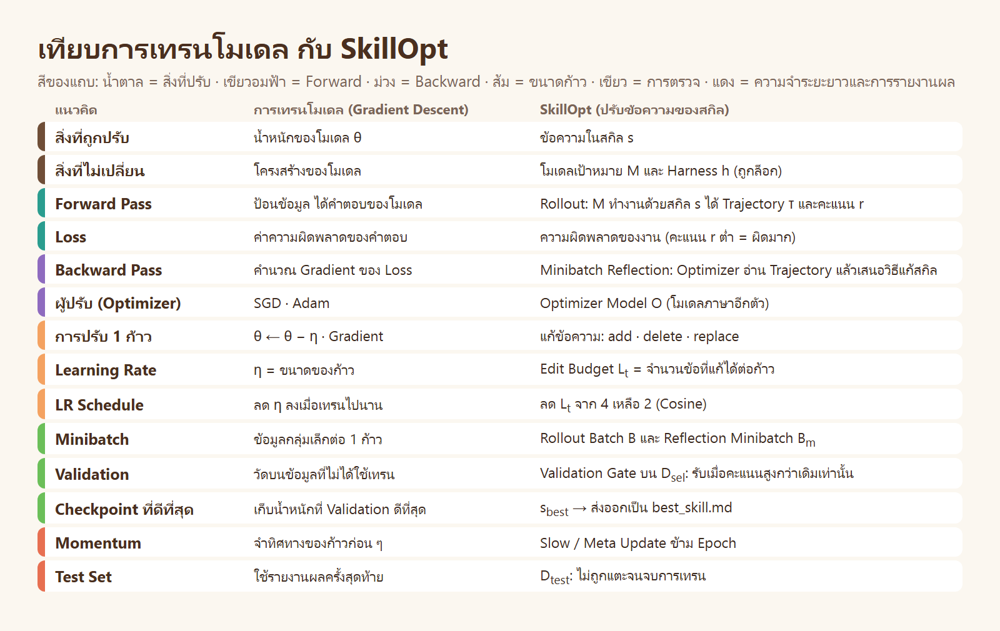

อ่านตารางทีละแถว: ซ้าย = ชื่อแนวคิด · กลาง = ในการเทรนโมเดล · ขวา = สิ่งที่ทำหน้าที่เดียวกันใน SkillOpt

**การเปรียบนี้ตรงแค่ไหน**

| ตรงกัน | ไม่ตรงกัน |
|---|---|
| โครงของวงรอบ: ลองทำ → ดูว่าผิดอย่างไร → ปรับเล็กน้อย → ตรวจ | ข้อความหา Gradient ทางคณิตศาสตร์ไม่ได้ "Gradient" ในที่นี้คือ **ข้อเสนอแก้เป็นภาษาคน** จาก Optimizer Model |
| บทบาทของ Learning Rate, Minibatch, Validation, Momentum | Gradient จริงรับประกันว่าก้าวเล็กพอแล้ว Loss ลด · ข้อเสนอแก้เป็นภาษา **ไม่รับประกัน** อะไรเลย |

ข้อที่ไม่ตรงกันนี้เป็นเหตุผลที่ SkillOpt ต้องมี **Validation Gate ทุกก้าว**: ข้อเสนอที่ฟังดูมีเหตุผล อาจทำให้โมเดลทำงานแย่ลงก็ได้ จึงต้องลองแล้ววัดก่อนรับ

เปเปอร์ย้ำว่าการเปรียบนี้มีไว้ **ใช้งานจริง** ไม่ใช่แค่ตั้งชื่อให้ดูดี: ทุกแนวคิดในตารางเป็นปุ่มปรับที่มีอยู่ในระบบ และถูกทดลองทีละปุ่ม (ข้อ 8)

---

# 4 · ภูมิประเทศของความผิดพลาด (Figure 1 ของเปเปอร์)

Figure 1 ของเปเปอร์รวม 2 เรื่องไว้ในภาพเดียว บทนี้แยกเป็น 2 ภาพ

## 4.1 ภูมิประเทศคืออะไร


| ในภาพ | ความหมาย |
|---|---|
| 1 จุดบนพื้นผิว | สกิล 1 รุ่น (ข้อความ 1 ชุด) |
| ความสูง | ความผิดพลาดบน Validation ของสกิลรุ่นนั้น |
| จุดเริ่มต้นบนเนิน | สกิลรุ่นแรก $s_0$ |
| หุบเขา | สกิลที่ดีที่สุด |
| การแก้สกิล 1 ครั้ง | การย้ายจากจุดหนึ่งไปอีกจุดหนึ่ง |

ต่างจากการเทรนโมเดลตรงที่ **เรามองไม่เห็นพื้นผิวนี้** จะรู้ความสูงของจุดใดก็ต้องให้โมเดลทำงานจริงด้วยสกิลรุ่นนั้นแล้ววัด

## 4.2 แก้ตามใจ เทียบกับ แก้ทีละก้าว

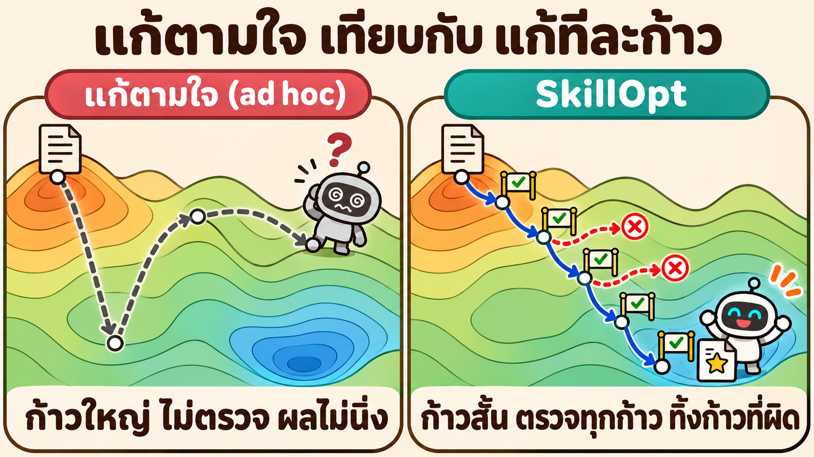

| | แก้ตามใจ (ad hoc update) | SkillOpt |
|---|---|---|
| ขนาดของการแก้ | เขียนสกิลใหม่ทั้งไฟล์ได้ = กระโดดไกล | จำกัดจำนวนข้อที่แก้ต่อก้าว = ก้าวสั้น |
| ตรวจก่อนรับ | ไม่ตรวจ | ตรวจบน Validation ทุกก้าว |
| ก้าวที่ทำให้แย่ลง | ถูกรับไปด้วย | ถูกปฏิเสธ และถูกจดไว้ไม่ให้ทำซ้ำ |
| ผล | ลบกฎที่ดีทิ้ง ผลไม่นิ่ง | ลงเนินต่อเนื่อง |

**ทำไมก้าวสั้นจึงสำคัญ** (เหตุผลของเปเปอร์)

| ถ้าก้าวสั้น | ถ้าก้าวยาว |
|---|---|
| สกิลรุ่นใหม่ต่างจากรุ่นก่อนไม่กี่ข้อ → รู้ว่าข้อไหนทำให้คะแนนเปลี่ยน | เปลี่ยนหลายอย่างพร้อมกัน → ไม่รู้ว่าอะไรได้ผล |
| ประวัติ "อะไรเคยได้ผล อะไรเคยถูกปฏิเสธ" ยังใช้กับรุ่นถัดไปได้ | รุ่นใหม่ต่างจากเดิมมาก ประวัติเก่าใช้ไม่ได้ |

---

# 5 · โจทย์ในรูปสมการ

เปเปอร์นิยามปัญหาด้วย 3 สมการ ทั้ง 3 ต่อกันเป็นสายเดียว

```text
สมการ 1  ให้คะแนน r ของงาน 1 ชิ้น
   ↓  นำ r ของหลายงานมาเฉลี่ย แล้วเทียบระหว่างสกิลหลายรุ่น
สมการ 2  ให้สกิลรุ่นที่ดีที่สุด s★
   ↓  นำ s★ ไปทำงานอีกชุดหนึ่ง แล้วเฉลี่ย r อีกครั้ง
สมการ 3  ให้ตัวเลขที่รายงาน
```

**สมการทั้ง 3 สัมพันธ์กันอย่างไร**

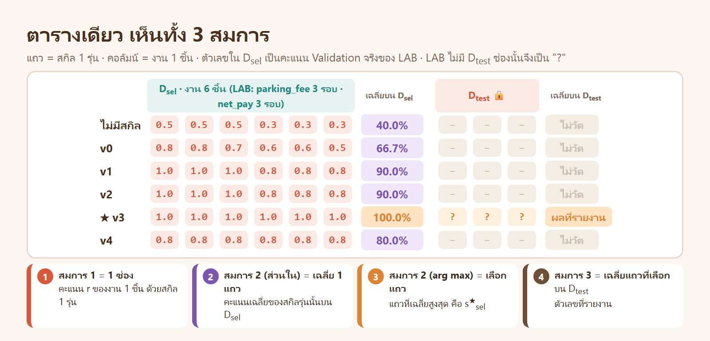

อ่านตารางในภาพ: **แถว = สกิล 1 รุ่น · คอลัมน์ = งาน 1 ชิ้น · ตัวเลขในช่อง = คะแนน**

| เลขในภาพ | สมการ | คือส่วนไหนของตาราง | ใช้อะไรจากสมการก่อนหน้า | ได้อะไร |
|---|---|---|---|---|
| 1 | สมการ 1 | **1 ช่อง** | – | คะแนน $r$ 1 ตัว |
| 2 | สมการ 2 ส่วนใน | **เฉลี่ย 1 แถว** บนคอลัมน์ของ $D_{\text{sel}}$ | $r$ จากสมการ 1 ของทุกช่องในแถว | คะแนนเฉลี่ยของสกิล 1 รุ่น |
| 3 | สมการ 2 ส่วนนอก | **เลือกแถว** ที่เฉลี่ยสูงสุด | คะแนนเฉลี่ยของทุกแถว | สกิลที่ดีที่สุด $s^{\star}_{\text{sel}}$ |
| 4 | สมการ 3 | **เฉลี่ยแถวที่เลือก** บนคอลัมน์ของ $D_{\text{test}}$ | $s^{\star}_{\text{sel}}$ จากสมการ 2 และ $r$ จากสมการ 1 | ตัวเลขที่รายงาน |

สรุปความสัมพันธ์

| | สมการ 1 | สมการ 2 | สมการ 3 |
|---|---|---|---|
| หน้าที่ | **วัด** งาน 1 ชิ้น | **เลือก** สกิล 1 รุ่นจากหลายรุ่น | **รายงาน** ผลของรุ่นที่เลือก |
| ขนาด | 1 ช่อง | ทั้งตารางฝั่ง $D_{\text{sel}}$ | 1 แถวฝั่ง $D_{\text{test}}$ |
| ใช้สมการ 1 กี่ครั้ง | 1 | จำนวนรุ่น × จำนวนงานใน $D_{\text{sel}}$ | จำนวนงานใน $D_{\text{test}}$ |
| ใน LAB ของเรา | 1 Trial | 6 รุ่น × 6 ค่า = 36 Trial | ไม่มี (LAB ไม่มี $D_{\text{test}}$) |

สมการ 2 และ 3 จึงไม่มีอะไรใหม่นอกจาก **การเฉลี่ย** และ **การเลือก** ตัวเลขทุกตัวที่ใช้มาจากสมการ 1

ข้อมูล 3 ชุดทำหน้าที่ต่างกัน

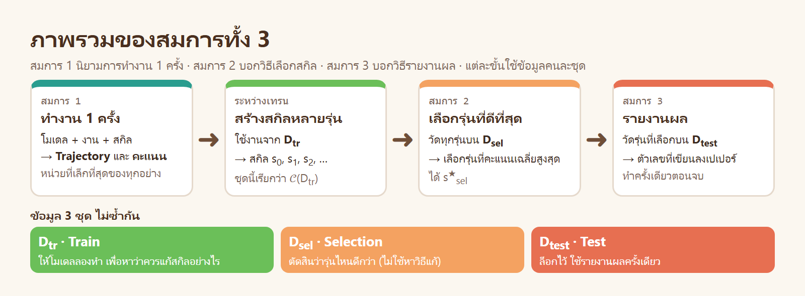

## 5.1 สมการ 1: การทำงาน 1 ครั้ง

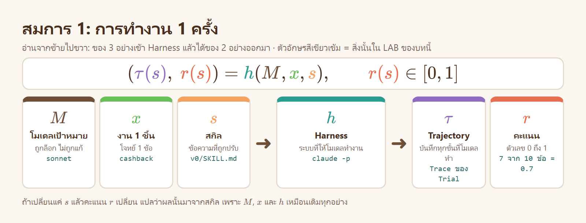

$$(\tau(s),\; r(s)) = h(M, x, s), \qquad r(s) \in [0, 1]$$

**อ่านเป็นภาษาคน:** ให้ Harness $h$ รันโมเดล $M$ ทำงาน $x$ โดยมีสกิล $s$ อยู่ด้วย จะได้ของ 2 อย่าง คือบันทึกการทำงาน $\tau$ และคะแนน $r$

| สัญลักษณ์ | ชื่อ | ความหมาย | ใน LAB ของบทนี้ |
|---|---|---|---|
| $M$ | Target Model | โมเดลที่ทำงาน · ถูกล็อก ไม่ถูกแก้ | โมเดล sonnet |
| $x$ | Task | งาน 1 ชิ้น | โจทย์ 1 ข้อ เช่น `cashback` |
| $s$ | Skill | ข้อความที่ใส่ให้โมเดลก่อนทำงาน · **สิ่งเดียวที่ถูกปรับ** | `SKILL.md` ของ `money-coder` |
| $h$ | Harness | ระบบที่ให้โมเดลทำงาน และให้คะแนน | `claude -p` ใน container และตัวตรวจ |
| $\tau$ | Trajectory | บันทึกทุกขั้นที่โมเดลทำ | Trace ของ 1 Trial |
| $r$ | Score | คะแนนของงานนั้น ระหว่าง 0 ถึง 1 | จำนวนข้อตรวจที่ผ่าน ÷ 10 |

**แทนค่าด้วย LAB**

```text
h( sonnet , cashback , v0/SKILL.md )  →  ( Trace ของ Trial นั้น , 0.7 )
```

**ทำไมเขียน $r(s)$ ไม่ใช่ $r$ เฉย ๆ:** $M$ และ $h$ ไม่เปลี่ยนตลอดการเทรน สิ่งเดียวที่เราเปลี่ยนคือ $s$ คะแนนจึงเป็น "ฟังก์ชันของสกิล" · ถ้าคะแนนเปลี่ยน ต้องมาจากสกิลอย่างเดียว

**ของ 2 อย่างที่ได้ ถูกใช้คนละที่**

| ผลของสมการ 1 | ใครใช้ต่อ |
|---|---|
| คะแนน $r$ | **สมการ 2 และ 3** (ข้อ 5.2 5.3) |
| Trajectory $\tau$ | **Backward Pass** ใช้หาว่าควรแก้สกิลอย่างไร (ข้อ 6.2) · สมการ 2 และ 3 ไม่ใช้ |

## 5.2 สมการ 2: เลือกสกิลรุ่นที่ดีที่สุด

**ต่อจากสมการ 1:** สมการ 1 ให้คะแนนของงาน 1 ชิ้น แต่คะแนนของงานชิ้นเดียวบอกไม่ได้ว่าสกิลดีหรือไม่ สมการ 2 จึงนำคะแนนของ **หลายงาน** มาเฉลี่ย แล้วเทียบระหว่าง **หลายรุ่น**

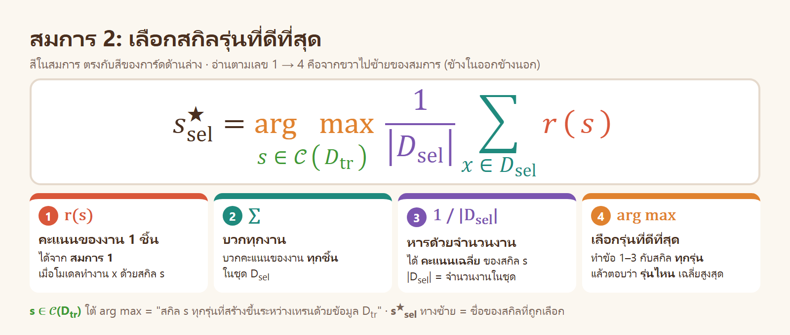

$$s^{\star}_{\text{sel}} = \arg\max_{s \,\in\, \mathcal{C}(D_{\text{tr}})} \; \frac{1}{|D_{\text{sel}}|} \sum_{x \in D_{\text{sel}}} r(s)$$

**อ่านเป็นภาษาคน:** ในบรรดาสกิลทุกรุ่นที่สร้างได้ระหว่างเทรน ให้เลือกรุ่นที่ได้คะแนนเฉลี่ยบน $D_{\text{sel}}$ สูงที่สุด

**อ่านตามเลขในภาพ** (จากขวาไปซ้ายของสมการ)

| เลข | ส่วนของสมการ | ทำอะไร |
|---|---|---|
| 1 | $r(s)$ | นำคะแนนของงาน 1 ชิ้นมาจากสมการ 1 |
| 2 | $\sum_{x \in D_{\text{sel}}}$ | บวกคะแนนของทุกงานในชุด $D_{\text{sel}}$ |
| 3 | $\frac{1}{\lvert D_{\text{sel}} \rvert}$ | หารด้วยจำนวนงาน ได้คะแนนเฉลี่ยของสกิลรุ่นนั้น |
| 4 | $\arg\max$ | ทำข้อ 1–3 กับสกิลทุกรุ่น แล้วตอบว่ารุ่นไหนได้เฉลี่ยสูงสุด |

**คิดตามด้วยตัวเลขจริง**

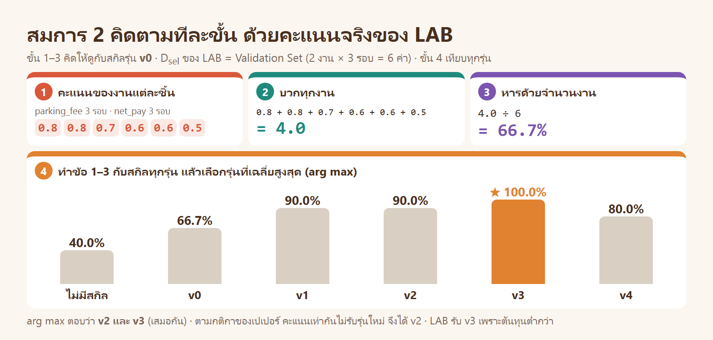

| ขั้น | คิดอย่างไร (สกิลรุ่น `v0`) | ผล |
|---|---|---|
| 1 | คะแนนของ 6 งานใน Validation | 0.8 · 0.8 · 0.7 · 0.6 · 0.6 · 0.5 |
| 2 | บวกทุกงาน | 4.0 |
| 3 | หารด้วย 6 | 66.7% |
| 4 | ทำแบบเดียวกันกับทุกรุ่น แล้วเลือกรุ่นที่สูงสุด | `v3` (100.0%) |

**สัญลักษณ์ที่มักสับสน**

| สัญลักษณ์ | อ่านว่า | ความหมาย |
|---|---|---|
| $\lvert D_{\text{sel}} \rvert$ | ขนาดของ D sel | จำนวนงานในชุด $D_{\text{sel}}$ (ใน LAB = 6) |
| $x \in D_{\text{sel}}$ | x เป็นสมาชิกของ D sel | งาน $x$ แต่ละชิ้นในชุด $D_{\text{sel}}$ |
| $\mathcal{C}(D_{\text{tr}})$ | C ของ D train | ชุดของสกิลทุกรุ่นที่สร้างระหว่างเทรน (C = Candidates · ใน LAB = ไม่มีสกิล และ `v0` ถึง `v4`) |
| $\arg\max$ | อาร์ก แมกซ์ | ตอบว่า **ตัวไหน** ให้ค่าสูงสุด · ต่างจาก $\max$ ที่ตอบว่าค่าสูงสุด **เท่ากับเท่าไร** |
| $s^{\star}_{\text{sel}}$ | s สตาร์ | สกิลที่ถูกเลือก (ดาว = ดีที่สุด · sel = เลือกด้วย $D_{\text{sel}}$) |

ตัวอย่างของ $\arg\max$ กับ $\max$ จากภาพ: $\max$ = 100.0% · $\arg\max$ = `v2` (และ `v3`)

**ทำไมสกิลถูกสร้างจาก $D_{\text{tr}}$ แต่ถูกเลือกด้วย $D_{\text{sel}}$**

| ถ้าเลือกด้วย | จะเกิดอะไร |
|---|---|
| $D_{\text{tr}}$ | สกิลถูกแก้จากข้อผิดของงานชุดนี้อยู่แล้ว คะแนนบนชุดนี้จึงสูงเสมอ บอกไม่ได้ว่าใช้กับงานอื่นได้หรือไม่ |
| $D_{\text{sel}}$ | เป็นงานที่ไม่ถูกใช้หาวิธีแก้ ถ้าคะแนนขึ้นที่นี่ด้วย แปลว่าสกิลดีขึ้นจริง |

สมการนี้เทียบได้กับการเก็บ **Checkpoint ที่ Validation ดีที่สุด** ในการเทรนโมเดล

## 5.3 สมการ 3: รายงานผล

**ต่อจากสมการ 2:** สมการ 2 ให้สกิลที่ดีที่สุด $s^{\star}_{\text{sel}}$ สมการ 3 ถามว่า **สกิลรุ่นนั้นดีแค่ไหนกับงานที่ไม่เคยเห็นเลย**

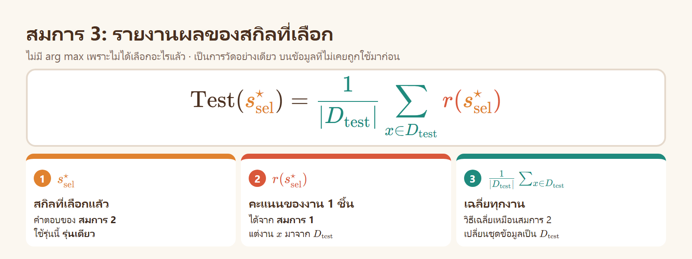

$$\text{Test}(s^{\star}_{\text{sel}}) = \frac{1}{|D_{\text{test}}|} \sum_{x \in D_{\text{test}}} r(s^{\star}_{\text{sel}})$$

**อ่านเป็นภาษาคน:** นำสกิลที่เลือกได้จากสมการ 2 **รุ่นเดียว** ไปทำงานทุกชิ้นใน $D_{\text{test}}$ แล้วหาค่าเฉลี่ย ตัวเลขนี้คือผลที่รายงาน

สมการ 3 คือส่วนในของสมการ 2 ที่เปลี่ยนไป 2 จุด

| | สมการ 2 | สมการ 3 |
|---|---|---|
| สกิลที่ใส่ใน $r(\cdot)$ | $s$ = ทุกรุ่น ทีละรุ่น | $s^{\star}_{\text{sel}}$ = รุ่นที่เลือกแล้ว รุ่นเดียว |
| ชุดข้อมูลที่เฉลี่ย | $D_{\text{sel}}$ | $D_{\text{test}}$ |
| มี $\arg\max$ หรือไม่ | มี (เป็นการเลือก) | ไม่มี (เป็นการวัดอย่างเดียว) |
| ทำกี่ครั้ง | ทุกก้าวของการเทรน | ครั้งเดียวตอนจบ |
| ผลที่ได้ | สกิล 1 รุ่น | ตัวเลข 1 ตัว |

**ทำไมรายงานคะแนนของ $D_{\text{sel}}$ จากสมการ 2 เลยไม่ได้**

สกิลถูกเลือกเพราะได้คะแนนบน $D_{\text{sel}}$ สูงสุดในหลายรุ่น ส่วนหนึ่งของคะแนนนั้นจึงมาจากความบังเอิญที่เข้าทางชุดนี้ เหมือนทอยลูกเต๋า 10 ครั้งแล้วรายงานเฉพาะครั้งที่ได้แต้มสูงสุด · $D_{\text{test}}$ ไม่เคยถูกใช้เลือกอะไร คะแนนบนชุดนี้จึงไม่เอนเอียง

LAB ของบทนี้ไม่มี $D_{\text{test}}$ ผลที่รายงานจึงเป็นคะแนนของ Validation ซึ่งถูกใช้ตัดสินมาแล้ว 5 ครั้ง (ข้อจำกัดในข้อ 4.4 ของ README หลัก)

## 5.4 สมการทั้ง 3 บอกอะไร และไม่บอกอะไร

| บอก | ไม่บอก |
|---|---|
| คะแนนของงาน 1 ชิ้นวัดอย่างไร (สมการ 1) | สกิลรุ่นใหม่แต่ละรุ่นใน $\mathcal{C}(D_{\text{tr}})$ **สร้างขึ้นมาอย่างไร** |
| เลือกรุ่นไหน (สมการ 2) | ควรแก้กี่ข้อต่อก้าว |
| รายงานผลอย่างไร (สมการ 3) | ทำอย่างไรไม่ให้ลองวิธีที่เคยไม่ได้ผลซ้ำ |

ส่วนที่สมการไม่บอก คือเนื้อหาของข้อ 6: วิธีสร้างสกิลรุ่นใหม่ทีละก้าว · ในตารางของภาพแรก ข้อ 6 คือ **วิธีเพิ่มแถวใหม่** ทีละแถว

**เชื่อมกับ Gradient Descent:** การเทรนโมเดลหา $\theta$ ที่ทำให้ Loss เฉลี่ย **ต่ำสุด** · SkillOpt หา $s$ ที่ทำให้คะแนนเฉลี่ย **สูงสุด** เป็นปัญหาแบบเดียวกัน ต่างกันที่ $\theta$ เป็นตัวเลข จึงหา Gradient ได้ ส่วน $s$ เป็นข้อความ จึงต้องให้ Optimizer Model เสนอวิธีแก้แทน

---

# 6 · หนึ่งก้าวของ SkillOpt (Figure 2 ของเปเปอร์)

Figure 2 ของเปเปอร์เป็นไพป์ไลน์ยาว 1 ภาพ บทนี้แยกเป็น 3 ช่วง ช่วงละ 2–4 ภาพ

```text
6.1 Forward Pass   →   6.2 Backward Pass   →   6.3 Validation Gate
    (ลองทำงาน)           (หาวิธีแก้สกิล)           (รับ หรือ ไม่รับ)
```

| ช่วง | เข้า | ออก | ใครทำ |
|---|---|---|---|
| 6.1 Forward Pass | สกิลปัจจุบัน + งานจาก $D_{\text{tr}}$ | Rollout Batch | โมเดลเป้าหมาย $M$ |
| 6.2 Backward Pass | Rollout Batch | สกิลรุ่นใหม่ (แก้ไม่เกิน $L_t$ ข้อ) | Optimizer Model $O$ |
| 6.3 Validation Gate | สกิลรุ่นใหม่ + งานจาก $D_{\text{sel}}$ | ACCEPT หรือ REJECT | โมเดลเป้าหมาย $M$ และตัวตรวจ |

## 6.1 Forward Pass: Rollout

**Rollout** = ให้โมเดลลองทำงานจริงตั้งแต่ต้นจนจบ แล้วบันทึกทุกอย่างไว้

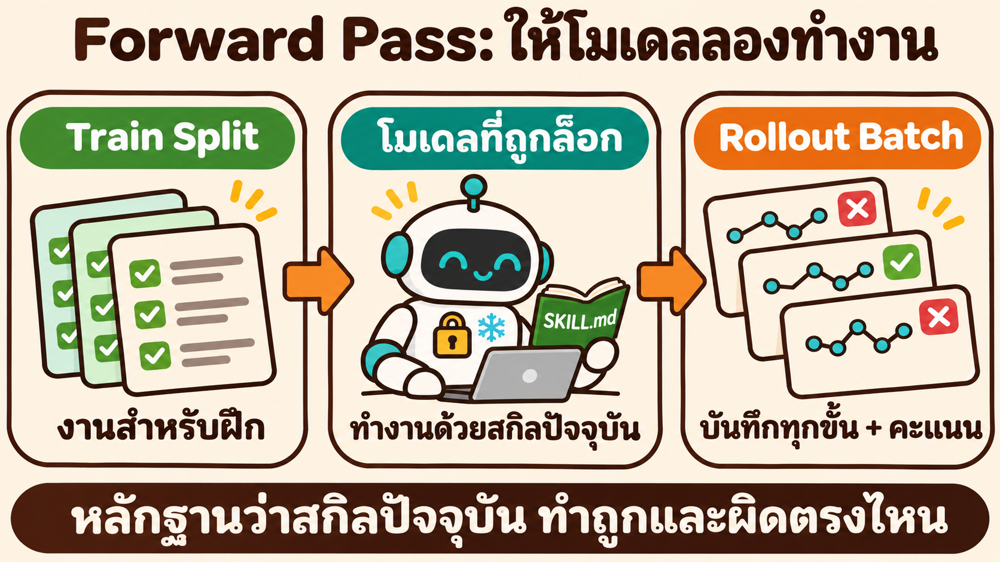

| ลำดับ | เกิดอะไรขึ้น |
|---|---|
| 1 | สุ่มงานกลุ่มหนึ่งจาก $D_{\text{tr}}$ (ค่าตั้งต้น 40 งาน) |
| 2 | โมเดลเป้าหมายทำงานแต่ละชิ้นด้วย **สกิลปัจจุบัน** (ใช้สมการ 1 กับทุกงาน) |
| 3 | ตัวตรวจให้คะแนนงานแต่ละชิ้น |
| 4 | ได้ **Rollout Batch** = Trajectory พร้อมคะแนน ของทุกงานในกลุ่ม |

**Trajectory 1 ใบ เก็บอะไร**

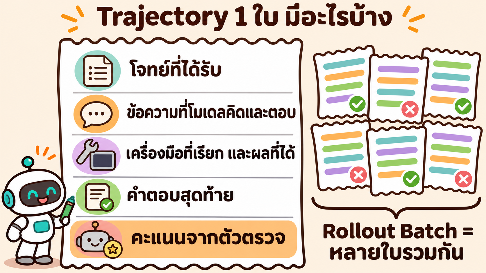

| ใน Trajectory | ใช้ทำอะไรใน Backward Pass | ตัวอย่างจาก LAB (`v0` งาน `cashback`) |
|---|---|---|
| โจทย์ที่ได้รับ | รู้ว่างานต้องการอะไร | ข้อความโจทย์ `cashback` |
| ข้อความที่โมเดลคิดและตอบ | เห็นว่าโมเดลเข้าใจสกิลอย่างไร | – |
| เครื่องมือที่เรียก และผลที่ได้ | เห็นว่าทำขั้นไหนพลาด หรือทำเกินจำเป็น | อ่าน `SKILL.md` → เขียน `solve.py` และ `test_solve.py` → รันเทสต์ |
| คำตอบสุดท้าย | ของที่ถูกตรวจ | ไฟล์ `solve.py` และ `test_solve.py` |
| คะแนนจากตัวตรวจ | บอกว่างานนี้ผิดหรือถูก และผิดข้อไหน | 0.7 · ผิด `reject_type` `cli_ok` `cli_error` |

**ทำไมต้องเก็บทั้ง Trajectory ไม่ใช่แค่คะแนน:** คะแนนบอกว่า **ผิด** แต่ Trajectory บอกว่า **ผิดเพราะอะไร** ซึ่งเป็นสิ่งที่ Backward Pass ต้องใช้

**ขนาดของกลุ่ม $B$** ทำหน้าที่เหมือน Batch Size

| กลุ่มเล็ก | กลุ่มใหญ่ |
|---|---|
| แก้สกิลได้บ่อย | แก้สกิลได้น้อยครั้งกว่า |
| หลักฐานน้อย ข้อผิดที่เห็นอาจเป็นความบังเอิญ | เห็นข้อผิดที่เกิดซ้ำชัดกว่า |

## 6.2 Backward Pass: Minibatch Reflection

ช่วงนี้ตอบคำถามเดียว: **จากหลักฐานที่ได้ ควรแก้สกิลตรงไหน** · ภาพรวมก่อน

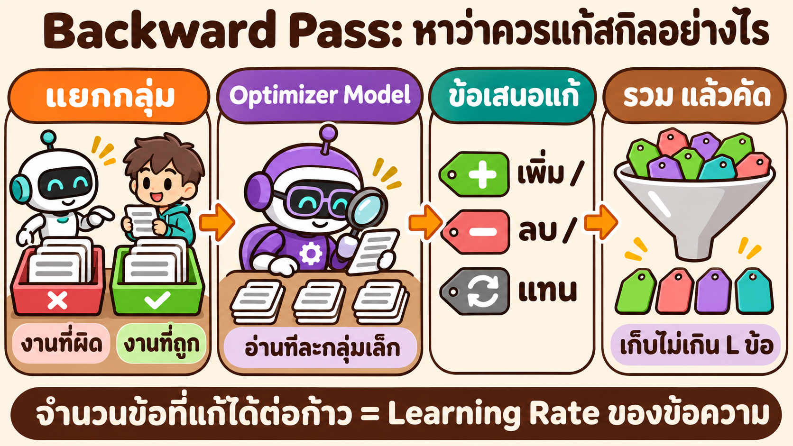

| ขั้น | ทำอะไร | อธิบายในข้อ |
|---|---|---|
| 1 แยกกลุ่ม | แยกงานที่ผิดกับงานที่ถูก แล้วแบ่งเป็นกลุ่มเล็ก | 6.2.1 |
| 2 Reflection | Optimizer Model อ่านทีละกลุ่ม แล้วเสนอ Edit | 6.2.1 |
| 3 ข้อเสนอแก้ | Edit มี 3 แบบ | 6.2.2 |
| 4 รวม แล้วคัด | รวมข้อเสนอ แล้วเก็บไม่เกิน $L_t$ ข้อ | 6.2.3 |

ข้อ 6.2.4 เดินตามทั้ง 4 ขั้นด้วยผลจริงของ LAB · ข้อ 6.2.5 เทียบกับ Gradient Descent และ LAB ของเรา

### 6.2.1 แยกกลุ่ม แล้วอ่านทีละกลุ่มเล็ก


| คำถาม | คำตอบ |
|---|---|
| ทำไมแยกงานที่ผิดกับงานที่ถูก | งานที่ผิดบอกว่าสกิล **ขาดอะไร** · งานที่ถูกบอกว่าสกิล **มีอะไรดีอยู่แล้ว** ที่ต้องรักษาไว้ |
| ทำไมอ่านทีละกลุ่ม (Minibatch) | อ่านทีละงาน Optimizer จะเสนอวิธีแก้ที่ใช้ได้กับงานนั้นงานเดียว · อ่านทีละกลุ่มจะเห็นข้อผิดที่ **เกิดซ้ำ** ซึ่งเป็นข้อบกพร่องของสกิลจริง |
| กลุ่มละกี่งาน | ค่าตั้งต้น 8 งาน ($B_m = 8$) |
| ข้อผิดที่เกิดซ้ำหน้าตาอย่างไร | เปเปอร์ยกตัวอย่าง: ค้นข้อมูลผิดแหล่งทุกครั้ง · ตอบผิดรูปแบบทุกครั้ง · ไม่ตรวจผลของเครื่องมือทุกครั้ง |

ตัวอย่างจาก LAB: ใน `v0` ข้อ `cli_ok` ผิด **12 จาก 12 Trial** จึงเป็นข้อบกพร่องของสกิล ส่วน `no_drift` ผิด 1 จาก 12 Trial จึงยังไม่ถูกแก้ใน `v1`

### 6.2.2 ข้อเสนอแก้: Edit 3 แบบ

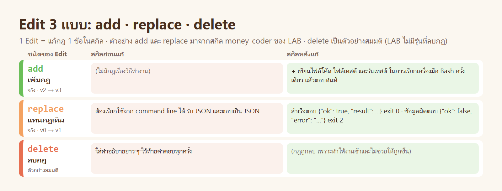

| Edit | ทำอะไร | ใช้เมื่อ |
|---|---|---|
| **add** | เพิ่มกฎใหม่ 1 ข้อ | สกิลไม่เคยพูดถึงเรื่องนั้น |
| **replace** | แทนกฎเดิมด้วยกฎที่ชัดกว่า | สกิลพูดถึงแล้ว แต่กว้างหรือผิด |
| **delete** | ลบกฎ 1 ข้อ | กฎนั้นทำให้ผลแย่ลง หรือขัดกับกฎอื่น |

Optimizer Model ต้องเสนอเป็น Edit ทีละข้อ ไม่เขียนสกิลใหม่ทั้งไฟล์ ทุก Edit จึงตรวจย้อนได้ว่ามาจากหลักฐานกลุ่มไหน

### 6.2.3 รวม คัด และ Learning Rate

ข้อเสนอจากทุกกลุ่มรวมกันมีจำนวนมาก ต้องผ่าน 2 ขั้นก่อนใช้

| ขั้น | ทำอะไร | ทำไม |
|---|---|---|
| **Merge** | รวมข้อเสนอของงานที่ผิด และของงานที่ถูก แล้วรวมกันอีกครั้งโดยให้การแก้ข้อผิดมาก่อน · ตัดข้อที่ซ้ำ ขัดกัน หรือเจาะจงเฉพาะตัวอย่าง | ข้อเสนอที่มาจากหลายกลุ่มน่าเชื่อกว่าข้อที่มาจากกลุ่มเดียว |
| **Rank แล้ว Clip** | เรียงตามประโยชน์ที่คาดว่าจะได้ แล้วเก็บเฉพาะ $L_t$ ข้อแรก | จำกัดขนาดของก้าว |

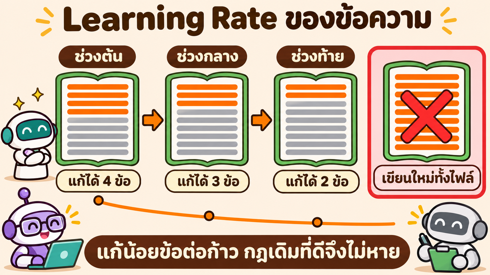

**$L_t$ คือ Learning Rate ของข้อความ**

| หัวข้อ | การเทรนโมเดล | SkillOpt |
|---|---|---|
| Learning Rate คือ | ตัวเลข $\eta$ ที่คูณกับ Gradient | จำนวน Edit สูงสุดต่อก้าว $L_t$ |
| ค่าตั้งต้น | แล้วแต่โมเดล | เริ่มที่ 4 ลดแบบ Cosine จนเหลือ 2 |
| ใหญ่เกินไป | กระโดดข้ามจุดต่ำสุด Loss แกว่ง | เขียนใหม่มากเกิน ลบกฎที่ดี ใส่กฎที่ขัดกัน |
| เล็กเกินไป | เทรนช้า | เรียนรู้ช้า ต้องใช้หลายก้าว |
| ทำไมลดลงตามเวลา | ช่วงท้ายควรปรับละเอียด | ช่วงต้นสกิลยังขาดมาก · ช่วงท้ายควรเก็บรายละเอียดโดยไม่ทำของเดิมพัง |

ผลของช่วงนี้คือ **สกิลรุ่นใหม่** 1 รุ่น ซึ่งต่างจากสกิลปัจจุบันไม่เกิน $L_t$ ข้อ · รุ่นนี้ยังไม่ถูกใช้ ต้องผ่านข้อ 6.3 ก่อน

### 6.2.4 เดินตามตัวอย่างจริง: `v0` → `v1` ของ LAB

ภาพนี้นำผลจริงของ LAB มาจัดให้อยู่ในรูปของ SkillOpt ทีละขั้น (LAB ไม่ได้แบ่ง Minibatch จริง ส่วนจำนวน Trial ที่พบข้อผิดเป็นผลจริง)

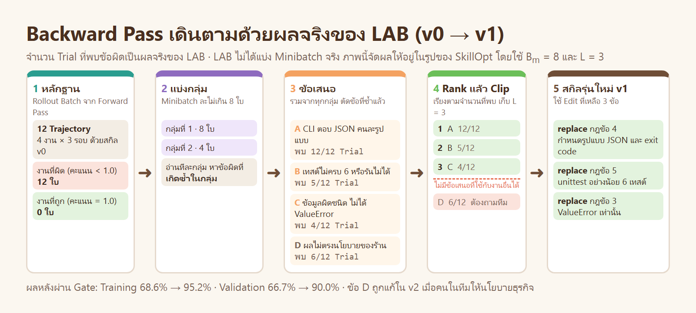

| ขั้น | เกิดอะไรขึ้นในตัวอย่าง | สิ่งที่ถูกคัดออก |
|---|---|---|
| 1 หลักฐาน | Forward Pass ให้ Trajectory 12 ใบ (4 งาน × 3 รอบ) ทุกใบได้คะแนนไม่เต็ม จึงเป็น "งานที่ผิด" ทั้ง 12 ใบ | – |
| 2 แบ่งกลุ่ม | แบ่งเป็นกลุ่มละไม่เกิน 8 ใบ ได้ 2 กลุ่ม (8 ใบ และ 4 ใบ) | – |
| 3 Reflection | อ่านทีละกลุ่ม หาข้อผิดที่ **เกิดซ้ำในกลุ่ม** แล้วเสนอ Edit · รวมจากทุกกลุ่มและตัดข้อที่ซ้ำกัน เหลือ 4 ข้อ (A B C D) | ข้อเสนอที่ซ้ำกันระหว่างกลุ่ม |
| 4 Rank แล้ว Clip | เรียงตามจำนวน Trial ที่พบ: A 12/12 · D 6/12 · B 5/12 · C 4/12 · ข้อ D ไม่มีข้อเสนอที่ใช้กับงานอื่นได้ จึงเหลือ 3 ข้อพอดี | **ข้อ D** (ตัวตรวจบอกตัวอย่างเดียวต่อโจทย์ ไม่พอสรุปเป็นกฎ ต้องถามทีม) |
| 5 สกิลรุ่นใหม่ | ใช้ Edit 3 ข้อกับ `v0` ได้ `v1` · ทั้ง 3 ข้อเป็นแบบ replace | – |

**ข้อเสนอ 4 ข้อ และ Edit ที่ได้**

| ข้อ | ข้อผิดที่เกิดซ้ำ | พบ | สกิล `v0` เขียนว่า | Edit (replace) ใน `v1` |
|---|---|---|---|---|
| A | CLI ตอบ JSON คนละรูปแบบ | 12/12 | "รับ JSON และตอบเป็น JSON" | สำเร็จ `{"ok": true, "result": …}` exit 0 · ผิด `{"ok": false, "error": "…"}` exit 2 |
| B | เทสต์ไม่ครบ 6 หรือรันด้วย unittest ไม่ได้ | 5/12 | "เขียนเทสต์มาด้วยทุกครั้ง" | `unittest.TestCase` อย่างน้อย 6 เทสต์ และต้องรันผ่าน |
| C | ข้อมูลผิดชนิด ไม่ได้ `ValueError` | 4/12 | "ถ้าผิดให้แจ้ง error" | ผิดชนิดหรือผิดช่วง → `raise ValueError` เท่านั้น |
| D | ผลไม่ตรงนโยบายของร้าน (`policy`) | 6/12 | ไม่ได้เขียน | ไม่ถูกเสนอเป็น Edit ในก้าวนี้ |

หมายเหตุ: ในเปเปอร์ Optimizer Model เป็นผู้เรียงข้อเสนอตามประโยชน์ที่คาดว่าจะได้ ตัวอย่างนี้ใช้จำนวน Trial ที่พบแทน เพราะเป็นเกณฑ์ที่ LAB ใช้จริง

**บทเรียนจากข้อ D:** ข้อ D พบบ่อยเป็นอันดับ 2 แต่ถูกเว้นไว้ เพราะข้อมูลไม่พอจะเขียนเป็นกฎที่ใช้กับงานอื่นได้ · ข้อนี้ถูกแก้ใน `v2` เมื่อคนในทีมให้นโยบายธุรกิจ (LAB 3) = Reflection บอกได้ว่าความรู้ขาดตรงไหน แต่บางครั้งความรู้นั้นต้องมาจากคน

### 6.2.5 เทียบ 3 ทาง: Gradient Descent · SkillOpt · LAB ของเรา

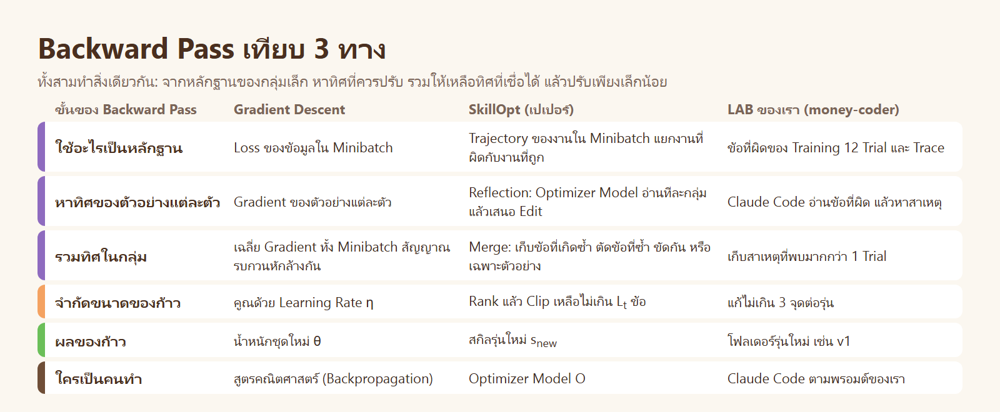

| ขั้น | Gradient Descent | SkillOpt | LAB ของเรา |
|---|---|---|---|
| หลักฐาน | Loss ของข้อมูลใน Minibatch | Trajectory ของงานใน Minibatch | ข้อที่ผิดของ Training 12 Trial และ Trace |
| หาทิศ | Gradient ของตัวอย่างแต่ละตัว | Reflection ทีละกลุ่ม ได้ข้อเสนอ Edit | Claude Code อ่านข้อที่ผิด หาสาเหตุ |
| รวมทิศ | เฉลี่ย Gradient ทั้งกลุ่ม | Merge: เก็บข้อที่เกิดซ้ำ | เก็บสาเหตุที่พบมากกว่า 1 Trial |
| จำกัดก้าว | คูณด้วย $\eta$ | Clip เหลือ $L_t$ ข้อ | แก้ไม่เกิน 3 จุด |
| ผล | น้ำหนักชุดใหม่ | สกิลรุ่นใหม่ | โฟลเดอร์ `v1` |

**ทำไม "รวมทิศ" จึงสำคัญในทั้งสามทาง**

| | ถ้าดูตัวอย่างเดียว | เมื่อรวมทั้งกลุ่ม |
|---|---|---|
| Gradient Descent | Gradient ของตัวอย่างเดียวชี้ไปทางที่ดีกับตัวอย่างนั้น อาจแย่กับตัวอย่างอื่น | ทิศที่ตัวอย่างส่วนใหญ่เห็นตรงกันเหลืออยู่ ทิศเฉพาะตัวหักล้างกันไป |
| SkillOpt | Edit จากงานเดียวเป็นวิธีแก้เฉพาะงานนั้น | Edit ที่หลายกลุ่มเสนอตรงกันได้อันดับสูง ข้อที่เจาะจงเฉพาะตัวอย่างถูกตัด |
| LAB ของเรา | แก้ตามข้อผิดของ Trial เดียวอาจเป็นการแก้ความบังเอิญ | ข้อ A พบ 12/12 จึงแก้ก่อน · ข้อ D มีตัวอย่างเดียวต่อโจทย์ จึงรอถามทีม |

## 6.3 Validation Gate และ Rejected-Edit Buffer

Backward Pass ให้ข้อเสนอที่ **ฟังดูมีเหตุผล** แต่ยังไม่มีอะไรรับประกันว่าได้ผลจริง ช่วงนี้จึงลองแล้ววัด

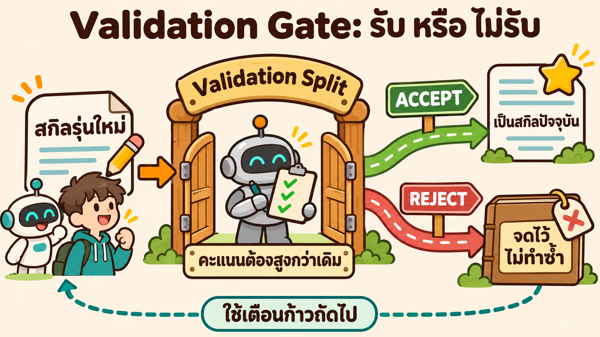

| ลำดับ | เกิดอะไรขึ้น |
|---|---|
| 1 | โมเดลเป้าหมายตัวเดิมทำงานทุกชิ้นใน $D_{\text{sel}}$ ด้วย **สกิลรุ่นใหม่** |
| 2 | คิดคะแนนเฉลี่ย (ส่วนในของสมการ 2) |
| 3 | เทียบกับคะแนนของ **สกิลปัจจุบัน** |
| 4 | สูงกว่า → **ACCEPT** · เท่ากันหรือต่ำกว่า → **REJECT** |

**ตัวอย่างการตัดสิน 6 ก้าว** (ตัวเลขสมมติ)

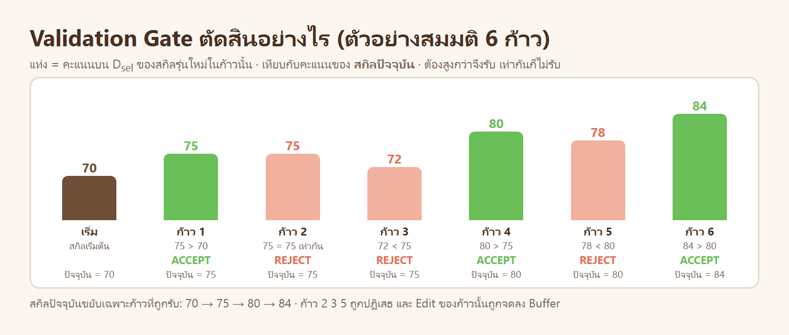

| ก้าว | คะแนนรุ่นใหม่ | คะแนนสกิลปัจจุบัน | ผล | สกิลปัจจุบันหลังก้าวนี้ |
|---|---|---|---|---|
| 1 | 75 | 70 | ACCEPT | 75 |
| 2 | 75 | 75 | REJECT (เท่ากัน) | 75 |
| 3 | 72 | 75 | REJECT | 75 |
| 4 | 80 | 75 | ACCEPT | 80 |
| 5 | 78 | 80 | REJECT | 80 |
| 6 | 84 | 80 | ACCEPT | 84 |

| ข้อสังเกต | ความหมาย |
|---|---|
| สกิลปัจจุบันไม่เคยแย่ลง | 70 → 75 → 80 → 84 · ก้าวที่ผิดไม่ถูกนำมาใช้ |
| เท่ากันก็ไม่รับ (ก้าว 2) | สกิลจะไม่ค่อย ๆ เปลี่ยนไปโดยไม่มีหลักฐานว่าดีขึ้น |
| ก้าวถัดไปเริ่มจากสกิลปัจจุบันเสมอ | ก้าว 3 เริ่มจากสกิลที่ได้ 75 ไม่ใช่จากรุ่นที่ถูกปฏิเสธในก้าว 2 |

เปเปอร์เรียกวิธีนี้ว่า **propose-and-test** (เสนอแล้วทดสอบ) ต่างจากการปล่อยให้โมเดลแก้สกิลตัวเองโดยไม่มีใครตรวจ

**รุ่นที่ถูกปฏิเสธไปไหน: Rejected-Edit Buffer**

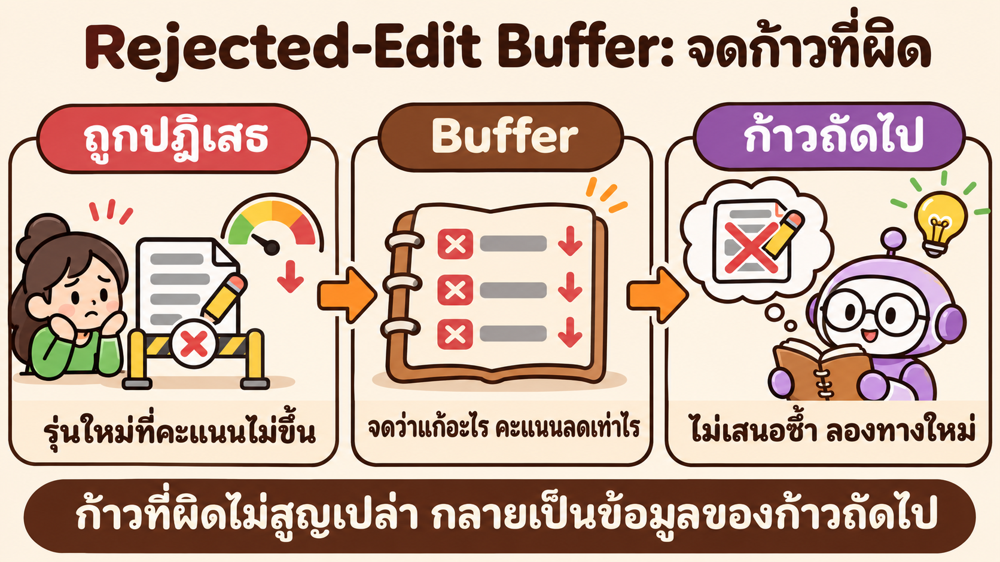

| หัวข้อ | รายละเอียด |
|---|---|
| จดอะไร | Edit ที่ลองในก้าวที่ถูกปฏิเสธ · คะแนนที่ลดลง · รูปแบบของข้อผิดที่พบ |
| ใครอ่าน | Optimizer Model ในก้าวถัดไป |
| ใช้ทำอะไร | ไม่เสนอ Edit ที่เคยไม่ได้ผลซ้ำ และหันไปแก้ข้อผิดที่ยังไม่หาย |
| อยู่นานแค่ไหน | ภายใน Epoch เดียวกัน · ขึ้น Epoch ใหม่แล้วล้าง |
| โมเดลเป้าหมายเห็นหรือไม่ | ไม่เห็น · ไม่ได้อยู่ในสกิลที่ส่งออก |
| เทียบกับการเทรนโมเดล | ไม่มีสิ่งที่เทียบได้ตรง ๆ ใกล้ที่สุดคือการจำว่าทิศไหนเคยทำให้ Loss เพิ่ม |

ใน LAB สิ่งที่ทำหน้าที่นี้คือ `ISSUES.md`: `v4` ถูกปฏิเสธ และถูกจดไว้ว่าการย่อทั้งไฟล์ทำให้รูปแบบคำตอบและ exit code ของ CLI หาย · แบบฝึกหัดข้อ 4 ให้ทำ `v5` โดยอ่านบันทึกนี้ก่อน

## 6.4 Slow Update และ Meta Skill: ความจำข้าม Epoch

**ปัญหาที่ส่วนนี้แก้:** ก้าวปกติ (ข้อ 6.1–6.3) มองเห็นแค่กลุ่มงานของก้าวนั้น และ Buffer ก็ถูกล้างทุกต้น Epoch ระบบจึงไม่มีความจำระยะยาว อาจแก้วนไปวนมา หรือค่อย ๆ ทำกฎที่ดีหายไปโดยไม่รู้ตัว

**ทางแก้:** ท้ายทุก Epoch (ตั้งแต่ Epoch ที่ 2) ทำเพิ่ม 2 อย่าง

| | คืออะไร | เก็บไว้ที่ไหน |
|---|---|---|
| **Slow Update** | บทเรียนระยะยาว **สำหรับโมเดลที่ทำงาน** | ในไฟล์สกิล ส่วนที่ถูกป้องกัน |
| **Meta Skill** | บทเรียนระยะยาว **สำหรับ Optimizer** ว่าควรแก้สกิลอย่างไร | นอกไฟล์สกิล · ไม่ถูกส่งออก |

### 6.4.1 Slow Update

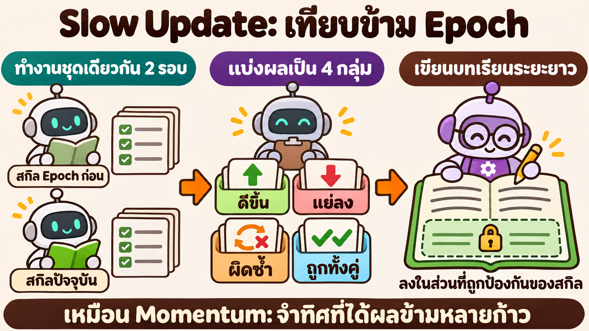

| ลำดับ | เกิดอะไรขึ้น |
|---|---|
| 1 | สุ่มงานฝึกชุดหนึ่ง (ค่าตั้งต้น 20 งาน) |
| 2 | ให้โมเดลทำงานชุดนี้ 2 รอบ: ด้วย **สกิลของ Epoch ก่อน** และด้วย **สกิลปัจจุบัน** |
| 3 | เทียบผลทีละงาน แล้วแบ่งเป็น 4 กลุ่ม (ตารางถัดไป) |
| 4 | Optimizer Model เขียนคำแนะนำระยะยาวสั้น ๆ ลงใน **ส่วนที่ถูกป้องกัน** ของสกิล |
| 5 | สกิลที่มีคำแนะนำนี้ต้องผ่าน Validation Gate เหมือนก้าวปกติ |

**4 กลุ่มบอกอะไร**

| กลุ่ม | Epoch ก่อน | ปัจจุบัน | บอกว่า |
|---|---|---|---|
| ดีขึ้น | ผิด | ถูก | การแก้ใน Epoch นี้ได้ผล ควรรักษาไว้ |
| แย่ลง | ถูก | ผิด | การแก้ใน Epoch นี้ทำของเดิมพัง ต้องเตือน |
| ผิดซ้ำ | ผิด | ผิด | ยังมีข้อบกพร่องที่ก้าวปกติแก้ไม่ได้ |
| ถูกทั้งคู่ | ถูก | ถูก | พฤติกรรมที่มั่นคงแล้ว ไม่ควรแตะ |

ก้าวปกติเห็นแค่ "ตอนนี้ผิดตรงไหน" ส่วน Slow Update เห็น **การเปลี่ยนแปลง** จึงจับกลุ่ม "แย่ลง" ได้ ซึ่งก้าวปกติมองไม่เห็น

**ทำไมต้องมีส่วนที่ถูกป้องกัน**

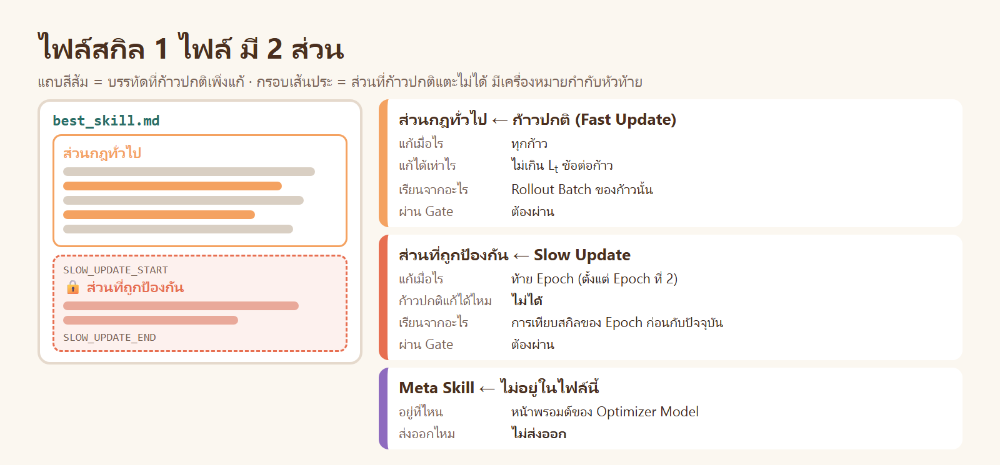

| ส่วนของไฟล์สกิล | ใครแก้ได้ | แก้เมื่อไร | เปรียบเหมือน |
|---|---|---|---|
| ส่วนกฎทั่วไป | ก้าวปกติ | ทุกก้าว ไม่เกิน $L_t$ ข้อ | บันทึกประจำวัน |
| ส่วนที่ถูกป้องกัน | Slow Update เท่านั้น | ท้าย Epoch | บทสรุปประจำเดือน ที่บันทึกประจำวันเขียนทับไม่ได้ |

ถ้าไม่ป้องกัน ก้าวปกติก้าวถัดไปอาจลบหรือแทนบทเรียนระยะยาวเพราะข้อผิดของงานกลุ่มเล็กกลุ่มเดียว

### 6.4.2 Meta Skill

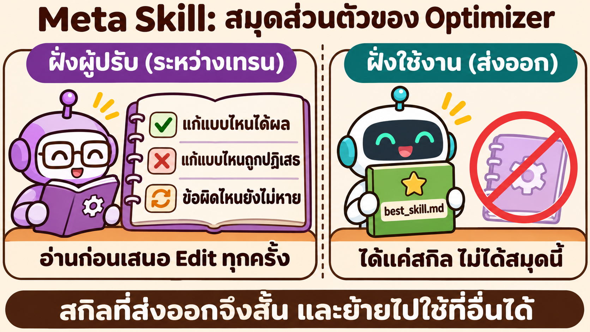

| หัวข้อ | รายละเอียด |
|---|---|
| จดอะไร | Edit แบบไหนเคยได้ผล · แบบไหนถูกปฏิเสธ · ข้อผิดไหนยังอยู่ข้ามหลาย Epoch |
| ใครเขียน | Optimizer Model ท้าย Epoch |
| ใครอ่าน | Optimizer Model เอง ก่อนทำ Reflection, Merge และ Rank ใน Epoch ถัดไป |
| โมเดลที่ทำงานเห็นหรือไม่ | **ไม่เห็น** |
| ถูกส่งออกหรือไม่ | **ไม่** · สิ่งที่ส่งออกมีแค่ `best_skill.md` |

**ทำไมแยกออกจากสกิล:** ประวัติการแก้เป็นประโยชน์ต่อคนแก้ ไม่ใช่ต่อคนทำงาน ถ้าใส่ไว้ในสกิล สกิลจะยาวขึ้นโดยโมเดลที่ทำงานไม่ได้อะไร

### 6.4.3 ความจำทั้ง 3 แบบ เทียบกัน

| | Rejected-Edit Buffer (ข้อ 6.3) | Slow Update | Meta Skill |
|---|---|---|---|
| จำอะไร | Edit ที่เพิ่งถูกปฏิเสธ | บทเรียนเรื่อง **วิธีทำงาน** | บทเรียนเรื่อง **วิธีแก้สกิล** |
| จำนานแค่ไหน | ภายใน Epoch เดียว | ข้าม Epoch | ข้าม Epoch |
| ใครอ่าน | Optimizer | โมเดลที่ทำงาน | Optimizer |
| อยู่ในสกิลที่ส่งออก | ไม่ | อยู่ | ไม่ |
| เทียบกับการเทรนโมเดล | ไม่มีสิ่งที่เทียบได้ตรง ๆ | Momentum | Momentum |
| ใน LAB ของเรา | `ISSUES.md` | ไม่มี | `ISSUES.md` |

**ทำไมเทียบกับ Momentum:** Momentum ทำให้ทิศของก้าวปัจจุบันไม่ได้มาจาก Minibatch ล่าสุดอย่างเดียว แต่รวมทิศของก้าวก่อน ๆ ด้วย จึงไม่แกว่งตามข้อมูลแต่ละกลุ่ม · Slow Update และ Meta Skill ทำให้การแก้สกิลไม่ได้มาจากกลุ่มงานล่าสุดอย่างเดียวเช่นกัน

**ผลเมื่อถอดออก** (Table 3 ของเปเปอร์)

| ตั้งค่า | SearchQA | SpreadsheetBench | LiveMath |
|---|---|---|---|
| มีทั้ง Meta Skill และ Slow Update | 87.1 | 77.5 | 61.3 |
| ไม่มี Meta Skill | 85.1 | 75.7 | 58.1 |
| ไม่มีทั้งสองอย่าง | 86.3 | **55.0** | 59.7 |

SpreadsheetBench ลดลง 22.5 จุดเมื่อไม่มีทั้งสองอย่าง เปเปอร์อธิบายว่าเพราะขาดทั้งหลักฐานระยะยาว และส่วนที่ถูกป้องกันซึ่งกันไม่ให้ก้าวปกติเขียนทับบทเรียนที่ใช้ได้นาน

---

# 7 · Algorithm 1

ข้อ 6 อธิบายทีละชิ้น ข้อนี้ประกอบทุกชิ้นเป็นอัลกอริทึมเดียว อ่าน 3 ขั้น: โครง → สิ่งที่อัลกอริทึมจำ → ทีละบรรทัด

## 7.1 โครง: วงซ้อน 2 ชั้น

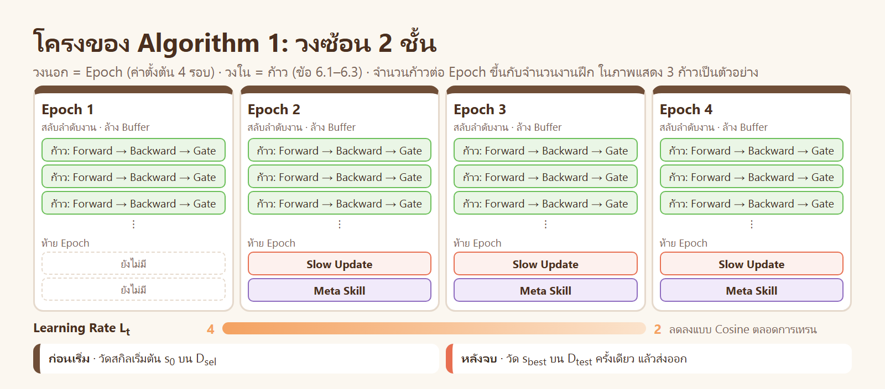

| ชั้น | ทำซ้ำอะไร | ข้างในทำอะไร | เทียบกับการเทรนโมเดล |
|---|---|---|---|
| วงนอก | Epoch 1 ถึง $E$ (ค่าตั้งต้น 4) | สลับลำดับงานฝึก · ล้าง Buffer · ทำวงในจนครบ · Slow Update และ Meta Skill | Epoch |
| วงใน | ก้าว (Step) | Forward Pass → Backward Pass → Validation Gate | 1 ก้าวของ Gradient Descent |

โครงเดียวกับการเทรนโมเดล เขียนเทียบกันได้ดังนี้

```text
การเทรนโมเดล                               SkillOpt
─────────────────────────────────────     ─────────────────────────────────────────────
ตั้งค่าน้ำหนักเริ่มต้น                          สกิลเริ่มต้น s0 · วัดบน D_sel
ทำซ้ำทุก Epoch:                              ทำซ้ำทุก Epoch:
    สลับลำดับข้อมูล                               สลับลำดับงานฝึก · ล้าง Buffer
    ทำซ้ำทุก Minibatch:                          ทำซ้ำทุกก้าว:
        Forward Pass → Loss                         Rollout → Trajectory และคะแนน
        Backward Pass → Gradient                    Reflection → Merge → ข้อเสนอ Edit
        ปรับน้ำหนัก × Learning Rate                   ใช้ Edit ไม่เกิน L_t ข้อ → สกิลรุ่นใหม่
        (ไม่ตรวจทุกก้าว)                              Validation Gate → รับ หรือ ไม่รับ
    วัด Validation · เก็บ Checkpoint               Slow Update · Meta Skill
วัด Test ด้วย Checkpoint ที่ดีที่สุด             วัด D_test ด้วย s_best
```

จุดที่ต่างที่สุด: การเทรนโมเดลวัด Validation ท้าย Epoch · SkillOpt วัด **ทุกก้าว** เพราะข้อเสนอแก้เป็นภาษาไม่มีอะไรรับประกันว่าได้ผล (ข้อ 3)

## 7.2 สิ่งที่อัลกอริทึมจำไว้ 5 อย่าง

| ตัวแปร | คืออะไร | เปลี่ยนเมื่อไร | อธิบายในข้อ |
|---|---|---|---|
| $s_{\text{cur}}$ | สกิลปัจจุบัน = จุดเริ่มของก้าวถัดไป | ทุกครั้งที่ Gate รับ | 6.3 |
| $s_{\text{best}}$ | สกิลที่ได้คะแนนบน $D_{\text{sel}}$ สูงสุดเท่าที่เคยมี = สิ่งที่ส่งออก | เมื่อรุ่นที่รับได้คะแนนสูงกว่าทุกรุ่นก่อนหน้า | 5.2 |
| $\mathcal{C}$ | ตารางจำคะแนนของสกิลที่เคยวัดแล้ว (Cache) | ทุกครั้งที่วัดสกิลรุ่นใหม่ | 7.3 |
| $\mathcal{B}$ | Rejected-Edit Buffer | เพิ่มเมื่อ Gate ไม่รับ · ล้างทุกต้น Epoch | 6.3 |
| $m_{\text{meta}}$ | Meta Skill | ท้าย Epoch (ตั้งแต่ Epoch ที่ 2) | 6.4.2 |

**$s_{\text{cur}}$ กับ $s_{\text{best}}$ ต่างกันอย่างไร:** ในก้าวปกติ รุ่นที่ถูกรับต้องดีกว่า $s_{\text{cur}}$ สองตัวนี้จึงมักเป็นรุ่นเดียวกัน อัลกอริทึมแยกไว้เพื่อให้แน่ใจว่าสิ่งที่ส่งออกคือรุ่นที่คะแนนสูงสุดเสมอ

## 7.3 ทีละบรรทัด

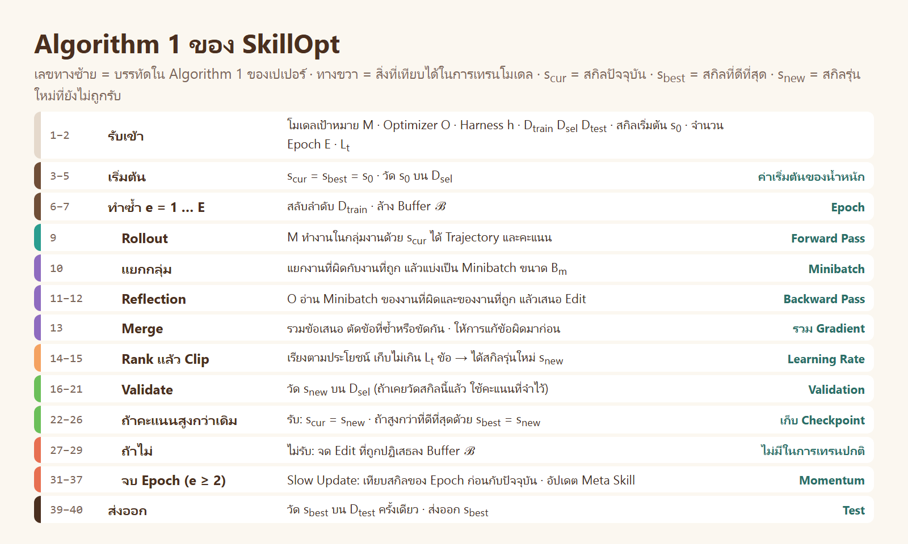

เลขทางซ้ายคือเลขบรรทัดใน Algorithm 1 ของเปเปอร์ (อยู่ในภาคผนวก) · ในภาพใช้ s<sub>new</sub> แทนสัญลักษณ์ $\tilde{s}$ ของเปเปอร์

| บรรทัด | ช่วง | ทำอะไร | อ่านรายละเอียด |
|---|---|---|---|
| 1–2 | รับเข้า และส่งออก | รับโมเดล ข้อมูล 3 ชุด สกิลเริ่มต้น และค่าตั้งต้น · ส่งออก $s_{\text{best}}$ และคะแนน Test | ข้อ 5 |
| 3–5 | เริ่มต้น | ให้ $s_{\text{cur}}$ และ $s_{\text{best}}$ เป็นสกิลเริ่มต้น · วัดบน $D_{\text{sel}}$ เก็บเป็นคะแนนตั้งต้น | 7.2 |
| 6–7 | เริ่ม Epoch | สลับลำดับงานฝึก แบ่งเป็น Rollout Batch · ล้าง Buffer | 7.1 |
| 9 | Forward Pass | โมเดลทำงานใน Batch ด้วย $s_{\text{cur}}$ | 6.1 |
| 10–12 | Reflection | แยกงานที่ผิดกับงานที่ถูก แบ่ง Minibatch ให้ Optimizer เสนอ Edit | 6.2.1 6.2.2 |
| 13–15 | Merge, Rank, Clip | รวมข้อเสนอ เรียง เก็บไม่เกิน $L_t$ ข้อ แล้วใช้กับสกิล ได้รุ่นใหม่ | 6.2.3 |
| 16–21 | วัดรุ่นใหม่ | ถ้าเคยวัดสกิลข้อความนี้แล้ว ใช้คะแนนจาก $\mathcal{C}$ · ถ้ายัง ให้วัดบน $D_{\text{sel}}$ แล้วจดลง $\mathcal{C}$ | 6.3 |
| 22–26 | รับ | คะแนนสูงกว่า $s_{\text{cur}}$ → รุ่นใหม่เป็น $s_{\text{cur}}$ · สูงกว่า $s_{\text{best}}$ ด้วย → เป็น $s_{\text{best}}$ | 6.3 |
| 27–29 | ไม่รับ | จด Edit ที่ถูกปฏิเสธและรูปแบบของข้อผิดลง $\mathcal{B}$ | 6.3 |
| 31–34 | Slow Update | เทียบสกิลท้าย Epoch ก่อนกับปัจจุบัน เขียนคำแนะนำลงส่วนที่ถูกป้องกัน แล้วผ่าน Gate | 6.4.1 |
| 35–37 | Meta Skill | Optimizer อัปเดต $m_{\text{meta}}$ | 6.4.2 |
| 39–40 | จบ | วัด $s_{\text{best}}$ บน $D_{\text{test}}$ ครั้งเดียว แล้วส่งออก | 5.3 |

**Cache ($\mathcal{C}$) มีไว้ทำไม (บรรทัด 16–21):** การวัดบน $D_{\text{sel}}$ ต้องให้โมเดลทำงานทุกชิ้นในชุด ซึ่งแพง ถ้า Edit ของก้าวนี้ให้ข้อความสกิลเหมือนรุ่นที่เคยวัดแล้วทุกตัวอักษร ก็ใช้คะแนนเดิมได้เลย

## 7.4 ค่าตั้งต้นในเปเปอร์

| ค่า | สัญลักษณ์ | ค่าตั้งต้น | คุมอะไร | เทียบกับการเทรนโมเดล |
|---|---|---|---|---|
| จำนวน Epoch | $E$ | 4 | เทรนนานแค่ไหน | Epoch |
| ขนาด Rollout Batch | $B$ | 40 งานต่อก้าว | หลักฐานต่อก้าว | Batch Size |
| ขนาด Reflection Minibatch | $B_m$ | 8 | Optimizer อ่านครั้งละกี่งาน | – |
| Learning Rate ของข้อความ | $L_t$ | 4 ลดแบบ Cosine เหลือ 2 | แก้ได้กี่ข้อต่อก้าว | Learning Rate และ Schedule |
| กติกาของ Gate | – | คะแนนต้องสูงกว่าเดิม (เท่ากันไม่รับ) | รับหรือไม่รับ | Validation |
| Slow Update | – | เทียบ 20 งานต่อ Epoch | ความจำข้าม Epoch | Momentum |
| รูปแบบการแก้ | – | Patch (แก้เฉพาะจุด) | แก้ทีละข้อ ไม่เขียนใหม่ทั้งไฟล์ | – |

เปเปอร์ทดลองเปลี่ยนค่าเหล่านี้ทีละตัว (ข้อ 8): ค่าตัวเลขที่แน่นอนมีผลไม่มาก แต่ **การมีอยู่** ของแต่ละกลไกมีผลชัดเจน

---

# 8 · ผลในเปเปอร์

ข้อนี้ตอบ 4 คำถาม ตามลำดับที่ควรถามกับงานวิจัยทุกชิ้น

| คำถาม | ข้อ |
|---|---|
| ทดลองอย่างไร | 8.1 |
| ได้ผลแค่ไหน และดีกว่าวิธีอื่นหรือไม่ | 8.2 8.3 |
| ส่วนไหนของระบบที่ทำให้ได้ผล | 8.4 |
| ใช้นอกการทดลองได้แค่ไหน และมีข้อจำกัดอะไร | 8.5 8.6 |

## 8.1 ทดลองอย่างไร

| หัวข้อ | รายละเอียด |
|---|---|
| งานที่ใช้ทดสอบ | 6 Benchmark (ตารางถัดไป) |
| โมเดลที่ถูกล็อก | 7 โมเดล ตั้งแต่ขนาดใหญ่ (GPT-5.5) ถึงขนาดเล็ก (Qwen 4B) |
| วิธีให้โมเดลทำงาน (Harness) | 3 แบบ: Direct Chat · Codex · Claude Code |
| เทียบกับอะไร | ไม่มีสกิล · สกิลที่คนเขียน · สกิลที่ LLM เขียนครั้งเดียว · วิธีปรับอัตโนมัติอื่น |
| วัดอย่างไร | คะแนนบน Test Split (สมการ 3) ด้วยตัวตรวจของแต่ละ Benchmark |

| Benchmark | งานประเภท |
|---|---|
| SearchQA | ตอบคำถามจากการค้นข้อมูล |
| SpreadsheetBench | งานตารางคำนวณ ต้องเขียนโค้ดและใช้เครื่องมือ |
| OfficeQA | ตอบคำถามจากเอกสาร |
| DocVQA | ตอบคำถามจากภาพเอกสาร |
| LiveMath | คณิตศาสตร์ |
| ALFWorld | สั่งงานหลายขั้นในสภาพแวดล้อมจำลอง |

## 8.2 ได้ผลแค่ไหน

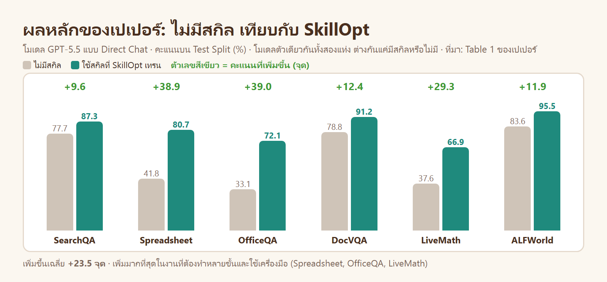

**วิธีอ่านภาพ:** แต่ละคู่คือโมเดลตัวเดียวกัน ทำงานชุดเดียวกัน ต่างกันแค่ **มีสกิลหรือไม่มี** ผลต่างจึงมาจากสกิลอย่างเดียว

| Benchmark | ไม่มีสกิล | SkillOpt | เพิ่ม (จุด) |
|---|---|---|---|
| SearchQA | 77.7 | 87.3 | +9.6 |
| SpreadsheetBench | 41.8 | 80.7 | +38.9 |
| OfficeQA | 33.1 | 72.1 | +39.0 |
| DocVQA | 78.8 | 91.2 | +12.4 |
| LiveMath | 37.6 | 66.9 | +29.3 |
| ALFWorld | 83.6 | 95.5 | +11.9 |
| **เฉลี่ย** | | | **+23.5** |

| ข้อสังเกต | ตัวอย่าง |
|---|---|
| งานที่คะแนนตั้งต้นต่ำ ได้เพิ่มมาก | SpreadsheetBench 41.8 → 80.7 |
| งานที่คะแนนตั้งต้นสูงอยู่แล้ว ได้เพิ่มน้อยกว่า | SearchQA 77.7 → 87.3 |
| ได้ผลกับทุก Harness | GPT-5.5 เพิ่มเฉลี่ย +24.8 จุดใน Codex และ +19.1 จุดใน Claude Code |

LAB ของเราเห็นแบบเดียวกัน: ไม่มีสกิล 45.3% → มีสกิล 100% (+54.7 จุด) โดยไม่ได้แก้โมเดล

## 8.3 ดีกว่าวิธีอื่นหรือไม่

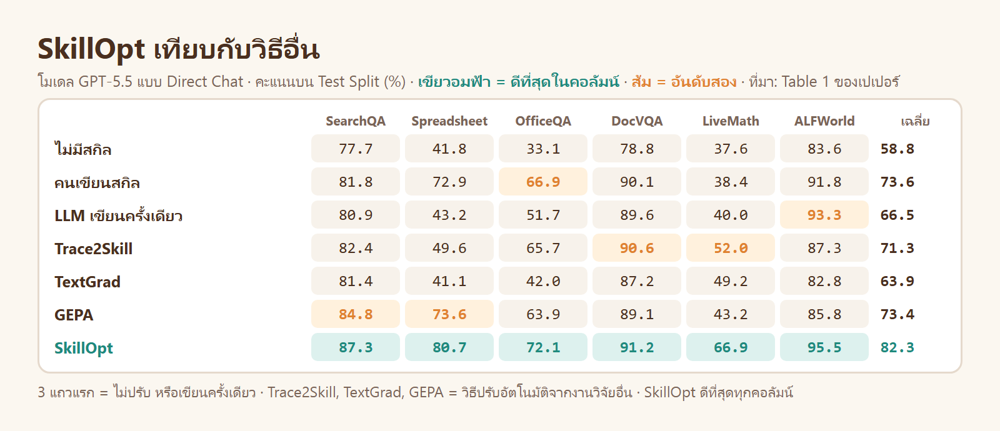

| กลุ่มของวิธี | วิธีในตาราง | ต่างจาก SkillOpt อย่างไร |
|---|---|---|
| ไม่ปรับ | ไม่มีสกิล | ไม่มีอะไรให้โมเดลอ่าน |
| เขียนครั้งเดียว | คนเขียนสกิล · LLM เขียนครั้งเดียว | ไม่ได้ลองใช้แล้วกลับมาแก้ |
| ปรับอัตโนมัติ | Trace2Skill · TextGrad · GEPA | ปรับจากผลการทำงานเหมือนกัน แต่การคุมขนาดก้าว การตรวจ และความจำ ต่างกัน |

| ข้อสังเกต | ตัวอย่างจากตาราง |
|---|---|
| สกิลที่คนเขียนช่วยได้มากในบางงาน แต่แทบไม่ช่วยในบางงาน | Spreadsheet 41.8 → 72.9 แต่ LiveMath 37.6 → 38.4 |
| สกิลที่ LLM เขียนครั้งเดียวไม่แน่นอน | Spreadsheet 41.8 → 43.2 |
| วิธีปรับอัตโนมัติบางวิธีทำให้ **แย่ลง** ได้ | TextGrad: Spreadsheet 41.8 → 41.1 · ALFWorld 83.6 → 82.8 |
| SkillOpt ดีที่สุดทุกคอลัมน์ | เฉลี่ย 82.3 เทียบกับอันดับสองราว 73 |

เปเปอร์รายงานว่าผลนี้เป็นจริงในทั้ง 52 การทดลอง (รวมทุกโมเดลและทุก Harness): SkillOpt ได้คะแนนดีที่สุดหรือเท่ากับดีที่สุดทุกครั้ง

## 8.4 ส่วนไหนของระบบที่ทำให้ได้ผล (Ablation)

**Ablation** = ถอดส่วนหนึ่งของระบบออก แล้วเทรนใหม่ทั้งหมด ถ้าคะแนนลด แปลว่าส่วนนั้นมีผลจริง

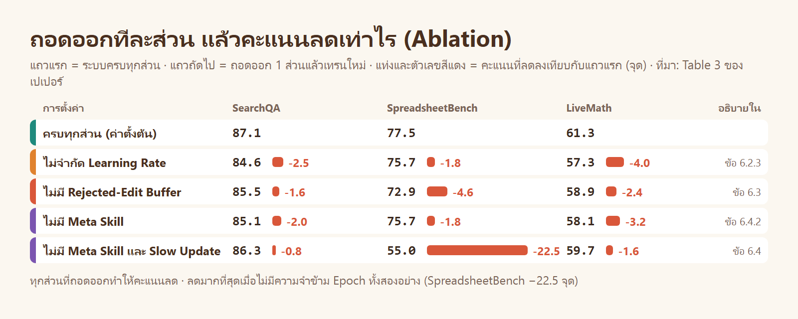

| ถอดอะไรออก | คะแนนลด (SearchQA · Spreadsheet · LiveMath) | แปลว่า |
|---|---|---|
| การจำกัด Learning Rate | −2.5 · −1.8 · −4.0 | แก้ได้ไม่จำกัดต่อก้าว ทำให้ผลแย่ลงทุกงาน |
| Rejected-Edit Buffer | −1.6 · −4.6 · −2.4 | ไม่จำก้าวที่ผิด ทำให้เสนอซ้ำ |
| Meta Skill | −2.0 · −1.8 · −3.2 | Optimizer ไม่มีบทเรียนข้าม Epoch |
| Meta Skill และ Slow Update | −0.8 · **−22.5** · −1.6 | ไม่มีความจำระยะยาวเลย เสียหายมากในงานที่ซับซ้อน |

**ค่าตัวเลขสำคัญแค่ไหน:** เปเปอร์ลองเปลี่ยนค่า Learning Rate ตั้งแต่ 1 ถึง 16, ขนาด Batch และขนาด Minibatch (Table 2) ผลต่างกันไม่มากและไม่มีค่าใดดีที่สุดทุกงาน

| สรุปของข้อนี้ | |
|---|---|
| ไม่ค่อยสำคัญ | จะตั้ง Learning Rate เป็น 2 หรือ 4 · Batch 24 หรือ 40 |
| สำคัญ | **มี** การจำกัดก้าว · **มี** การตรวจทุกก้าว · **มี** ความจำของก้าวที่ผิด · **มี** ความจำข้าม Epoch |

## 8.5 ใช้นอกการทดลองได้แค่ไหน (Transfer)

เปเปอร์นำสกิลที่เทรนเสร็จแล้วไปใช้ในที่ที่ไม่ได้เทรน **โดยไม่เทรนเพิ่ม** (Table 4)

| ย้ายอย่างไร | ตัวอย่าง | ไม่มีสกิล | ใช้สกิลที่ย้ายมา | เทรนที่ปลายทางเอง |
|---|---|---|---|---|
| ข้ามโมเดล (ใหญ่ → เล็ก) | SpreadsheetBench: GPT-5.4 → GPT-5.4-mini | 36.1 | 45.5 | 47.5 |
| ข้าม Harness | SpreadsheetBench: Codex → Claude Code | 22.1 | 81.8 | 80.4 |
| ข้าม Harness | LiveMath: Codex → Claude Code | 40.8 | 42.4 | 56.5 |
| ข้าม Benchmark | OlympiadBench → Omni-MATH (GPT-5.4) | 56.6 | 60.3 | – |

| ข้อสังเกต | ความหมาย |
|---|---|
| ทุกแถวดีกว่าไม่มีสกิล | สกิลเก็บ **วิธีทำงาน** ไม่ใช่คำตอบของงานที่ใช้เทรน |
| ส่วนใหญ่ยังต่ำกว่าเทรนที่ปลายทางเอง | สกิลบางส่วนเหมาะกับโมเดลหรือ Harness ที่ใช้เทรน |
| ได้มากบ้างน้อยบ้าง | LiveMath ข้าม Harness ได้เพิ่มแค่ 1.6 จุด ก่อนย้ายไปใช้ที่อื่นจึงต้องวัดใหม่ |

ข้อนี้คือเหตุผลของแบบฝึกหัดข้อ 3 ใน README หลัก (วัด `v0` และ `v3` ใหม่ด้วยโมเดล haiku)

## 8.6 ข้อจำกัดที่เปเปอร์ระบุ

| ข้อจำกัด | ผล | ใน LAB ของเรา |
|---|---|---|
| ต้องมีตัวตรวจอัตโนมัติที่เชื่อถือได้ | งานที่ตัดสินด้วยความรู้สึก ต้องหาวิธีให้คะแนนก่อน | ตัวตรวจ 10 ข้อ ซึ่งต้องตรวจตัวมันเองก่อนใน LAB 0 |
| การเทรนมีต้นทุน | ต้องรันโมเดลหลายรอบ คุ้มเมื่อสกิลถูกใช้ซ้ำ | 108 Trial ราคาตามรายการ $10.77 |
| ปรับสกิลเดียว | งานที่หลากหลายมากอาจต้องใช้หลายสกิล | สกิลเดียวสำหรับโค้ดคิดเงิน |
| สกิลอาจจำลักษณะของข้อมูลฝึก | ก่อนย้ายไปใช้กับงานที่ต่างออกไปมาก ต้องวัดใหม่ | Validation มีแค่ 2 งาน และไม่มี Test Split |

---

# 9 · เทียบกับ LAB ของบทนี้

LAB `money-coder` ใน [README หลัก](../README.md) คือ SkillOpt ขนาดเล็กที่มีคนกำกับ ข้อนี้ตอบ 3 คำถาม: ตรงกันตรงไหน · ผลของ LAB อ่านด้วยภาษาของเปเปอร์ได้อย่างไร · ต่างกันตรงไหนและทำไม

## 9.1 ตรงกันตรงไหน

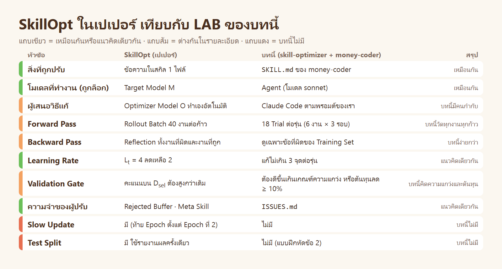

| ชิ้นส่วนของ SkillOpt | สิ่งที่ทำหน้าที่เดียวกันใน LAB | ไฟล์หรือคำสั่ง |
|---|---|---|
| สกิล $s$ | `SKILL.md` ของ `money-coder` | `runs/v*/skills/money-coder/SKILL.md` |
| โมเดลเป้าหมาย $M$ และ Harness $h$ | Agent (sonnet) ใน container | คำสั่ง `run` |
| $D_{\text{tr}}$ | Training Set 4 งาน | `suite/suite.json` |
| $D_{\text{sel}}$ | Validation Set 2 งาน | `suite/suite.json` |
| Forward Pass | วัดสกิล 1 รุ่น 18 Trial | คำสั่ง `run` และ `report` |
| Backward Pass | ดูข้อที่ผิด หาสาเหตุ แก้สกิล | คำสั่ง `failures` และ Claude Code |
| Learning Rate $L_t$ | แก้ไม่เกิน 3 จุดต่อรุ่น | ขั้นที่ 5 ของ `skill-optimizer` |
| Validation Gate | ประตูรับ | คำสั่ง `gate` |
| Rejected-Edit Buffer และ Meta Skill | บันทึกปัญหาและผลของการแก้ | `runs/ISSUES.md` |
| $s_{\text{best}}$ | รุ่นฐานล่าสุด = `v3` | `runs/v3/skills/money-coder/` |

## 9.2 ผลของ LAB อ่านด้วยภาษาของเปเปอร์

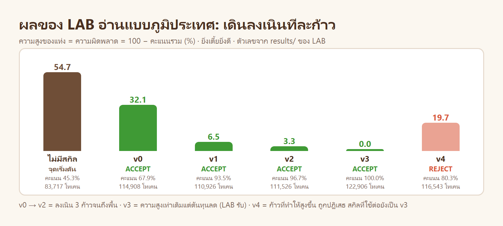

| รุ่น | ความผิดพลาด (100 − คะแนน) | Gate | ในภาษาของเปเปอร์ |
|---|---|---|---|
| ไม่มีสกิล | 54.7 | – | จุดเริ่มต้นบนเนิน (ไม่มีสกิล) |
| `v0` | 32.1 | ACCEPT | สกิลเริ่มต้น $s_0$ ที่คนเขียน |
| `v1` | 6.5 | ACCEPT | ก้าวที่ 1: replace 3 ข้อ (ข้อ 6.2.4) |
| `v2` | 3.3 | ACCEPT | ก้าวที่ 2: add นโยบายธุรกิจ 2 บรรทัด จากความรู้ที่คนในทีมให้ |
| `v3` | 0.0 | ACCEPT | ก้าวที่ 3: replace กติกาที่ยังกว้าง 2 ข้อ ถึงพื้นหุบเขา |
| `v4` | 19.7 | **REJECT** | ก้าวที่ถูกปฏิเสธ → จดลง Buffer (`ISSUES.md`) |

**สิ่งที่เปเปอร์เตือน เกิดขึ้นจริงใน LAB**

| เปเปอร์บอกว่า | เกิดใน LAB |
|---|---|
| ข้อเสนอที่ฟังดูดีอาจทำให้แย่ลง จึงต้องมี Gate (ข้อ 6.3) | `v4` สั้นและอ่านง่ายกว่า แต่คะแนนลด 19.7 จุด · Gate จับได้ |
| การแก้ครั้งใหญ่ลบกฎที่ดีทิ้งได้ (ข้อ 4.2) | `v4` ย่อ **ทั้งไฟล์** ในครั้งเดียว รูปแบบคำตอบและ exit code ของ CLI หายไป |
| ก้าวที่ผิดควรถูกจดไว้ ไม่ให้ทำซ้ำ (ข้อ 6.3) | สาเหตุของ `v4` ถูกจดใน `ISSUES.md` · แบบฝึกหัดข้อ 4 ให้อ่านก่อนทำ `v5` |
| ต้องเลือกด้วยข้อมูลที่ไม่ได้ใช้หาวิธีแก้ (ข้อ 5.2) | `v2` ได้ Training 100% แต่ Validation 90% · ถ้าดูแค่ Training จะคิดว่าเสร็จแล้ว |

## 9.3 ต่างกันตรงไหน และทำไม

| หัวข้อ | เปเปอร์ | LAB ของเรา | เหตุผลของ LAB |
|---|---|---|---|
| ใครเสนอวิธีแก้ | Optimizer Model ทำเองทั้งหมด | Claude Code ตามพรอมต์ของเรา | ผู้เรียนเห็นและเข้าใจทุกก้าว |
| จำนวนงาน | หลักสิบถึงหลักร้อยต่อชุด | Training 4 · Validation 2 | รันจบในไม่กี่นาที |
| กติกาของ Gate | คะแนนบน $D_{\text{sel}}$ สูงกว่าเดิม | ดีขึ้น **เกินความแกว่ง** · Training และ Validation ไม่ลด | งานน้อย ผลต่างเล็ก ๆ อาจเป็นความบังเอิญ |
| คะแนนเท่ากัน | ไม่รับ | รับ ถ้าต้นทุนลดอย่างน้อย 10% | แสดงว่าปรับสกิลให้ถูกลงได้ด้วย |
| Slow Update | มี | ไม่มี | มีแค่ 5 ก้าว ยังไม่ถึงขั้นต้องมีความจำข้าม Epoch |
| Test Split | มี | ไม่มี | เป็นแบบฝึกหัดข้อ 2 |

**ถ้าจะทำให้ LAB ใกล้เปเปอร์มากขึ้น**

| เพิ่มอะไร | ได้อะไร | แบบฝึกหัดใน README หลัก |
|---|---|---|
| โจทย์ `"split": "test"` | รายงานผลที่ไม่เอนเอียง (สมการ 3) | ข้อ 2 |
| โจทย์ Training และ Validation มากขึ้น | ความแกว่งที่วัดได้ไม่เป็น 0 และเห็นข้อผิดใหม่ | ข้อ 1 |
| วัดด้วยโมเดลอื่น | ทดสอบการย้ายสกิลข้ามโมเดล (ข้อ 8.5) | ข้อ 3 |
| ทำรุ่นถัดไปโดยอ่าน `ISSUES.md` ก่อน | ใช้ความจำของก้าวที่ผิด | ข้อ 4 |

## 9.4 สรุปทั้งบท

| แนวคิด | การเทรนโมเดล | SkillOpt | LAB ของเรา |
|---|---|---|---|
| ปรับอะไร | น้ำหนัก | ข้อความในสกิล | `SKILL.md` |
| ดูหลักฐานจากไหน | Forward Pass | Rollout | 18 Trial ต่อรุ่น |
| รู้ทิศจากไหน | Gradient | Reflection ของ Optimizer | ข้อที่ผิดซ้ำ และ Claude Code |
| ก้าวใหญ่แค่ไหน | Learning Rate | ไม่เกิน $L_t$ ข้อ | ไม่เกิน 3 จุด |
| รู้ได้อย่างไรว่าดีขึ้น | Validation | Validation Gate ทุกก้าว | ประตูรับ |
| จำอะไรข้ามก้าว | Momentum | Buffer · Slow Update · Meta Skill | `ISSUES.md` |

**ถัดไป:** กลับไปที่ [README หลัก ส่วนที่ 3](../README.md#3--ลงมือทำ-copy--paste) เพื่อลงมือทำ หรืออ่าน [ข้างใน skill-optimizer](../inside_skill_optimizer/README.md)

---

**อ้างอิง**

Yang, Y., Gong, Z., Huang, W., Yang, Q., Zhou, Z., Huang, Z., Li, Y., Gao, X., Dai, Q., Liu, B., และคณะ (2026). *SkillOpt: Executive Strategy for Self-Evolving Agent Skills.* arXiv:2605.23904.

ตัวเลขและคำอธิบายของข้อ 2–8 เรียบเรียงจากเปเปอร์ฉบับ arXiv (อ่านเมื่อ 13 พ.ย. 2026) · ข้อ 1 และข้อ 9 เป็นคำอธิบายของบทเรียนนี้เอง
