# Skill Optimizer ฉบับเริ่มต้น · สอน AI ให้เขียนโค้ดถูกข้อกำหนดของร้าน


**บทนี้แบ่งเป็น 2 ภาค แยกจากกัน**

| ภาค | ส่วน | ตอบคำถาม | ผู้เรียนทำอะไร |
|---|---|---|---|
| [**ภาคทฤษฎี**](#ภาคทฤษฎี) | [1 · โจทย์และข้อกำหนดของร้าน](#1--โจทย์และข้อกำหนดของร้าน) | โจทย์คืออะไร · โค้ดแบบไหนถูก แบบไหนผิด · ใครเป็นคนตรวจ | อ่าน ไม่ต้องรันอะไร |
| | [2 · วิธีปรับสกิล](#2--วิธีปรับสกิล) | ปรับสกิลอย่างไร · รู้ได้อย่างไรว่ารุ่นใหม่ดีกว่าจริง | อ่าน ไม่ต้องรันอะไร |
| [**ภาค LAB**](#ภาค-lab) | [3 · ลงมือทำ](#3--ลงมือทำ-copy--paste) | พรอมต์ Copy & Paste 6 ขั้น (LAB 0–5) พร้อมผลจริงของแต่ละ LAB | คัดลอกพรอมต์ แล้วรัน |
| | [4 · สรุปและแบบฝึกหัด](#4--สรุปและแบบฝึกหัด) | ผลของทุกรุ่น · บทเรียนจากผลจริง · โจทย์ให้ลองต่อ | อ่านผล แล้วทำแบบฝึกหัด |

**อ่านเพิ่ม (ไม่บังคับ · เป็นทฤษฎีทั้งคู่)**

| หน้า | ตอบคำถาม |
|---|---|
| [ทฤษฎี · SkillOpt](01_theory/README.md) | งานวิจัยต้นทาง: ปรับสกิลเหมือนเทรนโมเดลด้วย Gradient Descent อย่างไร |
| [ข้างใน skill-optimizer](inside_skill_optimizer/README.md) | เครื่องมือที่ใช้ปรับสกิล ทำงานอย่างไร และสร้างอย่างไร |

---

# ภาคทฤษฎี

> [!NOTE]
> **ภาคนี้อ่านอย่างเดียว ไม่ต้องรันอะไร และไม่ใช้โทเคน**
>
> - ส่วนที่ 1 อธิบายโจทย์ · ส่วนที่ 2 อธิบายวิธีปรับสกิล
> - ตัวเลขที่กำกับว่า **"ตัวอย่างจากผล LAB"** ยกมาจากการรันจริงใน [ภาค LAB](#ภาค-lab) เพื่อประกอบคำอธิบายเท่านั้น · ผลเต็มของทุกรุ่นอยู่ในภาค LAB

## 1 · โจทย์และข้อกำหนดของร้าน

### 1.1 โจทย์

**สถานการณ์:** ร้านกาแฟ BaanKafe ให้ AI เขียนโค้ดคิดเงิน 6 งาน งานละ 1 ฟังก์ชัน โดยเขียนโจทย์ของแต่ละงานให้ AI อ่าน

**ร้านมีข้อกำหนด 2 ประเภท แต่ AI ได้รับแค่ประเภทเดียว**

- **ข้อกำหนดที่ระบุชัด (Explicit Requirement):** สิ่งที่ร้านเขียนไว้ในโจทย์ เช่น "สมาชิก gold ได้เงินคืน 2.5%" → AI **รู้**
- **ความรู้แฝงของทีม (Tacit Knowledge):** สิ่งที่พนักงานทุกคนทำกันจนเป็นเรื่องปกติ เช่น "เศษ .5 สตางค์ปัดขึ้น" ตอนเก็บความต้องการ (Requirements Elicitation) เช่น สัมภาษณ์ทีม ไม่มีใครนึกถึงจึงไม่ได้พูด ไม่เคยถูกเขียนลงโจทย์ → AI **ไม่รู้**

**ปัญหา: AI ทำตามโจทย์ครบ แต่ยังถูกตัดสินว่าผิด**

| ลำดับ | เกิดอะไรขึ้น | ตัวอย่างจริง: เงินคืน silver ของยอด 200 บาท ที่ซื้อในเดือนเกิด |
|---|---|---|
| 1 | AI อ่านโจทย์ แล้วเขียนโค้ดตามข้อกำหนดที่ระบุชัดครบทุกข้อ | โจทย์บอกว่า silver ได้ 1.5% และ "เดือนเกิด ได้เงินคืน 2 เท่า" |
| 2 | ถึงจุดที่โจทย์ไม่ได้บอก AI ต้องเดาเอง | โจทย์ไม่ได้บอกว่าระดับไหนได้สิทธิ์เดือนเกิด · AI ให้ทุกระดับ คิด 20000 × 1.5% × 2 ได้ `600` |
| 3 | ตัวตรวจของร้านตรวจ **ทั้ง 2 ประเภท** โค้ดจึงไม่ผ่าน | ร้านให้สิทธิ์เดือนเกิดเฉพาะ gold และ platinum คำตอบที่ถูกคือ `300` |

AI ไม่ได้ผิดเพราะเขียนโค้ดไม่เป็น แต่ผิดเพราะ **ไม่มีใครบอกความรู้แฝงของทีม**

**งานของเรา:** ค้นหาความรู้แฝงที่ขาดไป จากข้อที่ AI ทำผิดตอนตรวจ แล้วเขียนลงใน **สกิล** (คู่มือที่ AI อ่านก่อนเขียนโค้ด) ปรับสกิลทีละรุ่น จนโค้ดผ่านตัวตรวจครบทุกข้อ ทุกครั้ง · รายละเอียดของข้อกำหนดทั้ง 2 ประเภทอยู่ในข้อ 1.2

<p>
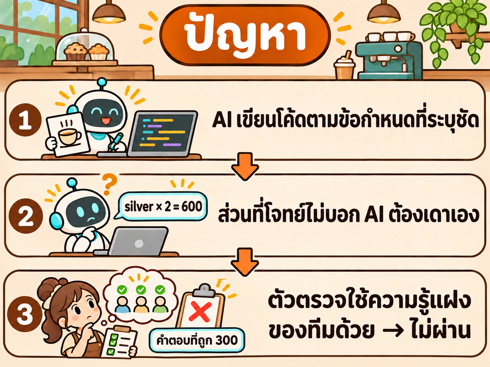
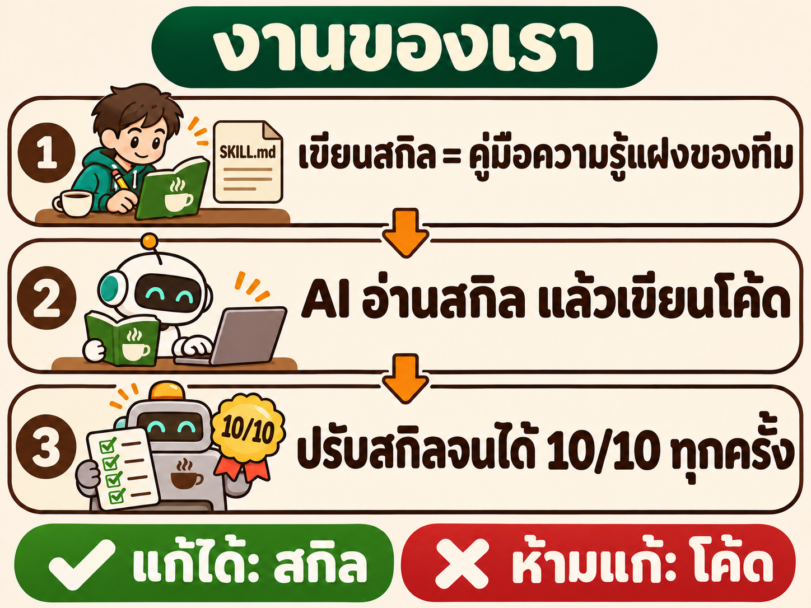
</p>

**งานคิดเงิน 6 งาน** · AI เขียนงานละ 1 ฟังก์ชัน ในไฟล์ `solve.py`

| # | งาน | ฟังก์ชัน | คิดอะไร | ใช้ทำอะไรในบทนี้ |
|---|---|---|---|---|
| 1 | บิลหน้าร้าน | `cafe_bill` | ยอดบิลหลังหักส่วนลด แล้วบวก VAT 7% | หาข้อผิดเพื่อปรับสกิล |
| 2 | หารบิล | `split_bill` | เงินที่แต่ละคนต้องจ่าย เมื่อหารบิลกันและบวกทิป | หาข้อผิดเพื่อปรับสกิล |
| 3 | ค่าส่งของ | `shipping_fee` | ค่าส่งตามน้ำหนัก ระยะทาง และแบบด่วน | หาข้อผิดเพื่อปรับสกิล |
| 4 | เงินคืนสมาชิก | `cashback` | เงินคืนตามระดับบัตรสมาชิก และเดือนเกิด | หาข้อผิดเพื่อปรับสกิล |
| 5 | ค่าจอดรถ | `parking_fee` | ค่าจอดรายชั่วโมง ส่วนลดสมาชิก และ VAT | เก็บไว้ทดสอบ ไม่เปิดดูตอนปรับ |
| 6 | ค่าแรงรายสัปดาห์ | `net_pay` | ค่าแรงรวม OT หลังหักภาษีและประกันสังคม | เก็บไว้ทดสอบ ไม่เปิดดูตอนปรับ |

ตัวอย่าง Input → Output ของทุกงานอยู่ในข้อ 1.8

**คำที่ใช้ตลอดบท**

| คำ | ความหมาย |
|---|---|
| **สกิล** (`SKILL.md`) | ไฟล์ข้อความ 1 ไฟล์ เขียนข้อกำหนดของร้านเป็นภาษาคน AI อ่านก่อนเขียนโค้ดทุกครั้ง · สกิลของบทนี้ชื่อ `money-coder` |
| **รุ่น** | แก้สกิล 1 ครั้ง ได้สกิลรุ่นใหม่ 1 รุ่น ชื่อ `v0` `v1` `v2` … |
| **Agent** | AI ตัวที่เขียนโค้ด · ได้โจทย์ 1 ข้อกับสกิล แล้วเขียน `solve.py` เอง |
| **ตัวตรวจ** (Grader) | โปรแกรมที่รันโค้ดของ Agent แล้วตรวจทีละข้อ (งานละ 10 ข้อ · งาน 3 มี 11 ข้อ) · คะแนน = จำนวนข้อที่ผ่าน ÷ จำนวนข้อตรวจของงานนั้น |
| **Trial** | Agent เขียนโค้ด 1 ครั้ง และตัวตรวจให้คะแนน 1 ครั้ง |

**กติกาของโจทย์**

| ทำได้ | ห้ามทำ |
|---|---|
| แก้ `SKILL.md` | แก้โค้ดที่ Agent เขียน |
| ให้ Claude Code ช่วยหาสาเหตุและเสนอจุดแก้ในสกิล | แก้โจทย์ หรือแก้ตัวตรวจ |
| เปิดดูข้อที่ผิดของงาน 1–4 | เปิดดูข้อที่ผิดของงาน 5–6 (ดูได้แค่คะแนนรวม) |

- **ทำไมห้ามแก้โค้ด:** แก้โค้ดได้ผลกับงานนั้นงานเดียว · แก้สกิลได้ผลกับทุกงานที่ AI จะเขียนต่อไป
- **เป้าหมาย:** ทุกงานผ่านครบทุกข้อตรวจ ทุกครั้งที่ให้ Agent เขียน

### 1.2 ข้อกำหนด 2 ประเภทของร้าน

โค้ดคิดเงินของร้านต้องเป็นไปตามข้อกำหนด 2 ประเภท ต่างกันที่ **AI ได้รับข้อมูลนั้นหรือไม่**

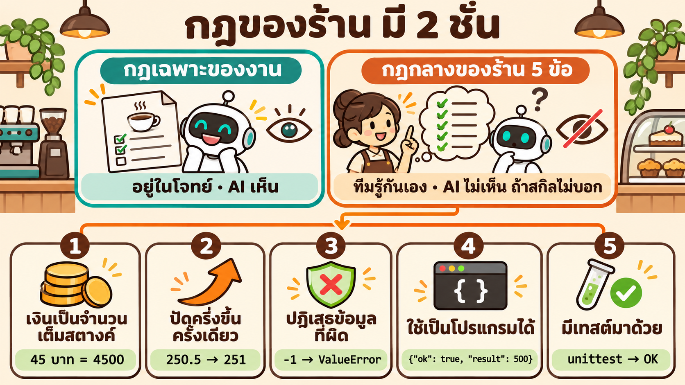

| ประเภท | คืออะไร | AI ได้รับหรือไม่ | ตัวอย่าง |
|---|---|---|---|
| **ข้อกำหนดที่ระบุชัด** (Explicit Requirement) | สิ่งที่ร้านเขียนไว้ในโจทย์ว่างานนั้นต้องคำนวณอะไร | **ได้รับ** ทุกครั้ง | gold ได้เงินคืน 2.5% · ซื้อไม่ถึง 100 บาทไม่ได้เงินคืน |
| **ความรู้แฝงของทีม** (Tacit Knowledge) | วิธีทำงานที่พนักงานทุกคนรู้กันจนเป็นเรื่องปกติ จึงไม่เคยเขียนลงโจทย์ | **ไม่ได้รับ** ถ้าสกิลไม่ระบุ | เงินเป็นจำนวนเต็มสตางค์ · ข้อมูลผิดต้องแจ้ง `ValueError` |

AI เหมือนพนักงานใหม่วันแรก: ใบสั่งงานบอกว่าต้องทำ **อะไร** แต่ไม่ได้บอกว่าคนในร้านทำ **อย่างไร**

**ความรู้แฝงของทีมมี 2 กลุ่ม**

| กลุ่ม | คืออะไร | ใช้กับงานไหน |
|---|---|---|
| **กลุ่ม 1 · มาตรฐานการเขียนโค้ด** 5 ข้อ | วิธีเขียนโค้ดคิดเงินที่ทีมใช้เหมือนกันทุกงาน | ทั้ง 6 งาน |
| **กลุ่ม 2 · นโยบายธุรกิจ** 4 ข้อ | ข้อยกเว้นทางธุรกิจที่พนักงานรู้ แต่ไม่ได้เขียนลงโจทย์ | งาน 3 ค่าส่ง · งาน 4 เงินคืน |

#### ข้อกำหนดที่ระบุชัด: ทุกงานรับอะไร มีเงื่อนไขอะไร

ทุกอย่างในส่วนนี้ AI เห็นในโจทย์ · เงินทุกค่าเป็น **สตางค์** (100 สตางค์ = 1 บาท)

**งาน 1 · `cafe_bill(items, member)` บิลหน้าร้าน** · Training

| พารามิเตอร์ | ชนิดและค่าที่รับได้ | ความหมาย |
|---|---|---|
| `items` | list ของ `{"price": int ≥ 0, "qty": int ≥ 1}` | รายการสินค้า ราคาต่อชิ้น และจำนวน |
| `member` | `True` / `False` | เป็นสมาชิกหรือไม่ |

เงื่อนไข: ยอดรวมตั้งแต่ 500 บาท ลด 5% → สมาชิกลดอีก 10% → บวก VAT 7% เป็นขั้นสุดท้าย

**งาน 2 · `split_bill(total, people, tip_percent)` หารบิล** · Training

| พารามิเตอร์ | ชนิดและค่าที่รับได้ | ความหมาย |
|---|---|---|
| `total` | int ≥ 0 | ยอดบิล |
| `people` | int ≥ 1 | จำนวนคน |
| `tip_percent` | int 0–100 | ทิปเป็นเปอร์เซ็นต์ |

เงื่อนไข: ยอดที่หาร = ยอดบิล + ทิป · หารไม่ลงตัว คนลำดับแรก ๆ จ่ายเพิ่มคนละ 1 สตางค์ · คืน list ยอดของแต่ละคน

**งาน 3 · `shipping_fee(weight_g, distance_km, express)` ค่าส่งเมล็ดกาแฟ** · Training

| พารามิเตอร์ | ชนิดและค่าที่รับได้ | ความหมาย |
|---|---|---|
| `weight_g` | int 1–30,000 | น้ำหนัก (กรัม) |
| `distance_km` | int ≥ 0 | ระยะทาง (กม.) |
| `express` | `True` / `False` | ส่งด่วนหรือไม่ |

เงื่อนไข: ≤ 1 กก. 40 บาท · ≤ 5 กก. 80 บาท · เกิน 5 กก. บวกกิโลกรัมละ 15 บาท (ตามสัดส่วนกรัม) → เกิน 100 กม. +20% → ส่งด่วน +50%

**งาน 4 · `cashback(amount, tier, birthday)` เงินคืนสมาชิก** · Training

| พารามิเตอร์ | ชนิดและค่าที่รับได้ | ความหมาย |
|---|---|---|
| `amount` | int ≥ 0 | ยอดซื้อ |
| `tier` | `"silver"` / `"gold"` / `"platinum"` | ระดับบัตรสมาชิก |
| `birthday` | `True` / `False` | ซื้อในเดือนเกิดหรือไม่ |

เงื่อนไข: silver 1.5% · gold 2.5% · platinum 4% · ซื้อต่ำกว่า 100 บาทไม่ได้ · เดือนเกิดได้ 2 เท่า · สูงสุด 200 บาทต่อบิล

**งาน 5 · `parking_fee(minutes, member)` ค่าจอดรถ** · Validation

| พารามิเตอร์ | ชนิดและค่าที่รับได้ | ความหมาย |
|---|---|---|
| `minutes` | int 0–1,440 | เวลาที่จอด (นาที) |
| `member` | `True` / `False` | เป็นสมาชิกหรือไม่ |

เงื่อนไข: ≤ 30 นาทีฟรี · เกินคิดชั่วโมงละ 25 บาท (เศษชั่วโมงนับเต็ม) สูงสุด 250 บาท → สมาชิกลด 15% → บวก VAT 7%

**งาน 6 · `net_pay(hours, rate, has_sso)` ค่าแรงพาร์ตไทม์รายสัปดาห์** · Validation

| พารามิเตอร์ | ชนิดและค่าที่รับได้ | ความหมาย |
|---|---|---|
| `hours` | int 0–80 | ชั่วโมงทำงาน |
| `rate` | int ≥ 0 | ค่าแรงต่อชั่วโมง |
| `has_sso` | `True` / `False` | หักประกันสังคมหรือไม่ |

เงื่อนไข: 40 ชม. แรกจ่ายปกติ เกินจ่าย 1.5 เท่า → หักภาษี 3% ของค่าแรงรวม → หักประกันสังคม 5% ไม่เกิน 750 บาท

#### ความรู้แฝงกลุ่ม 1: มาตรฐานการเขียนโค้ด 5 ข้อ

ใช้กับ **ทุกงาน** ของร้าน · คอลัมน์ขวาคือตัวอย่างจากผล LAB 1 เมื่อ AI ไม่มีสกิล (โค้ดของ Training Set 12 Trial ตรวจด้วยตัวตรวจฉบับปัจจุบัน)

| ข้อ | ชื่อ | สรุป | ไม่มีสกิล ทำถูก |
|---|---|---|---|
| 1 | ค่าเงินเป็นจำนวนเต็ม (Integer Money) | เงินทุกค่าเป็น `int` หน่วยสตางค์ | 12/12 |
| 2 | ปัดครึ่งขึ้น ครั้งเดียว (Round Half Up, Once) | เศษ .5 ปัดขึ้น และปัดครั้งเดียวตอนท้าย | ปัดขึ้น 9/9 · ปัดครั้งเดียว 12/12 |
| 3 | ตรวจสอบข้อมูลนำเข้า (Input Validation) | ข้อมูลผิด → `ValueError` เท่านั้น | นอกช่วง 4/12 · ผิดชนิด 0/12 |
| 4 | สัญญาการเรียกผ่าน CLI (CLI Contract) | รับ JSON ทาง stdin · ตอบ JSON รูปแบบเดียว | 0/12 |
| 5 | ชุดทดสอบหน่วย (Unit Tests) | ส่ง `unittest` อย่างน้อย 6 เทสต์ที่รันผ่าน | 0/12 |

ส่วนข้อกำหนดที่ระบุชัด (สูตรและค่าขอบเขต) AI ทำถูก 12/12 · ช่อง ✗ ด้านล่างส่วนใหญ่คือคำตอบที่ AI ตอบจริงในบทนี้

##### ข้อ 1 · ค่าเงินเป็นจำนวนเต็ม

**ข้อกำหนด:** เงินทุกค่าที่รับเข้าและคืนออก เป็นจำนวนเต็มหน่วยสตางค์ (100 สตางค์ = 1 บาท) ห้ามใช้ `float`
**เหตุผล:** คอมพิวเตอร์เก็บเลขทศนิยมเป็นเลขฐานสอง จึงเก็บค่าอย่าง 45.3 ได้ไม่ตรง ยอดเงินคลาดทีละสตางค์

| สถานการณ์ | ✓ ถูก | ✗ ผิด |
|---|---|---|
| ราคาลาเต้ 45.30 บาท | `4530` | `45.3` (เก็บจริงเป็น 45.29999999999999715…) |
| ลาเต้ 45.30 บาท 3 แก้ว | `4530 * 3` = `13590` | `45.3 * 3` = `135.89999999999998` |
| แปลง 19.99 บาทเป็นสตางค์ | `1999` | `int(19.99 * 100)` = `1998` · เงินหาย 1 สตางค์ |

เศษสตางค์ **ระหว่างคำนวณ** ไม่ผิดข้อนี้ (ดูข้อ 2) · ถ้าฟังก์ชันได้รับ `45.3` มา ต้องปฏิเสธ (ดูข้อ 3)

##### ข้อ 2 · ปัดครึ่งขึ้น ครั้งเดียว

**ข้อกำหนด:** เศษตั้งแต่ .5 สตางค์ปัดขึ้น และปัดครั้งเดียวที่ผลสุดท้าย ขั้นกลางเก็บค่าเต็มไว้ไม่ปัด
**เหตุผล:** ทุกสาขาต้องได้ยอดตรงกัน · ปัดหลายครั้งทำให้ความคลาดเคลื่อนสะสม (Rounding Drift)

| สถานการณ์ | ✓ ถูก | ✗ ผิด |
|---|---|---|
| กาแฟ 11.50 บาท บวก VAT 7%<br>1150 × 1.07 = 1230.5 สตางค์ | `1231` | `1230` · `round(1230.5)` ของ Python ปัดเข้าหาเลขคู่ (Banker's Rounding) |
| ค่าส่ง 5,019 กรัม<br>80 บาท + 19 กรัม × 1.5 สตางค์ = 8028.5 สตางค์ | `8029` | `8028` · ตัดเศษทิ้งด้วย `int()` หรือ `//` |
| ลาเต้ 45.05 บาท สมาชิกลด 10% แล้วบวก VAT 7%<br>4505 × 0.90 × 1.07 = 4338.315 | `4338` | `4339` · ปัดหลังลด 4054.5 → 4055 แล้ว × 1.07 = 4338.85 (เกิดจริงใน `v0` 1 Trial) |

**ข้อยกเว้น:** เงินที่ร้าน **จ่ายออก** เช่น เงินคืนสมาชิก ปัดลง ไม่ปัดครึ่งขึ้น (นโยบาย C2 ในกลุ่ม 2)

##### ข้อ 3 · ตรวจสอบข้อมูลนำเข้า

**ข้อกำหนด:** ข้อมูลผิดชนิด หรืออยู่นอกช่วงที่โจทย์กำหนด ต้องหยุดทันทีด้วย `ValueError` เท่านั้น
**เหตุผล:** คำนวณต่อจากข้อมูลผิด = เก็บเงินลูกค้าผิด · หยุดทันที (Fail Fast) ปลอดภัยกว่า

| สถานการณ์ | ✓ ถูก | ✗ ผิด |
|---|---|---|
| ยอดซื้อติดลบ `cashback(-1, "gold", False)` | `ValueError` | คืน `0` |
| ยอดบิลเป็นทศนิยม `split_bill(10000.0, 2, 0)` | `ValueError` | คืน `[5000.0, 5000.0]` |
| จำนวนคนเป็น 0 `split_bill(10000, 0, 0)` | `ValueError` | `ZeroDivisionError` |

##### ข้อ 4 · สัญญาการเรียกผ่าน CLI

**ข้อกำหนด:** รัน `python3 solve.py` แล้วส่ง JSON ทาง stdin · สำเร็จตอบ `{"ok": true, "result": …}` exit 0 · ข้อมูลผิดตอบ `{"ok": false, "error": "…"}` exit 2
**เหตุผล:** เครื่องคิดเงินของร้านเรียกทุกโปรแกรมด้วยวิธีเดียวกัน รูปแบบคำตอบจึงต้องตรงกันทุกตัว

| สถานการณ์ | ✓ ถูก | ✗ ผิด |
|---|---|---|
| ข้อมูลถูก `{"amount": 20000, "tier": "gold", "birthday": false}` | `{"ok": true, "result": 500}` exit 0 | `{"cashback": 500}` |
| ข้อมูลผิด `"tier": "bronze"` (ร้านไม่มีระดับนี้) | `{"ok": false, "error": "…"}` exit 2 | `{"error": "…"}` exit 1 |
| ช่องทางรับข้อมูล | `echo '{…}' \| python3 solve.py` | `python3 solve.py 20000 gold false` (รับทาง argument) |

##### ข้อ 5 · ชุดทดสอบหน่วย

**ข้อกำหนด:** ส่ง `test_solve.py` ที่ใช้ `unittest` อย่างน้อย 6 เทสต์ มีเทสต์ของข้อมูลผิด และต้องรันผ่าน
**เหตุผล:** คนที่มาแก้โค้ดทีหลังรันเทสต์แล้วรู้ทันทีว่าทำของเดิมพังหรือไม่ (Regression Test)

| สถานการณ์ | ✓ ถูก | ✗ ผิด |
|---|---|---|
| จำนวนเทสต์ | 6 เมธอด `test_*` ขึ้นไป | 5 เทสต์ |
| รูปแบบเทสต์ | `class TestCashback(unittest.TestCase)` | เขียนแบบ pytest → `python3 -m unittest` ตอบ `Ran 0 tests` |
| กรณีที่ทดสอบ | มีเทสต์ข้อมูลผิด เช่น `assertRaises(ValueError)` | ทดสอบเฉพาะข้อมูลถูก |

#### ความรู้แฝงกลุ่ม 2: นโยบายธุรกิจ 4 ข้อ

นโยบายที่พนักงานรู้ แต่ไม่ได้เขียนลงโจทย์ · ใช้กับงาน 3 ค่าส่ง และงาน 4 เงินคืน

| ข้อ | งาน | โจทย์บอกว่า (Explicit Requirement) | ทีมรู้กันเองว่า (Tacit Knowledge) | ✓ ถูก | ✗ ทำตามโจทย์อย่างเดียว |
|---|---|---|---|---|---|
| **C1** | เงินคืน | เดือนเกิด ได้เงินคืน 2 เท่า | สิทธิ์ 2 เท่า **เฉพาะ gold และ platinum** | `cashback(20000, "silver", True)` → `300` | `600` |
| **C2** | เงินคืน | คืนเงินคืน เป็นจำนวนเต็มสตางค์ | เงินคืนเป็นเงินที่ร้าน **จ่ายออก** จึง **ปัดลง** | `cashback(10020, "gold", False)` → `250` | `251` |
| **S1** | ค่าส่ง | `distance_km` ตั้งแต่ 0 | 0 กม. = ลูกค้า **รับเองที่ร้าน** ไม่คิดค่าส่ง | `shipping_fee(3000, 0, False)` → `0` | `8000` |
| **S2** | ค่าส่ง | น้ำหนัก 1–30,000 กรัม | ส่งด่วนรับ **ไม่เกิน 20,000 กรัม** | `shipping_fee(20001, 10, True)` → `ValueError` | `45752` |

- C1 และ C2 คือกรณีที่โจทย์เขียน **กว้างกว่าที่ร้านทำจริง** ซึ่งพบบ่อยในงานจริง
- C2 เป็นข้อยกเว้นของความรู้แฝงข้อ 2 (ปัดครึ่งขึ้น) เฉพาะเงินที่ร้านจ่ายออก
- ตัวอย่างจากผล LAB 1: โค้ดที่ AI เขียนตอนไม่มีสกิล ทำตามนโยบายครบ 0/6 Trial (งาน 3 และงาน 4 งานละ 3 Trial ตรวจด้วยตัวตรวจฉบับปัจจุบัน)

#### หน้าที่ของสกิล

สกิล `money-coder` มีหน้าที่เดียว: **เปลี่ยนความรู้แฝงของทีมให้เป็นข้อกำหนดที่ระบุชัด** แล้วให้ AI อ่านก่อนเขียนโค้ด (ทฤษฎีการจัดการความรู้เรียกกระบวนการนี้ว่า Externalization · Nonaka และ Takeuchi, 1995)

ตัวตรวจแปลงข้อกำหนดทั้ง 2 ประเภทเป็น **ข้อตรวจ 11 แบบ** (ข้อ 1.7 · งานละ 10 หรือ 11 ข้อ) ผ่านครบทุกข้อจึงแปลว่าโค้ดถูกทั้งสองประเภท

### 1.3 วิธีทำ: ทดลองเป็นรอบ

เราไม่รู้ล่วงหน้าว่าเขียนสกิลแบบไหน Agent จึงจะทำตาม จึงต้อง **ทดลองเป็นรอบ**: แก้สกิล ให้ Agent เขียนจริง แล้ววัด

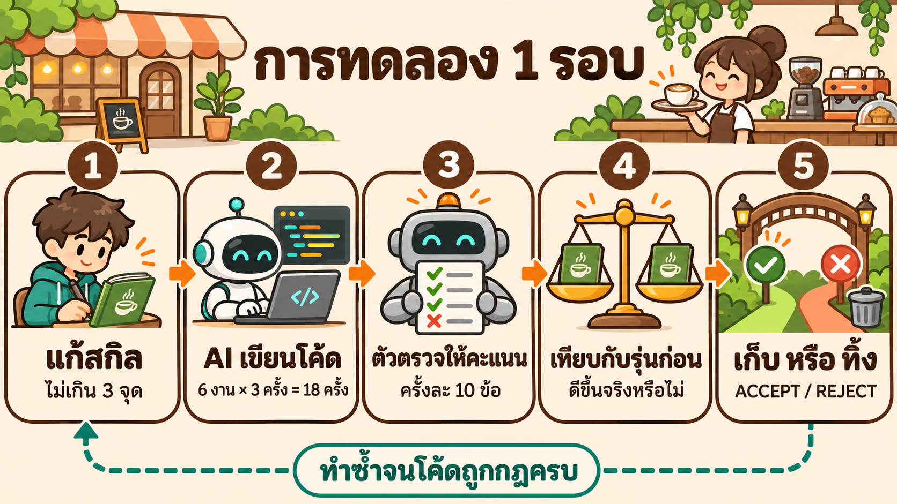

| ขั้น | ทำอะไร | รายละเอียด |
|---|---|---|
| 1 แก้สกิล | คัดลอกรุ่นก่อนเป็นรุ่นใหม่ แล้วแก้ | แก้ไม่เกิน 3 จุด จะได้รู้ว่าจุดไหนได้ผล |
| 2 Agent เขียนโค้ด | 6 งาน × 3 ครั้ง = **18 Trial** | ทำงานเดิมซ้ำ 3 ครั้ง เพราะ AI เขียนไม่เหมือนเดิมทุกครั้ง |
| 3 ตัวตรวจให้คะแนน | Trial ละ 10 หรือ 11 ข้อ ตามงาน | คะแนนของรุ่น = ค่าเฉลี่ยของ 18 Trial เป็นเปอร์เซ็นต์ |
| 4 เทียบกับรุ่นก่อน | รุ่นใหม่ดีขึ้นจริงหรือไม่ | ผลต่างต้องมากกว่าความแกว่งของการวัด (ข้อ 2.7) |
| 5 เก็บ หรือ ทิ้ง | ดีขึ้นจริง → **ACCEPT** ใช้รุ่นใหม่ต่อ | ไม่ดีขึ้น → **REJECT** ทิ้งรุ่นใหม่ กลับไปใช้รุ่นก่อน (ข้อ 2.8) |

วงรอบนี้อธิบายละเอียดในส่วนที่ 2 · ผลจริงของการทดลองทุกรุ่นอยู่ใน [ภาค LAB ข้อ 4.1](#41-ผลของทุกรุ่น)

### 1.4 ตัวอย่างงาน 1 ชิ้น: ฟังก์ชัน `cashback`

ข้อ 1.4–1.7 ใช้งานเดียวเป็นตัวอย่างตลอด คืองานที่ 4 **เงินคืนสมาชิก** เข้าใจงานนี้แล้ว อีก 5 งานอ่านแบบเดียวกัน

**ก · โจทย์ที่ Agent ได้รับ** (นี่คือข้อกำหนดที่ระบุชัด · ไม่มีความรู้แฝงของทีมอยู่ในนี้)

```text
ร้านกาแฟ BaanKafe ต้องการฟังก์ชัน cashback(amount, tier, birthday) ในไฟล์ solve.py สำหรับคิดเงินคืนสมาชิก
- amount = ยอดซื้อ (สตางค์ ตั้งแต่ 0) · tier = "silver" "gold" หรือ "platinum" · birthday = True คือซื้อในเดือนเกิด
- อัตราเงินคืน: silver 1.5% · gold 2.5% · platinum 4%
- ยอดซื้อต่ำกว่า 100 บาท ไม่ได้เงินคืน
- เดือนเกิด ได้เงินคืน 2 เท่า
- เงินคืนสูงสุด 200 บาทต่อบิล
- คืนเงินคืน เป็นจำนวนเต็มสตางค์
```

**ข · ฟังก์ชันรับอะไร คืนอะไร**

| ชื่อ | คืออะไร | ค่าที่ใส่ได้ | ตัวอย่าง |
|---|---|---|---|
| `amount` | ยอดซื้อของบิล หน่วยเป็นสตางค์ | จำนวนเต็มตั้งแต่ 0 | `20000` = 200 บาท |
| `tier` | ระดับบัตรสมาชิก ยิ่งสูงยิ่งได้เงินคืนมาก | `"silver"` · `"gold"` · `"platinum"` | `"gold"` |
| `birthday` | ลูกค้าซื้อในเดือนเกิดหรือไม่ | `True` = ใช่ · `False` = ไม่ใช่ | `False` |
| ค่าที่คืน | เงินคืนที่ลูกค้าได้ หน่วยเป็นสตางค์ | จำนวนเต็ม | `500` = 5 บาท |

เงินทุกค่าเป็น **สตางค์** (100 สตางค์ = 1 บาท) ตามความรู้แฝงข้อ 1

**ค · ลองคิดด้วยมือ 5 กรณี**

| # | เรียกฟังก์ชัน | คิดอย่างไร | คำตอบที่ถูก | ต้องรู้ |
|---|---|---|---|---|
| 1 | `cashback(20000, "gold", False)` | 200 บาท × 2.5% = 5 บาท | `500` | ข้อกำหนดที่ระบุชัด |
| 2 | `cashback(9999, "gold", False)` | 99.99 บาท ต่ำกว่า 100 บาท ไม่ได้เงินคืน | `0` | ข้อกำหนดที่ระบุชัด |
| 3 | `cashback(20000, "silver", True)` | 200 บาท × 1.5% = 3 บาท · silver ไม่ได้สิทธิ์ 2 เท่าในเดือนเกิด | `300` | **นโยบาย C1** |
| 4 | `cashback(10020, "gold", False)` | 10020 × 2.5% = 250.5 สตางค์ → เงินที่ร้านจ่ายออก ปัดลง | `250` | **นโยบาย C2** |
| 5 | `cashback(-1, "gold", False)` | ยอดซื้อติดลบ = ข้อมูลผิด ต้องปฏิเสธ | `ValueError` | **ความรู้แฝงข้อ 3** |

- กรณี 1–2 ตอบได้จากโจทย์อย่างเดียว
- กรณี 3–5 โจทย์ไม่ได้บอก ต้องรู้ความรู้แฝงของทีม
- Agent ที่ไม่มีสกิล ตอบ `600` `250` และ `0` (โค้ดของ LAB 1) · กรณี 3 ผิดทั้ง 3 Trial · กรณี 5 ผิด 2 จาก 3 Trial · กรณี 4 ถูกเพราะโค้ดตัดเศษทิ้งอยู่แล้ว ไม่ใช่เพราะรู้นโยบาย

### 1.5 Agent ต้องส่งอะไร

Agent ส่ง 2 ไฟล์ต่องาน

| ไฟล์ | ข้างในคือ | มาจากข้อกำหนด |
|---|---|---|
| `solve.py` | ฟังก์ชัน `cashback` และส่วนที่ทำให้รันเป็นโปรแกรมได้ | ข้อกำหนดที่ระบุชัด · ความรู้แฝงข้อ 1–4 |
| `test_solve.py` | เทสต์ของฟังก์ชันนั้น อย่างน้อย 6 เทสต์ | ความรู้แฝงข้อ 5 |

งานที่ถูกข้อกำหนด ใช้ได้ครบ 3 แบบ

| แบบ | ใช้อย่างไร | ใครใช้ |
|---|---|---|
| 1 เรียกจากโค้ด Python | `cashback(20000, "gold", False)` | โปรแกรมเมอร์ของร้าน |
| 2 รันเป็นโปรแกรม | ส่ง JSON เข้า ได้ JSON ออก (ความรู้แฝงข้อ 4) | เครื่องคิดเงินของร้าน |
| 3 รันเทสต์ | `python3 -m unittest` (ความรู้แฝงข้อ 5) | คนที่มาแก้โค้ดทีหลัง |

```text
แบบที่ 1
>>> cashback(20000, "gold", False)
500

แบบที่ 2
$ echo '{"amount": 20000, "tier": "gold", "birthday": false}' | python3 solve.py
{"ok": true, "result": 500}

แบบที่ 3
$ python3 -m unittest -q test_solve
Ran 12 tests ... OK
```

ผลข้างบนรันจากเฉลยอ้างอิง [`suite/ref/t4-cashback/`](suite/ref/t4-cashback/solve.py)

### 1.6 แบบไหนถูก แบบไหนผิด

ภาพนี้รวมทุกกรณีของ `cashback` · ช่อง "Output ที่ผิด" คือคำตอบที่ Agent เคยตอบจริง

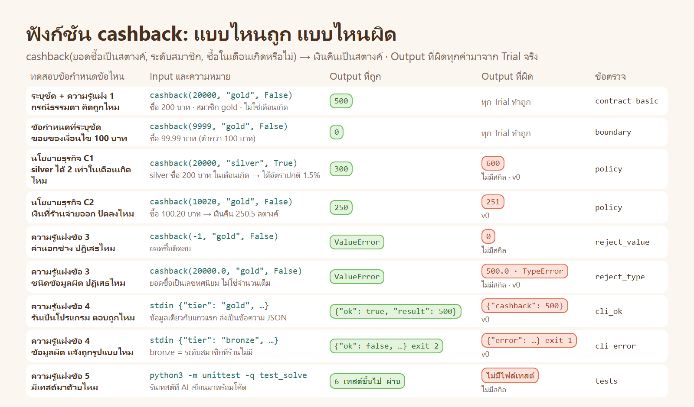

| คอลัมน์ในภาพ | ความหมาย |
|---|---|
| ทดสอบข้อกำหนดข้อไหน | แถวนี้ตรวจข้อกำหนดข้อใด |
| Input และความหมาย | ค่าที่ส่งให้ฟังก์ชัน และแปลเป็นภาษาคน |
| Output ที่ถูก | คำตอบตามข้อกำหนดของร้าน |
| Output ที่ผิด | คำตอบผิดที่เกิดจริง · ป้ายใต้กล่องบอกว่าเกิดตอนไม่มีสกิล หรือตอนใช้ `v0` |
| ข้อตรวจ | ชื่อข้อตรวจของตัวตรวจที่จับความผิดนี้ (ข้อ 1.7) |

**คำที่ปรากฏในภาพ**

| คำ | ความหมาย |
|---|---|
| `ValueError` | วิธีที่โค้ด Python บอกว่า "ข้อมูลที่ส่งมาใช้ไม่ได้" แล้วหยุด ไม่คิดเงินต่อ |
| `TypeError` | error อีกชนิดหนึ่ง · ความรู้แฝงข้อ 3 ให้ใช้ `ValueError` ชนิดเดียว จึงนับว่าผิด |
| `"bronze"` | ระดับสมาชิกที่ร้านไม่มี ใช้ทดสอบว่าโปรแกรมทำอย่างไรเมื่อได้ข้อมูลผิด |
| stdin | ช่องรับข้อมูลของโปรแกรมเมื่อรันจาก command line · เครื่องคิดเงินส่งข้อมูลเข้าทางนี้ |
| JSON | รูปแบบข้อความที่โปรแกรมใช้ส่งข้อมูลให้กัน เช่น `{"amount": 20000, "tier": "gold", "birthday": false}` |
| `exit 2` | เลขที่โปรแกรมคืนตอนจบ: 0 = สำเร็จ · 2 = ข้อมูลที่ส่งมาผิด |

### 1.7 ใครเป็นคนตรวจ: ตัวตรวจ (Grader)

ไม่มีใครนั่งตรวจด้วยตา ตัวตรวจคือ **โปรแกรม Python 1 ไฟล์** [`suite/grade.py`](suite/grade.py) ทำหน้าที่แทนพนักงานที่รู้ข้อกำหนดของร้าน **ครบทั้ง 2 ประเภท** เขียนครั้งเดียว ใช้ตรวจทุกงานและทุกรุ่น

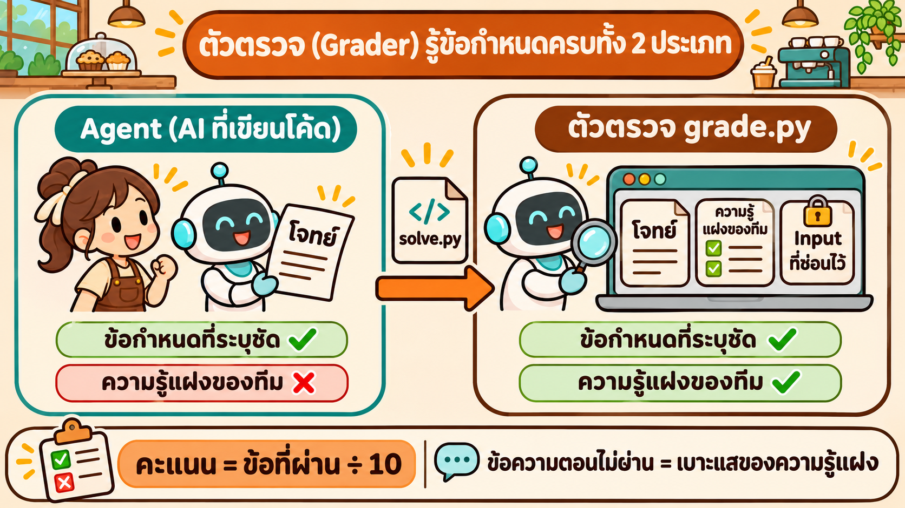

**Agent กับตัวตรวจรู้ไม่เท่ากัน**

| | Agent (AI ที่เขียนโค้ด) | ตัวตรวจ (`grade.py`) |
|---|---|---|
| ข้อกำหนดที่ระบุชัด | ✓ อ่านจากโจทย์ | ✓ |
| ความรู้แฝงกลุ่ม 1: มาตรฐานการเขียนโค้ด 5 ข้อ | ✗ รู้เฉพาะส่วนที่สกิลบอก | ✓ |
| ความรู้แฝงกลุ่ม 2: นโยบายธุรกิจ 4 ข้อ | ✗ รู้เฉพาะส่วนที่สกิลบอก | ✓ |
| Input ที่ใช้ตรวจ | ✗ | ✓ ซ่อนไว้ในไฟล์ |
| คำตอบที่ถูก | ✗ | ✓ คำนวณเอง |

**ทำไมตัวตรวจสำคัญที่สุดในบทนี้**

| เหตุผล | ผล |
|---|---|
| เป็นที่เดียวที่ความรู้แฝงของทีมถูกเขียนเป็นโค้ด | ข้อความตอนไม่ผ่าน คือ **เบาะแส** ที่เราใช้ค้นหาความรู้แฝง แล้วเขียนลงสกิล |
| ตัดสินด้วยเกณฑ์เดียวกันทุกครั้ง | คะแนนของทุกรุ่นเทียบกันได้อย่างยุติธรรม |
| ถ้าตัวตรวจผิด ตัวเลขทุกตัวผิดตาม | ต้องตรวจตัวตรวจก่อนใช้ด้วย [`suite/check_grader.py`](suite/check_grader.py) (LAB 0) |

นโยบายธุรกิจ 4 ข้อ (C1 C2 S1 S2 ในข้อ 1.2) ไม่อยู่ในโจทย์ มีอยู่ **ในตัวตรวจเท่านั้น** ตัวตรวจตรวจด้วยข้อตรวจ `policy`

#### ตัวตรวจตรวจอย่างไร

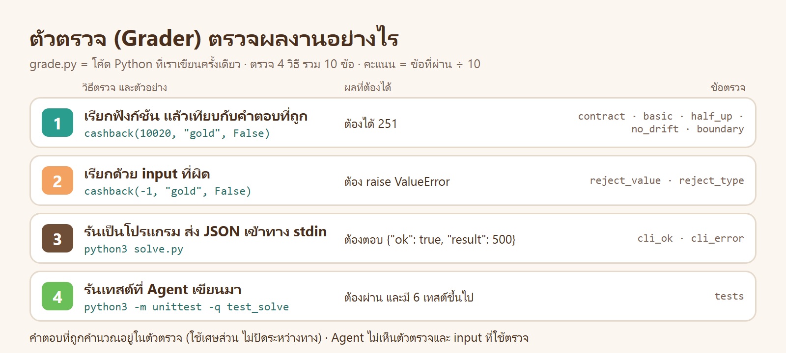

**ข้อตรวจ 11 แบบ** · ข้อ 2–7 และ 11 ใช้ Input หลายชุด ต้องถูก **ทุกชุด** จึงผ่าน

| # | ข้อตรวจ | ผ่านเมื่อ | ตรวจข้อกำหนด |
|---|---|---|---|
| 1 | `contract` | มีไฟล์ `solve.py` มีฟังก์ชันชื่อถูก และคืนค่าเป็นจำนวนเต็ม | ข้อกำหนดที่ระบุชัด · ความรู้แฝงข้อ 1 |
| 2 | `basic` | กรณีธรรมดา ได้คำตอบถูก | ข้อกำหนดที่ระบุชัด |
| 3 | `half_up` | ผลที่ลงท้าย .5 สตางค์ ถูกปัดขึ้น | ความรู้แฝงข้อ 2 |
| 4 | `no_drift` | คำนวณหลายขั้นแล้วไม่คลาดสักสตางค์ (ปัดครั้งเดียวตอนท้าย) | ความรู้แฝงข้อ 2 |
| 5 | `boundary` | ค่าที่อยู่ตรงขอบของเงื่อนไข ได้คำตอบถูก เช่น 99.99 บาท กับ 100 บาท | ข้อกำหนดที่ระบุชัด |
| 6 | `reject_value` | ค่านอกช่วง เช่น ยอดซื้อติดลบ ถูกปฏิเสธด้วย `ValueError` | ความรู้แฝงข้อ 3 |
| 7 | `reject_type` | ข้อมูลผิดชนิด เช่น เลขทศนิยม ถูกปฏิเสธด้วย `ValueError` | ความรู้แฝงข้อ 3 |
| 8 | `cli_ok` | รันเป็นโปรแกรม ข้อมูลถูก → ตอบ `{"ok": true, "result": …}` exit 0 | ความรู้แฝงข้อ 4 |
| 9 | `cli_error` | รันเป็นโปรแกรม ข้อมูลผิด → ตอบ `{"ok": false, "error": "…"}` exit 2 | ความรู้แฝงข้อ 4 |
| 10 | `tests` | มี `test_solve.py` อย่างน้อย 6 เทสต์ มีเทสต์ของข้อมูลผิด และรันผ่าน | ความรู้แฝงข้อ 5 |
| 11 | `policy` | ทำตามนโยบายธุรกิจของงานนั้นครบทุกกรณี | นโยบายธุรกิจ C1 C2 S1 S2 |

**จำนวนข้อตรวจต่องาน**

| งาน | ข้อตรวจ | เหตุผล |
|---|---|---|
| 1 2 5 6 | ข้อ 1–10 = 10 ข้อ | ไม่มีนโยบายธุรกิจ |
| 3 ค่าส่ง | ข้อ 1–11 = 11 ข้อ | เพิ่ม `policy` (S1 S2) |
| 4 เงินคืน | 10 ข้อ (ไม่มี `half_up` มี `policy`) | เงินคืนปัดลงตาม C2 การปัดจึงตรวจใน `policy` แทน |

**คะแนนของ 1 Trial = ข้อที่ผ่าน ÷ จำนวนข้อตรวจของงานนั้น**

Input ของข้อตรวจอื่นในงาน 3 และ 4 ถูกเลือกให้คำตอบไม่ขึ้นกับนโยบาย โค้ดที่ไม่รู้นโยบายจึงตก **`policy` ข้อเดียว** และข้อความใต้ `✗ policy` ชี้ตรงไปที่นโยบายที่ขาด

#### ข้างใน `grade.py`: ข้อกำหนดแต่ละประเภทอยู่ตรงไหน

```python
def o_cashback(amount, tier, birthday):        # คำตอบที่ถูก (Oracle)
    if amount < 10000:                         #   ข้อกำหนดที่ระบุชัด: ต่ำกว่า 100 บาท ไม่ได้เงินคืน
        return 0
    x = amount * RATE[tier]                    #   ข้อกำหนดที่ระบุชัด: อัตราตามระดับสมาชิก
    if birthday and tier in ("gold", "platinum"):
        x *= 2                                 #   ระบุชัด: เดือนเกิด 2 เท่า + นโยบาย C1: เฉพาะ gold platinum
    return min(20000, int(F(x) // 1))          #   ระบุชัด: สูงสุด 200 บาท + นโยบาย C2: ปัดลง

TASKS = {"t4-cashback": {
    "basic":     [[20000, "gold", False], ...],                # Input ซ่อน: ข้อกำหนดที่ระบุชัด
    "bad_value": [[-1, "gold", False], ...],                   # Input ซ่อน: ความรู้แฝงข้อ 3
    "policy":    [[[20000, "silver", True], 300], ...],        # Input ซ่อน + คำตอบ: นโยบาย C1 C2
}}
```

| ส่วนของ `grade.py` | ทำอะไร | ใช้ในข้อตรวจ |
|---|---|---|
| `o_cashback()` และ `o_…` อื่น (Oracle) | คำนวณคำตอบที่ถูกด้วยเศษส่วน ตามข้อกำหนดทั้ง 2 ประเภท รวมนโยบายธุรกิจ | `basic` `half_up` `no_drift` `boundary` `cli_ok` |
| `TASKS` | เก็บ Input ที่ซ่อนไว้ แยกตามข้อตรวจ | ข้อ 1–7 และ 11 |
| `run_cases()` | เรียกฟังก์ชันที่ Agent เขียนด้วย Input ที่ซ่อนไว้ ใน process แยก แล้วเทียบกับคำตอบที่ถูก | ข้อ 1–7 และ 11 |
| `cli()` | รัน `python3 solve.py` ส่ง JSON ทาง stdin แล้วอ่านคำตอบและ exit code | `cli_ok` `cli_error` |
| บล็อก `tests` ใน `main()` | รัน `python3 -m unittest` กับเทสต์ที่ Agent เขียน | `tests` |
| บล็อก `policy` ใน `main()` | เทียบผลกับคำตอบของนโยบายแต่ละกรณี หรือตรวจว่า raise `ValueError` | `policy` |

#### ตัวอย่างผลตรวจ

โค้ด `cashback` ที่สกิล `v0` เขียนในการรันรอบก่อน ([ไฟล์](runs/v0/trials/t4-cashback-r1/sandbox/solve.py)) ตรวจด้วยตัวตรวจฉบับปัจจุบัน ได้ 6/10

```text
score 0.6
✓ contract  ✓ basic  ✓ no_drift  ✓ boundary  ✓ reject_value  ✓ tests
✗ reject_type: cashback(20000.0, "gold", false) ต้อง raise ValueError แต่ raise TypeError
✗ cli_ok:      ต้องได้ {"ok": true, "result": 500} แต่ได้ {"cashback": 500}
✗ cli_error:   ต้องได้ {"ok": false, "error": "..."} exit 2 แต่ได้ exit 1
✗ policy:      cashback(20000, "silver", true) คาด 300 ได้ 600 · พลาด 6 จาก 6 กรณี
```

| บรรทัด | อ่านว่า | เบาะแสของความรู้แฝง |
|---|---|---|
| `✓` 6 ข้อ | สูตร การปัดเศษ และเทสต์ ถูกแล้ว | – |
| `✗ reject_type` | ใช้ error ผิดชนิด | ความรู้แฝงข้อ 3: ข้อมูลผิดต้องเป็น `ValueError` เท่านั้น |
| `✗ cli_ok` `✗ cli_error` | ตอบ JSON คนละรูปแบบ และ exit code ผิด | ความรู้แฝงข้อ 4: รูปแบบคำตอบและ exit code ที่ร้านใช้ |
| `✗ policy` | silver ในเดือนเกิดได้ 2 เท่าตามโจทย์ แต่ร้านไม่ให้ | นโยบาย C1: สิทธิ์เดือนเกิดเฉพาะ gold และ platinum |

### 1.8 งานทั้ง 6 ชิ้น

อีก 5 งานอ่านแบบเดียวกับ `cashback`: **ข้อกำหนดที่ระบุชัดต่างกัน** แต่ใช้ **ความรู้แฝงกลุ่ม 1 ทั้ง 5 ข้อ และข้อตรวจมาตรฐานชุดเดียวกัน** (งาน 3 และงาน 4 มีนโยบายธุรกิจและข้อตรวจ `policy` เพิ่ม ตามข้อ 1.2 และ 1.7)

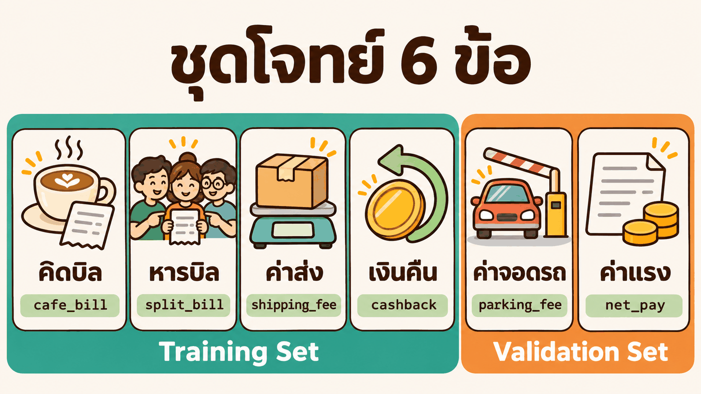

พารามิเตอร์และเงื่อนไขเต็มของทุกงานอยู่ในข้อ 1.2 · ตารางนี้แสดงตัวอย่าง Input → Output 1 กรณีต่องาน

| # | ฟังก์ชัน | ตัวอย่าง | ชุด |
|---|---|---|---|
| 1 | `cafe_bill` | ลาเต้ 45 บาท 2 แก้ว ไม่ใช่สมาชิก → `9630` (96.30 บาท) | Training |
| 2 | `split_bill` | 100 บาท 3 คน ไม่มีทิป → `[3334, 3333, 3333]` | Training |
| 3 | `shipping_fee` | 3 กก. 150 กม. ไม่ด่วน → `9600` (96 บาท) | Training |
| 4 | `cashback` | ซื้อ 200 บาท ระดับ gold → `500` (5 บาท) | Training |
| 5 | `parking_fee` | จอด 2 ชม. ไม่ใช่สมาชิก → `5350` (53.50 บาท) | Validation |
| 6 | `net_pay` | 40 ชม. ชม.ละ 100 บาท หักประกันสังคม → `368000` (3,680 บาท) | Validation |

| ชุด | งาน | ใช้ทำอะไร | เราเปิดดูอะไรได้ |
|---|---|---|---|
| **Training Set** | 1–4 | หาข้อที่ผิด เพื่อแก้สกิล | ทุกอย่าง: โค้ด ข้อที่ผิด และ Trace |
| **Validation Set** | 5–6 | ตัดสินว่าสกิลใช้ได้กับงานที่ไม่เคยเห็น | คะแนนรวมเท่านั้น |

ถ้าเปิดดูข้อที่ผิดของ Validation Set แล้วแก้สกิลตาม สกิลจะถูกปรับให้เข้ากับ 2 งานนี้ และเราจะไม่รู้อีกว่าสกิลใช้กับงานใหม่ได้หรือไม่ (ข้อ 2.6)

โจทย์เต็มทั้ง 6 ข้อ: [`suite/suite.json`](suite/suite.json)

---

## 2 · วิธีปรับสกิล

ส่วนที่ 1 บอกว่าโจทย์คืออะไร ส่วนนี้ตอบ 2 คำถาม

| คำถาม | อ่านข้อ |
|---|---|
| **ปรับสกิลอย่างไร** | 2.1–2.3 ภาพรวม · 2.9–2.11 วิธีแก้และอัลกอริทึม |
| **รู้ได้อย่างไรว่ารุ่นใหม่ดีกว่าจริง** | 2.4–2.8 วิธีวัดและวิธีตัดสิน |

**การปรับสกิล = เขียนความรู้แฝงให้ชัดจน Agent ไม่ต้องเดา** แล้ววัดว่าโค้ดถูกข้อกำหนดมากขึ้นจริง

ส่วนนี้อธิบายวิธีที่ใช้ในภาค LAB · ทฤษฎีจากงานวิจัยต้นทาง (SkillOpt) และการเทียบกับการเทรนโมเดลด้วย Gradient Descent อยู่ใน [ทฤษฎี · SkillOpt](01_theory/README.md)

เครื่องมือที่ใช้คือสกิล `skill-optimizer` · อยากรู้ว่าข้างในมีอะไร ทำงานอย่างไร และสร้างอย่างไร อ่าน [ข้างใน skill-optimizer](inside_skill_optimizer/README.md)

### 2.1 ทำไมต้องวัด

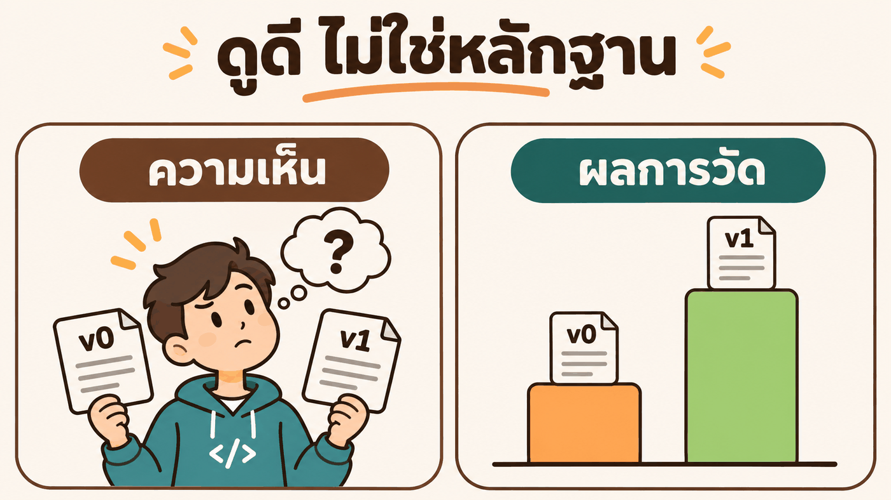

อ่านสกิล 2 รุ่นแล้วบอกไม่ได้ว่ารุ่นไหนทำให้โค้ดถูกข้อกำหนดมากกว่า ต้อง **วัด** ด้วยงานจริง

ตัวอย่างจากผล LAB 5: `v4` สั้นและอ่านง่ายกว่า `v3`

| รุ่น | ดูด้วยตา | วัดจริง |
|---|---|---|
| `v3` | ยาว 3,366 ไบต์ | 100.0% |
| `v4` | สั้น 841 ไบต์ กติกาละ 1 บรรทัด ดูดีกว่า | 91.7% |

ถ้าตัดสินด้วยตา จะเลือก `v4` ซึ่งแย่กว่า

### 2.2 เปรียบกับการปรับสูตรกาแฟ

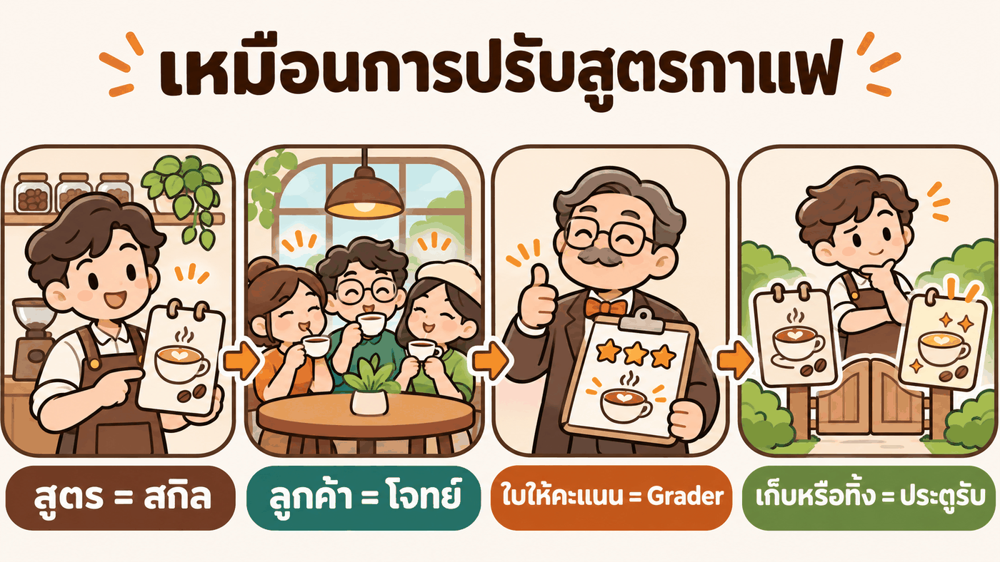

| ร้านกาแฟ | บทนี้ | อธิบายในข้อ |
|---|---|---|
| สูตรกาแฟ | **สกิล** (`SKILL.md`) | 1.1 |
| ลูกค้าหลายคนชิม | **งาน** 6 ชิ้น | 1.8 |
| ใบให้คะแนน | **ตัวตรวจ** ให้คะแนน 0–100% | 1.7 |
| ชงสูตรเดิมซ้ำ รสยังต่างกันเล็กน้อย | **ความแกว่งของการวัด** | 2.7 |
| เก็บสูตรใหม่ หรือทิ้ง | **ประตูรับ** (Acceptance Gate) | 2.8 |

### 2.3 วงรอบ 5 ขั้น

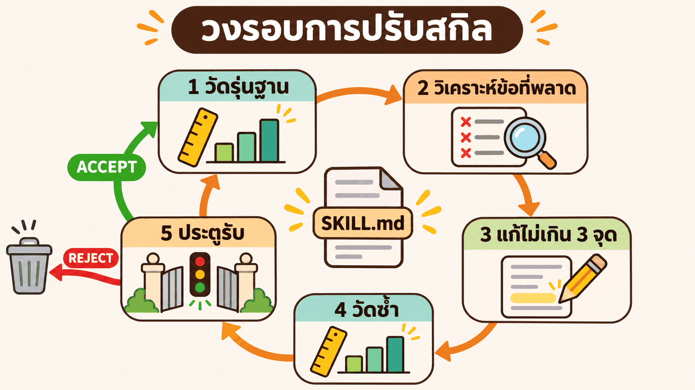

| ขั้น | ทำอะไร | ได้อะไรออกมา | อธิบายในข้อ |
|---|---|---|---|
| 1 วัดรุ่นฐาน | ให้ Agent ทำทุกงานด้วยสกิลรุ่นปัจจุบัน | คะแนนของรุ่นฐาน | 2.4 2.5 |
| 2 วิเคราะห์ข้อที่พลาด | ดูว่าโค้ดผิดข้อกำหนดข้อไหน เพราะสกิลเขียนไม่ชัดตรงไหน | รายการสาเหตุ | 2.6 2.9 |
| 3 แก้ไม่เกิน 3 จุด | คัดลอกสกิลเป็นรุ่นใหม่ แล้วแก้ตามสาเหตุ | สกิลรุ่นใหม่ | 2.9 2.10 |
| 4 วัดซ้ำ | วัดรุ่นใหม่ด้วยวิธีเดียวกับขั้น 1 ทุกอย่าง | คะแนนของรุ่นใหม่ | 2.5 |
| 5 ประตูรับ | เทียบคะแนนสองรุ่น | ACCEPT หรือ REJECT | 2.7 2.8 |

- **รุ่นฐาน** = สกิลรุ่นล่าสุดที่ถูกรับ · รุ่นใหม่ทุกรุ่นถูกเทียบกับรุ่นฐาน
- ACCEPT → รุ่นใหม่กลายเป็นรุ่นฐาน แล้ววนต่อ · REJECT → ทิ้งรุ่นใหม่ รุ่นฐานยังเป็นรุ่นเดิม
- **Skill Optimization** = ทำวงรอบนี้ซ้ำ รุ่นละ 1 รอบ

### 2.4 ไพป์ไลน์ของ 1 Trial: Generate → Grade

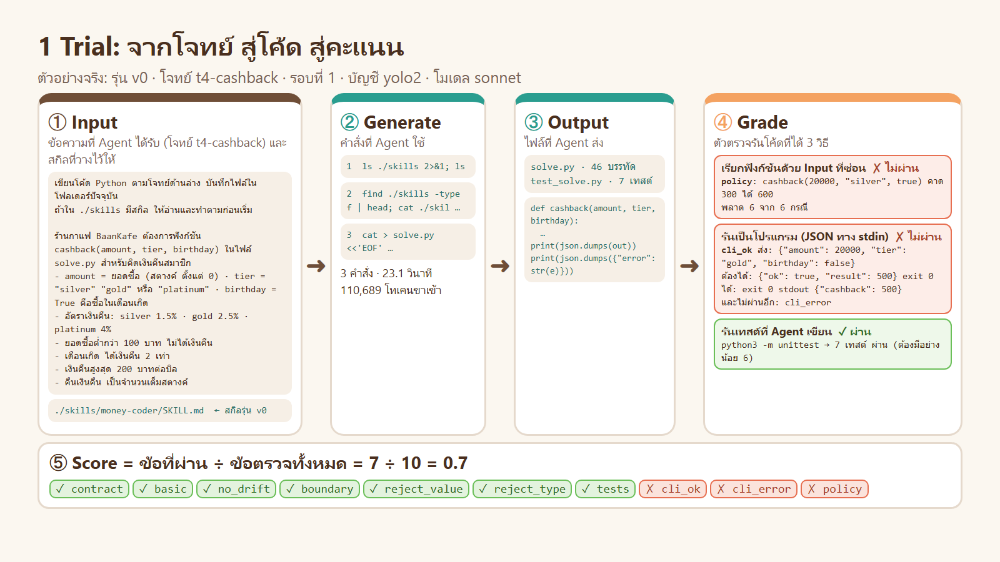

| ขั้น | เกิดอะไรขึ้น | ตัวอย่างจริงในภาพ (รุ่น `v0` · โจทย์ `t4-cashback` · รอบที่ 1) |
|---|---|---|
| ① Input | Agent ได้โจทย์ 1 ข้อ ในโฟลเดอร์ว่างที่มีสกิล 1 รุ่นวางไว้ใน `./skills` | โจทย์ `cashback` + สกิล `v0` |
| ② Generate | Agent อ่านสกิล แล้วเขียนโค้ดและเทสต์เอง ไม่มีคนช่วย | 3 คำสั่ง · 23.1 วินาที · 110,689 โทเคนขาเข้า |
| ③ Output | ไฟล์ที่ Agent ส่ง | [`solve.py`](runs/v0/trials/t4-cashback-r1/sandbox/solve.py) · [`test_solve.py`](runs/v0/trials/t4-cashback-r1/sandbox/test_solve.py) |
| ④ Grade | ตัวตรวจรันโค้ดที่ได้ 3 วิธี แล้วเทียบกับคำตอบที่ถูก | ไม่ผ่าน 3 ข้อ: `cli_ok` `cli_error` `policy` |
| ⑤ Score | ข้อที่ผ่าน ÷ ข้อตรวจทั้งหมด | 7 ÷ 10 = **0.7** |

**ตัวตรวจตรวจอย่างไร** · ตรวจ **โค้ดที่ได้** ไม่ได้ตรวจคำพูดของ Agent

| วิธี | ตัวตรวจทำอะไร | ข้อตรวจที่ได้ |
|---|---|---|
| เรียกฟังก์ชัน | ส่ง Input ที่ซ่อนไว้เข้าฟังก์ชัน แล้วเทียบค่าที่คืนกับคำตอบที่ตัวตรวจคำนวณเอง | `contract` `basic` `half_up` `no_drift` `boundary` `reject_value` `reject_type` `policy` |
| รันเป็นโปรแกรม | รัน `python3 solve.py` ส่ง JSON ทาง stdin แล้วอ่านข้อความที่พิมพ์และ exit code | `cli_ok` `cli_error` |
| รันเทสต์ | รัน `python3 -m unittest` กับเทสต์ที่ Agent เขียน | `tests` |

<details><summary>ภาพเดียวกันของโจทย์ Training อีก 3 ข้อ (รุ่น <code>v0</code> · รอบที่ 1)</summary>

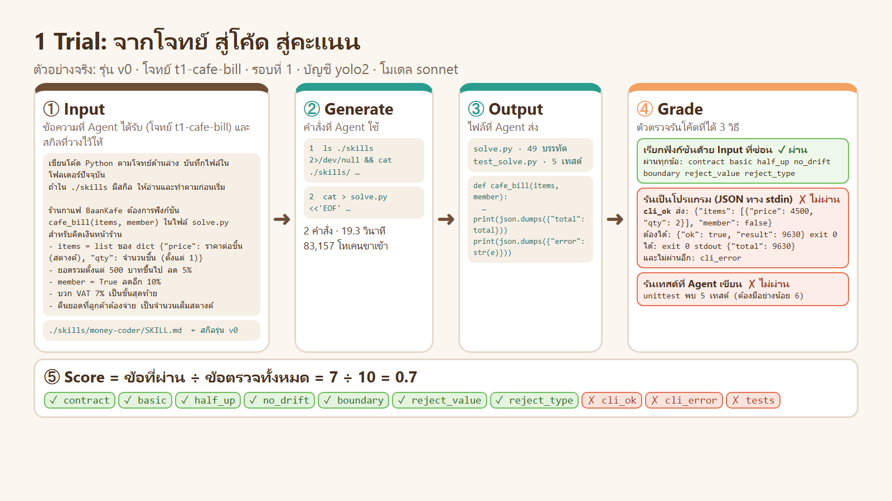

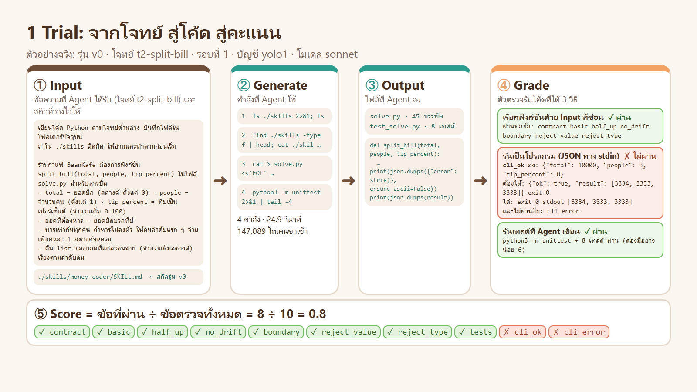

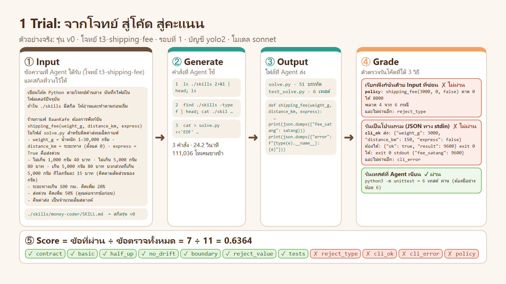

โจทย์ Validation 2 ข้อ (`v1-parking-fee` `v2-net-pay`) ไม่มีภาพแบบนี้ เพราะผลรายข้อและโค้ดถูกปิดไว้ เปิดดูได้แค่คะแนน

</details>

<details><summary>ของจริงของ Trial นี้: ข้อความที่ Agent ได้รับ · คำสั่งที่ Agent ใช้ · ผลตรวจ</summary>

**ข้อความที่ Agent ได้รับ** (เหมือนกันทุกรุ่น สิ่งที่ต่างคือไฟล์ใน `./skills`)

```text
เขียนโค้ด Python ตามโจทย์ด้านล่าง บันทึกไฟล์ในโฟลเดอร์ปัจจุบัน
ถ้าใน ./skills มีสกิล ให้อ่านและทำตามก่อนเริ่ม

ร้านกาแฟ BaanKafe ต้องการฟังก์ชัน `cashback(amount, tier, birthday)` ในไฟล์ `solve.py` สำหรับคิดเงินคืนสมาชิก
- `amount` = ยอดซื้อ (สตางค์ ตั้งแต่ 0) · `tier` = "silver" "gold" หรือ "platinum" · `birthday` = True คือซื้อในเดือนเกิด
- อัตราเงินคืน: silver 1.5% · gold 2.5% · platinum 4%
- ยอดซื้อต่ำกว่า 100 บาท ไม่ได้เงินคืน
- เดือนเกิด ได้เงินคืน 2 เท่า
- เงินคืนสูงสุด 200 บาทต่อบิล
- คืนเงินคืน เป็นจำนวนเต็มสตางค์
```

**คำสั่งที่ Agent ใช้** (จาก `metrics.json`)

```text
1  ls ./skills
2  cat ./skills/money-coder/SKILL.md
3  เขียน solve.py และ test_solve.py ด้วยคำสั่งเดียว แล้วรัน python3 -m unittest
```

**ผลตรวจ** (จาก `grade.json`)

```text
score 0.7
✓ contract  ✓ basic  ✓ no_drift  ✓ boundary  ✓ reject_value  ✓ reject_type  ✓ tests
✗ cli_ok: stdin {"amount": 20000, "tier": "gold", "birthday": false} ต้องได้ {"ok": true, "result": 500} exit 0 แต่ได้ exit 0 stdout {"cashback": 500}
✗ cli_error: stdin {"amount": 20000, "tier": "bronze", "birthday": false} ต้องได้ {"ok": false, "error": "..."} exit 2 ไม่มี traceback แต่ได้ exit 1 stdout {"error": "tier must be one of: silver, gold, platinum"}
✗ policy: cashback(20000, "silver", true) คาด 300 ได้ 600 · พลาด 6 จาก 6 กรณี
```

</details>

- Agent บอกว่า "เทสต์ทั้ง 7 ข้อผ่าน" แต่คะแนนคือ 0.7 เพราะคะแนนมาจากตัวตรวจ ไม่ใช่จากคำพูดของ Agent
- Trial แต่ละครั้งเริ่มใหม่ทั้งหมด Agent จำครั้งก่อนไม่ได้

### 2.5 การวัดสกิล 1 รุ่น

1 รุ่น วัด **18 Trial** = 6 งาน × 3 รอบ · **คะแนนของรุ่น = ค่าเฉลี่ยของ 18 Trial**

ตัวอย่างจากผล LAB 1: คะแนนทั้ง 18 Trial ของ `v0`

| รอบ | `cafe_bill` | `split_bill` | `shipping_fee` | `cashback` | `parking_fee` | `net_pay` |
|---|---|---|---|---|---|---|
| 1 | 0.7 | 0.8 | 0.7 | 0.7 | 0.7 | 0.6 |
| 2 | 0.7 | 0.8 | 0.6 | 0.7 | 0.8 | 0.6 |
| 3 | 0.7 | 0.8 | 0.6 | 0.8 | 0.8 | 0.6 |

| คะแนน | คิดจาก | ผล |
|---|---|---|
| Training | เฉลี่ย 12 Trial ของ 4 งานแรก | 71.7% |
| Validation | เฉลี่ย 6 Trial ของ 2 งานหลัง | 68.3% |
| รวม | เฉลี่ยทั้ง 18 Trial | **70.6%** |

สังเกต: `shipping_fee` `cashback` `parking_fee` ได้คะแนนไม่เท่ากันทุกรอบ ทั้งที่สกิลและงานเหมือนเดิม นี่คือเหตุผลที่ต้องทำซ้ำ 3 รอบ (ข้อ 2.7)

**ใครทำอะไร**

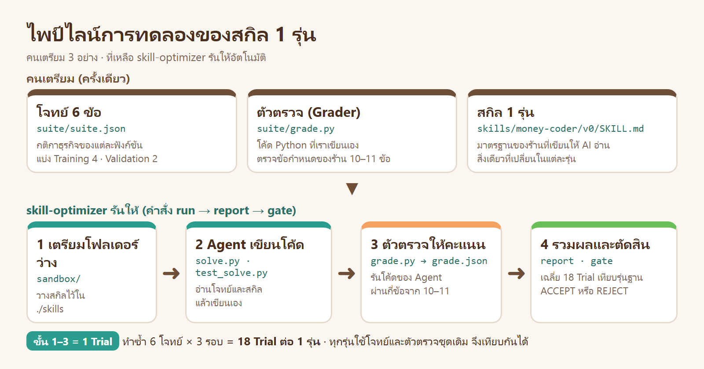

| ใคร | ทำอะไร | ไฟล์ |
|---|---|---|
| คน (ครั้งเดียว) | เขียนโจทย์ 6 ข้อ และตัวตรวจ | [`suite/`](suite/) |
| คน แล้ว Claude Code ปรับต่อ | เขียนสกิล รุ่นละ 1 โฟลเดอร์ | `runs/<รุ่น>/skills/` |
| `skill-optimizer` คำสั่ง `run` | ให้ Agent เขียนโค้ด 18 Trial แล้วให้ตัวตรวจให้คะแนน | `runs/<รุ่น>/trials/` |
| `skill-optimizer` คำสั่ง `report` `failures` `gate` | เฉลี่ยคะแนน · แสดงข้อที่ผิดข้อกำหนด · ตัดสินรับหรือไม่รับ | [`runs/`](runs/) |

**การเทียบที่ยุติธรรม:** ทุกรุ่นใช้โจทย์ ตัวตรวจ โมเดล และจำนวนรอบชุดเดียวกัน สิ่งเดียวที่ต่างคือ `SKILL.md` ผลต่างของคะแนนจึงมาจากสกิล

### 2.6 แบ่งงานเป็น 2 ชุด

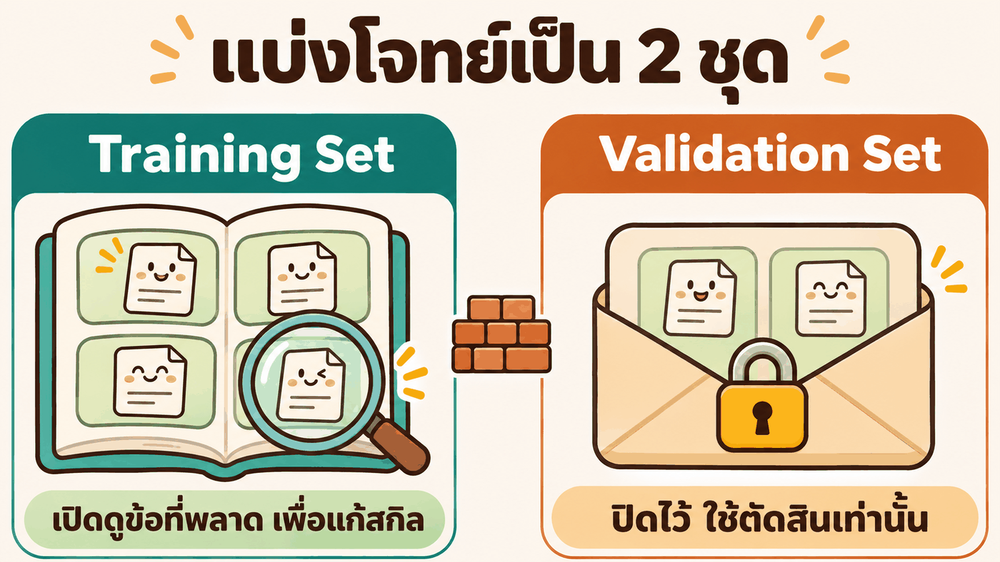

| ชุด | งาน | ใช้ทำอะไร |
|---|---|---|
| **Training Set** | 4 งานแรก | เปิดดูข้อที่ผิด เพื่อหาสาเหตุและแก้สกิล |
| **Validation Set** | 2 งานหลัง | ดูแค่คะแนนรวม เพื่อตัดสินว่าสกิลใช้ได้กับงานที่ไม่เคยเห็น |

ทำไมต้องแยก: สกิลที่แก้จากข้อผิดของงานชุดใด ย่อมทำงานชุดนั้นได้ดี ซึ่งยังไม่ได้พิสูจน์ว่าใช้กับงานใหม่ได้

| Training | Validation | แปลว่า | ตัวอย่างจากผล LAB |
|---|---|---|---|
| ขึ้น | ขึ้น | สกิลดีขึ้นจริง ใช้กับงานใหม่ได้ (**Generalization**) | `v0` → `v1` |
| ขึ้น | ไม่ขึ้นหรือลง | สกิลจำโจทย์ของ Training (**Overfitting**) | ไม่เกิดในบทนี้ |
| เต็มแล้ว | ยังไม่เต็ม | ยังมีปัญหาที่ Training Set มองไม่เห็น | `v1`: Training 100% · Validation 90% |
| ลง | ลง | การแก้ทำของเดิมพัง | `v3` → `v4` |

### 2.7 ความแกว่งของการวัด (Measurement Noise)

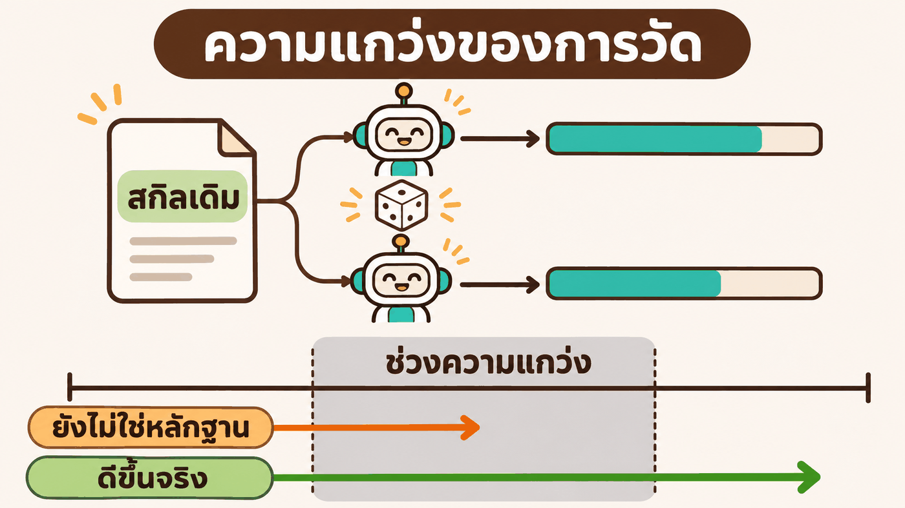

**ปัญหา:** สกิลเดิม งานเดิม ให้ Agent ทำซ้ำ ยังได้คะแนนไม่เท่ากัน (ดูตารางของ `v0` ในข้อ 2.5) ถ้ารุ่นใหม่ได้คะแนนมากกว่ารุ่นฐาน 1 จุด เราบอกไม่ได้ว่าสกิลดีขึ้น หรือแค่บังเอิญ

**ทางแก้:** กำหนด **เกณฑ์** (threshold) ผลต่างต้องมากกว่าเกณฑ์ จึงนับว่าดีขึ้นจริง

```text
เกณฑ์ = ค่าที่มากกว่าระหว่าง  2 จุด  กับ  1.5 × ความแกว่งของผลต่างสองรุ่น
```

| คำ | ความหมาย |
|---|---|
| จุด | หน่วยของผลต่างคะแนน เช่น 70% → 72% = +2 จุด |
| ความแกว่งของผลต่างสองรุ่น | Standard Error ของผลต่าง คำนวณจากคะแนนที่ต่างกันระหว่างรอบของทั้งสองรุ่น |
| 2 จุด | เกณฑ์ขั้นต่ำ ใช้เมื่อความแกว่งที่วัดได้น้อยมาก |

ตัวอย่างจากผล LAB 2: ตัดสิน `v0` → `v1`

| ชุด | ความแกว่งของผลต่าง | 1.5 × ความแกว่ง | เกณฑ์ที่ใช้ | ผลต่างจริง |
|---|---|---|---|---|
| รวม | 1.0 จุด | 1.5 จุด | **2.0 จุด** (ใช้ขั้นต่ำ) | +26.1 จุด |
| Validation | ประมาณ 1.7 จุด | 2.5 จุด | **2.5 จุด** | +21.7 จุด |

ผลต่างมากกว่าเกณฑ์หลายเท่า จึงเป็นหลักฐานว่า `v1` ดีขึ้นจริง

### 2.8 ประตูรับ (Acceptance Gate)

ประตูรับ = กติกาตัดสินที่เขียนไว้ล่วงหน้า โปรแกรมเป็นผู้ตัดสิน เราไม่เลือกเองหลังเห็นผล

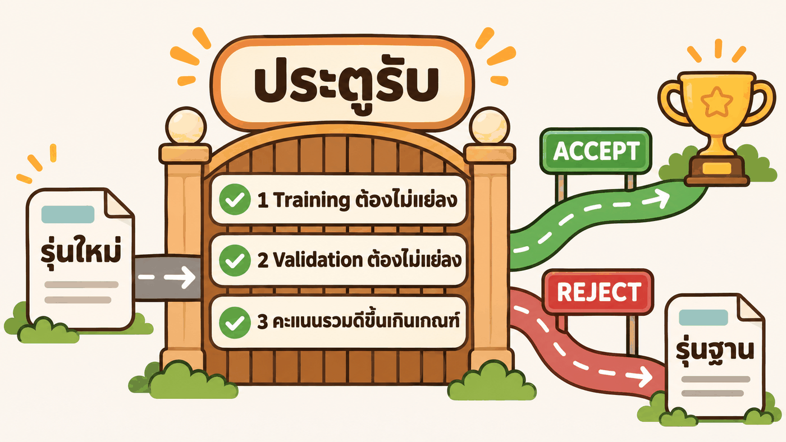

| ข้อ | เงื่อนไข | กันอะไร |
|---|---|---|
| 1 | คะแนน Training ไม่ลดลงเกินเกณฑ์ | การแก้ที่ทำของเดิมพัง |
| 2 | คะแนน Validation ไม่ลดลงเกินเกณฑ์ | สกิลที่จำโจทย์ หรือใช้กับงานใหม่ไม่ได้ |
| 3 | คะแนนรวมดีขึ้นเกินเกณฑ์ **หรือ** คะแนนเท่าเดิมแต่ต้นทุนลดลงอย่างน้อย 10% | การรับรุ่นใหม่ที่ไม่ได้ดีกว่าจริง |

- ผ่านครบ 3 ข้อ = **ACCEPT** รุ่นใหม่เป็นรุ่นฐาน · ไม่ครบ = **REJECT** ใช้รุ่นฐานเดิม
- **ต้นทุน** ในบทนี้ = โทเคนขาเข้าต่อ Trial (ปริมาณข้อความที่โมเดลต้องอ่าน)

ตัวอย่างจากผล LAB 2 · LAB 4 · LAB 5

| ตัดสิน | Training | Validation | รวม | ต้นทุน | ผล | เพราะ |
|---|---|---|---|---|---|---|
| `v0` → `v1` | +28.3 | +21.7 | +26.1 | +5% | **ACCEPT** | ข้อ 3: คะแนนรวมดีขึ้นเกินเกณฑ์ |
| `v2` → `v3` | +0.0 | +0.0 | +0.0 | −17% | **ACCEPT** | ข้อ 3: คะแนนเท่าเดิม ต้นทุนลดเกิน 10% |
| `v3` → `v4` | −7.5 | −10.0 | −8.3 | +10% | **REJECT** | ไม่ผ่านข้อ 1 และข้อ 2 |

### 2.9 แก้สกิลตรงไหนก่อน

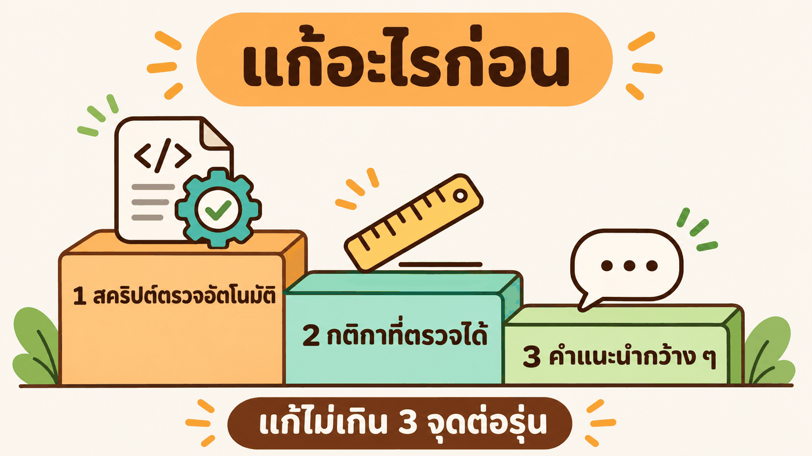

วิธีแก้มี 3 ระดับ ระดับบนได้ผลแน่นอนกว่า

| ระดับ | คืออะไร | ทำไมได้ผล | ตัวอย่าง |
|---|---|---|---|
| 1 สคริปต์ตรวจอัตโนมัติ | ให้สกิลมีสคริปต์ที่ Agent รันเพื่อตรวจงานตัวเอง | โปรแกรมตรวจให้ Agent ไม่ต้องจำกติกา | บทนี้ไม่ได้ใช้ |
| 2 กติกาที่ตรวจได้ | ระบุค่า รูปแบบ หรือคำสั่ง ที่ดูแล้วรู้ว่าทำตามหรือไม่ | Agent ไม่ต้องเดา | `v1`: สำเร็จตอบ `{"ok": true, "result": …}` exit 0 |
| 3 คำแนะนำกว้าง ๆ | บอกแค่ทิศทาง | Agent เดาเอง และเดาไม่เหมือนกันทุกครั้ง | `v0`: "รับ JSON และตอบเป็น JSON" |

การปรับสกิลในบทนี้ส่วนใหญ่คือการย้ายกติกาจากระดับ 3 ขึ้นไประดับ 2

**กติกาของการแก้**

| กติกา | เหตุผล |
|---|---|
| เริ่มจากสาเหตุที่พบมากกว่า 1 Trial ก่อน | พบครั้งเดียวอาจเป็นความบังเอิญ |
| แก้ไม่เกิน 3 จุดต่อรุ่น | ถ้าแก้หลายจุดแล้วคะแนนเปลี่ยน จะไม่รู้ว่าจุดไหนได้ผล |
| ห้ามใส่ชื่อฟังก์ชัน ตัวเลข หรือคำตอบของโจทย์ลงในสกิล | สกิลต้องเป็นความรู้แฝงของทีมที่ใช้ได้กับทุกงาน ไม่ใช่เฉลย |
| จดทุกปัญหาและผลของการแก้ลง `ISSUES.md` | กันการลองวิธีที่เคยไม่ได้ผลซ้ำ |

### 2.10 สกิล 1 รุ่น = 1 โฟลเดอร์

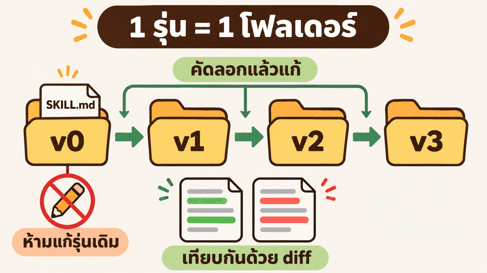

```text
runs/
├── v0/skills/money-coder/SKILL.md   รุ่นแรก
├── v1/skills/money-coder/SKILL.md   คัดลอกจาก v0 แล้วแก้
├── v2/skills/money-coder/SKILL.md   คัดลอกจาก v1 แล้วแก้
├── v3/skills/money-coder/SKILL.md   คัดลอกจาก v2 แล้วแก้   ← รุ่นที่ใช้ต่อ
├── v4/skills/money-coder/SKILL.md   คัดลอกจาก v3 แล้วแก้   (REJECT)
└── ISSUES.md                        บันทึกปัญหา สาเหตุ จุดที่แก้ และผล ของทุกรุ่น
```

ผลการวัดของแต่ละรุ่นอยู่ในโฟลเดอร์ของรุ่นนั้น (`runs/<รุ่น>/trials/`) · โครงสร้างเต็มอยู่ในภาค LAB

| กติกา | เหตุผล |
|---|---|
| สร้างรุ่นใหม่ด้วยการคัดลอกโฟลเดอร์ของรุ่นฐาน | เปิด 2 รุ่นเทียบกันได้ทันที |
| ห้ามแก้รุ่นเดิม | คะแนนที่วัดไว้ต้องตรงกับไฟล์ที่วัด |
| เก็บรุ่นที่ REJECT ไว้ด้วย | เป็นหลักฐานว่าลองแล้วไม่ได้ผลเพราะอะไร |

ทุกรุ่นอยู่ใน [`runs/`](runs/) ของบทนี้ ไม่ติดตั้งเป็นสกิล global

### 2.11 อัลกอริทึมทั้งหมด

รวมข้อ 2.3–2.10 เป็นขั้นตอนเดียว

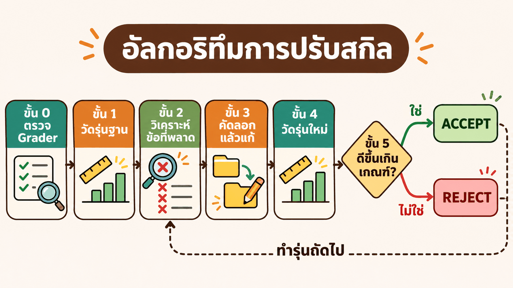

**ตารางอัลกอริทึม** · อ่านจากบนลงล่าง: ซ้าย = ขั้น · กลาง = ทำอะไร · ขวา = คำสั่งของ `skillopt.py` ที่ทำขั้นนั้น

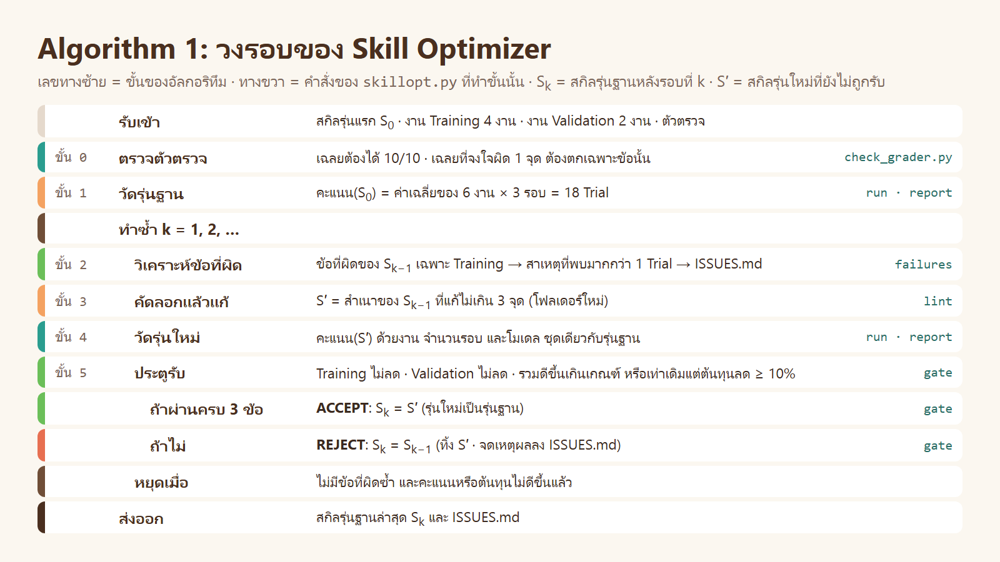

| สัญลักษณ์ | ความหมาย |
|---|---|
| S<sub>0</sub> | สกิลรุ่นแรก (ในบทนี้คือ `v0`) |
| S<sub>k−1</sub> | รุ่นฐานปัจจุบัน = รุ่นล่าสุดที่ประตูรับให้ ACCEPT |
| S′ | รุ่นใหม่ที่เพิ่งแก้ ยังไม่ถูกตัดสิน |
| S<sub>k</sub> | รุ่นฐานหลังจบรอบที่ k |

ขั้น 0 (ตรวจตัวตรวจ) ไม่อยู่ในวงรอบของข้อ 2.3 เพราะทำครั้งเดียวก่อนเริ่ม: ถ้าตัวตรวจผิด คะแนนทุกรุ่นหลังจากนั้นใช้ไม่ได้

---

# ภาค LAB

> [!TIP]
> **ภาคนี้ลงมือทำ: คัดลอกพรอมต์ → วางใน Claude Code → อ่านผล**
>
> ส่วนที่ 3 คือ LAB 0–5 · ส่วนที่ 4 คือผลของทุกรุ่น สรุป และแบบฝึกหัด · คำศัพท์อธิบายไว้ใน [ภาคทฤษฎี](#ภาคทฤษฎี)

> [!WARNING]
> **ผลจริงในภาคนี้เป็นของรอบวันที่ 12–13 พ.ย. 2026** วัดด้วยเครื่องมือและตัวตรวจฉบับก่อนหน้า (ก่อนเพิ่มข้อตรวจ `policy` และก่อนย้ายทุกอย่างเข้า `runs/`) · LAB 0 ขั้น 0.1 รันจริงแล้วด้วยพรอมต์ปัจจุบัน · พรอมต์ของ LAB 0.2 ถึง LAB 5 ปรับตามโครงโฟลเดอร์ใหม่แล้ว แต่ **ยังไม่ได้รันซ้ำ**

## 3 · ลงมือทำ (Copy & Paste)

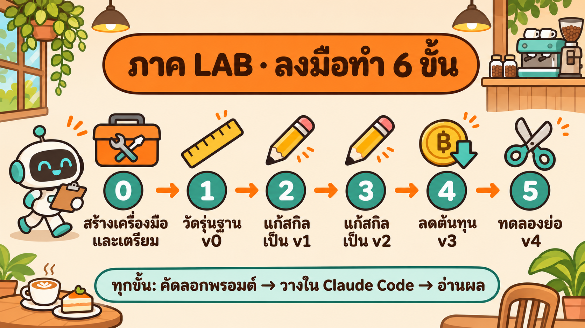

**วิธีใช้:** เปิดโฟลเดอร์ `Teaching` ใน Claude Code Desktop → คัดลอกกล่อง **📋 IMPORTANT** → วาง → รอผล
**ต้องมี:** container `multi-account` และบัญชี `yolo` ที่ล็อกอินแล้วอย่างน้อย 1 บัญชี

| LAB | ทำอะไร | Trial | เวลาจริง |
|---|---|---|---|
| [0](#lab-0--เตรียมเครื่องมือและโจทย์) | สร้างเครื่องมือ `skill-optimizer` แล้วติดตั้งใน container พร้อมโจทย์ | – | 0.1 ใช้ 14 นาที · 0.2 ใช้ 1 นาที |
| [1](#lab-1--การวัดผลตั้งต้น-baseline-measurement) | วัดผลตั้งต้น: ไม่มีสกิล เทียบกับ `v0` | 36 | 2 นาที |
| [2](#lab-2--การปรับสกิลรอบที่-1-v0--v1-วิเคราะห์ข้อผิดพลาด) | วิเคราะห์ข้อผิดพลาดของ `v0` แล้วสร้าง `v1` | 18 | 5 นาที |
| [3](#lab-3--การปรับสกิลรอบที่-2-v1--v2-เติมความรู้แฝงจากทีม) | เติมความรู้แฝงจากทีม (นโยบายธุรกิจ) แล้วสร้าง `v2` | 18 | 6 นาที |
| [4](#lab-4--การลดต้นทุน-v2--v3) | ลดต้นทุน สร้าง `v3` | 18 | 7 นาที |
| [5](#lab-5--การทดลองควบคุม-v3--v4-การย่อสกิล) | การทดลองควบคุม: ย่อสกิลเป็น `v4` | 18 | 4 นาที |

### แผนการทดลอง: วัดอะไร กับ Input อะไร

ทุก LAB วัดด้วยแผนเดียวกัน ต่างกันแค่ **สกิลรุ่นที่ถูกวัด**

| หัวข้อ | ค่าที่ใช้ |
|---|---|
| **Input** | โจทย์ 6 ข้อใน [`suite/suite.json`](suite/suite.json) · 1 ข้อ = ให้ Agent เขียน 1 ฟังก์ชัน |
| **Training Set** 4 ข้อ | `t1` บิลหน้าร้าน · `t2` หารบิล · `t3` ค่าส่ง · `t4` เงินคืน → เปิดดูข้อที่ผิดได้ ใช้หาสาเหตุ |
| **Validation Set** 2 ข้อ | `v1` ค่าจอดรถ · `v2` ค่าแรง → ดูได้แค่คะแนนรวม ใช้ตัดสินที่ประตูรับ |
| **1 Trial** | Agent 1 ตัว + โจทย์ 1 ข้อ + สกิล 1 รุ่น → ได้ `solve.py` และ `test_solve.py` |
| **การให้คะแนน 1 Trial** | ตัวตรวจรันโค้ดกับ Input ที่ซ่อนไว้ 25–39 ชุด แล้วสรุปเป็นข้อตรวจ 10 ข้อ (งาน 3 มี 11 ข้อ) · คะแนน = สัดส่วนข้อที่ผ่าน |
| **1 รุ่น** | 6 โจทย์ × 3 รอบ = **18 Trial** (Training 12 · Validation 6) |
| **ทั้งบท** | 6 รุ่น (`noskill` `v0`–`v4`) × 18 = **108 Trial** |
| **โมเดล** | `sonnet` · effort `medium` · เหมือนกันทุกรุ่น |
| **บัญชี** | ทุกบัญชี `yolo` ที่ล็อกอินแล้วช่วยกันรัน พร้อมกัน 6 Trial (ผลจริงใช้ `yolo1` `yolo2` `yolo3`) · มีบัญชีเดียวก็รันได้ แค่ช้าลง |
| **Output** | `runs/<รุ่น>/trials/<โจทย์>-r<รอบ>/` |

### โจทย์ 6 ข้อ (Input ของทุก LAB)

| โจทย์ | ฟังก์ชันที่ Agent ต้องเขียน | คิดอะไร | ชุด |
|---|---|---|---|
| `t1-cafe-bill` | `cafe_bill` | บิลหน้าร้าน: ยอดหลังหักส่วนลด แล้วบวก VAT 7% | Training |
| `t2-split-bill` | `split_bill` | หารบิล: ยอดที่แต่ละคนจ่าย เมื่อหารบิลและบวกทิป | Training |
| `t3-shipping-fee` | `shipping_fee` | ค่าส่ง: ตามน้ำหนัก ระยะทาง และแบบด่วน | Training |
| `t4-cashback` | `cashback` | เงินคืนสมาชิก: ตามระดับบัตร และเดือนเกิด | Training |
| `v1-parking-fee` | `parking_fee` | ค่าจอดรถ: รายชั่วโมง ส่วนลดสมาชิก และ VAT | Validation |
| `v2-net-pay` | `net_pay` | ค่าแรงรายสัปดาห์: รวม OT หลังหักภาษีและประกันสังคม | Validation |

Agent ทุกตัวได้รับข้อความเดียวกัน ต่างกันแค่โจทย์ที่ต่อท้าย (ตัวอย่าง: โจทย์ `t4-cashback`)

```text
เขียนโค้ด Python ตามโจทย์ด้านล่าง บันทึกไฟล์ในโฟลเดอร์ปัจจุบัน
ถ้าใน ./skills มีสกิล ให้อ่านและทำตามก่อนเริ่ม

ร้านกาแฟ BaanKafe ต้องการฟังก์ชัน `cashback(amount, tier, birthday)` ในไฟล์ `solve.py` สำหรับคิดเงินคืนสมาชิก
- `amount` = ยอดซื้อ (สตางค์ ตั้งแต่ 0) · `tier` = "silver" "gold" หรือ "platinum" · `birthday` = True คือซื้อในเดือนเกิด
- อัตราเงินคืน: silver 1.5% · gold 2.5% · platinum 4%
- ยอดซื้อต่ำกว่า 100 บาท ไม่ได้เงินคืน
- เดือนเกิด ได้เงินคืน 2 เท่า
- เงินคืนสูงสุด 200 บาทต่อบิล
- คืนเงินคืน เป็นจำนวนเต็มสตางค์
```

<details><summary>โจทย์เต็มทั้ง 6 ข้อ ตามที่เขียนใน <code>suite/suite.json</code></summary>

**`t1-cafe-bill`** (Training)

```text
ร้านกาแฟ BaanKafe ต้องการฟังก์ชัน `cafe_bill(items, member)` ในไฟล์ `solve.py` สำหรับคิดเงินหน้าร้าน
- `items` = list ของ dict `{"price": ราคาต่อชิ้น (สตางค์), "qty": จำนวนชิ้น (ตั้งแต่ 1)}`
- ยอดรวมตั้งแต่ 500 บาทขึ้นไป ลด 5%
- `member` = True ลดอีก 10%
- บวก VAT 7% เป็นขั้นสุดท้าย
- คืนยอดที่ลูกค้าต้องจ่าย เป็นจำนวนเต็มสตางค์
```

**`t2-split-bill`** (Training)

```text
ร้านกาแฟ BaanKafe ต้องการฟังก์ชัน `split_bill(total, people, tip_percent)` ในไฟล์ `solve.py` สำหรับหารบิล
- `total` = ยอดบิล (สตางค์ ตั้งแต่ 0) · `people` = จำนวนคน (ตั้งแต่ 1) · `tip_percent` = ทิปเป็นเปอร์เซ็นต์ (จำนวนเต็ม 0–100)
- ยอดที่ต้องหาร = ยอดบิลบวกทิป
- หารเท่ากันทุกคน ถ้าหารไม่ลงตัว ให้คนลำดับแรก ๆ จ่ายเพิ่มคนละ 1 สตางค์จนครบ
- คืน list ของยอดที่แต่ละคนจ่าย (จำนวนเต็มสตางค์) เรียงตามลำดับคน
```

**`t3-shipping-fee`** (Training)

```text
ร้านกาแฟ BaanKafe ต้องการฟังก์ชัน `shipping_fee(weight_g, distance_km, express)` ในไฟล์ `solve.py` สำหรับคิดค่าส่งเมล็ดกาแฟ
- `weight_g` = น้ำหนัก 1–30,000 กรัม · `distance_km` = ระยะทาง (ตั้งแต่ 0) · `express` = True คือส่งด่วน
- ไม่เกิน 1,000 กรัม 40 บาท · ไม่เกิน 5,000 กรัม 80 บาท · เกิน 5,000 กรัม 80 บาท บวกส่วนที่เกิน 5,000 กรัม กิโลกรัมละ 15 บาท (คิดตามสัดส่วนของกรัม)
- ระยะทางเกิน 100 กม. คิดเพิ่ม 20%
- ส่งด่วน คิดเพิ่ม 50% (คูณต่อจากข้อก่อน)
- คืนค่าส่ง เป็นจำนวนเต็มสตางค์
```

**`t4-cashback`** (Training)

```text
ร้านกาแฟ BaanKafe ต้องการฟังก์ชัน `cashback(amount, tier, birthday)` ในไฟล์ `solve.py` สำหรับคิดเงินคืนสมาชิก
- `amount` = ยอดซื้อ (สตางค์ ตั้งแต่ 0) · `tier` = "silver" "gold" หรือ "platinum" · `birthday` = True คือซื้อในเดือนเกิด
- อัตราเงินคืน: silver 1.5% · gold 2.5% · platinum 4%
- ยอดซื้อต่ำกว่า 100 บาท ไม่ได้เงินคืน
- เดือนเกิด ได้เงินคืน 2 เท่า
- เงินคืนสูงสุด 200 บาทต่อบิล
- คืนเงินคืน เป็นจำนวนเต็มสตางค์
```

**`v1-parking-fee`** (Validation)

```text
ร้านกาแฟ BaanKafe ต้องการฟังก์ชัน `parking_fee(minutes, member)` ในไฟล์ `solve.py` สำหรับคิดค่าจอดรถ
- `minutes` = เวลาที่จอด 0–1,440 นาที · `member` = True คือสมาชิก
- จอดไม่เกิน 30 นาที ไม่คิดเงิน
- จอดเกิน 30 นาที คิดชั่วโมงละ 25 บาท นับจากเวลาที่จอดทั้งหมด เศษของชั่วโมงนับเป็น 1 ชั่วโมง
- ค่าจอดก่อนส่วนลดและภาษี สูงสุด 250 บาท
- สมาชิกลด 15%
- บวก VAT 7% เป็นขั้นสุดท้าย
- คืนค่าจอด เป็นจำนวนเต็มสตางค์
```

**`v2-net-pay`** (Validation)

```text
ร้านกาแฟ BaanKafe ต้องการฟังก์ชัน `net_pay(hours, rate, has_sso)` ในไฟล์ `solve.py` สำหรับคิดค่าแรงรายสัปดาห์ของพนักงานพาร์ตไทม์
- `hours` = ชั่วโมงทำงาน (จำนวนเต็ม 0–80) · `rate` = ค่าแรงต่อชั่วโมง (สตางค์ ตั้งแต่ 0) · `has_sso` = True คือหักประกันสังคม
- 40 ชั่วโมงแรกจ่ายตามค่าแรงปกติ ชั่วโมงที่เกิน 40 จ่าย 1.5 เท่า
- หักภาษี ณ ที่จ่าย 3% ของค่าแรงรวม
- หักประกันสังคม 5% ของค่าแรงรวม แต่ไม่เกิน 750 บาท
- คืนเงินสุทธิที่พนักงานได้รับ เป็นจำนวนเต็มสตางค์
```

</details>

### โครงสร้างโฟลเดอร์

ของที่ป้อนเข้าอยู่ใน `suite/` · ผลลัพธ์ทั้งหมดอยู่ใน `runs/` · **1 รุ่น = 1 โฟลเดอร์**

```text
05_Skill_Optimizer/
├── README.md               บทเรียนนี้
├── skillopt_format.md      รูปแบบที่เครื่องมือ skill-optimizer ต้องทำตาม
├── suite/                  ของที่ป้อนเข้า: โจทย์ 6 ข้อ (suite.json) และตัวตรวจ (grade.py)
├── runs/                   ผลลัพธ์: 1 รุ่น = 1 โฟลเดอร์
│   ├── noskill/            วัดแบบไม่มีสกิล (มีแต่ trials/)
│   ├── v0/
│   │   ├── skills/money-coder/SKILL.md   สกิลของรุ่นนี้
│   │   ├── trials/<โจทย์>-r<รอบ>/        ผลของแต่ละ Trial (คะแนน ต้นทุน โค้ดที่ Agent เขียน)
│   │   └── gate.txt failures.txt …       ผลตัดสินและข้อที่พลาดของรุ่นนี้
│   ├── v1/ … v4/           รุ่นถัดไป โครงเดียวกัน
│   ├── ISSUES.md           บันทึกปัญหา สาเหตุ จุดที่แก้ และผล ของทุกรุ่น
│   └── report.md results.json            ตารางเทียบทุกรุ่น
├── tools/                  charts.py diagrams.py วาดกราฟและแผนภาพจาก runs/
├── 01_theory/              ทฤษฎีจากเปเปอร์ SkillOpt
└── inside_skill_optimizer/ หลักการออกแบบเครื่องมือ และ mini_gate.py
```

| ที่ | โฟลเดอร์ |
|---|---|
| เครื่องมือที่สร้างใน LAB 0.1 | `Teaching/my-skill-optimizer/` → ติดตั้งใน container เป็น global skill ชื่อ `skill-optimizer` |
| ที่ทำงานใน container | `/workspace/sklab/` มี `suite/` และ `runs/` โครงเดียวกับข้างบน |
| `money-coder` | อยู่ใน `runs/<รุ่น>/skills/` เท่านั้น ห้ามเป็น global skill (ไม่เช่นนั้น Trial แบบไม่มีสกิลจะเห็นสกิลด้วย) |

### LAB 0 · เตรียมเครื่องมือและโจทย์

#### ขั้น 0.1 · สร้างโฟลเดอร์ `skill-optimizer`

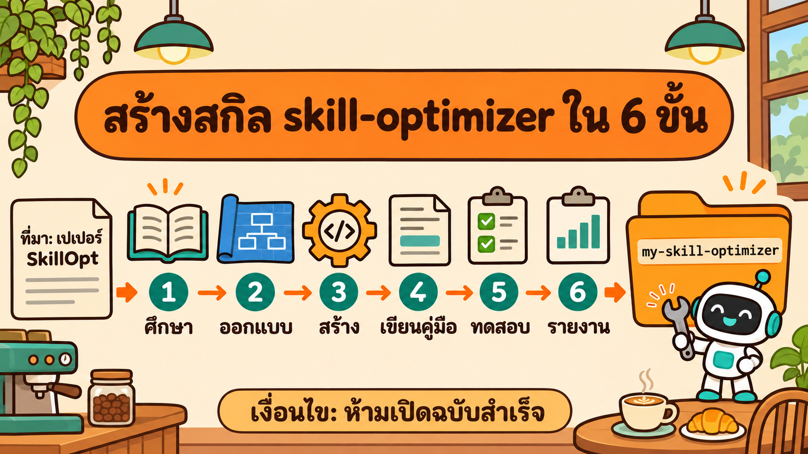

> [!IMPORTANT]
> **📋 คัดลอกกล่องนี้ → Claude Code Desktop แล้วกด Enter**
>
> ```text
> งาน: สร้างสกิล skill-optimizer ไว้ในโฟลเดอร์ใหม่ ./my-skill-optimizer (ทำบนเครื่องนี้ ไม่ใช้ container)
>
> ที่มา    : เปเปอร์ SkillOpt (arXiv:2605.23904 · github.com/microsoft/SkillOpt) · สรุปภาษาไทย 03_week03/05_Skill_Optimizer/01_theory/README.md
> รูปแบบ   : 03_week03/05_Skill_Optimizer/skillopt_format.md
> เงื่อนไข : ห้ามเปิดฉบับสำเร็จที่ 00_resource/skills/skill-optimizer
>
> ทำตามลำดับ:
> 1. ศึกษา       อ่านที่มา แล้วสรุปวงรอบของ SkillOpt
> 2. ออกแบบ      จด references/source.md: ส่วนของสกิล | มาจากข้อไหนของเปเปอร์ | เหมือนหรือต่าง
> 3. สร้าง        scripts/skillopt.py 7 คำสั่ง (lint run grade report failures null gate) ตามรูปแบบ
> 4. เขียนคู่มือ   SKILL.md และ references/suite.md references/issues.md
> 5. ทดสอบ       gate --cost-metric context_tokens กับ 03_week03/05_Skill_Optimizer ทั้ง 5 คู่ (noskill → v0 → v1 → v2 → v3 → v4) ต้องตัดสินตรงกับ runs/<รุ่นใหม่>/gate.txt
> 6. รายงาน      ตาราง ไฟล์ | หน้าที่ และผลทดสอบ 5 คู่
> ```

<!-- lab01-result -->
**ผลจริง** · agent ใหม่รันพรอมต์นี้ตามตัวอักษรเมื่อ 14 พ.ย. 2026 · ใช้ 14 นาที · ไม่เรียกโมเดล

| ไฟล์ที่ได้ใน `my-skill-optimizer/` | บรรทัด | หน้าที่ |
|---|---|---|
| `SKILL.md` | 61 | ขั้นตอนที่ AI ทำตาม: ใช้เมื่อไร · ตารางคำสั่ง · ขั้นตอน 0–8 · ข้อห้าม |
| `scripts/skillopt.py` | 832 | โปรแกรม 7 คำสั่ง · มีแค่ `run` ที่เรียกโมเดล |
| `references/source.md` | 47 | สรุปวงรอบของ SkillOpt และตารางตรวจย้อนกลับ 20 แถว |
| `references/suite.md` | 98 | รูปแบบโฟลเดอร์งาน ชุดโจทย์ ตัวตรวจ และกติกาของ gate |
| `references/issues.md` | 44 | รูปแบบของ `runs/ISSUES.md` |

| ทดสอบกับผลเดิมใน `runs/` | ผล |
|---|---|
| `gate` 5 คู่ | ✅ ข้อความที่พิมพ์ตรงกับ `gate.txt` ที่เก็บไว้ทุกตัวอักษร (ACCEPT 4 คู่ · REJECT 1 คู่) |
| `null` · `lint` · `report` | ✅ ตรงกับไฟล์ที่เก็บไว้ |
| `run` | ⚠️ ทดสอบด้วย Agent จำลองเท่านั้น · ยังไม่ได้เรียกโมเดลจริง (จะรู้ผลใน LAB 1) |

👀 เครื่องมือที่สร้างเองไม่ต้องเหมือนใครทุกบรรทัด สิ่งที่ต้องตรงคือ **รูปแบบ** และ **ผลตัดสิน**

<details><summary>ตัวอย่างตารางตรวจย้อนกลับใน <code>references/source.md</code></summary>

| ส่วนของสกิล | มาจากข้อไหนของเปเปอร์ | เหมือนหรือต่าง |
|---|---|---|
| สิ่งที่ถูกปรับ = `SKILL.md` ของรุ่น · โมเดลไม่ถูกแตะ | Problem Setup · Eq. 1 | เหมือน |
| ชุดโจทย์แบ่ง `train` `val` `test` | Problem Setup: D_tr D_sel D_test | เหมือน · `val` คือ D_sel |
| แก้ไม่เกิน 3 จุดต่อรุ่น | Bounded Text Updates: L_t · Algorithm 1 บรรทัด 14–15 | เหมือนแนวคิด · ต่าง: ค่าคงที่ 3 (เปเปอร์เริ่ม 4 ลดเหลือ 2) |
| `failures` แล้ว AI เปิด Trace หาสาเหตุ | Backward Pass: Minibatch Reflection | ต่าง: ไม่มี Optimizer Model แยก ให้ Claude Code ที่มีคนกำกับอ่านเอง |
| `null`: ความแกว่งระหว่างรอบ | ไม่มีในเปเปอร์ | เพิ่มเอง: ชุดโจทย์เล็ก ผลต่างเล็ก ๆ อาจเป็นความบังเอิญ |
| `gate` ข้อ 1–3 | Validation Gate · Algorithm 1 บรรทัด 22–26 | ต่าง: ต้องดีขึ้นเกินความแกว่ง แทน "สูงกว่าเดิม" |
| `gate` ข้อ 4: คะแนนไม่เพิ่ม แต่ต้นทุนลดเกิน 10% → รับ | Ablations: Gate strictness | ต่าง (ตรงข้าม): เปเปอร์ไม่รับเมื่อคะแนนเท่ากัน |
| `runs/ISSUES.md` | Rejected-Edit Buffer และ Meta Skill | ต่าง: ไฟล์เดียวทำ 2 หน้าที่ และจดทั้งที่ได้ผลและไม่ได้ผล |
| ไม่มี Slow Update | Epoch-Wise Slow/Meta Update | ไม่ได้ทำ: วงรอบมีไม่กี่ก้าวและมีคนกำกับ |

</details>
<!-- /lab01-result -->

#### ขั้น 0.2 · ติดตั้งเครื่องมือ และตรวจตัวตรวจ

> [!IMPORTANT]
> **📋 คัดลอกกล่องนี้ → Claude Code Desktop แล้วกด Enter**
>
> ```text
> งาน: เตรียม container multi-account ให้พร้อมสำหรับ LAB 1–5 (ยังไม่วัดอะไร)
>
> ทำตามลำดับ:
> 1. ติดตั้ง   my-skill-optimizer เป็น global skill ชื่อ skill-optimizer ของบัญชี yolo
> 2. คัดลอก   suite และ runs/v0/skills ของ 03_week03/05_Skill_Optimizer ไปไว้ที่ /workspace/sklab (คงโครงโฟลเดอร์เดิม)
> 3. ตรวจ     ตัวตรวจด้วย suite/check_grader.py · บัญชี yolo1–yolo5 ตัวไหนล็อกอินแล้ว
> 4. รายงาน   ตาราง รายการ | ผล
> ```

**ผลจริง:** ติดตั้งสกิล ✅ · คัดลอกโจทย์ ✅ · Grader ผ่าน ✅ · บัญชีที่ใช้ได้ `yolo1` `yolo2` `yolo3`

👀 ตรวจ Grader ก่อนเสมอ ถ้าเครื่องวัดผิด ตัวเลขหลังจากนี้ใช้ไม่ได้ทั้งหมด

### LAB 1 · การวัดผลตั้งต้น (Baseline Measurement)

วัดสกิลรุ่นแรก [`v0`](runs/v0/skills/money-coder/SKILL.md) (5 บรรทัด เขียนจากความจำ) เทียบกับแบบไม่มีสกิล

> [!IMPORTANT]
> **📋 คัดลอกกล่องนี้ → Claude Code Desktop แล้วกด Enter**
>
> ```text
> งาน: การวัดผลตั้งต้น (Baseline Measurement) · เทียบสกิล money-coder รุ่น v0 กับการไม่ใช้สกิล
>
> ที่ทำงาน  : container multi-account โฟลเดอร์ /workspace/sklab
> เครื่องมือ : สกิล skill-optimizer
> เงื่อนไข   : ห้ามเปิดตัวตรวจ suite/grade.py และเฉลย suite/ref/ · โจทย์ของ Validation Set ดูได้แค่คะแนนรวม
>
> Input: โจทย์ 6 ข้อใน suite/suite.json (ข้อละ 1 ฟังก์ชันคิดเงิน)
> - Training Set 4 ข้อ ใช้หาข้อที่ผิด: t1-cafe-bill t2-split-bill t3-shipping-fee t4-cashback
> - Validation Set 2 ข้อ ใช้ตัดสิน: v1-parking-fee v2-net-pay
>
> วิธีทดลอง:
> - 1 Trial = Agent 1 ตัว (โมเดล sonnet · effort medium) ได้โจทย์ 1 ข้อ แล้วเขียน solve.py และ test_solve.py ในโฟลเดอร์ว่าง
> - โจทย์แต่ละข้อทำซ้ำ 3 รอบ เพราะ Agent เขียนไม่เหมือนกันทุกครั้ง → 1 รุ่น = 6 โจทย์ × 3 รอบ = 18 Trial
> - LAB นี้วัด 2 รุ่น: noskill (ไม่มีสกิล) และ v0 (สกิลใน runs/v0/skills) → รวม 36 Trial
> - ใช้ทุกบัญชี yolo ที่ล็อกอินแล้ว รันพร้อมกันไม่เกิน 6 Trial
>
> วิธีตรวจ:
> - ทุก Trial ตัวตรวจ suite/grade.py รันโค้ดที่ Agent เขียน แล้วให้คะแนน 0–1 = สัดส่วนข้อตรวจที่ผ่าน (10 หรือ 11 ข้อต่อโจทย์)
> - คะแนนของรุ่น = ค่าเฉลี่ยของ 18 Trial
> - gate เทียบรุ่นใหม่กับรุ่นฐาน แล้วตอบ ACCEPT หรือ REJECT: Training และ Validation ต้องไม่ลด และคะแนนรวมต้องดีขึ้นเกินความแกว่ง หรือเท่าเดิมแต่ต้นทุนลดอย่างน้อย 10%
>
> ทำตามลำดับ:
> 1. วัด      รุ่น noskill และรุ่น v0
> 2. สรุป     ตารางเทียบ 2 รุ่น (report) บันทึกที่ runs/report.md · ความแกว่งของ v0 (null)
> 3. ตัดสิน   gate noskill → v0 ใช้ต้นทุน context_tokens บันทึกที่ runs/v0/gate.txt
> 4. เก็บผล   คัดลอก runs/ จาก container มาไว้ที่ 03_week03/05_Skill_Optimizer/runs บนเครื่อง: เก็บ skills ไฟล์ผลของรุ่น และของแต่ละ Trial เก็บ grade.json metrics.json กับโค้ดใน sandbox (ไม่เก็บ Trace) · โจทย์ของ Validation Set เก็บแค่คะแนนและต้นทุน
> 5. รายงาน   ตารางเทียบ 2 รุ่น · ความแกว่งของ v0 · ผล gate
> ```

| รุ่น | Training | Validation | รวม | ผ่านครบ 10 ข้อ | Gate |
|---|---|---|---|---|---|
| ไม่มีสกิล | 48.3% | 40.0% | **45.6%** | 0/18 | – |
| `v0` | 71.7% | 68.3% | **70.6%** | 0/18 | **ACCEPT** |

👀 สกิล 5 บรรทัดช่วยได้ +25 จุด แต่ยังไม่มี Trial ไหนผ่านครบ 10 ข้อ

<details><summary>รายละเอียด: <code>v0</code> เขียนอะไร และทำตามความรู้แฝงข้อไหนได้</summary>

ผลดิบ: [report.md](runs/report.md) · [gate.txt](runs/v0/gate.txt)

| ความรู้แฝง | `v0` เขียนว่า | Agent ทำอะไร | ผ่าน (Training 12 Trial) |
|---|---|---|---|
| 1 เงินเป็นจำนวนเต็มสตางค์ | "เงินทุกค่าเป็นจำนวนเต็มสตางค์ ห้ามใช้ float" | ทำตามได้ | 12/12 |
| 2 ปัดครึ่งขึ้น ครั้งเดียว | "ปัดเศษสตางค์ให้ถูกต้อง" | ส่วนใหญ่ถูก มี 1 ครั้งปัดทุกขั้น | 11/12 |
| 3 ปฏิเสธข้อมูลที่ผิด | "ตรวจ input ทุกตัว ถ้าผิดให้แจ้ง error" | บางครั้งใช้ `TypeError` บางครั้งรับเลขทศนิยม | 8/12 |
| 4 ใช้เป็นโปรแกรมได้ | "รับ JSON และตอบเป็น JSON" | เดารูปแบบเอง เช่น `{"cashback": 500}` | 0/12 |
| 5 มีเทสต์มาด้วย | "เขียนเทสต์มาด้วยทุกครั้ง" | บางครั้งมีแค่ 5 เทสต์ | 7/12 |

ข้อกำหนดที่เขียน **ชัด** Agent ทำตามได้ ("ห้ามใช้ float" → 12/12) · ข้อกำหนดที่เขียน **กว้าง** Agent ต้องเดา และเดาไม่เหมือนกันทุกครั้ง ("ตอบเป็น JSON" → 0/12)

</details>

### LAB 2 · การปรับสกิลรอบที่ 1 (`v0` → `v1`): วิเคราะห์ข้อผิดพลาด

> [!IMPORTANT]
> **📋 คัดลอกกล่องนี้ → Claude Code Desktop แล้วกด Enter**
>
> ```text
> งาน: การปรับสกิลรอบที่ 1 · สร้าง money-coder รุ่น v1 จาก v0 โดยแก้จากข้อที่ผิดของ Training Set
>
> ที่ทำงาน  : container multi-account โฟลเดอร์ /workspace/sklab
> เครื่องมือ : สกิล skill-optimizer
> เงื่อนไข   : ห้ามเปิดตัวตรวจ suite/grade.py และเฉลย suite/ref/ · โจทย์ของ Validation Set ดูได้แค่คะแนนรวม
>
> Input: โจทย์ 6 ข้อใน suite/suite.json (ข้อละ 1 ฟังก์ชันคิดเงิน)
> - Training Set 4 ข้อ ใช้หาข้อที่ผิด: t1-cafe-bill t2-split-bill t3-shipping-fee t4-cashback
> - Validation Set 2 ข้อ ใช้ตัดสิน: v1-parking-fee v2-net-pay
>
> วิธีทดลอง:
> - 1 Trial = Agent 1 ตัว (โมเดล sonnet · effort medium) ได้โจทย์ 1 ข้อ แล้วเขียน solve.py และ test_solve.py ในโฟลเดอร์ว่าง
> - โจทย์แต่ละข้อทำซ้ำ 3 รอบ เพราะ Agent เขียนไม่เหมือนกันทุกครั้ง → 1 รุ่น = 6 โจทย์ × 3 รอบ = 18 Trial
> - LAB นี้วัดรุ่นใหม่ 1 รุ่น: v1 (รุ่นฐาน v0 วัดไว้แล้วใน LAB 1) → 18 Trial
> - ใช้ทุกบัญชี yolo ที่ล็อกอินแล้ว รันพร้อมกันไม่เกิน 6 Trial
>
> วิธีตรวจ:
> - ทุก Trial ตัวตรวจ suite/grade.py รันโค้ดที่ Agent เขียน แล้วให้คะแนน 0–1 = สัดส่วนข้อตรวจที่ผ่าน (10 หรือ 11 ข้อต่อโจทย์)
> - คะแนนของรุ่น = ค่าเฉลี่ยของ 18 Trial
> - gate เทียบรุ่นใหม่กับรุ่นฐาน แล้วตอบ ACCEPT หรือ REJECT: Training และ Validation ต้องไม่ลด และคะแนนรวมต้องดีขึ้นเกินความแกว่ง หรือเท่าเดิมแต่ต้นทุนลดอย่างน้อย 10%
>
> ทำตามลำดับ:
> 1. หาสาเหตุ  ดูข้อที่ผิดของ v0 (failures เฉพาะ Training Set) แล้วเปิด Trace และโค้ดของ Trial ที่ผิด · เก็บเฉพาะสาเหตุที่พบมากกว่า 1 Trial
> 2. จด        เขียน runs/ISSUES.md: ปัญหา | พบกี่ Trial | สาเหตุ | ทางแก้
> 3. แก้        คัดลอก runs/v0/skills เป็น runs/v1/skills แล้วแก้ไม่เกิน 3 จุด
> 4. วัด        รุ่น v1 ด้วยค่าเดียวกับ v0
> 5. ตัดสิน     gate v0 → v1 ใช้ต้นทุน context_tokens บันทึกที่ runs/v1/gate.txt · ตารางเทียบทุกรุ่นบันทึกที่ runs/report.md
> 6. เก็บผล     คัดลอก runs/ จาก container มาไว้ที่ 03_week03/05_Skill_Optimizer/runs บนเครื่อง: เก็บ skills ไฟล์ผลของรุ่น และของแต่ละ Trial เก็บ grade.json metrics.json กับโค้ดใน sandbox (ไม่เก็บ Trace) · โจทย์ของ Validation Set เก็บแค่คะแนนและต้นทุน
> 7. รายงาน     ตารางปัญหา · จุดที่แก้ใน v1 · ตารางเทียบทุกรุ่น · ผล gate
> ```

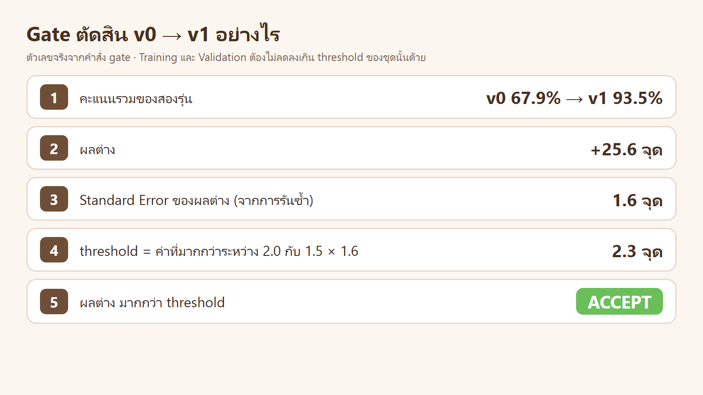

**ผลจริง:** รวม 70.6% → 96.7% (+26.1) · **ACCEPT**

👀 Training เต็ม 100% แต่ Validation ได้ 90% → ยังมีปัญหาที่ Training Set มองไม่เห็น

<details><summary>รายละเอียด: สาเหตุที่ Claude พบ และจุดที่แก้ใน <code>v1</code></summary>

ผลดิบ: [ISSUES.md](runs/ISSUES.md) · [failures.txt ของ v0](runs/v0/failures.txt) · [gate.txt](runs/v1/gate.txt) · [สกิล v1](runs/v1/skills/money-coder/SKILL.md)

| โค้ดผิดความรู้แฝงข้อ | อาการ | พบ | `v0` เขียนว่า | `v1` เขียนว่า |
|---|---|---|---|---|
| 4 ใช้เป็นโปรแกรมได้ | ตอบคนละรูปแบบ เช่น `{"total": …}` | 12/12 | รับ JSON และตอบเป็น JSON | สำเร็จ `{"ok": true, "result": …}` exit 0 · ผิด `{"ok": false, "error": "…"}` exit 2 |
| 5 มีเทสต์มาด้วย | เทสต์ไม่ครบ หรือรันด้วย unittest ไม่ได้ | 5/12 | เขียนเทสต์มาด้วย | `unittest.TestCase` อย่างน้อย 6 เทสต์ และต้องรันผ่าน |
| 3 ปฏิเสธข้อมูลที่ผิด | รับเลขทศนิยม หรือใช้ `TypeError` | 4/12 | ถ้าผิดให้แจ้ง error | `raise ValueError` เท่านั้น · ไม่รับ `float` `bool` `str` `None` |
| 2 ปัดครั้งเดียว | ปัดเศษทุกขั้น คลาด 1 สตางค์ | 1/12 | ปัดเศษให้ถูกต้อง | ยังไม่แก้ (พบครั้งเดียว) |

</details>

### LAB 3 · การปรับสกิลรอบที่ 2 (`v1` → `v2`): เติมความรู้แฝงจากทีม

> [!IMPORTANT]
> **📋 คัดลอกกล่องนี้ → Claude Code Desktop แล้วกด Enter**
>
> ```text
> งาน: การปรับสกิลรอบที่ 2 · สร้าง money-coder รุ่น v2 จากรุ่นฐานล่าสุด โดยเติมนโยบายธุรกิจที่ทีมยืนยันแล้ว
>
> ที่ทำงาน  : container multi-account โฟลเดอร์ /workspace/sklab
> เครื่องมือ : สกิล skill-optimizer
> เงื่อนไข   : ห้ามเปิดตัวตรวจ suite/grade.py และเฉลย suite/ref/ · โจทย์ของ Validation Set ดูได้แค่คะแนนรวม
>
> Input: โจทย์ 6 ข้อใน suite/suite.json (ข้อละ 1 ฟังก์ชันคิดเงิน)
> - Training Set 4 ข้อ ใช้หาข้อที่ผิด: t1-cafe-bill t2-split-bill t3-shipping-fee t4-cashback
> - Validation Set 2 ข้อ ใช้ตัดสิน: v1-parking-fee v2-net-pay
>
> ความรู้จากทีม (คำตอบของปัญหา policy ที่ยังเปิดอยู่ใน runs/ISSUES.md):
> - ระยะทาง 0 กม. คือลูกค้ารับเองที่ร้าน ไม่คิดค่าส่ง
> - ส่งด่วนรับน้ำหนักไม่เกิน 20,000 กรัม เกินกว่านี้ถือเป็นข้อมูลผิด
> - สิทธิ์เงินคืน 2 เท่าในเดือนเกิด ให้เฉพาะสมาชิก gold และ platinum
> - เงินคืนเป็นเงินที่ร้านจ่ายออก ให้ปัดลง ไม่ปัดครึ่งขึ้น
>
> วิธีทดลอง:
> - 1 Trial = Agent 1 ตัว (โมเดล sonnet · effort medium) ได้โจทย์ 1 ข้อ แล้วเขียน solve.py และ test_solve.py ในโฟลเดอร์ว่าง
> - โจทย์แต่ละข้อทำซ้ำ 3 รอบ เพราะ Agent เขียนไม่เหมือนกันทุกครั้ง → 1 รุ่น = 6 โจทย์ × 3 รอบ = 18 Trial
> - LAB นี้วัดรุ่นใหม่ 1 รุ่น: v2 → 18 Trial
> - ใช้ทุกบัญชี yolo ที่ล็อกอินแล้ว รันพร้อมกันไม่เกิน 6 Trial
>
> วิธีตรวจ:
> - ทุก Trial ตัวตรวจ suite/grade.py รันโค้ดที่ Agent เขียน แล้วให้คะแนน 0–1 = สัดส่วนข้อตรวจที่ผ่าน (10 หรือ 11 ข้อต่อโจทย์)
> - คะแนนของรุ่น = ค่าเฉลี่ยของ 18 Trial
> - gate เทียบรุ่นใหม่กับรุ่นฐาน แล้วตอบ ACCEPT หรือ REJECT: Training และ Validation ต้องไม่ลด และคะแนนรวมต้องดีขึ้นเกินความแกว่ง หรือเท่าเดิมแต่ต้นทุนลดอย่างน้อย 10%
>
> ทำตามลำดับ:
> 1. หาจุดแก้  ดู 3 อย่าง: ข้อที่ผิดของรุ่นฐาน (Training Set) · ปัญหาที่ยังเปิดใน runs/ISSUES.md · ความรู้จากทีมข้างบน
> 2. แก้        คัดลอก skills ของรุ่นฐานเป็น runs/v2/skills แล้วแก้ไม่เกิน 3 จุด · เขียนเป็นนโยบายของร้าน ห้ามใส่ Input หรือคำตอบของข้อตรวจ
> 3. วัด        รุ่น v2 ด้วยค่าเดียวกับ v0
> 4. ตัดสิน     gate v1 → v2 ใช้ต้นทุน context_tokens บันทึกที่ runs/v2/gate.txt · อัปเดต runs/ISSUES.md และ runs/report.md
> 5. เก็บผล     คัดลอก runs/ จาก container มาไว้ที่ 03_week03/05_Skill_Optimizer/runs บนเครื่อง: เก็บ skills ไฟล์ผลของรุ่น และของแต่ละ Trial เก็บ grade.json metrics.json กับโค้ดใน sandbox (ไม่เก็บ Trace) · โจทย์ของ Validation Set เก็บแค่คะแนนและต้นทุน
> 6. รายงาน     จุดที่แก้ใน v2 และเหตุผล · ตารางเทียบทุกรุ่น · ผล gate
> ```

**ผลจริง:** Validation 90.0% → 100.0% · รวม 96.7% → 100.0% (+3.3) · **ACCEPT**

👀 ส่วนที่ดีขึ้นมาจาก Validation ทั้งหมด = กติกาใหม่ใช้ได้กับโจทย์ที่ไม่เคยเห็น (**Generalization**)

<details><summary>รายละเอียด: จุดที่แก้ใน <code>v2</code></summary>

ผลดิบ: [gate.txt](runs/v2/gate.txt) · [สกิล v2](runs/v2/skills/money-coder/SKILL.md)

Training ไม่มีข้อที่พลาดแล้ว Claude จึงแก้กติกาที่ยังกว้าง 2 ข้อ

| ความรู้แฝง | `v1` | `v2` |
|---|---|---|
| 2 | ปัดเศษสตางค์ให้ถูกต้อง | ปัดครั้งเดียวที่ขั้นสุดท้าย แบบครึ่งปัดขึ้น · ขั้นก่อนหน้าเก็บเป็นเศษส่วน ห้ามปัดทีละขั้น |
| 1 | ห้ามใช้ float | ในโค้ดห้ามมี `float` `round(` เลขทศนิยม และการหารด้วย `/` |

</details>

### LAB 4 · การลดต้นทุน (`v2` → `v3`)

คะแนนเต็มแล้ว ยังปรับได้อีกทางหนึ่งคือ **ต้นทุน**

> [!IMPORTANT]
> **📋 คัดลอกกล่องนี้ → Claude Code Desktop แล้วกด Enter**
>
> ```text
> งาน: การลดต้นทุน · สร้าง money-coder รุ่น v3 ที่ใช้โทเคนขาเข้า (context_tokens) น้อยลงอย่างน้อย 10% โดยคะแนนไม่ลด
>
> ที่ทำงาน  : container multi-account โฟลเดอร์ /workspace/sklab
> เครื่องมือ : สกิล skill-optimizer
> เงื่อนไข   : ห้ามเปิดตัวตรวจ suite/grade.py และเฉลย suite/ref/ · โจทย์ของ Validation Set ดูได้แค่คะแนนรวม
>
> Input: โจทย์ 6 ข้อใน suite/suite.json (ข้อละ 1 ฟังก์ชันคิดเงิน)
> - Training Set 4 ข้อ ใช้หาข้อที่ผิด: t1-cafe-bill t2-split-bill t3-shipping-fee t4-cashback
> - Validation Set 2 ข้อ ใช้ตัดสิน: v1-parking-fee v2-net-pay
>
> วิธีทดลอง:
> - 1 Trial = Agent 1 ตัว (โมเดล sonnet · effort medium) ได้โจทย์ 1 ข้อ แล้วเขียน solve.py และ test_solve.py ในโฟลเดอร์ว่าง
> - โจทย์แต่ละข้อทำซ้ำ 3 รอบ เพราะ Agent เขียนไม่เหมือนกันทุกครั้ง → 1 รุ่น = 6 โจทย์ × 3 รอบ = 18 Trial
> - LAB นี้วัดรุ่นใหม่ 1 รุ่น: v3 → 18 Trial
> - ใช้ทุกบัญชี yolo ที่ล็อกอินแล้ว รันพร้อมกันไม่เกิน 6 Trial
>
> วิธีตรวจ:
> - ทุก Trial ตัวตรวจ suite/grade.py รันโค้ดที่ Agent เขียน แล้วให้คะแนน 0–1 = สัดส่วนข้อตรวจที่ผ่าน (10 หรือ 11 ข้อต่อโจทย์)
> - คะแนนของรุ่น = ค่าเฉลี่ยของ 18 Trial
> - gate เทียบรุ่นใหม่กับรุ่นฐาน แล้วตอบ ACCEPT หรือ REJECT: Training และ Validation ต้องไม่ลด และคะแนนรวมต้องดีขึ้นเกินความแกว่ง หรือเท่าเดิมแต่ต้นทุนลดอย่างน้อย 10%
>
> ทำตามลำดับ:
> 1. หาจุดแก้  เปิด Trace ของรุ่นฐาน (Training Set) ดูว่า Agent ใช้คำสั่งไปกับอะไร
> 2. แก้        คัดลอก skills ของรุ่นฐานเป็น runs/v3/skills แล้วแก้ไม่เกิน 3 จุด
> 3. วัด        รุ่น v3 ด้วยค่าเดียวกับ v0
> 4. ตัดสิน     gate v2 → v3 ใช้ต้นทุน context_tokens บันทึกที่ runs/v3/gate.txt · ถ้า REJECT ใช้ v2 ต่อ ห้ามวัดซ้ำเพื่อให้ผ่าน
> 5. จด        อัปเดต runs/ISSUES.md และ runs/report.md
> 6. เก็บผล     คัดลอก runs/ จาก container มาไว้ที่ 03_week03/05_Skill_Optimizer/runs บนเครื่อง: เก็บ skills ไฟล์ผลของรุ่น และของแต่ละ Trial เก็บ grade.json metrics.json กับโค้ดใน sandbox (ไม่เก็บ Trace) · โจทย์ของ Validation Set เก็บแค่คะแนนและต้นทุน
> 7. รายงาน     จุดที่แก้ใน v3 และเหตุผล · ตารางเทียบทุกรุ่น · ผล gate
> ```

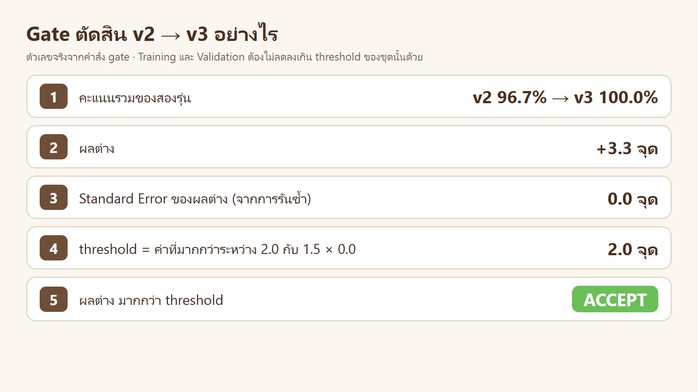

**ผลจริง:** คะแนนเท่าเดิม 100.0% · โทเคนขาเข้า −17% · **ACCEPT**

👀 สกิลยาวขึ้นแต่ต้นทุนรวมลดลง เพราะ Agent ใช้คำสั่งน้อยลง (3.4 → 2.7 คำสั่งต่อ Trial)

<details><summary>รายละเอียด: สิ่งที่พบใน Trace และจุดที่แก้ใน <code>v3</code></summary>

ผลดิบ: [gate.txt](runs/v3/gate.txt) · [สกิล v3](runs/v3/skills/money-coder/SKILL.md)

| สิ่งที่พบใน Trace ของ `v2` | พบ | จุดที่แก้ใน `v3` |
|---|---|---|
| เรียกเครื่องมือผิดชื่อ ต้องส่งคำสั่งเดิมซ้ำ | 4/12 | เขียนโค้ด เขียนเทสต์ รันเทสต์ ในคำสั่งเดียว แล้วตอบทันที |
| คิดค่าที่คาดหวังในเทสต์ผิด ต้องแก้แล้วรันใหม่ | 1/12 | เทสต์ที่มีการปัดเศษ ใช้ input ที่ผลเป็นจำนวนเต็มหรือ .5 พอดี |

</details>

### LAB 5 · การทดลองควบคุม (`v3` → `v4`): การย่อสกิล

สกิลยาวขึ้นทุกรุ่น ถ้าย่อให้สั้นและอ่านง่าย จะดีขึ้นหรือไม่ ให้ประตูรับตัดสิน

> [!IMPORTANT]
> **📋 คัดลอกกล่องนี้ → Claude Code Desktop แล้วกด Enter**
>
> ```text
> งาน: การทดลองควบคุม · ทดสอบว่าสกิลที่สั้นและอ่านง่ายกว่าให้ผลดีกว่าจริงหรือไม่ โดยสร้าง money-coder รุ่น v4 จากรุ่นฐาน
>
> ที่ทำงาน  : container multi-account โฟลเดอร์ /workspace/sklab
> เครื่องมือ : สกิล skill-optimizer
> เงื่อนไข   : ห้ามเปิดตัวตรวจ suite/grade.py และเฉลย suite/ref/ · โจทย์ของ Validation Set ดูได้แค่คะแนนรวม
>
> Input: โจทย์ 6 ข้อใน suite/suite.json (ข้อละ 1 ฟังก์ชันคิดเงิน)
> - Training Set 4 ข้อ ใช้หาข้อที่ผิด: t1-cafe-bill t2-split-bill t3-shipping-fee t4-cashback
> - Validation Set 2 ข้อ ใช้ตัดสิน: v1-parking-fee v2-net-pay
>
> วิธีทดลอง:
> - 1 Trial = Agent 1 ตัว (โมเดล sonnet · effort medium) ได้โจทย์ 1 ข้อ แล้วเขียน solve.py และ test_solve.py ในโฟลเดอร์ว่าง
> - โจทย์แต่ละข้อทำซ้ำ 3 รอบ เพราะ Agent เขียนไม่เหมือนกันทุกครั้ง → 1 รุ่น = 6 โจทย์ × 3 รอบ = 18 Trial
> - LAB นี้วัดรุ่นใหม่ 1 รุ่น: v4 → 18 Trial
> - ใช้ทุกบัญชี yolo ที่ล็อกอินแล้ว รันพร้อมกันไม่เกิน 6 Trial
>
> วิธีตรวจ:
> - ทุก Trial ตัวตรวจ suite/grade.py รันโค้ดที่ Agent เขียน แล้วให้คะแนน 0–1 = สัดส่วนข้อตรวจที่ผ่าน (10 หรือ 11 ข้อต่อโจทย์)
> - คะแนนของรุ่น = ค่าเฉลี่ยของ 18 Trial
> - gate เทียบรุ่นใหม่กับรุ่นฐาน แล้วตอบ ACCEPT หรือ REJECT: Training และ Validation ต้องไม่ลด และคะแนนรวมต้องดีขึ้นเกินความแกว่ง หรือเท่าเดิมแต่ต้นทุนลดอย่างน้อย 10%
>
> ทำตามลำดับ:
> 1. แก้        คัดลอก skills ของรุ่นฐานเป็น runs/v4/skills แล้วย่อ SKILL.md: กติกาละ 1 บรรทัด ไม่เกิน 60 ตัวอักษร (นับเป็น 1 จุด ไม่แก้อย่างอื่น)
> 2. วัด        รุ่น v4 ด้วยค่าเดียวกับ v0
> 3. ตัดสิน     gate v3 → v4 ใช้ต้นทุน context_tokens บันทึกที่ runs/v4/gate.txt · ถ้า REJECT ใช้รุ่นฐานต่อ ห้ามแก้ v4 เพิ่ม ห้ามวัดซ้ำ
> 4. จด        อัปเดต runs/ISSUES.md และ runs/report.md
> 5. เก็บผล     คัดลอก runs/ จาก container มาไว้ที่ 03_week03/05_Skill_Optimizer/runs บนเครื่อง: เก็บ skills ไฟล์ผลของรุ่น และของแต่ละ Trial เก็บ grade.json metrics.json กับโค้ดใน sandbox (ไม่เก็บ Trace) · โจทย์ของ Validation Set เก็บแค่คะแนนและต้นทุน
> 6. รายงาน     SKILL.md ของ v4 · ตารางเทียบทุกรุ่น · ผล gate · ข้อตรวจของ Training Set ที่เปลี่ยนไป
> ```

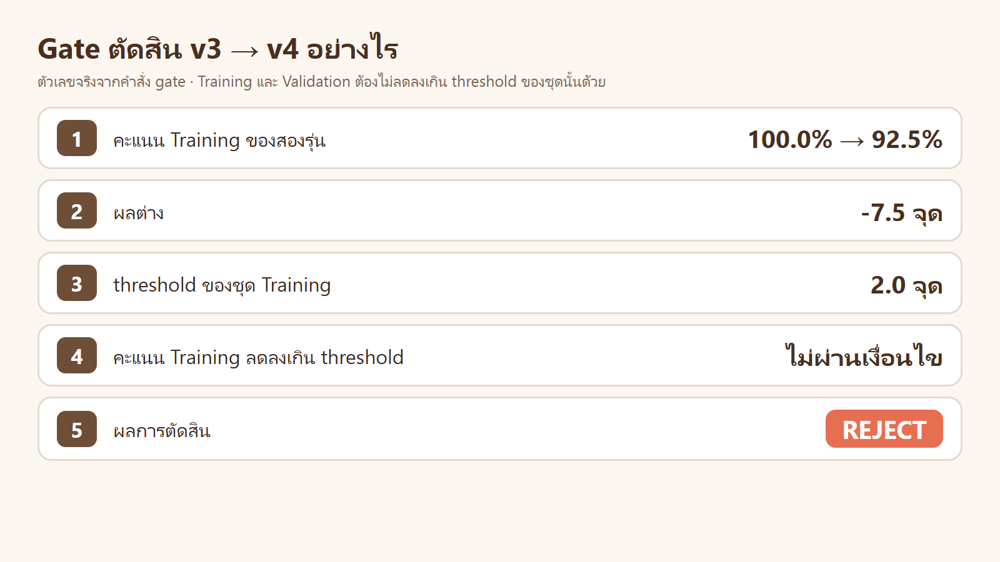

**ผลจริง:** รวม 100.0% → 91.7% (−8.3) · **REJECT** · รุ่นที่ใช้ต่อคือ **`v3`**

👀 ตอนย่อ วลี "อ่าน JSON จาก stdin" หายไป → `cli_ok` เหลือ 3/12 เพราะ Agent รับค่าทาง argument แทน · โทเคนก็ไม่ลด

<details><summary>รายละเอียด: สกิล <code>v4</code> ที่ย่อแล้ว</summary>

ผลดิบ: [gate.txt](runs/v4/gate.txt) · [สกิล v4](runs/v4/skills/money-coder/SKILL.md)

```markdown
- เงินเป็น `int` สตางค์ ห้าม `float` `round(` ทศนิยม และ `/`
- ปัด half-up ครั้งเดียวตอนท้าย ห้ามปัดทีละขั้น
- input ผิด → `ValueError` เท่านั้น ไม่รับ float bool str
- CLI {"ok":true,"result":…} / {"ok":false,"error":…} exit 2
- เทสต์ `unittest` อย่างน้อย 6 เมธอด `test_*` ต้องรันผ่าน
- เขียนโค้ด เทสต์ รันเทสต์ ใน `Bash` ครั้งเดียว แล้วตอบ
```

</details>

---

## 4 · สรุปและแบบฝึกหัด

### 4.1 ผลของทุกรุ่น

วัดแบบไม่มีสกิล 1 ครั้ง แล้วทดลอง 5 รุ่น (`v0` ถึง `v4`) รวม 108 Trial

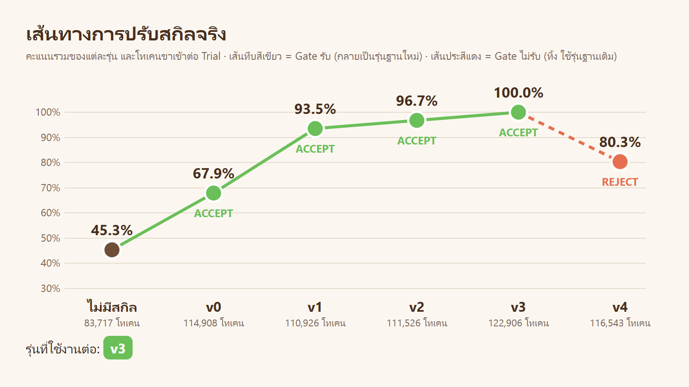

| อ่านกราฟ | ความหมาย |
|---|---|
| 1 จุด | สกิล 1 รุ่น |
| ตัวเลขเหนือจุด | คะแนนเฉลี่ยของรุ่นนั้น (18 Trial) |
| ตัวเลขใต้ชื่อรุ่น | โทเคนที่ Agent ใช้ต่อ Trial = ต้นทุน |
| เส้นทึบสีเขียว · ACCEPT | รุ่นนั้นถูกเก็บ |
| เส้นประสีแดง · REJECT | รุ่นนั้นถูกทิ้ง |

คะแนนขึ้นจาก 45.6% (ไม่มีสกิล) เป็น 100% ที่ `v2` · `v3` คะแนนเท่าเดิมแต่ใช้โทเคนน้อยลง จึงถูกเก็บ · `v4` คะแนนลด จึงถูกทิ้ง · รุ่นที่ใช้ต่อคือ **`v3`**

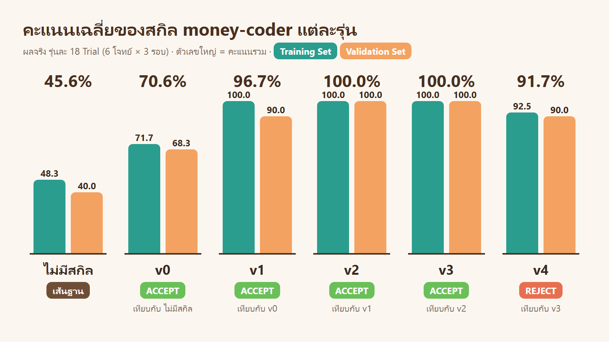

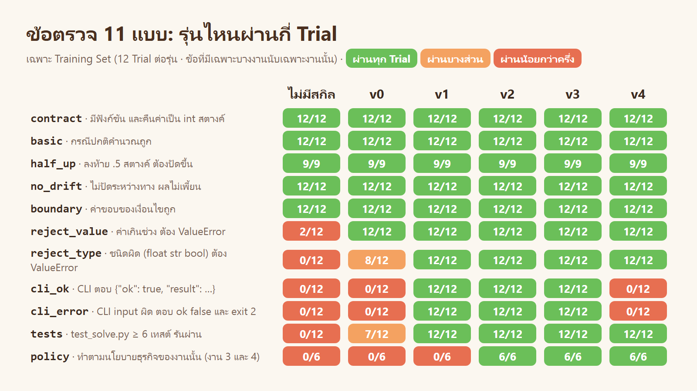

| รุ่น | แก้อะไร | รวม | โทเคนต่อ Trial | Gate |
|---|---|---|---|---|
| ไม่มีสกิล | – | 45.6% | 82,727 | – |
| `v0` | ร่างแรก 5 บรรทัด | 70.6% | 120,976 | ACCEPT |
| `v1` | กติกากว้าง 3 ข้อ → กติกาที่ตรวจได้ | 96.7% | 127,192 | ACCEPT |
| `v2` | กติกาปัดเศษและ float ให้ตรวจได้ | 100.0% | 128,725 | ACCEPT |
| `v3` | ลดจำนวนคำสั่งที่ Agent ใช้ | 100.0% | 106,704 | **ACCEPT** (ต้นทุน −17%) |
| `v4` | ย่อให้สั้น | 91.7% | 117,405 | REJECT |

รวม 108 Trial · โมเดล sonnet / effort medium · ราคาตามรายการรวม $10.77 (ไม่ใช่ยอดจ่ายจริงของบัญชีแบบ subscription)

### 4.2 สิ่งที่ผลจริงสอน

| ผล | บทเรียน |
|---|---|
| ไม่มีสกิล 45.6% | AI เขียนโค้ดรันได้ แต่ไม่รู้มาตรฐานของทีม |
| `v0` → `v1` +26.1 จุด | กติกากว้าง ("ตอบเป็น JSON") ทำให้ AI เดาต่างกันทุกครั้ง · กติกาที่ตรวจได้แก้ได้ทันที |
| `v1` Training 100% แต่ Validation 90% | Training Set เต็มแล้วไม่ได้แปลว่าสกิลสมบูรณ์ |
| `v2` Validation ขึ้นเป็น 100% | แก้ที่ **สาเหตุ** (กติกาปัดเศษกว้าง) โจทย์ที่ไม่เคยเห็นจึงดีขึ้นด้วย |
| `v3` คะแนนเท่าเดิม ต้นทุน −17% | ปรับสกิลได้ 2 ทาง: ถูกขึ้น หรือ ถูกลง |
| `v4` REJECT | สกิลที่สั้นและดูดี ทำคะแนนลด · ถ้าไม่วัดจะไม่รู้ |

<details><summary>เปิดซอง Validation Set หลังตัดสินครบทุกรุ่น: <code>v1</code> พลาดอะไร</summary>

`v1` พลาดที่ `net_pay` ทั้ง 3 รอบ ([validation-unsealed.txt](runs/validation-unsealed.txt)) เพราะปัดเศษ 3 ครั้ง (ค่าแรงรวม ภาษี ประกันสังคม) แทนที่จะปัดครั้งเดียว

```text
✗ half_up:  net_pay(41, 5100, false) คาด 205301 ได้ 205300
✗ no_drift: net_pay(38, 5005, true)  คาด 174975 ได้ 174974
```

เป็นสาเหตุเดียวกับปัญหาที่ Training Set เคยพบ 1 Trial ใน `v0` (ปัดเศษทุกขั้น) ซึ่ง `v2` แก้โดยไม่ต้องเปิดซองนี้

</details>

<details><summary>โค้ดที่ AI เขียนจริง: ไม่มีสกิล เทียบกับ <code>v3</code> (ฟังก์ชัน <code>cashback</code>)</summary>

ไม่มีสกิล · ผ่าน 3/10 ([ไฟล์](runs/noskill/trials/t4-cashback-r1/sandbox/solve.py))

```python
def cashback(amount, tier, birthday):
    if tier not in RATES_PER_MILLE:
        raise ValueError(f"unknown tier: {tier!r}")
    if amount < MIN_AMOUNT:
        return 0
    rate = RATES_PER_MILLE[tier] * (2 if birthday else 1)
    result = amount * rate // 1000  # integer math, rounds down
    return min(result, MAX_CASHBACK)
```

`v3` · ผ่าน 10/10 ([ไฟล์](runs/v3/trials/t4-cashback-r1/sandbox/solve.py)) มีการตรวจ input ปัดครึ่งขึ้น CLI และเทสต์ครบ

</details>

### 4.3 แบบฝึกหัด

| # | โจทย์ | ได้ฝึกอะไร |
|---|---|---|
| 1 | เพิ่มโจทย์ Training ข้อที่ 5 (เช่น คิดค่าปรับคืนของช้า) ใน `suite/` พร้อมเฉลยใน `suite/ref/` แล้วรัน `check_grader.py` | สร้าง Task และตรวจ Grader |
| 2 | เพิ่มโจทย์ `"split": "test"` 1 ข้อ แล้ววัด `v3` ครั้งเดียว | ยืนยันด้วย Test Set |
| 3 | วัด `v0` และ `v3` ใหม่ด้วย `--model haiku` | ผลผูกกับโมเดลที่ใช้วัด |
| 4 | ทำ `v5` จาก `v3`: ย่อให้สั้นลงโดยคะแนนไม่ลด (ดูจาก `ISSUES.md` ว่า `v4` พลาดเพราะอะไร) | ใช้ Issue Log กันการลองซ้ำ |
| 5 | เขียนสกิลของตัวเอง 1 ตัว พร้อมโจทย์ 4 + 2 ข้อ แล้วปรับ 2 รุ่น | ทำทั้งวงรอบเอง |

### 4.4 ข้อจำกัด

| ข้อจำกัด | ผล |
|---|---|
| โจทย์ 6 ข้อ และ Training เต็ม 100% ตั้งแต่ `v1` | ความแกว่งที่วัดได้เป็น 0 และ Training Set ชี้ปัญหาใหม่ไม่ได้ ควรเพิ่มโจทย์ที่ยากขึ้น |
| Validation Set ถูกใช้ตัดสิน 5 ครั้ง | คำตอบค่อย ๆ รั่วเข้าการตัดสินใจ ควรยืนยันด้วย Test Set (แบบฝึกหัดข้อ 2) |
| Gate ไม่คิดความแกว่งของต้นทุน | −17% ของ `v3` มีส่วนที่เป็นความบังเอิญได้ (การเรียกเครื่องมือผิดชื่อเกิดแบบสุ่ม) |
| Grader ตรวจเฉพาะ 10 ข้อ | คุณภาพด้านอื่น เช่น โค้ดอ่านง่าย ไม่ถูกวัด |

### 4.5 ไฟล์ในโฟลเดอร์นี้

ดู [โครงสร้างโฟลเดอร์](#โครงสร้างโฟลเดอร์) ในส่วนที่ 3

**ถัดไป:** [WikiSkill · ให้ AI จดสมุดความรู้ แล้วเขียนสกิลจากสมุด](../06_WikiSkill/README.md) ใช้งาน `money-coder` เดิม เทียบกับ Skill Optimizer
