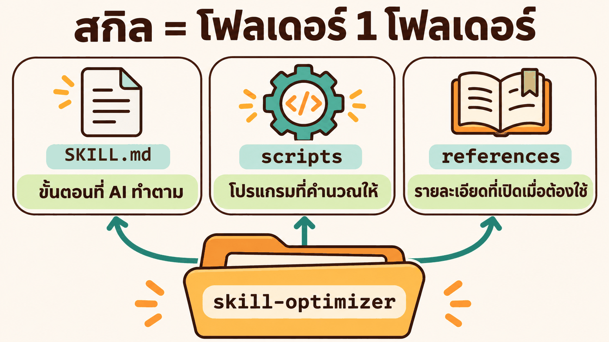
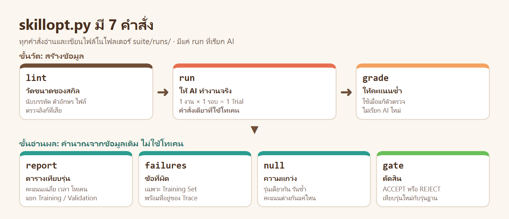
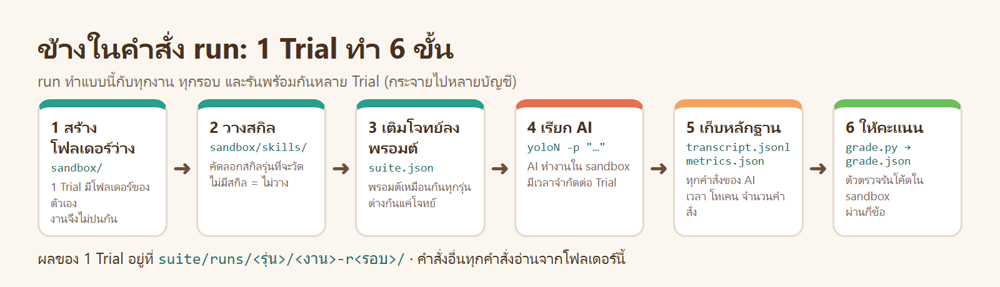
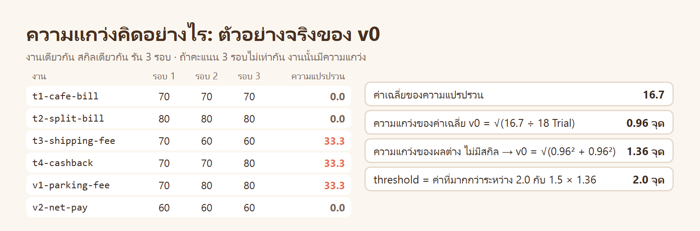
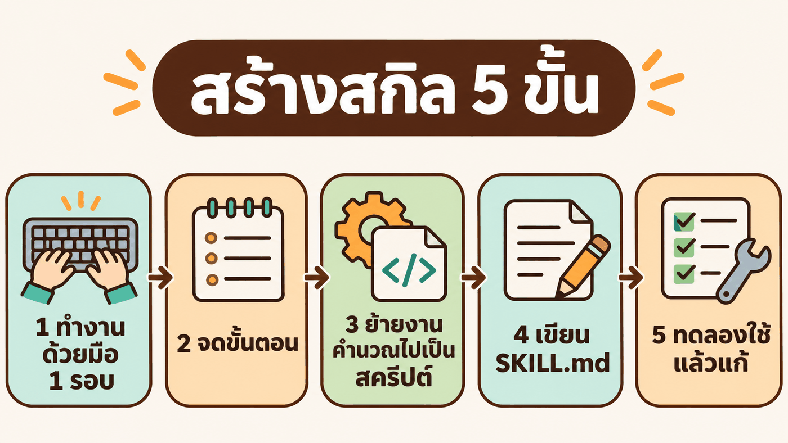

# ข้างใน `skill-optimizer` · เครื่องมือนี้ทำงานอย่างไร และสร้างอย่างไร

> [บทหลัก](../README.md) ใช้ `skill-optimizer` เป็นเครื่องมือ หน้านี้เปิดฝาดูข้างใน

| ส่วน | ตอบคำถาม |
|---|---|
| [1 · สกิลนี้คืออะไร](#1--สกิลนี้คืออะไร) | ในโฟลเดอร์มีอะไรบ้าง |
| [2 · หลักการออกแบบ](#2--หลักการออกแบบ) | ทำไมแบ่งเป็น `SKILL.md` กับสคริปต์ |
| [3 · ทำงานอย่างไร](#3--ทำงานอย่างไร) | แต่ละคำสั่งทำอะไร คิดคะแนนและตัดสินอย่างไร |
| [4 · สร้างอย่างไร](#4--สร้างอย่างไร) | ถ้าจะสร้างสกิลแบบนี้เอง ทำกี่ขั้น |
| [5 · ลองเอง](#5--ลองเอง) | แบบฝึกหัดที่ไม่ใช้โทเคน |

---

# 1 · สกิลนี้คืออะไร



สกิลไม่ใช่โปรแกรมพิเศษ เป็น **โฟลเดอร์ 1 โฟลเดอร์** ที่ AI เปิดอ่านเมื่อได้งานที่ตรงกับคำอธิบายของสกิล

หน้านี้อธิบาย **ฉบับอ้างอิง** ที่ [`00_resource/skills/skill-optimizer/`](../../../00_resource/skills/skill-optimizer/) · ฉบับที่ผู้เรียนสร้างเองใน LAB 0.1 ทำตาม [`skillopt_format.md`](../skillopt_format.md) ซึ่งเก็บผลไว้ใน `runs/<รุ่น>/` แทน `suite/runs/`

```text
skill-optimizer/
├── SKILL.md               60 บรรทัด    ขั้นตอนที่ AI ทำตาม
├── scripts/skillopt.py    439 บรรทัด   โปรแกรม 7 คำสั่ง (Python มาตรฐาน ไม่ต้องติดตั้งอะไรเพิ่ม)
├── references/suite.md    50 บรรทัด    รูปแบบของชุดโจทย์และตัวตรวจ
├── references/issues.md   17 บรรทัด    รูปแบบของ Issue Log
└── examples/web-fixer/    ชุดโจทย์ตัวอย่าง (ใช้ในบท 03 · มีเฉพาะใน 00_resource)
```

**ได้โฟลเดอร์นี้มาอย่างไร:** สร้างเองด้วยพรอมต์ใน [LAB 0 ขั้น 0.1](../README.md#ขั้น-01--สร้างโฟลเดอร์-skill-optimizer) แล้วขั้น 0.2 ติดตั้งเป็น global skill ของบัญชี yolo ใน container (`/root/ai-accounts/.Claude/shared/skills/skill-optimizer`)

---

# 2 · หลักการออกแบบ

## 2.1 AI ตัดสินใจ · สคริปต์คำนวณ


| งาน | ใครทำ | เพราะ |
|---|---|---|
| ให้ AI ทำงาน 18 ครั้ง แล้วเก็บผล | สคริปต์ | ต้องทำเหมือนกันทุกครั้ง |
| ให้คะแนน เฉลี่ย คิดความแกว่ง | สคริปต์ | ตัวเลขต้องคำนวณ ไม่ใช่ประมาณ |
| ตัดสิน ACCEPT หรือ REJECT | สคริปต์ | คนแก้ไม่ควรเป็นคนตัดสินงานของตัวเอง |
| อ่านข้อที่ผิด เปิด Trace หาสาเหตุ | AI | ต้องใช้ความเข้าใจ |
| เขียนกฎใหม่ลงในสกิล | AI | ต้องใช้ภาษา |

## 2.2 AI อ่านสกิลทีละชั้น


| ชั้น | อะไร | ขนาดจริง | AI อ่านเมื่อไร |
|---|---|---|---|
| 1 | `description` บนหัวไฟล์ `SKILL.md` | 612 ตัวอักษร | ทุกครั้ง ใช้ตัดสินว่างานนี้ต้องเปิดสกิลหรือไม่ |
| 2 | เนื้อหาของ `SKILL.md` | 57 บรรทัด | เมื่อเปิดใช้สกิล |
| 3 | `references/` | 67 บรรทัด | เมื่อ `SKILL.md` ชี้ไป |
| – | `scripts/skillopt.py` | 439 บรรทัด | ไม่ต้องอ่าน แค่สั่งรัน |

ชั้นบนยิ่งสั้น AI ยิ่งเสียโทเคนน้อย · โค้ด 439 บรรทัดไม่เข้าไปอยู่ในบริบทของ AI เลย

---

# 3 · ทำงานอย่างไร

## 3.1 `SKILL.md` เขียนอะไร 5 ส่วน

| ส่วน | เขียนอะไร | ตัวอย่างจากไฟล์จริง |
|---|---|---|
| 1 `description` | สกิลทำอะไร และใช้เมื่อผู้ใช้พูดว่าอะไร | ใช้เมื่อผู้ใช้ขอ "ปรับปรุงสกิล", "optimize skill", "เทียบสกิล 2 รุ่น" |
| 2 ตารางคำสั่ง | ต้องการอะไร → คำสั่งไหน → ใช้โทเคนหรือไม่ | `python3 $O gate <suite> --base v0 --cand v1` |
| 3 ขั้นตอน 0–8 | ลำดับที่ต้องทำ ห้ามข้าม | "หาสาเหตุ … เฉพาะชุด train" |
| 4 ประตูรับตัดสินอย่างไร | เกณฑ์ที่ AI ต้องอธิบายให้ผู้ใช้ได้ | "คะแนนชุด train ขึ้นแต่ชุด val ลง = สกิลจำโจทย์ → ไม่รับ" |
| 5 ข้อห้าม | สิ่งที่ห้ามทำ | "ห้ามแก้ตัวตรวจหรือโจทย์เพื่อให้ผ่าน" |

อ่านไฟล์เต็ม: [`SKILL.md`](../../../00_resource/skills/skill-optimizer/SKILL.md)

## 3.2 `skillopt.py` มี 7 คำสั่ง



| คำสั่ง | ฟังก์ชันในโค้ด | อ่าน | ให้ผล |
|---|---|---|---|
| `lint` | `lint()` | `SKILL.md` ของสกิลที่จะวัด | ขนาดของสกิล และคำเตือน |
| `run` | `cmd_run()` → `run_trial()` | `suite.json` และโฟลเดอร์สกิล | โฟลเดอร์ผลของทุก Trial |
| `grade` | `cmd_grade()` → `grade_trial()` | โค้ดใน sandbox | `grade.json` ใหม่ |
| `report` | `cmd_report()` → `summarize()` | `metrics.json` `grade.json` | ตารางเทียบรุ่น และ `results.json` |
| `failures` | `cmd_failures()` | `grade.json` ของ Training Set | รายการข้อที่ผิด |
| `null` | `cmd_null()` → `noise_of()` | `grade.json` | ความแกว่งของรุ่นนั้น |
| `gate` | `cmd_gate()` → `se_diff()` | ผลของสองรุ่น | ACCEPT (exit 0) หรือ REJECT (exit 1) |

อ่านโค้ดเต็ม: [`scripts/skillopt.py`](../../../00_resource/skills/skill-optimizer/scripts/skillopt.py)

## 3.3 ข้างในคำสั่ง `run`



ผลจริงของ 1 Trial (`v1` งาน `cashback` รอบ 1)

```text
suite/runs/v1/t4-cashback-r1/
├── sandbox/                          โฟลเดอร์ที่ AI ทำงาน
│   ├── skills/money-coder/SKILL.md   สกิลรุ่นที่ถูกวัด
│   ├── solve.py                      โค้ดที่ AI เขียน
│   └── test_solve.py                 เทสต์ที่ AI เขียน
├── task.json                         โจทย์ของ Trial นี้
├── transcript.jsonl                  ทุกคำสั่งของ AI (Trace)
├── metrics.json                      คำสั่ง 3 ครั้ง · $0.117 · โทเคนขาเข้า 116,152
└── grade.json                        คะแนน และผลรายข้อ
```

## 3.4 ข้างในคำสั่ง `null` และ `gate`



`gate` ถาม 3 ข้อตามลำดับ

| ข้อ | ถามว่า | ถ้าไม่ผ่าน |
|---|---|---|
| 1 | คะแนน Training ลดลงเกิน threshold หรือไม่ | REJECT |
| 2 | คะแนน Validation ลดลงเกิน threshold หรือไม่ | REJECT |
| 3 | คะแนนรวมดีขึ้นเกิน threshold **หรือ** โทเคนลดลงอย่างน้อย 10% หรือไม่ | REJECT |

อ่านสูตรทั้งหมดได้ใน [`mini_gate.py`](mini_gate.py) ฉบับย่อ 70 บรรทัด ให้ผลตรงกับคำสั่ง `gate` จริงทั้ง 5 ครั้งของบทนี้

> [!IMPORTANT]
> **📋 คัดลอกกล่องนี้ → Terminal ที่โฟลเดอร์ `05_Skill_Optimizer` แล้วกด Enter**
>
> ```bash
> python inside_skill_optimizer/mini_gate.py v0 v1
> ```

ผลจริง

```text
train 71.7% -> 100.0% (+28.3) เกณฑ์ 2.0 จุด
val   68.3% -> 90.0% (+21.7) เกณฑ์ 2.5 จุด
รวม   70.6% -> 96.7% (+26.1) เกณฑ์ 2.0 จุด = ค่าที่มากกว่าระหว่าง 2.0 กับ 1.5 x 1.0
โทเคนขาเข้าต่อ Trial 120976 -> 127192 (+5%)
ผล: ACCEPT รับ v1 แทน v0
```

---

# 4 · สร้างอย่างไร

## 4.1 วิธีสร้างสกิลแบบนี้ 5 ขั้น



| ขั้น | ทำอะไร | ใน `skill-optimizer` คือ |
|---|---|---|
| 1 ทำงานด้วยมือ 1 รอบ | ทำงานนั้นเองจนจบ โดยยังไม่มีสกิล | ให้ AI ทำงาน เปิดผลดู เทียบ 2 รุ่น |
| 2 จดขั้นตอน | ลำดับที่ได้ผล และจุดที่พลาดง่าย | ขั้นตอน 0–8 และข้อห้าม |
| 3 ย้ายงานคำนวณไปเป็นสคริปต์ | งานที่ทำซ้ำ หรือเป็นตัวเลข | `skillopt.py` 7 คำสั่ง |
| 4 เขียน `SKILL.md` | คำอธิบาย ตารางคำสั่ง ขั้นตอน ข้อห้าม | 60 บรรทัด |
| 5 ทดลองใช้ แล้วแก้ | ใช้กับงานจริง จดสิ่งที่ผิด แล้วแก้ | 3 รุ่น ในข้อ 4.2 |

## 4.2 สกิลนี้ถูกแก้มาแล้ว 3 รุ่น

| วันที่ | เกิดอะไร | `skillopt.py` |
|---|---|---|
| 10 พ.ย. 2026 | รุ่นแรก ใช้ปรับสกิล `dag-planner` และ `web-builder` | 380 บรรทัด |
| 11 พ.ย. 2026 | ใช้กับสกิล `web-fixer` แล้วพบจุดอ่อน 11 จุด เช่น วิธีคิดความแกว่ง และการแสดงผลรายข้อของ Validation Set | 437 บรรทัด |
| 13 พ.ย. 2026 | บทนี้พบว่าคอลัมน์ "อ่านสกิล" นับต่ำกว่าจริงเมื่อ AI อ่านด้วย `cat ./skills/x/*` | 439 บรรทัด |

เครื่องมือที่ใช้ปรับสกิล ก็ถูกปรับด้วยวิธีเดียวกัน: ใช้จริง → เจอข้อผิด → แก้

## 4.3 เช็กลิสต์ของสกิลที่ดี

| ☐ | ข้อ |
|---|---|
| ☐ | `description` บอกว่าสกิลทำอะไร และผู้ใช้พูดว่าอะไรจึงควรเปิดใช้ |
| ☐ | `SKILL.md` สั้น มีตารางคำสั่งและขั้นตอนที่เรียงลำดับ |
| ☐ | งานที่เป็นตัวเลขหรือทำซ้ำ อยู่ในสคริปต์ ไม่ให้ AI ทำเอง |
| ☐ | รายละเอียดที่ใช้บางครั้ง อยู่ใน `references/` |
| ☐ | มีข้อห้ามสำหรับสิ่งที่ทำผิดแล้วเสียหาย |
| ☐ | ผ่านการใช้กับงานจริง และแก้ตามสิ่งที่พบ |

---

# 5 · ลองเอง

ทุกข้อรันบนเครื่อง จากโฟลเดอร์ `05_Skill_Optimizer` ไม่ใช้โทเคน

> [!IMPORTANT]
> **📋 คัดลอกกล่องนี้ → Terminal ที่โฟลเดอร์ `05_Skill_Optimizer` แล้วกด Enter** (ข้อ 1 และ 2)
>
> ```bash
> python inside_skill_optimizer/mini_gate.py v3 v4
> python inside_skill_optimizer/mini_gate.py v2 v3
> ```

| # | ทำ | ได้เห็นอะไร |
|---|---|---|
| 1 | `python inside_skill_optimizer/mini_gate.py v3 v4` | Gate ปฏิเสธ `v4` เพราะคะแนนลดลงเกินเกณฑ์ |
| 2 | `python inside_skill_optimizer/mini_gate.py v2 v3` | Gate รับ `v3` ด้วยต้นทุน ทั้งที่คะแนนเท่าเดิม |
| 3 | เปิด [`mini_gate.py`](mini_gate.py) เปลี่ยน `EPS` จาก `2.0` เป็น `5.0` แล้วรัน `v1 v2` | เกณฑ์เข้มขึ้น ผลเปลี่ยนจาก ACCEPT เป็น REJECT |
| 4 | อ่าน `cmd_gate()` ใน `skillopt.py` เทียบกับ `mini_gate.py` | ฉบับจริงมีอะไรเพิ่ม (เช่น ตรวจว่าสองรุ่นรันงานชุดเดียวกัน) |
| 5 | เขียนสกิลของตัวเอง 1 ตัวตาม 5 ขั้นในข้อ 4.1 | ทำทั้งกระบวนการเอง |

**กลับไป:** [บทหลัก](../README.md)
