# ทฤษฎี · SkillOpt: ปรับสกิลเหมือนเทรนโมเดล

บทนี้อธิบายงานวิจัยต้นทางของแนวคิด Skill Optimization และเทียบกับการเทรนโมเดลด้วย Gradient Descent ทีละส่วน

| | |
|---|---|
| เปเปอร์ | *SkillOpt: Executive Strategy for Self-Evolving Agent Skills* (Yang และคณะ, Microsoft Research, 2026) |
| อ่านต้นฉบับ | [arXiv:2605.23904](https://arxiv.org/abs/2605.23904) · [หน้าโครงการ](https://microsoft.github.io/SkillOpt/) · [โค้ด](https://github.com/microsoft/SkillOpt) |
| แนวคิดในประโยคเดียว | ล็อกโมเดลไว้ แล้ว **เทรนข้อความของสกิล** ด้วยวงรอบแบบเดียวกับการเทรนโมเดล |
| ภาพในบทนี้ | วาดขึ้นใหม่เพื่ออธิบาย ไม่ใช่ภาพจากเปเปอร์ · ภาพต้นฉบับ (Figure 1 และ 2) ดูได้ที่หน้าโครงการ |

**อ่านตามลำดับนี้**

| ส่วน | ตอบคำถาม |
|---|---|
| [1 · การเทรนโมเดล](#1--การเทรนโมเดลด้วย-gradient-descent) | Gradient Descent ทำงานอย่างไร (ทบทวน) |
| [2 · แนวคิดของเปเปอร์](#2--แนวคิดของเปเปอร์-เทรนสกิล-ไม่เทรนน้ำหนัก) | ทำไมเทรนสกิลแทนน้ำหนัก |
| [3 · เทียบทีละแนวคิด](#3--เทียบทีละแนวคิด) | อะไรใน SkillOpt ตรงกับอะไรในการเทรนโมเดล |
| [4 · ภูมิประเทศของความผิดพลาด](#4--ภูมิประเทศของความผิดพลาด-figure-1-ของเปเปอร์) | ทำไมต้องแก้ทีละก้าวเล็ก และตรวจทุกก้าว |
| [5 · โจทย์ในรูปสมการ](#5--โจทย์ในรูปสมการ) | เปเปอร์นิยามปัญหาอย่างไร |
| [6 · หนึ่งก้าวของ SkillOpt](#6--หนึ่งก้าวของ-skillopt-figure-2-ของเปเปอร์) | Forward · Backward · Gate ทำอะไร |
| [7 · Algorithm 1](#7--algorithm-1) | อัลกอริทึมเต็ม และค่าตั้งต้น |
| [8 · ผลในเปเปอร์](#8--ผลในเปเปอร์) | ได้ผลแค่ไหน ส่วนไหนสำคัญ |
| [9 · เทียบกับ LAB ของบทนี้](#9--เทียบกับ-lab-ของบทนี้) | LAB `money-coder` ตรงกับเปเปอร์ตรงไหน ต่างตรงไหน |

---

# 1 · การเทรนโมเดลด้วย Gradient Descent

ต้องเข้าใจส่วนนี้ก่อน เพราะ SkillOpt ยืมโครงของมันมาทั้งชุด

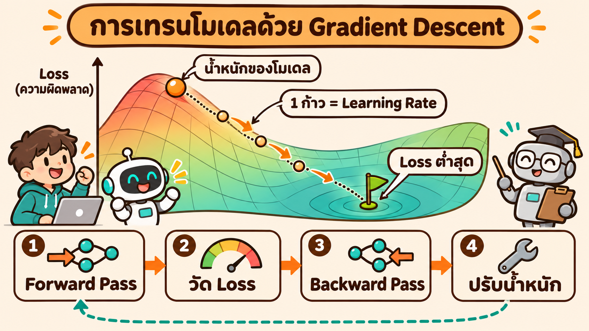

**ภาพในใจ:** โมเดลคือลูกบอลบนเนินเขา ความสูงของเนินคือ **Loss** (ความผิดพลาด) การเทรนคือการพาลูกบอลเดินลงไปหาจุดต่ำสุด ทีละก้าว

**1 ก้าวของการเทรน มี 4 ขั้น**

| ขั้น | ทำอะไร | เปรียบเหมือน |
|---|---|---|
| 1 Forward Pass | ป้อนข้อมูลให้โมเดล ได้คำตอบ | ทำข้อสอบ |
| 2 วัด Loss | เทียบคำตอบกับเฉลย ได้ตัวเลขความผิดพลาด | ตรวจข้อสอบ |
| 3 Backward Pass | คำนวณ **Gradient** = น้ำหนักแต่ละตัวต้องขยับทางไหน Loss จึงจะลด | ดูว่าผิดเพราะอะไร |
| 4 ปรับน้ำหนัก | ขยับน้ำหนักไปตาม Gradient เล็กน้อย | แก้วิธีทำ |

สูตรของขั้นที่ 4

$$\theta \leftarrow \theta - \eta \cdot \nabla_\theta \, \text{Loss}$$

**อ่านเป็นภาษาคน:** น้ำหนักใหม่ = น้ำหนักเดิม ลบด้วย (ขนาดก้าว × ทิศที่ทำให้ Loss เพิ่ม)

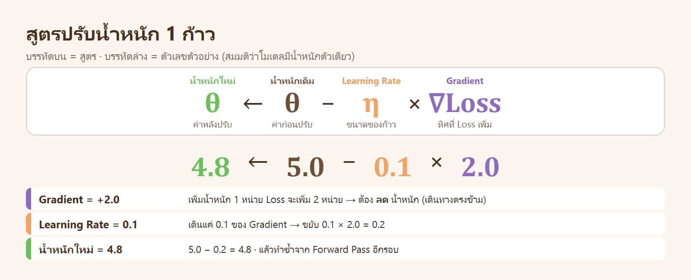

| สัญลักษณ์ | อ่านว่า | ความหมาย |
|---|---|---|
| $\theta$ | theta | น้ำหนักของโมเดล = สิ่งที่ถูกปรับ |
| $\nabla_\theta \, \text{Loss}$ | Gradient | ทิศที่ทำให้ Loss เพิ่มเร็วที่สุด จึงเดินทางตรงข้าม |
| $\eta$ | eta | **Learning Rate** = ขนาดของ 1 ก้าว |

**ทำไมต้องลบ:** Gradient ชี้ไปทางที่ Loss **เพิ่ม** เราต้องการให้ Loss ลด จึงเดินทางตรงข้าม

**ทำไมต้องคูณ $\eta$:** Gradient บอกทิศ ณ จุดที่ยืนอยู่เท่านั้น ถ้าเดินไกลเกินไป ทิศนั้นอาจไม่ถูกแล้ว จึงเดินทีละน้อยแล้วคำนวณใหม่

SkillOpt ใช้เหตุผลชุดเดียวกัน: ข้อเสนอแก้สกิลถูกต้อง ณ สกิลรุ่นปัจจุบันเท่านั้น จึงแก้ทีละไม่กี่ข้อ แล้ววัดใหม่ (ข้อ 6)

**คำที่ใช้คู่กับการเทรน**

| คำ | ความหมาย | ถ้าไม่มีจะเกิดอะไร |
|---|---|---|
| **Learning Rate** | ขนาดของก้าว | ใหญ่ไป = กระโดดข้ามหุบเขา ผลไม่นิ่ง · เล็กไป = ช้า |
| **Minibatch** | ข้อมูลกลุ่มเล็กที่ใช้ต่อ 1 ก้าว | กลุ่มเล็ก = เร็วแต่ทิศแกว่ง · กลุ่มใหญ่ = ทิศนิ่งแต่ช้า |
| **Epoch** | ใช้ข้อมูลฝึกครบ 1 รอบ | – |
| **Validation Set** | ข้อมูลที่ไม่ใช้ฝึก ใช้ตรวจว่าโมเดลดีขึ้นจริง | โมเดลจำข้อมูลฝึก (Overfitting) โดยไม่มีใครรู้ |
| **Checkpoint** | สำเนาของน้ำหนักที่ Validation ดีที่สุด | ได้โมเดลรุ่นสุดท้าย ซึ่งอาจไม่ใช่รุ่นที่ดีที่สุด |
| **Momentum** | จำทิศของก้าวก่อน ๆ มาช่วยก้าวปัจจุบัน | ทิศแกว่งไปมาตามข้อมูลแต่ละกลุ่ม |
| **Test Set** | ข้อมูลที่เปิดใช้ครั้งเดียวตอนรายงานผล | ผลที่รายงานดีเกินจริง |

---

# 2 · แนวคิดของเปเปอร์: เทรนสกิล ไม่เทรนน้ำหนัก

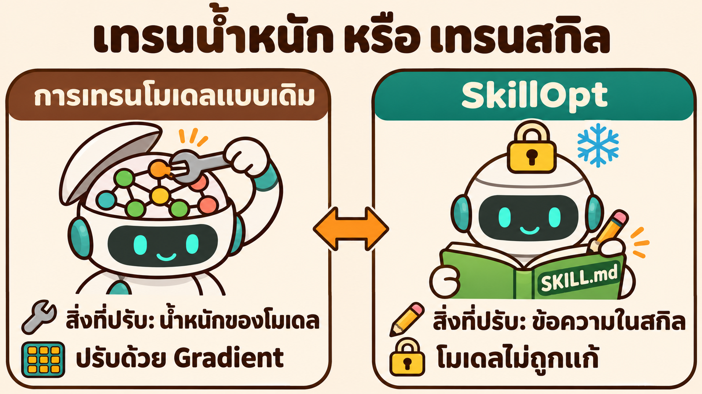

เปเปอร์ตั้งคำถามว่า ถ้าสิ่งที่ Agent ขาดคือ **วิธีทำงาน** (หาข้อมูลอย่างไร ใช้เครื่องมืออย่างไร ตอบรูปแบบไหน) ทำไมต้องไปแก้น้ำหนักของโมเดล

| | การเทรนโมเดลแบบเดิม | SkillOpt |
|---|---|---|
| สิ่งที่ถูกปรับ | น้ำหนักหลายพันล้านตัว | ข้อความในสกิล 1 ไฟล์ (ประมาณ 300–2,000 โทเคน) |
| โมเดล | ถูกแก้ | **ถูกล็อก** (Frozen) ไม่แตะเลย |
| ใช้กับโมเดลปิดได้หรือไม่ | ไม่ได้ (ไม่มีสิทธิ์แก้น้ำหนัก) | ได้ |
| คนอ่านผลลัพธ์ออกหรือไม่ | ไม่ออก | อ่านออก เป็นภาษาคน |
| ย้ายไปใช้กับโมเดลอื่น | ไม่ได้ | ได้ (เปเปอร์ทดลองแล้ว ข้อ 8) |

ปัญหาของวิธีที่มีอยู่ก่อน ซึ่งเปเปอร์ต้องการแก้

| วิธีเดิม | ปัญหา |
|---|---|
| คนเขียนสกิลเอง | ใช้ได้กับงานที่คนเขียนนึกถึง พอเปลี่ยนงานหรือเปลี่ยนโมเดลก็พลาด |
| ให้ LLM เขียนสกิลครั้งเดียว | ไม่ได้ลองใช้จริง ไม่รู้ว่าได้ผลหรือไม่ |
| ให้ LLM แก้สกิลตัวเองไปเรื่อย ๆ โดยไม่ตรวจ | แก้ทีละมาก ๆ ลบกฎที่ดีทิ้ง ผลขึ้น ๆ ลง ๆ |

คำตอบของเปเปอร์: **ถ้าสกิลคือสิ่งที่ถูกปรับ ก็ควรปรับมันอย่างมีวินัยแบบเดียวกับการเทรนโมเดล** คือมีหลักฐานต่อก้าว มีขนาดก้าว มีการตรวจบนข้อมูลที่ไม่ได้ใช้ฝึก และมีทิศทางที่ต่อเนื่อง

---

# 3 · เทียบทีละแนวคิด

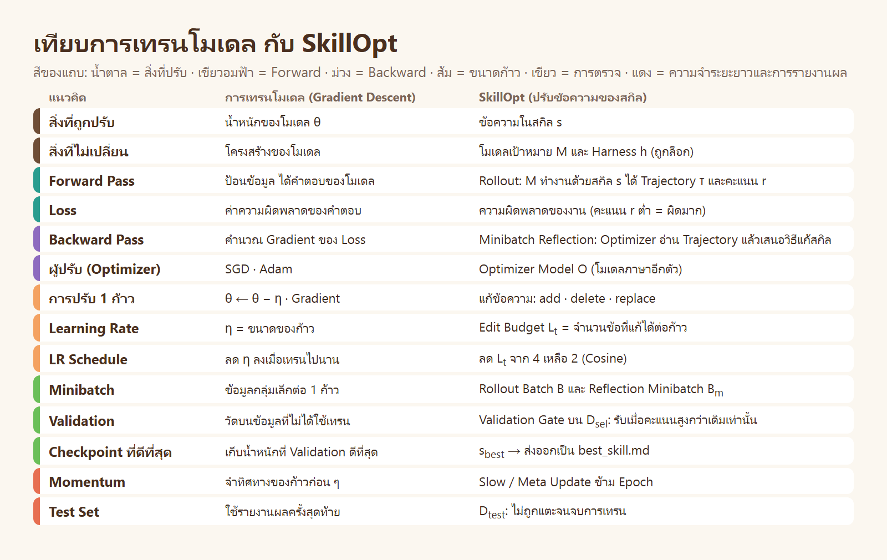

อ่านตารางทีละแถว: ซ้าย = ชื่อแนวคิด · กลาง = ในการเทรนโมเดล · ขวา = สิ่งที่ทำหน้าที่เดียวกันใน SkillOpt

**การเปรียบนี้ตรงแค่ไหน**

| ตรงกัน | ไม่ตรงกัน |
|---|---|
| โครงของวงรอบ: ลองทำ → ดูว่าผิดอย่างไร → ปรับเล็กน้อย → ตรวจ | ข้อความหา Gradient ทางคณิตศาสตร์ไม่ได้ "Gradient" ในที่นี้คือ **ข้อเสนอแก้เป็นภาษาคน** จาก Optimizer Model |
| บทบาทของ Learning Rate, Minibatch, Validation, Momentum | Gradient จริงรับประกันว่าก้าวเล็กพอแล้ว Loss ลด · ข้อเสนอแก้เป็นภาษา **ไม่รับประกัน** อะไรเลย |

ข้อที่ไม่ตรงกันนี้เป็นเหตุผลที่ SkillOpt ต้องมี **Validation Gate ทุกก้าว**: ข้อเสนอที่ฟังดูมีเหตุผล อาจทำให้โมเดลทำงานแย่ลงก็ได้ จึงต้องลองแล้ววัดก่อนรับ

เปเปอร์ย้ำว่าการเปรียบนี้มีไว้ **ใช้งานจริง** ไม่ใช่แค่ตั้งชื่อให้ดูดี: ทุกแนวคิดในตารางเป็นปุ่มปรับที่มีอยู่ในระบบ และถูกทดลองทีละปุ่ม (ข้อ 8)

---

# 4 · ภูมิประเทศของความผิดพลาด (Figure 1 ของเปเปอร์)

Figure 1 ของเปเปอร์รวม 2 เรื่องไว้ในภาพเดียว บทนี้แยกเป็น 2 ภาพ

## 4.1 ภูมิประเทศคืออะไร


| ในภาพ | ความหมาย |
|---|---|
| 1 จุดบนพื้นผิว | สกิล 1 รุ่น (ข้อความ 1 ชุด) |
| ความสูง | ความผิดพลาดบน Validation ของสกิลรุ่นนั้น |
| จุดเริ่มต้นบนเนิน | สกิลรุ่นแรก $s_0$ |
| หุบเขา | สกิลที่ดีที่สุด |
| การแก้สกิล 1 ครั้ง | การย้ายจากจุดหนึ่งไปอีกจุดหนึ่ง |

ต่างจากการเทรนโมเดลตรงที่ **เรามองไม่เห็นพื้นผิวนี้** จะรู้ความสูงของจุดใดก็ต้องให้โมเดลทำงานจริงด้วยสกิลรุ่นนั้นแล้ววัด

## 4.2 แก้ตามใจ เทียบกับ แก้ทีละก้าว

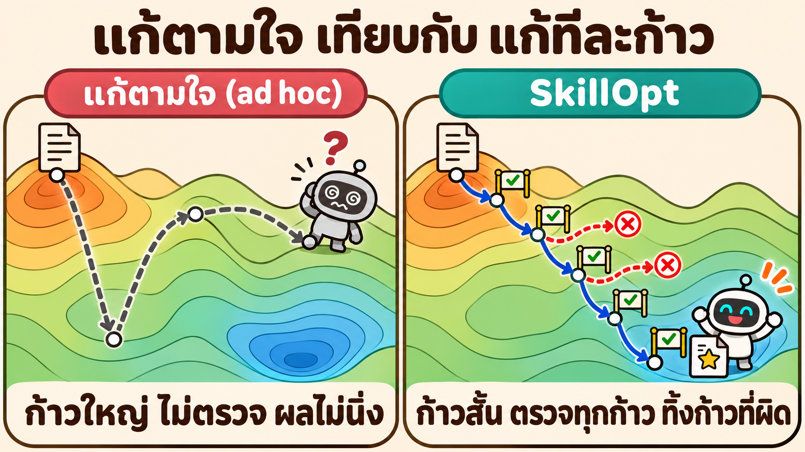

| | แก้ตามใจ (ad hoc update) | SkillOpt |
|---|---|---|
| ขนาดของการแก้ | เขียนสกิลใหม่ทั้งไฟล์ได้ = กระโดดไกล | จำกัดจำนวนข้อที่แก้ต่อก้าว = ก้าวสั้น |
| ตรวจก่อนรับ | ไม่ตรวจ | ตรวจบน Validation ทุกก้าว |
| ก้าวที่ทำให้แย่ลง | ถูกรับไปด้วย | ถูกปฏิเสธ และถูกจดไว้ไม่ให้ทำซ้ำ |
| ผล | ลบกฎที่ดีทิ้ง ผลไม่นิ่ง | ลงเนินต่อเนื่อง |

**ทำไมก้าวสั้นจึงสำคัญ** (เหตุผลของเปเปอร์)

| ถ้าก้าวสั้น | ถ้าก้าวยาว |
|---|---|
| สกิลรุ่นใหม่ต่างจากรุ่นก่อนไม่กี่ข้อ → รู้ว่าข้อไหนทำให้คะแนนเปลี่ยน | เปลี่ยนหลายอย่างพร้อมกัน → ไม่รู้ว่าอะไรได้ผล |
| ประวัติ "อะไรเคยได้ผล อะไรเคยถูกปฏิเสธ" ยังใช้กับรุ่นถัดไปได้ | รุ่นใหม่ต่างจากเดิมมาก ประวัติเก่าใช้ไม่ได้ |

---

# 5 · โจทย์ในรูปสมการ

เปเปอร์นิยามปัญหาด้วย 3 สมการ ดูภาพรวมก่อน แล้วค่อยอ่านทีละสมการ

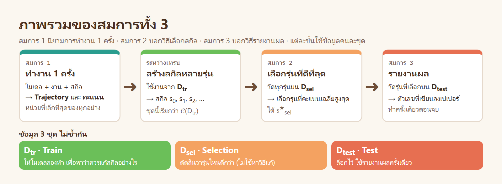

| สมการ | ตอบคำถาม | ใช้ข้อมูลชุดไหน |
|---|---|---|
| 1 | การทำงาน 1 ครั้งคืออะไร ได้อะไรออกมา | งาน 1 ชิ้น จากชุดใดก็ได้ |
| 2 | ในสกิลหลายรุ่น เลือกรุ่นไหน | $D_{\text{sel}}$ |
| 3 | รายงานว่าสกิลที่เลือกดีแค่ไหน | $D_{\text{test}}$ |

## 5.1 สมการ 1: การทำงาน 1 ครั้ง

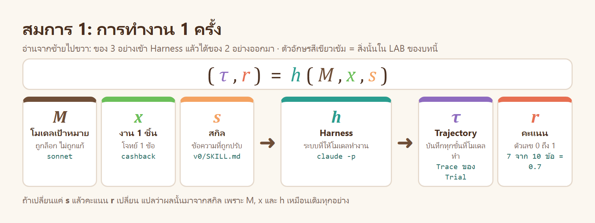

$$(\tau(s),\; r(s)) = h(M, x, s), \qquad r(s) \in [0, 1]$$

**อ่านเป็นภาษาคน:** ให้ Harness $h$ รันโมเดล $M$ ทำงาน $x$ โดยมีสกิล $s$ อยู่ด้วย จะได้ของ 2 อย่าง คือบันทึกการทำงาน $\tau$ และคะแนน $r$

| สัญลักษณ์ | ชื่อ | ความหมาย | ใน LAB ของบทนี้ |
|---|---|---|---|
| $M$ | Target Model | โมเดลที่ทำงาน · ถูกล็อก ไม่ถูกแก้ | โมเดล sonnet |
| $x$ | Task | งาน 1 ชิ้น | โจทย์ 1 ข้อ เช่น `cashback` |
| $s$ | Skill | ข้อความที่ใส่ให้โมเดลก่อนทำงาน · **สิ่งเดียวที่ถูกปรับ** | `SKILL.md` ของ `money-coder` |
| $h$ | Harness | ระบบที่ให้โมเดลทำงาน และให้คะแนน | `claude -p` ใน container และตัวตรวจ |
| $\tau$ | Trajectory | บันทึกทุกขั้นที่โมเดลทำ | Trace ของ 1 Trial |
| $r$ | Score | คะแนนของงานนั้น | จำนวนข้อตรวจที่ผ่าน ÷ 10 |

**แทนค่าด้วย LAB**

```text
h( sonnet , cashback , v0/SKILL.md )  →  ( Trace ของ Trial นั้น , 0.7 )
```

**จุดที่ควรสังเกตในสมการ**

| เขียนว่า | หมายความว่า |
|---|---|
| $\tau(s)$ และ $r(s)$ มี $(s)$ ต่อท้าย | ผลลัพธ์ **ขึ้นกับสกิล** · เปลี่ยนสกิล ผลก็เปลี่ยน |
| $M$ และ $h$ ไม่เปลี่ยนตลอดการเทรน | ถ้าคะแนนเปลี่ยน ต้องมาจาก $s$ อย่างเดียว จึงเทียบสกิลสองรุ่นได้อย่างยุติธรรม |
| $r(s) \in [0, 1]$ | คะแนนอยู่ระหว่าง 0 (ผิดทั้งหมด) ถึง 1 (ถูกทั้งหมด) · ตัวตรวจต้องให้คะแนนเป็นตัวเลขได้ |

สมการนี้คือ Forward Pass ของ 1 งาน: ในการเทรนโมเดล ป้อนข้อมูลแล้วได้คำตอบกับ Loss · ที่นี่ป้อนงานแล้วได้ Trajectory กับคะแนน

## 5.2 สมการ 2: เลือกสกิลรุ่นที่ดีที่สุด

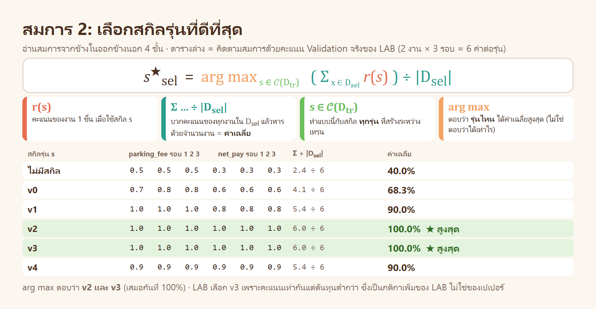

$$s^{\star}_{\text{sel}} = \arg\max_{s \,\in\, \mathcal{C}(D_{\text{tr}})} \; \frac{1}{|D_{\text{sel}}|} \sum_{x \in D_{\text{sel}}} r(s)$$

**อ่านเป็นภาษาคน:** ในบรรดาสกิลทุกรุ่นที่สร้างได้ระหว่างเทรน ให้เลือกรุ่นที่ได้คะแนนเฉลี่ยบน $D_{\text{sel}}$ สูงที่สุด

**อ่านจากข้างในออกข้างนอก 4 ชั้น**

| ชั้น | ส่วนของสมการ | ทำอะไร | ตัวอย่างจาก LAB (`v0`) |
|---|---|---|---|
| 1 | $r(s)$ | คะแนนของงาน 1 ชิ้น เมื่อใช้สกิล $s$ (จากสมการ 1) | `parking_fee` รอบ 1 ได้ 0.7 |
| 2 | $\sum_{x \in D_{\text{sel}}}$ | บวกคะแนนของ **ทุกงาน** ใน $D_{\text{sel}}$ | 0.7 + 0.8 + 0.8 + 0.6 + 0.6 + 0.6 = 4.1 |
| 3 | $\frac{1}{\lvert D_{\text{sel}} \rvert}$ | หารด้วยจำนวนงาน ได้ **ค่าเฉลี่ย** | 4.1 ÷ 6 = 0.683 = 68.3% |
| 4 | $\arg\max_{s \in \mathcal{C}(D_{\text{tr}})}$ | ทำชั้น 1–3 กับสกิล **ทุกรุ่น** แล้วตอบว่ารุ่นไหนได้ค่าเฉลี่ยสูงสุด | เทียบ ไม่มีสกิล `v0` `v1` `v2` `v3` `v4` |

| สัญลักษณ์ | ความหมาย |
|---|---|
| $\lvert D_{\text{sel}} \rvert$ | จำนวนงานในชุด $D_{\text{sel}}$ (ขีดตั้งสองข้าง = "จำนวนสมาชิก") |
| $\mathcal{C}(D_{\text{tr}})$ | ชุดของสกิลทุกรุ่นที่ถูกสร้างระหว่างเทรนด้วยข้อมูล $D_{\text{tr}}$ (C มาจาก Candidates) |
| $s \in \mathcal{C}(D_{\text{tr}})$ | $s$ เป็นรุ่นใดรุ่นหนึ่งในชุดนั้น |
| $\arg\max$ | ตอบว่า **ตัวไหน** ให้ค่าสูงสุด · ต่างจาก $\max$ ที่ตอบว่าค่าสูงสุด **เท่ากับเท่าไร** |
| $s^{\star}_{\text{sel}}$ | สกิลที่ถูกเลือก (ดาว = ดีที่สุด · sel = เลือกด้วย $D_{\text{sel}}$) |

**ทำไมเลือกด้วย $D_{\text{sel}}$ ไม่ใช่ $D_{\text{tr}}$**

| ถ้าเลือกด้วย | จะเกิดอะไร |
|---|---|
| $D_{\text{tr}}$ | สกิลถูกแก้จากข้อผิดของงานชุดนี้อยู่แล้ว คะแนนบนชุดนี้จึงสูงเสมอ บอกไม่ได้ว่าใช้กับงานอื่นได้หรือไม่ |
| $D_{\text{sel}}$ | เป็นงานที่ไม่ถูกใช้หาวิธีแก้ ถ้าคะแนนขึ้นที่นี่ด้วย แปลว่าสกิลดีขึ้นจริง |

สมการนี้เทียบได้กับการเก็บ **Checkpoint ที่ Validation ดีที่สุด** ในการเทรนโมเดล

## 5.3 สมการ 3: รายงานผล

$$\text{Test}(s^{\star}_{\text{sel}}) = \frac{1}{|D_{\text{test}}|} \sum_{x \in D_{\text{test}}} r(s^{\star}_{\text{sel}})$$

**อ่านเป็นภาษาคน:** นำสกิลที่เลือกได้จากสมการ 2 **รุ่นเดียว** ไปทำงานทุกชิ้นใน $D_{\text{test}}$ แล้วหาค่าเฉลี่ย ตัวเลขนี้คือผลที่รายงาน

| เทียบกับสมการ 2 | สมการ 2 | สมการ 3 |
|---|---|---|
| วัดสกิลกี่รุ่น | ทุกรุ่น | รุ่นเดียว ($s^{\star}_{\text{sel}}$) |
| ใช้ข้อมูลชุดไหน | $D_{\text{sel}}$ | $D_{\text{test}}$ |
| ทำกี่ครั้ง | ทุกก้าวของการเทรน | ครั้งเดียวตอนจบ |
| มี $\arg\max$ หรือไม่ | มี (เป็นการเลือก) | ไม่มี (เป็นการวัดอย่างเดียว) |

**ทำไมรายงานคะแนนของ $D_{\text{sel}}$ ไม่ได้**

สกิลถูกเลือกเพราะได้คะแนนบน $D_{\text{sel}}$ สูงสุดในหลายรุ่น ส่วนหนึ่งของคะแนนนั้นจึงมาจากความบังเอิญที่เข้าทางชุดนี้ เหมือนทอยลูกเต๋า 10 ครั้งแล้วรายงานเฉพาะครั้งที่ได้แต้มสูงสุด · $D_{\text{test}}$ ไม่เคยถูกใช้เลือกอะไร คะแนนบนชุดนี้จึงไม่เอนเอียง

LAB ของบทนี้ไม่มี $D_{\text{test}}$ ผลที่รายงานจึงเป็นคะแนนของ Validation ซึ่งถูกใช้ตัดสินมาแล้ว 5 ครั้ง (ข้อจำกัดในข้อ 4.4 ของ README หลัก)

## 5.4 สมการทั้ง 3 บอกอะไร และไม่บอกอะไร

| บอก | ไม่บอก |
|---|---|
| คะแนนของสกิลวัดอย่างไร (สมการ 1) | สกิลรุ่นใหม่แต่ละรุ่นใน $\mathcal{C}(D_{\text{tr}})$ **สร้างขึ้นมาอย่างไร** |
| เลือกรุ่นไหน (สมการ 2) | ควรแก้กี่ข้อต่อก้าว |
| รายงานผลอย่างไร (สมการ 3) | ทำอย่างไรไม่ให้ลองวิธีที่เคยไม่ได้ผลซ้ำ |

ส่วนที่สมการไม่บอก คือเนื้อหาของข้อ 6: วิธีสร้างสกิลรุ่นใหม่ทีละก้าว

**เชื่อมกับ Gradient Descent:** การเทรนโมเดลหา $\theta$ ที่ทำให้ Loss เฉลี่ย **ต่ำสุด** · SkillOpt หา $s$ ที่ทำให้คะแนนเฉลี่ย **สูงสุด** เป็นปัญหาแบบเดียวกัน ต่างกันที่ $\theta$ เป็นตัวเลข จึงหา Gradient ได้ ส่วน $s$ เป็นข้อความ จึงต้องให้ Optimizer Model เสนอวิธีแก้แทน

---

# 6 · หนึ่งก้าวของ SkillOpt (Figure 2 ของเปเปอร์)

Figure 2 ของเปเปอร์เป็นไพป์ไลน์ยาว 1 ภาพ บทนี้แยกเป็น 3 ช่วง ช่วงละ 2–4 ภาพ

```text
6.1 Forward Pass   →   6.2 Backward Pass   →   6.3 Validation Gate
    (ลองทำงาน)           (หาวิธีแก้สกิล)           (รับ หรือ ไม่รับ)
```

| ช่วง | เข้า | ออก | ใครทำ |
|---|---|---|---|
| 6.1 Forward Pass | สกิลปัจจุบัน + งานจาก $D_{\text{tr}}$ | Rollout Batch | โมเดลเป้าหมาย $M$ |
| 6.2 Backward Pass | Rollout Batch | สกิลรุ่นใหม่ (แก้ไม่เกิน $L_t$ ข้อ) | Optimizer Model $O$ |
| 6.3 Validation Gate | สกิลรุ่นใหม่ + งานจาก $D_{\text{sel}}$ | ACCEPT หรือ REJECT | โมเดลเป้าหมาย $M$ และตัวตรวจ |

## 6.1 Forward Pass: Rollout

**Rollout** = ให้โมเดลลองทำงานจริงตั้งแต่ต้นจนจบ แล้วบันทึกทุกอย่างไว้

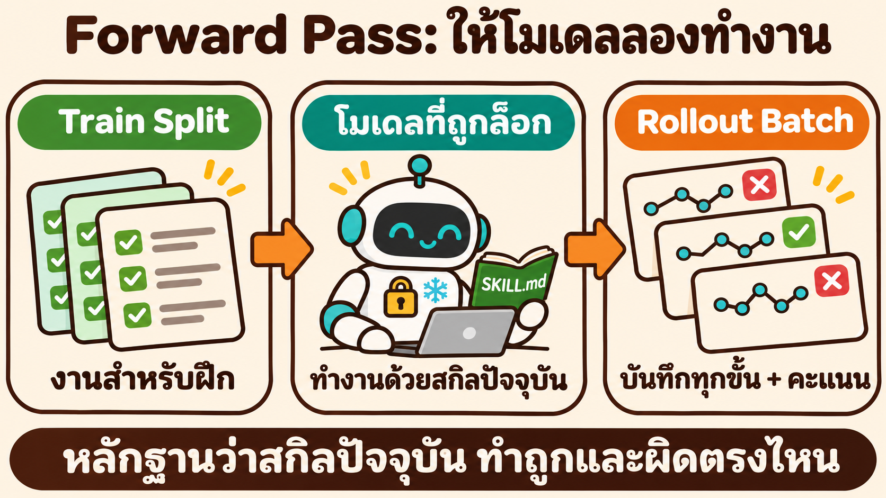

| ลำดับ | เกิดอะไรขึ้น |
|---|---|
| 1 | สุ่มงานกลุ่มหนึ่งจาก $D_{\text{tr}}$ (ค่าตั้งต้น 40 งาน) |
| 2 | โมเดลเป้าหมายทำงานแต่ละชิ้นด้วย **สกิลปัจจุบัน** (ใช้สมการ 1 กับทุกงาน) |
| 3 | ตัวตรวจให้คะแนนงานแต่ละชิ้น |
| 4 | ได้ **Rollout Batch** = Trajectory พร้อมคะแนน ของทุกงานในกลุ่ม |

**Trajectory 1 ใบ เก็บอะไร**

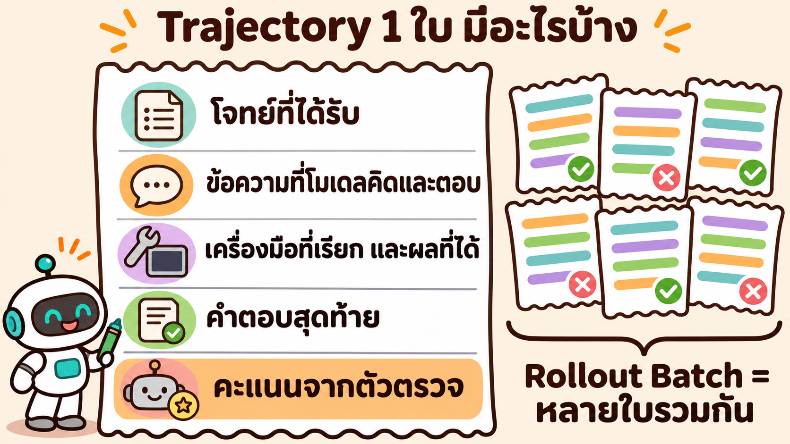

| ใน Trajectory | ใช้ทำอะไรใน Backward Pass | ตัวอย่างจาก LAB (`v0` งาน `cashback`) |
|---|---|---|
| โจทย์ที่ได้รับ | รู้ว่างานต้องการอะไร | ข้อความโจทย์ `cashback` |
| ข้อความที่โมเดลคิดและตอบ | เห็นว่าโมเดลเข้าใจสกิลอย่างไร | – |
| เครื่องมือที่เรียก และผลที่ได้ | เห็นว่าทำขั้นไหนพลาด หรือทำเกินจำเป็น | อ่าน `SKILL.md` → เขียน `solve.py` และ `test_solve.py` → รันเทสต์ |
| คำตอบสุดท้าย | ของที่ถูกตรวจ | ไฟล์ `solve.py` และ `test_solve.py` |
| คะแนนจากตัวตรวจ | บอกว่างานนี้ผิดหรือถูก และผิดข้อไหน | 0.7 · ผิด `reject_type` `cli_ok` `cli_error` |

**ทำไมต้องเก็บทั้ง Trajectory ไม่ใช่แค่คะแนน:** คะแนนบอกว่า **ผิด** แต่ Trajectory บอกว่า **ผิดเพราะอะไร** ซึ่งเป็นสิ่งที่ Backward Pass ต้องใช้

**ขนาดของกลุ่ม $B$** ทำหน้าที่เหมือน Batch Size

| กลุ่มเล็ก | กลุ่มใหญ่ |
|---|---|
| แก้สกิลได้บ่อย | แก้สกิลได้น้อยครั้งกว่า |
| หลักฐานน้อย ข้อผิดที่เห็นอาจเป็นความบังเอิญ | เห็นข้อผิดที่เกิดซ้ำชัดกว่า |

## 6.2 Backward Pass: Minibatch Reflection

ช่วงนี้ตอบคำถามเดียว: **จากหลักฐานที่ได้ ควรแก้สกิลตรงไหน** · ภาพรวมก่อน

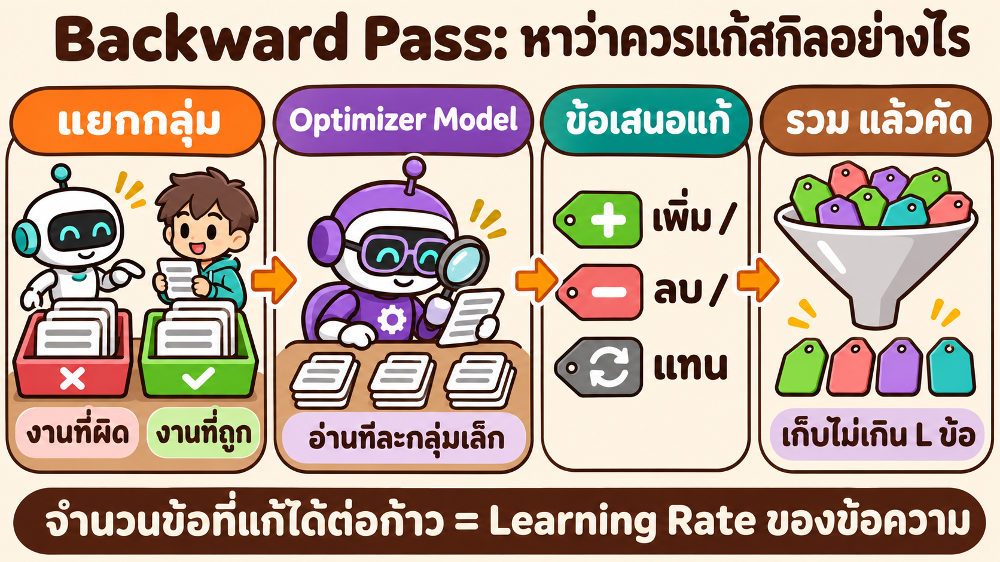

| ขั้น | ทำอะไร | อธิบายในข้อ |
|---|---|---|
| 1 แยกกลุ่ม | แยกงานที่ผิดกับงานที่ถูก แล้วแบ่งเป็นกลุ่มเล็ก | 6.2.1 |
| 2 Reflection | Optimizer Model อ่านทีละกลุ่ม แล้วเสนอ Edit | 6.2.1 |
| 3 ข้อเสนอแก้ | Edit มี 3 แบบ | 6.2.2 |
| 4 รวม แล้วคัด | รวมข้อเสนอ แล้วเก็บไม่เกิน $L_t$ ข้อ | 6.2.3 |

ข้อ 6.2.4 เดินตามทั้ง 4 ขั้นด้วยผลจริงของ LAB · ข้อ 6.2.5 เทียบกับ Gradient Descent และ LAB ของเรา

### 6.2.1 แยกกลุ่ม แล้วอ่านทีละกลุ่มเล็ก


| คำถาม | คำตอบ |
|---|---|
| ทำไมแยกงานที่ผิดกับงานที่ถูก | งานที่ผิดบอกว่าสกิล **ขาดอะไร** · งานที่ถูกบอกว่าสกิล **มีอะไรดีอยู่แล้ว** ที่ต้องรักษาไว้ |
| ทำไมอ่านทีละกลุ่ม (Minibatch) | อ่านทีละงาน Optimizer จะเสนอวิธีแก้ที่ใช้ได้กับงานนั้นงานเดียว · อ่านทีละกลุ่มจะเห็นข้อผิดที่ **เกิดซ้ำ** ซึ่งเป็นข้อบกพร่องของสกิลจริง |
| กลุ่มละกี่งาน | ค่าตั้งต้น 8 งาน ($B_m = 8$) |
| ข้อผิดที่เกิดซ้ำหน้าตาอย่างไร | เปเปอร์ยกตัวอย่าง: ค้นข้อมูลผิดแหล่งทุกครั้ง · ตอบผิดรูปแบบทุกครั้ง · ไม่ตรวจผลของเครื่องมือทุกครั้ง |

ตัวอย่างจาก LAB: ใน `v0` ข้อ `cli_ok` ผิด **12 จาก 12 Trial** จึงเป็นข้อบกพร่องของสกิล ส่วน `no_drift` ผิด 1 จาก 12 Trial จึงยังไม่ถูกแก้ใน `v1`

### 6.2.2 ข้อเสนอแก้: Edit 3 แบบ

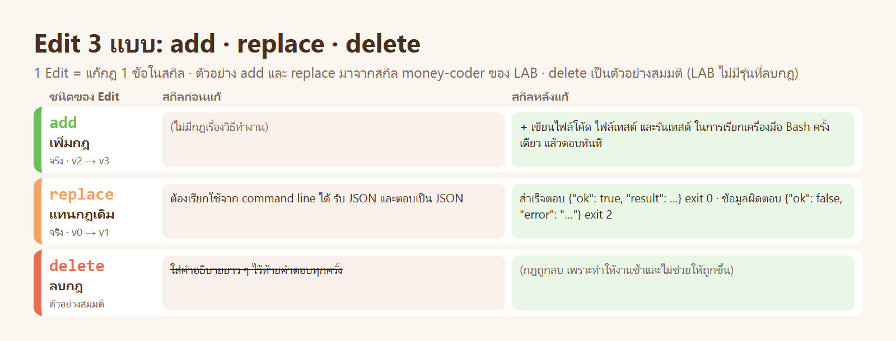

| Edit | ทำอะไร | ใช้เมื่อ |
|---|---|---|
| **add** | เพิ่มกฎใหม่ 1 ข้อ | สกิลไม่เคยพูดถึงเรื่องนั้น |
| **replace** | แทนกฎเดิมด้วยกฎที่ชัดกว่า | สกิลพูดถึงแล้ว แต่กว้างหรือผิด |
| **delete** | ลบกฎ 1 ข้อ | กฎนั้นทำให้ผลแย่ลง หรือขัดกับกฎอื่น |

Optimizer Model ต้องเสนอเป็น Edit ทีละข้อ ไม่เขียนสกิลใหม่ทั้งไฟล์ ทุก Edit จึงตรวจย้อนได้ว่ามาจากหลักฐานกลุ่มไหน

### 6.2.3 รวม คัด และ Learning Rate

ข้อเสนอจากทุกกลุ่มรวมกันมีจำนวนมาก ต้องผ่าน 2 ขั้นก่อนใช้

| ขั้น | ทำอะไร | ทำไม |
|---|---|---|
| **Merge** | รวมข้อเสนอของงานที่ผิด และของงานที่ถูก แล้วรวมกันอีกครั้งโดยให้การแก้ข้อผิดมาก่อน · ตัดข้อที่ซ้ำ ขัดกัน หรือเจาะจงเฉพาะตัวอย่าง | ข้อเสนอที่มาจากหลายกลุ่มน่าเชื่อกว่าข้อที่มาจากกลุ่มเดียว |
| **Rank แล้ว Clip** | เรียงตามประโยชน์ที่คาดว่าจะได้ แล้วเก็บเฉพาะ $L_t$ ข้อแรก | จำกัดขนาดของก้าว |

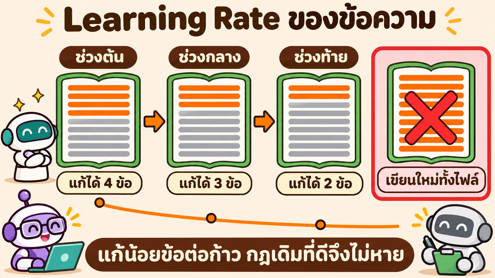

**$L_t$ คือ Learning Rate ของข้อความ**

| หัวข้อ | การเทรนโมเดล | SkillOpt |
|---|---|---|
| Learning Rate คือ | ตัวเลข $\eta$ ที่คูณกับ Gradient | จำนวน Edit สูงสุดต่อก้าว $L_t$ |
| ค่าตั้งต้น | แล้วแต่โมเดล | เริ่มที่ 4 ลดแบบ Cosine จนเหลือ 2 |
| ใหญ่เกินไป | กระโดดข้ามจุดต่ำสุด Loss แกว่ง | เขียนใหม่มากเกิน ลบกฎที่ดี ใส่กฎที่ขัดกัน |
| เล็กเกินไป | เทรนช้า | เรียนรู้ช้า ต้องใช้หลายก้าว |
| ทำไมลดลงตามเวลา | ช่วงท้ายควรปรับละเอียด | ช่วงต้นสกิลยังขาดมาก · ช่วงท้ายควรเก็บรายละเอียดโดยไม่ทำของเดิมพัง |

ผลของช่วงนี้คือ **สกิลรุ่นใหม่** 1 รุ่น ซึ่งต่างจากสกิลปัจจุบันไม่เกิน $L_t$ ข้อ · รุ่นนี้ยังไม่ถูกใช้ ต้องผ่านข้อ 6.3 ก่อน

### 6.2.4 เดินตามตัวอย่างจริง: `v0` → `v1` ของ LAB

ภาพนี้นำผลจริงของ LAB มาจัดให้อยู่ในรูปของ SkillOpt ทีละขั้น (LAB ไม่ได้แบ่ง Minibatch จริง ส่วนจำนวน Trial ที่พบข้อผิดเป็นผลจริง)

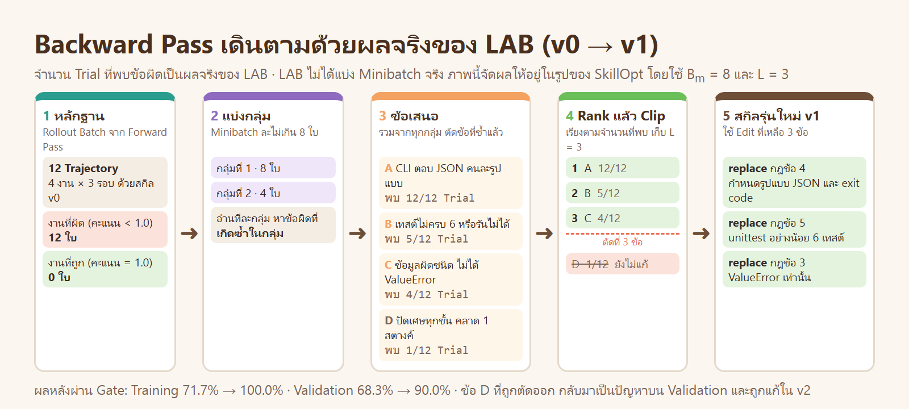

| ขั้น | เกิดอะไรขึ้นในตัวอย่าง | สิ่งที่ถูกคัดออก |
|---|---|---|
| 1 หลักฐาน | Forward Pass ให้ Trajectory 12 ใบ (4 งาน × 3 รอบ) ทุกใบได้คะแนนไม่เต็ม จึงเป็น "งานที่ผิด" ทั้ง 12 ใบ | – |
| 2 แบ่งกลุ่ม | แบ่งเป็นกลุ่มละไม่เกิน 8 ใบ ได้ 2 กลุ่ม (8 ใบ และ 4 ใบ) | – |
| 3 Reflection | อ่านทีละกลุ่ม หาข้อผิดที่ **เกิดซ้ำในกลุ่ม** แล้วเสนอ Edit · รวมจากทุกกลุ่มและตัดข้อที่ซ้ำกัน เหลือ 4 ข้อ (A B C D) | ข้อเสนอที่ซ้ำกันระหว่างกลุ่ม |
| 4 Rank แล้ว Clip | เรียงตามจำนวน Trial ที่พบ: A 12/12 · B 5/12 · C 4/12 · D 1/12 แล้วเก็บ 3 ข้อแรก | **ข้อ D** (พบ 1 Trial อาจเป็นความบังเอิญ) |
| 5 สกิลรุ่นใหม่ | ใช้ Edit 3 ข้อกับ `v0` ได้ `v1` · ทั้ง 3 ข้อเป็นแบบ replace | – |

**ข้อเสนอ 4 ข้อ และ Edit ที่ได้**

| ข้อ | ข้อผิดที่เกิดซ้ำ | พบ | สกิล `v0` เขียนว่า | Edit (replace) ใน `v1` |
|---|---|---|---|---|
| A | CLI ตอบ JSON คนละรูปแบบ | 12/12 | "รับ JSON และตอบเป็น JSON" | สำเร็จ `{"ok": true, "result": …}` exit 0 · ผิด `{"ok": false, "error": "…"}` exit 2 |
| B | เทสต์ไม่ครบ 6 หรือรันด้วย unittest ไม่ได้ | 5/12 | "เขียนเทสต์มาด้วยทุกครั้ง" | `unittest.TestCase` อย่างน้อย 6 เทสต์ และต้องรันผ่าน |
| C | ข้อมูลผิดชนิด ไม่ได้ `ValueError` | 4/12 | "ถ้าผิดให้แจ้ง error" | ผิดชนิดหรือผิดช่วง → `raise ValueError` เท่านั้น |
| D | ปัดเศษทุกขั้น คลาด 1 สตางค์ | 1/12 | "ปัดเศษสตางค์ให้ถูกต้อง" | ถูกตัดออกในขั้น Clip |

หมายเหตุ: ในเปเปอร์ Optimizer Model เป็นผู้เรียงข้อเสนอตามประโยชน์ที่คาดว่าจะได้ ตัวอย่างนี้ใช้จำนวน Trial ที่พบแทน เพราะเป็นเกณฑ์ที่ LAB ใช้จริง

**บทเรียนจากข้อ D:** การตัดข้อที่พบน้อยออกทำให้ก้าวเล็กและปลอดภัย แต่ข้อที่ถูกตัดอาจเป็นปัญหาจริง · ข้อ D กลับมาเป็นข้อผิดบน Validation ของ `v1` (ได้ 90%) และถูกแก้ใน `v2` · นี่คือเหตุผลที่ต้องเทรนหลายก้าว ไม่ใช่ก้าวเดียว

### 6.2.5 เทียบ 3 ทาง: Gradient Descent · SkillOpt · LAB ของเรา

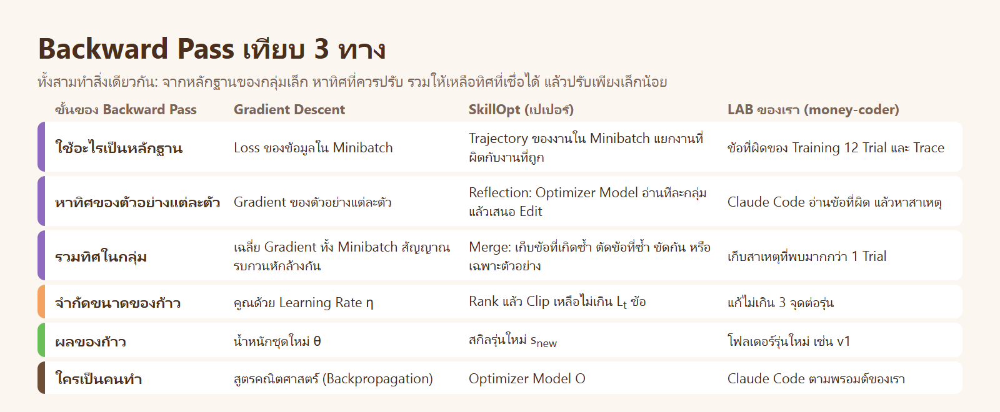

| ขั้น | Gradient Descent | SkillOpt | LAB ของเรา |
|---|---|---|---|
| หลักฐาน | Loss ของข้อมูลใน Minibatch | Trajectory ของงานใน Minibatch | ข้อที่ผิดของ Training 12 Trial และ Trace |
| หาทิศ | Gradient ของตัวอย่างแต่ละตัว | Reflection ทีละกลุ่ม ได้ข้อเสนอ Edit | Claude Code อ่านข้อที่ผิด หาสาเหตุ |
| รวมทิศ | เฉลี่ย Gradient ทั้งกลุ่ม | Merge: เก็บข้อที่เกิดซ้ำ | เก็บสาเหตุที่พบมากกว่า 1 Trial |
| จำกัดก้าว | คูณด้วย $\eta$ | Clip เหลือ $L_t$ ข้อ | แก้ไม่เกิน 3 จุด |
| ผล | น้ำหนักชุดใหม่ | สกิลรุ่นใหม่ | โฟลเดอร์ `v1` |

**ทำไม "รวมทิศ" จึงสำคัญในทั้งสามทาง**

| | ถ้าดูตัวอย่างเดียว | เมื่อรวมทั้งกลุ่ม |
|---|---|---|
| Gradient Descent | Gradient ของตัวอย่างเดียวชี้ไปทางที่ดีกับตัวอย่างนั้น อาจแย่กับตัวอย่างอื่น | ทิศที่ตัวอย่างส่วนใหญ่เห็นตรงกันเหลืออยู่ ทิศเฉพาะตัวหักล้างกันไป |
| SkillOpt | Edit จากงานเดียวเป็นวิธีแก้เฉพาะงานนั้น | Edit ที่หลายกลุ่มเสนอตรงกันได้อันดับสูง ข้อที่เจาะจงเฉพาะตัวอย่างถูกตัด |
| LAB ของเรา | แก้ตามข้อผิดของ Trial เดียวอาจเป็นการแก้ความบังเอิญ | ข้อ A พบ 12/12 จึงแก้ก่อน · ข้อ D พบ 1/12 จึงรอ |

## 6.3 Validation Gate และ Rejected-Edit Buffer

Backward Pass ให้ข้อเสนอที่ **ฟังดูมีเหตุผล** แต่ยังไม่มีอะไรรับประกันว่าได้ผลจริง ช่วงนี้จึงลองแล้ววัด

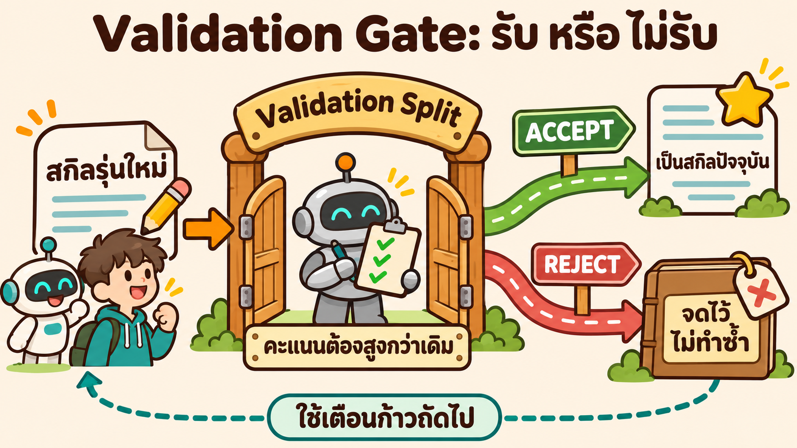

| ลำดับ | เกิดอะไรขึ้น |
|---|---|
| 1 | โมเดลเป้าหมายตัวเดิมทำงานทุกชิ้นใน $D_{\text{sel}}$ ด้วย **สกิลรุ่นใหม่** |
| 2 | คิดคะแนนเฉลี่ย (ส่วนในของสมการ 2) |
| 3 | เทียบกับคะแนนของ **สกิลปัจจุบัน** |
| 4 | สูงกว่า → **ACCEPT** · เท่ากันหรือต่ำกว่า → **REJECT** |

**ตัวอย่างการตัดสิน 6 ก้าว** (ตัวเลขสมมติ)

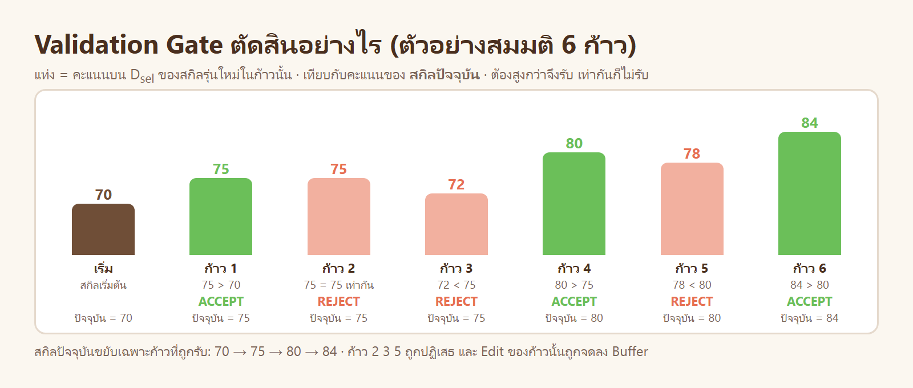

| ก้าว | คะแนนรุ่นใหม่ | คะแนนสกิลปัจจุบัน | ผล | สกิลปัจจุบันหลังก้าวนี้ |
|---|---|---|---|---|
| 1 | 75 | 70 | ACCEPT | 75 |
| 2 | 75 | 75 | REJECT (เท่ากัน) | 75 |
| 3 | 72 | 75 | REJECT | 75 |
| 4 | 80 | 75 | ACCEPT | 80 |
| 5 | 78 | 80 | REJECT | 80 |
| 6 | 84 | 80 | ACCEPT | 84 |

| ข้อสังเกต | ความหมาย |
|---|---|
| สกิลปัจจุบันไม่เคยแย่ลง | 70 → 75 → 80 → 84 · ก้าวที่ผิดไม่ถูกนำมาใช้ |
| เท่ากันก็ไม่รับ (ก้าว 2) | สกิลจะไม่ค่อย ๆ เปลี่ยนไปโดยไม่มีหลักฐานว่าดีขึ้น |
| ก้าวถัดไปเริ่มจากสกิลปัจจุบันเสมอ | ก้าว 3 เริ่มจากสกิลที่ได้ 75 ไม่ใช่จากรุ่นที่ถูกปฏิเสธในก้าว 2 |

เปเปอร์เรียกวิธีนี้ว่า **propose-and-test** (เสนอแล้วทดสอบ) ต่างจากการปล่อยให้โมเดลแก้สกิลตัวเองโดยไม่มีใครตรวจ

**รุ่นที่ถูกปฏิเสธไปไหน: Rejected-Edit Buffer**

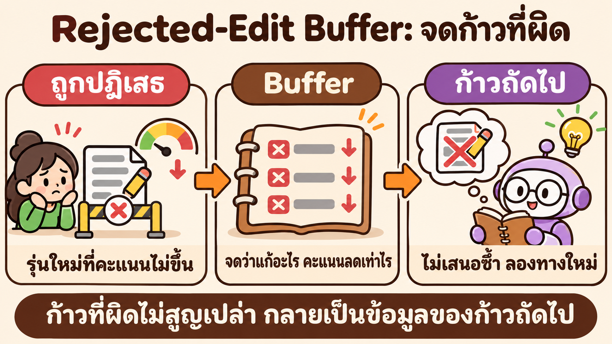

| หัวข้อ | รายละเอียด |
|---|---|
| จดอะไร | Edit ที่ลองในก้าวที่ถูกปฏิเสธ · คะแนนที่ลดลง · รูปแบบของข้อผิดที่พบ |
| ใครอ่าน | Optimizer Model ในก้าวถัดไป |
| ใช้ทำอะไร | ไม่เสนอ Edit ที่เคยไม่ได้ผลซ้ำ และหันไปแก้ข้อผิดที่ยังไม่หาย |
| อยู่นานแค่ไหน | ภายใน Epoch เดียวกัน · ขึ้น Epoch ใหม่แล้วล้าง |
| โมเดลเป้าหมายเห็นหรือไม่ | ไม่เห็น · ไม่ได้อยู่ในสกิลที่ส่งออก |
| เทียบกับการเทรนโมเดล | ไม่มีสิ่งที่เทียบได้ตรง ๆ ใกล้ที่สุดคือการจำว่าทิศไหนเคยทำให้ Loss เพิ่ม |

ใน LAB สิ่งที่ทำหน้าที่นี้คือ `ISSUES.md`: `v4` ถูกปฏิเสธ และถูกจดไว้ว่าการย่อทั้งไฟล์ทำให้วลี "อ่าน JSON จาก stdin" หาย · แบบฝึกหัดข้อ 4 ให้ทำ `v5` โดยอ่านบันทึกนี้ก่อน

## 6.4 Slow Update และ Meta Skill (ความจำข้าม Epoch)

ก้าวปกติเรียนจากกลุ่มงานปัจจุบัน ส่วนนี้เรียนจากการเทียบ **ข้าม Epoch** ทำหน้าที่คล้าย Momentum

| | Slow Update | Meta Skill |
|---|---|---|
| ทำเมื่อไร | ท้าย Epoch (ตั้งแต่ Epoch ที่ 2) | ท้าย Epoch (ตั้งแต่ Epoch ที่ 2) |
| ทำอะไร | ให้โมเดลทำงานชุดเดียวกันด้วยสกิลของ Epoch ก่อนและสกิลปัจจุบัน แล้วแบ่งเป็น ดีขึ้น · แย่ลง · ผิดซ้ำ · ถูกทั้งคู่ | สรุปว่า Edit แบบไหนได้ผล แบบไหนถูกปฏิเสธ ข้อผิดไหนยังไม่หาย |
| เขียนลงที่ไหน | ส่วนที่ถูกป้องกันในสกิล ซึ่งก้าวปกติแก้ไม่ได้ | ใส่ไว้หน้าพรอมต์ของ Optimizer Model เท่านั้น |
| โมเดลเป้าหมายเห็นหรือไม่ | เห็น (เป็นส่วนหนึ่งของสกิล) | **ไม่เห็น** ไม่ถูกส่งออกไปกับสกิล |
| ผ่าน Gate หรือไม่ | ต้องผ่าน | ไม่เกี่ยว (ไม่ได้แก้สกิล) |

---

# 7 · Algorithm 1

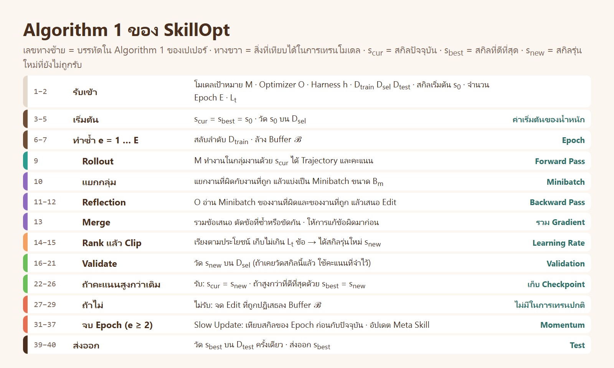

เลขทางซ้ายคือเลขบรรทัดใน Algorithm 1 ของเปเปอร์ (อยู่ในภาคผนวก) · ในภาพใช้ s<sub>new</sub> แทนสัญลักษณ์ $\tilde{s}$ ของเปเปอร์

**ค่าตั้งต้นในเปเปอร์**

| ค่า | สัญลักษณ์ | ค่าตั้งต้น | เทียบกับการเทรนโมเดล |
|---|---|---|---|
| จำนวน Epoch | $E$ | 4 | Epoch |
| ขนาด Rollout Batch | $B$ | 40 งานต่อก้าว | Batch Size |
| ขนาด Reflection Minibatch | $B_m$ | 8 | – |
| Learning Rate ของข้อความ | $L_t$ | 4 ลดแบบ Cosine เหลือ 2 | Learning Rate และ Schedule |
| กติกาของ Gate | – | คะแนนต้องสูงกว่าเดิม (เท่ากันไม่รับ) | Validation |
| Slow Update | – | เทียบ 20 งานต่อ Epoch | Momentum |
| รูปแบบการแก้ | – | Patch (แก้เฉพาะจุด) | – |

---

# 8 · ผลในเปเปอร์

**ผลหลัก** · โมเดล GPT-5.5 แบบ Direct Chat คะแนนบน Test Split (%)

| Benchmark | งานประเภท | ไม่มีสกิล | SkillOpt | เพิ่ม |
|---|---|---|---|---|
| SearchQA | ตอบคำถามจากการค้น | 77.7 | 87.3 | +9.6 |
| SpreadsheetBench | งานตารางคำนวณ | 41.8 | 80.7 | +38.9 |
| OfficeQA | ตอบคำถามจากเอกสาร | 33.1 | 72.1 | +39.0 |
| DocVQA | ตอบคำถามจากภาพเอกสาร | 78.8 | 91.2 | +12.4 |
| LiveMath | คณิตศาสตร์ | 37.6 | 66.9 | +29.3 |
| ALFWorld | สั่งงานในสภาพแวดล้อมจำลอง | 83.6 | 95.5 | +11.9 |
| **เฉลี่ย** | | | | **+23.5** |

เปเปอร์รายงานว่า SkillOpt ได้คะแนนดีที่สุดหรือเท่ากับดีที่สุดในทั้ง 52 การทดลอง (7 โมเดล · 6 Benchmark · 3 Harness) เมื่อเทียบกับสกิลที่คนเขียน สกิลที่ LLM เขียนครั้งเดียว และวิธีปรับอัตโนมัติอื่น

**ส่วนไหนสำคัญ (Ablation)** · ถอดออกทีละส่วนแล้ววัดใหม่ (Table 3 ของเปเปอร์)

| ถอดอะไรออก | SearchQA | SpreadsheetBench | LiveMath |
|---|---|---|---|
| ไม่ถอด (ค่าตั้งต้น) | 87.1 | 77.5 | 61.3 |
| ไม่จำกัด Learning Rate | 84.6 | 75.7 | 57.3 |
| ไม่มี Rejected-Edit Buffer | 85.5 | 72.9 | 58.9 |
| ไม่มี Meta Skill | 85.1 | 75.7 | 58.1 |
| ไม่มีทั้ง Meta Skill และ Slow Update | 86.3 | **55.0** | 59.7 |

| ข้อสรุปของเปเปอร์ | ความหมาย |
|---|---|
| ค่าตัวเลขที่แน่นอนไม่สำคัญมาก | เปลี่ยนขนาด Batch หรือค่า Learning Rate แล้วผลต่างกันไม่มาก |
| **การมีอยู่** ของแต่ละส่วนสำคัญ | ถอดการจำกัดก้าว การตรวจ ความจำของ Edit ที่ถูกปฏิเสธ หรือ Slow Update ออก ผลลดลงชัดเจน |
| สกิลย้ายที่ได้ | สกิลที่เทรนกับโมเดลหนึ่งหรือ Harness หนึ่ง ใช้กับอีกตัวแล้วยังดีกว่าไม่มีสกิล |

**ข้อจำกัดที่เปเปอร์ระบุ**

| ข้อจำกัด | ผล |
|---|---|
| ต้องมีตัวตรวจอัตโนมัติที่เชื่อถือได้ | งานที่ตัดสินด้วยความรู้สึก ต้องหาวิธีให้คะแนนก่อน |
| การเทรนมีต้นทุน | ต้องรันโมเดลหลายรอบ คุ้มเมื่อสกิลถูกใช้ซ้ำ |
| ปรับสกิลเดียว | งานที่หลากหลายมากอาจต้องใช้หลายสกิล |
| สกิลอาจจำลักษณะของข้อมูลฝึก | ก่อนย้ายไปใช้กับงานที่ต่างออกไปมาก ต้องวัดใหม่ |

---

# 9 · เทียบกับ LAB ของบทนี้

LAB `money-coder` ใน [README หลัก](../README.md) ใช้แนวคิดเดียวกับเปเปอร์ ในขนาดที่เล็กลงและมีคนกำกับ

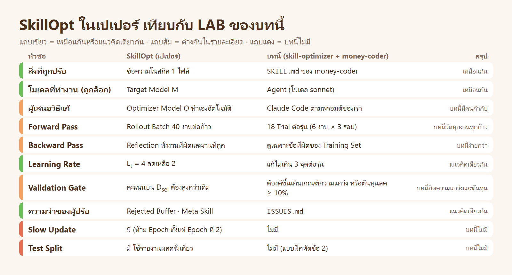

**ผลจริงของ LAB อ่านด้วยภาษาของเปเปอร์**

| รุ่นใน LAB | คะแนนรวม | Gate | ในภาพภูมิประเทศ (ข้อ 4) |
|---|---|---|---|
| ไม่มีสกิล | 45.6% | – | จุดเริ่มต้นบนเนิน |
| `v0` | 70.6% | ACCEPT | ก้าวที่ 1 ลงเนิน |
| `v1` | 96.7% | ACCEPT | ก้าวที่ 2 |
| `v2` | 100.0% | ACCEPT | ก้าวที่ 3 ถึงหุบเขา |
| `v3` | 100.0% | ACCEPT | ความสูงเท่าเดิม ต้นทุนลด 17% |
| `v4` | 91.7% | **REJECT** | ก้าวที่ถูกปฏิเสธ = "ก้าวที่ผิด" ในภาพ 4.2 |

`v4` คือตัวอย่างของสิ่งที่เปเปอร์เตือน: ย่อสกิล **ทั้งไฟล์** ในครั้งเดียวเป็นก้าวที่ใหญ่ วลีสำคัญหายไป 1 วลี คะแนนจึงลด · Gate จับได้ และเหตุผลถูกจดลง `ISSUES.md` ซึ่งทำหน้าที่เดียวกับ Rejected-Edit Buffer

**สิ่งที่ LAB ทำต่างจากเปเปอร์ และเหตุผล**

| LAB ทำอะไร | ต่างจากเปเปอร์อย่างไร | ทำไม |
|---|---|---|
| ประตูรับคิด **ความแกว่งของการวัด** | เปเปอร์รับเมื่อคะแนนสูงกว่าเดิมโดยไม่มีเกณฑ์ขั้นต่ำ | LAB มีงานแค่ 6 งาน ผลต่างเล็ก ๆ อาจเป็นความบังเอิญ |
| ประตูรับดูคะแนน Training ด้วย | เปเปอร์ดูเฉพาะ $D_{\text{sel}}$ | กันการแก้ที่ทำของเดิมพัง |
| รับรุ่นที่คะแนนเท่าเดิมแต่ **ต้นทุนลด** | เปเปอร์ไม่รับเมื่อคะแนนเท่ากัน | LAB ต้องการแสดงว่าปรับสกิลให้ถูกลงได้ด้วย |
| ไม่มี Test Split | เปเปอร์มี $D_{\text{test}}$ | เป็นแบบฝึกหัดข้อ 2 ของ README หลัก |

**ถัดไป:** กลับไปที่ [README หลัก ส่วนที่ 3](../README.md#3--ลงมือทำ-copy--paste) เพื่อลงมือทำ หรืออ่าน [ข้างใน skill-optimizer](../inside_skill_optimizer/README.md)

---

**อ้างอิง**

Yang, Y., Gong, Z., Huang, W., Yang, Q., Zhou, Z., Huang, Z., Li, Y., Gao, X., Dai, Q., Liu, B., และคณะ (2026). *SkillOpt: Executive Strategy for Self-Evolving Agent Skills.* arXiv:2605.23904.

ตัวเลขและคำอธิบายของข้อ 2–8 เรียบเรียงจากเปเปอร์ฉบับ arXiv (อ่านเมื่อ 13 พ.ย. 2026) · ข้อ 1 และข้อ 9 เป็นคำอธิบายของบทเรียนนี้เอง
