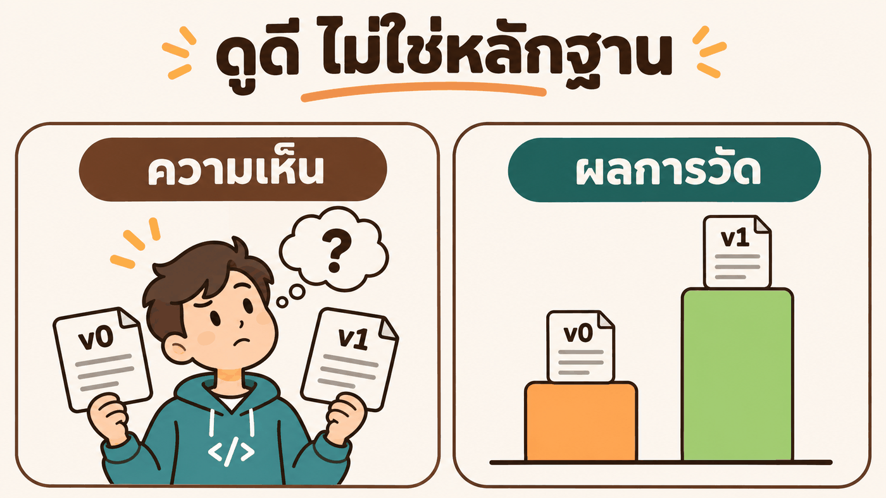
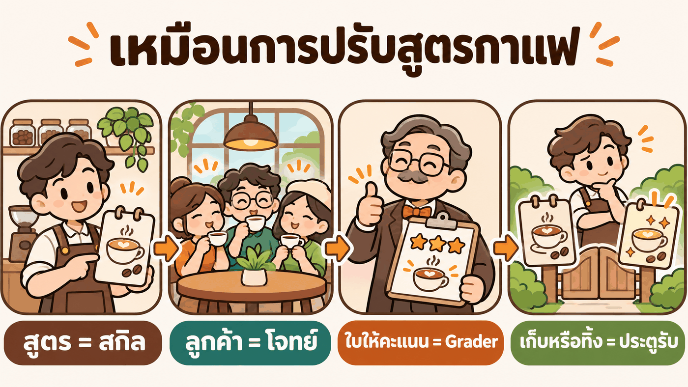
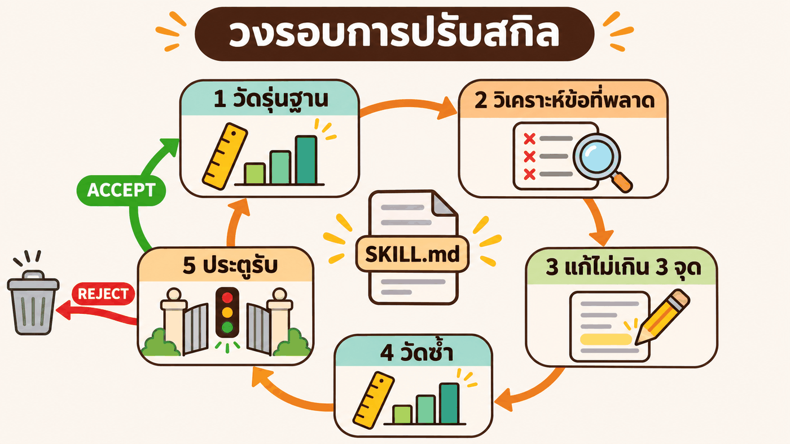
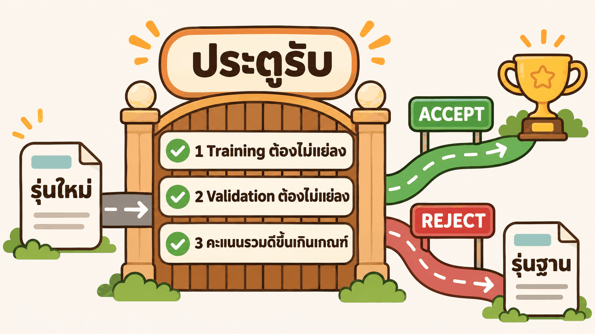
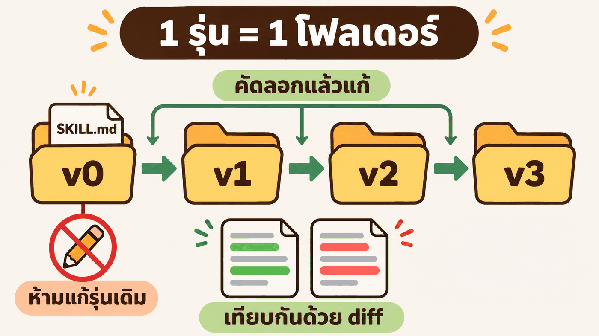
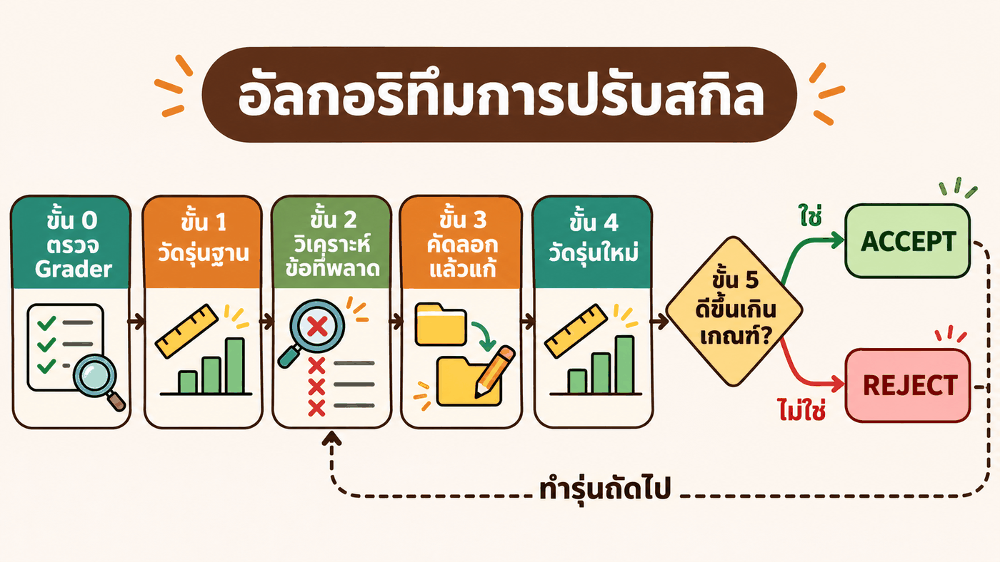
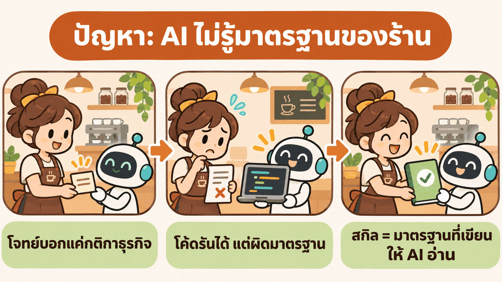
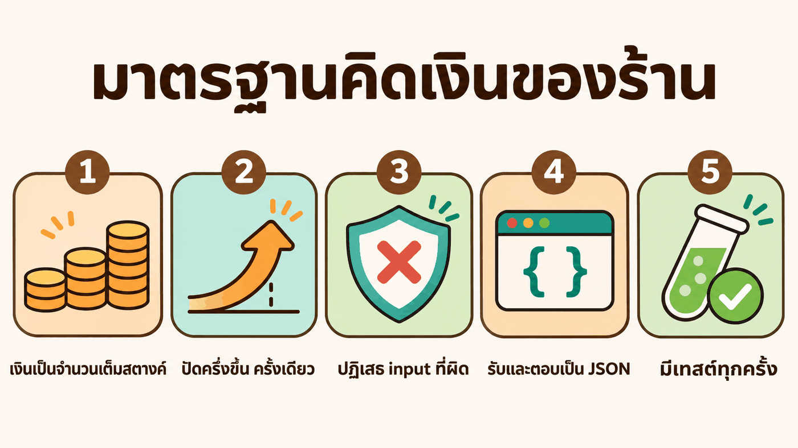
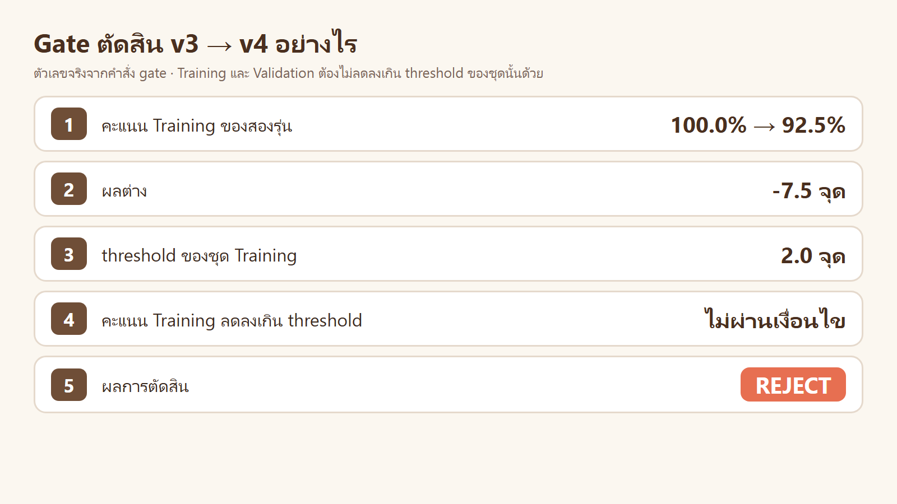

# Skill Optimizer ฉบับเริ่มต้น · ปรับสกิลเขียนโค้ดคิดเงิน ทีละรุ่น


> เขียนสกิลเสร็จแล้ว รู้ได้อย่างไรว่าสกิล **ดีจริง** และรุ่นใหม่ **ดีกว่า** รุ่นเก่า
> บทนี้สร้างสกิล `money-coder` ในโฟลเดอร์นี้ แล้วใช้ `skill-optimizer` ปรับจาก `v0` ถึง `v3` และทดลอง `v4` ที่ถูกปฏิเสธ โดยให้ **ผลการวัด** เป็นผู้ตัดสิน


| ส่วน | อ่านจบแล้วได้อะไร |
|---|---|
| [1 · ทฤษฎี](#1--ทฤษฎี) | เข้าใจแนวคิดทีละขั้น จนถึงอัลกอริทึมทั้งหมด |
| [2 · โจทย์](#2--โจทย์) | รู้ว่าสกิลนี้แก้ปัญหาอะไร และวัดอย่างไร |
| [3 · ลงมือทำ](#3--ลงมือทำ-copy--paste) | พรอมต์ Copy & Paste 6 ขั้น พร้อมผลจริงของทุกรุ่น |
| [4 · สรุปและแบบฝึกหัด](#4--สรุปและแบบฝึกหัด) | บทเรียนจากผลจริง และโจทย์ให้ลองต่อ |

ตัวเลขทุกตัวมาจากการรันจริงเมื่อ 12–13 พ.ย. 2026 · ผลดิบอยู่ใน [`results/`](results/)

---

# 1 · ทฤษฎี

## 1.1 ปัญหา: สกิลที่ "ดูดี" ยังไม่ใช่หลักฐาน



อ่านสกิล 2 รุ่นแล้วบอกไม่ได้ว่ารุ่นไหนดีกว่า ต้อง **วัด** ด้วยโจทย์จริง

## 1.2 แนวคิด: เหมือนการปรับสูตรกาแฟ



| ร้านกาแฟ | Skill Optimization |
|---|---|
| สูตรกาแฟ | **สกิล** (`SKILL.md`) |
| ลูกค้าหลายคนชิม | **โจทย์** หลายข้อ (Task Suite) |
| ใบให้คะแนน | **Grader** โปรแกรมให้คะแนน 0–100% |
| เก็บสูตรใหม่หรือทิ้ง | **ประตูรับ** (Acceptance Gate) |

## 1.3 วงรอบ 5 ขั้น



**Skill Optimization** = ทำวงรอบนี้ซ้ำ รุ่นละ 1 รอบ · รุ่นที่ไม่ผ่านประตูรับถูกทิ้ง

## 1.4 การวัด 1 ครั้ง (1 Trial)


- Agent ได้โจทย์กับสกิล แล้วเขียนโค้ดเอง
- Grader ตรวจ **ผลงาน** ไม่ได้ตรวจคำตอบที่ Agent พูด
- โจทย์เดิมรันซ้ำ 3 ครั้ง (Replicate) เพราะ AI ตอบไม่เหมือนเดิมทุกครั้ง

## 1.5 แบ่งโจทย์เป็น 2 ชุด


- แก้สกิลจากข้อที่พลาดของ **Training Set** เท่านั้น
- **Validation Set** ใช้ตัดสินอย่างเดียว ถ้า Training ขึ้นแต่ Validation ไม่ขึ้น = สกิลจำโจทย์ (**Overfitting**)

## 1.6 ความแกว่งของการวัด (Measurement Noise)


สกิลเดิม โจทย์เดิม ยังได้คะแนนต่างกัน ผลต่างที่เล็กกว่าความแกว่งจึงยังไม่ใช่หลักฐาน

```text
threshold = ค่าที่มากกว่าระหว่าง 2 จุด กับ 1.5 × Standard Error ของผลต่าง
```

## 1.7 ประตูรับ (Acceptance Gate)



| ข้อ | เงื่อนไข |
|---|---|
| 1 | คะแนน Training ไม่ลดลงเกิน threshold |
| 2 | คะแนน Validation ไม่ลดลงเกิน threshold |
| 3 | คะแนนรวมดีขึ้นเกิน threshold **หรือ** คะแนนเท่าเดิมแต่ต้นทุนลดลงอย่างน้อย 10% |

ผ่านครบ = **ACCEPT** รุ่นใหม่เป็นรุ่นฐาน · ไม่ครบ = **REJECT** ใช้รุ่นฐานเดิม

## 1.8 แก้อะไรก่อน


- สคริปต์ตรวจให้เอง ดีกว่ากติกาที่ต้องให้ AI จำ
- กติกาที่ตรวจได้ (ระบุค่า รูปแบบ คำสั่ง) ดีกว่าคำแนะนำกว้าง ๆ
- แก้ไม่เกิน 3 จุดต่อรุ่น จะได้รู้ว่าจุดไหนได้ผล

## 1.9 สกิล 1 รุ่น = 1 โฟลเดอร์



ทุกรุ่นอยู่ใน [`skills/money-coder/`](skills/money-coder/) ของบทนี้ ไม่ใช้สกิล global จึงเปิดเทียบกันได้ทันที

## 1.10 อัลกอริทึมทั้งหมด



```text
ขั้น 0  ตรวจ Grader          เฉลยต้องได้เต็ม · งานที่จงใจผิด 1 จุด ต้องตกเฉพาะข้อนั้น
ขั้น 1  วัดรุ่นฐาน            ทุกโจทย์ × 3 รอบ
ทำซ้ำ:
  ขั้น 2  วิเคราะห์ข้อที่พลาด   เฉพาะ Training Set → จดลง ISSUES.md
  ขั้น 3  คัดลอกแล้วแก้        โฟลเดอร์ใหม่ · ไม่เกิน 3 จุด
  ขั้น 4  วัดรุ่นใหม่           โจทย์ รอบ โมเดล เหมือนรุ่นฐานทุกค่า
  ขั้น 5  ประตูรับ             ACCEPT → รุ่นใหม่เป็นรุ่นฐาน · REJECT → ทิ้งรุ่นใหม่
จนกว่า  ไม่มีข้อที่พลาดซ้ำ หรือคะแนนไม่ขึ้นแล้ว
```

---

# 2 · โจทย์

## 2.1 ปัญหาคืออะไร

ร้านกาแฟ **BaanKafe** ให้ AI เขียนฟังก์ชัน Python สำหรับคิดเงิน โจทย์แต่ละข้อบอกแค่ **กติกาของธุรกิจ** (ลดกี่เปอร์เซ็นต์ บวกภาษีเท่าไร)



AI เขียนโค้ดที่รันได้ทุกครั้ง แต่ร้านใช้ไม่ได้ เพราะ AI ไม่รู้ **มาตรฐานของร้าน** ตัวอย่างจริงจาก Trial ที่ไม่มีสกิล (ฟังก์ชัน `cashback`)

| เรียกฟังก์ชัน | ร้านต้องการ | โค้ดของ AI (ไม่มีสกิล) | ผิดเพราะ |
|---|---|---|---|
| `cashback(10020, "gold", False)` | `251` | `250` | เงินคืน 250.5 สตางค์ ร้านปัดขึ้น แต่โค้ดปัดลง |
| `cashback(-5, "gold", False)` | `ValueError` | `0` | ยอดติดลบไม่ถูกปฏิเสธ |
| `cashback(20000.0, "gold", False)` | `ValueError` | `500.0` | รับ float แล้วคืน float |

สกิล `money-coder` = ที่เขียนมาตรฐานของร้านให้ AI อ่านก่อนเขียนโค้ด · คำถามของบทนี้: **เขียนสกิลอย่างไร AI จึงทำตามมาตรฐานได้ครบทุกครั้ง**

## 2.2 ฟังก์ชันที่ใช้ทดลอง 6 ตัว


เงินทุกค่าเป็น **สตางค์** (100 สตางค์ = 1 บาท)

| ชุด | ฟังก์ชัน | คิดอะไร | ตัวอย่าง |
|---|---|---|---|
| Training | `cafe_bill(items, member)` | บิลหน้าร้าน: ส่วนลด 5% เมื่อครบ 500 บาท · สมาชิกลด 10% · VAT 7% | ลาเต้ 45 บาท 2 แก้ว → `9630` (96.30 บาท) |
| Training | `split_bill(total, people, tip_percent)` | หารบิลบวกทิป เศษสตางค์ให้คนแรก ๆ | 100 บาท 3 คน → `[3334, 3333, 3333]` |
| Training | `shipping_fee(weight_g, distance_km, express)` | ค่าส่งตามช่วงน้ำหนัก · ไกลเกิน 100 กม. +20% · ด่วน +50% | 3 กก. 150 กม. → `9600` (96 บาท) |
| Training | `cashback(amount, tier, birthday)` | เงินคืนสมาชิก 1.5–4% · เดือนเกิด 2 เท่า · สูงสุด 200 บาท | ซื้อ 200 บาท ระดับ gold → `500` (5 บาท) |
| Validation | `parking_fee(minutes, member)` | ค่าจอดรถรายชั่วโมง · 30 นาทีแรกฟรี · สมาชิกลด 15% · VAT 7% | จอด 2 ชม. → `5350` (53.50 บาท) |
| Validation | `net_pay(hours, rate, has_sso)` | ค่าแรงรายสัปดาห์ · OT 1.5 เท่า · หักภาษี 3% · หักประกันสังคม 5% | 40 ชม. ชม.ละ 100 บาท → `368000` (3,680 บาท) |

ทั้ง 6 ตัวเป็นงานแบบเดียวกัน (คิดเงิน) แต่คนละสูตร สกิลที่ดีต้องใช้ได้กับทุกตัว รวมถึง 2 ตัวใน Validation Set ที่ไม่เคยถูกใช้ตอนแก้สกิล

<details><summary>ตัวอย่างโจทย์ที่ Agent ได้รับ 1 ข้อ (<code>cafe_bill</code>)</summary>

```text
ร้านกาแฟ BaanKafe ต้องการฟังก์ชัน cafe_bill(items, member) ในไฟล์ solve.py สำหรับคิดเงินหน้าร้าน
- items = list ของ dict {"price": ราคาต่อชิ้น (สตางค์), "qty": จำนวนชิ้น (ตั้งแต่ 1)}
- ยอดรวมตั้งแต่ 500 บาทขึ้นไป ลด 5%
- member = True ลดอีก 10%
- บวก VAT 7% เป็นขั้นสุดท้าย
- คืนยอดที่ลูกค้าต้องจ่าย เป็นจำนวนเต็มสตางค์
```

โจทย์ทั้ง 6 ข้อ: [`suite/suite.json`](suite/suite.json)

</details>

## 2.3 มาตรฐานของร้าน และวิธีให้คะแนน

มาตรฐาน 5 ข้อนี้อยู่ในหัวของทีม ไม่อยู่ในโจทย์ AI ไม่มีทางรู้ถ้าสกิลไม่บอก



Grader ([`suite/grade.py`](suite/grade.py)) เรียกฟังก์ชันที่ Agent เขียนด้วย input ที่ซ่อนไว้ แล้วตรวจมาตรฐานนี้เป็น **10 ข้อ** ต่อ 1 Trial · คะแนน = จำนวนข้อที่ผ่าน ÷ 10

| มาตรฐาน | ข้อตรวจ | ตรวจอะไร |
|---|---|---|
| 1 เงินเป็นจำนวนเต็มสตางค์ | `contract` `basic` `boundary` | มีฟังก์ชัน คืน `int` · กรณีปกติถูก · ค่าขอบถูก |
| 2 ปัดครึ่งขึ้น ครั้งเดียว | `half_up` `no_drift` | ลงท้าย .5 สตางค์ต้องปัดขึ้น · ไม่ปัดระหว่างทาง |
| 3 ปฏิเสธ input ที่ผิด | `reject_value` `reject_type` | ค่าเกินช่วง และชนิดผิด (float str bool) ต้อง `ValueError` |
| 4 รับและตอบเป็น JSON | `cli_ok` `cli_error` | `{"ok": true, "result": …}` · ผิดต้อง `{"ok": false, …}` และ exit 2 |
| 5 มีเทสต์ทุกครั้ง | `tests` | `test_solve.py` อย่างน้อย 6 เทสต์ รันผ่าน |

---

# 3 · ลงมือทำ (Copy & Paste)

**วิธีใช้:** เปิดโฟลเดอร์ `Teaching` ใน Claude Code Desktop → คัดลอกพรอมต์ → วาง → รอผล
ต้องมี container `multi-account` และบัญชี `yolo` ที่ล็อกอินแล้วอย่างน้อย 1 บัญชี

| โฟลเดอร์นี้ (บนเครื่อง) | container |
|---|---|
| เก็บทุกอย่าง: สกิลทุกรุ่น ชุดโจทย์ ผลการวัด | ใช้รันอย่างเดียว (`/workspace/sklab`) |

กติกาที่ Claude ต้องทำตามอยู่ใน [`AGENT.md`](AGENT.md) พรอมต์จึงสั้น

| LAB | ทำอะไร | Trial | เวลาจริง |
|---|---|---|---|
| [0](#lab-0--เตรียม) | ส่งไฟล์เข้า container ตรวจ Grader | – | 1 นาที |
| [1](#lab-1--วัดรุ่นฐาน-v0) | วัด `v0` และวัดแบบไม่มีสกิล | 36 | 2 นาที |
| [2](#lab-2--สร้าง-v1) | วิเคราะห์ข้อที่พลาด สร้าง `v1` | 18 | 5 นาที |
| [3](#lab-3--สร้าง-v2) | สร้าง `v2` | 18 | 6 นาที |
| [4](#lab-4--ลอง-v3-ที่ถูกลง) | ลอง `v3` ที่ถูกลง | 18 | 7 นาที |
| [5](#lab-5--ทดลอง-รุ่นที่สั้นและดูดี-v4) | ทดลองรุ่นที่สั้นและดูดี `v4` | 18 | 4 นาที |

## LAB 0 · เตรียม

```text
อ่าน ./03_week03/05_Skill_Optimizer_Basic/AGENT.md แล้วทำตาม
เตรียม LAB: ส่งไฟล์เข้า container · ตรวจ Grader ด้วย suite/check_grader.py · ตรวจว่าบัญชี yolo ใดล็อกอินแล้ว
ยังไม่ต้องวัดอะไร · ตอบเป็นตาราง รายการ | ผล
```

ผลจริง

| รายการ | ผล |
|---|---|
| ส่งไฟล์เข้า container | ✅ `skill-optimizer` `suite` `skills/money-coder` อยู่ใน `/workspace/sklab` |
| Grader กับเฉลยอ้างอิง | ✅ ผ่าน 10/10 ทั้ง 6 โจทย์ |
| Grader กับเฉลยที่จงใจใส่ความผิด 1 จุด | ✅ ไม่ผ่านเฉพาะข้อนั้น (`half_up` · `reject_type` · `cli_error`) |
| บัญชี | ✅ `yolo1` `yolo2` `yolo3` · ❌ `yolo4` `yolo5` ยังไม่ล็อกอิน |

👀 ตรวจ Grader ก่อนเสมอ ถ้าเครื่องวัดผิด ตัวเลขหลังจากนี้ใช้ไม่ได้ทั้งหมด

## LAB 1 · วัดรุ่นฐาน (v0)

สกิลรุ่นแรก เขียนจากความจำใน 5 นาที ([`v0/SKILL.md`](skills/money-coder/v0/SKILL.md))

```markdown
- เงินทุกค่าเป็นจำนวนเต็มสตางค์ ห้ามใช้ float
- ปัดเศษสตางค์ให้ถูกต้อง
- ตรวจ input ทุกตัว ถ้าผิดให้แจ้ง error
- ต้องเรียกใช้จาก command line ได้ รับ JSON และตอบเป็น JSON
- เขียนเทสต์มาด้วยทุกครั้ง
```

```text
อ่าน ./03_week03/05_Skill_Optimizer_Basic/AGENT.md แล้วทำตาม
วัดสกิล money-coder รุ่น v0 และวัดแบบไม่มีสกิล (รวม 36 Trial)
ตอบ: ตาราง report · ความแกว่งของ v0 (null) · ผล gate ไม่มีสกิล → v0
```

ผลจริง ([report.md](results/report.md) · [gate](results/gate-noskill-v0.txt))

| รุ่น | Training | Validation | รวม | ผ่านครบ 10 ข้อ |
|---|---|---|---|---|
| ไม่มีสกิล | 48.3% | 40.0% | **45.6%** | 0/18 |
| `v0` | 71.7% | 68.3% | **70.6%** | 0/18 |

```text
รวม: 45.6% → 70.6% (+25.0) · เกณฑ์ 2.0 จุด
ผล: ACCEPT ✅ รับ v0 แทน noskill
```

👀 สกิล 5 บรรทัดช่วยได้ +25 จุด แต่ยังไม่มี Trial ไหนผ่านครบ 10 ข้อ

## LAB 2 · สร้าง v1

```text
อ่าน ./03_week03/05_Skill_Optimizer_Basic/AGENT.md แล้วทำตาม
ดูข้อที่พลาดของ v0 เฉพาะ Training Set แล้วเปิด Trace และโค้ดของ Trial ที่พลาด หาสาเหตุที่พบมากกว่า 1 Trial เขียน skills/money-coder/ISSUES.md
แล้วสร้าง v1 จาก v0 แก้ไม่เกิน 3 จุด · วัด v1 · รัน gate v0 → v1
ตอบ: ตารางปัญหา | พบกี่ Trial | สาเหตุ · จุดที่แก้ใน v1 · ตาราง report (noskill,v0,v1) · ผล gate
```

ผลจริง: สาเหตุที่ Claude พบจาก Trace ([ISSUES.md](skills/money-coder/ISSUES.md) · [failures-v0.txt](results/failures-v0.txt))

| ปัญหา | พบ | กติกาใน `v0` ที่กว้างเกินไป |
|---|---|---|
| CLI ตอบคนละรูปแบบ เช่น `{"total": …}` `{"cashback": …}` | 12/12 | "รับ JSON และตอบเป็น JSON" |
| เทสต์ไม่ครบ หรือรันด้วย unittest ไม่ได้ | 5/12 | "เขียนเทสต์มาด้วยทุกครั้ง" |
| รับ float หรือ raise `TypeError` | 4/12 | "ถ้าผิดให้แจ้ง error" |
| ปัดเศษทุกขั้น คลาด 1 สตางค์ | 1/12 | พบ Trial เดียว ยังไม่แก้ |

`v1` แทนกติกากว้าง 3 ข้อ ด้วย **กติกาที่ตรวจได้** ([`v1/SKILL.md`](skills/money-coder/v1/SKILL.md))

| จุด | `v0` | `v1` |
|---|---|---|
| 1 | ถ้าผิดให้แจ้ง error | ผิดชนิดหรือผิดช่วง → `raise ValueError` เท่านั้น · ไม่รับ `float` `bool` `str` `None` |
| 2 | รับ JSON และตอบเป็น JSON | สำเร็จ `{"ok": true, "result": …}` exit 0 · ผิด `{"ok": false, "error": "…"}` exit 2 |
| 3 | เขียนเทสต์มาด้วย | `unittest.TestCase` อย่างน้อย 6 เทสต์ และ `python3 -m unittest -q` ต้องผ่าน |

```text
train: 71.7% → 100.0% (+28.3) · เกณฑ์ 2.0 จุด
val: 68.3% → 90.0% (+21.7) · เกณฑ์ 2.5 จุด
รวม: 70.6% → 96.7% (+26.1) · เกณฑ์ 2.0 จุด
ผล: ACCEPT ✅ รับ v1 แทน v0
```


👀 Training เต็ม 100% แต่ Validation ได้ 90% → ยังมีปัญหาที่ Training Set มองไม่เห็น

## LAB 3 · สร้าง v2

```text
อ่าน ./03_week03/05_Skill_Optimizer_Basic/AGENT.md แล้วทำตาม
ทำรุ่นถัดไปของสกิล money-coder (v2) จากรุ่นฐานล่าสุด โดยดู 3 อย่าง: ข้อที่พลาดของรุ่นฐานเฉพาะ Training Set · ปัญหาที่ยังเปิดใน ISSUES.md · กติกาในสกิลที่ยังกว้างจนตรวจไม่ได้
แก้ไม่เกิน 3 จุด · วัด v2 · รัน gate v1 → v2 · อัปเดต ISSUES.md
ตอบ: จุดที่แก้ใน v2 และเหตุผล · ตาราง report ทุกรุ่น · ผล gate
```

ผลจริง: Training ไม่มีข้อที่พลาดแล้ว Claude จึงแก้กติกาที่ยังกว้าง 2 ข้อ ([`v2/SKILL.md`](skills/money-coder/v2/SKILL.md))

| จุด | `v1` | `v2` |
|---|---|---|
| 1 | ปัดเศษสตางค์ให้ถูกต้อง | ปัดครั้งเดียวที่ขั้นสุดท้าย แบบครึ่งปัดขึ้น · ขั้นก่อนหน้าเก็บเป็นเศษส่วน ห้ามปัดทีละขั้น |
| 2 | ห้ามใช้ float | ในโค้ดห้ามมี `float` `round(` เลขทศนิยม และการหารด้วย `/` |

```text
train: 100.0% → 100.0% (+0.0) · เกณฑ์ 2.0 จุด
val: 90.0% → 100.0% (+10.0) · เกณฑ์ 2.0 จุด
รวม: 96.7% → 100.0% (+3.3) · เกณฑ์ 2.0 จุด
ผล: ACCEPT ✅ รับ v2 แทน v1
```

👀 ส่วนที่ดีขึ้นมาจาก Validation ทั้งหมด = กติกาใหม่ใช้ได้กับโจทย์ที่ไม่เคยเห็น (**Generalization**)

## LAB 4 · ลอง v3 ที่ถูกลง

คะแนนเต็มแล้ว ยังปรับได้อีกทางหนึ่งคือ **ต้นทุน** (เงื่อนไขข้อ 3 ของประตูรับ)

```text
อ่าน ./03_week03/05_Skill_Optimizer_Basic/AGENT.md แล้วทำตาม
รุ่นฐานของสกิล money-coder ได้คะแนนเต็มแล้ว ลองทำ v3 ที่ถูกลง: ลดโทเคนขาเข้า (context_tokens) อย่างน้อย 10% โดยคะแนนไม่ลด
เปิด Trace ของ Training Set ดูว่า Agent ใช้คำสั่งไปกับอะไร แล้วแก้ไม่เกิน 3 จุด · วัด v3 · รัน gate v2 → v3 · อัปเดต ISSUES.md
ถ้า REJECT ให้ใช้ v2 ต่อ ห้ามแก้ Grader หรือโจทย์ และห้ามวัดซ้ำเพื่อให้ผ่าน
ตอบ: จุดที่แก้ใน v3 และเหตุผล · ตาราง report ทุกรุ่น · ผล gate
```

ผลจริง: Claude นับจาก Trace ว่า Agent เสียคำสั่งไปกับอะไร แล้วแก้ 2 จุด ([`v3/SKILL.md`](skills/money-coder/v3/SKILL.md))

| สิ่งที่พบใน Trace ของ `v2` | พบ | จุดที่แก้ใน `v3` |
|---|---|---|
| เรียกเครื่องมือผิดชื่อ ต้องส่งคำสั่งเดิมซ้ำ | 4/12 | เขียนโค้ด เขียนเทสต์ รันเทสต์ ในคำสั่งเดียว แล้วตอบทันที |
| คิดค่าที่คาดหวังในเทสต์ผิด ต้องแก้แล้วรันใหม่ | 1/12 | เทสต์ที่มีการปัดเศษ ใช้ input ที่ผลเป็นจำนวนเต็มหรือ .5 พอดี |

```text
รวม: 100.0% → 100.0% (+0.0) · เกณฑ์ 2.0 จุด
  ✓ คะแนนเท่าเดิม และโทเคนขาเข้าลดลงอย่างน้อย 10% [128,725 → 106,704 (-17%)]
ผล: ACCEPT ✅ รับ v3 แทน v2
```


👀 คำสั่งต่อ Trial ลดจาก 3.4 เหลือ 2.7 สกิลยาวขึ้นแต่ต้นทุนรวมลดลง เพราะ Agent ทำงานน้อยรอบลง

## LAB 5 · ทดลอง: รุ่นที่สั้นและดูดี (v4)

สกิลยาวขึ้นทุกรุ่น ถ้าย่อให้สั้นและอ่านง่าย จะดีขึ้นหรือไม่ ให้ประตูรับตัดสิน

```text
อ่าน ./03_week03/05_Skill_Optimizer_Basic/AGENT.md แล้วทำตาม
ทดลอง: สร้าง v4 จากรุ่นฐานของสกิล money-coder โดยย่อ SKILL.md ให้สั้นและอ่านง่าย กติกาละ 1 บรรทัด ไม่เกิน 60 ตัวอักษร (การย่อทั้งไฟล์นับเป็น 1 จุด ไม่แก้อย่างอื่น)
วัด v4 · รัน gate v3 → v4 · อัปเดต ISSUES.md
ถ้า REJECT ให้ใช้รุ่นฐานต่อ ห้ามแก้ v4 เพิ่ม และห้ามวัดซ้ำเพื่อให้ผ่าน
ตอบ: SKILL.md ของ v4 · ตาราง report ทุกรุ่น · ผล gate · ข้อตรวจของ Training Set ที่เปลี่ยนไป
```

ผลจริง: `v4` อ่านง่ายกว่าทุกรุ่น ([`v4/SKILL.md`](skills/money-coder/v4/SKILL.md))

```markdown
- เงินเป็น `int` สตางค์ ห้าม `float` `round(` ทศนิยม และ `/`
- ปัด half-up ครั้งเดียวตอนท้าย ห้ามปัดทีละขั้น
- input ผิด → `ValueError` เท่านั้น ไม่รับ float bool str
- CLI {"ok":true,"result":…} / {"ok":false,"error":…} exit 2
- เทสต์ `unittest` อย่างน้อย 6 เมธอด `test_*` ต้องรันผ่าน
- เขียนโค้ด เทสต์ รันเทสต์ ใน `Bash` ครั้งเดียว แล้วตอบ
```

```text
train: 100.0% → 92.5% (-7.5) · เกณฑ์ 2.0 จุด
  ✗ คะแนนชุด train ลดลงเกิน 2.0 จุด → การแก้ไม่ได้ผล
val: 100.0% → 90.0% (-10.0) · เกณฑ์ 2.0 จุด
  ✗ คะแนนชุด val ลดลงเกิน 2.0 จุด
ผล: REJECT ❌ ไม่รับ v4 แทน v3
```



👀 ตอนย่อ คำว่า "อ่าน JSON จาก stdin" หายไป 1 วลี → `cli_ok` เหลือ 3/12 เพราะ Agent รับค่าทาง argument แทน · โทเคนก็ไม่ลด (106,704 → 117,405) → รุ่นที่ใช้ต่อคือ **`v3`**

---

# 4 · สรุปและแบบฝึกหัด

## 4.1 ผลของทุกรุ่น


| รุ่น | แก้อะไร | รวม | โทเคนต่อ Trial | Gate |
|---|---|---|---|---|
| ไม่มีสกิล | – | 45.6% | 82,727 | – |
| `v0` | ร่างแรก 5 บรรทัด | 70.6% | 120,976 | ACCEPT |
| `v1` | กติกากว้าง 3 ข้อ → กติกาที่ตรวจได้ | 96.7% | 127,192 | ACCEPT |
| `v2` | กติกาปัดเศษและ float ให้ตรวจได้ | 100.0% | 128,725 | ACCEPT |
| `v3` | ลดจำนวนคำสั่งที่ Agent ใช้ | 100.0% | 106,704 | **ACCEPT** (ต้นทุน −17%) |
| `v4` | ย่อให้สั้น | 91.7% | 117,405 | REJECT |

รวม 108 Trial · โมเดล sonnet / effort medium · ราคาตามรายการรวม $10.77 (ไม่ใช่ยอดจ่ายจริงของบัญชีแบบ subscription)

## 4.2 สิ่งที่ผลจริงสอน

| ผล | บทเรียน |
|---|---|
| ไม่มีสกิล 45.6% | AI เขียนโค้ดรันได้ แต่ไม่รู้มาตรฐานของทีม |
| `v0` → `v1` +26.1 จุด | กติกากว้าง ("ตอบเป็น JSON") ทำให้ AI เดาต่างกันทุกครั้ง · กติกาที่ตรวจได้แก้ได้ทันที |
| `v1` Training 100% แต่ Validation 90% | Training Set เต็มแล้วไม่ได้แปลว่าสกิลสมบูรณ์ |
| `v2` Validation ขึ้นเป็น 100% | แก้ที่ **สาเหตุ** (กติกาปัดเศษกว้าง) โจทย์ที่ไม่เคยเห็นจึงดีขึ้นด้วย |
| `v3` คะแนนเท่าเดิม ต้นทุน −17% | ปรับสกิลได้ 2 ทาง: ถูกขึ้น หรือ ถูกลง |
| `v4` REJECT | สกิลที่สั้นและดูดี ทำคะแนนลด · ถ้าไม่วัดจะไม่รู้ |

<details><summary>เปิดซอง Validation Set หลังตัดสินครบทุกรุ่น: <code>v1</code> พลาดอะไร</summary>

`v1` พลาดที่ `net_pay` ทั้ง 3 รอบ ([validation-unsealed.txt](results/validation-unsealed.txt)) เพราะปัดเศษ 3 ครั้ง (ค่าแรงรวม ภาษี ประกันสังคม) แทนที่จะปัดครั้งเดียว

```text
✗ half_up:  net_pay(41, 5100, false) คาด 205301 ได้ 205300
✗ no_drift: net_pay(38, 5005, true)  คาด 174975 ได้ 174974
```

เป็นสาเหตุเดียวกับปัญหาที่ Training Set เคยพบ 1 Trial ใน `v0` (ปัดเศษทุกขั้น) ซึ่ง `v2` แก้โดยไม่ต้องเปิดซองนี้

</details>

<details><summary>โค้ดที่ AI เขียนจริง: ไม่มีสกิล เทียบกับ <code>v3</code> (ฟังก์ชัน <code>cashback</code>)</summary>

ไม่มีสกิล · ผ่าน 3/10 ([ไฟล์](results/runs/noskill/t4-cashback-r1/sandbox/solve.py))

```python
def cashback(amount, tier, birthday):
    if tier not in RATES_PER_MILLE:
        raise ValueError(f"unknown tier: {tier!r}")
    if amount < MIN_AMOUNT:
        return 0
    rate = RATES_PER_MILLE[tier] * (2 if birthday else 1)
    result = amount * rate // 1000  # integer math, rounds down
    return min(result, MAX_CASHBACK)
```

`v3` · ผ่าน 10/10 ([ไฟล์](results/runs/v3/t4-cashback-r1/sandbox/solve.py)) มีการตรวจ input ปัดครึ่งขึ้น CLI และเทสต์ครบ

</details>

## 4.3 แบบฝึกหัด

| # | โจทย์ | ได้ฝึกอะไร |
|---|---|---|
| 1 | เพิ่มโจทย์ Training ข้อที่ 5 (เช่น คิดค่าปรับคืนของช้า) ใน `suite/` พร้อมเฉลยใน `suite/ref/` แล้วรัน `check_grader.py` | สร้าง Task และตรวจ Grader |
| 2 | เพิ่มโจทย์ `"split": "test"` 1 ข้อ แล้ววัด `v3` ครั้งเดียว | ยืนยันด้วย Test Set |
| 3 | วัด `v0` และ `v3` ใหม่ด้วย `--model haiku` | ผลผูกกับโมเดลที่ใช้วัด |
| 4 | ทำ `v5` จาก `v3`: ย่อให้สั้นลงโดยคะแนนไม่ลด (ดูจาก `ISSUES.md` ว่า `v4` พลาดเพราะอะไร) | ใช้ Issue Log กันการลองซ้ำ |
| 5 | เขียนสกิลของตัวเอง 1 ตัว พร้อมโจทย์ 4 + 2 ข้อ แล้วปรับ 2 รุ่น | ทำทั้งวงรอบเอง |

## 4.4 ข้อจำกัด

| ข้อจำกัด | ผล |
|---|---|
| โจทย์ 6 ข้อ และ Training เต็ม 100% ตั้งแต่ `v1` | ความแกว่งที่วัดได้เป็น 0 และ Training Set ชี้ปัญหาใหม่ไม่ได้ ควรเพิ่มโจทย์ที่ยากขึ้น |
| Validation Set ถูกใช้ตัดสิน 5 ครั้ง | คำตอบค่อย ๆ รั่วเข้าการตัดสินใจ ควรยืนยันด้วย Test Set (แบบฝึกหัดข้อ 2) |
| Gate ไม่คิดความแกว่งของต้นทุน | −17% ของ `v3` มีส่วนที่เป็นความบังเอิญได้ (การเรียกเครื่องมือผิดชื่อเกิดแบบสุ่ม) |
| Grader ตรวจเฉพาะ 10 ข้อ | คุณภาพด้านอื่น เช่น โค้ดอ่านง่าย ไม่ถูกวัด |

## 4.5 ไฟล์ในโฟลเดอร์นี้

| ที่อยู่ | คืออะไร |
|---|---|
| [`skills/money-coder/`](skills/money-coder/) | สกิล 5 รุ่น `v0`–`v4` และ [`ISSUES.md`](skills/money-coder/ISSUES.md) |
| [`suite/`](suite/) | โจทย์ 6 ข้อ · Grader · เฉลยอ้างอิง (`ref/`) · `check_grader.py` |
| [`results/`](results/) | ผลจริง: `report.md` · `gate-*.txt` · `failures-*.txt` · โค้ดที่ Agent เขียนทุก Trial (`runs/`) |
| [`tools/`](tools/) | `push.sh` ส่งไฟล์เข้า container · `pull.sh` ดึงผลลงเครื่อง · `charts.py` วาดกราฟ |
| [`AGENT.md`](AGENT.md) | กติกาของ LAB ที่ Claude อ่านก่อนทำทุกพรอมต์ |

LAB 0 2 3 4 5 รันผ่าน Claude ด้วยพรอมต์ตามตัวอักษร · LAB 1 ผู้สอนรันคำสั่งชุดเดียวกันโดยตรง

**ถัดไป:** [Skill Optimization กับสกิลตรวจและแก้เว็บ](../03_Skill_Optimization/README.md) ใช้วิธีเดียวกันกับงานที่ยากขึ้น
