# Skill Optimizer ฉบับเริ่มต้น · สอน AI ให้เขียนโค้ดถูกกฎของร้าน


# 1 · โจทย์และกฎของร้าน

## 1.1 โจทย์

| | |
|---|---|
| **สถานการณ์** | ร้านกาแฟ BaanKafe ให้ AI เขียนโค้ดคิดเงินแทนคน มี 6 งาน งานละ 1 ฟังก์ชัน |
| **ปัญหา** | โค้ดที่ AI เขียนรันได้ แต่ **ผิดกฎของร้าน** เพราะกฎส่วนหนึ่งไม่ได้เขียนไว้ในโจทย์ AI จึงไม่รู้ |
| **งานของเรา** | เขียน **สกิล** (คู่มือกฎ) ให้ AI อ่านก่อนเขียนโค้ด แล้วปรับสกิลจนโค้ดถูกกฎครบทุกครั้ง |

<p>
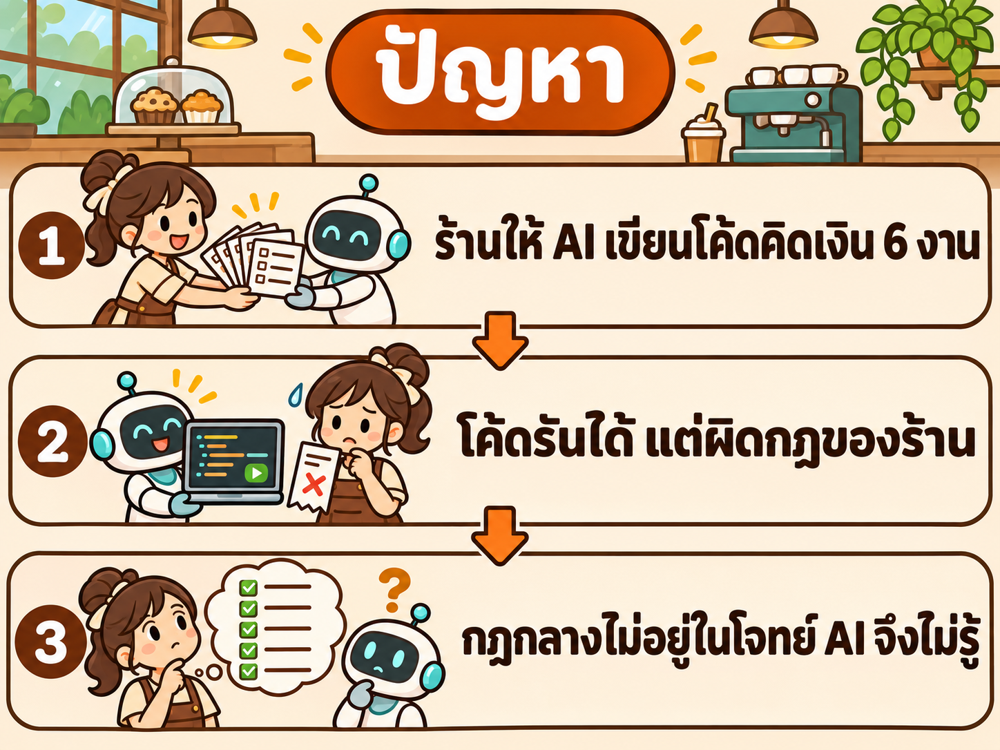
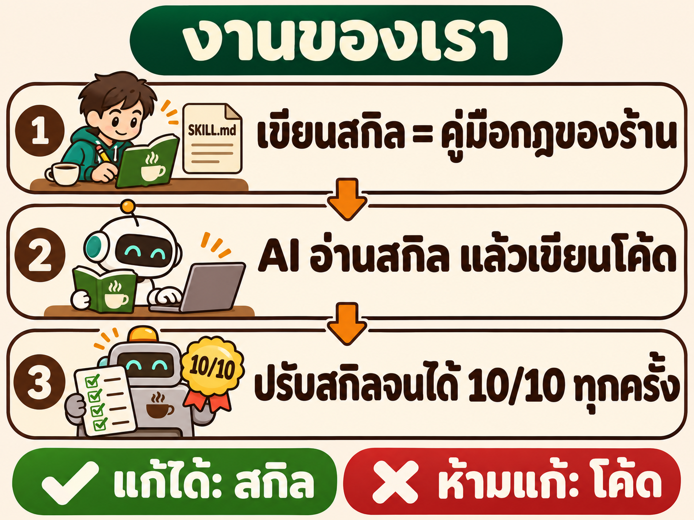
</p>

**งานคิดเงิน 6 งาน** · AI เขียนงานละ 1 ฟังก์ชัน ในไฟล์ `solve.py`

| # | งาน | ฟังก์ชัน | คิดอะไร | ใช้ทำอะไรในบทนี้ |
|---|---|---|---|---|
| 1 | บิลหน้าร้าน | `cafe_bill` | ยอดบิลหลังหักส่วนลด แล้วบวก VAT 7% | หาข้อผิดเพื่อปรับสกิล |
| 2 | หารบิล | `split_bill` | เงินที่แต่ละคนต้องจ่าย เมื่อหารบิลกันและบวกทิป | หาข้อผิดเพื่อปรับสกิล |
| 3 | ค่าส่งของ | `shipping_fee` | ค่าส่งตามน้ำหนัก ระยะทาง และแบบด่วน | หาข้อผิดเพื่อปรับสกิล |
| 4 | เงินคืนสมาชิก | `cashback` | เงินคืนตามระดับบัตรสมาชิก และเดือนเกิด | หาข้อผิดเพื่อปรับสกิล |
| 5 | ค่าจอดรถ | `parking_fee` | ค่าจอดรายชั่วโมง ส่วนลดสมาชิก และ VAT | เก็บไว้ทดสอบ ไม่เปิดดูตอนปรับ |
| 6 | ค่าแรงรายสัปดาห์ | `net_pay` | ค่าแรงรวม OT หลังหักภาษีและประกันสังคม | เก็บไว้ทดสอบ ไม่เปิดดูตอนปรับ |

ตัวอย่าง Input → Output ของทุกงานอยู่ในข้อ 1.8

**คำที่ใช้ตลอดบท**

| คำ | ความหมาย |
|---|---|
| **สกิล** (`SKILL.md`) | ไฟล์ข้อความ 1 ไฟล์ เขียนกฎของร้านเป็นภาษาคน AI อ่านก่อนเขียนโค้ดทุกครั้ง · สกิลของบทนี้ชื่อ `money-coder` |
| **รุ่น** | แก้สกิล 1 ครั้ง ได้สกิลรุ่นใหม่ 1 รุ่น ชื่อ `v0` `v1` `v2` … |
| **Agent** | AI ตัวที่เขียนโค้ด · ได้โจทย์ 1 ข้อกับสกิล แล้วเขียน `solve.py` เอง |
| **ตัวตรวจ** (Grader) | โปรแกรมที่รันโค้ดของ Agent แล้วตรวจ 10 ข้อ · คะแนน = จำนวนข้อที่ผ่าน ÷ 10 |
| **Trial** | Agent เขียนโค้ด 1 ครั้ง และตัวตรวจให้คะแนน 1 ครั้ง |

**กติกาของโจทย์**

| ทำได้ | ห้ามทำ |
|---|---|
| แก้ `SKILL.md` | แก้โค้ดที่ Agent เขียน |
| ให้ Claude Code ช่วยหาสาเหตุและเสนอจุดแก้ในสกิล | แก้โจทย์ หรือแก้ตัวตรวจ |
| เปิดดูข้อที่ผิดของงาน 1–4 | เปิดดูข้อที่ผิดของงาน 5–6 (ดูได้แค่คะแนนรวม) |

- **ทำไมห้ามแก้โค้ด:** แก้โค้ดได้ผลกับงานนั้นงานเดียว · แก้สกิลได้ผลกับทุกงานที่ AI จะเขียนต่อไป
- **เป้าหมาย:** ทุกงานได้ 10/10 ทุกครั้งที่ให้ Agent เขียน

## 1.2 กฎของร้าน

ร้านมีกฎ 2 ชั้น โค้ดคิดเงินทุกตัวต้องทำตามทั้งสองชั้น


| ชั้น | คืออะไร | เขียนอยู่ที่ไหน | AI เห็นหรือไม่ |
|---|---|---|---|
| **กฎเฉพาะของงาน** | สูตรของงานนั้น เช่น เงินคืนกี่เปอร์เซ็นต์ | ในโจทย์แต่ละข้อ | เห็นทุกครั้ง |
| **กฎกลางของร้าน** 5 ข้อ | วิธีเขียนโค้ดคิดเงินที่ใช้กับ **ทุกงาน** | ทีมรู้กันเอง ไม่ได้เขียนไว้ในโจทย์ | **ไม่เห็น** ถ้าสกิลไม่บอก |

**กฎกลางของร้าน 5 ข้อ**

| กฎ | ร้านกำหนดว่า | ทำไมต้องมี | ตัวอย่าง |
|---|---|---|---|
| **1 เงินเป็นจำนวนเต็มสตางค์** | เงินทุกค่าที่รับเข้าและคืนออก เป็นจำนวนเต็ม หน่วยสตางค์ ไม่ใช้เลขทศนิยม | คอมพิวเตอร์เก็บเลขทศนิยมไม่พอดี (`0.1 + 0.2` ได้ `0.30000000000000004`) เงินจะเพี้ยนทีละสตางค์ | 45 บาท เขียนว่า `4500` ไม่ใช่ `45.0` |
| **2 ปัดครึ่งขึ้น ครั้งเดียว** | ถ้าผลมีเศษของสตางค์ ให้ปัดเป็นจำนวนเต็ม เศษตั้งแต่ .5 ปัดขึ้น และปัด **ครั้งเดียวที่ผลสุดท้าย** | ทุกสาขาต้องได้ยอดเท่ากัน · ปัดหลายครั้งระหว่างทางทำให้ผลเพี้ยน | 250.5 → `251` · 150.3 × 2 = 300.6 → `301` (ไม่ใช่ 150 × 2 = `300`) |
| **3 ปฏิเสธข้อมูลที่ผิด** | ถ้า Input ผิดชนิด (เลขทศนิยม ข้อความ) หรืออยู่นอกช่วงที่โจทย์กำหนด โค้ดต้องหยุดและแจ้ง `ValueError` ห้ามคิดเงินต่อ | คิดเงินจากข้อมูลที่ผิด = เก็บเงินลูกค้าผิด หยุดแล้วแจ้งปลอดภัยกว่า | ยอดซื้อ `-1` หรือ `20000.0` → `ValueError` |
| **4 ใช้เป็นโปรแกรมได้** | รัน `python3 solve.py` แล้วส่งข้อมูลเป็น JSON · สำเร็จตอบ `{"ok": true, "result": ค่า}` · ข้อมูลผิดตอบ `{"ok": false, "error": "ข้อความ"}` และจบด้วย exit code 2 | เครื่องคิดเงินของร้านเรียกโค้ดทุกตัวด้วยวิธีนี้ จึงต้องตอบรูปแบบเดียวกันทุกตัว | `{"ok": true, "result": 500}` |
| **5 มีเทสต์มาด้วย** | ส่งไฟล์ `test_solve.py` มาพร้อมโค้ด มีอย่างน้อย 6 เทสต์ รวมกรณีข้อมูลผิด และรันผ่าน | คนที่มาแก้โค้ดทีหลังรู้ได้ทันทีว่าทำของเดิมพังหรือไม่ | `python3 -m unittest -q test_solve` → `OK` |

**หลักฐานว่ากฎกลางคือปัญหา** · ผลจริงเมื่อ Agent ไม่มีสกิล (งาน 1–4 รวม 12 Trial)

| กฎ | Agent เห็นกฎนี้หรือไม่ | ข้อตรวจที่ผ่าน |
|---|---|---|
| กฎเฉพาะของงาน | เห็น (อยู่ในโจทย์) | สูตรพื้นฐาน 12/12 · ค่าขอบเขต 12/12 |
| กฎกลาง 2 ปัดครึ่งขึ้น ครั้งเดียว | ไม่เห็น | 9/12 |
| กฎกลาง 3 ปฏิเสธข้อมูลที่ผิด | ไม่เห็น | ค่านอกช่วง 4/12 · ผิดชนิด 0/12 |
| กฎกลาง 4 ใช้เป็นโปรแกรมได้ | ไม่เห็น | 0/12 |
| กฎกลาง 5 มีเทสต์มาด้วย | ไม่เห็น | 0/12 |

กฎที่ Agent เห็น ทำถูกทุกครั้ง · กฎที่ไม่เห็น ต้องเดาเอง จึงผิด → สกิล `money-coder` มีหน้าที่เดียว: **เขียนกฎกลาง 5 ข้อให้ Agent อ่าน**

ตัวตรวจเปลี่ยนกฎทั้งสองชั้นเป็น **ข้อตรวจ 10 ข้อ** (ข้อ 1.7) คะแนน 10/10 จึงแปลว่าโค้ดถูกทั้งกฎเฉพาะและกฎกลาง

## 1.3 วิธีทำ และผลจริง

เราไม่รู้ล่วงหน้าว่าเขียนสกิลแบบไหน Agent จึงจะทำตาม จึงต้อง **ทดลองเป็นรอบ**: แก้สกิล ให้ Agent เขียนจริง แล้ววัด

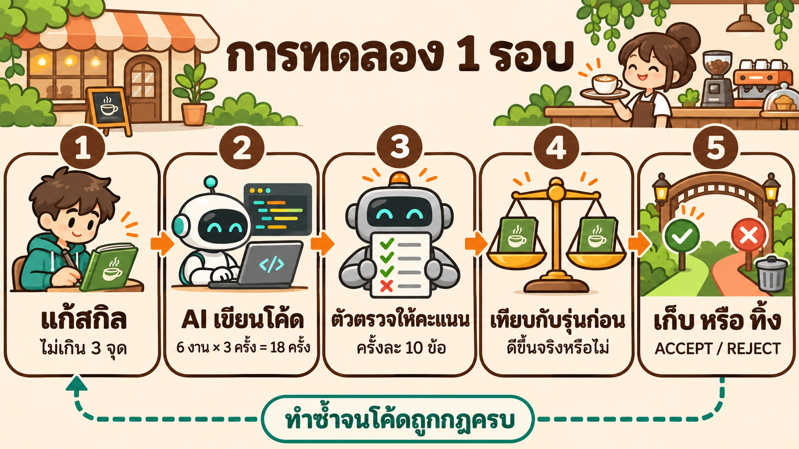

| ขั้น | ทำอะไร | รายละเอียด |
|---|---|---|
| 1 แก้สกิล | คัดลอกรุ่นก่อนเป็นรุ่นใหม่ แล้วแก้ | แก้ไม่เกิน 3 จุด จะได้รู้ว่าจุดไหนได้ผล |
| 2 Agent เขียนโค้ด | 6 งาน × 3 ครั้ง = **18 Trial** | ทำงานเดิมซ้ำ 3 ครั้ง เพราะ AI เขียนไม่เหมือนเดิมทุกครั้ง |
| 3 ตัวตรวจให้คะแนน | Trial ละ 10 ข้อ | คะแนนของรุ่น = ค่าเฉลี่ยของ 18 Trial เป็นเปอร์เซ็นต์ |
| 4 เทียบกับรุ่นก่อน | รุ่นใหม่ดีขึ้นจริงหรือไม่ | ผลต่างต้องมากกว่าความแกว่งของการวัด (ข้อ 2.7) |
| 5 เก็บ หรือ ทิ้ง | ดีขึ้นจริง → **ACCEPT** ใช้รุ่นใหม่ต่อ | ไม่ดีขึ้น → **REJECT** ทิ้งรุ่นใหม่ กลับไปใช้รุ่นก่อน (ข้อ 2.8) |

**ผลจริงของบทนี้** · วัดแบบไม่มีสกิล 1 ครั้ง แล้วทดลอง 5 รุ่น (`v0` ถึง `v4`) รวม 108 Trial

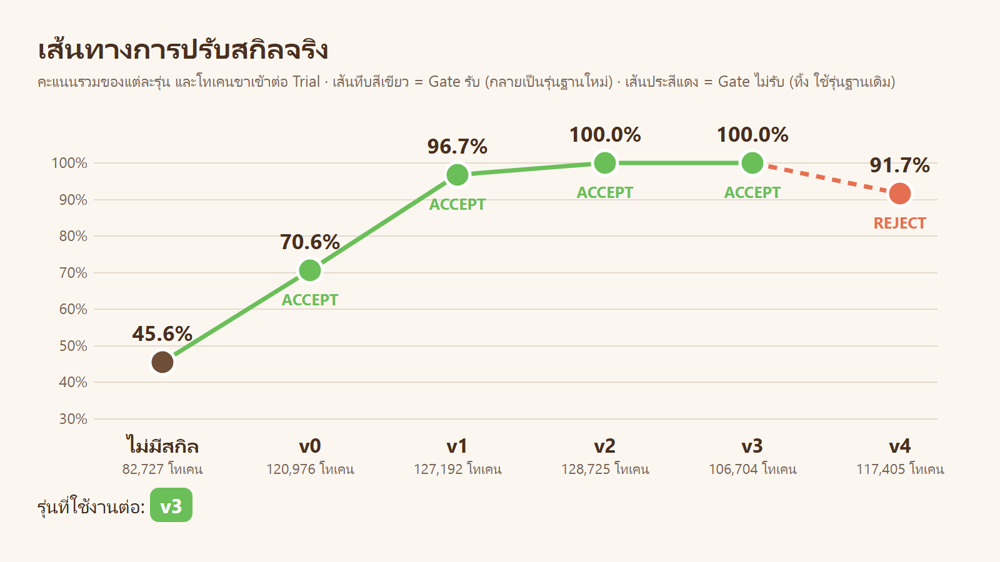

| อ่านกราฟ | ความหมาย |
|---|---|
| 1 จุด | สกิล 1 รุ่น |
| ตัวเลขเหนือจุด | คะแนนเฉลี่ยของรุ่นนั้น (18 Trial) |
| ตัวเลขใต้ชื่อรุ่น | โทเคนที่ Agent ใช้ต่อ Trial = ต้นทุน |
| เส้นทึบสีเขียว · ACCEPT | รุ่นนั้นถูกเก็บ |
| เส้นประสีแดง · REJECT | รุ่นนั้นถูกทิ้ง |

คะแนนขึ้นจาก 45.6% (ไม่มีสกิล) เป็น 100% ที่ `v2` · `v3` คะแนนเท่าเดิมแต่ใช้โทเคนน้อยลง จึงถูกเก็บ · `v4` คะแนนลด จึงถูกทิ้ง · รุ่นที่ใช้ต่อคือ **`v3`**

**อ่านต่อตามลำดับนี้**

| ส่วน | ตอบคำถาม |
|---|---|
| [1.4–1.9](#14-ตัวอย่างงาน-1-ชิ้น-ฟังก์ชัน-cashback) | ตัวอย่างงาน 1 ชิ้น · โค้ดแบบไหนถูก แบบไหนผิด · ใครเป็นคนตรวจ · งานทั้ง 6 ชิ้น |
| [2 · วิธีปรับสกิล](#2--วิธีปรับสกิล) | ปรับสกิลอย่างไร · รู้ได้อย่างไรว่ารุ่นใหม่ดีกว่าจริง |
| [เสริม · ข้างใน skill-optimizer](inside_skill_optimizer/README.md) | เครื่องมือที่ใช้ปรับสกิล ทำงานอย่างไร และสร้างอย่างไร |
| [3 · ลงมือทำ](#3--ลงมือทำ-copy--paste) | พรอมต์ Copy & Paste 6 ขั้น พร้อมผลจริงของทุกรุ่น |
| [4 · สรุปและแบบฝึกหัด](#4--สรุปและแบบฝึกหัด) | บทเรียนจากผลจริง และโจทย์ให้ลองต่อ |

ตัวเลขทุกตัวมาจากการรันจริงเมื่อ 12–13 พ.ย. 2026 · ผลดิบอยู่ใน [`results/`](results/)

## 1.4 ตัวอย่างงาน 1 ชิ้น: ฟังก์ชัน `cashback`

ข้อ 1.4–1.7 ใช้งานเดียวเป็นตัวอย่างตลอด คืองานที่ 4 **เงินคืนสมาชิก** เข้าใจงานนี้แล้ว อีก 5 งานอ่านแบบเดียวกัน

**ก · โจทย์ที่ Agent ได้รับ** (นี่คือกฎเฉพาะของงาน · ไม่มีกฎกลางอยู่ในนี้)

```text
ร้านกาแฟ BaanKafe ต้องการฟังก์ชัน cashback(amount, tier, birthday) ในไฟล์ solve.py สำหรับคิดเงินคืนสมาชิก
- amount = ยอดซื้อ (สตางค์ ตั้งแต่ 0) · tier = "silver" "gold" หรือ "platinum" · birthday = True คือซื้อในเดือนเกิด
- อัตราเงินคืน: silver 1.5% · gold 2.5% · platinum 4%
- ยอดซื้อต่ำกว่า 100 บาท ไม่ได้เงินคืน
- เดือนเกิด ได้เงินคืน 2 เท่า
- เงินคืนสูงสุด 200 บาทต่อบิล
- คืนเงินคืน เป็นจำนวนเต็มสตางค์
```

**ข · ฟังก์ชันรับอะไร คืนอะไร**

| ชื่อ | คืออะไร | ค่าที่ใส่ได้ | ตัวอย่าง |
|---|---|---|---|
| `amount` | ยอดซื้อของบิล หน่วยเป็นสตางค์ | จำนวนเต็มตั้งแต่ 0 | `20000` = 200 บาท |
| `tier` | ระดับบัตรสมาชิก ยิ่งสูงยิ่งได้เงินคืนมาก | `"silver"` · `"gold"` · `"platinum"` | `"gold"` |
| `birthday` | ลูกค้าซื้อในเดือนเกิดหรือไม่ | `True` = ใช่ · `False` = ไม่ใช่ | `False` |
| ค่าที่คืน | เงินคืนที่ลูกค้าได้ หน่วยเป็นสตางค์ | จำนวนเต็ม | `500` = 5 บาท |

เงินทุกค่าเป็น **สตางค์** (100 สตางค์ = 1 บาท) ตามกฎกลาง 1

**ค · ลองคิดด้วยมือ 5 กรณี**

| # | เรียกฟังก์ชัน | คิดอย่างไร | คำตอบที่ถูก | ต้องรู้กฎ |
|---|---|---|---|---|
| 1 | `cashback(20000, "gold", False)` | 200 บาท × 2.5% = 5 บาท | `500` | กฎเฉพาะ |
| 2 | `cashback(9999, "gold", False)` | 99.99 บาท ต่ำกว่า 100 บาท ไม่ได้เงินคืน | `0` | กฎเฉพาะ |
| 3 | `cashback(10020, "gold", False)` | 10020 × 2.5% = 250.5 สตางค์ → ปัดครึ่งขึ้น | `251` | **กฎกลาง 2** |
| 4 | `cashback(10020, "silver", True)` | 10020 × 1.5% = 150.3 → × 2 = 300.6 → ปัดครั้งเดียวตอนท้าย | `301` | **กฎกลาง 2** |
| 5 | `cashback(-1, "gold", False)` | ยอดซื้อติดลบ = ข้อมูลผิด ต้องปฏิเสธ | `ValueError` | **กฎกลาง 3** |

- กรณี 1–2 ตอบได้จากโจทย์อย่างเดียว
- กรณี 3–5 โจทย์ไม่ได้บอก ต้องรู้กฎกลาง · Agent ที่ไม่มีสกิลเดาเอง ตอบ `250` `300` และ `0` (ผลจริง)

## 1.5 Agent ต้องส่งอะไร

Agent ส่ง 2 ไฟล์ต่องาน

| ไฟล์ | ข้างในคือ | มาจากกฎ |
|---|---|---|
| `solve.py` | ฟังก์ชัน `cashback` และส่วนที่ทำให้รันเป็นโปรแกรมได้ | กฎเฉพาะ · กฎกลาง 1–4 |
| `test_solve.py` | เทสต์ของฟังก์ชันนั้น อย่างน้อย 6 เทสต์ | กฎกลาง 5 |

งานที่ถูกกฎ ใช้ได้ครบ 3 แบบ

| แบบ | ใช้อย่างไร | ใครใช้ |
|---|---|---|
| 1 เรียกจากโค้ด Python | `cashback(20000, "gold", False)` | โปรแกรมเมอร์ของร้าน |
| 2 รันเป็นโปรแกรม | ส่ง JSON เข้า ได้ JSON ออก (กฎกลาง 4) | เครื่องคิดเงินของร้าน |
| 3 รันเทสต์ | `python3 -m unittest` (กฎกลาง 5) | คนที่มาแก้โค้ดทีหลัง |

```text
แบบที่ 1
>>> cashback(20000, "gold", False)
500

แบบที่ 2
$ echo '{"amount": 20000, "tier": "gold", "birthday": false}' | python3 solve.py
{"ok": true, "result": 500}

แบบที่ 3
$ python3 -m unittest -q test_solve
Ran 12 tests ... OK
```

ผลข้างบนรันจากเฉลยอ้างอิง [`suite/ref/t4-cashback/`](suite/ref/t4-cashback/solve.py)

## 1.6 แบบไหนถูก แบบไหนผิด

ภาพนี้รวมทุกกรณีของ `cashback` · ช่อง "Output ที่ผิด" คือคำตอบที่ Agent เคยตอบจริง

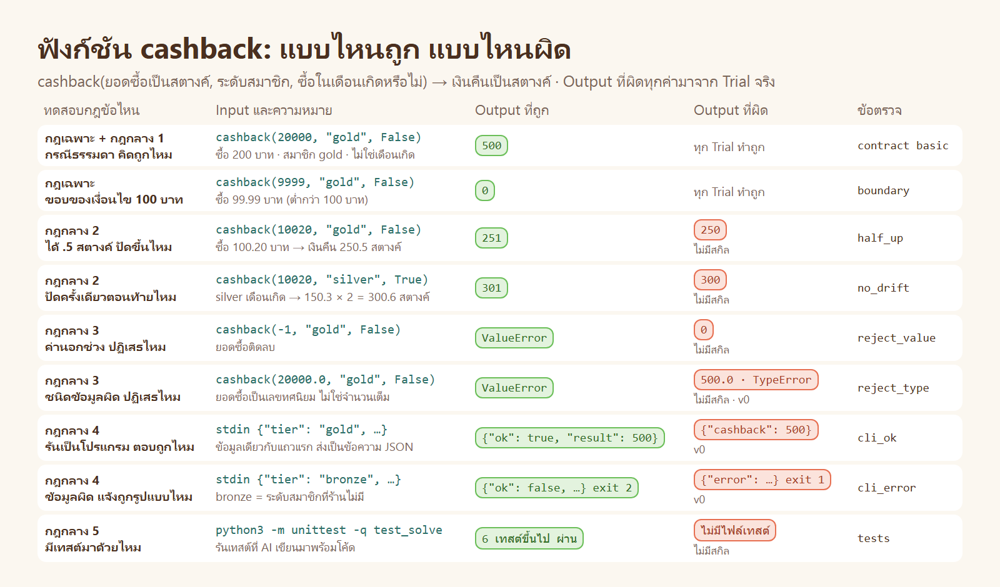

| คอลัมน์ในภาพ | ความหมาย |
|---|---|
| ทดสอบกฎข้อไหน | แถวนี้ตรวจกฎข้อใด |
| Input และความหมาย | ค่าที่ส่งให้ฟังก์ชัน และแปลเป็นภาษาคน |
| Output ที่ถูก | คำตอบตามกฎของร้าน |
| Output ที่ผิด | คำตอบผิดที่เกิดจริง · ป้ายใต้กล่องบอกว่าเกิดตอนไม่มีสกิล หรือตอนใช้ `v0` |
| ข้อตรวจ | ชื่อข้อตรวจของตัวตรวจที่จับความผิดนี้ (ข้อ 1.7) |

**คำที่ปรากฏในภาพ**

| คำ | ความหมาย |
|---|---|
| `ValueError` | วิธีที่โค้ด Python บอกว่า "ข้อมูลที่ส่งมาใช้ไม่ได้" แล้วหยุด ไม่คิดเงินต่อ |
| `TypeError` | error อีกชนิดหนึ่ง · กฎกลาง 3 ให้ใช้ `ValueError` ชนิดเดียว จึงนับว่าผิด |
| `"bronze"` | ระดับสมาชิกที่ร้านไม่มี ใช้ทดสอบว่าโปรแกรมทำอย่างไรเมื่อได้ข้อมูลผิด |
| stdin | ช่องรับข้อมูลของโปรแกรมเมื่อรันจาก command line · เครื่องคิดเงินส่งข้อมูลเข้าทางนี้ |
| JSON | รูปแบบข้อความที่โปรแกรมใช้ส่งข้อมูลให้กัน เช่น `{"amount": 20000, "tier": "gold", "birthday": false}` |
| `exit 2` | เลขที่โปรแกรมคืนตอนจบ: 0 = สำเร็จ · 2 = ข้อมูลที่ส่งมาผิด |

## 1.7 ใครเป็นคนตรวจ: ตัวตรวจ (Grader)

ไม่มีใครนั่งตรวจด้วยตา เราเขียนกฎของร้านเป็น **โปรแกรมตรวจ 1 ไฟล์** คือ [`suite/grade.py`](suite/grade.py) เขียนครั้งเดียว ใช้ตรวจทุกงานและทุกรุ่น

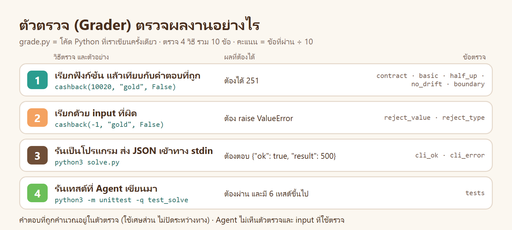

**ข้อตรวจ 10 ข้อ**

| # | ข้อตรวจ | ผ่านเมื่อ | ตรวจกฎ |
|---|---|---|---|
| 1 | `contract` | มีไฟล์ `solve.py` มีฟังก์ชันชื่อถูก และคืนค่าเป็นจำนวนเต็ม | กฎเฉพาะ · กฎกลาง 1 |
| 2 | `basic` | กรณีธรรมดา ได้คำตอบถูก | กฎเฉพาะ |
| 3 | `half_up` | ผลที่ลงท้าย .5 สตางค์ ถูกปัดขึ้น | กฎกลาง 2 |
| 4 | `no_drift` | คำนวณหลายขั้นแล้วไม่คลาดสักสตางค์ (ปัดครั้งเดียวตอนท้าย) | กฎกลาง 2 |
| 5 | `boundary` | ค่าที่อยู่ตรงขอบของเงื่อนไข ได้คำตอบถูก เช่น 99.99 บาท กับ 100 บาท | กฎเฉพาะ |
| 6 | `reject_value` | ค่านอกช่วง เช่น ยอดซื้อติดลบ ถูกปฏิเสธด้วย `ValueError` | กฎกลาง 3 |
| 7 | `reject_type` | ข้อมูลผิดชนิด เช่น เลขทศนิยม ถูกปฏิเสธด้วย `ValueError` | กฎกลาง 3 |
| 8 | `cli_ok` | รันเป็นโปรแกรม ข้อมูลถูก → ตอบ `{"ok": true, "result": …}` exit 0 | กฎกลาง 4 |
| 9 | `cli_error` | รันเป็นโปรแกรม ข้อมูลผิด → ตอบ `{"ok": false, "error": "…"}` exit 2 | กฎกลาง 4 |
| 10 | `tests` | มี `test_solve.py` อย่างน้อย 6 เทสต์ มีเทสต์ของข้อมูลผิด และรันผ่าน | กฎกลาง 5 |

- ข้อ 2–7 แต่ละข้อใช้ Input หลายชุด ต้องถูก **ทุกชุด** จึงผ่าน
- Agent ไม่เห็นตัวตรวจและไม่เห็น Input ที่ใช้ตรวจ
- **คะแนนของ 1 Trial = จำนวนข้อที่ผ่าน ÷ 10**

**ตัวอย่างผลตรวจจริง** · สกิล `v0` งาน `cashback` ได้ 7/10

```text
score 0.7
✓ contract  ✓ basic  ✓ half_up  ✓ no_drift  ✓ boundary  ✓ reject_value  ✓ tests
✗ reject_type: cashback(20000.0, "gold", false) ต้อง raise ValueError แต่ raise TypeError
✗ cli_ok:      ต้องได้ {"ok": true, "result": 500} แต่ได้ {"cashback": 500}
✗ cli_error:   ต้องได้ {"ok": false, "error": "..."} exit 2 แต่ได้ exit 1
```

| บรรทัด | อ่านว่า |
|---|---|
| `✓` 7 ข้อ | สูตร การปัดเศษ และเทสต์ ถูกแล้ว |
| `✗ reject_type` | ผิดกฎกลาง 3: ใช้ error ผิดชนิด |
| `✗ cli_ok` `✗ cli_error` | ผิดกฎกลาง 4: ตอบ JSON คนละรูปแบบ และ exit code ผิด |

ข้อความหลัง `✗` คือสิ่งที่เราใช้หาสาเหตุตอนปรับสกิล

<details><summary>ข้างในตัวตรวจมีอะไร (ย่อ)</summary>

ต่อ 1 งาน มี 2 ส่วน: **คำตอบที่ถูก** และ **Input ที่ซ่อนไว้**

```python
def o_cashback(amount, tier, birthday):        # คำตอบที่ถูก คำนวณด้วยเศษส่วน
    if amount < 10000:
        return 0
    x = amount * RATE[tier]
    if birthday:
        x *= 2
    return min(20000, half_up(x))              # ปัดครึ่งขึ้น ครั้งเดียว

TASKS = {"t4-cashback": {
    "half_up":   [[10020, "gold", False], ...],   # Input ของข้อตรวจ half_up
    "bad_value": [[-1, "gold", False], ...],      # Input ที่ต้องถูกปฏิเสธ
}}
```

| ส่วนของ `grade.py` | ทำอะไร |
|---|---|
| `o_cashback()` และฟังก์ชัน `o_…` อื่น | คำนวณคำตอบที่ถูกของแต่ละงาน |
| `run_cases()` | เรียกฟังก์ชันที่ Agent เขียนด้วย Input ที่ซ่อนไว้ |
| `cli()` | รันโค้ดของ Agent เป็นโปรแกรม แล้วอ่านคำตอบและ exit code |

ตัวตรวจเองก็ต้องถูกตรวจก่อนใช้ ด้วย [`suite/check_grader.py`](suite/check_grader.py) (LAB 0)

</details>

## 1.8 งานทั้ง 6 ชิ้น

อีก 5 งานอ่านแบบเดียวกับ `cashback`: **กฎเฉพาะต่างกัน** แต่ใช้ **กฎกลาง 5 ข้อ และข้อตรวจ 10 ข้อชุดเดียวกัน**

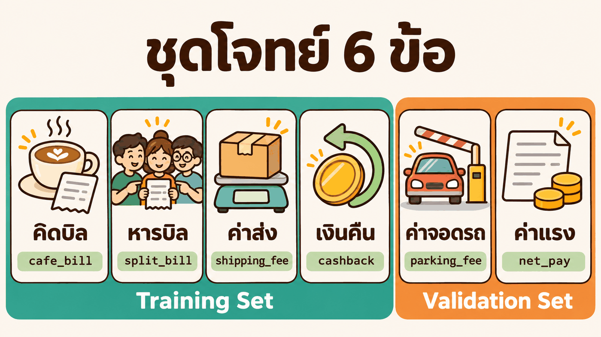

| # | ฟังก์ชัน | กฎเฉพาะ (ย่อ) | ตัวอย่าง | ชุด |
|---|---|---|---|---|
| 1 | `cafe_bill(items, member)` | บิลหน้าร้าน: ครบ 500 บาทลด 5% · สมาชิกลด 10% · VAT 7% | ลาเต้ 45 บาท 2 แก้ว → `9630` (96.30 บาท) | Training |
| 2 | `split_bill(total, people, tip_percent)` | หารบิลบวกทิป เศษสตางค์ให้คนแรก ๆ | 100 บาท 3 คน → `[3334, 3333, 3333]` | Training |
| 3 | `shipping_fee(weight_g, distance_km, express)` | ค่าส่งตามช่วงน้ำหนัก · ไกลเกิน 100 กม. +20% · ด่วน +50% | 3 กก. 150 กม. → `9600` (96 บาท) | Training |
| 4 | `cashback(amount, tier, birthday)` | เงินคืนสมาชิก 1.5–4% · เดือนเกิด 2 เท่า · สูงสุด 200 บาท | ซื้อ 200 บาท ระดับ gold → `500` (5 บาท) | Training |
| 5 | `parking_fee(minutes, member)` | ค่าจอดรถรายชั่วโมง · 30 นาทีแรกฟรี · สมาชิกลด 15% · VAT 7% | จอด 2 ชม. → `5350` (53.50 บาท) | Validation |
| 6 | `net_pay(hours, rate, has_sso)` | ค่าแรงรายสัปดาห์ · OT 1.5 เท่า · หักภาษี 3% · หักประกันสังคม 5% | 40 ชม. ชม.ละ 100 บาท → `368000` (3,680 บาท) | Validation |

| ชุด | งาน | ใช้ทำอะไร | เราเปิดดูอะไรได้ |
|---|---|---|---|
| **Training Set** | 1–4 | หาข้อที่ผิด เพื่อแก้สกิล | ทุกอย่าง: โค้ด ข้อที่ผิด และ Trace |
| **Validation Set** | 5–6 | ตัดสินว่าสกิลใช้ได้กับงานที่ไม่เคยเห็น | คะแนนรวมเท่านั้น |

ถ้าเปิดดูข้อที่ผิดของ Validation Set แล้วแก้สกิลตาม สกิลจะถูกปรับให้เข้ากับ 2 งานนี้ และเราจะไม่รู้อีกว่าสกิลใช้กับงานใหม่ได้หรือไม่ (ข้อ 2.6)

โจทย์เต็มทั้ง 6 ข้อ: [`suite/suite.json`](suite/suite.json)

## 1.9 สกิลรุ่นแรก (`v0`) ทำได้แค่ไหน

`v0` เขียนกฎกลางไว้สั้น ๆ ข้อละ 1 บรรทัด ผลจริงของ Training Set 12 Trial:

| กฎกลาง | `v0` เขียนว่า | Agent ทำอะไร | ผ่าน |
|---|---|---|---|
| 1 เงินเป็นจำนวนเต็มสตางค์ | "เงินทุกค่าเป็นจำนวนเต็มสตางค์ ห้ามใช้ float" | ทำตามได้ | 12/12 |
| 2 ปัดครึ่งขึ้น ครั้งเดียว | "ปัดเศษสตางค์ให้ถูกต้อง" | ส่วนใหญ่ถูก มี 1 ครั้งปัดทุกขั้น | 11/12 |
| 3 ปฏิเสธข้อมูลที่ผิด | "ถ้าผิดให้แจ้ง error" | บางครั้งใช้ `TypeError` บางครั้งรับเลขทศนิยม | 8/12 |
| 4 ใช้เป็นโปรแกรมได้ | "รับ JSON และตอบเป็น JSON" | เดารูปแบบเอง เช่น `{"cashback": 500}` | 0/12 |
| 5 มีเทสต์มาด้วย | "เขียนเทสต์มาด้วยทุกครั้ง" | บางครั้งมีแค่ 5 เทสต์ | 7/12 |

| สังเกต | ตัวอย่าง |
|---|---|
| กฎที่เขียน **ชัด** Agent ทำตามได้ | "ห้ามใช้ float" → 12/12 |
| กฎที่เขียน **กว้าง** Agent ต้องเดา และเดาไม่เหมือนกันทุกครั้ง | "ตอบเป็น JSON" ไม่ได้บอกว่า JSON หน้าตาแบบไหน → 0/12 |

**การปรับสกิล = เขียนกฎให้ชัดจน Agent ไม่ต้องเดา** แล้ววัดว่าโค้ดถูกกฎมากขึ้นจริง · วิธีทำอยู่ในส่วนที่ 2

---

# 2 · วิธีปรับสกิล

รู้กฎของร้านและวิธีตรวจแล้ว ส่วนนี้ตอบ 2 คำถาม: **ปรับสกิลอย่างไร** และ **รู้ได้อย่างไรว่ารุ่นใหม่ดีกว่าจริง**

เครื่องมือที่ใช้คือสกิล `skill-optimizer` · อยากรู้ว่าข้างในมีอะไร ทำงานอย่างไร และสร้างอย่างไร อ่าน [ข้างใน skill-optimizer](inside_skill_optimizer/README.md)

## 2.1 ทำไมต้องวัด


อ่านสกิล 2 รุ่นแล้วบอกไม่ได้ว่ารุ่นไหนทำให้โค้ดถูกกฎมากกว่า ต้อง **วัด** ด้วยงานจริง

## 2.2 เปรียบกับการปรับสูตรกาแฟ


| ร้านกาแฟ | บทนี้ |
|---|---|
| สูตรกาแฟ | **สกิล** (`SKILL.md`) |
| ลูกค้าหลายคนชิม | **งาน** 6 ชิ้น |
| ใบให้คะแนน | **ตัวตรวจ** ให้คะแนน 0–100% |
| เก็บสูตรใหม่หรือทิ้ง | **ประตูรับ** (Acceptance Gate) |

## 2.3 วงรอบ 5 ขั้น


**Skill Optimization** = ทำวงรอบนี้ซ้ำ รุ่นละ 1 รอบ · รุ่นที่ไม่ผ่านประตูรับถูกทิ้ง

## 2.4 การวัด 1 ครั้ง (1 Trial)

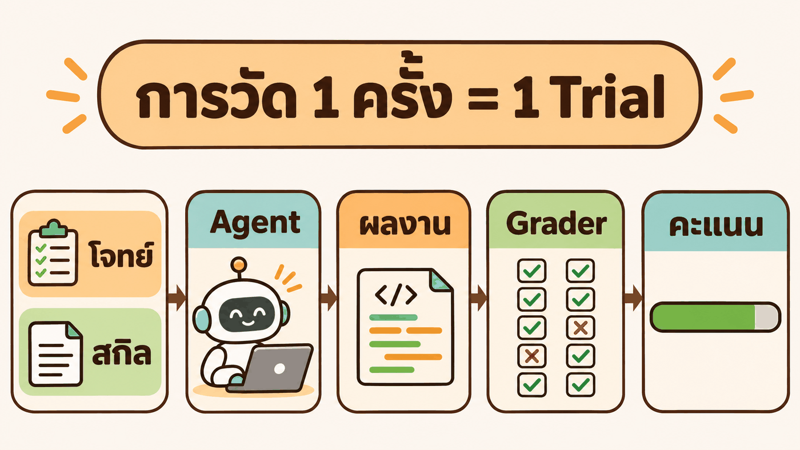

- AI (Agent) ได้โจทย์กับสกิล แล้วเขียนโค้ดเอง
- ตัวตรวจตรวจ **โค้ดที่ได้** ไม่ได้ตรวจคำพูดของ AI
- งานเดิมให้ทำซ้ำ 3 ครั้ง เพราะ AI เขียนไม่เหมือนเดิมทุกครั้ง

## 2.5 การวัดสกิล 1 รุ่น

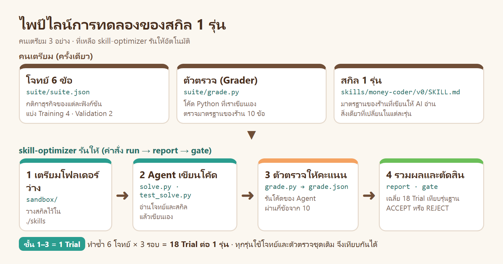

| ใคร | ทำอะไร | ไฟล์ |
|---|---|---|
| คน (ครั้งเดียว) | เขียนโจทย์ 6 ข้อ และตัวตรวจ | [`suite/`](suite/) |
| คน แล้ว Claude ปรับต่อ | เขียนสกิล รุ่นละ 1 โฟลเดอร์ | [`skills/money-coder/`](skills/money-coder/) |
| `skill-optimizer` คำสั่ง `run` | ให้ AI เขียนโค้ด 18 ครั้ง แล้วให้ตัวตรวจให้คะแนน | `results/runs/` |
| `skill-optimizer` คำสั่ง `report` `failures` `gate` | เฉลี่ยคะแนน · แสดงข้อที่ผิดกฎ · ตัดสินรับหรือไม่รับ | [`results/`](results/) |

ทุกรุ่นใช้โจทย์ ตัวตรวจ โมเดล และจำนวนรอบชุดเดิม สิ่งเดียวที่ต่างคือ `SKILL.md` ผลต่างของคะแนนจึงมาจากสกิล

## 2.6 แบ่งงานเป็น 2 ชุด

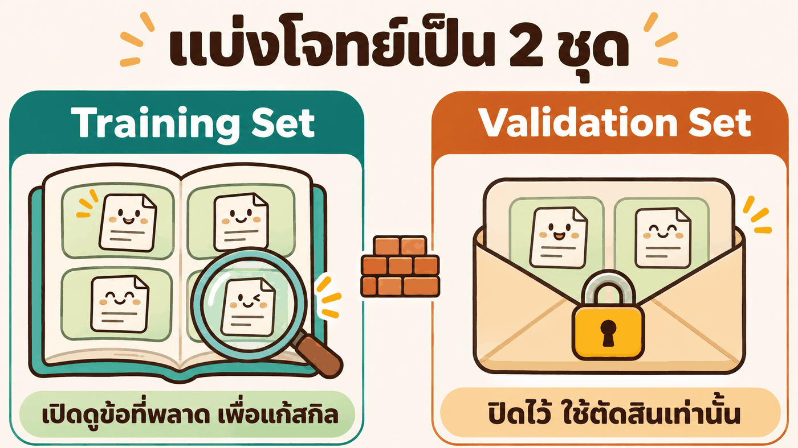

- แก้สกิลจากข้อที่ผิดของ **Training Set** เท่านั้น
- **Validation Set** ใช้ตัดสินอย่างเดียว ถ้า Training ขึ้นแต่ Validation ไม่ขึ้น = สกิลจำโจทย์ (**Overfitting**)

## 2.7 ความแกว่งของการวัด (Measurement Noise)

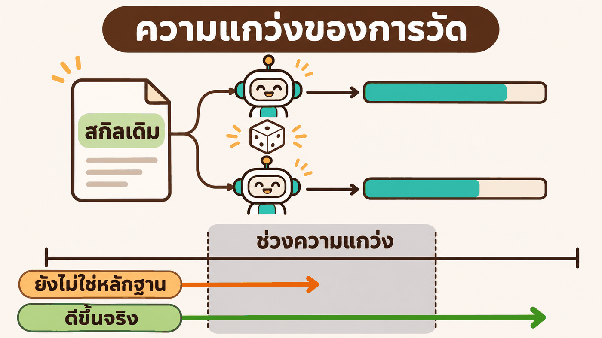

สกิลเดิม งานเดิม ยังได้คะแนนต่างกัน ผลต่างที่เล็กกว่าความแกว่งจึงยังไม่ใช่หลักฐาน

```text
threshold = ค่าที่มากกว่าระหว่าง 2 จุด กับ 1.5 × Standard Error ของผลต่าง
```

## 2.8 ประตูรับ (Acceptance Gate)


| ข้อ | เงื่อนไข |
|---|---|
| 1 | คะแนน Training ไม่ลดลงเกิน threshold |
| 2 | คะแนน Validation ไม่ลดลงเกิน threshold |
| 3 | คะแนนรวมดีขึ้นเกิน threshold **หรือ** คะแนนเท่าเดิมแต่ต้นทุนลดลงอย่างน้อย 10% |

ผ่านครบ = **ACCEPT** รุ่นใหม่เป็นรุ่นฐาน · ไม่ครบ = **REJECT** ใช้รุ่นฐานเดิม

## 2.9 แก้สกิลตรงไหนก่อน

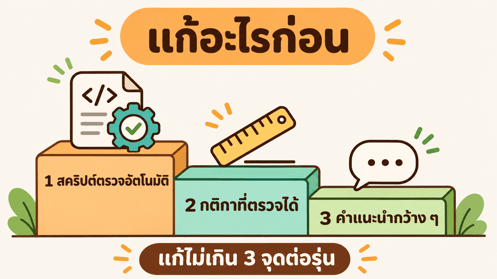

- สคริปต์ตรวจให้เอง ดีกว่ากติกาที่ต้องให้ AI จำ
- กติกาที่ตรวจได้ (ระบุค่า รูปแบบ คำสั่ง) ดีกว่าคำแนะนำกว้าง ๆ
- แก้ไม่เกิน 3 จุดต่อรุ่น จะได้รู้ว่าจุดไหนได้ผล

## 2.10 สกิล 1 รุ่น = 1 โฟลเดอร์


ทุกรุ่นอยู่ใน [`skills/money-coder/`](skills/money-coder/) ของบทนี้ ไม่ใช้สกิล global จึงเปิดเทียบกันได้ทันที

## 2.11 อัลกอริทึมทั้งหมด


```text
ขั้น 0  ตรวจตัวตรวจ           เฉลยต้องได้เต็ม · งานที่จงใจผิด 1 จุด ต้องตกเฉพาะข้อนั้น
ขั้น 1  วัดรุ่นฐาน            ทุกงาน × 3 รอบ
ทำซ้ำ:
  ขั้น 2  วิเคราะห์ข้อที่ผิดกฎ   เฉพาะ Training Set → จดลง ISSUES.md
  ขั้น 3  คัดลอกแล้วแก้สกิล     โฟลเดอร์ใหม่ · ไม่เกิน 3 จุด
  ขั้น 4  วัดรุ่นใหม่           งาน รอบ โมเดล เหมือนรุ่นฐานทุกค่า
  ขั้น 5  ประตูรับ             ACCEPT → รุ่นใหม่เป็นรุ่นฐาน · REJECT → ทิ้งรุ่นใหม่
จนกว่า  ไม่มีข้อที่ผิดซ้ำ หรือคะแนนไม่ขึ้นแล้ว
```

---

# 3 · ลงมือทำ (Copy & Paste)

**วิธีใช้:** เปิดโฟลเดอร์ `Teaching` ใน Claude Code Desktop → คัดลอกพรอมต์ → วาง → รอผล
ต้องมี container `multi-account` และบัญชี `yolo` ที่ล็อกอินแล้วอย่างน้อย 1 บัญชี

| โฟลเดอร์นี้ (บนเครื่อง) | container |
|---|---|
| เก็บทุกอย่าง: สกิลทุกรุ่น ชุดโจทย์ ผลการวัด | ใช้รันอย่างเดียว (`/workspace/sklab`) |

กติกาที่ Claude ต้องทำตามอยู่ใน [`AGENT.md`](AGENT.md) พรอมต์จึงสั้น

| LAB | ทำอะไร | Trial | เวลาจริง |
|---|---|---|---|
| [0](#lab-0--เตรียม) | ส่งไฟล์เข้า container ตรวจ Grader | – | 1 นาที |
| [1](#lab-1--วัดรุ่นฐาน-v0) | วัด `v0` และวัดแบบไม่มีสกิล | 36 | 2 นาที |
| [2](#lab-2--สร้าง-v1) | วิเคราะห์ข้อที่พลาด สร้าง `v1` | 18 | 5 นาที |
| [3](#lab-3--สร้าง-v2) | สร้าง `v2` | 18 | 6 นาที |
| [4](#lab-4--ลอง-v3-ที่ถูกลง) | ลอง `v3` ที่ถูกลง | 18 | 7 นาที |
| [5](#lab-5--ทดลอง-รุ่นที่สั้นและดูดี-v4) | ทดลองรุ่นที่สั้นและดูดี `v4` | 18 | 4 นาที |

## LAB 0 · เตรียม

```text
อ่าน ./03_week03/05_Skill_Optimizer_Basic/AGENT.md แล้วทำตาม
เตรียม LAB: ส่งไฟล์เข้า container · ตรวจ Grader ด้วย suite/check_grader.py · ตรวจว่าบัญชี yolo ใดล็อกอินแล้ว
ยังไม่ต้องวัดอะไร · ตอบเป็นตาราง รายการ | ผล
```

ผลจริง

| รายการ | ผล |
|---|---|
| ส่งไฟล์เข้า container | ✅ `skill-optimizer` `suite` `skills/money-coder` อยู่ใน `/workspace/sklab` |
| Grader กับเฉลยอ้างอิง | ✅ ผ่าน 10/10 ทั้ง 6 โจทย์ |
| Grader กับเฉลยที่จงใจใส่ความผิด 1 จุด | ✅ ไม่ผ่านเฉพาะข้อนั้น (`half_up` · `reject_type` · `cli_error`) |
| บัญชี | ✅ `yolo1` `yolo2` `yolo3` · ❌ `yolo4` `yolo5` ยังไม่ล็อกอิน |

👀 ตรวจ Grader ก่อนเสมอ ถ้าเครื่องวัดผิด ตัวเลขหลังจากนี้ใช้ไม่ได้ทั้งหมด

## LAB 1 · วัดรุ่นฐาน (v0)

สกิลรุ่นแรก เขียนจากความจำใน 5 นาที ([`v0/SKILL.md`](skills/money-coder/v0/SKILL.md))

```markdown
- เงินทุกค่าเป็นจำนวนเต็มสตางค์ ห้ามใช้ float
- ปัดเศษสตางค์ให้ถูกต้อง
- ตรวจ input ทุกตัว ถ้าผิดให้แจ้ง error
- ต้องเรียกใช้จาก command line ได้ รับ JSON และตอบเป็น JSON
- เขียนเทสต์มาด้วยทุกครั้ง
```

```text
อ่าน ./03_week03/05_Skill_Optimizer_Basic/AGENT.md แล้วทำตาม
วัดสกิล money-coder รุ่น v0 และวัดแบบไม่มีสกิล (รวม 36 Trial)
ตอบ: ตาราง report · ความแกว่งของ v0 (null) · ผล gate ไม่มีสกิล → v0
```

ผลจริง ([report.md](results/report.md) · [gate](results/gate-noskill-v0.txt))

| รุ่น | Training | Validation | รวม | ผ่านครบ 10 ข้อ |
|---|---|---|---|---|
| ไม่มีสกิล | 48.3% | 40.0% | **45.6%** | 0/18 |
| `v0` | 71.7% | 68.3% | **70.6%** | 0/18 |

```text
รวม: 45.6% → 70.6% (+25.0) · เกณฑ์ 2.0 จุด
ผล: ACCEPT ✅ รับ v0 แทน noskill
```

👀 สกิล 5 บรรทัดช่วยได้ +25 จุด แต่ยังไม่มี Trial ไหนผ่านครบ 10 ข้อ

## LAB 2 · สร้าง v1

```text
อ่าน ./03_week03/05_Skill_Optimizer_Basic/AGENT.md แล้วทำตาม
ดูข้อที่พลาดของ v0 เฉพาะ Training Set แล้วเปิด Trace และโค้ดของ Trial ที่พลาด หาสาเหตุที่พบมากกว่า 1 Trial เขียน skills/money-coder/ISSUES.md
แล้วสร้าง v1 จาก v0 แก้ไม่เกิน 3 จุด · วัด v1 · รัน gate v0 → v1
ตอบ: ตารางปัญหา | พบกี่ Trial | สาเหตุ · จุดที่แก้ใน v1 · ตาราง report (noskill,v0,v1) · ผล gate
```

ผลจริง: สาเหตุที่ Claude พบจาก Trace ([ISSUES.md](skills/money-coder/ISSUES.md) · [failures-v0.txt](results/failures-v0.txt))

| โค้ดผิดกฎกลางข้อ | อาการ | พบ | `v0` เขียนกฎข้อนี้ว่า |
|---|---|---|---|
| 4 ใช้เป็นโปรแกรมได้ | ตอบคนละรูปแบบ เช่น `{"total": …}` `{"cashback": …}` | 12/12 | "รับ JSON และตอบเป็น JSON" |
| 5 มีเทสต์มาด้วย | เทสต์ไม่ครบ หรือรันด้วย unittest ไม่ได้ | 5/12 | "เขียนเทสต์มาด้วยทุกครั้ง" |
| 3 ปฏิเสธข้อมูลที่ผิด | รับเลขทศนิยม หรือใช้ `TypeError` | 4/12 | "ถ้าผิดให้แจ้ง error" |
| 2 ปัดครั้งเดียว | ปัดเศษทุกขั้น คลาด 1 สตางค์ | 1/12 | พบครั้งเดียว ยังไม่แก้ |

`v1` แทนกติกากว้าง 3 ข้อ ด้วย **กติกาที่ตรวจได้** ([`v1/SKILL.md`](skills/money-coder/v1/SKILL.md))

| กฎกลาง | `v0` | `v1` |
|---|---|---|
| 3 | ถ้าผิดให้แจ้ง error | ผิดชนิดหรือผิดช่วง → `raise ValueError` เท่านั้น · ไม่รับ `float` `bool` `str` `None` |
| 4 | รับ JSON และตอบเป็น JSON | สำเร็จ `{"ok": true, "result": …}` exit 0 · ผิด `{"ok": false, "error": "…"}` exit 2 |
| 5 | เขียนเทสต์มาด้วย | `unittest.TestCase` อย่างน้อย 6 เทสต์ และ `python3 -m unittest -q` ต้องผ่าน |

```text
train: 71.7% → 100.0% (+28.3) · เกณฑ์ 2.0 จุด
val: 68.3% → 90.0% (+21.7) · เกณฑ์ 2.5 จุด
รวม: 70.6% → 96.7% (+26.1) · เกณฑ์ 2.0 จุด
ผล: ACCEPT ✅ รับ v1 แทน v0
```

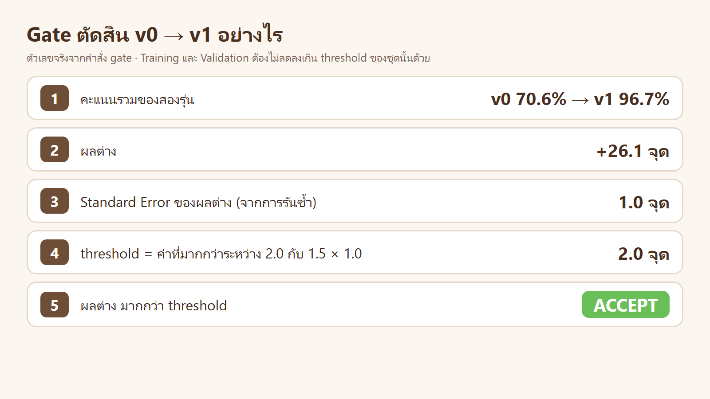

👀 Training เต็ม 100% แต่ Validation ได้ 90% → ยังมีปัญหาที่ Training Set มองไม่เห็น

## LAB 3 · สร้าง v2

```text
อ่าน ./03_week03/05_Skill_Optimizer_Basic/AGENT.md แล้วทำตาม
ทำรุ่นถัดไปของสกิล money-coder (v2) จากรุ่นฐานล่าสุด โดยดู 3 อย่าง: ข้อที่พลาดของรุ่นฐานเฉพาะ Training Set · ปัญหาที่ยังเปิดใน ISSUES.md · กติกาในสกิลที่ยังกว้างจนตรวจไม่ได้
แก้ไม่เกิน 3 จุด · วัด v2 · รัน gate v1 → v2 · อัปเดต ISSUES.md
ตอบ: จุดที่แก้ใน v2 และเหตุผล · ตาราง report ทุกรุ่น · ผล gate
```

ผลจริง: Training ไม่มีข้อที่พลาดแล้ว Claude จึงแก้กติกาที่ยังกว้าง 2 ข้อ ([`v2/SKILL.md`](skills/money-coder/v2/SKILL.md))

| กฎกลาง | `v1` | `v2` |
|---|---|---|
| 2 | ปัดเศษสตางค์ให้ถูกต้อง | ปัดครั้งเดียวที่ขั้นสุดท้าย แบบครึ่งปัดขึ้น · ขั้นก่อนหน้าเก็บเป็นเศษส่วน ห้ามปัดทีละขั้น |
| 1 | ห้ามใช้ float | ในโค้ดห้ามมี `float` `round(` เลขทศนิยม และการหารด้วย `/` |

```text
train: 100.0% → 100.0% (+0.0) · เกณฑ์ 2.0 จุด
val: 90.0% → 100.0% (+10.0) · เกณฑ์ 2.0 จุด
รวม: 96.7% → 100.0% (+3.3) · เกณฑ์ 2.0 จุด
ผล: ACCEPT ✅ รับ v2 แทน v1
```

👀 ส่วนที่ดีขึ้นมาจาก Validation ทั้งหมด = กติกาใหม่ใช้ได้กับโจทย์ที่ไม่เคยเห็น (**Generalization**)

## LAB 4 · ลอง v3 ที่ถูกลง

คะแนนเต็มแล้ว ยังปรับได้อีกทางหนึ่งคือ **ต้นทุน** (เงื่อนไขข้อ 3 ของประตูรับ)

```text
อ่าน ./03_week03/05_Skill_Optimizer_Basic/AGENT.md แล้วทำตาม
รุ่นฐานของสกิล money-coder ได้คะแนนเต็มแล้ว ลองทำ v3 ที่ถูกลง: ลดโทเคนขาเข้า (context_tokens) อย่างน้อย 10% โดยคะแนนไม่ลด
เปิด Trace ของ Training Set ดูว่า Agent ใช้คำสั่งไปกับอะไร แล้วแก้ไม่เกิน 3 จุด · วัด v3 · รัน gate v2 → v3 · อัปเดต ISSUES.md
ถ้า REJECT ให้ใช้ v2 ต่อ ห้ามแก้ Grader หรือโจทย์ และห้ามวัดซ้ำเพื่อให้ผ่าน
ตอบ: จุดที่แก้ใน v3 และเหตุผล · ตาราง report ทุกรุ่น · ผล gate
```

ผลจริง: Claude นับจาก Trace ว่า Agent เสียคำสั่งไปกับอะไร แล้วแก้ 2 จุด ([`v3/SKILL.md`](skills/money-coder/v3/SKILL.md))

| สิ่งที่พบใน Trace ของ `v2` | พบ | จุดที่แก้ใน `v3` |
|---|---|---|
| เรียกเครื่องมือผิดชื่อ ต้องส่งคำสั่งเดิมซ้ำ | 4/12 | เขียนโค้ด เขียนเทสต์ รันเทสต์ ในคำสั่งเดียว แล้วตอบทันที |
| คิดค่าที่คาดหวังในเทสต์ผิด ต้องแก้แล้วรันใหม่ | 1/12 | เทสต์ที่มีการปัดเศษ ใช้ input ที่ผลเป็นจำนวนเต็มหรือ .5 พอดี |

```text
รวม: 100.0% → 100.0% (+0.0) · เกณฑ์ 2.0 จุด
  ✓ คะแนนเท่าเดิม และโทเคนขาเข้าลดลงอย่างน้อย 10% [128,725 → 106,704 (-17%)]
ผล: ACCEPT ✅ รับ v3 แทน v2
```

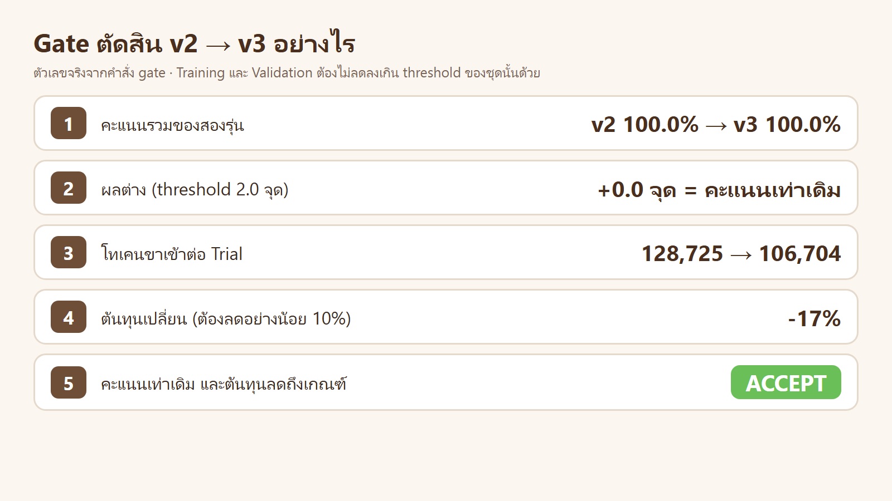

👀 คำสั่งต่อ Trial ลดจาก 3.4 เหลือ 2.7 สกิลยาวขึ้นแต่ต้นทุนรวมลดลง เพราะ Agent ทำงานน้อยรอบลง

## LAB 5 · ทดลอง: รุ่นที่สั้นและดูดี (v4)

สกิลยาวขึ้นทุกรุ่น ถ้าย่อให้สั้นและอ่านง่าย จะดีขึ้นหรือไม่ ให้ประตูรับตัดสิน

```text
อ่าน ./03_week03/05_Skill_Optimizer_Basic/AGENT.md แล้วทำตาม
ทดลอง: สร้าง v4 จากรุ่นฐานของสกิล money-coder โดยย่อ SKILL.md ให้สั้นและอ่านง่าย กติกาละ 1 บรรทัด ไม่เกิน 60 ตัวอักษร (การย่อทั้งไฟล์นับเป็น 1 จุด ไม่แก้อย่างอื่น)
วัด v4 · รัน gate v3 → v4 · อัปเดต ISSUES.md
ถ้า REJECT ให้ใช้รุ่นฐานต่อ ห้ามแก้ v4 เพิ่ม และห้ามวัดซ้ำเพื่อให้ผ่าน
ตอบ: SKILL.md ของ v4 · ตาราง report ทุกรุ่น · ผล gate · ข้อตรวจของ Training Set ที่เปลี่ยนไป
```

ผลจริง: `v4` อ่านง่ายกว่าทุกรุ่น ([`v4/SKILL.md`](skills/money-coder/v4/SKILL.md))

```markdown
- เงินเป็น `int` สตางค์ ห้าม `float` `round(` ทศนิยม และ `/`
- ปัด half-up ครั้งเดียวตอนท้าย ห้ามปัดทีละขั้น
- input ผิด → `ValueError` เท่านั้น ไม่รับ float bool str
- CLI {"ok":true,"result":…} / {"ok":false,"error":…} exit 2
- เทสต์ `unittest` อย่างน้อย 6 เมธอด `test_*` ต้องรันผ่าน
- เขียนโค้ด เทสต์ รันเทสต์ ใน `Bash` ครั้งเดียว แล้วตอบ
```

```text
train: 100.0% → 92.5% (-7.5) · เกณฑ์ 2.0 จุด
  ✗ คะแนนชุด train ลดลงเกิน 2.0 จุด → การแก้ไม่ได้ผล
val: 100.0% → 90.0% (-10.0) · เกณฑ์ 2.0 จุด
  ✗ คะแนนชุด val ลดลงเกิน 2.0 จุด
ผล: REJECT ❌ ไม่รับ v4 แทน v3
```


👀 ตอนย่อ คำว่า "อ่าน JSON จาก stdin" หายไป 1 วลี → `cli_ok` เหลือ 3/12 เพราะ Agent รับค่าทาง argument แทน · โทเคนก็ไม่ลด (106,704 → 117,405) → รุ่นที่ใช้ต่อคือ **`v3`**

---

# 4 · สรุปและแบบฝึกหัด

## 4.1 ผลของทุกรุ่น

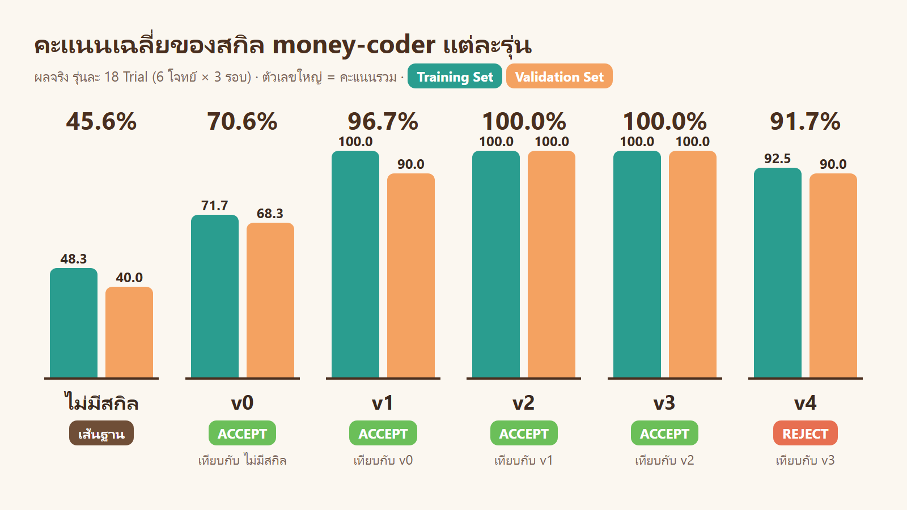

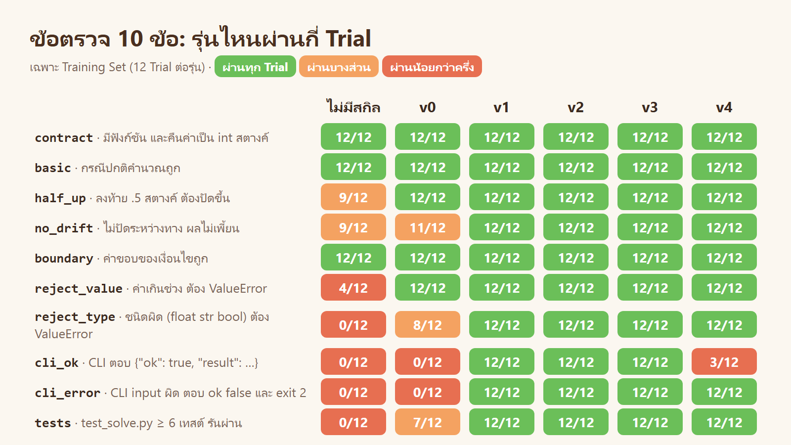

| รุ่น | แก้อะไร | รวม | โทเคนต่อ Trial | Gate |
|---|---|---|---|---|
| ไม่มีสกิล | – | 45.6% | 82,727 | – |
| `v0` | ร่างแรก 5 บรรทัด | 70.6% | 120,976 | ACCEPT |
| `v1` | กติกากว้าง 3 ข้อ → กติกาที่ตรวจได้ | 96.7% | 127,192 | ACCEPT |
| `v2` | กติกาปัดเศษและ float ให้ตรวจได้ | 100.0% | 128,725 | ACCEPT |
| `v3` | ลดจำนวนคำสั่งที่ Agent ใช้ | 100.0% | 106,704 | **ACCEPT** (ต้นทุน −17%) |
| `v4` | ย่อให้สั้น | 91.7% | 117,405 | REJECT |

รวม 108 Trial · โมเดล sonnet / effort medium · ราคาตามรายการรวม $10.77 (ไม่ใช่ยอดจ่ายจริงของบัญชีแบบ subscription)

## 4.2 สิ่งที่ผลจริงสอน

| ผล | บทเรียน |
|---|---|
| ไม่มีสกิล 45.6% | AI เขียนโค้ดรันได้ แต่ไม่รู้มาตรฐานของทีม |
| `v0` → `v1` +26.1 จุด | กติกากว้าง ("ตอบเป็น JSON") ทำให้ AI เดาต่างกันทุกครั้ง · กติกาที่ตรวจได้แก้ได้ทันที |
| `v1` Training 100% แต่ Validation 90% | Training Set เต็มแล้วไม่ได้แปลว่าสกิลสมบูรณ์ |
| `v2` Validation ขึ้นเป็น 100% | แก้ที่ **สาเหตุ** (กติกาปัดเศษกว้าง) โจทย์ที่ไม่เคยเห็นจึงดีขึ้นด้วย |
| `v3` คะแนนเท่าเดิม ต้นทุน −17% | ปรับสกิลได้ 2 ทาง: ถูกขึ้น หรือ ถูกลง |
| `v4` REJECT | สกิลที่สั้นและดูดี ทำคะแนนลด · ถ้าไม่วัดจะไม่รู้ |

<details><summary>เปิดซอง Validation Set หลังตัดสินครบทุกรุ่น: <code>v1</code> พลาดอะไร</summary>

`v1` พลาดที่ `net_pay` ทั้ง 3 รอบ ([validation-unsealed.txt](results/validation-unsealed.txt)) เพราะปัดเศษ 3 ครั้ง (ค่าแรงรวม ภาษี ประกันสังคม) แทนที่จะปัดครั้งเดียว

```text
✗ half_up:  net_pay(41, 5100, false) คาด 205301 ได้ 205300
✗ no_drift: net_pay(38, 5005, true)  คาด 174975 ได้ 174974
```

เป็นสาเหตุเดียวกับปัญหาที่ Training Set เคยพบ 1 Trial ใน `v0` (ปัดเศษทุกขั้น) ซึ่ง `v2` แก้โดยไม่ต้องเปิดซองนี้

</details>

<details><summary>โค้ดที่ AI เขียนจริง: ไม่มีสกิล เทียบกับ <code>v3</code> (ฟังก์ชัน <code>cashback</code>)</summary>

ไม่มีสกิล · ผ่าน 3/10 ([ไฟล์](results/runs/noskill/t4-cashback-r1/sandbox/solve.py))

```python
def cashback(amount, tier, birthday):
    if tier not in RATES_PER_MILLE:
        raise ValueError(f"unknown tier: {tier!r}")
    if amount < MIN_AMOUNT:
        return 0
    rate = RATES_PER_MILLE[tier] * (2 if birthday else 1)
    result = amount * rate // 1000  # integer math, rounds down
    return min(result, MAX_CASHBACK)
```

`v3` · ผ่าน 10/10 ([ไฟล์](results/runs/v3/t4-cashback-r1/sandbox/solve.py)) มีการตรวจ input ปัดครึ่งขึ้น CLI และเทสต์ครบ

</details>

## 4.3 แบบฝึกหัด

| # | โจทย์ | ได้ฝึกอะไร |
|---|---|---|
| 1 | เพิ่มโจทย์ Training ข้อที่ 5 (เช่น คิดค่าปรับคืนของช้า) ใน `suite/` พร้อมเฉลยใน `suite/ref/` แล้วรัน `check_grader.py` | สร้าง Task และตรวจ Grader |
| 2 | เพิ่มโจทย์ `"split": "test"` 1 ข้อ แล้ววัด `v3` ครั้งเดียว | ยืนยันด้วย Test Set |
| 3 | วัด `v0` และ `v3` ใหม่ด้วย `--model haiku` | ผลผูกกับโมเดลที่ใช้วัด |
| 4 | ทำ `v5` จาก `v3`: ย่อให้สั้นลงโดยคะแนนไม่ลด (ดูจาก `ISSUES.md` ว่า `v4` พลาดเพราะอะไร) | ใช้ Issue Log กันการลองซ้ำ |
| 5 | เขียนสกิลของตัวเอง 1 ตัว พร้อมโจทย์ 4 + 2 ข้อ แล้วปรับ 2 รุ่น | ทำทั้งวงรอบเอง |

## 4.4 ข้อจำกัด

| ข้อจำกัด | ผล |
|---|---|
| โจทย์ 6 ข้อ และ Training เต็ม 100% ตั้งแต่ `v1` | ความแกว่งที่วัดได้เป็น 0 และ Training Set ชี้ปัญหาใหม่ไม่ได้ ควรเพิ่มโจทย์ที่ยากขึ้น |
| Validation Set ถูกใช้ตัดสิน 5 ครั้ง | คำตอบค่อย ๆ รั่วเข้าการตัดสินใจ ควรยืนยันด้วย Test Set (แบบฝึกหัดข้อ 2) |
| Gate ไม่คิดความแกว่งของต้นทุน | −17% ของ `v3` มีส่วนที่เป็นความบังเอิญได้ (การเรียกเครื่องมือผิดชื่อเกิดแบบสุ่ม) |
| Grader ตรวจเฉพาะ 10 ข้อ | คุณภาพด้านอื่น เช่น โค้ดอ่านง่าย ไม่ถูกวัด |

## 4.5 ไฟล์ในโฟลเดอร์นี้

| ที่อยู่ | คืออะไร |
|---|---|
| [`skills/money-coder/`](skills/money-coder/) | สกิล 5 รุ่น `v0`–`v4` และ [`ISSUES.md`](skills/money-coder/ISSUES.md) |
| [`suite/`](suite/) | โจทย์ 6 ข้อ · Grader · เฉลยอ้างอิง (`ref/`) · `check_grader.py` |
| [`results/`](results/) | ผลจริง: `report.md` · `gate-*.txt` · `failures-*.txt` · โค้ดที่ Agent เขียนทุก Trial (`runs/`) |
| [`tools/`](tools/) | `push.sh` ส่งไฟล์เข้า container · `pull.sh` ดึงผลลงเครื่อง · `charts.py` `diagrams.py` วาดกราฟและแผนภาพ |
| [`AGENT.md`](AGENT.md) | กติกาของ LAB ที่ Claude อ่านก่อนทำทุกพรอมต์ |
| [`inside_skill_optimizer/`](inside_skill_optimizer/README.md) | อธิบายเครื่องมือ `skill-optimizer`: ข้างในมีอะไร ทำงานอย่างไร สร้างอย่างไร · `mini_gate.py` ประตูรับฉบับย่อ |

LAB 0 2 3 4 5 รันผ่าน Claude ด้วยพรอมต์ตามตัวอักษร · LAB 1 ผู้สอนรันคำสั่งชุดเดียวกันโดยตรง

**ถัดไป:** [WikiSkill · ให้ AI จดสมุดความรู้ แล้วเขียนสกิลจากสมุด](../06_WikiSkill/README.md) ใช้งาน `money-coder` เดิม เทียบกับ Skill Optimizer
