# ทฤษฎี WikiSkill · แนวคิด วิธีคิดในการออกแบบ และอัลกอริทึม

> เปเปอร์ต้นทาง: Tang et al., *WikiSkill: Compiling Agent Experience into Persistent Knowledge for Skill Evolution*, Google Research, [arXiv:2608.27454](https://arxiv.org/abs/2608.27454) (ส.ค. 2026)
> หน้านี้อธิบายด้วยถ้อยคำของบทเรียน ตัวเลขของเปเปอร์คัดจาก Table 1, 3, 7 · ตัวอย่างทุกชิ้นมาจากการรันจริงของบทนี้ ([`runs/w1/`](../runs/w1/))

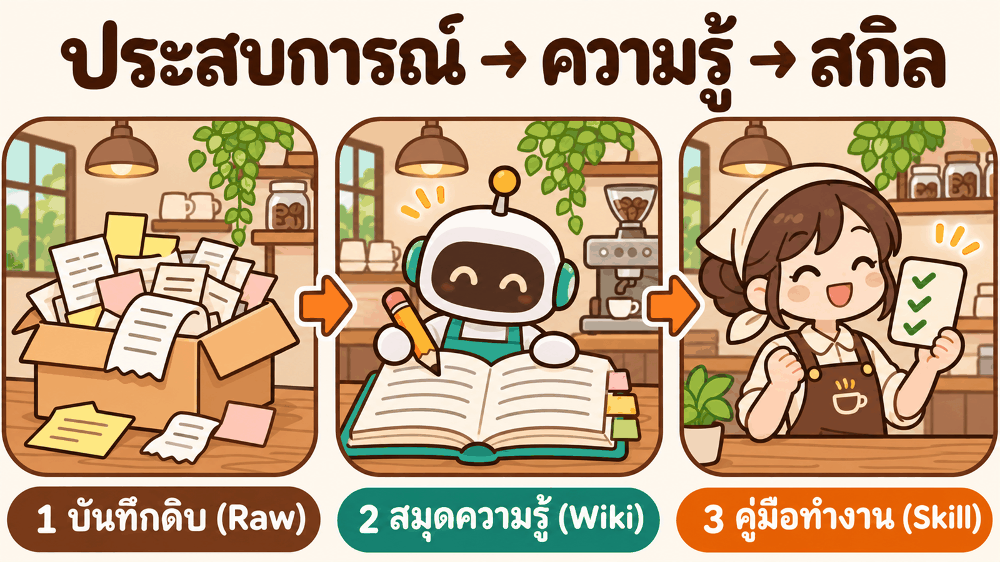

**WikiSkill ในประโยคเดียว:** ระหว่างการปรับสกิล ให้มี **สมุดความรู้ (Wiki)** คั่นกลางระหว่าง Trace ดิบกับสกิล · Trace ถูกสรุปลง Wiki ก่อน แล้วสกิลจึงถูกแก้จาก Wiki · สกิลที่ไม่ผ่านถูกทิ้งได้ แต่ Wiki ไม่ถูกทิ้ง

## อ่านตามลำดับนี้

| ขั้น | ตอบคำถาม |
|---|---|
| [1 · วงรอบการปรับสกิล](#ขั้น-1--วงรอบการปรับสกิล) | ทุกวิธีปรับสกิลทำอะไรเหมือนกัน |
| [2 · ปัญหา](#ขั้น-2--ปัญหา-ความรู้กระจัดกระจาย) | วงรอบเดิมขาดอะไร |
| [3 · แนวคิดหลัก](#ขั้น-3--แนวคิดหลัก-คอมไพล์ประสบการณ์เป็นความรู้) | "คอมไพล์ประสบการณ์เป็นความรู้" คืออะไร |
| [4 · สถาปัตยกรรม 3 ชั้น](#ขั้น-4--สถาปัตยกรรม-3-ชั้น) | แต่ละชั้นเก็บอะไร ต่างกันอย่างไร |
| [5 · ส่วนประกอบ 4 ตัว](#ขั้น-5--ส่วนประกอบ-4-ตัว) | ใครทำอะไร เห็นอะไรได้บ้าง |
| [6 · เดิน 1 รอบด้วยผลจริง](#ขั้น-6--เดิน-1-รอบด้วยผลจริง) | ข้อมูลไหลจาก Trace ไปเป็นสกิลอย่างไร |
| [7 · อัลกอริทึม](#ขั้น-7--อัลกอริทึม) | Algorithm 1 ทีละบรรทัด |
| [8 · วิธีคิดในการออกแบบ](#ขั้น-8--วิธีคิดในการออกแบบ) | ทำไมจึงออกแบบแต่ละจุดเช่นนี้ (10 ข้อ) |
| [9 · เปรียบเทียบ](#ขั้น-9--เปรียบเทียบ) | ต่างจากวิธีอื่น และจาก Skill Optimizer ของบท 05 อย่างไร |
| [10 · ข้อจำกัด](#ขั้น-10--ข้อจำกัด) | สิ่งที่ WikiSkill ยังทำไม่ได้ |
| [11 · ทบทวน](#ขั้น-11--ทบทวน) | คำถามตรวจความเข้าใจ |

ทุกขั้นมีกล่อง **ในโค้ด** บอกว่าแนวคิดนั้นอยู่ตรงไหนของ [`wikiskill.py`](../wikiskill/wikiskill.py) และ prompt · อ่านโค้ดและ prompt ทั้งไฟล์ได้ที่ [ข้างใน WikiSkill](../02_inside_wikiskill/README.md)

---

## ขั้น 1 · วงรอบการปรับสกิล

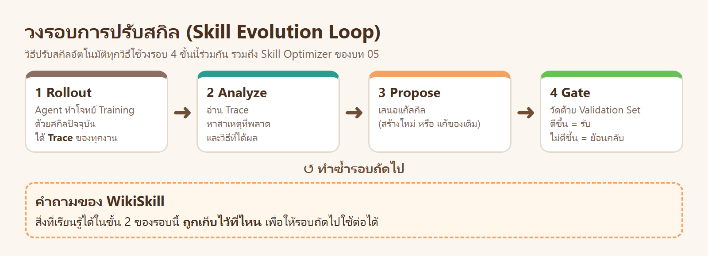

วิธีปรับสกิลอัตโนมัติทุกวิธีทำ 4 ขั้นนี้ซ้ำ รวมถึงบท 05

| ขั้น | ทำอะไร | ในบท 05 (Skill Optimizer) คือ |
|---|---|---|
| 1 Rollout | Agent ทำโจทย์ Training ด้วยสกิลปัจจุบัน | คำสั่ง `run` |
| 2 Analyze | อ่าน Trace หาสาเหตุ | Claude อ่าน `failures` แล้วจดลง `ISSUES.md` |
| 3 Propose | เสนอแก้สกิล | Claude คัดลอก `v1` เป็น `v2` แล้วแก้ไม่เกิน 3 จุด |
| 4 Gate | วัด Validation แล้วรับหรือทิ้ง | คำสั่ง `gate` |

คำศัพท์ที่ใช้ทั้งหน้า

| คำ | ความหมาย |
|---|---|
| **Trace** | บันทึกทุกขั้นที่ Agent ทำใน 1 งาน: คำสั่ง โค้ด ผลที่ได้ และผลของตัวตรวจ |
| **สกิล (Skill)** | โฟลเดอร์ที่มี `SKILL.md` = ขั้นตอนที่ Agent อ่านแล้วทำตาม |
| **Training / Validation / Test Set** | โจทย์ที่ใช้หาข้อพลาด / โจทย์ที่ใช้ตัดสินรับหรือทิ้ง / โจทย์ที่ใช้วัดผลสุดท้าย |
| **R_best** | คะแนน Validation ที่ดีที่สุดเท่าที่เคยได้ |

---

## ขั้น 2 · ปัญหา: ความรู้กระจัดกระจาย

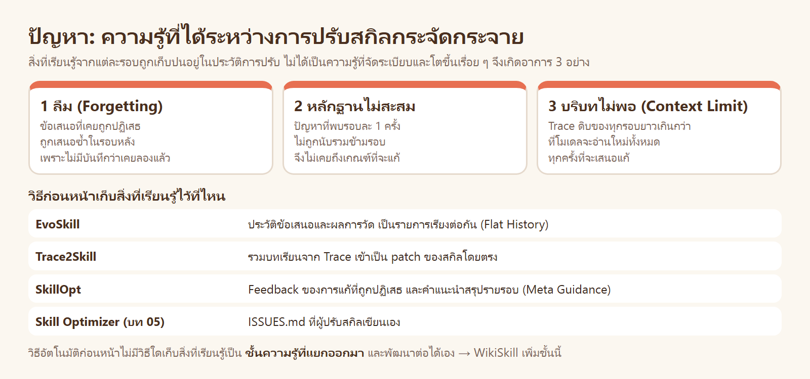

ขั้น 2 ของวงรอบ (Analyze) ได้ข้อสรุปออกมาทุกรอบ เช่น "Agent ปัดเศษทุกขั้นจึงคลาด 1 สตางค์" แต่ข้อสรุปนี้ถูกใช้ครั้งเดียวตอนแก้สกิลของรอบนั้น แล้วหายไปกับประวัติ

| อาการ | ตัวอย่าง |
|---|---|
| **1 ลืม** | รอบ 3 เสนอวิธีที่รอบ 1 ลองแล้วถูกปฏิเสธ เพราะไม่มีที่ใดจดว่าเคยลอง |
| **2 หลักฐานไม่สะสม** | ปัญหาที่พบรอบละ 1 Trace ถูกมองว่าบังเอิญทุกรอบ ทั้งที่รวม 4 รอบแล้วพบ 4 ครั้ง |
| **3 บริบทไม่พอ** | 8 รอบ × 12 Trace × 15,000 ตัวอักษร ≈ 1.4 ล้านตัวอักษร อ่านใหม่ทุกครั้งไม่ได้ |

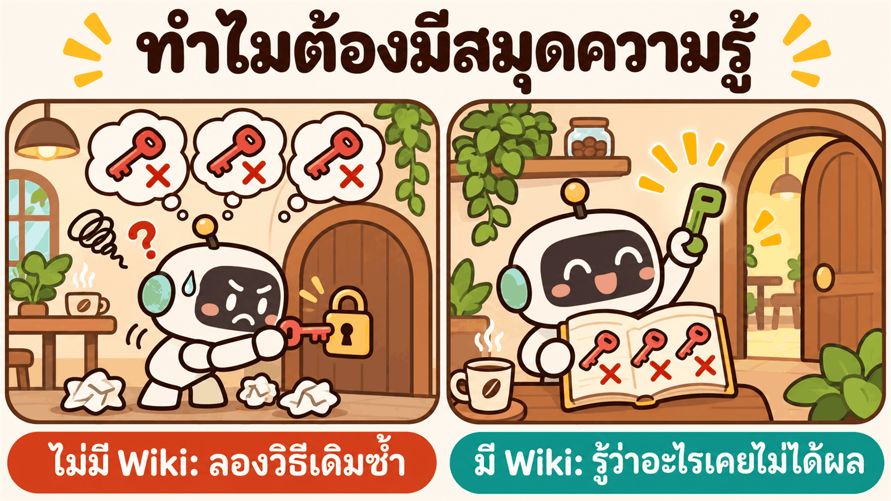

**ตัวอย่างจากบท 05:** ในรุ่น `v0` พบ "ปัดเศษทุกขั้น" แค่ 1 จาก 12 Trial จึงยังไม่แก้ → รุ่น `v1` Validation ได้ 90% เพราะสาเหตุเดียวกัน → รุ่น `v2` แก้ได้ เพราะ Claude **จดปัญหานั้นไว้ใน `ISSUES.md`** ตั้งแต่ `v0`
`ISSUES.md` ของบท 05 คือ Wiki ที่เขียนด้วยมือ · WikiSkill ทำสิ่งนี้ให้เป็นระบบและอัตโนมัติ

---

## ขั้น 3 · แนวคิดหลัก: คอมไพล์ประสบการณ์เป็นความรู้

เปเปอร์ได้แนวคิดจาก LLM Wiki ของ Andrej Karpathy: ให้โมเดล **เรียบเรียงข้อมูลดิบเป็นฐานความรู้ที่อ่านต่อได้** แทนที่จะกลับไปค้นข้อมูลดิบทุกครั้ง · คำว่า "คอมไพล์" ยืมมาจากการเขียนโปรแกรม

| | ของดิบ | สิ่งที่เรียบเรียงแล้ว | สิ่งที่ใช้ทำงาน |
|---|---|---|---|
| เขียนโปรแกรม | source code | ไลบรารีที่คอมไพล์แล้ว | โปรแกรมที่รัน |
| ร้านกาแฟ | ใบบันทึกหน้างานทุกวัน | สมุดความรู้ของร้าน | คู่มือพนักงาน 1 หน้า |
| นักเรียน | ข้อสอบเก่าที่ทำผิด | สมุดสรุปบทเรียน | โพยสูตรก่อนเข้าห้องสอบ |
| **WikiSkill** | **Trace** (`raw/`) | **Wiki** (`wiki/`) | **สกิล** (`skills/`) |

สามอย่างนี้ตอบคำถามคนละข้อ จึงไม่ควรเก็บรวมกัน

| | ตอบคำถาม | ขนาด | ใครใช้ |
|---|---|---|---|
| Trace | **เกิดอะไรขึ้น** ในงานนี้ | ยาวมาก (สูงสุด 15,000 ตัวอักษรต่องาน) | ผู้วิเคราะห์ |
| Wiki | **ทำไม** จึงเกิด และเคยลองแก้อย่างไร | กลาง (10–30 บรรทัดต่อ pattern) | ผู้ปรับสกิล |
| สกิล | **ต้องทำอย่างไร** ในงานถัดไป | สั้น | Agent ที่ทำงาน |

> **ประโยคที่ต้องจำ:** สกิลเป็นเพียง "ฉบับย่อที่ใช้งานได้" ของความรู้ ณ ขณะหนึ่ง · ความรู้ที่อยู่เบื้องหลัง (ทำไมจึงมีกฎข้อนี้ เคยลองอะไรแล้วไม่ได้ผล) ต้องมีที่อยู่ของตัวเอง

---

## ขั้น 4 · สถาปัตยกรรม 3 ชั้น

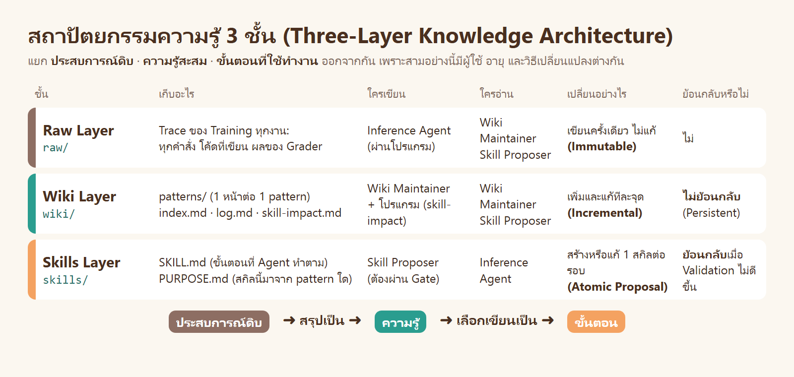

workspace จริงหลังรันจบ ([`runs/w1/`](../runs/w1/))

```text
runs/w1/
├── raw/iter-01/                       Raw Layer
│   ├── traces/t1-cafe-bill-r1.md …    Trace 12 ไฟล์ (4 โจทย์ × 3 รอบ)
│   └── summary.md                     ตารางผลของ Trace ทั้ง 12
├── wiki/                              Wiki Layer
│   ├── index.md                       สารบัญ 5 บรรทัด
│   ├── patterns/                      5 หน้า (22–38 บรรทัดต่อหน้า)
│   ├── log.md                         บันทึกของ Maintainer รายรอบ
│   └── skill-impact.md                บันทึกของโปรแกรม: ข้อเสนอ diff คะแนน ผล
├── skills/baankafe_solve_checklist/   Skills Layer
│   ├── SKILL.md                       69 บรรทัด · Agent อ่านไฟล์นี้
│   └── PURPOSE.md                     สกิลนี้แก้ pattern ใดใน wiki
├── history/iter-01/                   หลักฐานของรอบ: สิ่งที่แต่ละ Agent ได้รับและตอบ
└── state.json                         สถานะของวงรอบ (k · R_best · ประวัติ)
```

> **ในโค้ด:** `cmd_init()` สร้าง 3 โฟลเดอร์นี้ว่าง ๆ (S₀ = ∅, W₀ = ∅) · Raw เขียนโดย `render_trace()` ครั้งเดียวตอน `rollout` และไม่มีฟังก์ชันใดกลับไปแก้ · Wiki แก้โดย `cmd_maintain()` และ `cmd_gate()` · Skills เปลี่ยนโดย `cmd_gate()` เท่านั้น

### เรื่องเดียวกัน ใน 3 ชั้น (ผลจริง)

ปัญหา "ปัดเศษสตางค์ผิด" ปรากฏในทั้ง 3 ชั้น แต่เขียนต่างกันตามหน้าที่ของชั้น

**ชั้น 1 · Raw** บอกว่า *เกิดอะไรขึ้น* ในงานนี้ ([`raw/iter-01/traces/t4-cashback-r1.md`](../runs/w1/raw/iter-01/traces/t4-cashback-r1.md))

```text
- ✗ `half_up`: cashback(10020, "gold", false) คาด 251 ได้ 250 · พลาด 3 จาก 3 กรณี
…
    result = amount * rate * mult // 10000  # integer math, no float error
```

**ชั้น 2 · Wiki** บอกว่า *ทำไม* และรวมหลักฐานจากหลายงาน ([`wiki/patterns/money-rounding-half-up.md`](../runs/w1/wiki/patterns/money-rounding-half-up.md))

```markdown
## สาเหตุ
- โจทย์ไม่ระบุวิธีปัดเศษ Agent จึงเลือก floor (`//`) ทั้งที่ตัวตรวจคาดว่าเป็นปัดครึ่งขึ้น (half-up)
## หลักฐาน
- ล้ม: t4-cashback-r1 (`amount*rate*mult // 10000`), t4-cashback-r3 (`// 1000`), t2-split-bill-r1 (`total*tip_percent // 100`)
- ผ่าน: t1-cafe-bill-r1 เก็บ num/den แล้วปัด half-up ครั้งเดียวตอนท้าย `(2*num+den)//(2*den)`
```

**ชั้น 3 · Skill** บอกว่า *ต้องทำอย่างไร* ไม่มีชื่อโจทย์ ไม่มีหลักฐาน ([`skills/baankafe_solve_checklist/SKILL.md`](../runs/w1/skills/baankafe_solve_checklist/SKILL.md))

```markdown
### 1. ปัดเศษ half-up (โจทย์ไม่ระบุ = ให้ใช้ half-up ห้ามเลือกปัดลง)
- เก็บผลเป็น `num/den` คูณต่อกันทุกขั้น แล้วปัด **ครั้งเดียวตอนท้าย**: `(2*num + den) // (2*den)`
```

| | Raw | Wiki | Skill |
|---|---|---|---|
| พูดถึงงานกี่งาน | 1 งาน | 5 งาน (3 ล้ม · 2 ผ่าน) | ทุกงานในอนาคต |
| มีเลขของโจทย์หรือไม่ | มี | มี (เป็นหลักฐาน) | ไม่มี |
| วิธีแก้มาจากไหน | – | จาก Trace ที่ **ผ่าน** (t1, t3) | จาก Wiki |

สังเกตแถวสุดท้าย: วิธีปัดที่ถูก `(2*num+den)//(2*den)` ไม่ได้ถูกคิดขึ้นใหม่ Maintainer พบใน Trace ของงานที่ผ่าน แล้วจดเป็นวิธีแก้ของงานที่ล้ม · นี่คือเหตุผลที่ Wiki จดทั้ง pattern ที่ล้มเหลวและที่สำเร็จ

---

## ขั้น 5 · ส่วนประกอบ 4 ตัว

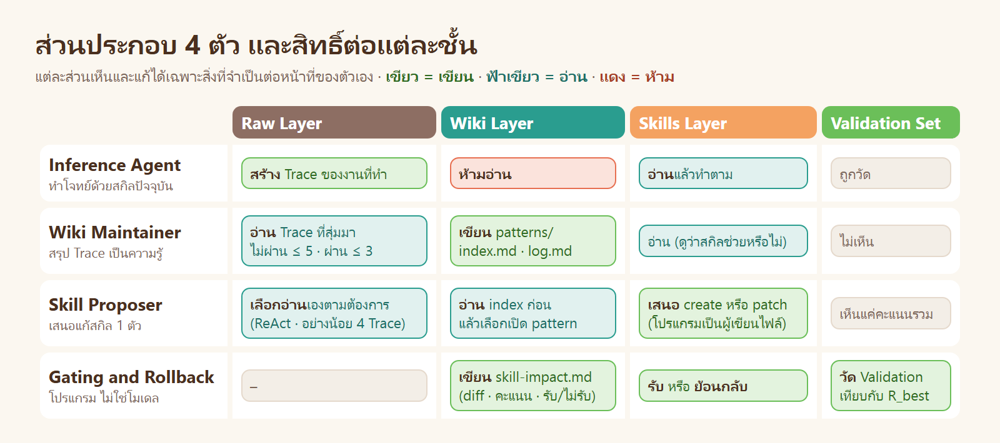

| ส่วนประกอบ | เป็นอะไร | รับเข้า | ส่งออก | เรียกโมเดล |
|---|---|---|---|---|
| **Inference Agent** | Agent ที่ทำโจทย์ (ตัวที่ถูกปรับ) | โจทย์ + สกิลปัจจุบัน | ผลงาน + Trace | 1 เซสชันต่อ 1 งาน |
| **Wiki Maintainer** | โมเดลที่ทำหน้าที่ "นักวิเคราะห์" | Wiki เดิม + Trace ที่สุ่มมา ≤ 8 | รายการแก้ Wiki (JSON) | **1 ครั้ง**ต่อรอบ |
| **Skill Proposer** | โมเดลที่ทำหน้าที่ "ผู้เขียนคู่มือ" | index ของ Wiki + ประวัติข้อเสนอ + สรุปผล แล้วเลือกเปิดไฟล์เอง | ข้อเสนอ 1 ข้อ (JSON) | ReAct ราว 10–20 รอบ |
| **Gating and Rollback** | โปรแกรม (ไม่ใช่โมเดล) | สกิลที่เสนอ + โจทย์ Validation | รับ หรือ ย้อนกลับ + บันทึกลง Wiki | ไม่เรียก |

> **ในโค้ด:** Inference Agent = `rollouts()` (เรียก `run_trial` ของบท 05) · Wiki Maintainer = `cmd_maintain()` + [`prompts/maintainer.md`](../wikiskill/prompts/maintainer.md) · Skill Proposer = `cmd_propose()` + [`prompts/proposer.md`](../wikiskill/prompts/proposer.md) · Gate = `cmd_gate()`

---

## ขั้น 6 · เดิน 1 รอบด้วยผลจริง

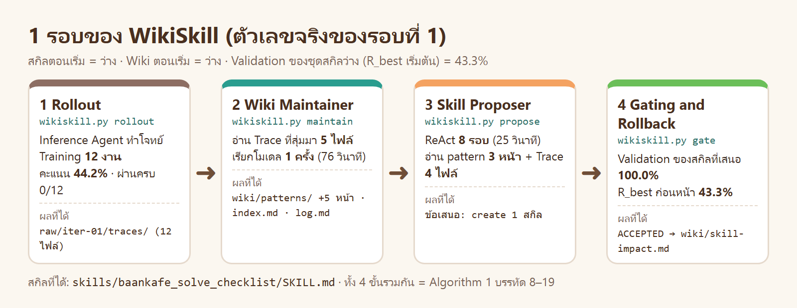

ก่อนเริ่ม: สกิลว่าง · Wiki ว่าง · วัด Validation ด้วยชุดสกิลว่างได้ **43.3%** = R_best เริ่มต้น

### 6.1 Rollout: Agent ทำโจทย์ → Raw Layer

Agent (sonnet) ทำโจทย์ Training 4 ข้อ ข้อละ 3 รอบ ไม่มีสกิล ได้เฉลี่ย **44.2%** ไม่มีงานใดผ่านครบ 10 ข้อ
โปรแกรมแปลง transcript ของแต่ละงานเป็น Trace 1 ไฟล์ และสรุปทั้ง 12 งานไว้ใน [`summary.md`](../runs/w1/raw/iter-01/summary.md)

```text
| trace_id | ผล | คะแนน | ข้อตรวจที่ไม่ผ่าน |
| t1-cafe-bill-r1 | FAIL | 0.50 | reject_value reject_type cli_ok cli_error tests |
| t2-split-bill-r1 | FAIL | 0.40 | half_up reject_value reject_type cli_ok cli_error tests |
```

> **ในโค้ด:** `cmd_rollout()` → `rollouts()` → `render_trace()` และ `summary_md()`

### 6.2 Wiki Maintainer: Trace → Wiki Layer

| รับเข้า | ส่งออก |
|---|---|
| Wiki เดิม (ว่าง) + Trace ที่สุ่มมา 5 ไฟล์ (ไม่ผ่านทั้ง 5 เพราะรอบนี้ไม่มีงานที่ผ่าน) | JSON 1 ก้อน: `create_patterns` 5 หน้า · `update_index` · `append_log` |

เรียกโมเดล **1 ครั้ง** ใช้ 76 วินาที · ได้ pattern 5 หน้า และ [`index.md`](../runs/w1/wiki/index.md) 5 บรรทัด ตัวอย่าง 1 บรรทัด

```markdown
- [missing-cli-entrypoint](wiki/patterns/missing-cli-entrypoint.md): `cli_ok`/`cli_error` ล้มเพราะ solve.py มีแต่ฟังก์ชัน
  ไม่อ่าน stdin JSON ไม่พิมพ์ `{"ok":...}` ให้เพิ่ม `main()` + `__main__` ที่ exit 0 เมื่อสำเร็จ และ exit 2 พร้อม JSON error …
```

บรรทัดเดียวมีครบ 3 ส่วน: **ปัญหา** (`cli_ok`/`cli_error` ล้ม) · **สาเหตุ** (ไม่อ่าน stdin ไม่พิมพ์ JSON) · **วิธีแก้** (เพิ่ม `main()` exit 0 / exit 2)

| pattern ที่ได้ | ชนิด | ข้อตรวจที่เกี่ยว |
|---|---|---|
| `missing-cli-entrypoint` | ล้มเหลว | `cli_ok` `cli_error` |
| `missing-input-validation` | ล้มเหลว | `reject_value` `reject_type` |
| `money-rounding-half-up` | ล้มเหลว + สำเร็จ | `half_up` `no_drift` |
| `missing-test-file` | ล้มเหลว | `tests` |
| `happy-path-only-verification` | พฤติกรรมของ Agent | ทุกข้อ (Agent ตรวจแค่กรณีปกติแล้วบอกว่าถูก) |

pattern สุดท้ายไม่ตรงกับข้อตรวจใดข้อหนึ่ง แต่เป็น **สาเหตุร่วม** ของทุกข้อ: Agent ไม่ได้ตรวจงานจริงก่อนจบ · ตัวตรวจไม่ได้รายงานเรื่องนี้ Maintainer เห็นจากการอ่านสิ่งที่ Agent ทำ

> **ในโค้ด:** `cmd_maintain()` → `sample_traces()` → `llm(tools="")` → `apply_edits()` · prompt: [`maintainer.md`](../wikiskill/prompts/maintainer.md) ข้อ 3 (วิธีวิเคราะห์) ข้อ 4 (หน้า pattern) ข้อ 5 (index)

### 6.3 Skill Proposer: Wiki + Trace → ข้อเสนอ

Proposer ได้รับ `index.md` + `skill-impact.md` + `summary.md` แล้วเปิดไฟล์เองตามลำดับนี้ (จาก [`state.json`](../runs/w1/state.json))

```text
1 wiki/patterns/missing-cli-entrypoint.md
2 wiki/patterns/missing-input-validation.md
3 wiki/patterns/money-rounding-half-up.md
4 traces/t4-cashback-r1.md
5 traces/t2-split-bill-r1.md
6 traces/t1-cafe-bill-r1.md
7 traces/t3-shipping-fee-r1.md
```

เปิด pattern 3 จาก 5 หน้า (อีก 2 หน้า บรรทัดใน index บอกพอแล้ว) และ Trace 4 จาก 12 ไฟล์ (โจทย์ละ 1) · รวม 8 รอบ ReAct ใช้ 25 วินาที
ข้อเสนอ: `create` สกิล `baankafe_solve_checklist` พร้อม `PURPOSE.md` ที่ชี้กลับไปยัง pattern ทั้ง 5

```markdown
## Patterns Addressed
- wiki/patterns/missing-cli-entrypoint.md (cli_ok, cli_error)
- wiki/patterns/missing-input-validation.md (reject_value, reject_type)
- wiki/patterns/money-rounding-half-up.md (half_up, no_drift)
- wiki/patterns/missing-test-file.md (tests)
- wiki/patterns/happy-path-only-verification.md (ตรวจจริงก่อนจบ)
```

> **ในโค้ด:** `cmd_propose()` → `llm(tools="Read")` → `build_candidate()` · prompt: [`proposer.md`](../wikiskill/prompts/proposer.md) ข้อ 3 (ลำดับการทำงาน) ข้อ 4 (รูปแบบข้อเสนอ) ข้อ 5 (กติกา)

### 6.4 Gating and Rollback: ข้อเสนอ → รับหรือย้อนกลับ

โปรแกรมวางสกิลที่เสนอไว้ในโฟลเดอร์ `candidate/` (ยังไม่ใช่สกิลที่ใช้งาน) แล้วให้ Agent ทำโจทย์ Validation 2 ข้อ × 3 รอบ

```text
Validation ของสกิลที่เสนอ 100.0%  >  R_best 43.3%   →   ACCEPTED
```

จากนั้นโปรแกรมจดลง [`wiki/skill-impact.md`](../runs/w1/wiki/skill-impact.md) (ชื่อสกิล · diff ทั้งหมด · คะแนน · ผล) และเพราะ R_best = 100% วงรอบจึงหยุดที่รอบนี้ (Algorithm 1 บรรทัด 5)

> **ในโค้ด:** `cmd_gate()` · การหยุดอยู่ใน `cmd_loop()`

### 6.5 เมื่อมีรอบที่ 2: Wiki ทำงานข้ามรอบ

การรันหลัก (`w1`) จบในรอบเดียว · การรัน [`w2`](../runs/w2/) (อัลกอริทึมเดิม แต่วัดโจทย์ละ 6 รอบ) ได้ Validation 92.5% หลังรอบที่ 1 จึงมีรอบที่ 2 ให้ดูว่า Wiki ถูกใช้ต่ออย่างไร

**Maintainer ไม่ได้เริ่มจากศูนย์** รอบนี้ได้ Trace ที่ผ่าน 3 + ไม่ผ่าน 5 และ Wiki ของรอบที่ 1

| สิ่งที่ทำ | ผลจริง |
|---|---|
| สร้าง pattern ใหม่ 1 หน้า | [`test-count-below-minimum.md`](../runs/w2/wiki/patterns/test-count-below-minimum.md): โค้ด `solve.py` เหมือนกัน งานที่ผ่านมี 6 test method งานที่ล้มมี 4–5 |
| **เติม** หน้าเดิม 5 หน้า ไม่สร้างซ้ำ | แต่ละหน้าได้หัวข้อ "อัปเดต iter 2" บอกว่าปัญหานั้นแก้ได้แล้วหรือยัง |
| แก้ `index.md` | บรรทัดของ pattern ใหม่ขึ้นต้นด้วย `[ยังเกิดอยู่ iter 2: ข้อเดียวที่ล้ม 5/8 trace]` |

```markdown
## อัปเดต iter 2: แก้ได้แล้ว                                   ← wiki/patterns/missing-test-file.md
- สกิล `cafe_solve_checklist` ทำให้ Agent สร้าง test_solve.py ครบ 8/8 trace …
- ปัญหาที่เหลือของข้อ `tests` คือจำนวนเทสต์ไม่ถึง 6 (5 จาก 8 trace) ดู test-count-below-minimum
```

**Proposer อ่านน้อยลง** เพราะ index บอกแล้วว่าเรื่องใดจบ เรื่องใดยังเปิดอยู่

| | รอบที่ 1 | รอบที่ 2 |
|---|---|---|
| pattern ที่เปิด | 3 จาก 5 หน้า | **1 จาก 6 หน้า** (หน้าใหม่) |
| Trace ที่เปิด | 4 | 4 |
| ไฟล์อื่น | – | `SKILL.md` ของสกิลเดิม |
| ข้อเสนอ | `create` ทั้งสกิล | `patch` ข้อ 4 ของสกิล (แก้ 2 จุด เติม 1 จุด) |
| เวลา | 25 วินาที | 16 วินาที |

ข้อเสนอของรอบที่ 2 แก้เฉพาะจุดที่ pattern ใหม่ชี้: ระบุจำนวน test method ขั้นต่ำ และให้ดูบรรทัด `Ran N tests` ก่อนจบ · ส่วนอื่นของสกิลที่ผ่านอยู่แล้วไม่ถูกแตะ (ข้อ 8.9)

> **ข้อจำกัดของตัวอย่างจริง:** ใน 4 การรันของบทนี้ไม่มีข้อเสนอใดถูกปฏิเสธ จึงยังไม่มีตัวอย่างจริงของการย้อนกลับ (ข้อ 8.3) · กลไกนั้นอธิบายจากกรณีศึกษาของเปเปอร์ และอ่านได้จากโค้ดของ `cmd_gate()`

---

## ขั้น 7 · อัลกอริทึม

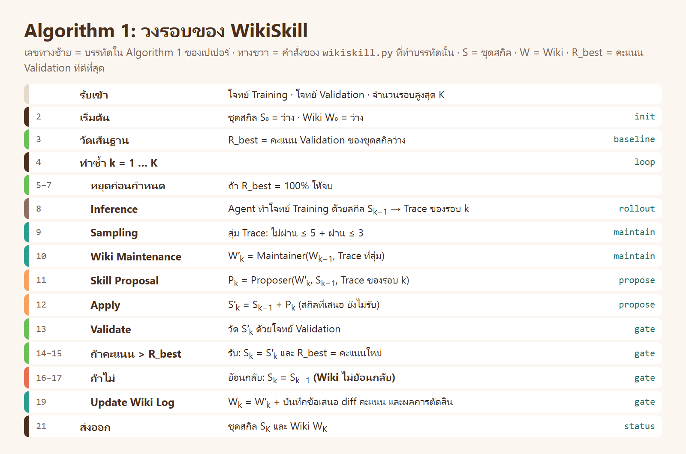

สถานะของระบบมี 3 ตัว: ชุดสกิล **S** · Wiki **W** · คะแนน Validation ที่ดีที่สุด **R_best**

```text
รับเข้า  โจทย์ Training · โจทย์ Validation · จำนวนรอบสูงสุด K
 2  S ← ว่าง   W ← ว่าง
 3  R_best ← คะแนน Validation ของ S                     # เส้นฐาน: ยังไม่มีสกิล
 4  ทำซ้ำ k = 1 … K
 5      ถ้า R_best = 100%  →  จบ
 8      Trace_k   ← Inference Agent ทำโจทย์ Training ด้วย S
 9      ตัวอย่าง   ← สุ่มจาก Trace_k (ไม่ผ่าน ≤ 5 · ผ่าน ≤ 3)
10      W         ← Wiki Maintainer(W, ตัวอย่าง)         # ความรู้ของรอบนี้เข้า Wiki
11      ข้อเสนอ    ← Skill Proposer(W, S, Trace_k)        # create / patch สกิล 1 ตัว
12      S′        ← S ที่ใส่ข้อเสนอแล้ว                   # ยังไม่รับ
13      คะแนน     ← คะแนน Validation ของ S′
14      ถ้า คะแนน > R_best  →  S ← S′ ,  R_best ← คะแนน    # รับ
16      ถ้าไม่              →  S คงเดิม                    # ย้อนกลับเฉพาะสกิล
19      W ← W + บันทึก(ข้อเสนอ, diff, คะแนน, รับ/ไม่รับ)    # ทำทั้งสองกรณี
21  ส่งออก  S และ W
```

สามบรรทัดที่ทำให้ WikiSkill ต่างจากวงรอบทั่วไป

| บรรทัด | ทำอะไร | ถ้าตัดออกจะเกิดอะไร |
|---|---|---|
| 10 | ความรู้ของรอบนี้ถูกเขียนลง Wiki **ก่อน** เสนอแก้สกิล | Proposer ต้องวิเคราะห์ Trace ใหม่ทุกรอบ ไม่มีอะไรสะสม |
| 16 | ย้อนกลับเฉพาะ S ไม่แตะ W | ความรู้ที่ได้จากรอบที่ล้มเหลวหายไปด้วย |
| 19 | จดผลของข้อเสนอลง W ทุกครั้ง ทั้งรับและไม่รับ | รอบถัดไปไม่รู้ว่าอะไรเคยลองแล้วไม่ได้ผล |

สถานะจริงของการรันหลัก (`w1`)

| k | S (ชุดสกิล) | W (Wiki) | R_best | เกิดอะไร |
|---|---|---|---|---|
| 0 | ว่าง | ว่าง | 43.3% | วัดเส้นฐาน (บรรทัด 3) |
| 1 | `baankafe_solve_checklist` | 5 pattern + log 1 รอบ + skill-impact 1 รายการ | 100.0% | สร้างสกิล → รับ (บรรทัด 8–19) |
| – | – | – | – | หยุด เพราะ R_best = 100% (บรรทัด 5) |

สถานะจริงของการรัน `w2` (2 รอบ)

| k | S | W | R_best | เกิดอะไร |
|---|---|---|---|---|
| 0 | ว่าง | ว่าง | 45.0% | วัดเส้นฐาน |
| 1 | `cafe_solve_checklist` (ฉบับแรก) | 5 pattern | 92.5% | สร้างสกิล → รับ |
| 2 | `cafe_solve_checklist` (แก้ข้อ 4) | 6 pattern (ใหม่ 1 · เติม 5) + skill-impact 2 รายการ | 100.0% | แก้สกิล → รับ → หยุด |

W โตขึ้นทุกรอบและไม่เคยลดลง · S เปลี่ยนเฉพาะเมื่อผ่าน Gate

> **ในโค้ด:** 1 คำสั่งของ `wikiskill.py` = 1 กลุ่มบรรทัด (`baseline` 3 · `rollout` 8 · `maintain` 9–10 · `propose` 11–12 · `gate` 13–19) · `cmd_loop()` คือบรรทัด 4–20 · เงื่อนไขรับอยู่ใน `cmd_gate()` บรรทัด `accepted = r_val > before + 1e-9`

---

## ขั้น 8 · วิธีคิดในการออกแบบ

ส่วนนี้ตอบว่า **ทำไม** WikiSkill จึงออกแบบเช่นนี้ ทีละการตัดสินใจ · แต่ละข้อมี: คำถาม → ทางเลือก → สิ่งที่เลือก → เหตุผล → อยู่ตรงไหนของโค้ด

### 8.1 ทำไมไม่ให้สกิลเก็บความรู้เอง

| | |
|---|---|
| คำถาม | สิ่งที่เรียนรู้ ควรเขียนลงสกิลโดยตรงเลยหรือไม่ |
| ทางเลือก | (ก) เขียนทุกอย่างลงสกิล · (ข) แยกชั้นความรู้ออกมา |
| WikiSkill เลือก | (ข) |
| เหตุผล | สกิลถูกอ่านโดย Agent **ทุกงาน** จึงต้องสั้นและมีแต่สิ่งที่ต้องทำ · เหตุผล หลักฐาน และสิ่งที่เคยลองแล้วล้มเหลว เป็นประโยชน์ต่อผู้ปรับสกิล แต่เป็นภาระต่อ Agent ที่ทำงาน · และสกิลถูกย้อนกลับได้ ถ้าความรู้อยู่ในสกิล ย้อนกลับเมื่อใดความรู้หายเมื่อนั้น |
| ในโค้ด | สกิลมี 2 ไฟล์: `SKILL.md` (Agent อ่าน) กับ `PURPOSE.md` (ชี้กลับไปที่ pattern ใน Wiki) · สร้างใน `build_candidate()` |

### 8.2 ทำไม Raw Layer ห้ามแก้

| | |
|---|---|
| คำถาม | Trace ควรถูกสรุปทับหรือลบเมื่อสรุปลง Wiki แล้วหรือไม่ |
| WikiSkill เลือก | เก็บ Trace ดิบไว้ครบ ไม่แก้ ไม่ลบ |
| เหตุผล | Wiki เป็นการตีความ และการตีความผิดได้ · Skill Proposer ต้องกลับไปดูของจริงเพื่อยืนยันสาเหตุก่อนเสนอ (กติกา: อ่านอย่างน้อย 4 Trace) · ถ้าต้นฉบับถูกแก้ จะตรวจการตีความไม่ได้อีก |
| ในโค้ด | `cmd_rollout()` เขียน `raw/iter-NN/traces/*.md` ครั้งเดียว · `cmd_propose()` ส่ง **สำเนา** ให้ Proposer ในโฟลเดอร์ `proposer_view/` และให้เครื่องมือ `Read` อย่างเดียว |

### 8.3 ทำไมสกิลย้อนกลับได้ แต่ Wiki ไม่ย้อนกลับ


| | |
|---|---|
| คำถาม | เมื่อข้อเสนอไม่ผ่าน Validation ควรย้อนอะไรกลับบ้าง |
| ทางเลือก | (ก) ย้อนทั้งสกิลและ Wiki · (ข) ย้อนเฉพาะสกิล |
| WikiSkill เลือก | (ข) |
| เหตุผล | สกิลที่แย่ลงเป็น **อันตราย** ต่อการใช้งาน จึงต้องทิ้ง · แต่ "วิธีนี้ลองแล้วไม่ได้ผล" เป็น **ความรู้ชิ้นใหม่** ที่มีค่า ถ้าย้อน Wiki ด้วย รอบถัดไปจะเสนอสิ่งเดิมซ้ำ (อาการ "ลืม" ในขั้น 2) · การทดลองที่ล้มเหลวจึงไม่สูญเปล่า |
| หลักฐานในเปเปอร์ | กรณีศึกษา ALFWorld: รอบแรกเสนอสกิลหนึ่งแล้วถูกปฏิเสธ · รอบถัดมา Proposer เห็นบันทึกนั้น จึงเสนอสกิลอีกแบบที่มีกฎเจาะจงกว่า และผ่าน |
| ในโค้ด | `cmd_gate()`: ถ้าไม่ผ่าน ไม่มีบรรทัดใดแตะ `wiki/` นอกจากการ **เพิ่ม** รายการใน `wiki/skill-impact.md` · `skills/` ถูกแทนที่เฉพาะเมื่อ `accepted` เป็นจริง |

### 8.4 ทำไม Inference Agent ห้ามอ่าน Wiki

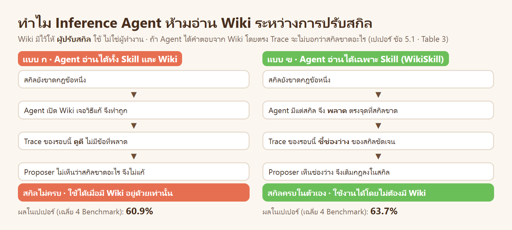

| | |
|---|---|
| คำถาม | Wiki มีวิธีแก้อยู่แล้ว ทำไมไม่ให้ Agent ที่ทำงานเปิดอ่านด้วย |
| WikiSkill เลือก | ระหว่างการปรับสกิล Agent เห็นเฉพาะ `skills/` |
| เหตุผล | เป้าหมายคือ **สกิลที่ครบในตัวเอง** · ถ้า Agent ทำถูกเพราะ Wiki, Trace จะดูดี และไม่มีอะไรบอก Proposer ว่าสกิลยังขาดกฎข้อใด · ความผิดพลาดของ Agent คือสัญญาณที่ใช้ปรับสกิล จึงต้องไม่ถูกกลบ |
| หลักฐานในเปเปอร์ | Table 3: ให้ Agent อ่าน Wiki ด้วย คะแนนเฉลี่ยลดจาก 63.7% เป็น 60.9% |
| ในโค้ด | `rollouts()` คัดลอกเข้า sandbox เฉพาะโฟลเดอร์ `skills/` (ผ่าน `suite["files"]`) · ไม่มี path ของ `wiki/` หรือ `raw/` ใน sandbox |

### 8.5 ทำไมแยก Wiki Maintainer กับ Skill Proposer

| | |
|---|---|
| คำถาม | ใช้โมเดลตัวเดียวอ่าน Trace แล้วแก้สกิลเลยได้หรือไม่ |
| WikiSkill เลือก | แยก 2 บทบาท: Maintainer **วินิจฉัย** · Proposer **สั่งยา** |
| เหตุผล | (1) คนละเป้าหมาย: Maintainer ต้องจดให้ครบและเป็นกลาง รวมถึง pattern ที่สำเร็จ · Proposer ต้องเลือกแก้ **จุดเดียว** ที่คุ้มที่สุด (2) Maintainer ไม่ถูกผูกกับผลของ Gate: ต่อให้ข้อเสนอของรอบนี้ถูกทิ้ง ความรู้ของรอบนี้ก็เข้า Wiki ไปแล้ว (บรรทัด 10 เกิดก่อนบรรทัด 14) (3) แต่ละตัวได้บริบทที่เหมาะกับงาน: Maintainer ได้ Trace ตัวอย่างเต็ม ๆ · Proposer ได้สารบัญแล้วเลือกเปิดเอง |
| ในโค้ด | `cmd_maintain()` เรียก `llm()` ด้วย `tools=""` (ไม่มีเครื่องมือ · 1 ครั้ง) · `cmd_propose()` เรียก `llm()` ด้วย `tools="Read"` (หลายรอบ) |

### 8.6 ทำไม `skill-impact.md` ต้องเขียนโดยโปรแกรม

| | |
|---|---|
| คำถาม | ให้ Maintainer เขียนผลของ Gate ลง Wiki เองได้หรือไม่ |
| WikiSkill เลือก | ไฟล์นี้โปรแกรมเขียนเท่านั้น: ชื่อสกิล · diff · คะแนน Validation · ผลรับหรือไม่รับ |
| เหตุผล | นี่คือ **ข้อเท็จจริงจากการวัด** ไม่ใช่การตีความ · ถ้าให้โมเดลเล่าเอง อาจจำคลาดหรือสรุปเข้าข้างข้อเสนอของตัวเอง · ผู้ปรับสกิลต้องมีบันทึกที่เชื่อได้ 100% ว่าอะไรเคยถูกลองและได้ผลอย่างไร (หลักเดียวกับบท 05: คนแก้ไม่ควรเป็นคนตัดสินงานของตัวเอง) |
| ในโค้ด | `cmd_gate()` ต่อท้าย `wiki/skill-impact.md` ด้วย `difflib.unified_diff` · prompt ของ Maintainer ระบุว่าไฟล์นี้อ่านได้อย่างเดียว |

### 8.7 ทำไม Proposer ต้องเป็น ReAct และเริ่มจาก index

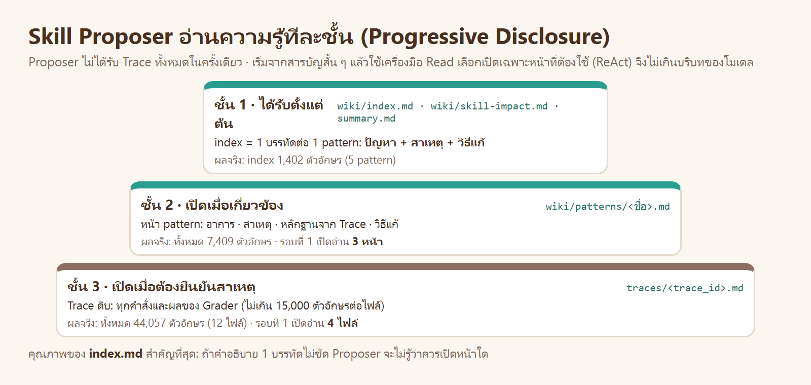

| | |
|---|---|
| คำถาม | ทำไมไม่ส่ง Wiki และ Trace ทั้งหมดให้ Proposer ในครั้งเดียว |
| WikiSkill เลือก | ให้เฉพาะ `index.md` + `skill-impact.md` + สรุปผล แล้วให้ Proposer ใช้เครื่องมือ `Read` เปิดไฟล์ที่ต้องการเอง (ReAct = คิด → เปิดไฟล์ → คิดต่อ) |
| เหตุผล | (1) บริบทของโมเดลมีจำกัด และ Trace ยาว (2) ต้นทุนไม่โตตามจำนวนโจทย์: ต่อรอบใช้ 1 + T_ReAct ครั้ง ไม่ว่าจะมี Training 12 หรือ 1,200 งาน (3) บังคับให้ Wiki ต้องดี: ถ้าบรรทัดใน index ไม่ชัด หน้านั้นจะไม่ถูกเปิด prompt ของ Maintainer จึงกำหนดว่า 1 บรรทัดต้องมี **ปัญหา + สาเหตุ + วิธีแก้** |
| ในโค้ด | `cmd_propose()` สร้าง `proposer_view/` และใส่เฉพาะ index, skill-impact, summary ในข้อความแรก · นับไฟล์ที่ถูกเปิดจาก transcript (`reads`) · ถ้าเปิด Trace น้อยกว่า 4 ไฟล์ ข้อเสนอถูกตีกลับ (`MIN_TRACES`) |

### 8.8 ทำไมสุ่ม Trace ให้ Maintainer แค่ 8 และมีทั้งที่ผ่าน

| | |
|---|---|
| WikiSkill เลือก | ต่อรอบ: ไม่ผ่านไม่เกิน 5 + ผ่านไม่เกิน 3 · แต่ละ Trace ไม่เกิน 15,000 ตัวอักษร |
| เหตุผล | Trace ที่ไม่ผ่านใช้หาสาเหตุ · Trace ที่ผ่านใช้ดูว่า **ทำอย่างไรจึงถูก** (หลายครั้งวิธีแก้อยู่ใน Trace ที่ผ่านอยู่แล้ว) และกันไม่ให้ข้อเสนอใหม่ทำของที่ดีอยู่พัง · จำนวนคงที่ทำให้ Maintainer เรียกโมเดล 1 ครั้งต่อรอบเสมอ |
| ในโค้ด | `sample_traces()` (`MAX_FAIL = 5`, `MAX_PASS = 3`, กระจายทุกโจทย์ คะแนนต่ำก่อน) · `TRACE_CAP = 15000` ใน `render_trace()` |

### 8.9 ทำไมข้อเสนอต้องเล็ก: 1 สกิลต่อรอบ และแก้แบบ patch

| | |
|---|---|
| WikiSkill เลือก | 1 รอบ = ข้อเสนอ 1 ข้อ ต่อสกิล 1 ตัว · แก้ของเดิมด้วยรายการ `append` / `replace` / `insert_after` ไม่เขียนทับทั้งไฟล์ |
| เหตุผล | (1) **รู้ว่าอะไรได้ผล:** Gate ให้คำตอบเดียวต่อรอบ (รับ/ไม่รับ) ถ้าแก้หลายอย่างพร้อมกันจะไม่รู้ว่าอย่างไหนทำให้คะแนนเปลี่ยน (เหตุผลเดียวกับ "แก้ไม่เกิน 3 จุด" ของบท 05) (2) **ไม่ทำของเดิมหาย:** การเขียนทั้งไฟล์ใหม่ โมเดลมักทำกฎที่ดีอยู่แล้วตกหล่น · patch แตะเฉพาะจุดที่ระบุ (3) diff เล็ก อ่านง่ายเมื่อไปอยู่ใน `skill-impact.md` |
| ในโค้ด | `apply_edits()` ใช้ร่วมกันทั้ง Wiki และสกิล · ถ้า `target` ไม่พบในไฟล์ ข้อเสนอถูกตีกลับใน `build_candidate()` |

### 8.10 ทำไม Gate รับเฉพาะเมื่อ "ดีกว่า" และหยุดเมื่อได้ 100%

| | |
|---|---|
| WikiSkill เลือก | รับเมื่อคะแนน Validation **มากกว่า** R_best เท่านั้น · หยุดทันทีเมื่อ R_best = 100% |
| เหตุผล | เกณฑ์เดียวกับวิธีก่อนหน้า (SkillOpt, EvoSkill) เพื่อให้เทียบกันได้ยุติธรรม · เข้มไว้ก่อนเพื่อไม่ให้สกิลบวมด้วยการแก้ที่ไม่ช่วย |
| ข้อแลกเปลี่ยน | (1) ข้อเสนอที่คะแนนเท่าเดิมแต่เป็นฐานของการแก้รอบถัดไป ถูกทิ้ง (2) Validation ชุดเล็กมีความแกว่ง: ได้ 100% หนึ่งครั้งไม่ได้แปลว่าสกิลสมบูรณ์ · เปเปอร์จึงรันทั้งกระบวนการ 3 ครั้งแล้วเฉลี่ย · บท 05 ใช้อีกทางหนึ่งคือ threshold จากความแกว่ง |
| ในโค้ด | `cmd_gate()`: `accepted = r_val > before + 1e-9` · `cmd_loop()` และ `cmd_rollout()` ตรวจ `r_best >= 1.0` ก่อนเริ่มรอบใหม่ |

### สรุปการออกแบบใน 1 ตาราง

| หลัก | ผลในระบบ |
|---|---|
| แยกของดิบ ความรู้ และขั้นตอน | 3 ชั้น 3 โฟลเดอร์ |
| ความรู้ต้องสะสม | Wiki ไม่ย้อนกลับ · หน้าเดิมถูกเติมหลักฐาน ไม่สร้างซ้ำ |
| สิ่งที่ใช้งานต้องปลอดภัย | สกิลผ่าน Gate เท่านั้น และย้อนกลับได้ |
| ข้อเท็จจริงมาจากการวัด | `skill-impact.md` เขียนโดยโปรแกรม |
| สัญญาณต้องไม่ถูกกลบ | Agent ที่ทำงานไม่เห็น Wiki |
| บริบทมีจำกัด | สุ่ม Trace · index 1 บรรทัดต่อ pattern · Proposer เลือกเปิดเอง |
| รู้ว่าอะไรได้ผล | ข้อเสนอ 1 ข้อต่อรอบ · patch ทีละจุด |

---

## ขั้น 9 · เปรียบเทียบ

### 9.1 กับวิธีปรับสกิลก่อนหน้า

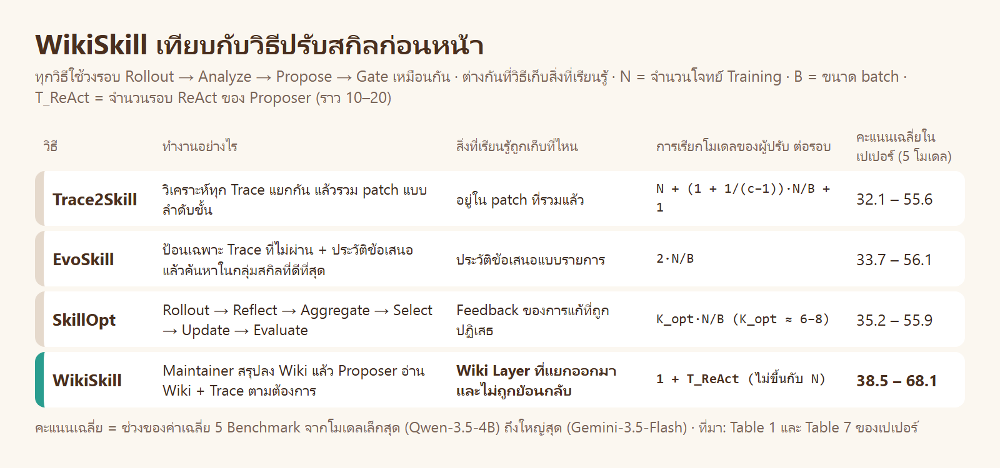

| วิธี | จุดเด่น | สิ่งที่ WikiSkill ทำต่างออกไป |
|---|---|---|
| Trace2Skill | วิเคราะห์ทุก Trace แบบขนาน แล้วรวม patch เป็นลำดับชั้น | ไม่วิเคราะห์ทุก Trace: Maintainer ดูตัวอย่าง Proposer เลือกเปิดเอง · ต้นทุนไม่โตตามจำนวนโจทย์ |
| EvoSkill | เก็บกลุ่มสกิลที่ดีที่สุดไว้หลายตัว และมีประวัติข้อเสนอ | ประวัติไม่ได้เป็นแค่รายการ แต่ถูกจัดเป็น pattern ที่มีสาเหตุและหลักฐาน |
| SkillOpt | ไพป์ไลน์ 6 ขั้น และใช้ feedback ของการแก้ที่ถูกปฏิเสธ | ความรู้อยู่ในชั้นแยกที่ไม่ถูกย้อนกลับ ใช้ได้ข้ามทุกรอบ |

### 9.2 กับ Skill Optimizer ของบท 05

| | Skill Optimizer (บท 05) | WikiSkill (บทนี้) |
|---|---|---|
| ผู้วิเคราะห์และผู้แก้สกิล | Claude ใน Claude Code Desktop ตามพรอมต์ของเราทีละรอบ | โมเดล 2 บทบาท รันเองทั้งวงรอบ |
| สกิลเริ่มต้น | `v0` ที่คนเขียน (รู้กฎของร้านอยู่แล้ว) | ว่าง · ต้องค้นพบกฎจาก Trace เอง |
| ที่เก็บความรู้ | `ISSUES.md` 1 ไฟล์ เขียนตามรูปแบบที่ตกลงไว้ | `wiki/` : patterns + index + log + skill-impact |
| ขนาดการแก้ต่อรอบ | ไม่เกิน 3 จุด | ข้อเสนอ 1 ข้อ ต่อสกิล 1 ตัว |
| เกณฑ์ของ Gate | Training และ Validation ไม่ลดเกิน threshold และคะแนนขึ้นเกิน threshold หรือต้นทุนลด ≥ 10% | Validation มากกว่า R_best |
| ความแกว่งของการวัด | คิดจากการรันซ้ำ แล้วใช้เป็น threshold | ไม่คิด (เปเปอร์ชดเชยด้วยการรันทั้งกระบวนการ 3 ครั้ง) |
| ต้นทุนเป็นเป้าหมายด้วยหรือไม่ | ใช่ (`v3` รับเพราะโทเคนลด 17%) | ไม่ · หยุดเมื่อ Validation 100% |
| ชุดที่ใช้วัดผลสุดท้าย | ไม่มี Test Set | มี Test Set |

ผลจริงของทั้งสองวิธีบนโจทย์ชุดเดียวกันอยู่ใน [README หลัก ส่วนที่ 4](../README.md#4--เทียบกับ-skill-optimizer)

### 9.3 ผลในเปเปอร์

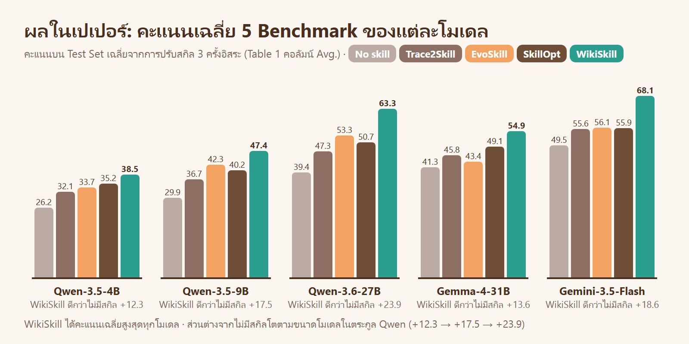

เปเปอร์ทดลอง 5 Benchmark (คณิตศาสตร์ · ค้นเว็บ · สเปรดชีต · เอกสารยาว · งานบ้านจำลอง) กับ 5 โมเดล ข้อค้นพบหลัก

| ข้อค้นพบ | ตัวเลข |
|---|---|
| WikiSkill ได้ค่าเฉลี่ยสูงสุดทุกโมเดล | ชนะวิธีที่ดีที่สุดรองลงมา 3.3 ถึง 12.0 จุด |
| โมเดลใหญ่ได้ประโยชน์จากสกิลมากกว่า | Qwen 4B / 9B / 27B ดีขึ้น +12.3 / +17.5 / +23.9 จุด |
| โมเดลเล็กที่มีสกิล ชนะโมเดลใหญ่ที่ไม่มีสกิล | Qwen-9B + WikiSkill 47.4% เทียบกับ Qwen-27B ไม่มีสกิล 39.4% |
| สกิลย้ายข้ามโมเดลได้ และบางครั้งดีกว่าสกิลที่โมเดลปรับเอง | ALFWorld: Qwen-9B ใช้สกิลของ 27B ได้ 70.2% · ใช้สกิลของตัวเองได้ 63.4% |
| แต่สกิลจากโมเดลเล็กอาจถ่วงโมเดลใหญ่ | SpreadSheet: Gemini ใช้สกิลของ Qwen-4B ลดจาก 50.5% เหลือ 18.1% (สกิลเต็มไปด้วยวิธีเลี่ยงข้อจำกัดของโมเดลเล็ก) |

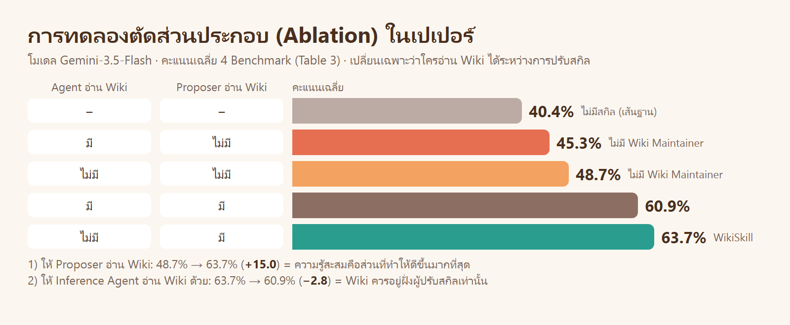

การตัดส่วนประกอบยืนยันการออกแบบ 2 ข้อ: Wiki ที่สะสมข้ามรอบคือส่วนที่ทำให้ดีขึ้นมากที่สุด (ข้อ 8.3, 8.7) และ Wiki ควรอยู่ฝั่งผู้ปรับสกิลเท่านั้น (ข้อ 8.4)

---

## ขั้น 10 · ข้อจำกัด

| ข้อจำกัด | ที่มา | ผล |
|---|---|---|
| ไม่ได้ทดสอบการ **เลือก** สกิล | เปเปอร์ | สกิลทุกตัวถูกใส่ให้ Agent ตรง ๆ ถ้ามีสกิลจำนวนมาก ต้องมีขั้นค้นหาสกิลเพิ่ม |
| Gate เข้ม รับเฉพาะเมื่อดีขึ้น | เปเปอร์ | ข้อเสนอที่ไม่ขึ้นทันทีแต่เป็นฐานของรอบถัดไปถูกทิ้ง |
| Wiki โตอย่างเดียว ไม่มีการตัดแต่ง | เปเปอร์ | รันยาวมาก ๆ Wiki จะใหญ่และมีหน้าที่ล้าสมัย |
| ไม่ครอบคลุมงานที่ยาวหลายชั่วโมง | เปเปอร์ | ยังไม่มีการปรับสกิลระหว่างทำงานชิ้นเดียว |
| Validation ชุดเล็กแกว่ง | เปเปอร์ + ผลจริงของบทนี้ | การรับและการหยุดขึ้นกับโชคของการวัดครั้งนั้น (ดูผลจริงใน README หลัก) |

---

## ขั้น 11 · ทบทวน

<details><summary>1 ทำไมสกิลที่ไม่ผ่าน Gate ถูกทิ้ง แต่บันทึกของมันยังอยู่ใน Wiki</summary>

สกิลที่ทำให้คะแนนแย่ลงเป็นอันตรายต่อการใช้งาน จึงต้องย้อนกลับ · แต่ข้อเท็จจริงว่า "เคยลองแบบนี้แล้วไม่ได้ผล" เป็นความรู้ที่ทำให้รอบถัดไปไม่เสนอซ้ำ จึงเก็บไว้ใน `wiki/skill-impact.md` (ข้อ 8.3)

</details>

<details><summary>2 ถ้าให้ Inference Agent อ่าน Wiki ได้ จะเกิดอะไรขึ้นกับสกิล</summary>

Agent ทำถูกเพราะ Wiki ไม่ใช่เพราะสกิล · Trace จึงไม่แสดงช่องว่างของสกิล · Proposer ไม่มีสัญญาณให้เติมสกิล · สกิลที่ได้ใช้ได้เฉพาะเมื่อมี Wiki อยู่ด้วย (ข้อ 8.4 · เปเปอร์: 63.7% → 60.9%)

</details>

<details><summary>3 บรรทัดใดของ Algorithm 1 ที่ทำให้ความรู้ของรอบที่ล้มเหลวไม่หาย</summary>

บรรทัด 10 (Wiki ถูกเขียนก่อนรู้ผลของ Gate) · บรรทัด 16 (ย้อนกลับเฉพาะสกิล) · บรรทัด 19 (จดผลของข้อเสนอทุกครั้ง)

</details>

<details><summary>4 ทำไมบรรทัดใน <code>index.md</code> ต้องมี ปัญหา + สาเหตุ + วิธีแก้</summary>

Proposer ได้รับเฉพาะ index ตั้งแต่ต้น แล้วเลือกเองว่าจะเปิดหน้าใด บรรทัดที่บอกไม่ครบทำให้หน้านั้นไม่ถูกเปิด ความรู้ในหน้านั้นจึงไม่ถูกใช้ (ข้อ 8.7)

</details>

<details><summary>5 <code>skill-impact.md</code> ต่างจากไฟล์อื่นใน Wiki อย่างไร</summary>

เป็นไฟล์เดียวที่โปรแกรมเขียน ไม่ใช่โมเดล เพราะเป็นข้อเท็จจริงจากการวัด (diff · คะแนน · รับ/ไม่รับ) ซึ่งต้องเชื่อได้ทั้งหมด (ข้อ 8.6)

</details>

<details><summary>6 การเรียกโมเดลของผู้ปรับสกิลต่อรอบ ขึ้นกับจำนวนโจทย์ Training หรือไม่</summary>

ไม่ · Maintainer เรียก 1 ครั้งกับ Trace ตัวอย่างไม่เกิน 8 · Proposer เรียกตามจำนวนรอบ ReAct (ราว 10–20) · รวม 1 + T_ReAct ไม่ว่าจะมีโจทย์กี่ข้อ (ข้อ 8.7 · Table 7 ของเปเปอร์)

</details>

**ถัดไป:** [ข้างใน WikiSkill: `wikiskill.py` และ prompt](../02_inside_wikiskill/README.md) · [กลับไปบทหลัก](../README.md)
