# ทฤษฎี WikiSkill · แนวคิด วิธีคิดในการออกแบบ และอัลกอริทึม

> เปเปอร์ต้นทาง: Tang et al., *WikiSkill: Compiling Agent Experience into Persistent Knowledge for Skill Evolution*, Google Research, [arXiv:2608.27454](https://arxiv.org/abs/2608.27454) (ส.ค. 2026)
> หน้านี้อธิบายด้วยถ้อยคำของบทเรียน ตัวเลขของเปเปอร์คัดจาก Table 1, 3, 4, 7 · ตัวอย่างทุกชิ้นมาจากการรันจริงของบทนี้ ([`runs/w1/`](../runs/w1/))

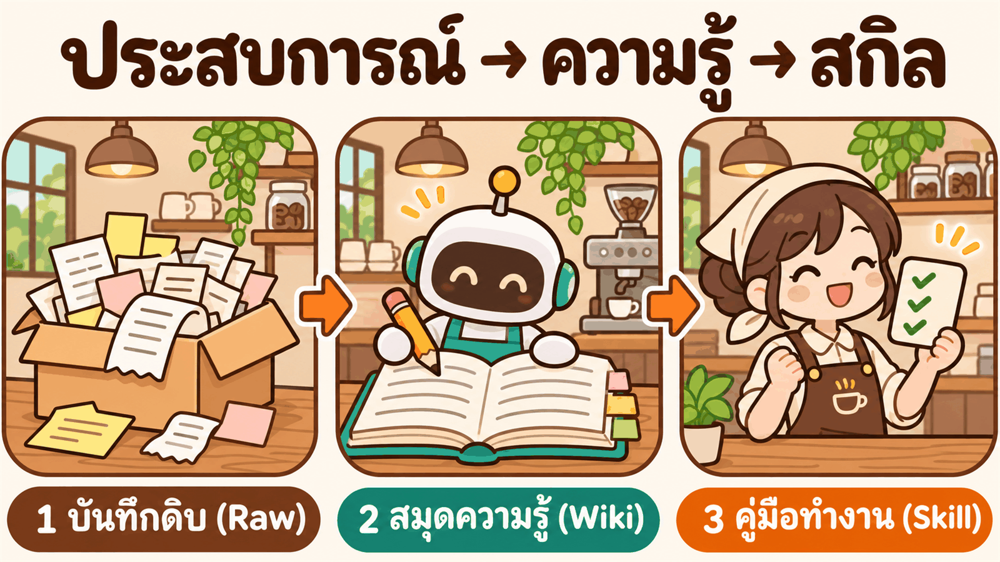

**WikiSkill ในประโยคเดียว:** ระหว่างการปรับสกิล ให้มี **สมุดความรู้ (Wiki)** คั่นกลางระหว่าง Trace ดิบกับสกิล · Trace ถูกสรุปลง Wiki ก่อน แล้วสกิลจึงถูกแก้จาก Wiki · สกิลที่ไม่ผ่านถูกทิ้งได้ แต่ Wiki ไม่ถูกทิ้ง

สไลด์ของบทนี้: [WikiSkill_Theory_Slides.html](WikiSkill_Theory_Slides.html) (เปิดในเบราว์เซอร์)

## ภาพรวมใน 1 หน้า

| | |
|---|---|
| **ปัญหา** | วิธีปรับสกิลอัตโนมัติวิเคราะห์ Trace ใหม่ทุกรอบ แต่สิ่งที่วิเคราะห์ได้ถูกใช้ครั้งเดียวแล้วหายไป รอบถัดไปจึงลืม เสนอซ้ำ และมองไม่เห็นปัญหาที่ค่อย ๆ สะสม (ขั้น 2) |
| **แนวคิด** | แยกของ 3 อย่างออกจากกัน: Trace (เกิดอะไรขึ้น) · Wiki (ทำไม) · สกิล (ต้องทำอย่างไร) และให้ Wiki อยู่ถาวร (ขั้น 3–4) |
| **วงรอบ** | Agent ทำโจทย์ → Wiki Maintainer จดความรู้ลง Wiki → Skill Proposer เสนอแก้สกิล 1 ตัวจาก Wiki → วัดด้วย Validation → รับ หรือย้อนกลับเฉพาะสกิล (ขั้น 5–7) |
| **ทำไมออกแบบแบบนี้** | 10 การตัดสินใจ แต่ละข้อมีคำถาม ทางเลือก เหตุผล และหลักฐาน (ขั้น 8) |
| **ผลในเปเปอร์** | ชนะวิธีก่อนหน้าทุกโมเดล · ตัด Wiki ออก คะแนนเฉลี่ยลดจาก 63.7% เหลือ 48.7% · ข้อเสนอ 8 ครั้งผ่าน Gate ราว 2–3 ครั้ง (ขั้น 9) |
| **ผลในบทนี้** | เริ่มจากไม่มีสกิล ได้ 97.9% ใน 2 รอบ และ 100% บน Test Set · ค้นพบมาตรฐานการเขียนโค้ดเอง แต่ไม่พบนโยบายธุรกิจ Wiki จดไว้ว่ายังไม่ยืนยัน (ขั้น 10) |

## อ่านตามลำดับนี้

| ขั้น | ตอบคำถาม |
|---|---|
| [1 · วงรอบการปรับสกิล](#ขั้น-1--วงรอบการปรับสกิล) | ทุกวิธีปรับสกิลทำอะไรเหมือนกัน |
| [2 · ปัญหา](#ขั้น-2--ปัญหา-ความรู้กระจัดกระจาย) | วงรอบเดิมขาดอะไร |
| [3 · แนวคิดหลัก](#ขั้น-3--แนวคิดหลัก-คอมไพล์ประสบการณ์เป็นความรู้) | "คอมไพล์ประสบการณ์เป็นความรู้" คืออะไร |
| [4 · สถาปัตยกรรม 3 ชั้น](#ขั้น-4--สถาปัตยกรรม-3-ชั้น) | แต่ละชั้นเก็บอะไร ต่างกันอย่างไร |
| [5 · ส่วนประกอบ 4 ตัว](#ขั้น-5--ส่วนประกอบ-4-ตัว) | ใครทำอะไร เห็นอะไรได้บ้าง |
| [6 · เดิน 1 รอบด้วยผลจริง](#ขั้น-6--เดิน-1-รอบด้วยผลจริง) | ข้อมูลไหลจาก Trace ไปเป็นสกิลอย่างไร |
| [7 · อัลกอริทึม](#ขั้น-7--อัลกอริทึม) | Algorithm 1 ทีละบรรทัด |
| [8 · วิธีคิดในการออกแบบ](#ขั้น-8--วิธีคิดในการออกแบบ) | ทำไมจึงออกแบบแต่ละจุดเช่นนี้ (10 ข้อ) |
| [9 · เปรียบเทียบ](#ขั้น-9--เปรียบเทียบ) | ต่างจากวิธีอื่น และจาก Skill Optimizer ของบท 05 อย่างไร |
| [10 · นำมาใช้กับโจทย์ของบทนี้](#ขั้น-10--นำมาใช้กับโจทย์ของบทนี้) | เปเปอร์กับบทนี้ต่างกันตรงไหน · ผลจริงยืนยันหรือแย้งกับเปเปอร์ข้อใด |
| [11 · ข้อจำกัด](#ขั้น-11--ข้อจำกัด) | สิ่งที่ WikiSkill ยังทำไม่ได้ |
| [12 · ทบทวน](#ขั้น-12--ทบทวน) | คำถามตรวจความเข้าใจ |

ทุกขั้นมีกล่อง **ในเครื่องมือ** บอกว่าแนวคิดนั้นคือคำสั่งใดของ `wikiskill.py` และกติกาข้อใดใน [รูปแบบของ `wikiskill`](../wikiskill_format.md) · เครื่องมือนี้ผู้เรียนสร้างเองใน [LAB 0](../README.md#lab-0--เตรียมเครื่องมือและโจทย์)

---

## ขั้น 1 · วงรอบการปรับสกิล

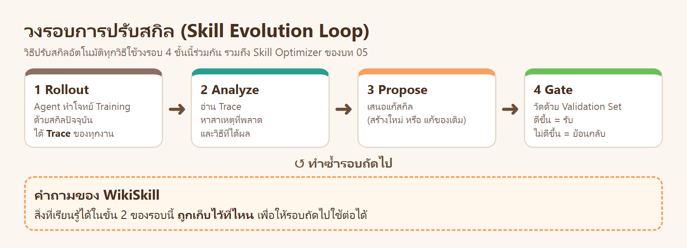

วิธีปรับสกิลอัตโนมัติทุกวิธีทำ 4 ขั้นนี้ซ้ำ รวมถึงบท 05

| ขั้น | ทำอะไร | ในบท 05 (Skill Optimizer) คือ |
|---|---|---|
| 1 Rollout | Agent ทำโจทย์ Training ด้วยสกิลปัจจุบัน | คำสั่ง `run` |
| 2 Analyze | อ่าน Trace หาสาเหตุ | Claude อ่าน `failures` แล้วจดลง `ISSUES.md` |
| 3 Propose | เสนอแก้สกิล | Claude คัดลอก `v1` เป็น `v2` แล้วแก้ไม่เกิน 3 จุด |
| 4 Gate | วัด Validation แล้วรับหรือทิ้ง | คำสั่ง `gate` |

คำศัพท์ที่ใช้ทั้งหน้า

| คำ | ความหมาย |
|---|---|
| **Trace** | บันทึกทุกขั้นที่ Agent ทำใน 1 งาน: คำสั่ง โค้ด ผลที่ได้ และผลของตัวตรวจ |
| **สกิล (Skill)** | โฟลเดอร์ที่มี `SKILL.md` = ขั้นตอนที่ Agent อ่านแล้วทำตาม |
| **Training / Validation / Test Set** | โจทย์ที่ใช้หาข้อพลาด / โจทย์ที่ใช้ตัดสินรับหรือทิ้ง / โจทย์ที่ใช้วัดผลสุดท้าย |
| **R_best** | คะแนน Validation ที่ดีที่สุดเท่าที่เคยได้ |

---

## ขั้น 2 · ปัญหา: ความรู้กระจัดกระจาย

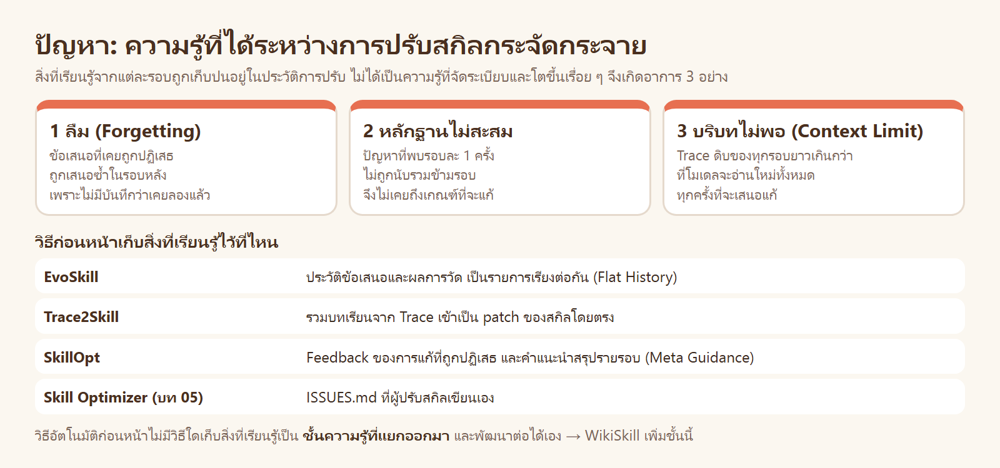

ขั้น 2 ของวงรอบ (Analyze) ได้ข้อสรุปออกมาทุกรอบ เช่น "Agent ปัดเศษทุกขั้นจึงคลาด 1 สตางค์" แต่ข้อสรุปนี้ถูกใช้ครั้งเดียวตอนแก้สกิลของรอบนั้น แล้วหายไปกับประวัติ

| อาการ | ตัวอย่าง |
|---|---|
| **1 ลืม** | รอบ 3 เสนอวิธีที่รอบ 1 ลองแล้วถูกปฏิเสธ เพราะไม่มีที่ใดจดว่าเคยลอง |
| **2 หลักฐานไม่สะสม** | ปัญหาที่พบรอบละ 1 Trace ถูกมองว่าบังเอิญทุกรอบ ทั้งที่รวม 4 รอบแล้วพบ 4 ครั้ง |
| **3 บริบทไม่พอ** | 8 รอบ × 12 Trace × 15,000 ตัวอักษร ≈ 1.4 ล้านตัวอักษร อ่านใหม่ทุกครั้งไม่ได้ |

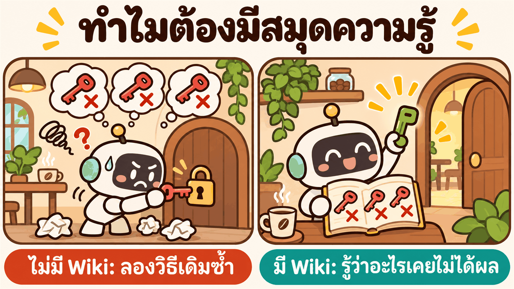

**ตัวอย่างจากบท 05:** ในรุ่น `v0` พบ "ปัดเศษทุกขั้น" แค่ 1 จาก 12 Trial จึงยังไม่แก้ → รุ่น `v1` Validation ได้ 90% เพราะสาเหตุเดียวกัน → รุ่น `v2` แก้ได้ เพราะ Claude **จดปัญหานั้นไว้ใน `ISSUES.md`** ตั้งแต่ `v0`
`ISSUES.md` ของบท 05 คือ Wiki ที่เขียนด้วยมือ · WikiSkill ทำสิ่งนี้ให้เป็นระบบและอัตโนมัติ

---

## ขั้น 3 · แนวคิดหลัก: คอมไพล์ประสบการณ์เป็นความรู้

เปเปอร์ได้แนวคิดจาก LLM Wiki ของ Andrej Karpathy: ให้โมเดล **เรียบเรียงข้อมูลดิบเป็นฐานความรู้ที่อ่านต่อได้** แทนที่จะกลับไปค้นข้อมูลดิบทุกครั้ง · คำว่า "คอมไพล์" ยืมมาจากการเขียนโปรแกรม

| | ของดิบ | สิ่งที่เรียบเรียงแล้ว | สิ่งที่ใช้ทำงาน |
|---|---|---|---|
| เขียนโปรแกรม | source code | ไลบรารีที่คอมไพล์แล้ว | โปรแกรมที่รัน |
| ร้านกาแฟ | ใบบันทึกหน้างานทุกวัน | สมุดความรู้ของร้าน | คู่มือพนักงาน 1 หน้า |
| นักเรียน | ข้อสอบเก่าที่ทำผิด | สมุดสรุปบทเรียน | โพยสูตรก่อนเข้าห้องสอบ |
| **WikiSkill** | **Trace** (`raw/`) | **Wiki** (`wiki/`) | **สกิล** (`skills/`) |

สามอย่างนี้ตอบคำถามคนละข้อ จึงไม่ควรเก็บรวมกัน

| | ตอบคำถาม | ขนาด | ใครใช้ |
|---|---|---|---|
| Trace | **เกิดอะไรขึ้น** ในงานนี้ | ยาวมาก (สูงสุด 15,000 ตัวอักษรต่องาน) | ผู้วิเคราะห์ |
| Wiki | **ทำไม** จึงเกิด และเคยลองแก้อย่างไร | กลาง (10–30 บรรทัดต่อ pattern) | ผู้ปรับสกิล |
| สกิล | **ต้องทำอย่างไร** ในงานถัดไป | สั้น | Agent ที่ทำงาน |

> **ประโยคที่ต้องจำ:** สกิลเป็นเพียง "ฉบับย่อที่ใช้งานได้" ของความรู้ ณ ขณะหนึ่ง · ความรู้ที่อยู่เบื้องหลัง (ทำไมจึงมีกฎข้อนี้ เคยลองอะไรแล้วไม่ได้ผล) ต้องมีที่อยู่ของตัวเอง

---

## ขั้น 4 · สถาปัตยกรรม 3 ชั้น

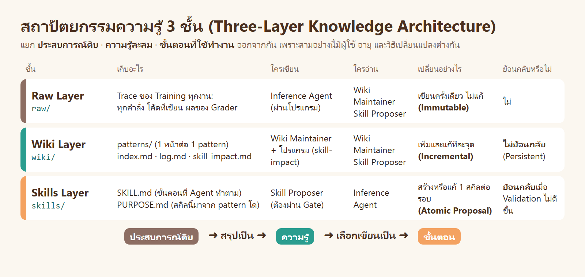

workspace จริงหลังรันจบ ([`runs/w1/`](../runs/w1/) · LAB 1)

```text
runs/w1/
├── raw/iter-01/  raw/iter-02/         Raw Layer
│   ├── traces/t1-cafe-bill-r1.md …    Trace รอบละ 12 ไฟล์ (4 โจทย์ × 3 รอบ)
│   └── summary.md                     ตารางผลของ Trace ทั้ง 12
├── wiki/                              Wiki Layer
│   ├── index.md                       สารบัญ 7 บรรทัด
│   ├── patterns/                      7 หน้า (26–44 บรรทัดต่อหน้า)
│   ├── log.md                         บันทึกของ Maintainer รายรอบ
│   └── skill-impact.md                บันทึกของโปรแกรม: ข้อเสนอ diff คะแนน ผล
├── skills/solve-py-contract/          Skills Layer
│   ├── SKILL.md                       107 บรรทัด · Agent อ่านไฟล์นี้
│   └── PURPOSE.md                     สกิลนี้แก้ pattern ใดใน wiki
├── history/iter-01/  history/iter-02/ หลักฐานของรอบ: สิ่งที่แต่ละบทบาทได้รับและตอบ
└── state.json                         สถานะของวงรอบ (k · R_best · ประวัติ)
```

> **ในเครื่องมือ:** `init` สร้าง 3 โฟลเดอร์นี้ว่าง ๆ (S₀ = ∅, W₀ = ∅) · Raw เขียนครั้งเดียวตอน `rollout` และไม่มีคำสั่งใดกลับไปแก้ · Wiki เปลี่ยนตอน `maintain` และ `gate` · Skills เปลี่ยนตอน `gate` เท่านั้น ([รูปแบบ ข้อ 2](../wikiskill_format.md#2--โฟลเดอร์งาน-work-และ-workspace))

### เรื่องเดียวกัน ใน 3 ชั้น (ผลจริง)

ปัญหา "รันเป็นโปรแกรมไม่ได้" ปรากฏในทั้ง 3 ชั้น แต่เขียนต่างกันตามหน้าที่ของชั้น

**ชั้น 1 · Raw** บอกว่า *เกิดอะไรขึ้น* ในงานนี้ ([`raw/iter-01/traces/t4-cashback-r1.md`](../runs/w1/raw/iter-01/traces/t4-cashback-r1.md))

```text
- ✗ `cli_ok`: stdin {"amount": 20000, "tier": "gold", "birthday": false} ต้องได้ {"ok": true, "result": 500} exit 0 แต่ได้ exit 0 stdout (ว่าง)
```

**ชั้น 2 · Wiki** บอกว่า *ทำไม* และรวมหลักฐานจากหลายงาน ([`wiki/patterns/missing-cli-entrypoint.md`](../runs/w1/wiki/patterns/missing-cli-entrypoint.md))

```markdown
## สาเหตุ
- Agent เขียน `solve.py` เป็นไฟล์ที่มีแต่ฟังก์ชัน ไม่มีบล็อก `if __name__ == "__main__":` …
- โจทย์ไม่ได้เอ่ยถึงโหมด CLI และไม่มีสกิลบอก Agent จึงไม่รู้ว่าต้องทำ
## หลักฐาน
งานที่ล้ม: ทั้ง 5 Trace ใช้ `cat > solve.py` หรือ Write เฉพาะนิยามฟังก์ชัน ไม่มีโค้ดอ่าน stdin
## อัปเดตรอบ 2: แก้ได้แล้ว
- `cli_ok` และ `cli_error` ผ่านครบในทั้ง 7 Trace ที่สุ่มมา …
```

**ชั้น 3 · Skill** บอกว่า *ต้องทำอย่างไร* ไม่มีชื่อโจทย์ ไม่มีหลักฐาน ([`skills/solve-py-contract/SKILL.md`](../runs/w1/skills/solve-py-contract/SKILL.md))

```markdown
## 2) โหมด CLI ท้าย solve.py
- สำเร็จ: stdout เป็น `{"ok": true, "result": ...}` exit 0
- ผิดพลาด: stdout เป็น `{"ok": false, "error": "..."}` exit 2 และห้ามมี traceback
```

| | Raw | Wiki | Skill |
|---|---|---|---|
| พูดถึงงานกี่งาน | 1 งาน | 5 งานในรอบ 1 · 7 งานในรอบ 2 | ทุกงานในอนาคต |
| มีชื่อโจทย์และค่าของโจทย์หรือไม่ | มี | มี (เป็นหลักฐาน) | ไม่มี |
| เปลี่ยนเมื่อใด | ไม่เปลี่ยน | ทุกรอบ (เติมสถานะล่าสุด) | เมื่อข้อเสนอผ่าน Gate |

---

## ขั้น 5 · ส่วนประกอบ 4 ตัว

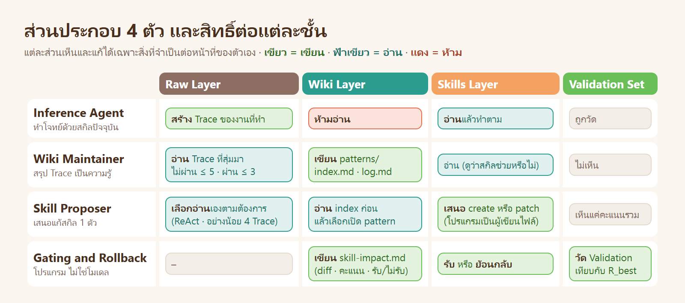

| ส่วนประกอบ | เป็นอะไร | รับเข้า | ส่งออก | เรียกโมเดล |
|---|---|---|---|---|
| **Inference Agent** | Agent ที่ทำโจทย์ (ตัวที่ถูกปรับ) | โจทย์ + สกิลปัจจุบัน | ผลงาน + Trace | 1 เซสชันต่อ 1 งาน |
| **Wiki Maintainer** | โมเดลที่ทำหน้าที่ "นักวิเคราะห์" | Wiki เดิม + Trace ที่สุ่มมา ≤ 8 | รายการแก้ Wiki (JSON) | **1 ครั้ง**ต่อรอบ |
| **Skill Proposer** | โมเดลที่ทำหน้าที่ "ผู้เขียนคู่มือ" | index ของ Wiki + ประวัติข้อเสนอ + สรุปผล แล้วเลือกเปิดไฟล์เอง | ข้อเสนอ 1 ข้อ (JSON) | ReAct ราว 10–20 รอบ |
| **Gating and Rollback** | โปรแกรม (ไม่ใช่โมเดล) | สกิลที่เสนอ + โจทย์ Validation | รับ หรือ ย้อนกลับ + บันทึกลง Wiki | ไม่เรียก |

> **ในเครื่องมือ:** Inference Agent = คำสั่ง `rollout` (รัน Trial ด้วย `skill-optimizer` ของบท 05) · Wiki Maintainer = `maintain` + `prompts/maintainer.md` · Skill Proposer = `propose` + `prompts/proposer.md` · Gate = `gate` ([รูปแบบ ข้อ 3](../wikiskill_format.md#3--คำสั่ง-8-ตัว))

---

## ขั้น 6 · เดิน 1 รอบด้วยผลจริง

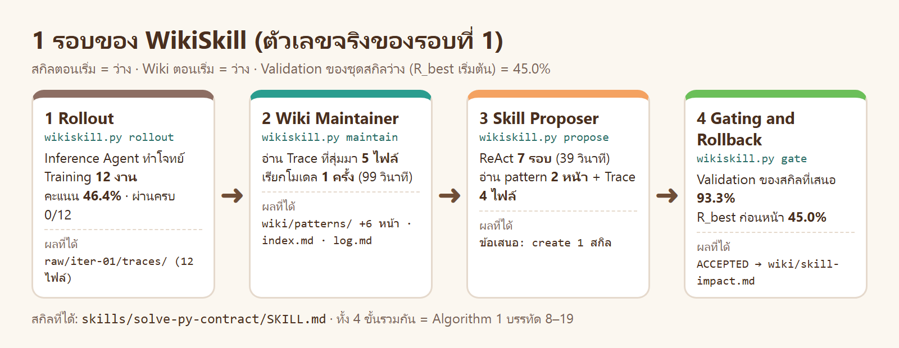

ตัวอย่างทั้งหมดในขั้นนี้มาจาก [`runs/w1/`](../runs/w1/) (LAB 1) · ก่อนเริ่ม: สกิลว่าง · Wiki ว่าง · วัด Validation ด้วยชุดสกิลว่างได้ **45.0%** = R_best เริ่มต้น

### 6.1 Rollout: Agent ทำโจทย์ → Raw Layer

Agent (sonnet) ทำโจทย์ Training 4 ข้อ ข้อละ 3 รอบ ไม่มีสกิล ได้เฉลี่ย **46.4%** ไม่มีงานใดผ่านครบทุกข้อ
โปรแกรมแปลง Trace ดิบของแต่ละงานเป็นไฟล์ที่อ่านได้ 1 ไฟล์ และสรุปทั้ง 12 งานไว้ใน [`summary.md`](../runs/w1/raw/iter-01/summary.md)

```text
| trace_id | ผล | คะแนน | ข้อตรวจที่ไม่ผ่าน |
| t1-cafe-bill-r1 | FAIL | 0.50 | reject_value reject_type cli_ok cli_error tests |
| t4-cashback-r1 | FAIL | 0.40 | reject_value reject_type cli_ok cli_error tests policy |
```

> **ในเครื่องมือ:** คำสั่ง `rollout` · รูปแบบของ Trace และ `summary.md`: [รูปแบบ ข้อ 5–6](../wikiskill_format.md#5--การรัน-trial-inference-agent)

### 6.2 Wiki Maintainer: Trace → Wiki Layer

| รับเข้า | ส่งออก |
|---|---|
| Wiki เดิม (ว่าง) + Trace ที่สุ่มมา 5 ไฟล์ (ไม่ผ่านทั้ง 5 เพราะรอบนี้ไม่มีงานที่ผ่าน) | JSON 1 ก้อน: `create_patterns` 6 หน้า · `update_index` · `append_log` |

เรียกโมเดล **1 ครั้ง** ใช้ 99 วินาที · ได้ pattern 6 หน้า และ [`index.md`](../runs/w1/wiki/index.md) 6 บรรทัด

| pattern ที่ได้ | ชนิด | ข้อตรวจที่เกี่ยว |
|---|---|---|
| `missing-input-validation` | ล้มเหลว | `reject_value` `reject_type` |
| `missing-cli-entrypoint` | ล้มเหลว | `cli_ok` `cli_error` |
| `missing-test-file` | ล้มเหลว | `tests` |
| `shallow-self-check` | พฤติกรรมของ Agent | ทุกข้อ (Agent ตรวจแค่กรณีปกติแล้วบอกว่าถูก) |
| `integer-money-arithmetic` | **สำเร็จ** | `basic` `no_drift` `half_up` (สิ่งที่ Agent ทำถูกอยู่แล้ว ให้คงไว้) |
| `policy-ambiguous-edge-cases` | ล้มเหลว · **ยังไม่ยืนยันสาเหตุ** | `policy` |

สองหน้าท้ายแสดงสิ่งที่ Maintainer ทำนอกเหนือจากการแจกแจงข้อที่ผิด: จดสิ่งที่ **ทำถูก** ไว้กันไม่ให้ข้อเสนอรอบหลังทำพัง และจดสิ่งที่ **ยังไม่รู้** โดยไม่เดา

> **ในเครื่องมือ:** คำสั่ง `maintain`: สุ่ม Trace → เรียกโมเดล 1 ครั้งโดยไม่มีเครื่องมือ → โปรแกรมเขียนไฟล์ wiki ตามคำตอบ ([รูปแบบ ข้อ 7](../wikiskill_format.md#7--wiki-maintainer-maintain)) · prompt `maintainer.md` ต้องบอก 3 เรื่อง: วิธีวิเคราะห์ Trace · โครงของหน้า pattern · กติกาของ index

### 6.3 Skill Proposer: Wiki + Trace → ข้อเสนอ

Proposer ได้รับ `index.md` + `skill-impact.md` + `summary.md` แล้วเปิดไฟล์เองตามลำดับนี้ (จาก [`state.json`](../runs/w1/state.json))

```text
1 traces/t1-cafe-bill-r1.md
2 traces/t2-split-bill-r2.md
3 traces/t3-shipping-fee-r1.md
4 traces/t4-cashback-r2.md
5 wiki/patterns/missing-input-validation.md
6 wiki/patterns/missing-cli-entrypoint.md
```

เปิด Trace 4 จาก 12 ไฟล์ (โจทย์ละ 1) และ pattern 2 จาก 6 หน้า (อีก 4 หน้า บรรทัดใน index บอกพอแล้ว) · รวม 7 รอบ ReAct ใช้ 39 วินาที
ข้อเสนอ: `create` สกิล `solve-py-contract` (96 บรรทัด) พร้อม [`PURPOSE.md`](../runs/w1/skills/solve-py-contract/PURPOSE.md) ที่ชี้กลับไปยัง pattern ใน Wiki

```markdown
## pattern ใน wiki ที่แก้
- `wiki/patterns/missing-input-validation.md`
- `wiki/patterns/missing-cli-entrypoint.md`
- `wiki/patterns/missing-test-file.md`
- `wiki/patterns/shallow-self-check.md` (ส่วนรายการตรวจก่อนตอบ)

ไม่ได้แตะ `wiki/patterns/policy-ambiguous-edge-cases.md` เพราะยังไม่ยืนยันสาเหตุ …
```

> **ในเครื่องมือ:** คำสั่ง `propose`: เรียกโมเดล 1 เซสชันที่มีเครื่องมือ `Read` อย่างเดียว → โปรแกรมนำข้อเสนอไปสร้างชุดสกิลที่เสนอ ([รูปแบบ ข้อ 8](../wikiskill_format.md#8--skill-proposer-propose)) · prompt `proposer.md` ต้องบอก 3 เรื่อง: ลำดับการทำงาน · รูปแบบข้อเสนอ · กติกา

### 6.4 Gating and Rollback: ข้อเสนอ → รับหรือย้อนกลับ

โปรแกรมวางสกิลที่เสนอไว้ในโฟลเดอร์ `candidate/` (ยังไม่ใช่สกิลที่ใช้งาน) แล้วให้ Agent ทำโจทย์ Validation 2 ข้อ × 3 รอบ

```text
Validation ของสกิลที่เสนอ 93.3%  >  R_best 45.0%   →   ACCEPTED
```

จากนั้นโปรแกรมจดลง [`wiki/skill-impact.md`](../runs/w1/wiki/skill-impact.md) (ชื่อสกิล · diff ทั้งหมด · คะแนน · ผล) · R_best ยังไม่ถึง 100% วงรอบจึงทำรอบที่ 2 ต่อ

> **ในเครื่องมือ:** คำสั่ง `gate` · เงื่อนไขหยุดของวงรอบอยู่ในคำสั่ง `loop` ([รูปแบบ ข้อ 9](../wikiskill_format.md#9--gating-and-rollback-gate))

### 6.5 รอบที่ 2: Wiki ทำงานข้ามรอบ

รอบที่ 2 Agent ทำโจทย์ Training ด้วยสกิลของรอบที่ 1 ได้ **89.5%** (ผ่านครบ 2/12)

**Maintainer ไม่ได้เริ่มจากศูนย์** รอบนี้ได้ Trace ที่ไม่ผ่าน 5 + **ผ่าน 2** และ Wiki ของรอบที่ 1

| สิ่งที่ทำ | ผลจริง |
|---|---|
| สร้าง pattern ใหม่ 1 หน้า | [`too-few-test-methods.md`](../runs/w1/wiki/patterns/too-few-test-methods.md): มีไฟล์เทสต์แล้ว แต่นับได้ 4–5 เทสต์ (ต้องมีอย่างน้อย 6) เพราะ `subTest` หลายชุดในเมธอดเดียวนับเป็น 1 · งานที่ผ่านมี 6, 7, 9 เทสต์ |
| **เติม** หน้าเดิม 6 หน้า ไม่สร้างซ้ำ | แต่ละหน้าได้หัวข้อ "อัปเดตรอบ 2" บอกว่าปัญหานั้นแก้ได้แล้วหรือยังเกิดอยู่ |
| แก้ `index.md` | ทุกบรรทัดขึ้นต้นด้วยสถานะ: `แก้ได้แล้ว` 4 หน้า · `ดีขึ้นมาก` 1 หน้า · `ยังเกิดอยู่` 2 หน้า |

```markdown
## อัปเดตรอบ 2: แก้ได้แล้ว                                   ← wiki/patterns/missing-cli-entrypoint.md
- `cli_ok` และ `cli_error` ผ่านครบในทั้ง 7 Trace ที่สุ่มมา ทุกงานมีบล็อก `if __name__ == "__main__":` ที่คัดจากสกิล `solve-py-contract` …
```

**Proposer อ่านน้อยลง** เพราะ index บอกแล้วว่าเรื่องใดจบ เรื่องใดยังเปิดอยู่

| | รอบที่ 1 | รอบที่ 2 |
|---|---|---|
| pattern ที่เปิด | 2 จาก 6 หน้า | **1 จาก 7 หน้า** (หน้าใหม่) |
| Trace ที่เปิด | 4 | 4 |
| ไฟล์อื่น | – | `SKILL.md` ของสกิลเดิม |
| ข้อเสนอ | `create` ทั้งสกิล (96 บรรทัด) | `patch` เฉพาะส่วนเทสต์ (เป็น 107 บรรทัด) |
| เวลา | 39 วินาที | 20 วินาที |
| Validation | 93.3% → ACCEPTED | **100.0%** → ACCEPTED → วงรอบหยุด |

ข้อเสนอของรอบที่ 2 แก้เฉพาะจุดที่ pattern ใหม่ชี้: ให้มีอย่างน้อย 8 เมธอด `def test_...` แยกกัน และให้ดูบรรทัด `Ran N tests` ก่อนจบ · ส่วนอื่นของสกิลที่ผ่านอยู่แล้วไม่ถูกแตะ (ข้อ 8.9)

**เรื่องที่ Wiki จดไว้แต่สกิลไม่แก้:** ข้อตรวจ `policy` ไม่ผ่านทั้ง 2 รอบ · หน้า [`policy-ambiguous-edge-cases.md`](../runs/w1/wiki/patterns/policy-ambiguous-edge-cases.md) รวบรวมเบาะแสและตั้งสมมติฐานไว้ แต่ระบุว่า "ยังไม่ยืนยันสาเหตุ" Proposer จึงไม่ใส่ลงสกิล · เรื่องนี้อธิบายต่อใน [ขั้น 10](#ขั้น-10--นำมาใช้กับโจทย์ของบทนี้)

> **ข้อจำกัดของตัวอย่างจริง:** ใน 3 การรันของบทนี้ (`w1` `w2` `n1`) ข้อเสนอผ่าน Gate ทั้ง 4 ครั้ง จึงไม่มีตัวอย่างจริงของการย้อนกลับ (ข้อ 8.3) · กลไกนั้นอธิบายจากกรณีศึกษาของเปเปอร์ (ข้อ 9.4) และเห็นได้จากการทดสอบด้วย Agent จำลองใน [LAB 0.1](../README.md#ขั้น-01--สร้างโฟลเดอร์-wikiskill)

---

## ขั้น 7 · อัลกอริทึม

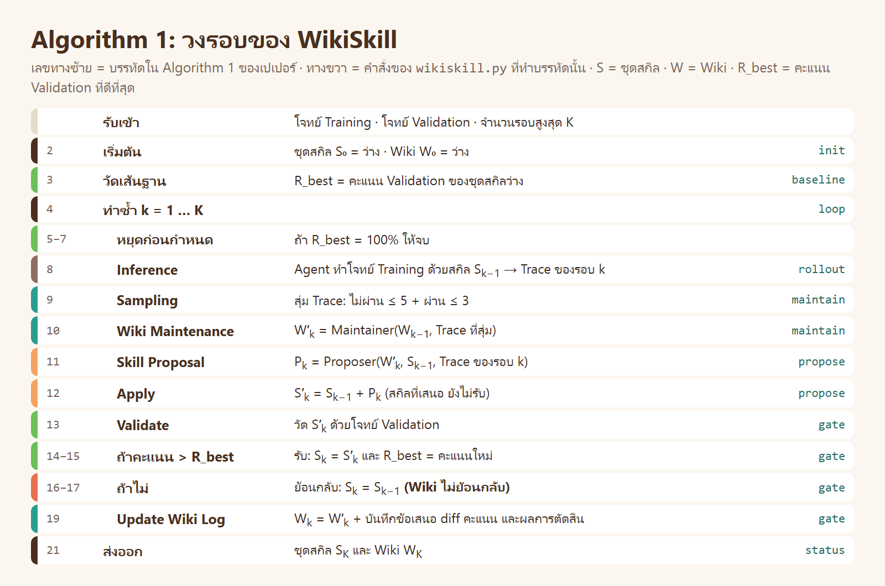

สถานะของระบบมี 3 ตัว: ชุดสกิล **S** · Wiki **W** · คะแนน Validation ที่ดีที่สุด **R_best**

```text
รับเข้า  โจทย์ Training · โจทย์ Validation · จำนวนรอบสูงสุด K
 2  S ← ว่าง   W ← ว่าง
 3  R_best ← คะแนน Validation ของ S                     # เส้นฐาน: ยังไม่มีสกิล
 4  ทำซ้ำ k = 1 … K
 5      ถ้า R_best = 100%  →  จบ
 8      Trace_k   ← Inference Agent ทำโจทย์ Training ด้วย S
 9      ตัวอย่าง   ← สุ่มจาก Trace_k (ไม่ผ่าน ≤ 5 · ผ่าน ≤ 3)
10      W         ← Wiki Maintainer(W, ตัวอย่าง)         # ความรู้ของรอบนี้เข้า Wiki
11      ข้อเสนอ    ← Skill Proposer(W, S, Trace_k)        # create / patch สกิล 1 ตัว
12      S′        ← S ที่ใส่ข้อเสนอแล้ว                   # ยังไม่รับ
13      คะแนน     ← คะแนน Validation ของ S′
14      ถ้า คะแนน > R_best  →  S ← S′ ,  R_best ← คะแนน    # รับ
16      ถ้าไม่              →  S คงเดิม                    # ย้อนกลับเฉพาะสกิล
19      W ← W + บันทึก(ข้อเสนอ, diff, คะแนน, รับ/ไม่รับ)    # ทำทั้งสองกรณี
21  ส่งออก  S และ W
```

สามบรรทัดที่ทำให้ WikiSkill ต่างจากวงรอบทั่วไป

| บรรทัด | ทำอะไร | ถ้าตัดออกจะเกิดอะไร |
|---|---|---|
| 10 | ความรู้ของรอบนี้ถูกเขียนลง Wiki **ก่อน** เสนอแก้สกิล | Proposer ต้องวิเคราะห์ Trace ใหม่ทุกรอบ ไม่มีอะไรสะสม |
| 16 | ย้อนกลับเฉพาะ S ไม่แตะ W | ความรู้ที่ได้จากรอบที่ล้มเหลวหายไปด้วย |
| 19 | จดผลของข้อเสนอลง W ทุกครั้ง ทั้งรับและไม่รับ | รอบถัดไปไม่รู้ว่าอะไรเคยลองแล้วไม่ได้ผล |

สถานะจริงของ `w1` (LAB 1)

| k | S (ชุดสกิล) | W (Wiki) | R_best | เกิดอะไร |
|---|---|---|---|---|
| 0 | ว่าง | ว่าง | 45.0% | วัดเส้นฐาน (บรรทัด 3) |
| 1 | `solve-py-contract` (96 บรรทัด) | 6 pattern + log 1 รอบ + skill-impact 1 รายการ | 93.3% | สร้างสกิล → รับ (บรรทัด 8–19) |
| 2 | `solve-py-contract` (107 บรรทัด) | 7 pattern (ใหม่ 1 · เติม 6) + skill-impact 2 รายการ | 100.0% | แก้สกิล → รับ |
| – | – | – | – | หยุด เพราะ R_best = 100% (บรรทัด 5) |

W โตขึ้นทุกรอบและไม่เคยลดลง · S เปลี่ยนเฉพาะเมื่อผ่าน Gate

> **ในเครื่องมือ:** 1 คำสั่งของ `wikiskill.py` = 1 กลุ่มบรรทัด (`baseline` 3 · `rollout` 8 · `maintain` 9–10 · `propose` 11–12 · `gate` 13–19) · `loop` คือบรรทัด 3–20 · เงื่อนไขรับคือ "คะแนน Validation > R_best เท่านั้น" ([รูปแบบ ข้อ 3](../wikiskill_format.md#3--คำสั่ง-8-ตัว) และ [ข้อ 9](../wikiskill_format.md#9--gating-and-rollback-gate))

---

## ขั้น 8 · วิธีคิดในการออกแบบ

ส่วนนี้ตอบว่า **ทำไม** WikiSkill จึงออกแบบเช่นนี้ ทีละการตัดสินใจ · แต่ละข้อมี: คำถาม → ทางเลือก → สิ่งที่เลือก → เหตุผล → อยู่ตรงไหนของโค้ด

### 8.1 ทำไมไม่ให้สกิลเก็บความรู้เอง

| | |
|---|---|
| คำถาม | สิ่งที่เรียนรู้ ควรเขียนลงสกิลโดยตรงเลยหรือไม่ |
| ทางเลือก | (ก) เขียนทุกอย่างลงสกิล · (ข) แยกชั้นความรู้ออกมา |
| WikiSkill เลือก | (ข) |
| เหตุผล | สกิลถูกอ่านโดย Agent **ทุกงาน** จึงต้องสั้นและมีแต่สิ่งที่ต้องทำ · เหตุผล หลักฐาน และสิ่งที่เคยลองแล้วล้มเหลว เป็นประโยชน์ต่อผู้ปรับสกิล แต่เป็นภาระต่อ Agent ที่ทำงาน · และสกิลถูกย้อนกลับได้ ถ้าความรู้อยู่ในสกิล ย้อนกลับเมื่อใดความรู้หายเมื่อนั้น |
| ในเครื่องมือ | สกิลมี 2 ไฟล์: `SKILL.md` (Agent อ่าน) กับ `PURPOSE.md` (ชี้กลับไปที่ pattern ใน Wiki) · โปรแกรมสร้างจากข้อเสนอของ Proposer (รูปแบบ ข้อ 8) |

### 8.2 ทำไม Raw Layer ห้ามแก้

| | |
|---|---|
| คำถาม | Trace ควรถูกสรุปทับหรือลบเมื่อสรุปลง Wiki แล้วหรือไม่ |
| WikiSkill เลือก | เก็บ Trace ดิบไว้ครบ ไม่แก้ ไม่ลบ |
| เหตุผล | Wiki เป็นการตีความ และการตีความผิดได้ · Skill Proposer ต้องกลับไปดูของจริงเพื่อยืนยันสาเหตุก่อนเสนอ (กติกา: อ่านอย่างน้อย 4 Trace) · ถ้าต้นฉบับถูกแก้ จะตรวจการตีความไม่ได้อีก |
| ในเครื่องมือ | `rollout` เขียน `raw/iter-NN/traces/*.md` ครั้งเดียว · `propose` ส่ง **สำเนา** ให้ Proposer ในโฟลเดอร์ `proposer_view/` และให้เครื่องมือ `Read` อย่างเดียว (รูปแบบ ข้อ 6 และ 8) |

### 8.3 ทำไมสกิลย้อนกลับได้ แต่ Wiki ไม่ย้อนกลับ


| | |
|---|---|
| คำถาม | เมื่อข้อเสนอไม่ผ่าน Validation ควรย้อนอะไรกลับบ้าง |
| ทางเลือก | (ก) ย้อนทั้งสกิลและ Wiki · (ข) ย้อนเฉพาะสกิล |
| WikiSkill เลือก | (ข) |
| เหตุผล | สกิลที่แย่ลงเป็น **อันตราย** ต่อการใช้งาน จึงต้องทิ้ง · แต่ "วิธีนี้ลองแล้วไม่ได้ผล" เป็น **ความรู้ชิ้นใหม่** ที่มีค่า ถ้าย้อน Wiki ด้วย รอบถัดไปจะเสนอสิ่งเดิมซ้ำ (อาการ "ลืม" ในขั้น 2) · การทดลองที่ล้มเหลวจึงไม่สูญเปล่า |
| หลักฐานในเปเปอร์ | กรณีศึกษา ALFWorld: รอบแรกเสนอสกิลหนึ่งแล้วถูกปฏิเสธ · รอบถัดมา Proposer เห็นบันทึกนั้น จึงเสนอสกิลอีกแบบที่มีกฎเจาะจงกว่า และผ่าน |
| ในเครื่องมือ | `gate`: ถ้าไม่ผ่าน ไม่มีไฟล์ใดใน `wiki/` ถูกแก้ นอกจากการ **เพิ่ม** รายการใน `wiki/skill-impact.md` · `skills/` ถูกแทนที่เฉพาะเมื่อผลเป็น ACCEPTED (รูปแบบ ข้อ 9) |

### 8.4 ทำไม Inference Agent ห้ามอ่าน Wiki


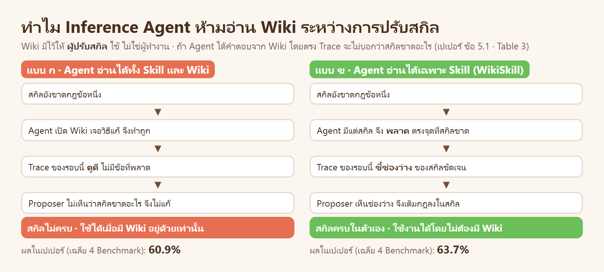

| | |
|---|---|
| คำถาม | Wiki มีวิธีแก้อยู่แล้ว ทำไมไม่ให้ Agent ที่ทำงานเปิดอ่านด้วย |
| WikiSkill เลือก | ระหว่างการปรับสกิล Agent เห็นเฉพาะ `skills/` |
| เหตุผล | เป้าหมายคือ **สกิลที่ครบในตัวเอง** · ถ้า Agent ทำถูกเพราะ Wiki, Trace จะดูดี และไม่มีอะไรบอก Proposer ว่าสกิลยังขาดกฎข้อใด · ความผิดพลาดของ Agent คือสัญญาณที่ใช้ปรับสกิล จึงต้องไม่ถูกกลบ |
| หลักฐานในเปเปอร์ | Table 3: ให้ Agent อ่าน Wiki ด้วย คะแนนเฉลี่ยลดจาก 63.7% เป็น 60.9% |
| ในเครื่องมือ | Trial รันใน sandbox ที่มีเฉพาะสำเนาของ `skills/` · ไม่มี `wiki/` หรือ `raw/` ใน sandbox (รูปแบบ ข้อ 5) |

### 8.5 ทำไมแยก Wiki Maintainer กับ Skill Proposer

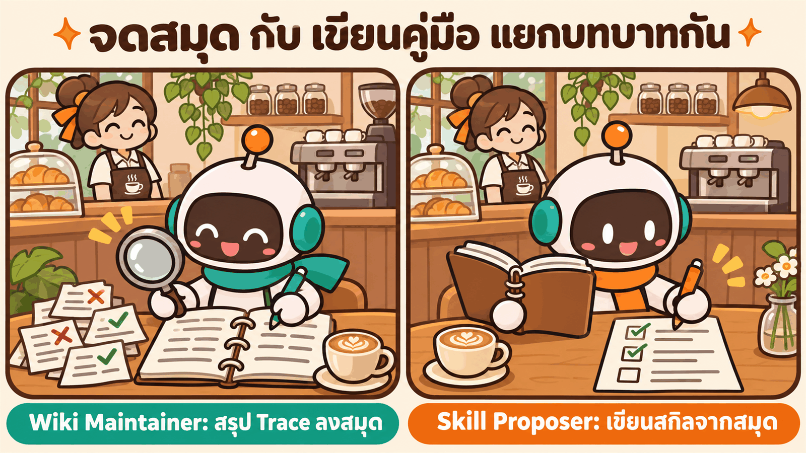

| | |
|---|---|
| คำถาม | ใช้โมเดลตัวเดียวอ่าน Trace แล้วแก้สกิลเลยได้หรือไม่ |
| WikiSkill เลือก | แยก 2 บทบาท: Maintainer **วินิจฉัย** · Proposer **สั่งยา** |
| เหตุผล | (1) คนละเป้าหมาย: Maintainer ต้องจดให้ครบและเป็นกลาง รวมถึง pattern ที่สำเร็จ · Proposer ต้องเลือกแก้ **จุดเดียว** ที่คุ้มที่สุด (2) Maintainer ไม่ถูกผูกกับผลของ Gate: ต่อให้ข้อเสนอของรอบนี้ถูกทิ้ง ความรู้ของรอบนี้ก็เข้า Wiki ไปแล้ว (บรรทัด 10 เกิดก่อนบรรทัด 14) (3) แต่ละตัวได้บริบทที่เหมาะกับงาน: Maintainer ได้ Trace ตัวอย่างเต็ม ๆ · Proposer ได้สารบัญแล้วเลือกเปิดเอง |
| ในเครื่องมือ | `maintain` เรียกโมเดลโดยไม่มีเครื่องมือ 1 ครั้ง · `propose` เรียกโมเดลพร้อมเครื่องมือ `Read` ทำงานหลายรอบในเซสชันเดียว (รูปแบบ ข้อ 11) |

### 8.6 ทำไม `skill-impact.md` ต้องเขียนโดยโปรแกรม

| | |
|---|---|
| คำถาม | ให้ Maintainer เขียนผลของ Gate ลง Wiki เองได้หรือไม่ |
| WikiSkill เลือก | ไฟล์นี้โปรแกรมเขียนเท่านั้น: ชื่อสกิล · diff · คะแนน Validation · ผลรับหรือไม่รับ |
| เหตุผล | นี่คือ **ข้อเท็จจริงจากการวัด** ไม่ใช่การตีความ · ถ้าให้โมเดลเล่าเอง อาจจำคลาดหรือสรุปเข้าข้างข้อเสนอของตัวเอง · ผู้ปรับสกิลต้องมีบันทึกที่เชื่อได้ 100% ว่าอะไรเคยถูกลองและได้ผลอย่างไร (หลักเดียวกับบท 05: คนแก้ไม่ควรเป็นคนตัดสินงานของตัวเอง) |
| ในเครื่องมือ | `gate` ต่อท้าย `wiki/skill-impact.md` ด้วย diff ของ `SKILL.md` ที่โปรแกรมคำนวณเอง · prompt ของ Maintainer ระบุว่าไฟล์นี้อ่านได้อย่างเดียว (รูปแบบ ข้อ 9) |

### 8.7 ทำไม Proposer ต้องเป็น ReAct และเริ่มจาก index

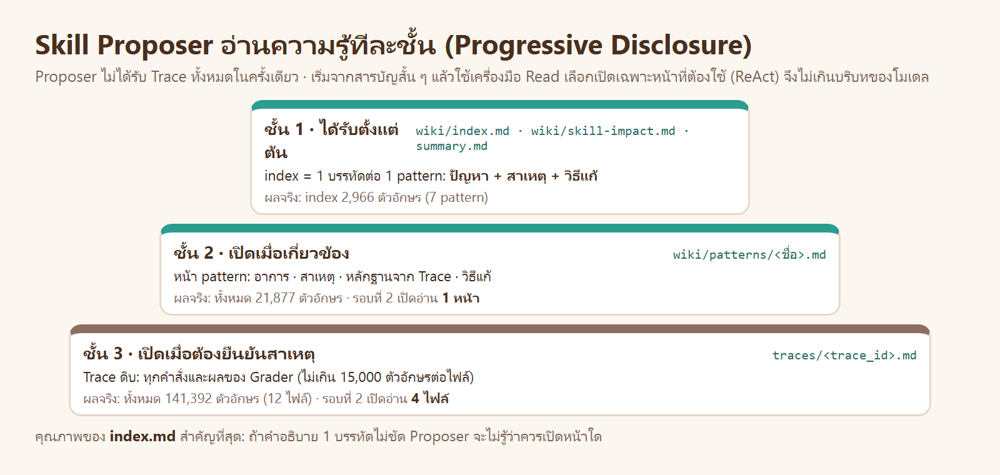

| | |
|---|---|
| คำถาม | ทำไมไม่ส่ง Wiki และ Trace ทั้งหมดให้ Proposer ในครั้งเดียว |
| WikiSkill เลือก | ให้เฉพาะ `index.md` + `skill-impact.md` + สรุปผล แล้วให้ Proposer ใช้เครื่องมือ `Read` เปิดไฟล์ที่ต้องการเอง (ReAct = คิด → เปิดไฟล์ → คิดต่อ) |
| เหตุผล | (1) บริบทของโมเดลมีจำกัด และ Trace ยาว (2) ต้นทุนไม่โตตามจำนวนโจทย์: ต่อรอบใช้ 1 + T_ReAct ครั้ง ไม่ว่าจะมี Training 12 หรือ 1,200 งาน (3) บังคับให้ Wiki ต้องดี: ถ้าบรรทัดใน index ไม่ชัด หน้านั้นจะไม่ถูกเปิด prompt ของ Maintainer จึงกำหนดว่า 1 บรรทัดต้องมี **ปัญหา + สาเหตุ + วิธีแก้** |
| ในเครื่องมือ | `propose` สร้าง `proposer_view/` และใส่เฉพาะ index, skill-impact, summary ในข้อความแรก · โปรแกรมนับไฟล์ที่ถูกเปิดจาก Trace ของ Proposer · ถ้าเปิด Trace น้อยกว่า 4 ไฟล์ ข้อเสนอถูกตีกลับ (รูปแบบ ข้อ 8) |

### 8.8 ทำไมสุ่ม Trace ให้ Maintainer แค่ 8 และมีทั้งที่ผ่าน

| | |
|---|---|
| WikiSkill เลือก | ต่อรอบ: ไม่ผ่านไม่เกิน 5 + ผ่านไม่เกิน 3 · แต่ละ Trace ไม่เกิน 15,000 ตัวอักษร |
| เหตุผล | Trace ที่ไม่ผ่านใช้หาสาเหตุ · Trace ที่ผ่านใช้ดูว่า **ทำอย่างไรจึงถูก** (หลายครั้งวิธีแก้อยู่ใน Trace ที่ผ่านอยู่แล้ว) และกันไม่ให้ข้อเสนอใหม่ทำของที่ดีอยู่พัง · จำนวนคงที่ทำให้ Maintainer เรียกโมเดล 1 ครั้งต่อรอบเสมอ |
| ในเครื่องมือ | `maintain` สุ่ม Trace ที่ไม่ผ่านไม่เกิน 5 และที่ผ่านไม่เกิน 3 กระจายทุกโจทย์ คะแนนต่ำก่อน · 1 Trace ยาวไม่เกิน 15,000 ตัวอักษร (รูปแบบ ข้อ 6 และ 7) |

### 8.9 ทำไมข้อเสนอต้องเล็ก: 1 สกิลต่อรอบ และแก้แบบ patch

| | |
|---|---|
| WikiSkill เลือก | 1 รอบ = ข้อเสนอ 1 ข้อ ต่อสกิล 1 ตัว · แก้ของเดิมด้วยรายการ `append` / `replace` / `insert_after` ไม่เขียนทับทั้งไฟล์ |
| เหตุผล | (1) **รู้ว่าอะไรได้ผล:** Gate ให้คำตอบเดียวต่อรอบ (รับ/ไม่รับ) ถ้าแก้หลายอย่างพร้อมกันจะไม่รู้ว่าอย่างไหนทำให้คะแนนเปลี่ยน (เหตุผลเดียวกับ "แก้ไม่เกิน 3 จุด" ของบท 05) (2) **ไม่ทำของเดิมหาย:** การเขียนทั้งไฟล์ใหม่ โมเดลมักทำกฎที่ดีอยู่แล้วตกหล่น · patch แตะเฉพาะจุดที่ระบุ (3) diff เล็ก อ่านง่ายเมื่อไปอยู่ใน `skill-impact.md` |
| ในเครื่องมือ | รายการแก้ 3 แบบ (`append` `replace` `insert_after`) ใช้ร่วมกันทั้ง Wiki และสกิล · ถ้า `target` ไม่พบในไฟล์ ข้อเสนอถูกตีกลับ (รูปแบบ ข้อ 7 และ 8) |

### 8.10 ทำไม Gate รับเฉพาะเมื่อ "ดีกว่า" และหยุดเมื่อได้ 100%

| | |
|---|---|
| WikiSkill เลือก | รับเมื่อคะแนน Validation **มากกว่า** R_best เท่านั้น · หยุดทันทีเมื่อ R_best = 100% |
| เหตุผล | เกณฑ์เดียวกับวิธีก่อนหน้า (SkillOpt, EvoSkill) เพื่อให้เทียบกันได้ยุติธรรม · เข้มไว้ก่อนเพื่อไม่ให้สกิลบวมด้วยการแก้ที่ไม่ช่วย |
| ข้อแลกเปลี่ยน | (1) ข้อเสนอที่คะแนนเท่าเดิมแต่เป็นฐานของการแก้รอบถัดไป ถูกทิ้ง (2) Validation ชุดเล็กมีความแกว่ง: ได้ 100% หนึ่งครั้งไม่ได้แปลว่าสกิลสมบูรณ์ · เปเปอร์จึงรันทั้งกระบวนการ 3 ครั้งแล้วเฉลี่ย · บท 05 ใช้อีกทางหนึ่งคือ threshold จากความแกว่ง |
| ในเครื่องมือ | `gate` รับเมื่อคะแนน Validation มากกว่า R_best เท่านั้น (เท่ากัน = ไม่รับ) · `loop` และ `rollout` ตรวจว่า R_best = 100% ก่อนเริ่มรอบใหม่ (รูปแบบ ข้อ 4 และ 9) |

### สรุปการออกแบบใน 1 ตาราง

| หลัก | ผลในระบบ |
|---|---|
| แยกของดิบ ความรู้ และขั้นตอน | 3 ชั้น 3 โฟลเดอร์ |
| ความรู้ต้องสะสม | Wiki ไม่ย้อนกลับ · หน้าเดิมถูกเติมหลักฐาน ไม่สร้างซ้ำ |
| สิ่งที่ใช้งานต้องปลอดภัย | สกิลผ่าน Gate เท่านั้น และย้อนกลับได้ |
| ข้อเท็จจริงมาจากการวัด | `skill-impact.md` เขียนโดยโปรแกรม |
| สัญญาณต้องไม่ถูกกลบ | Agent ที่ทำงานไม่เห็น Wiki |
| บริบทมีจำกัด | สุ่ม Trace · index 1 บรรทัดต่อ pattern · Proposer เลือกเปิดเอง |
| รู้ว่าอะไรได้ผล | ข้อเสนอ 1 ข้อต่อรอบ · patch ทีละจุด |

---

## ขั้น 9 · เปรียบเทียบ

### 9.1 กับวิธีปรับสกิลก่อนหน้า

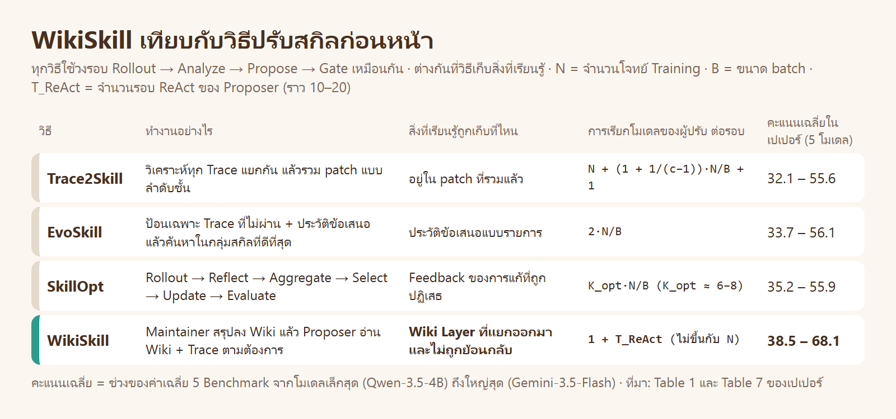

| วิธี | จุดเด่น | สิ่งที่ WikiSkill ทำต่างออกไป |
|---|---|---|
| Trace2Skill | วิเคราะห์ทุก Trace แบบขนาน แล้วรวม patch เป็นลำดับชั้น | ไม่วิเคราะห์ทุก Trace: Maintainer ดูตัวอย่าง Proposer เลือกเปิดเอง · ต้นทุนไม่โตตามจำนวนโจทย์ |
| EvoSkill | เก็บกลุ่มสกิลที่ดีที่สุดไว้หลายตัว และมีประวัติข้อเสนอ | ประวัติไม่ได้เป็นแค่รายการ แต่ถูกจัดเป็น pattern ที่มีสาเหตุและหลักฐาน |
| SkillOpt | ไพป์ไลน์ 6 ขั้น และใช้ feedback ของการแก้ที่ถูกปฏิเสธ | ความรู้อยู่ในชั้นแยกที่ไม่ถูกย้อนกลับ ใช้ได้ข้ามทุกรอบ |

### 9.2 กับ Skill Optimizer ของบท 05

| | Skill Optimizer (บท 05) | WikiSkill (บทนี้) |
|---|---|---|
| ผู้วิเคราะห์และผู้แก้สกิล | Claude ใน Claude Code Desktop ตามพรอมต์ของคน ทีละรุ่น | โมเดล 2 บทบาท รันเองทั้งวงรอบ |
| สกิลเริ่มต้น | `v0` ที่คนเขียน | ว่าง · ต้องค้นพบกฎจาก Trace เอง |
| ความรู้แฝงที่ไม่มีในโจทย์ | คนเขียนลงสกิล และตอบเมื่อ Claude ถาม (นโยบายธุรกิจ) | ค้นพบเองได้เฉพาะส่วนที่ Trace และ Validation แสดง |
| ที่เก็บความรู้ | `ISSUES.md` 1 ไฟล์ ที่ Claude จดตามรูปแบบที่ตกลงไว้ | `wiki/` : patterns + index + log + skill-impact |
| ขนาดการแก้ต่อรอบ | ไม่เกิน 3 จุด | ข้อเสนอ 1 ข้อ ต่อสกิล 1 ตัว |
| เกณฑ์ของ Gate | Training และ Validation ไม่ลดเกินเกณฑ์ และคะแนนรวมขึ้นเกินความแกว่ง หรือต้นทุนลด ≥ 10% | Validation มากกว่า R_best |
| ความแกว่งของการวัด | คิดจากการรันซ้ำ แล้วใช้เป็นเกณฑ์ | ไม่คิด (เปเปอร์ชดเชยด้วยการรันทั้งกระบวนการ 3 ครั้ง) |
| ต้นทุนเป็นเป้าหมายด้วยหรือไม่ | ใช่ | ไม่ · หยุดเมื่อ Validation 100% |
| ชุดที่ใช้วัดผลสุดท้าย | ไม่มี Test Set | มี Test Set 3 ข้อ |

ผลจริงของทั้งสองวิธีบนโจทย์ชุดเดียวกันอยู่ใน [README หลัก ส่วนที่ 4](../README.md#4--สรุปและแบบฝึกหัด)

### 9.3 ผลในเปเปอร์

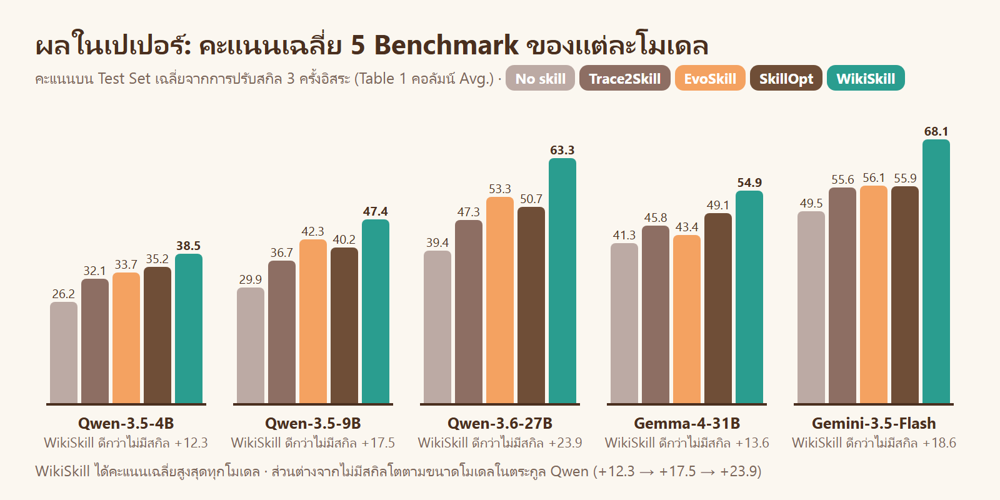

เปเปอร์ทดลอง 5 Benchmark (คณิตศาสตร์ · ค้นเว็บ · สเปรดชีต · เอกสารยาว · งานบ้านจำลอง) กับ 5 โมเดล ข้อค้นพบหลัก

| ข้อค้นพบ | ตัวเลข |
|---|---|
| WikiSkill ได้ค่าเฉลี่ยสูงสุดทุกโมเดล | ชนะวิธีที่ดีที่สุดรองลงมา 3.3 ถึง 12.0 จุด |
| โมเดลใหญ่ได้ประโยชน์จากสกิลมากกว่า | Qwen 4B / 9B / 27B ดีขึ้น +12.3 / +17.5 / +23.9 จุด |
| โมเดลเล็กที่มีสกิล ชนะโมเดลใหญ่ที่ไม่มีสกิล | Qwen-9B + WikiSkill 47.4% เทียบกับ Qwen-27B ไม่มีสกิล 39.4% |
| สกิลย้ายข้ามโมเดลได้ และบางครั้งดีกว่าสกิลที่โมเดลปรับเอง | ALFWorld: Qwen-9B ใช้สกิลของ 27B ได้ 70.2% · ใช้สกิลของตัวเองได้ 63.4% |
| แต่สกิลจากโมเดลเล็กอาจถ่วงโมเดลใหญ่ | SpreadSheet: Gemini ใช้สกิลของ Qwen-4B ลดจาก 50.5% เหลือ 18.1% (สกิลเต็มไปด้วยวิธีเลี่ยงข้อจำกัดของโมเดลเล็ก) |

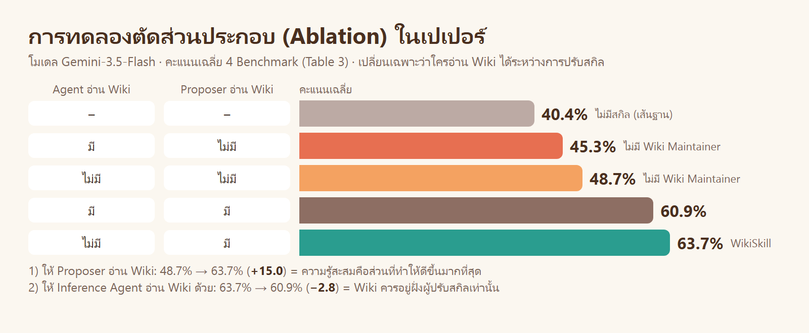

การตัดส่วนประกอบยืนยันการออกแบบ 2 ข้อ: Wiki ที่สะสมข้ามรอบคือส่วนที่ทำให้ดีขึ้นมากที่สุด (ข้อ 8.3, 8.7) และ Wiki ควรอยู่ฝั่งผู้ปรับสกิลเท่านั้น (ข้อ 8.4)

| ใครอ่าน Wiki ได้ | คะแนนเฉลี่ย 4 Benchmark (Gemini-3.5-Flash) |
|---|---|
| ไม่มีสกิล | 40.4% |
| ไม่มี Wiki เลย (ไม่มี Maintainer) | 48.7% |
| **Proposer อ่านได้ · Agent อ่านไม่ได้** (WikiSkill) | **63.7%** |
| ทั้ง Proposer และ Agent อ่านได้ | 60.9% |

### 9.4 พลวัตของสกิลและ Wiki ในเปเปอร์

เปเปอร์นับว่าใน 1 การรัน (8 รอบ) มีข้อเสนอกี่ครั้ง ผ่าน Gate กี่ครั้ง และ Wiki โตเท่าไร (Table 4)

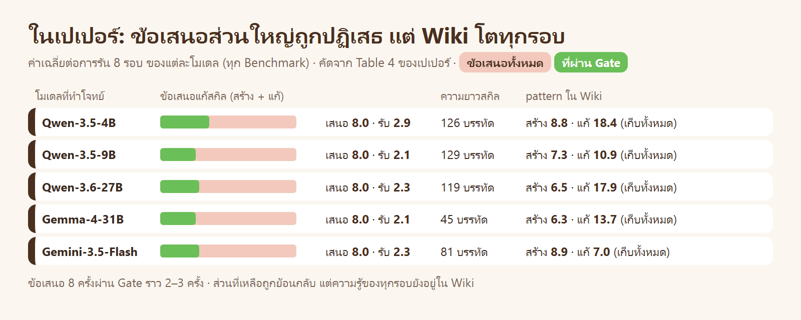

| ข้อสังเกต | ตัวเลขในเปเปอร์ | ความหมาย |
|---|---|---|
| ข้อเสนอส่วนใหญ่ **ไม่ผ่าน** Gate | เสนอ 8 ครั้ง ผ่าน 2.1–2.9 ครั้ง | การย้อนกลับเป็นเรื่องปกติของวงรอบ ไม่ใช่ข้อผิดพลาด |
| Wiki โตทุกรอบ และไม่ถูกลบ | สร้าง 6.3–8.9 หน้า · แก้ 7.0–18.4 ครั้ง | ความรู้ของรอบที่ถูกปฏิเสธยังถูกเก็บ |
| สกิลที่ได้สั้น | 45–129 บรรทัด | ความรู้ส่วนใหญ่อยู่ใน Wiki สกิลมีแต่สิ่งที่ต้องทำ |
| การรับเกิดตลอดการรัน | 39–52% ของการรับเกิดใน 2 รอบแรก ที่เหลือเกิดในรอบกลางและรอบท้าย | รอบหลัง ๆ ยังปรับสกิลได้ เพราะมีความรู้สะสมให้ใช้ |

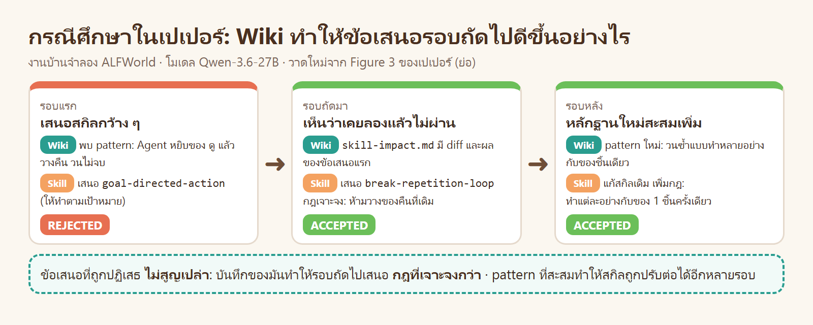

กรณีศึกษา (Figure 3 ของเปเปอร์ · ALFWorld): ข้อเสนอแรก `goal-directed-action` ถูกปฏิเสธ · `skill-impact.md` เก็บ diff และผลไว้ · รอบถัดมา Proposer จึงเสนอ `break-repetition-loop` ที่มีกฎเจาะจงว่า "ห้ามวางของคืนที่เดิม" และผ่าน · รอบหลังมี pattern ใหม่ จึงแก้สกิลเดิมเพิ่มอีก 1 กฎ

**ต้นทุนของผู้ปรับสกิล** (Table 7): ต่อรอบ WikiSkill เรียกโมเดล 1 + T_ReAct ครั้ง (Maintainer 1 ครั้ง + Proposer ราว 10–20 รอบ) ไม่ขึ้นกับจำนวนโจทย์ Training · วิธีอื่นโตตามจำนวนโจทย์หรือจำนวนชุดย่อย

---

## ขั้น 10 · นำมาใช้กับโจทย์ของบทนี้

ขั้นนี้ตอบว่าเมื่อนำ WikiSkill มาใช้กับโจทย์คิดเงินของร้าน BaanKafe (โจทย์เดียวกับบท 05) อะไรเหมือนเปเปอร์ อะไรต่าง และผลจริงบอกอะไร

### 10.1 เปเปอร์กับบทนี้

| ประเด็น | ในเปเปอร์ | ในบทนี้ | ผลต่อการอ่านผล |
|---|---|---|---|
| งาน | 5 Benchmark หลายร้อยโจทย์ | ฟังก์ชันคิดเงิน 9 ข้อ | งานเล็ก จบใน 1–2 รอบ (เปเปอร์รัน 8 รอบ) |
| Validation | ชุดใหญ่ต่อ Benchmark | 2 โจทย์ × 3 รอบ = 6 Trial | ได้ 100% ง่าย วงรอบหยุดเร็ว |
| การให้สกิลกับ Agent | ใส่เนื้อหาสกิลใน prompt | วางใน `./skills` ให้ Agent เปิดอ่านเอง | Agent เปิดอ่านครบทุก Trial ในผลจริง |
| prompt ของ Maintainer และ Proposer | ภาคผนวก E | เขียนใหม่เป็นภาษาไทยใน LAB 0 | ผลอาจต่างจากการใช้ prompt ต้นฉบับ |
| การรันซ้ำ | 3 ครั้งแล้วเฉลี่ย | 2 ครั้ง (`w1` `w2`) | ผลต่างเล็ก ๆ ยังไม่ใช่ข้อสรุป |
| ความรู้แฝงเฉพาะงาน | ไม่มีในการทดลอง | นโยบายธุรกิจ 4 ข้อ อยู่ใน Training 2 โจทย์ ไม่มีใน Validation | คำถามใหม่ของบทนี้ |

### 10.2 ผลจริงเทียบกับข้อค้นพบของเปเปอร์

| ข้อค้นพบของเปเปอร์ | ผลจริงของบทนี้ | ตรงกันหรือไม่ |
|---|---|---|
| WikiSkill ดีกว่าการไม่มีสกิลมาก | 46.9% → 97.9% (`w1`) | ตรง |
| สกิลที่ได้ใช้กับงานที่ไม่เคยเห็นได้ | Test Set 100.0% (`w1`) และ 97.8% (`w2`) | ตรง |
| ตัด Wiki ออก คะแนนลดมาก (63.7% → 48.7%) | มี Wiki 97.9% และ 96.8% · ไม่มี Wiki 95.7% | **ไม่เห็นผลชัด**: โจทย์จบใน 1–2 รอบ ยังไม่มีความรู้ข้ามรอบให้สะสม |
| ข้อเสนอส่วนใหญ่ถูกปฏิเสธ | ผ่าน Gate ทั้ง 4 ครั้ง | **ต่าง**: งานง่ายกว่าและ Validation เล็ก |
| Wiki โตทุกรอบ หน้าเดิมถูกเติม ไม่สร้างซ้ำ | `w1` รอบ 2: สร้าง 1 หน้า เติม 6 หน้า | ตรง |
| Proposer ใช้การเรียกโมเดลไม่ขึ้นกับจำนวนโจทย์ | 5–10 รอบ ReAct ต่อรอบ | ตรง |

### 10.3 สิ่งที่บทนี้พบเพิ่ม: ความรู้ที่ไม่อยู่ใน Trace


ร้านมีความรู้แฝง 2 กลุ่ม (นิยามในบท 05) และ WikiSkill จัดการได้ไม่เท่ากัน

| ความรู้แฝง | ปรากฏที่ใด | WikiSkill ทำอะไร | ผล |
|---|---|---|---|
| มาตรฐานการเขียนโค้ด 5 ข้อ | ทุกโจทย์ ทั้ง Training และ Validation | จดเป็น pattern แล้วใส่ลงสกิล | ผ่านครบ (เว้นเกณฑ์จำนวนเทสต์ในการรันที่หยุดรอบแรก) |
| นโยบายธุรกิจ 4 ข้อ | Training 2 โจทย์ · ตัวตรวจบอกตัวอย่างเดียวต่อโจทย์ | จดเป็น pattern "ยังไม่ยืนยัน" พร้อมสมมติฐาน · **ไม่ใส่ลงสกิล** | `policy` 0/6 ทุกการรัน |

เหตุผลที่นโยบายธุรกิจไม่เข้าสกิลมี 3 ชั้น และทุกชั้นมาจากการออกแบบที่ตั้งใจ

| ชั้น | กติกา | ผลกับนโยบายธุรกิจ |
|---|---|---|
| Wiki Maintainer | สิ่งที่ยังไม่แน่ใจให้เขียนว่า "ยังไม่ยืนยัน" ห้ามเดาแล้วเขียนเป็นข้อเท็จจริง | ตัวอย่างเดียวต่อโจทย์ไม่พอสรุปเป็นกฎ |
| Skill Proposer | สกิลเป็นวิธีทำงานทั่วไป ห้ามใส่คำตอบของโจทย์ | กฎเฉพาะของฟังก์ชันค่าส่งและเงินคืนไม่ใช่วิธีทำงานทั่วไป |
| Gate | รับเมื่อ Validation ดีขึ้นเท่านั้น และหยุดเมื่อได้ 100% | Validation ไม่มีข้อตรวจ `policy` จึงได้ 100% โดยไม่ต้องรู้นโยบาย |

ข้อสรุป: **วงรอบเรียนรู้ได้เท่าที่ Validation วัด** · ความรู้ที่ Validation ไม่วัด ไม่มีทางผ่าน Gate เข้าสกิล แต่ Wiki ยังเก็บไว้ได้

สิ่งที่ Wiki ให้ในกรณีนี้คือ **รายการคำถามถึงคน**: หน้า [`policy-ambiguous-edge-cases.md`](../runs/w1/wiki/patterns/policy-ambiguous-edge-cases.md) บอกว่าโจทย์ใด กรณีใด คาดอะไร ได้อะไร และตั้งสมมติฐานไว้ · LAB 5 ให้คนในทีมตอบ 4 ข้อ แล้วเติมลงสกิลด้วยวิธีของบท 05

| รุ่น | เขียนนโยบายอย่างไร | Training | Validation | Test | gate ของบท 05 |
|---|---|---|---|---|---|
| `w1` | ไม่มี | 95.2% | 100.0% | 100.0% | – |
| `w1p` | เป็นกติกาทั่วไป ("เงินที่ร้านจ่ายออก ให้ปัดลง") | 100.0% | 96.7% | 93.3% | REJECT |
| `w1q` | กำกับขอบเขต ("ใช้กับฟังก์ชันคิดเงินคืนสมาชิกเท่านั้น") | 100.0% | 100.0% | 100.0% | ACCEPT |

`w1p` ยืนยันกติกาของ Skill Proposer จากอีกด้านหนึ่ง: ความรู้เฉพาะงานที่เขียนเป็นกติกาทั่วไปลามไปงานอื่น (งานคืนเงินคอร์สของ Test Set ถูกปัดลงตามไปด้วย) · ความรู้เฉพาะงานจึงต้องมาพร้อมขอบเขต และต้องผ่านการวัดกับโจทย์ที่ไม่ได้ใช้ตอนแก้

---

## ขั้น 11 · ข้อจำกัด

| ข้อจำกัด | ที่มา | ผล |
|---|---|---|
| ไม่ได้ทดสอบการ **เลือก** สกิล | เปเปอร์ | สกิลทุกตัวถูกใส่ให้ Agent ตรง ๆ ถ้ามีสกิลจำนวนมาก ต้องมีขั้นค้นหาสกิลเพิ่ม |
| Gate เข้ม รับเฉพาะเมื่อดีขึ้น | เปเปอร์ | ข้อเสนอที่ไม่ขึ้นทันทีแต่เป็นฐานของรอบถัดไปถูกทิ้ง |
| Wiki โตอย่างเดียว ไม่มีการตัดแต่ง | เปเปอร์ | รันยาวมาก ๆ Wiki จะใหญ่และมีหน้าที่ล้าสมัย |
| ไม่ครอบคลุมงานที่ยาวหลายชั่วโมง | เปเปอร์ | ยังไม่มีการปรับสกิลระหว่างทำงานชิ้นเดียว |
| Validation ชุดเล็กแกว่ง | เปเปอร์ + ผลจริงของบทนี้ | การรับและการหยุดขึ้นกับโชคของการวัดครั้งนั้น: `w1` ทำ 2 รอบ `w2` หยุดที่รอบเดียวและไม่รู้เกณฑ์จำนวนเทสต์ |
| เรียนรู้ได้เท่าที่ Validation วัด | ผลจริงของบทนี้ | ความรู้ที่ Validation ไม่มีข้อตรวจ (นโยบายธุรกิจ) ไม่เข้าสกิล ต้องให้คนเติม (ขั้น 10.3) |

---

## ขั้น 12 · ทบทวน

<details><summary>1 ทำไมสกิลที่ไม่ผ่าน Gate ถูกทิ้ง แต่บันทึกของมันยังอยู่ใน Wiki</summary>

สกิลที่ทำให้คะแนนแย่ลงเป็นอันตรายต่อการใช้งาน จึงต้องย้อนกลับ · แต่ข้อเท็จจริงว่า "เคยลองแบบนี้แล้วไม่ได้ผล" เป็นความรู้ที่ทำให้รอบถัดไปไม่เสนอซ้ำ จึงเก็บไว้ใน `wiki/skill-impact.md` (ข้อ 8.3)

</details>

<details><summary>2 ถ้าให้ Inference Agent อ่าน Wiki ได้ จะเกิดอะไรขึ้นกับสกิล</summary>

Agent ทำถูกเพราะ Wiki ไม่ใช่เพราะสกิล · Trace จึงไม่แสดงช่องว่างของสกิล · Proposer ไม่มีสัญญาณให้เติมสกิล · สกิลที่ได้ใช้ได้เฉพาะเมื่อมี Wiki อยู่ด้วย (ข้อ 8.4 · เปเปอร์: 63.7% → 60.9%)

</details>

<details><summary>3 บรรทัดใดของ Algorithm 1 ที่ทำให้ความรู้ของรอบที่ล้มเหลวไม่หาย</summary>

บรรทัด 10 (Wiki ถูกเขียนก่อนรู้ผลของ Gate) · บรรทัด 16 (ย้อนกลับเฉพาะสกิล) · บรรทัด 19 (จดผลของข้อเสนอทุกครั้ง)

</details>

<details><summary>4 ทำไมบรรทัดใน <code>index.md</code> ต้องมี ปัญหา + สาเหตุ + วิธีแก้</summary>

Proposer ได้รับเฉพาะ index ตั้งแต่ต้น แล้วเลือกเองว่าจะเปิดหน้าใด บรรทัดที่บอกไม่ครบทำให้หน้านั้นไม่ถูกเปิด ความรู้ในหน้านั้นจึงไม่ถูกใช้ (ข้อ 8.7)

</details>

<details><summary>5 <code>skill-impact.md</code> ต่างจากไฟล์อื่นใน Wiki อย่างไร</summary>

เป็นไฟล์เดียวที่โปรแกรมเขียน ไม่ใช่โมเดล เพราะเป็นข้อเท็จจริงจากการวัด (diff · คะแนน · รับ/ไม่รับ) ซึ่งต้องเชื่อได้ทั้งหมด (ข้อ 8.6)

</details>

<details><summary>6 การเรียกโมเดลของผู้ปรับสกิลต่อรอบ ขึ้นกับจำนวนโจทย์ Training หรือไม่</summary>

ไม่ · Maintainer เรียก 1 ครั้งกับ Trace ตัวอย่างไม่เกิน 8 · Proposer เรียกตามจำนวนรอบ ReAct (ราว 10–20) · รวม 1 + T_ReAct ไม่ว่าจะมีโจทย์กี่ข้อ (ข้อ 8.7 · Table 7 ของเปเปอร์)

</details>

<details><summary>7 ทำไม WikiSkill ของบทนี้จึงไม่ใส่นโยบายธุรกิจลงสกิล ทั้งที่ Wiki จดเรื่องนี้ไว้</summary>

Maintainer จดว่ายังไม่ยืนยัน (ตัวอย่างเดียวต่อโจทย์) · Proposer ไม่ใส่กฎเฉพาะโจทย์ลงสกิล · Validation ไม่มีข้อตรวจนี้ จึงได้ 100% และวงรอบหยุด (ขั้น 10.3)

</details>

<details><summary>8 รุ่น <code>w1p</code> มีนโยบายถูกทุกข้อ ทำไมจึงถูกปฏิเสธ</summary>

นโยบายเฉพาะงานถูกเขียนเป็นกติกาทั่วไป Agent จึงนำไปใช้กับงานอื่น คะแนน Validation และ Test ลด · รุ่น `w1q` ใช้ความรู้ชุดเดิมแต่กำกับขอบเขต จึงผ่าน (ขั้น 10.3)

</details>

**ถัดไป:** [กลับไปบทหลัก](../README.md) · [รูปแบบของ `wikiskill`](../wikiskill_format.md)
