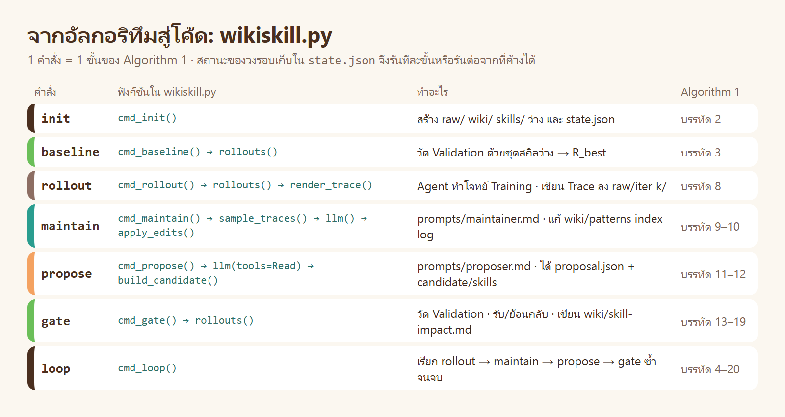

# ข้างใน WikiSkill · `wikiskill.py` และ prompt ทำงานอย่างไร

> [ทฤษฎี](../01_theory/README.md) อธิบายว่า WikiSkill คิดอย่างไร · หน้านี้ชี้ว่าแนวคิดแต่ละข้ออยู่ตรงไหนของโค้ดและ prompt ที่บทนี้ใช้รันจริง

| ส่วน | ตอบคำถาม |
|---|---|
| [1 · ไฟล์ทั้งหมด](#1--ไฟล์ทั้งหมด) | มีไฟล์อะไร ใครเรียกใคร |
| [2 · จากอัลกอริทึมสู่คำสั่ง](#2--จากอัลกอริทึมสู่คำสั่ง) | บรรทัดใดของ Algorithm 1 คือคำสั่งใด |
| [3 · เดินโค้ดทีละคำสั่ง](#3--เดินโค้ดทีละคำสั่ง) | แต่ละคำสั่งอ่านอะไร เขียนอะไร |
| [4 · prompt ของ Wiki Maintainer](#4--prompt-ของ-wiki-maintainer) | แต่ละย่อหน้ามีไว้ทำอะไร |
| [5 · prompt ของ Skill Proposer](#5--prompt-ของ-skill-proposer) | แต่ละย่อหน้ามีไว้ทำอะไร |
| [6 · การออกแบบ 10 ข้อ อยู่ตรงไหนของโค้ด](#6--การออกแบบ-10-ข้อ-อยู่ตรงไหนของโค้ด) | ตารางเชื่อมทฤษฎีข้อ 8 กับโค้ด |
| [7 · ต่างจากเปเปอร์ตรงไหน](#7--ต่างจากเปเปอร์ตรงไหน) | สิ่งที่บทนี้ปรับ และเหตุผล |
| [8 · ลองเอง](#8--ลองเอง) | แบบฝึกหัดที่ไม่ใช้โทเคน |

---

# 1 · ไฟล์ทั้งหมด

```text
wikiskill/
├── wikiskill.py                 685 บรรทัด   วงรอบทั้งหมด 9 คำสั่ง (Python มาตรฐาน)
└── prompts/
    ├── maintainer.md            74 บรรทัด    system prompt ของ Wiki Maintainer
    ├── proposer.md              84 บรรทัด    system prompt ของ Skill Proposer
    └── proposer_nowiki.md       77 บรรทัด    Proposer แบบไม่มี wiki (ใช้ใน LAB 4)
```

| ส่วน | เป็นโค้ดหรือโมเดล | เหตุผล |
|---|---|---|
| ลำดับของวงรอบ · การสุ่ม Trace · การรับหรือย้อนกลับ · การจด `skill-impact.md` | **โค้ด** | ต้องทำเหมือนกันทุกรอบ และเป็นข้อเท็จจริงจากการวัด |
| การหาสาเหตุจาก Trace · การเขียน pattern | **โมเดล** (Maintainer) | ต้องใช้ความเข้าใจ |
| การเลือกว่าจะแก้อะไร · การเขียนสกิล | **โมเดล** (Proposer) | ต้องใช้ความเข้าใจและภาษา |
| การทำโจทย์ | **โมเดล** (Inference Agent) ผ่าน `run_trial` ของ [`skillopt.py`](../../../00_resource/skills/skill-optimizer/scripts/skillopt.py) | ใช้ตัวรันเดียวกับบท 05 ผลจึงเทียบกันได้ |

หลักเดียวกับบท 05: **โมเดลตัดสินใจ · โค้ดคำนวณและตัดสินผล**

---

# 2 · จากอัลกอริทึมสู่คำสั่ง



วงรอบเก็บสถานะไว้ใน `state.json` จึงรันทีละขั้น หยุดกลางทาง แล้วรันต่อได้

```text
init ──▶ baseline ──▶ rollout ──▶ maintain ──▶ propose ──▶ gate ─┐
                         ▲                                        │
                         └──────── รอบถัดไป (ถ้า R_best < 100% และ k < K) ┘
```

| ฟิลด์ใน `state.json` | ความหมาย | ตัวอย่างจริง ([`runs/w1/state.json`](../runs/w1/state.json)) |
|---|---|---|
| `k` | รอบปัจจุบัน | `1` |
| `phase` | ขั้นล่าสุดที่ทำเสร็จ | `"gate"` |
| `r_best` | คะแนน Validation ที่ดีที่สุด | `1.0` |
| `history[]` | ผลของแต่ละรอบ: คะแนน · Trace ที่สุ่ม · pattern ที่สร้าง · ไฟล์ที่ Proposer เปิด · ผลของ Gate · ต้นทุน | 1 รายการ |

ถ้ารันคำสั่งผิดลำดับ ฟังก์ชัน `need()` (บรรทัด 328) จะบอกว่าขั้นถัดไปคืออะไร แล้วไม่ทำอะไร

---

# 3 · เดินโค้ดทีละคำสั่ง

## 3.1 `init` · สร้าง 3 ชั้นว่าง ๆ

[`cmd_init()`](../wikiskill/wikiskill.py#L294) สร้าง `raw/` `wiki/` `skills/` และ `state.json` · Wiki เริ่มด้วยหัวไฟล์เปล่า 3 ไฟล์ (W₀ = ว่าง) สกิลไม่มีสักตัว (S₀ = ว่าง)

## 3.2 `baseline` และ `rollout` · Inference Agent

ทั้งสองคำสั่งใช้ [`rollouts()`](../wikiskill/wikiskill.py#L80) ตัวเดียวกัน ต่างกันที่ชุดโจทย์ (Validation / Training)

```python
suite = so.load_suite(cfg["suite"])
if skill_names(skills_dir):
    suite = dict(suite, files=suite.get("files", []) + [os.path.abspath(skills_dir)])
a = argparse.Namespace(label=label, skill="none", model=cfg["model"], effort=cfg["effort"])
…
return so.run_trial(cfg["suite"], suite, j[0], j[1], a, acc)
```

| สิ่งที่โค้ดทำ | แนวคิดในทฤษฎี |
|---|---|
| คัดลอกเฉพาะโฟลเดอร์ `skills/` เข้า sandbox ของ Agent | Agent เห็นสกิล แต่ **ไม่เห็น Wiki** (ข้อ 8.4) |
| เรียก `run_trial` ของ `skillopt.py` | โจทย์ พรอมต์ ตัวตรวจ และโมเดล เหมือนบท 05 ทุกค่า |
| ข้าม Trial ที่มีผลแล้ว | รันต่อจากที่ค้างได้ |

หลัง `rollout` [`render_trace()`](../wikiskill/wikiskill.py#L141) แปลง transcript ดิบเป็น Trace ที่อ่านได้ 1 ไฟล์ต่องาน

```text
# Trace t4-cashback-r1 · iteration 1
- ผล: **FAIL** · คะแนน 0.30 (ผ่าน 3 จาก 10 ข้อตรวจ)
## โจทย์            ← ข้อความโจทย์ที่ Agent ได้รับ
## ผลของตัวตรวจ     ← ✓/✗ ทั้ง 10 ข้อ พร้อมข้อความ "คาดอะไร ได้อะไร"
## สิ่งที่ Agent ทำ   ← ทุกคำสั่งและผลที่ได้ ตามลำดับ
## คำตอบสุดท้าย
```

Trace ยาวเกิน 15,000 ตัวอักษรจะถูกย่อ (`TRACE_CAP` บรรทัด 30) · ไฟล์ถูกเขียนครั้งเดียว ไม่มีฟังก์ชันใดกลับมาแก้ (ข้อ 8.2)

## 3.3 `maintain` · Wiki Maintainer

[`cmd_maintain()`](../wikiskill/wikiskill.py#L373) ทำ 4 อย่างตามลำดับ

| # | ทำอะไร | ฟังก์ชัน | ผลจริงของรอบที่ 1 |
|---|---|---|---|
| 1 | สุ่ม Trace: ไม่ผ่าน ≤ 5 (คะแนนต่ำก่อน กระจายทุกโจทย์) + ผ่าน ≤ 3 | [`sample_traces()`](../wikiskill/wikiskill.py#L207) | ไม่ผ่าน 5 · ผ่าน 0 |
| 2 | ประกอบข้อความ: สกิลปัจจุบัน + Wiki ทั้งหมด + Trace ที่สุ่ม | [`wiki_context()`](../wikiskill/wikiskill.py#L363) | 1 ข้อความ → [`maintainer_input.md`](../runs/w1/history/iter-01/maintainer_input.md) |
| 3 | เรียกโมเดล 1 ครั้ง ไม่มีเครื่องมือ | [`llm(tools="")`](../wikiskill/wikiskill.py#L227) | 76 วินาที → [`maintainer_output.json`](../runs/w1/history/iter-01/maintainer_output.json) |
| 4 | นำ JSON ไปแก้ไฟล์ใน `wiki/` | [`apply_edits()`](../wikiskill/wikiskill.py#L264) | สร้าง 5 หน้า · เขียน index · ต่อท้าย log |

โมเดลไม่ได้เขียนไฟล์เอง โมเดลตอบ JSON แล้ว **โค้ดเป็นผู้เขียน** จึงควบคุมได้ว่าแก้ได้เฉพาะ `patterns/` `index.md` `log.md`

```python
for p in out.get("update_patterns") or []:            # หน้าเดิม: แก้ทีละจุด ไม่เขียนทับ
    txt, bad = apply_edits(read(os.path.join(pd, n)), p.get("edits"))
write(P(ws, "wiki", "index.md"), out["update_index"].strip() + "\n")
write(P(ws, "wiki", "log.md"), read(P(ws, "wiki", "log.md")).rstrip("\n") + … )   # ต่อท้ายเท่านั้น
```

## 3.4 `propose` · Skill Proposer

[`cmd_propose()`](../wikiskill/wikiskill.py#L483)

| # | ทำอะไร | แนวคิดในทฤษฎี |
|---|---|---|
| 1 | สร้างโฟลเดอร์ `proposer_view/` = สำเนาของ `wiki/` + `traces/` ของรอบนี้ + `skills/` + `summary.md` | Proposer เห็นเฉพาะสิ่งที่ควรเห็น · ไม่มีอะไรของ Validation (ข้อ 8.2) |
| 2 | ข้อความแรกมีแค่ `index.md` + `skill-impact.md` + `summary.md` | เริ่มจากสารบัญ (ข้อ 8.7) |
| 3 | เรียกโมเดลในโฟลเดอร์นั้น ด้วยเครื่องมือ `Read` อย่างเดียว | ReAct: เลือกเปิดไฟล์เอง |
| 4 | อ่าน transcript ว่าเปิดไฟล์ใดบ้าง ถ้าเปิด Trace น้อยกว่า 4 ตีกลับ | ต้องยืนยันสาเหตุจากของจริง (`MIN_TRACES` บรรทัด 32) |
| 5 | [`build_candidate()`](../wikiskill/wikiskill.py#L449) นำข้อเสนอไปสร้าง `candidate/skills/` | ข้อเสนอยังไม่ใช่สกิลที่ใช้งาน (Algorithm 1 บรรทัด 12) |

```python
m = llm(st, system, user + …, "Read", view, …)        # cwd = proposer_view · เครื่องมือ = Read
…
if prop.get("action") != "no_action" and ntr < MIN_TRACES:
    raise ValueError("อ่าน Trace แค่ %d ไฟล์ (ต้องอย่างน้อย %d) ก่อนเสนอ" % (ntr, MIN_TRACES))
name, diff = build_candidate(ws, hd, prop)
```

ข้อเสนอที่ใช้ไม่ได้ (JSON เสีย · `target` ของ patch ไม่พบ · อ่าน Trace ไม่ครบ) ถูกส่งกลับให้เสนอใหม่ได้อีก 2 ครั้ง ถ้ายังไม่ได้ถือเป็น `no_action`

## 3.5 `gate` · Gating and Rollback

[`cmd_gate()`](../wikiskill/wikiskill.py#L544) คือหัวใจของการแยก "สกิลย้อนกลับได้ · Wiki ไม่ย้อนกลับ"

```python
rows = rollouts(st, "%s-k%02d-val" % (cfg["name"], k), "val", os.path.join(hd, "candidate", "skills"))
r_val = mean(r["score"] for r in rows)
accepted = r_val > before + 1e-9                      # สมการ (4): รับเมื่อดีกว่า R_best เท่านั้น
if accepted:
    shutil.rmtree(P(ws, "skills"))                    # แทนที่สกิลที่ใช้งาน
    shutil.copytree(os.path.join(hd, "candidate", "skills"), P(ws, "skills"))
    st["r_best"] = r_val
…                                                     # ไม่ว่าจะรับหรือไม่: จดลง wiki
write(P(ws, "wiki", "skill-impact.md"), … + "\n".join(E) + "\n")
```

| กรณี | `skills/` | `wiki/` |
|---|---|---|
| รับ (ACCEPTED) | แทนด้วยสกิลที่เสนอ | เพิ่มรายการใน `skill-impact.md` |
| ไม่รับ (REJECTED) | **ไม่ถูกแตะ** (สกิลที่เสนออยู่ใน `candidate/` เท่านั้น) | เพิ่มรายการใน `skill-impact.md` พร้อม diff ที่ถูกปฏิเสธ |

การ "ย้อนกลับ" จึงไม่ต้องมีโค้ดย้อน: สกิลที่เสนอไม่เคยถูกวางลง `skills/` จนกว่าจะผ่าน

## 3.6 `loop` · `status` · `eval`

| คำสั่ง | ทำอะไร |
|---|---|
| [`loop`](../wikiskill/wikiskill.py#L589) | เรียก 4 ขั้นซ้ำ · หยุดเมื่อ `r_best = 100%` หรือครบ `--iters` |
| [`status`](../wikiskill/wikiskill.py#L610) | ตารางสรุปทุกรอบจาก `state.json` (ไม่เรียกโมเดล) |
| [`eval`](../wikiskill/wikiskill.py#L641) | วัดชุดสกิลใดก็ได้กับชุดโจทย์ใดก็ได้ ใช้เทียบกับสกิลของบท 05 |

---

# 4 · prompt ของ Wiki Maintainer

ไฟล์เต็ม: [`prompts/maintainer.md`](../wikiskill/prompts/maintainer.md)

| ส่วนของ prompt | เขียนว่า (ย่อ) | มีไว้เพื่อ | ทฤษฎี |
|---|---|---|---|
| บทบาท | เปลี่ยน Trace เป็นความรู้ที่ใช้ซ้ำได้ · ไม่ได้แก้สกิล | แยกหน้าที่วินิจฉัยออกจากการแก้ | 8.5 |
| 1 สิ่งที่ได้รับ | Trace ที่สุ่ม · Wiki ทั้งหมด · สกิลปัจจุบัน | ให้เห็นทั้งของใหม่และของที่รู้แล้ว | ขั้น 5 |
| 2 โครงของ wiki | 4 ไฟล์ · `skill-impact.md` อ่านได้อย่างเดียว | ข้อเท็จจริงจากการวัดไม่ให้โมเดลแก้ | 8.6 |
| 3 วิธีวิเคราะห์ | ดูสิ่งที่ Agent ทำจริง · เทียบผ่านกับไม่ผ่าน · ถามต่อจนถึงสาเหตุ · สกิลช่วยหรือทำให้พลาด | ได้ "ทำไม" ไม่ใช่แค่ "เกิดอะไรขึ้น" | ขั้น 3 |
| 4 กติกาของหน้า pattern | 4 ส่วน: อาการ สาเหตุ หลักฐาน วิธีแก้ · จดทั้งล้มเหลวและสำเร็จ · ห้ามซ้ำ ให้เติมหน้าเดิม · 10–30 บรรทัด | หลักฐานสะสมในหน้าเดียว | ขั้น 2 อาการ 2 |
| 5 กติกาของ index | 1 บรรทัด = ปัญหา + สาเหตุ + วิธีแก้ | Proposer ตัดสินจากบรรทัดนี้ว่าจะเปิดหน้าใด | 8.7 |
| 6 รูปแบบคำตอบ | JSON: `create_patterns` `update_patterns` `update_index` `append_log` · patch 3 แบบ | โค้ดเป็นผู้เขียนไฟล์ · หน้าเดิมไม่ถูกเขียนทับ | 8.9 |

**ผลของกติกา "จดทั้งล้มเหลวและสำเร็จ" ในการรันจริง:** หน้า [`money-rounding-half-up.md`](../runs/w1/wiki/patterns/money-rounding-half-up.md) มีทั้งงานที่ล้ม (`t4-cashback`, `t2-split-bill`) และงานที่ผ่าน (`t1-cafe-bill`, `t3-shipping-fee`) วิธีแก้ในหน้านั้นคือสูตรที่งานที่ผ่านใช้อยู่แล้ว

---

# 5 · prompt ของ Skill Proposer

ไฟล์เต็ม: [`prompts/proposer.md`](../wikiskill/prompts/proposer.md)

| ส่วนของ prompt | เขียนว่า (ย่อ) | มีไว้เพื่อ | ทฤษฎี |
|---|---|---|---|
| บทบาท | เสนอได้ 1 อย่างต่อรอบ · ถูกวัดด้วยโจทย์ที่ไม่เห็น ไม่ดีกว่าเดิมจะถูกทิ้ง | ข้อเสนอเล็ก และรู้ว่ามี Gate | 8.9 · 8.10 |
| 1 เครื่องมือ | มี `Read` อย่างเดียว · ตอบสุดท้ายเป็น JSON | แก้ไฟล์เองไม่ได้ ทุกอย่างผ่าน Gate | 8.3 |
| 2 ไฟล์ใน workspace | wiki · summary · traces · skills | บอกว่ามีความรู้ 3 ระดับให้เปิด | 8.7 |
| 3 ลำดับการทำงาน | index → skill-impact → pattern ที่เกี่ยว → Trace ที่ไม่ผ่าน → สกิลเดิม → ตัดสินใจ | อ่านจากสั้นไปยาว จากสรุปไปของจริง | 8.7 |
| 4 รูปแบบข้อเสนอ | `create` (SKILL.md + PURPOSE.md) · `patch` (รายการแก้) · `no_action` | patch ทีละจุด · PURPOSE.md ชี้กลับไปยัง pattern | 8.1 · 8.9 |
| 5 กติกา ข้อ 1 | ห้ามเสนอสิ่งที่ `skill-impact.md` บันทึกว่าถูกปฏิเสธ | ใช้ความรู้จากรอบที่ล้มเหลว | 8.3 |
| 5 กติกา ข้อ 2 | อ่าน Trace อย่างน้อย 4 ไฟล์ | ยืนยันสาเหตุจากของจริง (โค้ดตรวจข้อนี้ด้วย) | 8.2 |
| 5 กติกา ข้อ 6 | ห้ามใส่ชื่อฟังก์ชัน ตัวเลข หรือคำตอบของโจทย์ | สกิลต้องใช้ได้กับโจทย์ที่ไม่เคยเห็น | – |

**สิ่งที่โค้ดตรวจซ้ำ ไม่เชื่อ prompt อย่างเดียว:** จำนวน Trace ที่เปิด (นับจาก transcript) · `target` ของ patch ต้องพบในไฟล์ · `skill_md` ต้องมี frontmatter · ชื่อไฟล์ต้องปลอดภัย · กติกาที่สำคัญจึงมีทั้งใน prompt (บอกโมเดล) และในโค้ด (บังคับ)

---

# 6 · การออกแบบ 10 ข้อ อยู่ตรงไหนของโค้ด

| ทฤษฎีข้อ | การออกแบบ | โค้ด | prompt |
|---|---|---|---|
| 8.1 | แยกความรู้ออกจากสกิล | `build_candidate()` เขียน `SKILL.md` + `PURPOSE.md` | proposer ข้อ 4 |
| 8.2 | Raw ห้ามแก้ | `cmd_rollout()` เขียนครั้งเดียว · `proposer_view/` เป็นสำเนา | proposer ข้อ 1 (มีแต่ `Read`) |
| 8.3 | สกิลย้อนกลับ Wiki ไม่ย้อนกลับ | `cmd_gate()` แทน `skills/` เฉพาะเมื่อ `accepted` | proposer ข้อ 5.1 |
| 8.4 | Agent ห้ามอ่าน Wiki | `rollouts()` คัดลอกเฉพาะ `skills/` | – |
| 8.5 | แยก Maintainer กับ Proposer | `cmd_maintain()` กับ `cmd_propose()` · `llm()` คนละการเรียก | 2 ไฟล์ |
| 8.6 | `skill-impact.md` เขียนโดยโปรแกรม | `cmd_gate()` + `difflib.unified_diff` | maintainer ข้อ 2 |
| 8.7 | ReAct + index | `cmd_propose()` ส่งแค่ index · `llm(tools="Read")` | maintainer ข้อ 5 · proposer ข้อ 3 |
| 8.8 | สุ่ม Trace 5 + 3 · ไม่เกิน 15,000 ตัวอักษร | `sample_traces()` · `TRACE_CAP` | – |
| 8.9 | ข้อเสนอ 1 ข้อ · patch | `apply_edits()` · `build_candidate()` | maintainer ข้อ 6 · proposer ข้อ 4 |
| 8.10 | รับเมื่อดีกว่า · หยุดที่ 100% | `cmd_gate()` บรรทัด 556 · `cmd_loop()` | proposer (บทบาท) |

---

# 7 · ต่างจากเปเปอร์ตรงไหน

| เรื่อง | เปเปอร์ | บทนี้ | เหตุผล |
|---|---|---|---|
| การให้สกิลแก่ Agent | ใส่เนื้อหาสกิลใน system prompt ทั้งหมด | วางสกิลใน `./skills` ของ sandbox แล้วพรอมต์บอกให้อ่าน | ใช้ตัวรันของบท 05 เพื่อให้เทียบกันได้ · ตรวจจาก Trace ว่า Agent อ่านจริง |
| prompt ของ Maintainer และ Proposer | ภาษาอังกฤษ (ภาคผนวก E) | เขียนใหม่เป็นภาษาไทยด้วยถ้อยคำของบทนี้ คงโครงของคำตอบ (JSON · patch 3 แบบ) | ผู้เรียนอ่านได้ · Wiki และสกิลเป็นภาษาไทย |
| เครื่องมือของ Proposer | `read_file` + `finish` | `Read` ของ Claude Code · ข้อความสุดท้าย = ข้อเสนอ | ใช้เครื่องมือที่มีอยู่ |
| Maintainer เห็นสกิลปัจจุบัน | ได้ Wiki + Trace | ได้เนื้อหาของสกิลปัจจุบันเพิ่ม | ให้ตอบได้ว่าสกิลช่วยหรือทำให้พลาด |
| PURPOSE.md ตอน patch | ไม่ระบุ | มีฟิลด์ `purpose_append` | ให้ PURPOSE.md มีประวัติครบทุกรอบ |
| กติกากันคำตอบรั่ว | ไม่ระบุ | Proposer ข้อ 5.6: ห้ามใส่ชื่อฟังก์ชันหรือคำตอบของโจทย์ | กติกาเดียวกับ `AGENT.md` ของบท 05 |
| จำนวนครั้งที่รันทั้งกระบวนการ | 3 ครั้ง แล้วเฉลี่ย | 1 ครั้งต่อการตั้งค่า | จำกัดต้นทุนของ LAB (ดูข้อจำกัดใน README หลัก) |
| ขนาดชุดโจทย์ | Training 16–80 · Validation 10–40 · Test 85–280 | Training 4 · Validation 2 · Test 3 (ข้อละ 3 รอบ) | ใช้โจทย์ของบท 05 |

สิ่งที่ **เหมือน** เปเปอร์: 3 ชั้น · 4 ส่วนประกอบ · ลำดับของ Algorithm 1 · การสุ่ม 5 + 3 · ขีดจำกัด 15,000 ตัวอักษร · Proposer แบบ ReAct ที่ต้องอ่าน Trace อย่างน้อย 4 · ข้อเสนอ 1 ข้อต่อรอบ · Gate แบบ "ดีกว่าเท่านั้น" · หยุดเมื่อ 100% · Wiki ไม่ย้อนกลับ · Agent ไม่เห็น Wiki

---

# 8 · ลองเอง

ทุกข้อรันบนเครื่อง จากโฟลเดอร์ `06_WikiSkill` ไม่ใช้โทเคน

| # | ทำ | ได้เห็นอะไร |
|---|---|---|
| 1 | `python wikiskill/wikiskill.py status runs/w1` | ตารางสรุปของการรันจริง อ่านจาก `state.json` |
| 2 | เปิด [`runs/w1/history/iter-01/maintainer_input.md`](../runs/w1/history/iter-01/maintainer_input.md) | ข้อความทั้งหมดที่ Maintainer ได้รับใน 1 ครั้ง |
| 3 | เปิด [`maintainer_output.json`](../runs/w1/history/iter-01/maintainer_output.json) เทียบกับไฟล์ใน [`runs/w1/wiki/`](../runs/w1/wiki/) | JSON 1 ก้อนกลายเป็นไฟล์ใน wiki อย่างไร |
| 4 | เปิด [`proposal.json`](../runs/w1/history/iter-01/proposal.json) เทียบกับ [`skills/`](../runs/w1/skills/) | ข้อเสนอกลายเป็นสกิลอย่างไร |
| 5 | อ่าน `cmd_gate()` แล้วตอบ: ถ้า Validation ได้เท่ากับ R_best พอดี จะเกิดอะไร | เกณฑ์ "ดีกว่าเท่านั้น" (ข้อ 8.10) |
| 6 | แก้ `MAX_PASS` เป็น `0` แล้วอ่าน `sample_traces()` ว่า Maintainer จะเสียอะไร | ทำไมต้องมี Trace ที่ผ่าน (ข้อ 8.8) |

**กลับไป:** [ทฤษฎี](../01_theory/README.md) · [บทหลัก](../README.md)
