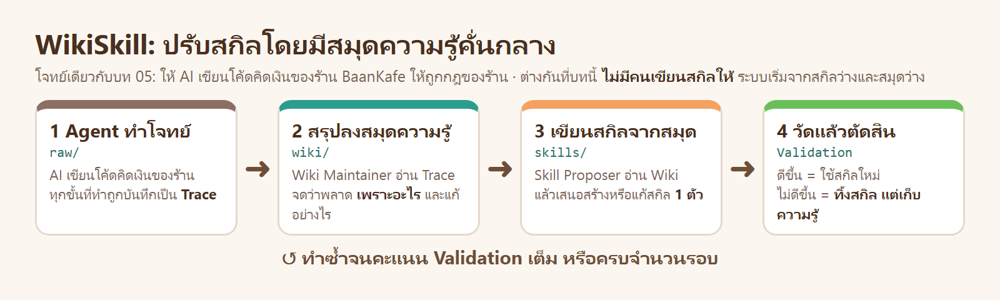
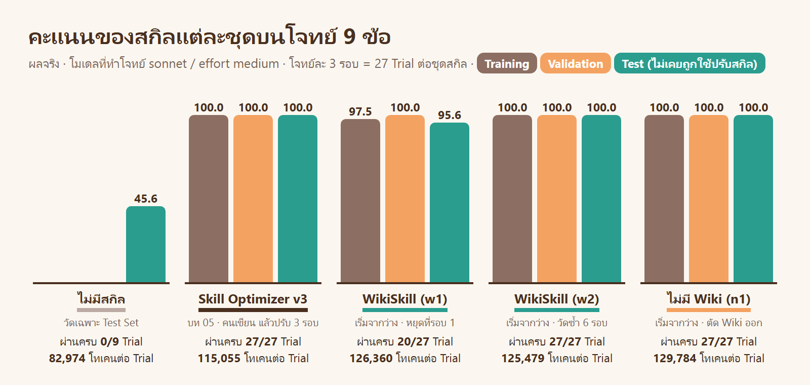
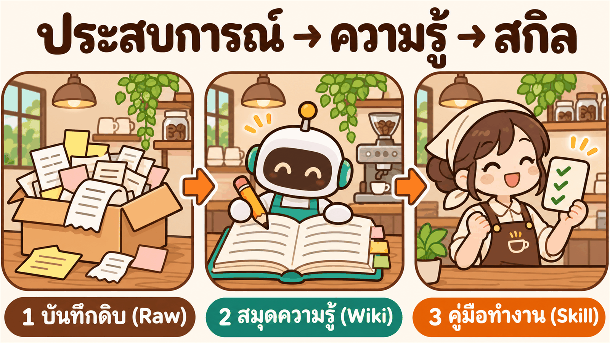
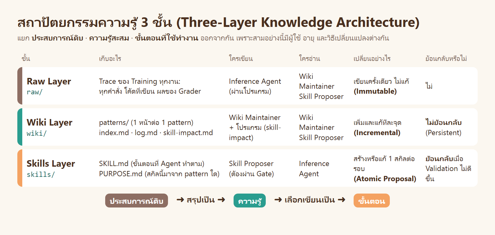
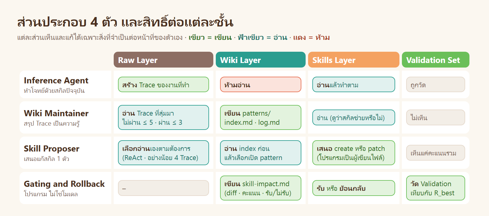
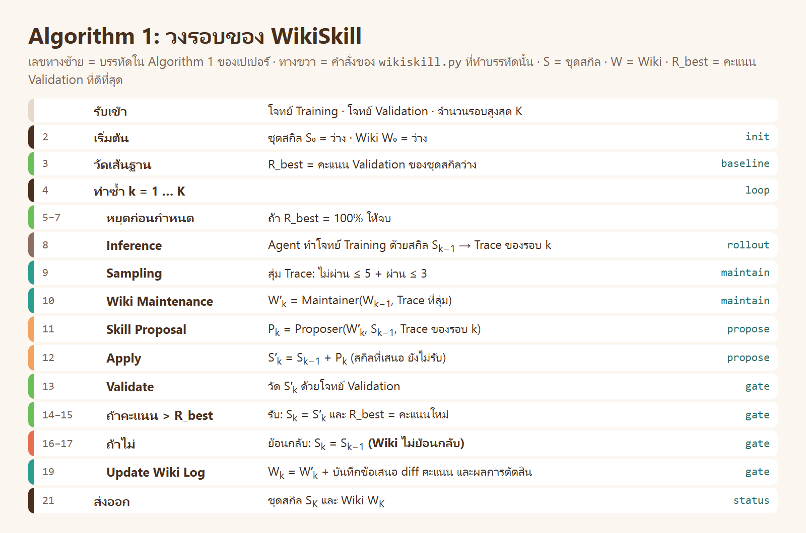
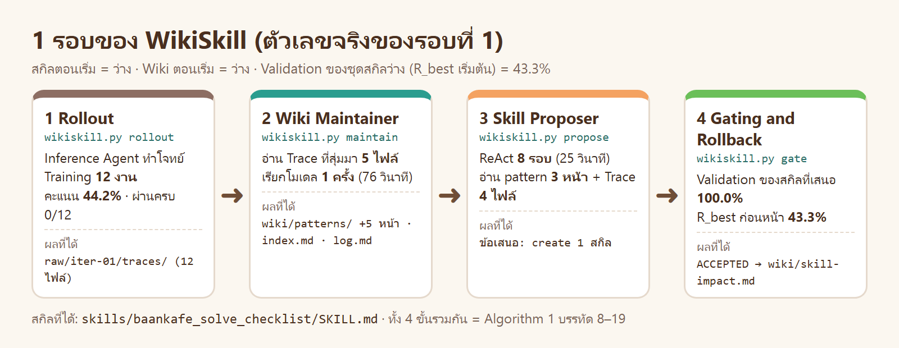
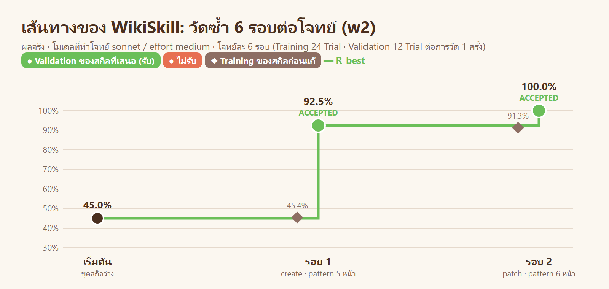
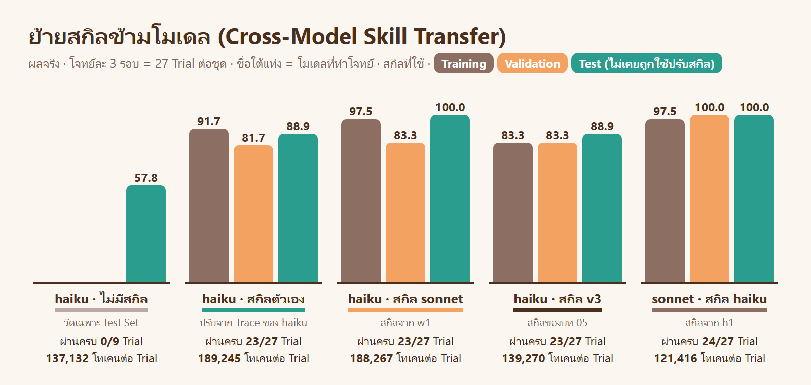
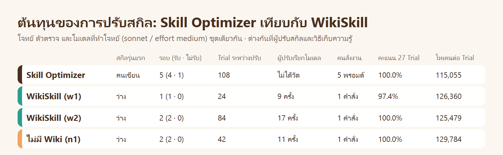

# WikiSkill · ให้ AI จดสมุดความรู้ แล้วเขียนสกิลจากสมุด


## เรื่องทั้งหมดในภาพเดียว



| ขั้น | เกิดอะไรขึ้น |
|---|---|
| 1 Agent ทำโจทย์ | AI เขียนโค้ดคิดเงินของร้าน BaanKafe (โจทย์ชุดเดียวกับ [บท 05](../05_Skill_Optimizer_Basic/README.md)) ทุกขั้นถูกบันทึกเป็น **Trace** |
| 2 สรุปลงสมุดความรู้ | AI ตัวที่สองอ่าน Trace แล้วจดลง **Wiki** ว่าพลาดเพราะอะไร แก้อย่างไร |
| 3 เขียนสกิลจากสมุด | AI ตัวที่สามอ่าน Wiki แล้วเสนอสร้างหรือแก้ **สกิล** 1 ตัว |
| 4 วัดแล้วตัดสิน | คะแนนดีขึ้น = ใช้สกิลใหม่ · ไม่ดีขึ้น = ทิ้งสกิล แต่ Wiki ยังอยู่ครบ |

บท 05 เราเขียนสกิลรุ่นแรกเองแล้วสั่งปรับทีละรอบ · บทนี้ **ไม่มีคนเขียนสกิล** ระบบเริ่มจากสกิลว่าง แล้วทำ 4 ขั้นนี้เอง · ผลจริงเทียบกัน:



## อ่านตามลำดับนี้

| ส่วน | ตอบคำถาม |
|---|---|
| [1 · โจทย์](#1--โจทย์) | โจทย์เดิมของบท 05 คืออะไร บทนี้เพิ่มอะไร |
| [2 · WikiSkill ฉบับย่อ](#2--wikiskill-ฉบับย่อ) | แนวคิดหลักใน 4 ภาพ |
| [ทฤษฎี (ละเอียด 11 ขั้น)](01_theory/README.md) | แนวคิด · **วิธีคิดในการออกแบบ 10 ข้อ** · อัลกอริทึม · การเปรียบเทียบ |
| [ข้างใน WikiSkill](02_inside_wikiskill/README.md) | `wikiskill.py` และ prompt ทำงานอย่างไร เชื่อมกับทฤษฎีข้อใด |
| [3 · ลงมือทำ](#3--ลงมือทำ-copy--paste) | พรอมต์ Copy & Paste 6 ขั้น พร้อมผลจริง |
| [4 · เทียบกับ Skill Optimizer](#4--เทียบกับ-skill-optimizer) | วิธีไหนได้อะไร เสียอะไร |
| [5 · สรุปและแบบฝึกหัด](#5--สรุปและแบบฝึกหัด) | บทเรียนจากผลจริง ข้อจำกัด และโจทย์ให้ลองต่อ |

ตัวเลขทุกตัวมาจากการรันจริงเมื่อ 13 พ.ย. 2026 · ผลดิบอยู่ใน [`runs/`](runs/) และ [`results/`](results/)
เปเปอร์ต้นทาง: Tang et al., *WikiSkill: Compiling Agent Experience into Persistent Knowledge for Skill Evolution*, [arXiv:2608.27454](https://arxiv.org/abs/2608.27454)

---

# 1 · โจทย์

## 1.1 โจทย์เดิมของบท 05

| หัวข้อ | คืออะไร |
|---|---|
| สถานการณ์ | ร้าน BaanKafe ให้ AI เขียนฟังก์ชันคิดเงิน เช่น `cashback(amount, tier, birthday)` |
| กฎ 2 ชั้น | **กฎเฉพาะของงาน** อยู่ในโจทย์ AI เห็น · **กฎกลางของร้าน 5 ข้อ** ไม่อยู่ในโจทย์ AI ไม่เห็นถ้าสกิลไม่บอก |
| กฎกลาง 5 ข้อ | เงินเป็นจำนวนเต็มสตางค์ · ปัดครึ่งขึ้นครั้งเดียว · ข้อมูลผิดต้อง `ValueError` · รันเป็นโปรแกรมรับส่ง JSON · มีเทสต์อย่างน้อย 6 ข้อ |
| ตัวตรวจ | [`suite/grade.py`](suite/grade.py) ตรวจ 10 ข้อ · คะแนนของ 1 งาน = ข้อที่ผ่าน ÷ 10 |
| สิ่งเดียวที่ปรับได้ | สกิล (`SKILL.md`) |

รายละเอียดของกฎและตัวตรวจ: [บท 05 ส่วนที่ 1](../05_Skill_Optimizer_Basic/README.md#1--โจทย์และกฎของร้าน)

## 1.2 สิ่งที่บทนี้เปลี่ยน

| | บท 05 · Skill Optimizer | บทนี้ · WikiSkill |
|---|---|---|
| สกิลรุ่นแรก | คนเขียน (`v0` 5 บรรทัด) | ไม่มี · เริ่มจากว่าง |
| ใครหาสาเหตุและแก้สกิล | Claude ตามพรอมต์ของเราทีละรอบ | AI 2 บทบาท ทำเองทั้งวงรอบ |
| ที่เก็บสิ่งที่เรียนรู้ | `ISSUES.md` | `wiki/` |
| AI รู้กฎกลางจากไหน | จากสกิลที่คนเขียน | ต้องค้นพบเองจาก Trace และข้อความของตัวตรวจ |

โจทย์ ตัวตรวจ พรอมต์ของ Agent โมเดล (sonnet / effort medium) และจำนวนรอบ (3) **เหมือนบท 05 ทุกค่า** ผลจึงเทียบกันได้

## 1.3 Test Set 3 ข้อใหม่

บท 05 มี Training 4 ข้อ กับ Validation 2 ข้อ · บทนี้เพิ่ม **Test Set** 3 ข้อที่ไม่เคยถูกใช้ปรับสกิลทั้งสองวิธี ใช้วัดครั้งเดียวตอนจบ

| ชุด | ฟังก์ชัน | กฎเฉพาะ (ย่อ) |
|---|---|---|
| Test | `late_fee(amount, days_late)` | ค่าปรับจ่ายช้า วันละ 0.75% · 3 วันแรกไม่คิด · สูงสุด 15% |
| Test | `refund(paid, used_percent, restock)` | คืนเงินคอร์สตามส่วนที่ยังไม่เรียน · เรียนเกิน 80% ไม่คืน · หักค่าดำเนินการ 12.5% |
| Test | `bulk_price(unit_price, qty, coupon)` | ราคาขายส่ง ลด 3.5% หรือ 7.5% ตามจำนวน · คูปองลดอีก 2.5% · VAT 7% |

โจทย์เต็ม: [`suite/suite.json`](suite/suite.json) · ตัวตรวจผ่านการตรวจกับเฉลยอ้างอิงและเฉลยที่จงใจผิดทั้ง 9 ข้อ (LAB 0)

---

# 2 · WikiSkill ฉบับย่อ

ส่วนนี้ให้เห็นภาพรวมก่อนลงมือ · คำอธิบายเต็มพร้อมเหตุผลของการออกแบบทุกจุดอยู่ใน [ทฤษฎี](01_theory/README.md)

## 2.1 แนวคิด: มีสมุดความรู้คั่นกลาง



Trace บอกว่า **เกิดอะไรขึ้น** · Wiki บอกว่า **ทำไม** · สกิลบอกว่า **ต้องทำอย่างไร** · สามอย่างนี้มีผู้ใช้และอายุต่างกัน จึงแยกเก็บ

## 2.2 สามชั้น



## 2.3 สี่ส่วนประกอบ



## 2.4 อัลกอริทึม



จุดที่ต่างจากวงรอบทั่วไปมี 3 ข้อ: ความรู้ถูกจดลง Wiki **ก่อน** แก้สกิล · สกิลที่ไม่ผ่านถูกย้อนกลับ แต่ **Wiki ไม่ย้อนกลับ** · Agent ที่ทำโจทย์ **ไม่เห็น Wiki**
เหตุผลของแต่ละข้อ: [ทฤษฎี ขั้น 8](01_theory/README.md#ขั้น-8--วิธีคิดในการออกแบบ)

---

# 3 · ลงมือทำ (Copy & Paste)

**วิธีใช้:** เปิดโฟลเดอร์ `Teaching` ใน Claude Code Desktop → คัดลอกพรอมต์ → วาง → รอผล
ต้องมี container `multi-account` และบัญชี `yolo` ที่ล็อกอินแล้วอย่างน้อย 1 บัญชี

กติกาที่ Claude ต้องทำตามอยู่ใน [`AGENT.md`](AGENT.md) พรอมต์จึงสั้น · Claude ในที่นี้เป็นเพียงผู้กดรันคำสั่ง ผู้ปรับสกิลคือ `wikiskill.py`

| LAB | ทำอะไร | Trial | เวลาจริง |
|---|---|---|---|
| [0](#lab-0--เตรียม) | ส่งไฟล์เข้า container ตรวจตัวตรวจ | – | 1 นาที |
| [1](#lab-1--รัน-wikiskill-ทีละขั้น) | รัน WikiSkill ทีละขั้น ดู 3 ชั้นเปลี่ยน | 24 | 3 นาที |
| [2](#lab-2--เทียบกับสกิลของบท-05-บน-test-set) | เทียบกับสกิล `v3` ของบท 05 บน Test Set | 63 | 5 นาที |
| [3](#lab-3--วัด-validation-ให้มากขึ้น) | รันใหม่โดยวัดซ้ำ 6 รอบต่อโจทย์ | 111 | 9 นาที |
| [4](#lab-4--ตัด-wiki-ออก) | ตัด Wiki ออก (Ablation) | 69 | 5 นาที |
| [5](#lab-5--โมเดลเล็กลง-และย้ายสกิลข้ามโมเดล) | โมเดลเล็กลง และย้ายสกิลข้ามโมเดล | 141 | 10 นาที |

## LAB 0 · เตรียม

```text
อ่าน ./03_week03/06_WikiSkill/AGENT.md แล้วทำตาม
เตรียม LAB: ส่งไฟล์เข้า container · ตรวจ Grader ด้วย suite/check_grader.py · ตรวจว่าบัญชี yolo ใดล็อกอินแล้ว
ยังไม่ต้องสร้าง workspace หรือรัน Trial · ตอบเป็นตาราง รายการ | ผล
```

ผลจริง

| รายการ | ผล |
|---|---|
| ส่งไฟล์เข้า container | ✅ `wikiskill` `suite` `skill-optimizer` `baselines/v3` อยู่ใน `/workspace/wklab` |
| Grader กับเฉลยอ้างอิง | ✅ ผ่าน 10/10 ทั้ง 9 โจทย์ |
| Grader กับเฉลยที่จงใจใส่ความผิด 1 จุด | ✅ ไม่ผ่านเฉพาะข้อนั้น (`half_up` · `reject_type` · `cli_error`) |
| บัญชี | ✅ `yolo1` `yolo2` `yolo3` |

## LAB 1 · รัน WikiSkill ทีละขั้น

```text
อ่าน ./03_week03/06_WikiSkill/AGENT.md แล้วทำตาม
สร้าง workspace ชื่อ w1 แล้วรัน baseline และรอบที่ 1 ทีละขั้น: rollout → maintain → propose → gate
หลังแต่ละขั้น เปิดไฟล์ที่ขั้นนั้นสร้าง แล้วบอกว่าชั้นใด (raw / wiki / skills) เปลี่ยนอย่างไร
จากนั้นรัน loop ต่อจนจบ แล้วเก็บผลลงเครื่อง
ตอบ: ตาราง ขั้น | ไฟล์ที่เกิดหรือเปลี่ยน | สรุป 1 บรรทัด · เนื้อหาของ wiki/index.md · ชื่อสกิลที่ได้ · ตาราง status · เหตุผลที่วงรอบหยุด
```

ผลจริง ([`runs/w1/`](runs/w1/))

| ขั้น | ชั้นที่เปลี่ยน | ไฟล์ที่เกิด | ผล |
|---|---|---|---|
| `baseline` | – | – | Validation ของชุดสกิลว่าง **43.3%** = R_best |
| `rollout` | Raw | [`raw/iter-01/traces/`](runs/w1/raw/iter-01/traces/) 12 ไฟล์ · [`summary.md`](runs/w1/raw/iter-01/summary.md) | Training 44.2% · ผ่านครบ 0/12 |
| `maintain` | Wiki | [`wiki/patterns/`](runs/w1/wiki/patterns/) 5 หน้า · [`index.md`](runs/w1/wiki/index.md) · [`log.md`](runs/w1/wiki/log.md) | อ่าน Trace 5 ไฟล์ · เรียกโมเดล 1 ครั้ง (76 วินาที) |
| `propose` | (ยังไม่เปลี่ยน) | [`history/iter-01/proposal.json`](runs/w1/history/iter-01/proposal.json) | ReAct 8 รอบ · เปิด pattern 3 หน้า + Trace 4 ไฟล์ → `create` 1 สกิล |
| `gate` | Skills + Wiki | [`skills/baankafe_solve_checklist/`](runs/w1/skills/baankafe_solve_checklist/) · [`wiki/skill-impact.md`](runs/w1/wiki/skill-impact.md) | Validation **100.0%** > 43.3% → **ACCEPTED** |
| `loop` | – | – | หยุด: R_best = 100% (Algorithm 1 บรรทัด 5) |

Wiki ที่ได้: 5 pattern ([`index.md`](runs/w1/wiki/index.md))

| pattern | พบว่า | ตรงกับกฎกลางข้อ |
|---|---|---|
| `money-rounding-half-up` | ปัดลงด้วย `//` · วิธีที่ถูกพบใน Trace ของงานที่ผ่าน | 1 · 2 |
| `missing-input-validation` | ไม่ตรวจช่วงค่าและชนิด | 3 |
| `missing-cli-entrypoint` | ไม่อ่าน JSON จาก stdin ไม่พิมพ์ `{"ok": …}` | 4 |
| `missing-test-file` | ไม่มี `test_solve.py` | 5 |
| `happy-path-only-verification` | Agent ตรวจแค่กรณีปกติแล้วบอกว่าถูก | (พฤติกรรมของ Agent) |



**รันซ้ำโดย Agent อิสระ:** พรอมต์ LAB 0 และ LAB 1 ถูกรันตามตัวอักษรอีกครั้งโดย Agent ที่ไม่รู้จักบทนี้ (workspace [`v1`](runs/v1/) · [status](results/status-v1.txt)) ไม่มีคำสั่งใดล้ม · ครั้งนั้น Validation รอบแรกได้ 93.3% วงรอบจึงทำรอบที่ 2 แล้วได้ 100.0% = prompt เดิม อัลกอริทึมเดิม แต่จำนวนรอบต่างจาก `w1`

👀 AI ค้นพบกฎกลางของร้านครบ 5 หมวดเองจาก Trace 5 ไฟล์ โดยไม่มีใครบอก · สกิล 69 บรรทัดถูกสร้างในรอบเดียว · เดินดูทีละไฟล์: [ทฤษฎี ขั้น 6](01_theory/README.md#ขั้น-6--เดิน-1-รอบด้วยผลจริง)

## LAB 2 · เทียบกับสกิลของบท 05 บน Test Set

```text
อ่าน ./03_week03/06_WikiSkill/AGENT.md แล้วทำตาม
วัด 3 ชุดด้วยคำสั่ง eval ของ workspace w1:
1) สกิลของ w1 ป้าย w1-final --skills active --split all
2) สกิล v3 ของบท 05 ป้าย so-v3 --skills baselines/v3/skills --split all
3) ไม่มีสกิล ป้าย noskill-test --skills none --split test
แล้วรัน report ของทั้ง 3 ป้าย เก็บลง results/report.md และเก็บผลลงเครื่อง
ตอบ: ตาราง report · ชุดใดคะแนนสูงกว่าบน Test Set · ชุดใดใช้โทเคนขาเข้าต่อ Trial น้อยกว่า · ข้อตรวจที่ w1-final ยังพลาด (failures --label w1-final --split all)
```

ผลจริง ([report.md](results/report.md))

| ชุดสกิล | Training | Validation | **Test** | รวม 27 Trial | ผ่านครบ 10 ข้อ | โทเคนขาเข้าต่อ Trial |
|---|---|---|---|---|---|---|
| ไม่มีสกิล | 44.2% | 43.3% | **45.6%** | – | 0/9 (Test) | 82,974 |
| `v3` ของบท 05 (Skill Optimizer) | 100.0% | 100.0% | **100.0%** | 100.0% | 27/27 | 115,055 |
| สกิลของ `w1` (WikiSkill) | 97.5% | 100.0% | **95.6%** | 97.4% | 20/27 | 126,360 |

ข้อตรวจที่สกิลของ `w1` ยังพลาด มีข้อเดียวทั้ง 7 Trial

```text
✗ tests: unittest พบ 5 เทสต์ (ต้องมีอย่างน้อย 6)
```

👀 สกิลของ `w1` ไม่รู้ว่าต้องมีเทสต์อย่างน้อย 6 ข้อ เพราะในรอบที่ 1 Agent ยังไม่มีไฟล์เทสต์เลย ตัวตรวจจึงรายงานแค่ "ไม่มีไฟล์" · กฎ 6 ข้อจะปรากฏในรอบที่ 2 แต่ Validation 6 Trial บังเอิญผ่านครบ วงรอบจึงหยุดก่อน → LAB 3

## LAB 3 · วัด Validation ให้มากขึ้น

Validation 6 Trial ได้ 100% แต่วัดใหม่ 27 Trial ได้ 97.4% = การหยุดขึ้นกับความแกว่งของการวัด · ลองอัลกอริทึมเดิม แต่วัดโจทย์ละ 6 รอบ

```text
อ่าน ./03_week03/06_WikiSkill/AGENT.md แล้วทำตาม
สร้าง workspace ชื่อ w2 เหมือน w1 แต่เพิ่ม --reps 6 แล้วรัน loop จนจบ
จากนั้นวัดสกิลของ w2 ด้วย eval ของ workspace w1 ป้าย w2-final --skills ws/w2/skills --split all แล้วเก็บผลลงเครื่อง
ตอบ: ตาราง status ของ w2 · pattern ที่เพิ่มหรือถูกแก้ในแต่ละรอบ · diff ของข้อเสนอแต่ละรอบ (จาก wiki/skill-impact.md) · คะแนน all ของ w2-final เทียบ w1-final
```

ผลจริง ([`runs/w2/`](runs/w2/) · [status](results/status-w2.txt))



| รอบ | Training (สกิลก่อนแก้) | Wiki | ข้อเสนอ | Validation (12 Trial) | ผล |
|---|---|---|---|---|---|
| 0 | – | ว่าง | – | 45.0% | เส้นฐาน |
| 1 | 45.4% · ผ่านครบ 0/24 | +5 pattern | `create` `cafe_solve_checklist` | 92.5% | ACCEPTED |
| 2 | 91.3% · ผ่านครบ 3/24 | +1 pattern · แก้ 5 หน้าเดิม | `patch` ข้อ 4 ของสกิล | 100.0% | ACCEPTED |

รอบที่ 2 คือรอบที่ `w1` ไม่ได้ทำ และเป็นรอบที่ Wiki ทำงานข้ามรอบ

| ใคร | ทำอะไรในรอบที่ 2 |
|---|---|
| Wiki Maintainer | อ่าน Trace 8 ไฟล์ (ไม่ผ่าน 5 + **ผ่าน 3**) พบว่าโค้ดเหมือนกัน ต่างกันที่จำนวน test method → สร้าง [`test-count-below-minimum.md`](runs/w2/wiki/patterns/test-count-below-minimum.md) · เติมสถานะ "อัปเดต iter 2: แก้ได้แล้ว" ใน 5 หน้าเดิม |
| Skill Proposer | เปิด `SKILL.md` + pattern ใหม่ **1 หน้า** + Trace 4 ไฟล์ (7 รอบ ReAct · 16 วินาที) → `patch` เฉพาะข้อ 4 |
| Gate | Validation 100.0% > 92.5% → ACCEPTED |

diff ที่โปรแกรมจดไว้ใน [`wiki/skill-impact.md`](runs/w2/wiki/skill-impact.md) (ย่อ)

```diff
 ## 4. สร้าง test_solve.py ข้าง solve.py (unittest) แล้วรันให้ผ่าน
-ต้องมีอย่างน้อย: กรณีปกติ 2–3 ตัว · ค่าขอบทุกเกณฑ์ … · `assertRaises(ValueError)` …
+ตัวตรวจนับจำนวน method ที่ชื่อขึ้นต้นด้วย `test_` และต้องได้ **อย่างน้อย 6** แต่ `for` และ `subTest` ใน method เดียวนับเป็น 1 เท่านั้น
+ให้เขียน **อย่างน้อย 8 method แยกกัน** …
+**ก่อนจบงานต้องดู `Ran N tests` … ถ้า N < 8 ให้เพิ่ม method แล้วรันใหม่**
```

| | `w1` (Validation 6 Trial) | `w2` (Validation 12 Trial) |
|---|---|---|
| รอบที่ใช้ | 1 | 2 |
| Validation หลังรอบที่ 1 | 100.0% → หยุด | 92.5% → ทำต่อ |
| คะแนนรวม 27 Trial | 97.4% (20/27) | **100.0%** (27/27) |
| รู้กฎ "เทสต์ 6 ข้อ" | ไม่ | รู้ |
| Trial ระหว่างปรับ | 24 | 84 |

👀 อัลกอริทึมเดิม prompt เดิม ต่างกันที่จำนวนการวัด · สกิลของรอบที่ 1 ของทั้งสองการรันมีจุดอ่อนเดียวกัน แต่ `w1` มองไม่เห็นเพราะ 6 Trial ผ่านครบโดยบังเอิญ · Gate ของ WikiSkill ไม่คิดความแกว่ง จึงต้องชดเชยด้วย Validation ที่ใหญ่พอ

## LAB 4 · ตัด Wiki ออก

เปเปอร์รายงานว่าถ้าตัด Wiki ออก คะแนนเฉลี่ยลดจาก 63.7% เหลือ 48.7% · ลองกับโจทย์ของเรา: ไม่มี Wiki Maintainer และ Proposer เห็นแค่ Trace ของรอบล่าสุด

```text
อ่าน ./03_week03/06_WikiSkill/AGENT.md แล้วทำตาม
สร้าง workspace ชื่อ n1 เหมือน w1 แต่เพิ่ม --no-wiki แล้วรัน loop จนจบ
จากนั้นวัดสกิลของ n1 ป้าย n1-final --skills active --split all แล้วเก็บผลลงเครื่อง
ตอบ: ตาราง status ของ n1 เทียบ w1 · จำนวนการเรียกโมเดลของผู้ปรับสกิล · คะแนน all ของ n1-final เทียบ w1-final · สิ่งที่ n1 ไม่มีเมื่อจบ
```

ผลจริง ([`runs/n1/`](runs/n1/))

| รอบ | Training (สกิลก่อนแก้) | ข้อเสนอ | Validation | ผล |
|---|---|---|---|---|
| 0 | – | – | 40.0% | เส้นฐาน |
| 1 | 47.5% | `create` `billing_function_contract` | 95.0% | ACCEPTED |
| 2 | 94.2% | `patch` (เพิ่มเกณฑ์เทสต์ขั้นต่ำ) | 100.0% | ACCEPTED |

| | มี Wiki (`w1`) | ไม่มี Wiki (`n1`) |
|---|---|---|
| รอบที่ใช้ | 1 | 2 |
| Trial ระหว่างปรับ | 24 | 42 |
| การเรียกโมเดลของผู้ปรับสกิล | 9 | 11 |
| คะแนนรวม 27 Trial | 97.4% (20/27) | **100.0%** (27/27) |
| สิ่งที่เหลือเมื่อจบ | สกิล + Wiki 5 pattern + ประวัติข้อเสนอ | สกิลอย่างเดียว |

👀 บนโจทย์นี้ Wiki **ไม่ได้ทำให้คะแนนดีกว่า** · `n1` ได้คะแนนสูงกว่าเพราะ Validation รอบแรกได้ 95% จึงได้ทำรอบที่ 2 และเจอกฎ "เทสต์ 6 ข้อ" · ต่างกันที่จังหวะหยุด ไม่ใช่ที่ Wiki
เหตุผล: โจทย์นี้มีกฎ 5 ข้อที่ข้อความของตัวตรวจบอกตรง ๆ และจบใน 1–2 รอบ จึงยังไม่มีความรู้ข้ามรอบให้สะสม · ประโยชน์ของ Wiki ในเปเปอร์มาจากงานที่ต้องปรับ 8 รอบและมีข้อเสนอถูกปฏิเสธระหว่างทาง

## LAB 5 · โมเดลเล็กลง และย้ายสกิลข้ามโมเดล

เปเปอร์พบว่าสกิลย้ายข้ามโมเดลได้ · ลองให้โมเดลเล็ก (haiku) ทำโจทย์ และปรับสกิลจาก Trace ของตัวเอง แล้วสลับสกิลกับ sonnet

```text
อ่าน ./03_week03/06_WikiSkill/AGENT.md แล้วทำตาม
สร้าง workspace ชื่อ h1 เหมือน w1 แต่เพิ่ม --model haiku แล้วรัน loop จนจบ
จากนั้นวัดด้วย --split all: (1) eval ของ h1 ป้าย h1-final --skills active (2) eval ของ h1 ป้าย h1-with-w1 --skills ws/w1/skills
(3) eval ของ h1 ป้าย h1-with-v3 --skills baselines/v3/skills (4) eval ของ w1 ป้าย w1-with-h1 --skills ws/h1/skills
และ eval ของ h1 ป้าย h1-noskill-test --skills none --split test แล้วเก็บผลลงเครื่อง
ตอบ: ตาราง status ของ h1 · ตาราง โมเดลที่ทำโจทย์ | สกิลมาจากไหน | คะแนน Test | คะแนน all
```

ผลจริง ([`runs/h1/`](runs/h1/) · [status](results/status-h1.txt) · [report.md](results/report.md))

haiku ปรับสกิลจาก Trace ของตัวเอง: Validation 50.0% → **100.0%** ในรอบเดียว (Wiki 7 pattern · สกิล `cafe_solve_contract`) แล้วหยุด



| โมเดลที่ทำโจทย์ | สกิลมาจากไหน | Test | รวม 27 Trial | ผ่านครบ |
|---|---|---|---|---|
| haiku | ไม่มีสกิล | 57.8% | – | 0/9 (Test) |
| haiku | สกิลที่ปรับเอง (`h1`) | 88.9% | 88.5% | 23/27 |
| haiku | สกิลของ sonnet (`w1`) | **100.0%** | **95.2%** | 23/27 |
| haiku | สกิล `v3` ของบท 05 | 88.9% | 85.2% | 23/27 |
| sonnet | สกิลที่ปรับเอง (`w1`) | 95.6% | 97.4% | 20/27 |
| sonnet | สกิลของ haiku (`h1`) | **100.0%** | **98.9%** | 24/27 |

| ข้อสังเกต | รายละเอียด |
|---|---|
| สกิลย้ายข้ามโมเดลได้ทั้งสองทาง | สกิลของ sonnet ทำให้ haiku ได้ 95.2% · สกิลของ haiku ทำให้ sonnet ได้ 98.9% |
| สกิลที่โมเดลอื่นปรับ ไม่ได้แย่กว่าสกิลที่ปรับเอง | ทั้งสองทิศได้คะแนนสูงกว่าสกิลของตัวเอง (ตรงกับข้อค้นพบของเปเปอร์ แต่ที่นี่ต่างกันไม่กี่ Trial) |
| คะแนน 0 ของ haiku ไม่ได้มาจากเนื้อหาสกิล | haiku 1–4 Trial ต่อชุด บันทึก `solve.py` ไว้ **ในโฟลเดอร์ของสกิล** แทนโฟลเดอร์งาน (เกิดกับสกิลทุกตัว รวม `v3`) = ความสามารถในการทำตาม ไม่ใช่ความรู้ |
| ค้นพบความรู้ กับ ทำตามความรู้ เป็นคนละความสามารถ | haiku เขียนสกิลที่ sonnet ใช้ได้ดี (98.9%) แต่ตัว haiku เองทำตามสกิลได้ 88.5% |

👀 การรันชุดละ 1 ครั้ง ผลต่างไม่กี่จุดยังไม่ใช่ข้อสรุป · สิ่งที่สรุปได้คือสกิลที่ได้ไม่ผูกกับโมเดลที่สร้างมัน

---

# 4 · เทียบกับ Skill Optimizer




| ประเด็น | Skill Optimizer (บท 05) | WikiSkill (บทนี้) | อ่านผล |
|---|---|---|---|
| คะแนน Test Set | 100.0% | `w1` 95.6% · `w2` 100.0% | ไปถึงระดับเดียวกันได้ เมื่อ Validation ใหญ่พอ |
| ผ่านครบ 10 ข้อ (27 Trial) | 27/27 | `w1` 20/27 · `w2` 27/27 | |
| โทเคนขาเข้าต่อ Trial ของสกิลที่ได้ | **115,055** | 126,360 · 125,479 (+9%) | `v3` ผ่านรอบลดต้นทุนของบท 05 และสั้นกว่า (3.8 KB เทียบ 5.8–6.9 KB) · WikiSkill ไม่มีเป้าหมายต้นทุน |
| กฎของร้านที่รู้ตั้งแต่ต้น | 5 ข้อ (คนเขียน `v0`) | 0 ข้อ | WikiSkill ค้นพบเองจาก Trace |
| Trial ที่ใช้ระหว่างปรับ | 108 | 24 · 84 | |
| สิ่งที่คนทำ | เขียน `v0` · 5 พรอมต์ · อ่านผลทุกรอบ | 1 คำสั่ง | |
| ความรู้ที่เหลือหลังปรับ | `ISSUES.md` 8 รายการ | `wiki/` 5–6 pattern + ประวัติข้อเสนอพร้อม diff | อ่านย้อนได้ทั้งคู่ · ของ WikiSkill ถูกเขียนโดย AI ทั้งหมด |
| การตัดสินเมื่อคะแนนใกล้กัน | threshold จากความแกว่ง | "ดีกว่าเท่านั้น" | `w1` หยุดเร็วเพราะ Gate ไม่คิดความแกว่ง |

## 4.1 เลือกใช้เมื่อไร

| สถานการณ์ | ทางที่เหมาะ | เหตุผล |
|---|---|---|
| มีคนที่รู้กฎของงานอยู่แล้ว และต้องคุมต้นทุนของสกิล | Skill Optimizer | เริ่มจากความรู้ของคน · มีรอบลดต้นทุน · ทุกการแก้มีคนเห็น |
| ยังไม่มีสกิล ไม่รู้ว่ากฎแฝงมีอะไร มี Trace ให้ดู | WikiSkill | ค้นพบกฎจาก Trace เอง และได้ Wiki เป็นเอกสารของงานนั้น |
| งานยาก ต้องปรับหลายรอบ มีข้อเสนอที่ล้มเหลวระหว่างทาง | WikiSkill | ความรู้ข้ามรอบไม่หาย (สิ่งที่เปเปอร์วัดได้ +15 จุด) |
| ต้องการทั้งสองอย่าง | ผสม | ใช้ WikiSkill สร้างสกิลรุ่นแรกและ Wiki → ใช้ Gate แบบบท 05 (คิดความแกว่ง + รอบลดต้นทุน) ต่อ ([แบบฝึกหัด 4 และ 5](#52-แบบฝึกหัด)) |

---

# 5 · สรุปและแบบฝึกหัด

## 5.1 สิ่งที่ผลจริงสอน

| ผล | บทเรียน |
|---|---|
| `w1`: Validation 43.3% → 100.0% ใน 1 รอบ | AI 2 บทบาทค้นพบกฎกลางของร้านครบ 5 หมวดเองจาก Trace 5 ไฟล์ และเขียนสกิลที่ใช้ได้ทันที |
| `w1` วัดใหม่ 27 Trial ได้ 97.4% | Validation 6 Trial ได้ 100% โดยบังเอิญ → วงรอบหยุดก่อนรู้กฎ "เทสต์ 6 ข้อ" |
| `w2` (วัด 12 Trial) ทำรอบที่ 2 แล้วได้ 100.0% (27/27) | วัดมากขึ้น การหยุดเชื่อได้มากขึ้น · รอบที่ 2 Proposer เปิด pattern ใหม่แค่ 1 หน้าแล้วแก้ตรงจุด |
| `n1` ไม่มี Wiki ก็ได้ 100.0% | โจทย์ที่จบใน 1–2 รอบ Wiki ยังไม่ให้ผลต่างด้านคะแนน · สิ่งที่ได้คือความรู้ที่อ่านและตรวจย้อนได้ |
| `v3` ของบท 05 ได้ 100.0% และใช้โทเคนน้อยกว่า 9% | คนที่รู้กฎ + รอบลดต้นทุน ยังให้สกิลที่สั้นและถูกกว่า |
| สกิลของ haiku ใช้กับ sonnet ได้ 98.9% · ของ sonnet ใช้กับ haiku ได้ 95.2% | สกิลย้ายข้ามโมเดลได้ · การค้นพบความรู้กับการทำตามความรู้เป็นคนละความสามารถ |
| ไม่มีข้อเสนอใดถูกปฏิเสธใน 4 การรัน | บทนี้ยังไม่ได้เห็นการย้อนกลับจริง · ต้องใช้โจทย์ที่ยากกว่านี้จึงจะเห็นประโยชน์ของ "สกิลย้อนกลับ Wiki ไม่ย้อนกลับ" |

รวมทั้งบท: 4 การรัน (`w1` `w2` `n1` `h1`) และการวัดเทียบ 10 ชุด = 408 Trial · โมเดลของ Wiki Maintainer และ Skill Proposer คือ sonnet / effort high

## 5.2 แบบฝึกหัด

| # | โจทย์ | ได้ฝึกอะไร |
|---|---|---|
| 1 | รัน `python wikiskill/wikiskill.py status runs/w1` บนเครื่อง แล้วเปิด [`maintainer_input.md`](runs/w1/history/iter-01/maintainer_input.md) กับ [`maintainer_output.json`](runs/w1/history/iter-01/maintainer_output.json) | เห็นสิ่งที่ Wiki Maintainer ได้รับและตอบ (ไม่ใช้โทเคน) |
| 2 | สร้าง workspace `w3` ด้วย `--iters 8 --reps 3` อีกครั้ง แล้วเทียบกับ `w1`: ได้ pattern ชุดเดียวกันหรือไม่ หยุดที่รอบเดียวกันหรือไม่ | การรัน 1 ครั้งไม่ใช่ข้อสรุป (เปเปอร์รัน 3 ครั้งแล้วเฉลี่ย) |
| 3 | เพิ่มโจทย์ Validation ข้อที่ 3 ใน `suite/` (พร้อมเฉลยใน `suite/ref/` และผ่าน `check_grader.py`) แล้วรัน WikiSkill ใหม่ | Validation ที่ใหญ่ขึ้นทำให้การหยุดเชื่อได้มากขึ้น |
| 4 | แก้ `cmd_gate()` ให้ใช้เกณฑ์ของบท 05 (ต้องดีขึ้นเกิน threshold จากความแกว่ง) แล้วรัน `w2` ใหม่ | เทียบ Gate แบบ "ดีกว่าเท่านั้น" กับแบบคิดความแกว่ง |
| 5 | เพิ่มเป้าหมายต้นทุน: หลัง Validation ได้ 100% ให้รันต่ออีก 1 รอบโดยบอก Proposer ว่า "ลดจำนวนคำสั่งโดยคะแนนไม่ลด" และรับเมื่อโทเคนลด ≥ 10% | นำแนวคิด `v3` ของบท 05 มาใส่ใน WikiSkill |
| 6 | ใช้ WikiSkill กับสกิลของตัวเอง: เขียนโจทย์ 4 + 2 + 2 ข้อ และตัวตรวจ แล้วรัน `loop` | ทำทั้งกระบวนการเอง |

## 5.3 ข้อจำกัด

| ข้อจำกัด | ผล |
|---|---|
| รันแต่ละการตั้งค่า 1 ครั้ง | ผลต่างระหว่าง `w1` `w2` `n1` มีส่วนที่เป็นความบังเอิญ · เปเปอร์รัน 3 ครั้งแล้วเฉลี่ย |
| โจทย์ง่าย กฎ 5 ข้อปรากฏในข้อความของตัวตรวจ | จบใน 1–2 รอบ ไม่มีข้อเสนอใดถูกปฏิเสธ จึงยังไม่ได้เห็นประโยชน์ของ Wiki ข้ามหลายรอบ และไม่ได้เห็นการย้อนกลับจริง |
| Validation 2 ข้อ | คะแนน 100% จาก 6 Trial ทำให้วงรอบหยุดเร็ว (`w1`) |
| สกิลถูกวางใน `./skills` ไม่ได้ใส่ใน system prompt แบบเปเปอร์ | Agent ต้องเปิดอ่านเอง ใช้คำสั่งเพิ่ม 1–2 ครั้งต่องาน |
| prompt ของ Maintainer และ Proposer เขียนใหม่เป็นภาษาไทย | ผลอาจต่างจากการใช้ prompt ต้นฉบับ |
| ตัวนับ "อ่านสกิล" ของ `skillopt.py` นับไม่ได้เมื่อ Agent ใช้ `cd skills/…; cat *.md` | คอลัมน์ "อ่านสกิล" ใน report ต่ำกว่าจริง (ตรวจจาก Trace แล้ว Agent อ่านทุกงาน) |

## 5.4 ไฟล์ในโฟลเดอร์นี้

| ที่อยู่ | คืออะไร |
|---|---|
| [`01_theory/`](01_theory/README.md) | ทฤษฎี 11 ขั้น: แนวคิด · วิธีคิดในการออกแบบ · อัลกอริทึม · การเปรียบเทียบ |
| [`02_inside_wikiskill/`](02_inside_wikiskill/README.md) | เดินอ่าน `wikiskill.py` และ prompt ทีละส่วน เชื่อมกับทฤษฎี |
| [`wikiskill/`](wikiskill/) | [`wikiskill.py`](wikiskill/wikiskill.py) (วงรอบ 9 คำสั่ง) · [`prompts/`](wikiskill/prompts/) (Maintainer · Proposer · Proposer แบบไม่มี wiki) |
| [`suite/`](suite/) | โจทย์ 9 ข้อ (Training 4 · Validation 2 · Test 3) · Grader · เฉลยอ้างอิง · `check_grader.py` |
| [`runs/`](runs/) | workspace จริงของทุกการรัน: `raw/` `wiki/` `skills/` `history/` `state.json` |
| [`results/`](results/) | `report.md` · `status-*.txt` · ผลและโค้ดของทุก Trial (`runs/`) |
| [`tools/`](tools/) | `push.sh` `pull.sh` · `diagrams.py` `charts.py` วาดภาพจากผลจริง |
| [`AGENT.md`](AGENT.md) | กติกาของ LAB ที่ Claude อ่านก่อนทำทุกพรอมต์ |

**ก่อนหน้า:** [Skill Optimizer ฉบับเริ่มต้น](../05_Skill_Optimizer_Basic/README.md) โจทย์เดียวกัน ปรับสกิลโดยคนสั่งทีละรอบ
