# WikiSkill · ให้ AI จดสมุดความรู้ แล้วเขียนสกิลจากสมุด


**บทนี้แบ่งเป็น 2 ภาค แยกจากกัน**

| ภาค | ส่วน | ตอบคำถาม | ผู้เรียนทำอะไร |
|---|---|---|---|
| [**ภาคทฤษฎี**](#ภาคทฤษฎี) | [1 · โจทย์ (ฉบับย่อ)](#1--โจทย์-ฉบับย่อ) | โจทย์เดิมของบท 05 คืออะไร · บทนี้เปลี่ยนอะไร | อ่าน ไม่ต้องรันอะไร |
| | [2 · WikiSkill](#2--wikiskill) | WikiSkill คืออะไร · ทำงานอย่างไร · นำมาใช้กับโจทย์นี้อย่างไร | อ่าน ไม่ต้องรันอะไร |
| [**ภาค LAB**](#ภาค-lab) | [3 · ลงมือทำ](#3--ลงมือทำ-copy--paste) | พรอมต์ Copy & Paste 6 ขั้น (LAB 0–5) พร้อมผลจริงของแต่ละ LAB | คัดลอกพรอมต์ แล้วรัน |
| | [4 · สรุปและแบบฝึกหัด](#4--สรุปและแบบฝึกหัด) | เทียบกับ Skill Optimizer · บทเรียนจากผลจริง · โจทย์ให้ลองต่อ | อ่านผล แล้วทำแบบฝึกหัด |

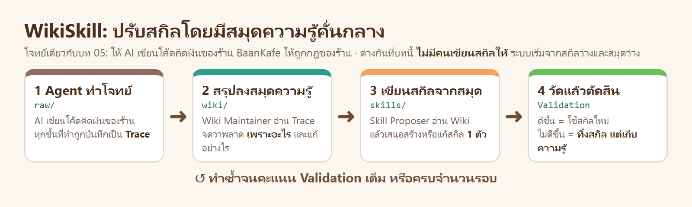

**อ่านเพิ่ม (ไม่บังคับ)**

| หน้า | ตอบคำถาม |
|---|---|
| [ทฤษฎี · WikiSkill ฉบับละเอียด](01_theory/README.md) | งานวิจัยต้นทาง: แนวคิด · สถาปัตยกรรม 3 ชั้น · อัลกอริทึม · **วิธีคิดในการออกแบบ 10 ข้อ** · ผลในเปเปอร์ |
| [สไลด์ของทฤษฎี WikiSkill](01_theory/WikiSkill_Theory_Slides.html) | สไลด์ของบททฤษฎี (เปิดไฟล์ `.html` ในเบราว์เซอร์) |
| [รูปแบบของ `wikiskill`](wikiskill_format.md) | เครื่องมือที่สร้างใน LAB 0 ต้องมีคำสั่งและไฟล์อะไร |
| [สไลด์ของบทนี้](WikiSkill_Slides.html) | สไลด์ HTML สำหรับสอน: ภาคทฤษฎี + ภาค LAB พร้อมปุ่มคัดลอกพรอมต์และรายการตรวจผล (เปิดไฟล์ `.html` ในเบราว์เซอร์) |

เปเปอร์ต้นทาง: Tang et al., *WikiSkill: Compiling Agent Experience into Persistent Knowledge for Skill Evolution*, Google Research, [arXiv:2608.27454](https://arxiv.org/abs/2608.27454)

---

# ภาคทฤษฎี

> [!NOTE]
> **ภาคนี้อ่านอย่างเดียว ไม่ต้องรันอะไร และไม่ใช้โทเคน**
>
> - ส่วนที่ 1 ทบทวนโจทย์ของบท 05 สั้น ๆ · ส่วนที่ 2 อธิบาย WikiSkill
> - ตัวเลขที่กำกับว่า **"ตัวอย่างจากผล LAB"** ยกมาจากการรันจริงใน [ภาค LAB](#ภาค-lab) เพื่อประกอบคำอธิบายเท่านั้น

## 1 · โจทย์ (ฉบับย่อ)

บทนี้ใช้ **โจทย์ ตัวตรวจ และกติกาชุดเดียวกับบท 05** จึงทบทวนแค่ภาพเดียว · คำอธิบายเต็มอยู่ที่ [บท 05 ส่วนที่ 1](../05_Skill_Optimizer/README.md#1--โจทย์และข้อกำหนดของร้าน)

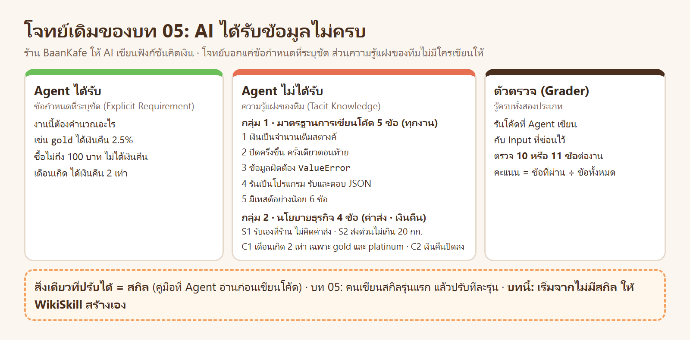

### 1.1 สิ่งที่บทนี้เปลี่ยน

| | บท 05 · Skill Optimizer | บทนี้ · WikiSkill |
|---|---|---|
| สกิลรุ่นแรก | คนเขียน (`v0`) | **ไม่มี** · เริ่มจากชุดสกิลว่าง |
| ใครหาสาเหตุและแก้สกิล | Claude Code ตามพรอมต์ของคน ทีละรุ่น | AI 2 บทบาท ทำเองทั้งวงรอบ |
| ความรู้แฝงมาจากไหน | คนเขียนลงสกิล และตอบคำถามของ Claude | ต้องค้นพบเองจาก Trace และข้อความของตัวตรวจ |
| ที่เก็บสิ่งที่เรียนรู้ | `ISSUES.md` | สมุดความรู้ `wiki/` |
| ชุดโจทย์ | Training 4 · Validation 2 | เหมือนเดิม + **Test Set 3 ข้อ** |

โมเดลที่ทำโจทย์ (sonnet · effort medium) จำนวนรอบต่อโจทย์ (3) และตัวตรวจ **เหมือนบท 05 ทุกค่า** ผลจึงเทียบกันได้

### 1.2 Test Set 3 ข้อ

โจทย์ 3 ข้อที่ไม่เคยถูกใช้ปรับสกิลทั้งสองวิธี ใช้วัดว่าสกิลที่ได้ใช้กับงานที่ไม่เคยเห็นได้หรือไม่

| โจทย์ | ฟังก์ชัน | คิดอะไร |
|---|---|---|
| `x1-late-fee` | `late_fee(amount, days_late)` | ค่าปรับจ่ายช้า วันละ 0.75% · 3 วันแรกไม่คิด · สูงสุด 15% |
| `x2-refund` | `refund(paid, used_percent, restock)` | คืนเงินคอร์สตามส่วนที่ยังไม่เรียน · เรียนเกิน 80% ไม่คืน · หักค่าดำเนินการ 12.5% |
| `x3-bulk-price` | `bulk_price(unit_price, qty, coupon)` | ราคาขายส่ง ลด 3.5% หรือ 7.5% ตามจำนวน · คูปองลดอีก 2.5% · VAT 7% |

Test Set ตรวจเฉพาะมาตรฐานการเขียนโค้ด 5 ข้อ (ไม่มีนโยบายธุรกิจ) · โจทย์เต็ม: [`suite/suite.json`](suite/suite.json)

## 2 · WikiSkill

### 2.1 ปัญหา: ความรู้ของแต่ละรอบหายไป

วิธีปรับสกิลอัตโนมัติทุกวิธีทำวงรอบเดียวกัน: Agent ทำโจทย์ → วิเคราะห์ Trace → เสนอแก้สกิล → วัดแล้วตัดสิน
สิ่งที่วิเคราะห์ได้ในแต่ละรอบถูกใช้ครั้งเดียวตอนแก้สกิลของรอบนั้น แล้วหายไป

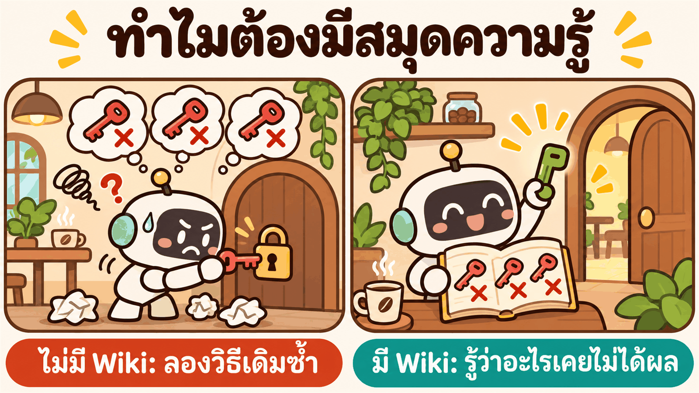

| อาการ | ตัวอย่าง |
|---|---|
| ลืม | รอบ 3 เสนอวิธีที่รอบ 1 ลองแล้วถูกปฏิเสธ |
| หลักฐานไม่สะสม | ปัญหาที่พบรอบละ 1 Trace ถูกมองว่าบังเอิญทุกรอบ |
| บริบทไม่พอ | Trace ของทุกรอบรวมกันยาวเกินกว่าจะอ่านใหม่ทุกครั้ง |

ในบท 05 เราแก้ปัญหานี้ด้วยมือ: ให้ Claude จดลง `ISSUES.md` · WikiSkill ทำสิ่งเดียวกันให้เป็นระบบและอัตโนมัติ

### 2.2 แนวคิด: มีสมุดความรู้คั่นกลาง

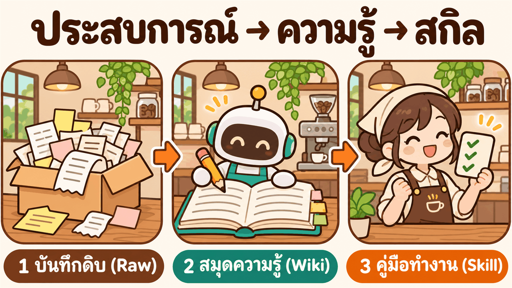

| | ตอบคำถาม | เทียบกับร้านกาแฟ | ใครใช้ |
|---|---|---|---|
| **Trace** | **เกิดอะไรขึ้น** ในงานนี้ | ใบบันทึกหน้างานทุกใบ | ผู้วิเคราะห์ |
| **Wiki** | **ทำไม** จึงเกิด และเคยลองแก้อย่างไร | สมุดความรู้ของร้าน | ผู้เขียนสกิล |
| **สกิล** | **ต้องทำอย่างไร** ในงานถัดไป | คู่มือพนักงาน 1 ใบ | Agent ที่ทำงาน |

สกิลเป็นเพียงฉบับย่อที่ใช้งานได้ของความรู้ ณ ขณะหนึ่ง · เหตุผล หลักฐาน และสิ่งที่เคยลองแล้วไม่ได้ผล ต้องมีที่อยู่ของตัวเอง

### 2.3 สถาปัตยกรรม 3 ชั้น

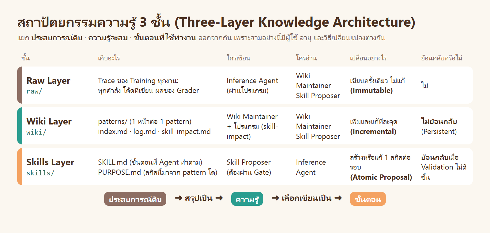

| ชั้น | โฟลเดอร์ | ใครเขียน | เมื่อข้อเสนอไม่ผ่าน |
|---|---|---|---|
| Raw Layer | `raw/` | โปรแกรม (จาก Trace ของ Agent) | คงอยู่ · ไม่มีใครแก้ |
| Wiki Layer | `wiki/` | Wiki Maintainer | **คงอยู่** · มีแต่เพิ่ม |
| Skills Layer | `skills/` | Skill Proposer เสนอ โปรแกรมเขียนเมื่อผ่าน Gate | **ย้อนกลับ** ไปชุดเดิม |

### 2.4 ส่วนประกอบ 4 ตัว

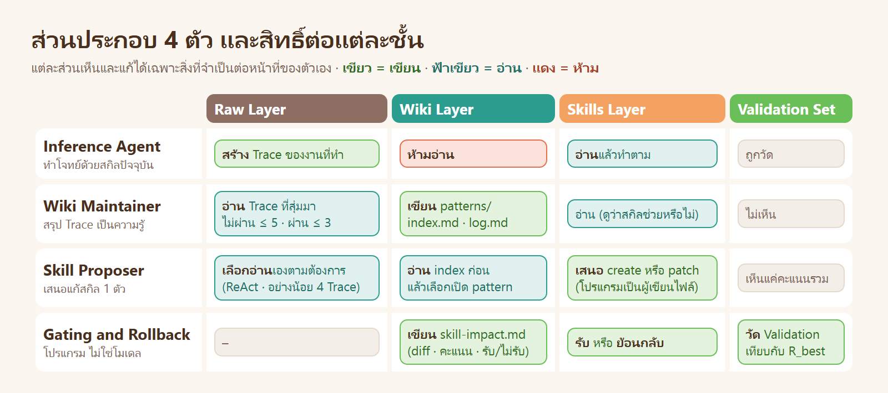

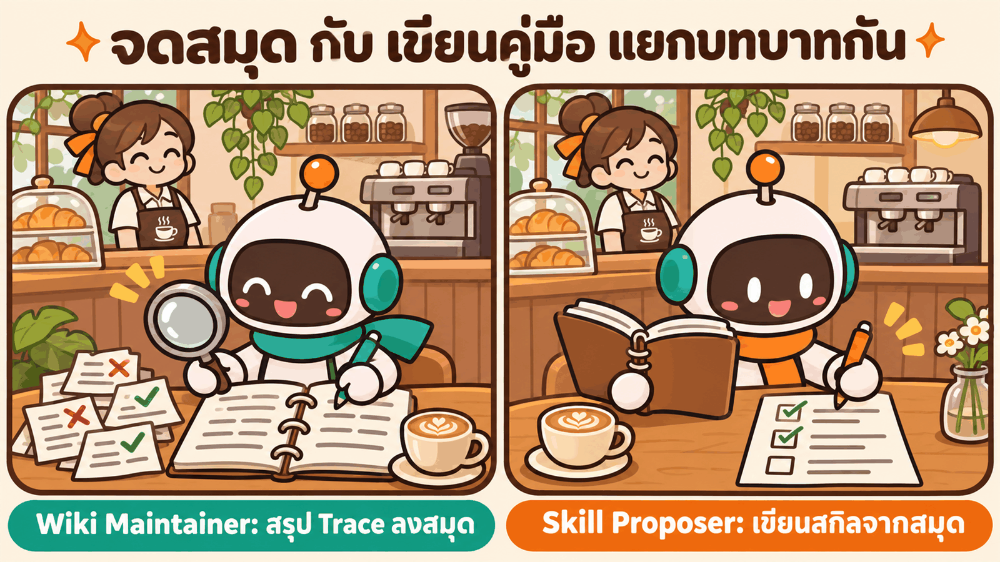

| ส่วนประกอบ | ทำอะไร | เรียกโมเดล |
|---|---|---|
| **Inference Agent** | ทำโจทย์ด้วยสกิลปัจจุบัน (ตัวที่ถูกปรับ) | 1 เซสชันต่อ 1 งาน |
| **Wiki Maintainer** | อ่าน Trace ที่สุ่มมา แล้วจดลง Wiki ว่าพลาดเพราะอะไร แก้อย่างไร | 1 ครั้งต่อรอบ |
| **Skill Proposer** | อ่านสารบัญของ Wiki เลือกเปิดหน้าและ Trace เอง แล้วเสนอสร้างหรือแก้สกิล **1 ตัว** | 1 เซสชันต่อรอบ |
| **Gating and Rollback** | โปรแกรมวัดสกิลที่เสนอด้วย Validation Set แล้วรับหรือย้อนกลับ | ไม่เรียก |

### 2.5 หนึ่งรอบของ WikiSkill

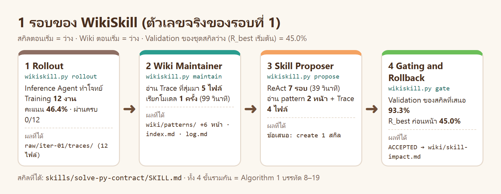

ตัวเลขในภาพคือ **ตัวอย่างจากผล LAB** (รอบที่ 1 ของ LAB 1)

### 2.6 อัลกอริทึม

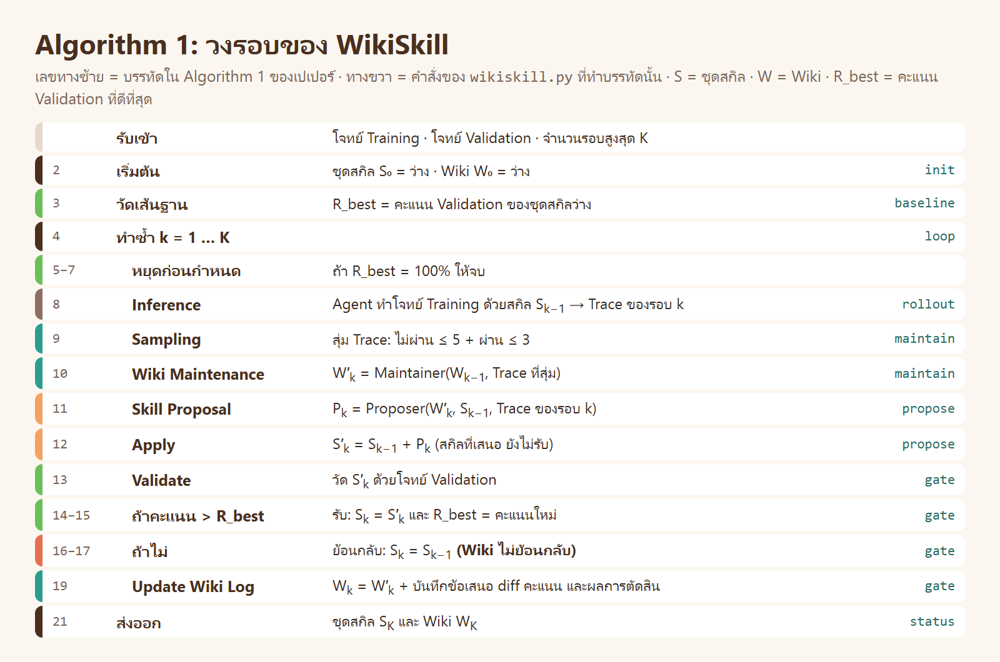

### 2.7 กติกา 3 ข้อที่ทำให้ WikiSkill ต่างจากวงรอบทั่วไป

| กติกา | เหตุผล |
|---|---|
| 1 จดความรู้ลง Wiki **ก่อน** เสนอแก้สกิล | ความรู้ของรอบนี้เข้า Wiki ไปแล้ว ไม่ว่าข้อเสนอจะผ่านหรือไม่ |
| 2 สกิลที่ไม่ผ่านถูกย้อนกลับ แต่ **Wiki ไม่ย้อนกลับ** | สกิลที่แย่ลงเป็นอันตรายต่อการใช้งาน · "วิธีนี้ลองแล้วไม่ได้ผล" เป็นความรู้ชิ้นใหม่ |
| 3 Agent ที่ทำโจทย์ **ไม่เห็น Wiki** | ถ้า Agent ทำถูกเพราะ Wiki จะไม่มีอะไรบอกว่าสกิลยังขาดกฎข้อใด |

<p>
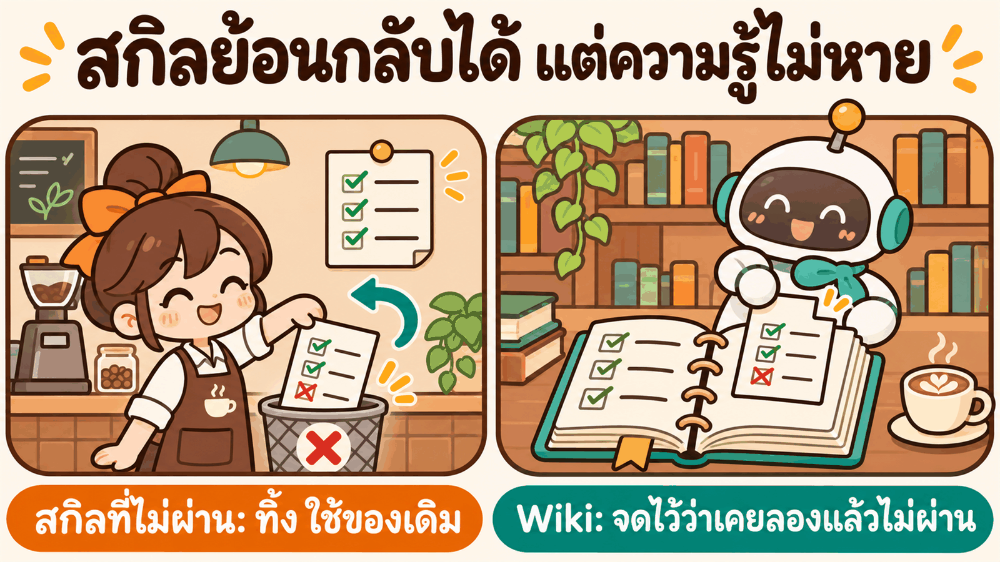

</p>

เหตุผลของการออกแบบทุกจุด (10 ข้อ): [ทฤษฎี ขั้น 8](01_theory/README.md#ขั้น-8--วิธีคิดในการออกแบบ)

### 2.8 สิ่งที่นำมาใช้กับโจทย์นี้

เครื่องมือของบทนี้ทำตาม Algorithm 1 ของเปเปอร์ทุกบรรทัด ต่างกันที่ขนาดของงานและวิธีรัน Agent

| ประเด็น | ในเปเปอร์ | ในบทนี้ |
|---|---|---|
| งาน | 5 Benchmark (คณิตศาสตร์ · ค้นเว็บ · สเปรดชีต · เอกสารยาว · งานบ้านจำลอง) | เขียนฟังก์ชันคิดเงิน 9 ข้อของร้าน BaanKafe |
| ชุดโจทย์ | แบ่ง train · validation · test ต่อ Benchmark | Training 4 · Validation 2 · Test 3 (ข้อละ 3 รอบ) |
| จำนวนรอบ | 8 รอบ | ไม่เกิน 8 รอบ (หยุดเมื่อ Validation = 100%) |
| โมเดลที่ทำโจทย์ | Qwen · Gemma · Gemini | sonnet (effort medium) เท่ากับบท 05 |
| Wiki Maintainer และ Skill Proposer | prompt ในภาคผนวก E | prompt ภาษาไทยที่เขียนใหม่ใน LAB 0 · sonnet (effort high) |
| วิธีให้สกิลกับ Agent | ใส่เนื้อหาสกิลใน prompt โดยตรง | วางใน `./skills` ให้ Agent เปิดอ่านเอง (ไพป์ไลน์เดียวกับบท 05) |
| การรัน Trial | ระบบของเปเปอร์ | คำสั่ง `run` ของ `skill-optimizer` ที่สร้างในบท 05 |
| การรันซ้ำ | 3 ครั้งแล้วเฉลี่ย | 2 ครั้ง (LAB 1 และ LAB 3) |
| ความรู้แฝงเฉพาะงาน (นโยบายธุรกิจ) | ไม่มี | มีใน Training 2 ข้อ แต่ **ไม่มีใน Validation** |

แถวสุดท้ายคือจุดที่บทนี้เพิ่มจากเปเปอร์ และเป็นคำถามหลักของภาค LAB

### 2.9 คำถามที่ภาค LAB จะตอบ

| # | คำถาม | LAB |
|---|---|---|
| 1 | เริ่มจากไม่มีสกิล WikiSkill ค้นพบมาตรฐานการเขียนโค้ด 5 ข้อเองได้หรือไม่ | 1 · 2 |
| 2 | นโยบายธุรกิจ 4 ข้อที่ไม่มีใครบอก WikiSkill ค้นพบได้หรือไม่ | 2 |
| 3 | รันซ้ำแล้วได้ผลเดิมหรือไม่ | 3 |
| 4 | ถ้าตัด Wiki ออก ผลต่างกันอย่างไร | 4 |
| 5 | ความรู้ที่ WikiSkill หาเองไม่ได้ เติมอย่างไร | 5 |

---

# ภาค LAB

> [!TIP]
> **ภาคนี้ลงมือทำ: คัดลอกพรอมต์ → วางใน Claude Code → อ่านผล**
>
> ผลจริงทุกตัวในภาคนี้มาจากการรันเมื่อ 14 พ.ย. 2026 · โมเดล sonnet · effort medium · ผลดิบอยู่ใน [`runs/`](runs/)

## 3 · ลงมือทำ (Copy & Paste)

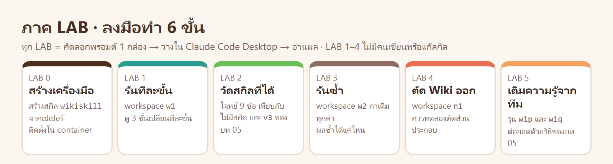

**วิธีใช้:** เปิดโฟลเดอร์ `Teaching` ใน Claude Code Desktop → คัดลอกกล่อง **📋 IMPORTANT** → วาง → รอผล
**ต้องมี:** container `multi-account` · บัญชี `yolo` ที่ล็อกอินแล้วอย่างน้อย 1 บัญชี · สกิล `skill-optimizer` ที่สร้างใน [บท 05 LAB 0](../05_Skill_Optimizer/README.md#lab-0--เตรียมเครื่องมือและโจทย์)

| LAB | ทำอะไร | Trial | เวลาจริง | ผลจริง |
|---|---|---|---|---|
| [0](#lab-0--เตรียมเครื่องมือและโจทย์) | สร้างเครื่องมือ `wikiskill` แล้วติดตั้งใน container พร้อมโจทย์ | – | 0.1 ใช้ 21 นาที · 0.2 ใช้ 1 นาที | ทดสอบผ่าน 3 ข้อ · ตัวตรวจผ่าน · ใช้ได้ 3 บัญชี |
| [1](#lab-1--รัน-wikiskill-ทีละขั้น-w1) | รัน WikiSkill ทีละขั้น จากชุดสกิลว่าง (`w1`) | 42 | 15 นาที | Validation 45.0% → **100.0%** ใน 2 รอบ |
| [2](#lab-2--วัดสกิลที่ได้-เทียบกับไม่มีสกิล-และ-v3-ของบท-05) | วัดสกิลของ `w1` กับโจทย์ 9 ข้อ เทียบกับไม่มีสกิล และ `v3` ของบท 05 | 81 | 6 นาที | `w1` 97.9% · Test 100% · `policy` 0/6 |
| [3](#lab-3--รันซ้ำด้วยค่าเดิม-w2) | รันซ้ำด้วยค่าเดิม (`w2`) | 51 | 12 นาที | 1 รอบ · 96.8% |
| [4](#lab-4--การทดลองตัดส่วนประกอบ-ไม่มี-wiki-n1) | ตัด Wiki ออก (`n1`) | 51 | 7 นาที | 1 รอบ · 95.7% · ไม่เหลือ Wiki |
| [5](#lab-5--เติมความรู้จากทีม-w1p--w1q) | เติมนโยบายธุรกิจจากทีม (`w1p` · `w1q`) | 54 | 5.1 ใช้ 5 นาที · 5.2 ใช้ 5 นาที | `w1p` **REJECT** · `w1q` 100.0% **ACCEPT** |

### แผนการทดลอง: วัดอะไร กับ Input อะไร

| หัวข้อ | ค่าที่ใช้ |
|---|---|
| **Input** | โจทย์ 9 ข้อใน [`suite/suite.json`](suite/suite.json) · 6 ข้อแรกและตัวตรวจเป็นชุดเดียวกับบท 05 |
| **Training Set** 4 ข้อ | `t1` บิลหน้าร้าน · `t2` หารบิล · `t3` ค่าส่ง · `t4` เงินคืน → ใช้สร้าง Trace ให้ Wiki Maintainer อ่าน |
| **Validation Set** 2 ข้อ | `v1` ค่าจอดรถ · `v2` ค่าแรง → ใช้ตัดสินที่ Gate ดูได้แค่คะแนนรวม |
| **Test Set** 3 ข้อ | `x1` ค่าปรับ · `x2` คืนเงิน · `x3` ราคาขายส่ง → ใช้วัดตอนจบเท่านั้น |
| **1 Trial** | Agent 1 ตัว + โจทย์ 1 ข้อ + ชุดสกิล 1 ชุด → ได้ `solve.py` และ `test_solve.py` |
| **การให้คะแนน 1 Trial** | ตัวตรวจสรุปเป็นข้อตรวจ 10 ข้อ (งาน `t3` มี 11 ข้อ) · คะแนน = สัดส่วนข้อที่ผ่าน |
| **1 รอบของ WikiSkill** | Training 4 โจทย์ × 3 รอบ = 12 Trial + Validation 2 โจทย์ × 3 รอบ = 6 Trial |
| **วัดชุดสกิล 1 ชุด** | 9 โจทย์ × 3 รอบ = **27 Trial** |
| **โมเดล** | Inference Agent: `sonnet` effort `medium` · Wiki Maintainer และ Skill Proposer: `sonnet` effort `high` |
| **บัญชี** | ทุกบัญชี `yolo` ที่ล็อกอินแล้วช่วยกันรัน พร้อมกัน 6 Trial (ผลจริงใช้ `yolo1` `yolo2` `yolo3`) |

Agent ทุกตัวได้รับพรอมต์เดียวกับบท 05: `เขียนโค้ด Python ตามโจทย์ด้านล่าง … ถ้าใน ./skills มีสกิล ให้อ่านและทำตามก่อนเริ่ม` ตามด้วยโจทย์ 1 ข้อ

### โครงสร้างโฟลเดอร์

ของที่ป้อนเข้าอยู่ใน `suite/` · ผลลัพธ์ทั้งหมดอยู่ใน `runs/` · **1 การรัน WikiSkill = 1 workspace = 1 โฟลเดอร์**

```text
06_WikiSkill/
├── README.md               บทเรียนนี้
├── WikiSkill_Slides.html   สไลด์ของบทนี้ (สร้างด้วย tools/build_slides.py)
├── wikiskill_format.md     รูปแบบที่เครื่องมือ wikiskill ต้องทำตาม
├── suite/                  ของที่ป้อนเข้า: โจทย์ 9 ข้อ (suite.json) และตัวตรวจ (grade.py)
├── runs/                   ผลลัพธ์
│   ├── w1/                 workspace ของ WikiSkill (LAB 1) · w2 (LAB 3) และ n1 (LAB 4) โครงเดียวกัน
│   │   ├── raw/iter-NN/    Raw Layer: Trace ของ Training ทุกรอบ
│   │   ├── wiki/           Wiki Layer: index.md · log.md · skill-impact.md · patterns/
│   │   ├── skills/         Skills Layer: สกิลที่ใช้งานเมื่อจบ
│   │   ├── history/iter-NN/   สิ่งที่แต่ละบทบาทได้รับและตอบในรอบนั้น
│   │   ├── rollouts/       Trial ที่วงรอบรัน (k00-val · k01-train · k01-val …)
│   │   ├── trials/         Trial ที่วัดสกิลตอนจบ 27 Trial (LAB 2)
│   │   └── state.json status.txt
│   ├── noskill/ so-v3/ w1p/   ชุดสกิลที่ใช้เทียบ: skills/ และ trials/
│   └── report.md results.json ตารางเทียบทุกชุด
├── tools/                  สคริปต์วาดกราฟและแผนภาพจาก runs/
└── 01_theory/              ทฤษฎีจากเปเปอร์ WikiSkill
```

| ที่ | โฟลเดอร์ |
|---|---|
| เครื่องมือที่สร้างใน LAB 0.1 | `Teaching/my-wikiskill/` → ติดตั้งใน container เป็น global skill ชื่อ `wikiskill` |
| ที่ทำงานใน container | `/workspace/wklab/` มี `suite/` และ `runs/` โครงเดียวกับข้างบน |
| สกิลที่วงรอบสร้าง | อยู่ใน `runs/<workspace>/skills/` เท่านั้น ห้ามเป็น global skill |

### LAB 0 · เตรียมเครื่องมือและโจทย์

#### ขั้น 0.1 · สร้างโฟลเดอร์ `wikiskill`

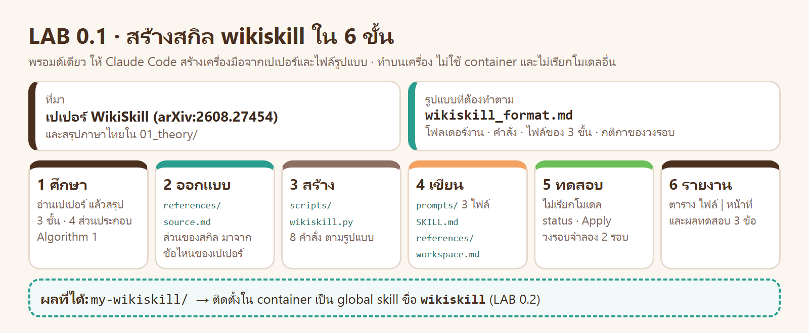

> [!IMPORTANT]
> **📋 คัดลอกกล่องนี้ → Claude Code Desktop แล้วกด Enter**
>
> ```text
> งาน: สร้างสกิล wikiskill ไว้ในโฟลเดอร์ใหม่ ./my-wikiskill (ทำบนเครื่องนี้ ไม่ใช้ container)
>
> ที่มา    : เปเปอร์ WikiSkill (arXiv:2608.27454) · สรุปภาษาไทย 03_week03/06_WikiSkill/01_theory/README.md
> รูปแบบ   : 03_week03/06_WikiSkill/wikiskill_format.md
> เงื่อนไข : ห้ามเปิดฉบับสำเร็จที่ 00_resource/skills/wikiskill · prompt ต้องเขียนด้วยถ้อยคำของตัวเอง
>
> ทำตามลำดับ:
> 1. ศึกษา       อ่านที่มา แล้วสรุปวงรอบของ WikiSkill: 3 ชั้น 4 ส่วนประกอบ และ Algorithm 1
> 2. ออกแบบ      จด references/source.md: ส่วนของสกิล | มาจากข้อไหนของเปเปอร์ | เหมือนหรือต่าง
> 3. สร้าง        scripts/wikiskill.py 8 คำสั่ง (init baseline rollout maintain propose gate loop status) ตามรูปแบบ
> 4. เขียน        prompts/ 3 ไฟล์ (maintainer proposer proposer_nowiki) · SKILL.md · references/workspace.md
> 5. ทดสอบ       ไม่เรียกโมเดล: (ก) status ของทุก workspace ใน 03_week03/06_WikiSkill/runs ต้องพิมพ์ตรงกับ status.txt (ข) นำ history/iter-NN/proposal.json ที่เก็บไว้มา Apply ใหม่ ต้องได้ candidate/skills และ proposal.diff เหมือนที่เก็บไว้ (ค) รันวงรอบ 2 รอบด้วย Agent จำลอง ให้ได้ ACCEPTED 1 รอบ และ REJECTED 1 รอบ แล้วตรวจว่ารอบที่ถูกปฏิเสธ skills คงเดิมแต่ wiki ยังอยู่ครบ
> 6. รายงาน      ตาราง ไฟล์ | หน้าที่ และผลทดสอบ 3 ข้อ
> ```

**ผลจริง** · agent ใหม่รันพรอมต์นี้ตามตัวอักษรเมื่อ 14 พ.ย. 2026 · ใช้ 21 นาที · ไม่เรียกโมเดลอื่น

| ไฟล์ที่ได้ใน `my-wikiskill/` | บรรทัด | หน้าที่ |
|---|---|---|
| `SKILL.md` | 73 | คู่มือที่ AI อ่าน: ใช้เมื่อไร · ตารางคำสั่ง 8 ตัว · ขั้นตอน · ข้อห้าม |
| `scripts/wikiskill.py` | 1,144 | โปรแกรมของวงรอบ ไฟล์เดียว ใช้ไลบรารีมาตรฐานเท่านั้น |
| `prompts/maintainer.md` | 79 | system prompt ของ Wiki Maintainer: วิธีอ่าน Trace · โครงหน้า pattern · กติกาของ index |
| `prompts/proposer.md` | 73 | system prompt ของ Skill Proposer: ลำดับการทำงาน · รูปแบบข้อเสนอ · กติกา |
| `prompts/proposer_nowiki.md` | 73 | system prompt ของ Skill Proposer เมื่อไม่ใช้ wiki (LAB 4) |
| `references/source.md` | 63 | สรุปวงรอบ และตารางตรวจย้อนกลับ 20 แถว |
| `references/workspace.md` | 100 | โครง workspace และไฟล์ที่แต่ละคำสั่งอ่านและเขียน |

| ทดสอบ (ไม่เรียกโมเดล) | ผล |
|---|---|
| (ก) `status` ของ workspace ที่เก็บไว้ | ✅ พิมพ์ตรงกับ `status.txt` ทุกตัวอักษร |
| (ข) Apply `proposal.json` ที่เก็บไว้ใหม่ | ✅ `SKILL.md` `PURPOSE.md` และ `proposal.diff` ตรงกันทุกไบต์ ทั้งข้อเสนอแบบ `create` และ `patch` |
| (ค) วงรอบจำลอง 2 รอบ | ✅ รอบ 1 ACCEPTED · รอบ 2 **REJECTED**: `skills/` กลับเป็นชุดของรอบ 1 · หน้า pattern ที่จดในรอบ 2 ยังอยู่ · `skill-impact.md` มีทั้ง 2 รายการพร้อม diff |
| การเรียกโมเดลจริง | ⚠️ ยังไม่ได้ทดสอบในขั้นนี้ (รู้ผลใน LAB 1) |

👀 การทดสอบ (ค) คือที่เดียวในบทนี้ที่เห็นการย้อนกลับ: สกิลที่ไม่ผ่านถูกทิ้ง แต่ความรู้ของรอบนั้นยังอยู่ใน Wiki · ในการรันจริง LAB 1–4 ข้อเสนอของวงรอบผ่าน Gate ทุกครั้ง จึงไม่มีการย้อนกลับของ WikiSkill ให้ดู

<details><summary>ตัวอย่างตารางตรวจย้อนกลับใน <code>references/source.md</code></summary>

| ส่วนของสกิล | มาจากข้อไหนของเปเปอร์ | เหมือนหรือต่าง |
|---|---|---|
| workspace 3 โฟลเดอร์ `raw/` `wiki/` `skills/` | ข้อ 3.1 · รูป 2 | เหมือน |
| Agent ไม่เห็น wiki | ข้อ 3.2 · ข้อ 5.1 | เหมือน |
| สุ่ม Trace: ไม่ผ่าน ≤ 5 + ผ่าน ≤ 3 · Trace ยาวไม่เกิน 15,000 ตัวอักษร | Algorithm 1 บรรทัด 9 · ภาคผนวก C | เหมือน |
| `maintain`: เรียกโมเดล 1 ครั้ง | บรรทัด 10 · ข้อ 3.2.2 | เหมือน |
| `propose`: ReAct เริ่มจาก index แล้วเปิดไฟล์เอง | บรรทัด 11 · ข้อ 3.2.3 | เหมือน |
| `gate`: รับเมื่อ Validation > R_best · ย้อนกลับเฉพาะสกิล | บรรทัด 13–18 · สมการ 4 | เหมือน |
| `wiki/skill-impact.md` เขียนโดยโปรแกรม | บรรทัด 19 | เหมือน |
| `rollout`: สกิลอยู่ใน `./skills` | ข้อ 3.2.1 | ต่าง: เปเปอร์ใส่เนื้อหาสกิลใน system prompt ของ Agent |
| prompt 3 ไฟล์ | ภาคผนวก E | ต่าง: เขียนใหม่ทั้งหมดเป็นภาษาไทย ไม่ได้เปิดภาคผนวก E |
| `status` · `history/iter-NN/` | ไม่มีในเปเปอร์ | เพิ่มเอง: ตารางสรุป และหลักฐานของแต่ละรอบ |

</details>

#### ขั้น 0.2 · ติดตั้งเครื่องมือ และตรวจตัวตรวจ

> [!IMPORTANT]
> **📋 คัดลอกกล่องนี้ → Claude Code Desktop แล้วกด Enter**
>
> ```text
> งาน: เตรียม container multi-account ให้พร้อมสำหรับ LAB 1–5 (ยังไม่วัดอะไร)
>
> ทำตามลำดับ:
> 1. ติดตั้ง   my-wikiskill เป็น global skill ชื่อ wikiskill ของบัญชี yolo (ไว้ข้างสกิล skill-optimizer ของบท 05)
> 2. คัดลอก   suite ของ 03_week03/06_WikiSkill ไปไว้ที่ /workspace/wklab/suite · สกิล v3 ของบท 05 (03_week03/05_Skill_Optimizer/runs/v3/skills) ไปไว้ที่ /workspace/wklab/runs/so-v3/skills
> 3. ตรวจ     มีสกิล skill-optimizer อยู่แล้วหรือไม่ · ตัวตรวจด้วย suite/check_grader.py · บัญชี yolo1–yolo5 ตัวไหนล็อกอินแล้ว
> 4. รายงาน   ตาราง รายการ | ผล
> ```

| Input · ไฟล์ที่ใช้ | Output · สิ่งที่ได้ใน container |
|---|---|
| `my-wikiskill/` (จากขั้น 0.1) | global skill ชื่อ `wikiskill` ของทุกบัญชี yolo |
| [`suite/`](suite/) | `/workspace/wklab/suite/` |
| [`runs/v3/skills/`](../05_Skill_Optimizer/runs/v3/skills/) ของบท 05 | `/workspace/wklab/runs/so-v3/skills/` |

**ผลจริง:** ติดตั้งสกิล ✅ · มี `skill-optimizer` อยู่แล้ว ✅ · ตัวตรวจผ่าน ✅ (เฉลยอ้างอิงผ่าน 10/10 แปดโจทย์ และ 11/11 โจทย์ค่าส่ง · เฉลยที่จงใจใส่ความผิดไม่ผ่านเฉพาะข้อนั้น) · บัญชีที่ใช้ได้ `yolo1` `yolo2` `yolo3` · ใช้ 1 นาที

👀 ตรวจตัวตรวจก่อนเสมอ ถ้าเครื่องวัดผิด ตัวเลขหลังจากนี้ใช้ไม่ได้ทั้งหมด

### LAB 1 · รัน WikiSkill ทีละขั้น (`w1`)

เริ่มจากชุดสกิลว่างและ Wiki ว่าง · รันรอบที่ 1 ทีละขั้นเพื่อดูว่าแต่ละชั้นเปลี่ยนอย่างไร แล้วรันต่อจนวงรอบหยุด

| Input · ไฟล์ที่ใช้ | Output · ไฟล์ที่ได้เพิ่มหลังรัน |
|---|---|
| [`suite/suite.json`](suite/suite.json) โจทย์ Training 4 ข้อ และ Validation 2 ข้อ | [`runs/w1/raw/`](runs/w1/raw/) Trace ของ Training ทุกรอบ |
| `suite/grade.py` ตัวตรวจ | [`runs/w1/wiki/`](runs/w1/wiki/) สมุดความรู้: [`index.md`](runs/w1/wiki/index.md) · [`patterns/`](runs/w1/wiki/patterns/) · [`skill-impact.md`](runs/w1/wiki/skill-impact.md) |
| สกิล `wikiskill` (จาก LAB 0) | [`runs/w1/skills/`](runs/w1/skills/) สกิลที่วงรอบสร้าง |
|  | [`runs/w1/status.txt`](runs/w1/status.txt) ตารางของทุกรอบ · [`history/`](runs/w1/history/) หลักฐานของแต่ละรอบ |

> [!IMPORTANT]
> **📋 คัดลอกกล่องนี้ → Claude Code Desktop แล้วกด Enter**
>
> ```text
> งาน: รัน WikiSkill ทีละขั้น · เริ่มจากไม่มีสกิล ให้ระบบสร้างสกิลเขียนโค้ดคิดเงินของร้าน BaanKafe เอง
>
> ที่ทำงาน  : container multi-account โฟลเดอร์ /workspace/wklab
> เครื่องมือ : สกิล wikiskill
> เงื่อนไข   : ห้ามเปิดตัวตรวจ suite/grade.py และเฉลย suite/ref/ · โจทย์ของ Validation Set ดูได้แค่คะแนนรวม · ห้ามแก้ไฟล์ใน raw/ wiki/ skills/ เอง
>
> Input: โจทย์ใน suite/suite.json (ข้อละ 1 ฟังก์ชันคิดเงิน)
> - Training Set 4 ข้อ ใช้สร้าง Trace: t1-cafe-bill t2-split-bill t3-shipping-fee t4-cashback
> - Validation Set 2 ข้อ ใช้ตัดสิน: v1-parking-fee v2-net-pay
> - Test Set 3 ข้อ ยังไม่ใช้ใน LAB นี้
>
> วิธีทดลอง:
> - workspace ชื่อ w1 · เริ่มจากชุดสกิลว่างและ wiki ว่าง · ทำได้ไม่เกิน 8 รอบ
> - Inference Agent (ทำโจทย์): โมเดล sonnet · effort medium · โจทย์ละ 3 รอบ → Training 12 Trial และ Validation 6 Trial ต่อการวัด 1 ครั้ง
> - Wiki Maintainer และ Skill Proposer: โมเดล sonnet · effort high
> - คำอธิบายงาน: "เขียนฟังก์ชัน Python สำหรับคิดเงินของร้านกาแฟ BaanKafe (ตัวตรวจอัตโนมัติให้คะแนนผลงาน)"
> - ใช้ทุกบัญชี yolo ที่ล็อกอินแล้ว รันพร้อมกันไม่เกิน 6 Trial
>
> วิธีตรวจ:
> - ทุก Trial ตัวตรวจ suite/grade.py รันโค้ดที่ Agent เขียน แล้วให้คะแนน 0–1 = สัดส่วนข้อตรวจที่ผ่าน (10 หรือ 11 ข้อต่อโจทย์)
> - Gate รับสกิลที่เสนอเมื่อคะแนน Validation สูงกว่า R_best (คะแนน Validation ที่ดีที่สุดก่อนหน้า) เท่านั้น · ไม่รับ = ใช้ชุดสกิลเดิม แต่ wiki ยังอยู่
> - วงรอบหยุดเมื่อ R_best = 100% หรือครบ 8 รอบ
>
> ทำตามลำดับ:
> 1. สร้าง      workspace w1 แล้ววัด baseline
> 2. รอบที่ 1   รันทีละขั้น rollout → maintain → propose → gate · หลังแต่ละขั้นเปิดไฟล์ที่ขั้นนั้นสร้าง แล้วบอกว่าชั้นใด (raw / wiki / skills) เปลี่ยนอย่างไร
> 3. รันต่อ     loop จนวงรอบหยุด แล้วบันทึกผลของ status ที่ runs/w1/status.txt
> 4. เก็บผล     คัดลอก runs/w1 จาก container มาไว้ที่ 03_week03/06_WikiSkill/runs/w1 บนเครื่อง: ไม่เก็บ Trace ดิบ (transcript.jsonl และไฟล์ *_transcript_*) โฟลเดอร์ proposer_view และ rollouts/suite · Trial ของ Validation Set เก็บแค่คะแนนและต้นทุน (grade.json เหลือเฉพาะ score · metrics.json ไม่มี commands และ result · ไม่มี sandbox)
> 5. รายงาน     ตาราง ขั้น | ชั้นที่เปลี่ยน | ไฟล์ที่เกิดหรือเปลี่ยน | สรุป 1 บรรทัด · เนื้อหาของ wiki/index.md · ชื่อสกิลที่ได้ · ตาราง status · เหตุผลที่วงรอบหยุด
> ```

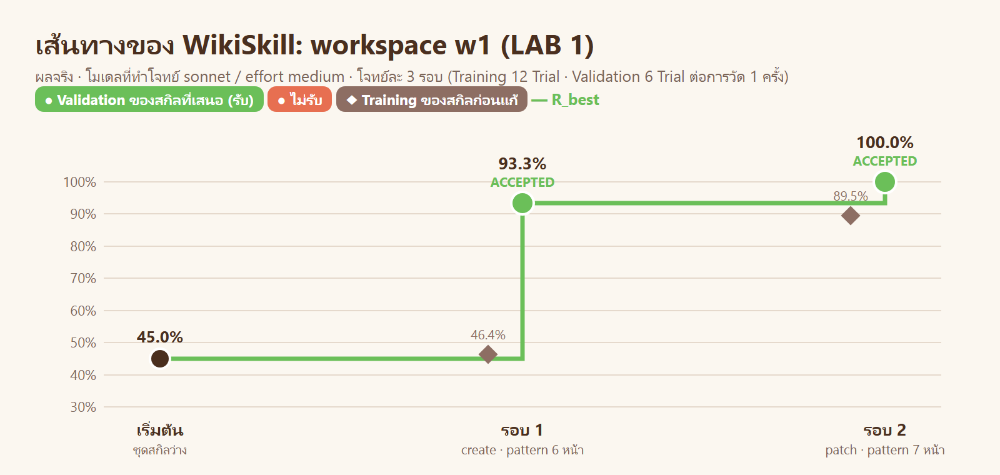

**ผลจริง:** Validation 45.0% → 93.3% → **100.0%** ใน 2 รอบ · ข้อเสนอผ่าน Gate ทั้ง 2 ครั้ง · 42 Trial · ใช้ 15 นาที

| ขั้น | ชั้นที่เปลี่ยน | ไฟล์ที่เกิดหรือเปลี่ยน | ผลจริง |
|---|---|---|---|
| `baseline` | – | `state.json` | Validation ของชุดสกิลว่าง **45.0%** = R_best เริ่มต้น |
| `rollout` | Raw | [`raw/iter-01/traces/`](runs/w1/raw/iter-01/traces/) 12 ไฟล์ · [`summary.md`](runs/w1/raw/iter-01/summary.md) | Training 46.4% · ผ่านครบ 0/12 |
| `maintain` | Wiki | [`wiki/patterns/`](runs/w1/wiki/patterns/) 6 หน้า · `index.md` · `log.md` | อ่าน Trace 5 ไฟล์ · เรียกโมเดล 1 ครั้ง (99 วินาที) |
| `propose` | ยังไม่เปลี่ยน | [`history/iter-01/proposal.json`](runs/w1/history/iter-01/proposal.json) · `candidate/` | เปิด pattern 2 หน้า + Trace 4 ไฟล์ → `create` สกิล `solve-py-contract` |
| `gate` | Skills + Wiki | [`skills/solve-py-contract/`](runs/w1/skills/solve-py-contract/) · [`wiki/skill-impact.md`](runs/w1/wiki/skill-impact.md) | Validation **93.3%** > 45.0% → **ACCEPTED** |
| `loop` รอบที่ 2 | ทั้ง 3 ชั้น | [`raw/iter-02/`](runs/w1/raw/iter-02/) · pattern ใหม่ 1 หน้า แก้ 6 หน้า · `patch` สกิลเดิม | Training 89.5% → Validation **100.0%** → **ACCEPTED** → หยุด |

👀 ไม่มีใครบอกกฎ แต่รอบที่ 1 Wiki Maintainer สรุปได้เองว่า Agent ไม่ตรวจข้อมูลที่ผิด ไม่มีโหมดรันเป็นโปรแกรม และไม่มีไฟล์เทสต์ · รอบที่ 2 เหลือปัญหาเดียวคือจำนวนเทสต์ไม่ถึงเกณฑ์ จึงแก้สกิลเฉพาะจุดนั้น

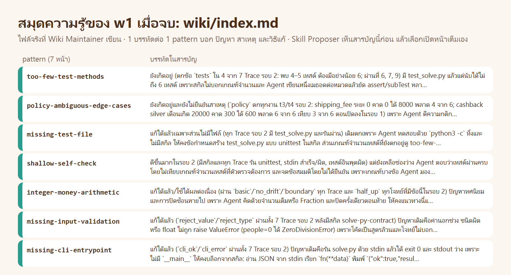

👀 อ่านบรรทัดที่ 2 ของสารบัญ: Wiki จดว่าข้อตรวจ `policy` **ยังเกิดอยู่และยังไม่ยืนยันสาเหตุ** และสกิลไม่ได้แตะเรื่องนี้ · LAB 2 จะวัดว่าเรื่องนี้กระทบคะแนนเท่าไร

<details><summary>รายละเอียด: รอบที่ 2 Wiki ทำงานข้ามรอบอย่างไร</summary>

| ใคร | รอบที่ 1 | รอบที่ 2 |
|---|---|---|
| Wiki Maintainer อ่าน Trace | ไม่ผ่าน 5 (ไม่มีงานที่ผ่าน) | ไม่ผ่าน 5 + **ผ่าน 2** |
| Wiki | สร้าง 6 หน้า | สร้าง 1 หน้า ([`too-few-test-methods.md`](runs/w1/wiki/patterns/too-few-test-methods.md)) · **เติม 6 หน้าเดิม** ว่าแก้ได้แล้วหรือยัง |
| Skill Proposer เปิดไฟล์ | pattern 2 หน้า + Trace 4 ไฟล์ | `SKILL.md` เดิม + pattern **1 หน้า** (หน้าใหม่) + Trace 4 ไฟล์ |
| ข้อเสนอ | `create` ทั้งสกิล (96 บรรทัด) | `patch` เฉพาะส่วนเทสต์ (เป็น 107 บรรทัด) |
| เวลาของ Skill Proposer | 39 วินาที | 20 วินาที |

diff ที่โปรแกรมจดไว้ใน [`wiki/skill-impact.md`](runs/w1/wiki/skill-impact.md) (ย่อ)

```diff
-รัน `python3 -m unittest test_solve -v` ในโฟลเดอร์นั้นให้ผ่านทุกเทสต์ก่อนตอบ
+### ต้องมีอย่างน้อย 8 เมธอด `def test_...` แยกกัน
+ตัวตรวจนับจำนวนเมธอดที่ unittest รายงาน (บรรทัด `Ran N tests`) และต้องได้อย่างน้อย 6 การวน for หรือ `subTest` … นับเป็น 1 เทสต์
+รัน `python3 -m unittest test_solve -v` … แล้วอ่านบรรทัด `Ran N tests` ถ้า N < 8 ให้แตกเมธอดเพิ่มแล้วรันใหม่ก่อนตอบ
```

</details>

<details><summary>สกิลที่ได้ทั้งไฟล์: <code>solve-py-contract</code> (107 บรรทัด)</summary>

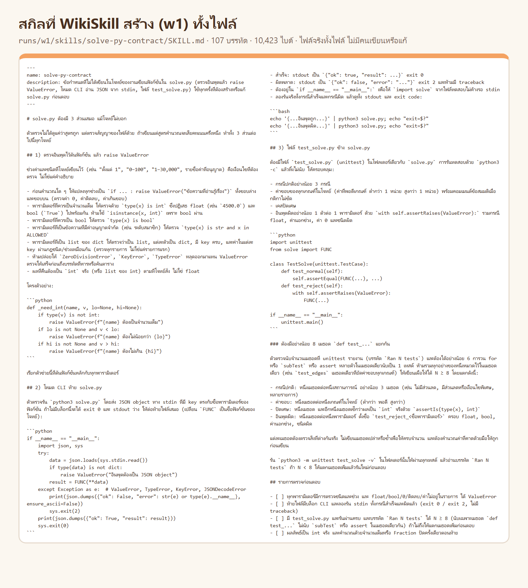

ไฟล์จริง: [`SKILL.md`](runs/w1/skills/solve-py-contract/SKILL.md) · [`PURPOSE.md`](runs/w1/skills/solve-py-contract/PURPOSE.md) (สกิลนี้แก้ pattern ใดใน Wiki)

</details>

### LAB 2 · วัดสกิลที่ได้ เทียบกับไม่มีสกิล และ `v3` ของบท 05

วงรอบของ LAB 1 หยุดเพราะ Validation ได้ 100% · LAB นี้วัดสกิลเดียวกันกับโจทย์ทั้ง 9 ข้อ รวม Test Set ที่ไม่เคยถูกใช้

| Input · ไฟล์ที่ใช้ | Output · ไฟล์ที่ได้เพิ่มหลังรัน |
|---|---|
| [`runs/w1/skills/`](runs/w1/skills/) สกิลของ WikiSkill | [`runs/w1/trials/`](runs/w1/trials/) · [`runs/so-v3/trials/`](runs/so-v3/trials/) · [`runs/noskill/trials/`](runs/noskill/trials/) ชุดละ 27 Trial |
| [`runs/so-v3/skills/`](runs/so-v3/skills/) สกิล `v3` ของบท 05 | [`runs/report.md`](runs/report.md) · [`runs/results.json`](runs/results.json) ตารางเทียบ |
| [`suite/suite.json`](suite/suite.json) โจทย์ 9 ข้อ | [`runs/w1/gate-noskill.txt`](runs/w1/gate-noskill.txt) · [`gate-so-v3.txt`](runs/w1/gate-so-v3.txt) ผลตัดสิน · [`failures.txt`](runs/w1/failures.txt) ข้อที่ยังผิด |

> [!IMPORTANT]
> **📋 คัดลอกกล่องนี้ → Claude Code Desktop แล้วกด Enter**
>
> ```text
> งาน: วัดสกิลที่ WikiSkill สร้าง (w1) กับโจทย์ทั้ง 9 ข้อ · เทียบกับการไม่ใช้สกิล และสกิล v3 ของบท 05
>
> ที่ทำงาน  : container multi-account โฟลเดอร์ /workspace/wklab
> เครื่องมือ : สกิล skill-optimizer
> เงื่อนไข   : ห้ามเปิดตัวตรวจ suite/grade.py และเฉลย suite/ref/ · โจทย์ของ Validation Set ดูได้แค่คะแนนรวม · ผลรายข้อของ Test Set เปิดได้หลังวัดครบทั้ง 3 ชุดแล้วเท่านั้น
>
> Input: โจทย์ 9 ข้อใน suite/suite.json (ข้อละ 1 ฟังก์ชันคิดเงิน)
> - Training Set 4 ข้อ: t1-cafe-bill t2-split-bill t3-shipping-fee t4-cashback
> - Validation Set 2 ข้อ: v1-parking-fee v2-net-pay
> - Test Set 3 ข้อ ไม่เคยถูกใช้ปรับสกิลทั้งสองวิธี: x1-late-fee x2-refund x3-bulk-price
>
> วิธีทดลอง:
> - 1 Trial = Agent 1 ตัว (โมเดล sonnet · effort medium) ได้โจทย์ 1 ข้อ แล้วเขียน solve.py และ test_solve.py ในโฟลเดอร์ว่าง
> - โจทย์แต่ละข้อทำซ้ำ 3 รอบ → 1 ชุดสกิล = 9 โจทย์ × 3 รอบ = 27 Trial
> - LAB นี้วัด 3 ชุดสกิล → รวม 81 Trial
>   - noskill  ไม่มีสกิล
>   - so-v3    สกิล money-coder รุ่น v3 ของบท 05 (runs/so-v3/skills) · คนเขียนรุ่นแรก แล้วปรับ 3 รอบ
>   - w1       สกิลที่ WikiSkill สร้างใน LAB 1 (runs/w1/skills) · ไม่มีคนเขียน
> - ใช้ทุกบัญชี yolo ที่ล็อกอินแล้ว รันพร้อมกันไม่เกิน 6 Trial
>
> วิธีตรวจ:
> - ทุก Trial ตัวตรวจ suite/grade.py รันโค้ดที่ Agent เขียน แล้วให้คะแนน 0–1 = สัดส่วนข้อตรวจที่ผ่าน (10 หรือ 11 ข้อต่อโจทย์)
> - คะแนนของชุดสกิล = ค่าเฉลี่ยของ 27 Trial
> - gate ของ skill-optimizer เทียบชุดใหม่กับชุดฐาน แล้วตอบ ACCEPT หรือ REJECT ด้วยกติกาเดียวกับบท 05
>
> ทำตามลำดับ:
> 1. วัด      noskill · so-v3 · w1 กับโจทย์ทุกชุด
> 2. สรุป     ตารางเทียบ 3 ชุด (report) บันทึกที่ runs/report.md
> 3. ตัดสิน   gate noskill → w1 และ gate so-v3 → w1 ใช้ต้นทุน context_tokens บันทึกที่ runs/w1/gate-noskill.txt และ runs/w1/gate-so-v3.txt
> 4. หาข้อผิด  ข้อตรวจที่ w1 ยังไม่ผ่าน (failures ของชุด train และชุด test) บันทึกที่ runs/w1/failures.txt
> 5. เก็บผล   คัดลอก runs/ จาก container มาไว้ที่ 03_week03/06_WikiSkill/runs บนเครื่อง: เก็บ skills ไฟล์ผลของแต่ละชุด report.md results.json และของแต่ละ Trial เก็บ grade.json metrics.json กับโค้ดใน sandbox (ไม่เก็บ Trace ดิบ) · Trial ของ Validation Set เก็บแค่คะแนนและต้นทุน (grade.json เหลือเฉพาะ score · metrics.json ไม่มี commands และ result · ไม่มี sandbox)
> 6. รายงาน   ตารางเทียบ 3 ชุด · ผล gate 2 คู่ · ข้อตรวจที่ w1 ยังไม่ผ่าน และสาเหตุที่เห็นจากข้อความของตัวตรวจ
> ```

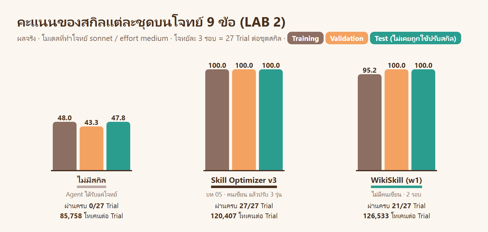

| ชุดสกิล | Training | Validation | **Test** | รวม 27 Trial | ผ่านครบทุกข้อ | โทเคนขาเข้าต่อ Trial |
|---|---|---|---|---|---|---|
| ไม่มีสกิล | 48.0% | 43.3% | **47.8%** | 46.9% | 0/27 | 85,758 |
| `so-v3` · Skill Optimizer (บท 05) | 100.0% | 100.0% | **100.0%** | 100.0% | 27/27 | 120,407 |
| `w1` · WikiSkill | 95.2% | 100.0% | **100.0%** | 97.9% | 21/27 | 126,533 |

| gate ของบท 05 | ผล |
|---|---|
| ไม่มีสกิล → `w1` | **ACCEPT** · รวม +51.0 จุด (เกณฑ์ 2.0) |
| `so-v3` → `w1` | **REJECT** · Training ลด 4.8 จุด (เกณฑ์ 2.0) |

👀 สกิลที่ไม่มีคนเขียนได้ **100% บน Test Set** เท่ากับ `v3` ที่คนเขียนและปรับ 3 รุ่น · จุดเดียวที่ต่างคือ Training 95.2%

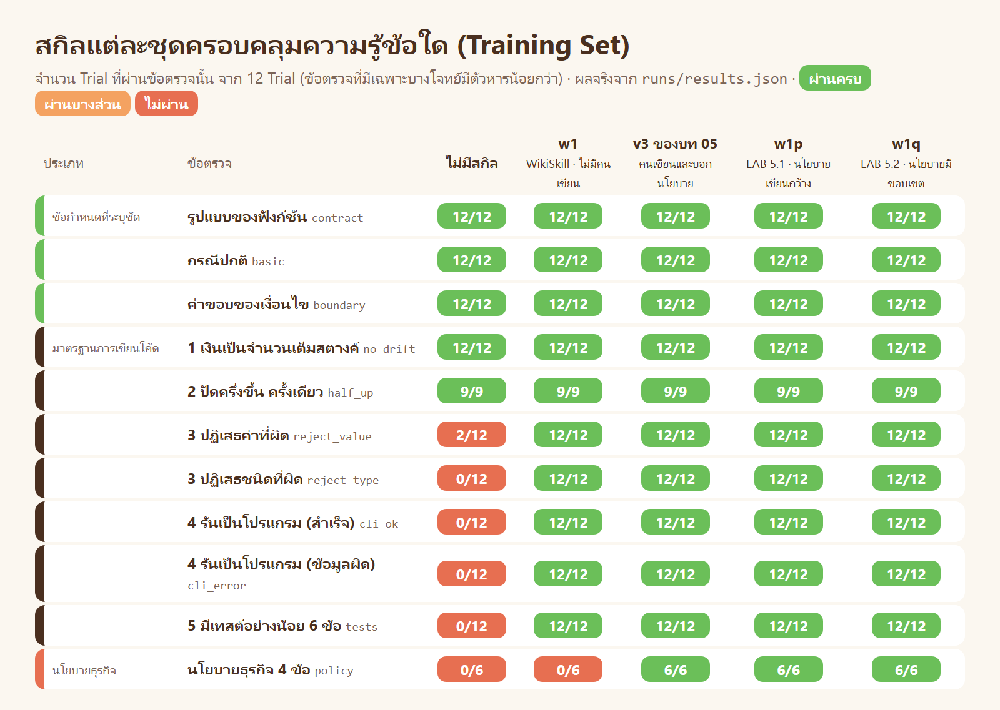

ข้อตรวจที่ `w1` ยังไม่ผ่านมีข้อเดียว คือ `policy` ทั้ง 6 Trial ของงานค่าส่งและงานเงินคืน

```text
✗ policy: shipping_fee(3000, 0, false) คาด 0 ได้ 8000 · พลาด 4 จาก 6 กรณี
✗ policy: cashback(20000, "silver", true) คาด 300 ได้ 600 · พลาด 6 จาก 6 กรณี
```

| ความรู้แฝง | WikiSkill ค้นพบเองหรือไม่ | เพราะอะไร |
|---|---|---|
| กลุ่ม 1 · มาตรฐานการเขียนโค้ด 5 ข้อ | **ได้ครบ** | เกิดซ้ำทุกโจทย์ ข้อความของตัวตรวจบอกว่าคาดอะไร และ Validation ตรวจด้วย |
| กลุ่ม 2 · นโยบายธุรกิจ 4 ข้อ | **ไม่ได้** | มีแค่ 2 โจทย์ ตัวตรวจบอกตัวอย่างเดียว Wiki จึงจดว่า "ยังไม่ยืนยัน" · Validation ไม่มีข้อตรวจนี้ วงรอบจึงหยุดที่ 100% |

👀 Wiki รู้ว่าตัวเองไม่รู้: หน้า [`policy-ambiguous-edge-cases.md`](runs/w1/wiki/patterns/policy-ambiguous-edge-cases.md) ตั้งสมมติฐานไว้ถูกทาง ("ระยะ 0 ได้ค่าส่ง 0" · "silver เดือนเกิดไม่คูณ 2" · "ทิศทางการปัดเศษของ cashback") แต่ไม่ยอมใส่ลงสกิลเพราะยังไม่มีหลักฐานยืนยัน · LAB 5 จะเติมส่วนนี้

### LAB 3 · รันซ้ำด้วยค่าเดิม (`w2`)

AI ไม่ตอบเหมือนกันทุกครั้ง และเปเปอร์รันทั้งกระบวนการ 3 ครั้งแล้วเฉลี่ย · LAB นี้รันวงรอบเดิมอีก 1 ครั้งโดยไม่เปลี่ยนค่าใด แล้วเทียบกับ `w1`

| Input · ไฟล์ที่ใช้ | Output · ไฟล์ที่ได้เพิ่มหลังรัน |
|---|---|
| ค่าทุกตัวเหมือน LAB 1 | [`runs/w2/`](runs/w2/) workspace ใหม่: `raw/` `wiki/` `skills/` · [`status.txt`](runs/w2/status.txt) |
| [`runs/w1/`](runs/w1/) ใช้เทียบ | [`runs/w2/trials/`](runs/w2/trials/) 27 Trial ของสกิลที่ได้ |
|  | [`runs/report.md`](runs/report.md) ตารางเทียบ 4 ชุด |

> [!IMPORTANT]
> **📋 คัดลอกกล่องนี้ → Claude Code Desktop แล้วกด Enter**
>
> ```text
> งาน: รัน WikiSkill ซ้ำอีก 1 ครั้งด้วยค่าเดิมทุกค่า (workspace w2) แล้วเทียบกับ w1 · ดูว่าผลของวงรอบซ้ำได้แค่ไหน
>
> ที่ทำงาน  : container multi-account โฟลเดอร์ /workspace/wklab
> เครื่องมือ : สกิล wikiskill (รันวงรอบ) และสกิล skill-optimizer (วัดสกิลที่ได้)
> เงื่อนไข   : ห้ามเปิดตัวตรวจ suite/grade.py และเฉลย suite/ref/ · โจทย์ของ Validation Set ดูได้แค่คะแนนรวม · ห้ามแก้ไฟล์ใน raw/ wiki/ skills/ เอง
>
> Input: โจทย์ 9 ข้อใน suite/suite.json (ข้อละ 1 ฟังก์ชันคิดเงิน)
> - Training Set 4 ข้อ ใช้สร้าง Trace: t1-cafe-bill t2-split-bill t3-shipping-fee t4-cashback
> - Validation Set 2 ข้อ ใช้ตัดสิน: v1-parking-fee v2-net-pay
> - Test Set 3 ข้อ ใช้วัดตอนจบ: x1-late-fee x2-refund x3-bulk-price
>
> วิธีทดลอง:
> - workspace ชื่อ w2 · ค่าทุกตัวเหมือน w1 ใน LAB 1: เริ่มจากชุดสกิลว่างและ wiki ว่าง · ไม่เกิน 8 รอบ · Inference Agent sonnet effort medium โจทย์ละ 3 รอบ · Wiki Maintainer และ Skill Proposer sonnet effort high
> - คำอธิบายงาน: "เขียนฟังก์ชัน Python สำหรับคิดเงินของร้านกาแฟ BaanKafe (ตัวตรวจอัตโนมัติให้คะแนนผลงาน)"
> - เมื่อวงรอบหยุด วัดสกิลของ w2 กับโจทย์ทั้ง 9 ข้อ ข้อละ 3 รอบ = 27 Trial (ค่าเดียวกับ LAB 2)
> - ใช้ทุกบัญชี yolo ที่ล็อกอินแล้ว รันพร้อมกันไม่เกิน 6 Trial
>
> วิธีตรวจ:
> - ทุก Trial ตัวตรวจ suite/grade.py รันโค้ดที่ Agent เขียน แล้วให้คะแนน 0–1 = สัดส่วนข้อตรวจที่ผ่าน (10 หรือ 11 ข้อต่อโจทย์)
> - Gate ของ WikiSkill รับสกิลที่เสนอเมื่อคะแนน Validation สูงกว่า R_best เท่านั้น · วงรอบหยุดเมื่อ R_best = 100% หรือครบ 8 รอบ
>
> ทำตามลำดับ:
> 1. รัน      สร้าง workspace w2 แล้วรัน loop จนวงรอบหยุด · บันทึกผลของ status ที่ runs/w2/status.txt
> 2. วัด      สกิลของ w2 กับโจทย์ทุกชุด (ป้าย w2) แล้วสรุปตารางเทียบ noskill so-v3 w1 w2 (report) บันทึกที่ runs/report.md
> 3. เทียบ    w1 กับ w2: จำนวนรอบ · pattern ใน wiki/index.md · ข้อเสนอและผลตัดสินของแต่ละรอบ (wiki/skill-impact.md) · คะแนนของสกิลที่ได้
> 4. เก็บผล   คัดลอก runs/w2 และ runs/report.md runs/results.json จาก container มาไว้ที่ 03_week03/06_WikiSkill/runs บนเครื่อง: ไม่เก็บ Trace ดิบ (transcript.jsonl และไฟล์ *_transcript_*) โฟลเดอร์ proposer_view และ rollouts/suite · Trial ของ Validation Set เก็บแค่คะแนนและต้นทุน (grade.json เหลือเฉพาะ score · metrics.json ไม่มี commands และ result · ไม่มี sandbox)
> 5. รายงาน   ตาราง status ของ w2 · ตารางเทียบ w1 กับ w2 · สิ่งที่เหมือนกันและสิ่งที่ต่างกัน
> ```

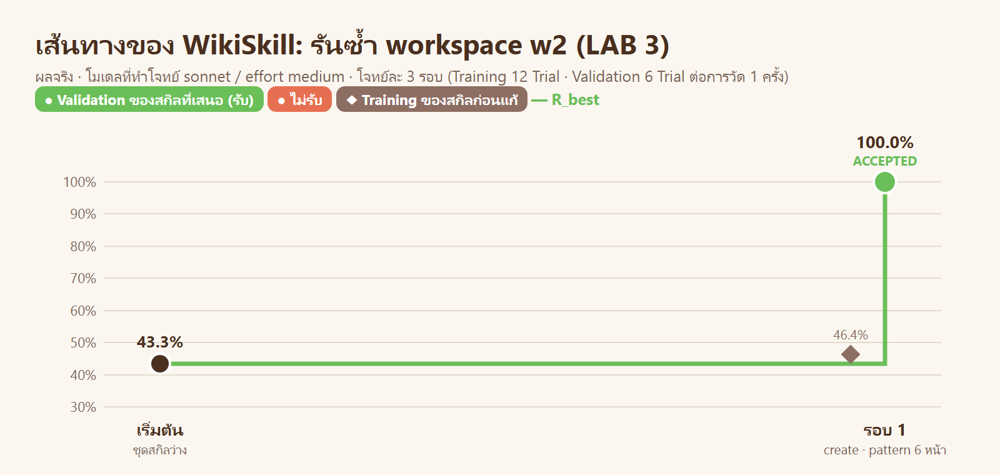

| | `w1` (LAB 1) | `w2` (LAB 3) |
|---|---|---|
| รอบที่ใช้ | 2 | **1** |
| Validation หลังรอบที่ 1 | 93.3% → ทำรอบที่ 2 | 100.0% → หยุด |
| pattern ใน Wiki | 7 หน้า | 6 หน้า |
| สกิลที่ได้ | `solve-py-contract` 107 บรรทัด | `solve-py-deliverable` 76 บรรทัด |
| รู้เกณฑ์ "เทสต์อย่างน้อย 6 ข้อ" | **รู้** (จากรอบที่ 2) | ไม่รู้ |
| Trial ระหว่างปรับ | 42 | 24 |
| คะแนนรวม 27 Trial | **97.9%** (ผ่านครบ 21/27) | 96.8% (ผ่านครบ 18/27) |
| Test Set | **100.0%** | 97.8% |
| ข้อตรวจ `policy` | 0/6 · Wiki จดว่ายังไม่ยืนยัน | 0/6 · Wiki จดว่ายังไม่ยืนยัน |

👀 สิ่งที่ซ้ำได้: ค้นพบมาตรฐานการเขียนโค้ดเอง ได้คะแนนราว 97% และไม่รู้นโยบายธุรกิจ · สิ่งที่ไม่ซ้ำ: จำนวนรอบ ชื่อและความยาวของสกิล และจำนวน pattern

👀 `w2` หยุดเร็วกว่าเพราะ Validation 6 Trial ผ่านครบในรอบแรก จึงไม่มีรอบที่ 2 ที่จะพบว่าเทสต์ยังไม่ถึง 6 ข้อ · จุดอ่อนนี้โผล่ตอนวัด 27 Trial: `unittest พบ 5 เทสต์ (ต้องมีอย่างน้อย 6)` 3 Trial · Gate ของ WikiSkill ไม่คิดความแกว่งของการวัด การหยุดจึงขึ้นกับโชคของ Validation ครั้งนั้น

<details><summary>สารบัญของ Wiki ทั้งสองครั้ง</summary>

| เรื่อง | pattern ใน `w1` | pattern ใน `w2` |
|---|---|---|
| ไม่ตรวจข้อมูลที่ผิด | `missing-input-validation` | `missing-input-validation` |
| รันเป็นโปรแกรมไม่ได้ | `missing-cli-entrypoint` | `missing-cli-entrypoint` |
| ไม่มีไฟล์เทสต์ | `missing-test-file` | `missing-test-file` |
| Agent ไม่ตรวจงานก่อนส่ง | `shallow-self-check` | `no-self-verification` |
| วิธีคิดเงินที่ทำถูกอยู่แล้ว | `integer-money-arithmetic` | `integer-math-half-up-works` |
| นโยบายธุรกิจ (ยังไม่ยืนยัน) | `policy-ambiguous-edge-cases` | `policy-mismatch-unconfirmed` |
| จำนวนเทสต์ไม่ถึงเกณฑ์ | `too-few-test-methods` (รอบที่ 2) | – |

ไฟล์จริง: [`runs/w1/wiki/index.md`](runs/w1/wiki/index.md) · [`runs/w2/wiki/index.md`](runs/w2/wiki/index.md)

</details>

### LAB 4 · การทดลองตัดส่วนประกอบ: ไม่มี Wiki (`n1`)

เปเปอร์รายงานว่าเมื่อตัด Wiki ออก คะแนนเฉลี่ยลดจาก 63.7% เหลือ 48.7% · LAB นี้ลองกับโจทย์ของเรา: ไม่มี Wiki Maintainer และ Skill Proposer เห็นเฉพาะ Trace ของรอบล่าสุด

| Input · ไฟล์ที่ใช้ | Output · ไฟล์ที่ได้เพิ่มหลังรัน |
|---|---|
| ค่าทุกตัวเหมือน LAB 1 ยกเว้นไม่ใช้ wiki | [`runs/n1/`](runs/n1/) workspace: `raw/` `skills/` (ไม่มี `wiki/`) · [`status.txt`](runs/n1/status.txt) |
| [`runs/w1/`](runs/w1/) · [`runs/w2/`](runs/w2/) ใช้เทียบ | [`runs/n1/trials/`](runs/n1/trials/) 27 Trial ของสกิลที่ได้ |
|  | [`runs/report.md`](runs/report.md) ตารางเทียบ 5 ชุด |

> [!IMPORTANT]
> **📋 คัดลอกกล่องนี้ → Claude Code Desktop แล้วกด Enter**
>
> ```text
> งาน: การทดลองตัดส่วนประกอบ (Ablation) · รัน WikiSkill แบบไม่มี Wiki (workspace n1) แล้วเทียบกับ w1 และ w2
>
> ที่ทำงาน  : container multi-account โฟลเดอร์ /workspace/wklab
> เครื่องมือ : สกิล wikiskill (รันวงรอบ) และสกิล skill-optimizer (วัดสกิลที่ได้)
> เงื่อนไข   : ห้ามเปิดตัวตรวจ suite/grade.py และเฉลย suite/ref/ · โจทย์ของ Validation Set ดูได้แค่คะแนนรวม · ห้ามแก้ไฟล์ใน raw/ skills/ เอง
>
> Input: โจทย์ 9 ข้อใน suite/suite.json (ข้อละ 1 ฟังก์ชันคิดเงิน)
> - Training Set 4 ข้อ ใช้สร้าง Trace: t1-cafe-bill t2-split-bill t3-shipping-fee t4-cashback
> - Validation Set 2 ข้อ ใช้ตัดสิน: v1-parking-fee v2-net-pay
> - Test Set 3 ข้อ ใช้วัดตอนจบ: x1-late-fee x2-refund x3-bulk-price
>
> วิธีทดลอง:
> - workspace ชื่อ n1 · ค่าทุกตัวเหมือน w1 ใน LAB 1 ยกเว้นข้อเดียว: **ไม่ใช้ wiki** (ไม่มี Wiki Maintainer · Skill Proposer เห็นเฉพาะ Trace ของรอบล่าสุด)
> - คำอธิบายงาน: "เขียนฟังก์ชัน Python สำหรับคิดเงินของร้านกาแฟ BaanKafe (ตัวตรวจอัตโนมัติให้คะแนนผลงาน)"
> - เมื่อวงรอบหยุด วัดสกิลของ n1 กับโจทย์ทั้ง 9 ข้อ ข้อละ 3 รอบ = 27 Trial (ค่าเดียวกับ LAB 2)
> - ใช้ทุกบัญชี yolo ที่ล็อกอินแล้ว รันพร้อมกันไม่เกิน 6 Trial
>
> วิธีตรวจ:
> - ทุก Trial ตัวตรวจ suite/grade.py รันโค้ดที่ Agent เขียน แล้วให้คะแนน 0–1 = สัดส่วนข้อตรวจที่ผ่าน (10 หรือ 11 ข้อต่อโจทย์)
> - Gate ของ WikiSkill รับสกิลที่เสนอเมื่อคะแนน Validation สูงกว่า R_best เท่านั้น · วงรอบหยุดเมื่อ R_best = 100% หรือครบ 8 รอบ
>
> ทำตามลำดับ:
> 1. รัน      สร้าง workspace n1 แบบไม่ใช้ wiki แล้วรัน loop จนวงรอบหยุด · บันทึกผลของ status ที่ runs/n1/status.txt
> 2. วัด      สกิลของ n1 กับโจทย์ทุกชุด (ป้าย n1) แล้วสรุปตารางเทียบ noskill so-v3 w1 w2 n1 (report) บันทึกที่ runs/report.md
> 3. เทียบ    n1 กับ w1 และ w2: จำนวนรอบ · ข้อเสนอที่ถูกรับและถูกปฏิเสธ · จำนวน Trial · จำนวนการเรียกโมเดลของผู้ปรับสกิล · คะแนนของสกิลที่ได้ · สิ่งที่เหลือในโฟลเดอร์เมื่อจบ
> 4. เก็บผล   คัดลอก runs/n1 และ runs/report.md runs/results.json จาก container มาไว้ที่ 03_week03/06_WikiSkill/runs บนเครื่อง: ไม่เก็บ Trace ดิบ (transcript.jsonl และไฟล์ *_transcript_*) โฟลเดอร์ proposer_view และ rollouts/suite · Trial ของ Validation Set เก็บแค่คะแนนและต้นทุน (grade.json เหลือเฉพาะ score · metrics.json ไม่มี commands และ result · ไม่มี sandbox)
> 5. รายงาน   ตาราง status ของ n1 · ตารางเทียบ n1 กับ w1 และ w2 · สิ่งที่ n1 ไม่มีเมื่อจบ
> ```

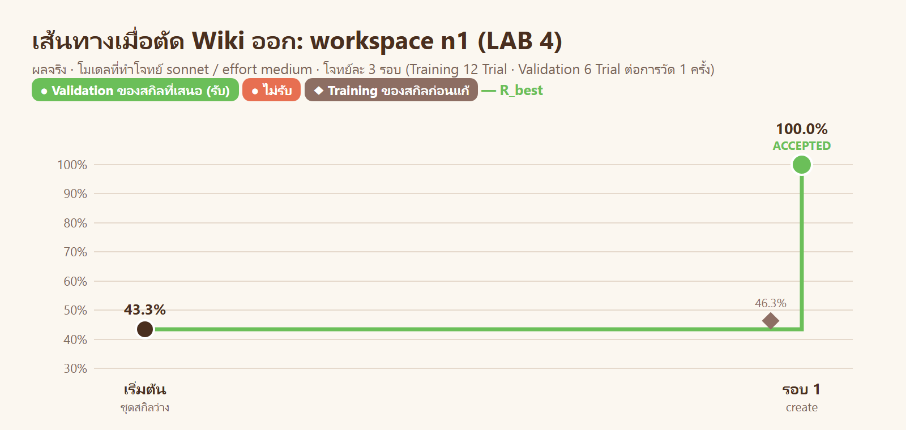

| | มี Wiki · `w1` | มี Wiki · `w2` | ไม่มี Wiki · `n1` |
|---|---|---|---|
| รอบที่ใช้ | 2 | 1 | 1 |
| Trial ระหว่างปรับ | 42 | 24 | 24 |
| การเรียกโมเดลของผู้ปรับสกิล | 16 ครั้ง | 11 ครั้ง | **5 ครั้ง** |
| คะแนนรวม 27 Trial | **97.9%** | 96.8% | 95.7% |
| Test Set | **100.0%** | 97.8% | 95.6% |
| Trial ที่เทสต์ไม่ถึง 6 ข้อ | 0 | 3 | 6 |
| สิ่งที่เหลือเมื่อจบ | สกิล + Wiki 7 หน้า + ประวัติข้อเสนอพร้อม diff | สกิล + Wiki 6 หน้า + ประวัติข้อเสนอ | **สกิลอย่างเดียว** |
| เรื่องนโยบายธุรกิจ | Wiki จดว่ายังไม่ยืนยัน พร้อมสมมติฐาน | Wiki จดว่ายังไม่ยืนยัน | ไม่มีบันทึก |

👀 บนโจทย์นี้การตัด Wiki ออก **ไม่ทำให้คะแนนต่างกันชัดเจน**: ผลต่าง 1–2 จุดระหว่าง 3 การรันมาจากจังหวะหยุด (`n1` และ `w2` หยุดที่รอบแรกเหมือนกัน และพลาดข้อเดียวกัน) · โจทย์นี้จบใน 1–2 รอบ จึงยังไม่มีความรู้ข้ามรอบให้สะสมมากพอจะเห็นผลแบบในเปเปอร์ที่รัน 8 รอบ

👀 สิ่งที่ต่างชัดคือ **สิ่งที่เหลือ**: `n1` ถูกกว่า (5 ครั้งเทียบกับ 11–16 ครั้ง) แต่ไม่มีอะไรบอกว่าสกิลนี้มาจากหลักฐานใด และไม่มีใครจดว่ามีเรื่องที่ยังไม่รู้ · ความรู้ข้อนี้จำเป็นใน LAB 5

### LAB 5 · เติมความรู้จากทีม (`w1p` → `w1q`)

WikiSkill หานโยบายธุรกิจเองไม่ได้ แต่ Wiki จดไว้ว่าต้องถามอะไร · ผู้เรียนรับบทคนในทีม ตอบเรื่องที่ Wiki จดว่ายังไม่ยืนยัน แล้วเติมลงสกิลด้วยวิธีของบท 05 (แก้ไม่เกิน 3 จุด → วัด → gate)


#### ขั้น 5.1 · เติมนโยบาย 4 ข้อ (`w1p`)

| Input · ไฟล์ที่ใช้ | Output · ไฟล์ที่ได้เพิ่มหลังรัน |
|---|---|
| ความรู้จากทีม 4 ข้อ (อยู่ในพรอมต์) | [`runs/w1p/skills/`](runs/w1p/skills/) สกิลของ `w1` + นโยบายธุรกิจ |
| [`runs/w1/wiki/`](runs/w1/wiki/) เรื่องที่ยังไม่ยืนยัน · [`runs/w1/failures.txt`](runs/w1/failures.txt) | [`runs/w1p/trials/`](runs/w1p/trials/) 27 Trial |
| [`runs/w1/skills/`](runs/w1/skills/) สกิลรุ่นฐาน | [`runs/w1p/gate-w1.txt`](runs/w1p/gate-w1.txt) · [`gate-so-v3.txt`](runs/w1p/gate-so-v3.txt) ผลตัดสิน |

> [!IMPORTANT]
> **📋 คัดลอกกล่องนี้ → Claude Code Desktop แล้วกด Enter**
>
> ```text
> งาน: ต่อยอดสกิลที่ WikiSkill สร้าง (w1) · เติมนโยบายธุรกิจที่ทีมยืนยันแล้ว ด้วยวิธีของบท 05 เป็นรุ่น w1p แล้วให้ gate ตัดสิน
>
> ที่ทำงาน  : container multi-account โฟลเดอร์ /workspace/wklab
> เครื่องมือ : สกิล skill-optimizer
> เงื่อนไข   : ห้ามเปิดตัวตรวจ suite/grade.py และเฉลย suite/ref/ · โจทย์ของ Validation Set ดูได้แค่คะแนนรวม · ห้ามแก้ไฟล์ใน runs/w1 (สร้างรุ่นใหม่เท่านั้น)
>
> Input: โจทย์ 9 ข้อใน suite/suite.json (ข้อละ 1 ฟังก์ชันคิดเงิน)
> - Training Set 4 ข้อ ใช้หาข้อที่ผิด: t1-cafe-bill t2-split-bill t3-shipping-fee t4-cashback
> - Validation Set 2 ข้อ ใช้ตัดสิน: v1-parking-fee v2-net-pay
> - Test Set 3 ข้อ: x1-late-fee x2-refund x3-bulk-price
>
> ความรู้จากทีม (คำตอบของเรื่องที่ wiki ของ w1 จดว่ายังไม่ยืนยัน):
> - ระยะทาง 0 กม. คือลูกค้ารับเองที่ร้าน ไม่คิดค่าส่ง
> - ส่งด่วนรับน้ำหนักไม่เกิน 20,000 กรัม เกินกว่านี้ถือเป็นข้อมูลผิด
> - สิทธิ์เงินคืน 2 เท่าในเดือนเกิด ให้เฉพาะสมาชิก gold และ platinum
> - เงินคืนเป็นเงินที่ร้านจ่ายออก ให้ปัดลง ไม่ปัดครึ่งขึ้น
>
> วิธีทดลอง:
> - รุ่นฐาน w1 = สกิลที่ WikiSkill สร้าง (วัดไว้แล้วใน LAB 2)
> - รุ่นใหม่ w1p = สกิลของ w1 + นโยบายธุรกิจ
> - 1 Trial = Agent 1 ตัว (โมเดล sonnet · effort medium) ได้โจทย์ 1 ข้อ แล้วเขียน solve.py และ test_solve.py ในโฟลเดอร์ว่าง
> - วัดรุ่นใหม่ 1 รุ่น: 9 โจทย์ × 3 รอบ = 27 Trial ด้วยค่าเดียวกับ LAB 2
> - ใช้ทุกบัญชี yolo ที่ล็อกอินแล้ว รันพร้อมกันไม่เกิน 6 Trial
>
> วิธีตรวจ:
> - ทุก Trial ตัวตรวจ suite/grade.py รันโค้ดที่ Agent เขียน แล้วให้คะแนน 0–1 = สัดส่วนข้อตรวจที่ผ่าน (10 หรือ 11 ข้อต่อโจทย์)
> - gate เทียบรุ่นใหม่กับรุ่นฐาน แล้วตอบ ACCEPT หรือ REJECT: Training และ Validation ต้องไม่ลด และคะแนนรวมต้องดีขึ้นเกินความแกว่ง หรือเท่าเดิมแต่ต้นทุนลดอย่างน้อย 10%
>
> ทำตามลำดับ:
> 1. หาจุดแก้  ดู 3 อย่าง: ข้อที่ผิดของ w1 (Training Set) · เรื่องที่ wiki ของ w1 จดว่ายังไม่ยืนยัน (runs/w1/wiki/index.md และหน้า pattern ที่เกี่ยวข้อง) · ความรู้จากทีมข้างบน
> 2. แก้        คัดลอก runs/w1/skills เป็น runs/w1p/skills แล้วแก้ไม่เกิน 3 จุด · เขียนเป็นนโยบายของร้าน ห้ามใส่ Input หรือคำตอบของข้อตรวจ
> 3. วัด        รุ่น w1p กับโจทย์ทุกชุด
> 4. ตัดสิน     gate w1 → w1p และ gate so-v3 → w1p ใช้ต้นทุน context_tokens บันทึกที่ runs/w1p/gate-w1.txt และ runs/w1p/gate-so-v3.txt · ตารางเทียบทุกชุด (report) บันทึกที่ runs/report.md
> 5. เก็บผล     คัดลอก runs/w1p และ runs/report.md runs/results.json จาก container มาไว้ที่ 03_week03/06_WikiSkill/runs บนเครื่อง: เก็บ skills ไฟล์ผล และของแต่ละ Trial เก็บ grade.json metrics.json กับโค้ดใน sandbox (ไม่เก็บ Trace ดิบ) · Trial ของ Validation Set เก็บแค่คะแนนและต้นทุน (grade.json เหลือเฉพาะ score · metrics.json ไม่มี commands และ result · ไม่มี sandbox)
> 6. รายงาน     จุดที่แก้ใน w1p และเหตุผล · ตารางเทียบทุกชุด · ผล gate 2 คู่
> ```

**ผลจริง:** Training 95.2% → 100.0% (`policy` 0/6 → 6/6) แต่ Validation 100.0% → 96.7% และ Test 100.0% → 93.3% · รวม 97.9% → 97.0% · **REJECT**

```diff
+## นโยบายธุรกิจของร้าน (ทีมยืนยันแล้ว ใช้แทนการเดาเมื่อโจทย์ไม่บอก)
+### ค่าส่งและการส่งด่วน
+- ระยะทาง 0 กม. คือลูกค้ารับเองที่ร้าน ไม่คิดค่าส่ง
+- ส่งด่วนรับน้ำหนักไม่เกิน 20,000 กรัม เกินกว่านี้ถือเป็นข้อมูลผิด ให้ raise ValueError
+### สิทธิ์เงินคืนในเดือนเกิด
+- สิทธิ์เงินคืน 2 เท่าในเดือนเกิด ให้เฉพาะสมาชิก gold และ platinum สมาชิกระดับอื่นได้อัตราปกติ
+### การปัดเศษเงินที่ร้านจ่ายออก
+- เงินคืนเป็นเงินที่ร้านจ่ายออก ให้ปัดลง ไม่ปัดครึ่งขึ้น (เงินที่ลูกค้าจ่ายเข้าร้านยังใช้กติกาปัดของโจทย์)
```

👀 นโยบายถูกทุกข้อ แต่หัวข้อสุดท้ายเขียนเป็นกติกาทั่วไป: "เงินที่ร้านจ่ายออก ให้ปัดลง" · งานคืนเงินคอร์สของ Test Set ก็เป็นเงินที่ร้านจ่ายออก Agent จึงปัดลงด้วย และผิดทั้ง 3 Trial

```text
✗ half_up: refund(150, 25, false) คาด 113 ได้ 112 · พลาด 3 จาก 3 กรณี        ← x2-refund ของ w1p
    # เงินที่ร้านจ่ายออก: ปัดลงครั้งเดียวตอนท้าย (จำนวนเต็มล้วน)                ← โค้ดที่ Agent เขียน
```

#### ขั้น 5.2 · กำกับขอบเขตของนโยบาย (`w1q`)

รุ่นที่ถูกปฏิเสธไม่ถูกใช้ต่อ · เริ่มจาก `w1` อีกครั้งด้วยความรู้ชุดเดิม แต่ระบุว่านโยบายแต่ละข้อใช้กับฟังก์ชันใด

| Input · ไฟล์ที่ใช้ | Output · ไฟล์ที่ได้เพิ่มหลังรัน |
|---|---|
| ความรู้จากทีม 4 ข้อ (ชุดเดิม) | [`runs/w1q/skills/`](runs/w1q/skills/) สกิลของ `w1` + นโยบายที่มีขอบเขต |
| [`runs/w1p/gate-w1.txt`](runs/w1p/gate-w1.txt) ผลของรุ่นที่ถูกปฏิเสธ | [`runs/w1q/trials/`](runs/w1q/trials/) 27 Trial |
| [`runs/w1/skills/`](runs/w1/skills/) สกิลรุ่นฐาน | [`runs/w1q/gate-w1.txt`](runs/w1q/gate-w1.txt) · [`gate-so-v3.txt`](runs/w1q/gate-so-v3.txt) · [`runs/report.md`](runs/report.md) ตารางเทียบ 7 ชุด |

> [!IMPORTANT]
> **📋 คัดลอกกล่องนี้ → Claude Code Desktop แล้วกด Enter**
>
> ```text
> งาน: แก้รุ่นที่ถูกปฏิเสธ · สร้างรุ่น w1q จาก w1 ด้วยนโยบายธุรกิจชุดเดิม แต่กำกับขอบเขตของแต่ละข้อให้ชัด แล้วให้ gate ตัดสิน
>
> ที่ทำงาน  : container multi-account โฟลเดอร์ /workspace/wklab
> เครื่องมือ : สกิล skill-optimizer
> เงื่อนไข   : ห้ามเปิดตัวตรวจ suite/grade.py และเฉลย suite/ref/ · โจทย์ของ Validation Set ดูได้แค่คะแนนรวม · ห้ามแก้ไฟล์ใน runs/w1 และ runs/w1p (สร้างรุ่นใหม่เท่านั้น)
>
> Input: โจทย์ 9 ข้อใน suite/suite.json (ข้อละ 1 ฟังก์ชันคิดเงิน)
> - Training Set 4 ข้อ ใช้หาข้อที่ผิด: t1-cafe-bill t2-split-bill t3-shipping-fee t4-cashback
> - Validation Set 2 ข้อ ใช้ตัดสิน: v1-parking-fee v2-net-pay
> - Test Set 3 ข้อ: x1-late-fee x2-refund x3-bulk-price
>
> สิ่งที่รู้จากรุ่น w1p ที่ถูกปฏิเสธ (runs/w1p/gate-w1.txt และ runs/report.md):
> - Training ขึ้นเป็น 100.0% แต่ Validation ลดจาก 100.0% เป็น 96.7% และ Test ลดจาก 100.0% เป็น 93.3%
> - สมมติฐาน: นโยบายที่เขียนเป็นกติกาทั่วไป (เช่น "เงินที่ร้านจ่ายออก ให้ปัดลง") ถูก Agent นำไปใช้กับงานอื่นที่ไม่เกี่ยว
>
> ความรู้จากทีม (ชุดเดิม):
> - ระยะทาง 0 กม. คือลูกค้ารับเองที่ร้าน ไม่คิดค่าส่ง
> - ส่งด่วนรับน้ำหนักไม่เกิน 20,000 กรัม เกินกว่านี้ถือเป็นข้อมูลผิด
> - สิทธิ์เงินคืน 2 เท่าในเดือนเกิด ให้เฉพาะสมาชิก gold และ platinum
> - เงินคืนเป็นเงินที่ร้านจ่ายออก ให้ปัดลง ไม่ปัดครึ่งขึ้น
>
> วิธีทดลอง:
> - รุ่นฐาน w1 = สกิลที่ WikiSkill สร้าง (วัดไว้แล้วใน LAB 2)
> - รุ่นใหม่ w1q = สกิลของ w1 + นโยบายธุรกิจที่กำกับขอบเขต: นโยบายค่าส่งใช้กับฟังก์ชันคิดค่าส่งเท่านั้น · นโยบายเงินคืนใช้กับฟังก์ชันคิดเงินคืนสมาชิกเท่านั้น · งานอื่นทุกงานใช้กติกาเดิมของสกิล
> - 1 Trial = Agent 1 ตัว (โมเดล sonnet · effort medium) ได้โจทย์ 1 ข้อ แล้วเขียน solve.py และ test_solve.py ในโฟลเดอร์ว่าง
> - วัดรุ่นใหม่ 1 รุ่น: 9 โจทย์ × 3 รอบ = 27 Trial ด้วยค่าเดียวกับ LAB 2
> - ใช้ทุกบัญชี yolo ที่ล็อกอินแล้ว รันพร้อมกันไม่เกิน 6 Trial
>
> วิธีตรวจ:
> - ทุก Trial ตัวตรวจ suite/grade.py รันโค้ดที่ Agent เขียน แล้วให้คะแนน 0–1 = สัดส่วนข้อตรวจที่ผ่าน (10 หรือ 11 ข้อต่อโจทย์)
> - gate เทียบรุ่นใหม่กับรุ่นฐาน แล้วตอบ ACCEPT หรือ REJECT: Training และ Validation ต้องไม่ลด และคะแนนรวมต้องดีขึ้นเกินความแกว่ง หรือเท่าเดิมแต่ต้นทุนลดอย่างน้อย 10%
>
> ทำตามลำดับ:
> 1. แก้        คัดลอก runs/w1/skills เป็น runs/w1q/skills แล้วแก้ไม่เกิน 3 จุด · เขียนเป็นนโยบายของร้านพร้อมขอบเขตของแต่ละข้อ ห้ามใส่ Input หรือคำตอบของข้อตรวจ
> 2. วัด        รุ่น w1q กับโจทย์ทุกชุด
> 3. ตัดสิน     gate w1 → w1q และ gate so-v3 → w1q ใช้ต้นทุน context_tokens บันทึกที่ runs/w1q/gate-w1.txt และ runs/w1q/gate-so-v3.txt · ตารางเทียบทุกชุด (report) บันทึกที่ runs/report.md
> 4. เก็บผล     คัดลอก runs/w1q และ runs/report.md runs/results.json จาก container มาไว้ที่ 03_week03/06_WikiSkill/runs บนเครื่อง: เก็บ skills ไฟล์ผล และของแต่ละ Trial เก็บ grade.json metrics.json กับโค้ดใน sandbox (ไม่เก็บ Trace ดิบ) · Trial ของ Validation Set เก็บแค่คะแนนและต้นทุน (grade.json เหลือเฉพาะ score · metrics.json ไม่มี commands และ result · ไม่มี sandbox)
> 5. รายงาน     จุดที่แก้ใน w1q เทียบกับ w1p · ตารางเทียบทุกชุด · ผล gate 2 คู่
> ```

**ผลจริง:** Training · Validation · Test **100.0% ทั้ง 3 ชุด** (ผ่านครบ 27/27) · รวม 97.9% → 100.0% (+2.1 จุด · เกณฑ์ 2.0) · **ACCEPT**

```diff
+### 2. นโยบายเงินคืน (ใช้กับฟังก์ชันคิดเงินคืนสมาชิกเท่านั้น)
+ใช้เฉพาะเมื่อโจทย์ให้เขียนฟังก์ชันคิดเงินคืน (cashback) ของสมาชิก ไม่ใช้กับฟังก์ชันอื่น แม้จะมีการปัดเศษเงินเหมือนกัน
+- สิทธิ์เงินคืน 2 เท่าในเดือนเกิด ให้เฉพาะสมาชิก gold และ platinum สมาชิกระดับอื่นได้อัตราปกติ
+- เงินคืนเป็นเงินที่ร้านจ่ายออก ให้ปัดลง ไม่ปัดครึ่งขึ้น
+### 3. ขอบเขตของนโยบาย
+นโยบายข้อ 1 และ 2 ไม่มีผลกับงานอื่น … ใช้กติกาของโจทย์และกติกาเดิมของสกิลนี้เท่านั้น
```

| gate ของบท 05 | `w1p` (นโยบายเขียนกว้าง) | `w1q` (นโยบายมีขอบเขต) |
|---|---|---|
| `w1` → รุ่นใหม่ | **REJECT** · รวม −0.9 จุด | **ACCEPT** · รวม +2.1 จุด |
| `so-v3` → รุ่นใหม่ | REJECT · รวม −3.0 จุด | REJECT · คะแนนเท่ากัน 100% แต่โทเคนขาเข้ามากกว่า 12% |


👀 ความรู้ชุดเดียวกัน เขียนต่างกันแค่ขอบเขต ผลต่างกัน 3 จุดและผลตัดสินกลับด้าน · บนชุด Training สองรุ่นนี้ได้ 100% เท่ากัน ต้องมี Validation และ Test Set จึงจะเห็นว่า `w1p` ทำงานอื่นพัง

👀 `w1q` ได้ 100% เท่ากับ `v3` ของบท 05 โดยคนทำแค่ตอบคำถาม 4 ข้อที่ Wiki จดไว้ · แต่ยังไม่ดีพอจะมาแทน `v3` เพราะสกิลยาวกว่า (12.8 KB เทียบกับ 6.7 KB) และใช้โทเคนมากกว่า

## 4 · สรุปและแบบฝึกหัด

### 4.1 ผลของทุกชุด

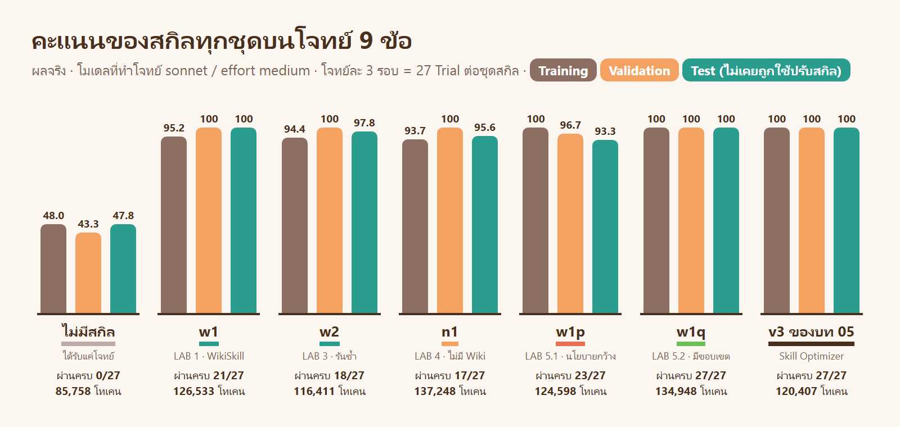

| ชุดสกิล | มาจาก | Training | Validation | Test | รวม | ผ่านครบ | โทเคนขาเข้าต่อ Trial |
|---|---|---|---|---|---|---|---|
| ไม่มีสกิล | – | 48.0% | 43.3% | 47.8% | 46.9% | 0/27 | 85,758 |
| `w1` | LAB 1 · WikiSkill 2 รอบ | 95.2% | 100.0% | 100.0% | 97.9% | 21/27 | 126,533 |
| `w2` | LAB 3 · WikiSkill รันซ้ำ 1 รอบ | 94.4% | 100.0% | 97.8% | 96.8% | 18/27 | 116,411 |
| `n1` | LAB 4 · ไม่มี Wiki 1 รอบ | 93.7% | 100.0% | 95.6% | 95.7% | 17/27 | 137,248 |
| `w1p` | LAB 5.1 · `w1` + นโยบายเขียนกว้าง | 100.0% | 96.7% | 93.3% | 97.0% | 23/27 | 124,598 |
| `w1q` | LAB 5.2 · `w1` + นโยบายมีขอบเขต | 100.0% | 100.0% | 100.0% | **100.0%** | 27/27 | 134,948 |
| `so-v3` | บท 05 · Skill Optimizer | 100.0% | 100.0% | 100.0% | **100.0%** | 27/27 | 120,407 |

รวม 279 Trial · ราคาตามรายการรวมประมาณ $34 (ไม่ใช่ยอดจ่ายจริงของบัญชีแบบ subscription) · ตารางเต็ม: [`runs/report.md`](runs/report.md)

### 4.2 เทียบกับ Skill Optimizer ของบท 05

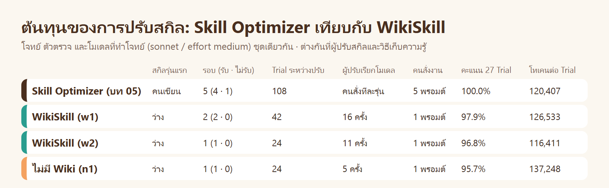

| ประเด็น | Skill Optimizer (บท 05) | WikiSkill (บทนี้) |
|---|---|---|
| สกิลรุ่นแรก | คนเขียน | ไม่มี · เริ่มจากว่าง |
| สิ่งที่คนทำ | เขียน `v0` · สั่งทีละรุ่น 5 พรอมต์ · บอกนโยบาย 4 ข้อ | 1 พรอมต์ต่อการรัน · ตอบนโยบาย 4 ข้อใน LAB 5 |
| มาตรฐานการเขียนโค้ด 5 ข้อ | คนเขียนแบบกว้าง แล้ว Claude ทำให้ตรวจสอบได้ | **ค้นพบเองจาก Trace** |
| นโยบายธุรกิจ 4 ข้อ | คนบอกใน LAB 3 | ค้นพบเองไม่ได้ · Wiki จดว่ายังไม่ยืนยัน → คนบอกใน LAB 5 |
| ที่เก็บความรู้ | `ISSUES.md` ที่ Claude จดตามคำสั่ง | `wiki/` ที่ระบบเขียนเอง พร้อมประวัติข้อเสนอและ diff |
| เกณฑ์ของ Gate | ต้องดีขึ้นเกินความแกว่ง หรือต้นทุนลด ≥ 10% | Validation ต้องสูงกว่าเดิมเท่านั้น |
| Trial ระหว่างปรับ | 108 | 24–42 |
| สกิลที่ได้ | 6.7 KB · 100% | 7.8–10.4 KB · 95.7–97.9% (100% หลังเติมนโยบาย · 12.8 KB) |

### 4.3 คำตอบของคำถาม 5 ข้อ

| # | คำถาม | คำตอบจากผลจริง |
|---|---|---|
| 1 | ค้นพบมาตรฐานการเขียนโค้ด 5 ข้อเองได้หรือไม่ | **ได้** ทุกการรัน (`w1` `w2` `n1`) · ข้อที่พลาดบ้างมีข้อเดียวคือเกณฑ์จำนวนเทสต์ ซึ่งขึ้นกับว่าได้ทำรอบที่ 2 หรือไม่ |
| 2 | ค้นพบนโยบายธุรกิจได้หรือไม่ | **ไม่ได้** (`policy` 0/6 ทุกการรัน) · แต่ Wiki จดว่ามีเรื่องนี้และยังไม่ยืนยัน |
| 3 | รันซ้ำได้ผลเดิมหรือไม่ | ผลรวมใกล้กัน (97.9% และ 96.8%) แต่จำนวนรอบและรายละเอียดของสกิลต่างกัน |
| 4 | ตัด Wiki ออกแล้วเป็นอย่างไร | คะแนนไม่ต่างชัดเจน (95.7%) เพราะโจทย์จบใน 1–2 รอบ · สิ่งที่หายคือความรู้ที่อ่านย้อนหลังได้ |
| 5 | ความรู้ที่หาเองไม่ได้ เติมอย่างไร | ให้คนตอบเรื่องที่ Wiki จดไว้ แล้วเติมลงสกิลแบบ **มีขอบเขต** และให้ gate ตัดสิน (`w1q` 100%) |

### 4.4 สิ่งที่ผลจริงสอน

| ผล | บทเรียน |
|---|---|
| ไม่มีสกิล 46.9% → `w1` 97.9% โดยไม่มีคนเขียนสกิล | ความรู้แฝงที่เกิดซ้ำทุกงาน ค้นพบได้จาก Trace และข้อความของตัวตรวจ |
| `policy` 0/6 ทั้ง `w1` `w2` `n1` | ความรู้เฉพาะงานที่มีตัวอย่างเดียว ระบบไม่เดา และ Validation ที่ไม่มีข้อตรวจนี้ทำให้วงรอบหยุดที่ 100% · **สกิลดีได้เท่าที่ Validation วัด** |
| Wiki จดว่า "ยังไม่ยืนยัน" พร้อมสมมติฐาน | Wiki ไม่ได้มีไว้ให้ AI อย่างเดียว เป็นรายการคำถามที่คนต้องตอบด้วย |
| `w1` 2 รอบ · `w2` 1 รอบ | Gate รับเมื่อ "สูงกว่าเดิม" และหยุดเมื่อได้ 100% โดยไม่คิดความแกว่ง · Validation 6 Trial ผ่านครบได้โดยบังเอิญ |
| `n1` ไม่มี Wiki ได้ 95.7% | โจทย์ที่จบเร็ว Wiki ยังไม่ให้ผลต่างด้านคะแนน · ประโยชน์ที่เปเปอร์วัดได้มาจากงานที่ปรับ 8 รอบและมีข้อเสนอถูกปฏิเสธ |
| `w1p` REJECT · `w1q` ACCEPT | ความรู้ที่ถูกต้องแต่เขียนกว้างเกิน ทำงานอื่นพัง · ทุกการแก้ต้องผ่านการวัดกับโจทย์ที่ไม่ได้ใช้ตอนแก้ |
| `w1q` 100% แต่แพ้ `v3` ที่ต้นทุน | WikiSkill ไม่มีเป้าหมายด้านต้นทุน สกิลจึงยาวกว่า · ต่อด้วยรอบลดต้นทุนของบท 05 ได้ |

### 4.5 เลือกใช้เมื่อไร

| สถานการณ์ | ทางที่เหมาะ |
|---|---|
| ยังไม่มีสกิล และไม่รู้ว่างานมีกฎแฝงอะไร | เริ่มด้วย WikiSkill: ได้สกิลรุ่นแรกและ Wiki ที่บอกว่าพบอะไร ยังไม่รู้อะไร |
| มีคนที่รู้กฎของงานอยู่แล้ว และต้องคุมต้นทุนของสกิล | Skill Optimizer: เริ่มจากความรู้ของคน และมีรอบลดต้นทุน |
| งานมีความรู้เฉพาะที่ไม่ปรากฏในโจทย์ทั่วไป | ผสม: WikiSkill หาส่วนที่หาได้ → คนตอบเรื่องที่ Wiki เปิดไว้ → gate ของบท 05 ตัดสิน (LAB 5) |
| งานยาก ต้องปรับหลายรอบ มีข้อเสนอล้มเหลวระหว่างทาง | WikiSkill: ความรู้ข้ามรอบไม่หาย (สิ่งที่เปเปอร์วัดได้ +15 จุด) |

### 4.6 แบบฝึกหัด

| # | โจทย์ | ได้ฝึกอะไร |
|---|---|---|
| 1 | เปิด [`runs/w1/history/iter-02/maintainer_input.md`](runs/w1/history/iter-02/maintainer_input.md) กับ [`maintainer_output.json`](runs/w1/history/iter-02/maintainer_output.json) แล้วหาว่า Maintainer แก้หน้าเดิมด้วยรายการแก้แบบใดบ้าง | เห็นสิ่งที่ Wiki Maintainer ได้รับและตอบ (ไม่ใช้โทเคน) |
| 2 | รัน workspace `w3` ด้วยค่าเดิม แล้วเติมแถวที่ 3 ในตารางของ LAB 3 | การรัน 1–2 ครั้งยังไม่ใช่ข้อสรุป (เปเปอร์รัน 3 ครั้งแล้วเฉลี่ย) |
| 3 | ย้ายโจทย์ `t4-cashback` ไปอยู่ Validation Set (แก้ `split` ใน `suite.json`) แล้วรัน WikiSkill ใหม่ วงรอบหยุดที่รอบใด และ Wiki จดเรื่อง `policy` อย่างไร | Validation กำหนดว่าวงรอบเห็นอะไร |
| 4 | รัน workspace ใหม่โดยตั้งให้วัดโจทย์ละ 6 รอบ แล้วเทียบจำนวนรอบกับ `w1` และ `w2` | Validation ที่ใหญ่ขึ้นทำให้การหยุดเชื่อได้มากขึ้น |
| 5 | ทำรุ่น `w1r` จาก `w1q`: ลดโทเคนขาเข้าอย่างน้อย 10% โดยคะแนนไม่ลด แล้วให้ gate เทียบกับ `so-v3` | นำรอบลดต้นทุนของบท 05 มาใช้กับสกิลของ WikiSkill |
| 6 | ใช้ WikiSkill กับงานของตัวเอง: เขียนโจทย์ 4 + 2 + 2 ข้อและตัวตรวจ แล้วรัน `loop` | ทำทั้งกระบวนการเอง |

### 4.7 ข้อจำกัด

| ข้อจำกัด | ผล |
|---|---|
| โจทย์เล็กและจบใน 1–2 รอบ | ข้อเสนอของวงรอบผ่าน Gate ทั้ง 4 ครั้ง จึงไม่มีการย้อนกลับจริงของ WikiSkill ให้ดู (เห็นได้จากการทดสอบของ LAB 0.1 และจาก gate ของบท 05 ใน LAB 5) |
| รันแต่ละการตั้งค่า 1–2 ครั้ง | ผลต่าง 1–2 จุดระหว่าง `w1` `w2` `n1` มีส่วนที่เป็นความบังเอิญ |
| Validation 2 ข้อ ไม่มีข้อตรวจ `policy` | วงรอบหยุดเมื่อ Validation ได้ 100% ทั้งที่ Training ยังไม่เต็ม |
| สกิลถูกวางใน `./skills` ไม่ได้ใส่ใน prompt แบบเปเปอร์ | Agent ต้องเปิดอ่านเอง ใช้คำสั่งเพิ่ม 1–2 ครั้งต่องาน |
| เครื่องมือ `wikiskill` และ prompt สร้างจากพรอมต์ของ LAB 0.1 | ฉบับของผู้เรียนอาจต่างจากฉบับที่ใช้วัดผลในบทนี้ สิ่งที่ต้องตรงคือรูปแบบใน [`wikiskill_format.md`](wikiskill_format.md) · ไฟล์รูปแบบถูกเติมรายละเอียดหลัง LAB 0.1 ตามจุดกำกวมที่ agent รายงาน |
| LAB 3 agent เริ่ม `loop` ซ้ำ 2 ครั้งโดยพลาด | ยกเลิกแล้วสร้าง `w2` ใหม่ทั้งหมด ผลที่รายงานมาจากการรันใหม่ครั้งเดียว |

LAB 0 ถึง LAB 5 รันโดย agent ใหม่ที่ได้รับพรอมต์ตามตัวอักษร ครั้งละ 1 LAB · ผลที่เก็บใน `runs/` ถูกจัดให้เป็นรูปแบบเดียวกันหลังรัน (ไม่เก็บ Trace ดิบ และ Validation Set เก็บแค่คะแนนกับต้นทุน)

**ก่อนหน้า:** [Skill Optimizer ฉบับเริ่มต้น](../05_Skill_Optimizer/README.md) โจทย์เดียวกัน คนเขียนสกิลรุ่นแรกแล้วปรับทีละรุ่น

**ถัดไป:** [EvoSkill v2 · ให้ Agent 3 ตัวปรับสกิลกันเอง](../07_EvoSkill_v2/README.md)
