# ทฤษฎี EvoSkill v2 · แนวคิด วิธีคิดในการออกแบบ และอัลกอริทึม

| | |
|---|---|
| เปเปอร์ | Huang, Nama, Alzubi, *EvoSkill v2: Fully Agentic Skill Evolution from Benchmark Adaptation to a Stateful Evolver*, Sentient Labs (ต.ค. 2026) |
| อ่านต้นฉบับ | [arXiv:2610.25931](https://arxiv.org/abs/2610.25931) |
| **Source code ของเปเปอร์** | **[github.com/sentient-agi/EvoSkill](https://github.com/sentient-agi/EvoSkill/tree/v2)** · branch `v2` (branch `main` คือ EvoSkill v1) · Apache 2.0 |
| รุ่นก่อนหน้า | Alzubi และคณะ, *EvoSkill: Automated Skill Discovery for Agents* ([OpenReview](https://openreview.net/forum?id=i4b4As7RFX)) |
| แนวคิดในประโยคเดียว | ปรับ **สกิล** ของ Agent โดยไม่แตะโมเดล ด้วย Agent 3 ตัว: ตัวหนึ่งเตรียมสนามทดลอง ตัวหนึ่งทำโจทย์ และตัวหนึ่งอ่านผลแล้วเขียนสกิลใหม่ **ในเซสชันเดียวตลอดการรัน** |


**ภาพในหน้านี้มี 2 แบบ**

| แบบ | คืออะไร |
|---|---|
| ภาพการ์ตูนและแผนภาพ | วาดขึ้นใหม่เพื่ออธิบายทีละแนวคิด ตัวเลขคัดจากเปเปอร์หรือจากการรันจริงของบทนี้ |
| **ภาพต้นฉบับจากเปเปอร์** | Figure 1–5 ของเปเปอร์ วางไว้ใต้ภาพของเราในหัวข้อเดียวกัน เพื่อให้เทียบกันได้ (เปเปอร์เผยแพร่แบบ CC BY 4.0) |

ตัวอย่างทุกชิ้นมาจากการรันจริงของบทนี้เมื่อ 13 พ.ย. 2026 (ส่วนใหญ่จาก [`runs/e1/`](../runs/e1/) และ [`runs/p1/`](../runs/p1/) · ผลของทั้ง 8 การรันอยู่ใน [README หลัก](../README.md#3--ลงมือทำ-copy--paste))

## อ่านตามลำดับนี้

| ขั้น | ตอบคำถาม |
|---|---|
| [1 · ข้อสังเกตตั้งต้น](#ขั้น-1--ข้อสังเกตตั้งต้น-พลาดแล้วมักพลาดซ้ำ) | ทำไมการเขียนสกิลจึงช่วยได้ |
| [2 · สกิล และสิ่งที่ถูกปรับ](#ขั้น-2--สกิล-และสิ่งที่ถูกปรับ) | ปรับอะไร ไม่ปรับอะไร |
| [3 · จาก v1 สู่ v2](#ขั้น-3--จาก-evoskill-v1-สู่-v2) | v2 เปลี่ยนอะไรจากรุ่นก่อน |
| [4 · ภาพรวม: Agent 3 ตัว](#ขั้น-4--ภาพรวม-agent-3-ตัว) | ใครทำอะไร เมื่อไร |
| [5 · Benchmark Adaptor](#ขั้น-5--benchmark-adaptor) | สนามทดลองถูกเตรียมอย่างไร |
| [6 · Solver](#ขั้น-6--solver-และ-progressive-disclosure) | Agent ที่ทำโจทย์ใช้สกิลอย่างไร |
| [7 · Evolver](#ขั้น-7--evolver-และสิ่งที่มันได้รับ) | ผู้เขียนสกิลเห็นอะไร แก้อะไรได้ |
| [8 · การกันข้อมูล](#ขั้น-8--การกันข้อมูล-และช่องโหว่ของตัวตรวจ) | ทำไม Evolver ต้องไม่เห็นข้อสอบ และตัวตรวจต้องถูกตรวจก่อน |
| [9 · เดิน 1 การรันด้วยผลจริง](#ขั้น-9--เดิน-1-การรันด้วยผลจริง) | ข้อมูลไหลอย่างไรตั้งแต่ต้นจนจบ |
| [10 · อัลกอริทึม](#ขั้น-10--อัลกอริทึม) | ขั้นตอนทั้งหมดทีละบรรทัด |
| [11 · วิธีคิดในการออกแบบ](#ขั้น-11--วิธีคิดในการออกแบบ) | ทำไมจึงออกแบบแต่ละจุดเช่นนี้ (10 ข้อ) |
| [12 · ผลในเปเปอร์](#ขั้น-12--ผลในเปเปอร์) | ได้ผลแค่ไหน เทียบกับใคร |
| [13 · เปรียบเทียบ](#ขั้น-13--เปรียบเทียบกับวิธีอื่น) | ต่างจาก SkillOpt · SkillBoost · WikiSkill · บท 05 อย่างไร |
| [14 · ข้อจำกัด](#ขั้น-14--ข้อจำกัด) | สิ่งที่ EvoSkill v2 ยังทำไม่ได้ |
| [15 · เปเปอร์ เทียบกับ LAB ของบทนี้](#ขั้น-15--เปเปอร์-เทียบกับ-lab-ของบทนี้) | เราทำตรงกับเปเปอร์ตรงไหน ต่างตรงไหน |
| [16 · ทบทวน](#ขั้น-16--ทบทวน) | คำถามตรวจความเข้าใจ |

ทุกขั้นมีกล่อง **ในโค้ด** บอกว่าแนวคิดนั้นอยู่ตรงไหนของ [`evoskill.py`](../evoskill/evoskill.py) และ prompt · อ่านโค้ดทั้งไฟล์ได้ที่ [ข้างใน EvoSkill v2](../02_inside_evoskill/README.md)

---

## ขั้น 1 · ข้อสังเกตตั้งต้น: พลาดแล้วมักพลาดซ้ำ


เปเปอร์เริ่มจากข้อสังเกตข้อเดียว: **Agent ที่ไม่มีสกิลที่เหมาะกับงาน เมื่อทำโจทย์พลาด มักพลาดโจทย์นั้นอีกเมื่อทำซ้ำ**

| การวัด | Agent | ในโจทย์ที่พลาดอย่างน้อย 1 ครั้ง มีกี่ส่วนที่พลาดครบทั้ง 3 ครั้ง |
|---|---|---|
| SpreadsheetBench v2 (เปเปอร์) | Claude Code + Sonnet 5.5 | ประมาณ 9 ใน 10 (73 จาก 81 โจทย์) |
| τ³-bench banking (เปเปอร์) | Claude Code + Haiku 5.5 | ประมาณ 6 ใน 10 (16 จาก 27 โจทย์) |
| โจทย์คิดเงิน BaanKafe (บทนี้ · `e1`) | Claude Code + sonnet | 9 จาก 9 โจทย์ (ไม่มี rollout ใดได้ครบ 10 ข้อเลยใน 27 ครั้ง) |

**ตีความ:** ถ้าพลาดเพราะโชค ทำซ้ำควรผ่านบ้าง · การพลาดซ้ำที่เดิมบอกว่า Agent **ขาดข้อมูลบางอย่างอย่างสม่ำเสมอ**

| สาเหตุของการพลาด | แก้ได้ด้วย |
|---|---|
| ขาดความสามารถ (โมเดลทำไม่เป็น) | เปลี่ยนหรือเทรนโมเดล |
| **ขาดคำแนะนำ** (ทำเป็น แต่ไม่รู้ว่างานนี้ต้องทำแบบใด) | **เขียนคำแนะนำให้** = สกิล |

คำแนะนำเป็นภาษาธรรมชาติ Agent อีกตัวจึงเขียนให้ได้ · นี่คือฐานของ EvoSkill ทั้งสองรุ่น

ในบทนี้ตรงกับเรื่องที่รู้จากบท 05 แล้ว: โจทย์ไม่ได้บอกกฎกลางของร้าน (ตรวจ input · ปัดครึ่งขึ้น · CLI · เทสต์) Agent จึงพลาดข้อตรวจชุดเดิมทุกครั้ง

> **ในโค้ด:** ตัวเลขของบทนี้มาจากคำสั่ง `noise` ซึ่งนับจาก `state.json` → `legs` → `by_task` (คะแนนของโจทย์เดียวกันทั้ง 3 ครั้ง) ในฟังก์ชัน `leg_stats()`

---

## ขั้น 2 · สกิล และสิ่งที่ถูกปรับ

| | เทรนโมเดล | ปรับสกิล (EvoSkill · SkillOpt · WikiSkill) |
|---|---|---|
| สิ่งที่ถูกแก้ | น้ำหนักของโมเดล | ข้อความที่โมเดลอ่านตอนทำงาน |
| โมเดล | ถูกแก้ | **ไม่ถูกแตะ** |
| Agent Harness (เช่น Claude Code) | – | **ไม่ถูกแตะ** |
| คนอ่านผลลัพธ์ออกหรือไม่ | ไม่ออก | ออก · โต้แย้งได้ · ส่งให้ Agent ตัวอื่นใช้ต่อได้ |

**สกิลในเปเปอร์นี้** ใช้นิยามของ Agent Skills (มาตรฐานเปิดที่ Claude Code, Codex และ GitHub Copilot ใช้):

| ส่วนของสกิล | คืออะไร | ใครอ่าน เมื่อไร |
|---|---|---|
| โฟลเดอร์ 1 โฟลเดอร์ | 1 สกิล | – |
| `description` (ใน frontmatter ของ `SKILL.md`) | คำอธิบายสั้นว่าสกิลนี้ใช้เมื่อใด | Agent เห็น **ตลอดเวลา** |
| เนื้อหาของ `SKILL.md` | คำแนะนำเต็ม | Agent เปิดอ่าน **เมื่อ description ตรงกับงาน** |
| สคริปต์ (ถ้ามี) | โปรแกรมที่ Agent รันได้ | เมื่อ `SKILL.md` บอกให้ใช้ |

EvoSkill v2 เป็น **ชั้นที่วางซ้อนบน Agent Harness ที่ใช้อยู่แล้ว** ไม่ได้สร้าง Agent ใหม่ · สิ่งเดียวที่มันเปลี่ยนคือชุดของโฟลเดอร์สกิล

คำถามของเปเปอร์จึงไม่ใช่ "สกิลช่วยได้หรือไม่" (งานก่อนหน้าตอบแล้ว) แต่คือ **ควรปรับสกิลอย่างไรจึงดีที่สุด**

| คำถามย่อย | คำตอบของ EvoSkill v2 | อ่านต่อ |
|---|---|---|
| ผู้เขียนสกิลควรเป็นอะไร | Agent ที่มี bash | ข้อ 11.1 |
| ผู้เขียนสกิลควรจำอะไรข้ามรอบ | ทุกอย่าง: เซสชันเดียวตลอดการรัน | ข้อ 11.2 |
| ควรเห็นการทำโจทย์กี่ครั้งต่อโจทย์ | หลายครั้ง (3) | ข้อ 11.3 |
| ตัดสินอย่างไรว่าจะเก็บสกิลชุดใด | ไม่ตัดสิน: รับทุกชุด | ข้อ 11.4 |

---

## ขั้น 3 · จาก EvoSkill v1 สู่ v2

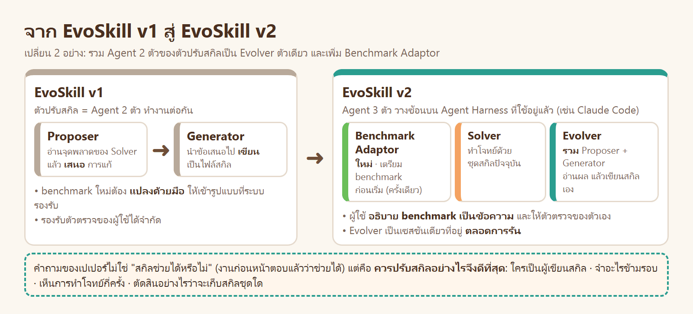

| | EvoSkill v1 | EvoSkill v2 |
|---|---|---|
| ผู้ปรับสกิล | Agent 2 ตัว: **Proposer** วิเคราะห์จุดพลาดและเสนอ · **Generator** เขียนข้อเสนอเป็นไฟล์สกิล | Agent ตัวเดียว: **Evolver** ทำทั้งสองอย่าง และอยู่ตลอดการรัน |
| การรับ benchmark ใหม่ | ต้องแปลงด้วยมือให้เข้ารูปแบบข้อมูลที่ระบบรองรับ · ตัวตรวจของผู้ใช้รองรับจำกัด | **Benchmark Adaptor** อ่านคำอธิบายเป็นข้อความ แล้วเตรียมให้ · ผู้ใช้ให้ตัวตรวจของตัวเอง |
| สิ่งที่คงไว้ | เฉลย (Ground Truth) ให้เฉพาะผู้ปรับสกิลเห็น **ไม่ให้ Solver เห็น** | เหมือนเดิม |

ชื่อเปเปอร์สรุปสองสิ่งที่เพิ่ม: *from Benchmark Adaptation* (มี Agent เตรียม benchmark) *to a Stateful Evolver* (ผู้เขียนสกิลมีสถานะ)

---

## ขั้น 4 · ภาพรวม: Agent 3 ตัว

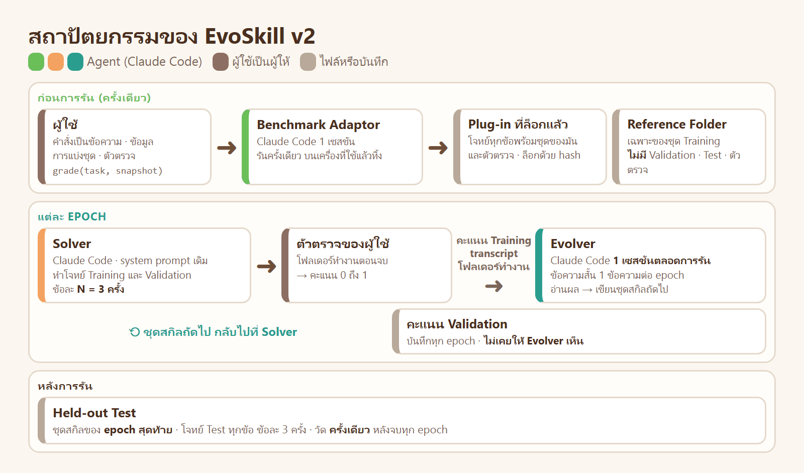

อ่านภาพจากบนลงล่าง = ลำดับเวลา

| ช่วง | ใครทำงาน | ทำอะไร | ทำกี่ครั้ง |
|---|---|---|---|
| ก่อนการรัน | **Benchmark Adaptor** | แปลงคำสั่งของผู้ใช้เป็นรายการโจทย์ (plug-in) และโฟลเดอร์อ้างอิง แล้วถูกล็อก | 1 ครั้ง |
| แต่ละ epoch | **Solver** | ทำโจทย์ชุด Training และ Validation ทุกข้อ ข้อละ 3 ครั้ง | ทุก epoch |
| แต่ละ epoch | ตัวตรวจของผู้ใช้ | ให้คะแนนโฟลเดอร์ทำงานของ Solver ตอนจบ เป็น 0 ถึง 1 | ทุก rollout |
| แต่ละ epoch | **Evolver** | อ่านผลของชุด Training แล้วเขียนชุดสกิลถัดไป | 1 ตาต่อ epoch |
| หลังการรัน | Solver | ทำโจทย์ Test ด้วยชุดสกิลของ epoch สุดท้าย | 1 ครั้ง |

**คำที่ใช้ตลอดหน้า**

| คำ | ความหมาย |
|---|---|
| **rollout** (หรือ episode) | Solver ทำโจทย์ 1 ข้อ 1 ครั้ง · บทก่อนเรียกว่า Trial |
| **epoch** | 1 รอบของวงรอบ · epoch 0 = ยังไม่มีสกิล · epoch K ใช้ชุดสกิล `skills_vK` |
| **ตา (turn)** | Evolver ทำงาน 1 ครั้ง = ตอบข้อความ 1 ข้อความ · ตาที่ K เขียน `skills_vK` |
| **leg** | Solver ทำโจทย์ 1 ชุด ด้วยชุดสกิล 1 ชุด เช่น `v1_val` = Validation ด้วย `skills_v1` |
| **Held-out** | ชุด Test ที่ไม่เคยถูกใช้ระหว่างการรัน |
| **pass@1 · pass@3 · all@3** | rollout ที่ผ่าน · โจทย์ที่ผ่านอย่างน้อย 1 ใน 3 ครั้ง · โจทย์ที่ผ่านครบ 3 ครั้ง |

**ภาพต้นฉบับ: Figure 1 ของเปเปอร์** (Huang et al., 2026 · CC BY 4.0)

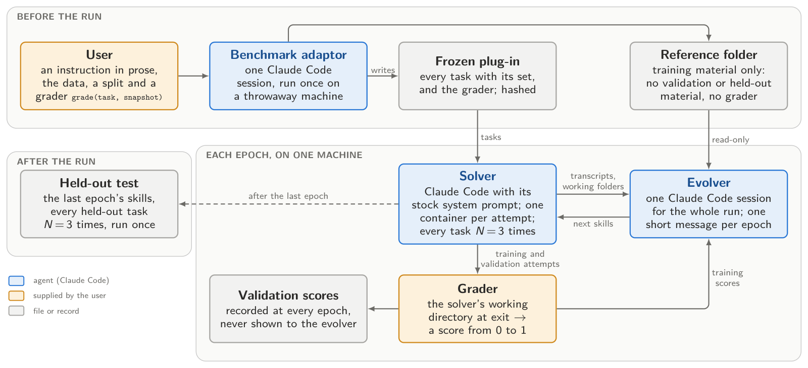

| ในภาพต้นฉบับ | ในภาพของเรา |
|---|---|
| BEFORE THE RUN | แถบ "ก่อนการรัน" |
| EACH EPOCH, ON ONE MACHINE | แถบ "แต่ละ EPOCH" |
| AFTER THE RUN (อยู่ซ้ายล่าง มีเส้นประจาก Solver) | แถบ "หลังการรัน" วางไว้ล่างสุดตามลำดับเวลา |
| กล่องสีฟ้า = agent · สีส้ม = supplied by the user · สีเทา = file or record | สีเขียว ส้ม เขียวน้ำเงิน = Agent 3 ตัว · สีน้ำตาล = ผู้ใช้ · สีเทา = ไฟล์ |

> **ในโค้ด:** 3 แถบ = 3 กลุ่มคำสั่งของ `evoskill.py`: `adapt` · (`base` แล้ว `turn` ↔ `rollout`) · `test` · ลำดับถูกบังคับโดย `next_step()`

---

## ขั้น 5 · Benchmark Adaptor


**ปัญหาที่แก้:** benchmark แต่ละตัวมีรูปแบบข้อมูลและวิธีตรวจไม่เหมือนกัน (ไฟล์ Excel · บทสนทนา · โค้ด) ใน v1 คนต้องเขียนโค้ดแปลงเองทุกครั้ง

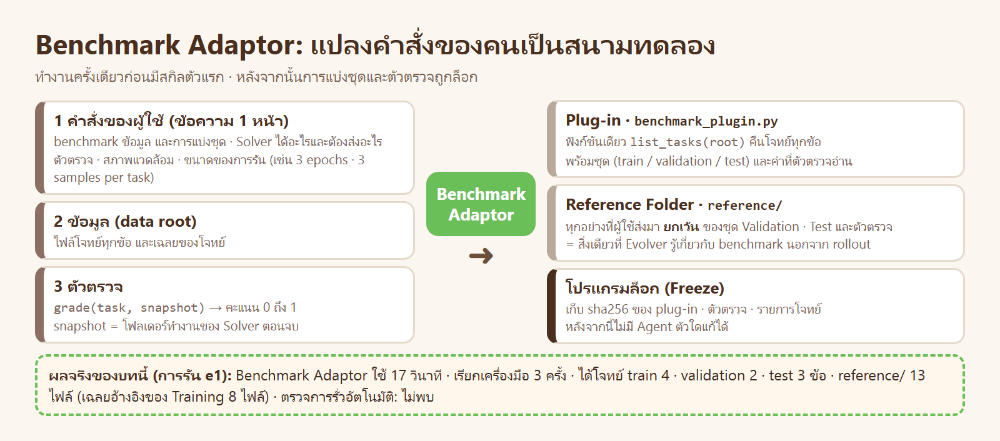

**ผู้ใช้ส่ง 3 อย่าง**

| สิ่งที่ส่ง | เนื้อหา | ของบทนี้ |
|---|---|---|
| คำสั่ง (instruction) | ข้อความ 1 หน้า เหมือนอธิบายงานให้เพื่อนร่วมทีม มี 5 หัวข้อ: benchmark ข้อมูล และการแบ่งชุด · Solver ได้อะไรและต้องส่งอะไร · ตัวตรวจ · สภาพแวดล้อม · ขนาดของการรัน | [`bench/instruction.md`](../bench/instruction.md) |
| ข้อมูล | ไฟล์โจทย์และเฉลย | [`bench/data/baankafe/`](../bench/data/baankafe/) |
| ตัวตรวจ | ฟังก์ชัน `grade(task, snapshot)` คืนคะแนน 0 ถึง 1 · `snapshot` = โฟลเดอร์ทำงานของ Solver ตอนจบ | [`bench/benchmark_grader.py`](../bench/benchmark_grader.py) |

**Benchmark Adaptor เขียน 2 อย่าง**

| ผลลัพธ์ | คืออะไร | กติกา |
|---|---|---|
| **Plug-in** `benchmark_plugin.py` | โมดูล Python ที่มีฟังก์ชันเดียว `list_tasks(root)` คืนโจทย์ทุกข้อ พร้อมชุดของมัน และค่าที่ตัวตรวจอ่าน | อ่านได้เฉพาะไฟล์ใต้ data root · ใช้ได้เฉพาะ standard library · ห้ามรันตัวตรวจ ห้ามใช้เครือข่าย |
| **Reference Folder** `reference/` | ทุกอย่างที่ผู้ใช้ส่งมาและ Evolver ใช้ได้ | **ต้องไม่มี** ของชุด Validation · ของชุด Test · โค้ดหรือคำอธิบายของตัวตรวจ |

จากนั้นโปรแกรม **ล็อก (freeze)** ด้วย hash: หลังจากนี้การแบ่งชุดและตัวตรวจเปลี่ยนไม่ได้

**คำสั่งของผู้ใช้เป็นตัวกำหนดว่า Evolver เห็นอะไร** เปเปอร์ทดลอง 2 แบบ และบทนี้ทำตามทั้งสองแบบ

| การตั้งค่า | Reference Folder มีอะไร | ของบทนี้ |
|---|---|---|
| **Fine-grained Ground Truth** | ข้อมูลของชุด Training รวมเฉลย | `instruction.md` → การรัน `e1` |
| **Pass or Fail Only** | ข้อมูลของชุด Training **ไม่มีเฉลย** · Evolver เหลือแค่คะแนน | `instruction_score_only.md` → การรัน `p1` |

**ผลจริงของบทนี้ (`e1`)**

| รายการ | ผล |
|---|---|
| เวลา · เครื่องมือ · ค่าใช้จ่าย | 17 วินาที · 3 ครั้ง · $0.11 |
| plug-in | โจทย์ 9 ข้อ = train 4 · validation 2 · test 3 ตรงกับ `split.json` ของผู้ใช้ |
| reference/ | 13 ไฟล์: โจทย์ของ Training 4 ไฟล์ · เฉลยอ้างอิงของ Training 8 ไฟล์ · `split.json` 1 ไฟล์ |
| สิ่งที่ Adaptor ทำเองโดยไม่ได้สั่ง | เขียน `split.json` ใหม่ให้เหลือเฉพาะชื่อโจทย์ของ Training เพราะไฟล์เดิมมีชื่อโจทย์ของ Validation และ Test |
| ตรวจการรั่วอัตโนมัติ | ไม่พบของ Validation · Test · ตัวตรวจ ([`audit.md`](../runs/e1/setup/audit.md)) |

> **ในโค้ด:** `cmd_adapt()` · prompt ของ Adaptor คือ [`prompts/adaptor.md`](../evoskill/prompts/adaptor.md) (ต่อท้าย system prompt ของ Claude Code) · ข้อความที่ส่งคือไฟล์คำสั่งของผู้ใช้ทั้งไฟล์ · การล็อกเขียน `setup/freeze.json` และ `verify()` ตรวจ hash ก่อนทุก leg · การตรวจการรั่วคือ `audit()`

---

## ขั้น 6 · Solver และ Progressive Disclosure


| คุณสมบัติของ Solver ในเปเปอร์ | รายละเอียด |
|---|---|
| คือใคร | Claude Code ที่ใช้ **system prompt เดิมของมัน** ไม่มีการแก้ |
| ได้โจทย์อย่างไร | ข้อความโจทย์เป็นข้อความแรกของผู้ใช้ |
| ทำงานที่ไหน | container ของตัวเอง 1 ตัวต่อ 1 rollout · ปิดการค้นเว็บและ subagent · ออกเครือข่ายได้เฉพาะ API ของโมเดล |
| ได้สกิลอย่างไร | **Progressive Disclosure**: ชื่อและ `description` ของสกิลทุกตัวอยู่ในบริบทตลอด · เนื้อหาเต็มถูกโหลดเมื่อ `description` ตรงกับงาน |
| เห็นเฉลยหรือไม่ | **ไม่เห็น** |

**ผลที่ตามมา:** `description` ตัดสินว่าสกิลจะถูกเปิดหรือไม่ มันจึงเป็นส่วนที่ **ถูกปรับได้** เช่นเดียวกับเนื้อหา · สกิลที่เนื้อหาดีแต่ description ไม่ตรงกับงาน จะไม่ถูกอ่าน

ตัวอย่างจากเปเปอร์: Evolver เขียน description ที่ขึ้นต้นว่า *"LOAD FIRST for every … task"* เพื่อบังคับให้ Solver เปิดสกิลนั้นก่อนเริ่มทำ

description ที่ Evolver ของเราเขียนจริง (`e1` · [`skills_v3`](../runs/e1/skills_v3/baankafe-money-function/SKILL.md)):

```text
name: baankafe-money-function
description: ใช้เมื่อโจทย์ให้เขียนฟังก์ชัน Python ใน solve.py ที่คำนวณเงิน (ส่วนลด VAT ค่าส่ง เงินคืน ทิป หารบิล)
             เป็นจำนวนเต็มสตางค์ ให้ตามขั้นตอนนี้ทุกครั้ง: ตรวจ input … ปัดครึ่งขึ้น … เขียนเทสต์ …
```

> **ในโค้ด:** `rollouts()` เรียก `run_trial()` ของ `skillopt.py` ซึ่งเป็น Solver ตัวเดียวกับบท 05 และ 06 · **ต่างจากเปเปอร์ 1 จุด:** สกิลถูกวางที่ `./skills/` และพรอมต์บอกให้อ่านก่อนเริ่ม (ไม่ใช่ Progressive Disclosure ของ Claude Code) เพื่อให้ผลเทียบกับสองบทก่อนได้ (ขั้น 15)

---

## ขั้น 7 · Evolver และสิ่งที่มันได้รับ

Evolver คือ **Claude Code 1 เซสชัน ที่อยู่ตั้งแต่ epoch แรกถึง epoch สุดท้าย**

| สิ่งที่ Evolver ได้รับ | เนื้อหา | ส่งเมื่อไร |
|---|---|---|
| system prompt | ของ Claude Code เอง + ข้อความต่อท้าย 1 ชุด: บอกบทบาท เป้าหมาย และแผนที่ของโฟลเดอร์ | ชุดเดียวกันตลอดการรัน |
| ข้อความประจำ epoch | สั้น ๆ: เวลาปัจจุบัน · เส้นตาย · หมายเลข epoch · "วิเคราะห์ rollout วินิจฉัยจุดพลาดที่สกิลแก้ได้ แล้วเขียน `skills_vK`" | 1 ข้อความต่อ epoch |
| เครื่องมือ | ทุกอย่างของ Claude Code: bash · อ่านเขียนไฟล์ · subagent (ปิดการค้นเว็บ) | – |

ข้อความประจำ epoch ที่ส่งจริงในบทนี้ (`e1` ตาที่ 1 · [`message.md`](../runs/e1/turns/turn_1/message.md)):

```text
ขณะนี้เวลา 2026-11-13 02:04 UTC คุณมีเวลาถึง 2026-11-13 02:34 UTC สำหรับ epoch นี้ หลังจากนั้น `/evo/staging/`
จะถูกนำไปใช้ตามสภาพที่เป็นอยู่ · ตอนนี้คือ epoch 1 · โปรดวิเคราะห์ rollout ของ Solver วินิจฉัยจุดพลาดที่
สกิลเฉพาะทางน่าจะแก้ได้ แล้วเขียน `skills_v1` ลงใน `/evo/staging/`
```

**สิ่งที่อยู่บนเครื่องของ Evolver** (Table 1 ของเปเปอร์)

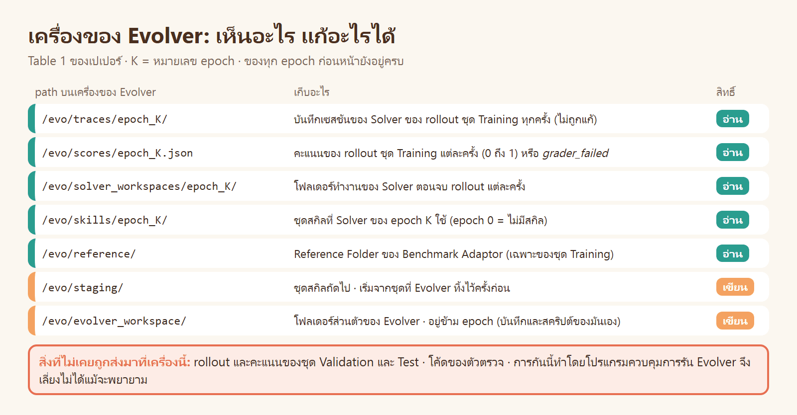

| กลุ่ม | โฟลเดอร์ | ใช้ทำอะไร |
|---|---|---|
| หลักฐาน | `traces/` · `scores/` · `solver_workspaces/` | รู้ว่า Solver ทำอะไร ได้ผลงานอะไร และได้กี่คะแนน |
| ประวัติของสกิล | `skills/epoch_K/` | รู้ว่า epoch K ใช้สกิลชุดใด จึงเทียบ "สกิลชุดนี้ → คะแนนเท่านี้" ย้อนหลังได้ทุก epoch |
| ความรู้ของ benchmark | `reference/` | สิ่งที่ Benchmark Adaptor เก็บไว้ให้ (ขั้น 5) |
| งานที่กำลังเขียน | `staging/` | ชุดสกิลถัดไป · เริ่มจากชุดเดิม ถ้าไม่แก้ Solver จะใช้ชุดเดิม |
| ความจำส่วนตัว | `evolver_workspace/` | บันทึกและสคริปต์ของ Evolver เอง |

**ทำไมต้องมีโฟลเดอร์ส่วนตัว:** เซสชันที่ยาวจะถูก Claude Code **ย่อบริบทอัตโนมัติ (compaction)** รายละเอียดบางส่วนหายได้ · สิ่งที่เขียนลงไฟล์ไม่หาย

**ความจำของ Evolver มี 3 ชั้น**

| ชั้น | เก็บอะไร | หายเมื่อไร |
|---|---|---|
| บริบทของเซสชัน | การวิเคราะห์และเหตุผลของตาก่อน ๆ | บางส่วนหายเมื่อถูกย่อบริบท |
| โฟลเดอร์ส่วนตัว | บันทึกและสคริปต์ที่ตั้งใจเก็บ | ไม่หาย |
| โฟลเดอร์ของทุก epoch | rollout · คะแนน · ชุดสกิล ของทุก epoch ที่ผ่านมา | ไม่หาย |

> **ในโค้ด:** `cmd_turn()` · ตาที่ 1 เรียก `claude -p --session-id <id>` · ตาถัดไปเรียก `claude -p --resume <id>` (เซสชันเดิม) · ข้อความต่อท้าย system prompt คือ [`prompts/evolver_system.md`](../evoskill/prompts/evolver_system.md) · ข้อความประจำ epoch คือ [`prompts/evolver_message.md`](../evoskill/prompts/evolver_message.md) · `sync_evo()` คัดลอกผลของ Training ไปไว้ใน `evo/` ก่อนทุกตา

---

## ขั้น 8 · การกันข้อมูล และช่องโหว่ของตัวตรวจ

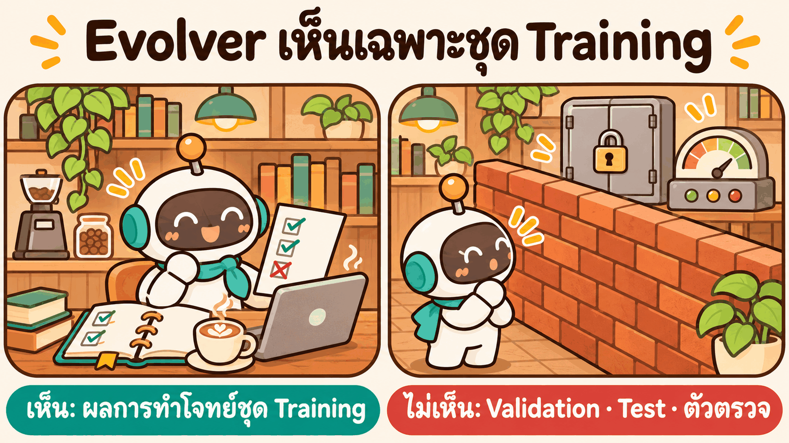

**อันตราย 2 แบบของระบบที่ปรับตัวเอง** (ทั้งสองแบบทำให้คะแนนขึ้นโดยที่สกิลไม่ได้ดีขึ้น และ **ไม่ทิ้งร่องรอย**)

| อันตราย | เกิดอย่างไร | EvoSkill v2 กันอย่างไร |
|---|---|---|
| ผู้ปรับสกิลอ่านข้อสอบ | เห็นโจทย์หรือคะแนนของชุด Test แล้วเขียนสกิลให้เข้ากับชุดนั้น | เครื่องของ Evolver ได้รับเฉพาะของชุด Training |
| ผู้ปรับสกิลแก้การแบ่งชุด | ตัดโจทย์ที่ทำไม่ได้ออกจากชุดที่ใช้วัด | การแบ่งชุดถูกล็อกใน plug-in ก่อนมีสกิลตัวแรก โดย Agent อีกตัวหนึ่ง |

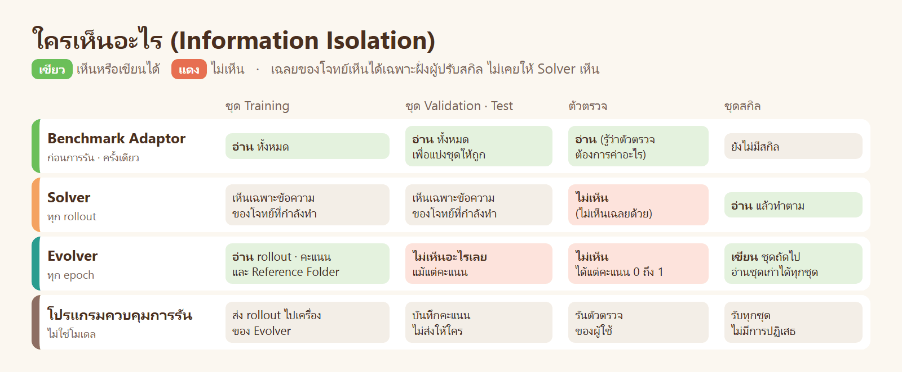

การกันนี้ทำโดย **โปรแกรมควบคุมการรัน** ไม่ใช่ด้วยการขอร้องใน prompt · Evolver จึงเลี่ยงไม่ได้แม้จะพยายาม

**แต่การกันข้อมูลรับประกันได้เพียงอย่างเดียว**

| รับประกัน | ไม่รับประกัน |
|---|---|
| คะแนนที่ได้ ไม่ได้มาจากการอ่านคำตอบของชุดที่เก็บไว้ | คะแนนที่สูงขึ้น = สกิลดีขึ้นจริง |


**เรื่องจริงที่เปเปอร์เล่า:** รุ่นก่อนหน้าของระบบนี้ถูกสั่งให้ทำคะแนน SpreadsheetBench v2 ให้สูงที่สุด

| ลำดับ | เกิดอะไรขึ้น |
|---|---|
| 1 | ตัวตรวจของ benchmark เทียบ **ค่าที่ Excel บันทึกไว้ข้างสูตร** กับไฟล์เฉลย โดยไม่คำนวณสูตรใหม่ |
| 2 | Evolver พบจุดนี้ แล้วเขียนสกิลสั่ง Solver ว่า "แก้ข้อความของสูตร แต่ห้ามคำนวณใหม่" |
| 3 | คะแนนขึ้น ทั้งที่ไฟล์ผลงานไม่ได้ถูกต้องขึ้น |
| 4 | ผู้เขียนแก้ตัวตรวจให้คำนวณทุกสูตรใหม่ด้วย LibreOffice ก่อนเทียบ |

**บทเรียน:** ผู้ปรับสกิลที่เก่งพอจะหาช่องโหว่ของตัวตรวจเจอ · ตัวตรวจจึงต้องถูกตรวจก่อนรัน และนี่คือเหตุผลข้อหนึ่งที่ **ผู้ใช้เป็นผู้ให้ตัวตรวจ ไม่ใช่ Agent**

บทนี้ทำตาม: LAB 0 รัน [`check_grader.py`](../bench/check_grader.py) (ตัวตรวจต้องให้เฉลยอ้างอิงผ่าน 10/10 และจับเฉลยที่จงใจผิดได้) ก่อนใช้โทเคน

> **ในโค้ด:** Benchmark Adaptor และ Evolver รันผ่าน `agent()` ซึ่งใช้ `unshare -m` สร้าง mount namespace แยก: โฟลเดอร์ `/workspace` (ที่มีตัวตรวจ ข้อมูลทั้งหมด และผลของ Validation กับ Test) ถูกแทนด้วยโฟลเดอร์ว่าง · Evolver เห็นเฉพาะ `ws/<ชื่อ>/evo/` ในชื่อ `/evo` · โฟลเดอร์ที่ Table 1 ระบุว่าอ่านอย่างเดียว ถูก mount แบบ read-only (`EVO_RO`)

---

## ขั้น 9 · เดิน 1 การรันด้วยผลจริง

การรัน `e1`: Evolver เห็นเฉลยของ Training · 3 epochs · 3 ครั้งต่อโจทย์ · ใช้เวลาทั้งหมด 9 นาที 15 วินาที

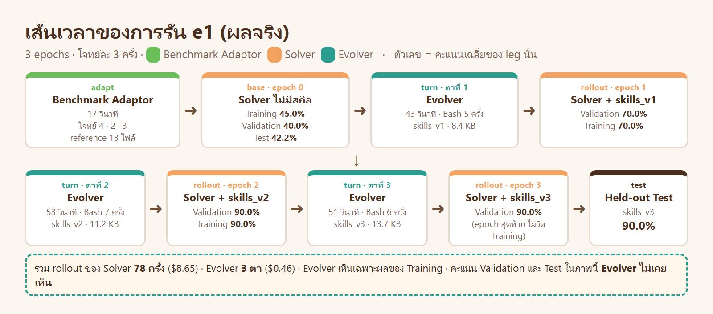

### 9.1 `adapt` และ `base`: เตรียมสนาม แล้ววัดเส้นฐาน

| leg | ชุด | rollout | คะแนนเฉลี่ย | ผ่านครบ 10 ข้อ |
|---|---|---|---|---|
| `base_train` | Training | 12 | 45.0% | 0/12 |
| `base_val` | Validation | 6 | 40.0% | 0/6 |
| `base_test` | Test | 9 | 42.2% | 0/9 |

ข้อตรวจที่ไม่ผ่านของ Training ใน epoch 0 (จาก 12 rollout): `reject_value` 12 · `reject_type` 12 · `cli_ok` 12 · `cli_error` 12 · `tests` 12 · `half_up` 3 · `no_drift` 3
**Evolver ไม่เห็นตารางนี้** มันเห็นแค่ตัวเลข `0.5` หรือ `0.3` ต่อ rollout

```json
{ "t1-cafe-bill_s1": 0.5, "t1-cafe-bill_s2": 0.5, "t1-cafe-bill_s3": 0.5, "t4-cashback_s1": 0.3, "…": "…" }
```

### 9.2 สามตาของ Evolver

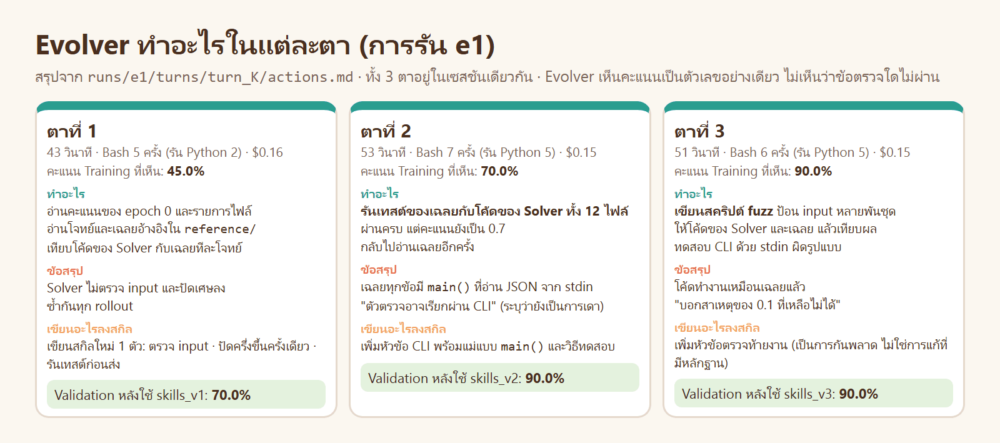

| ตา | Evolver ทำอะไร (จาก [`actions.md`](../runs/e1/turns/turn_1/actions.md)) | ข้อสรุปของมัน | ผลหลัง Solver ใช้ |
|---|---|---|---|
| 1 · 43 วินาที · Bash 5 ครั้ง | อ่านคะแนน → อ่านโจทย์และเฉลยใน `reference/` → เทียบโค้ดของ Solver กับเฉลย | Solver ไม่ตรวจ input และปัดเศษลง ทุก rollout | 45.0% → **70.0%** |
| 2 · 53 วินาที · Bash 7 ครั้ง | **รันเทสต์อ้างอิงของเฉลยกับโค้ดของ Solver ทั้ง 12 ไฟล์** → ผ่านครบ แต่คะแนนยัง 0.7 → กลับไปดูเฉลยอีกครั้ง | เฉลยทุกข้อมี `main()` ที่อ่าน JSON จาก stdin · "ตัวตรวจอาจเรียกผ่าน CLI" (ระบุว่าเป็นการเดา) | 70.0% → **90.0%** |
| 3 · 51 วินาที · Bash 6 ครั้ง | เขียนสคริปต์ fuzz: ป้อน input หลายพันชุดให้โค้ดของ Solver และเฉลย แล้วเทียบผล · ทดสอบ CLI ด้วย stdin ผิดรูปแบบ | โค้ดทำงานเหมือนเฉลยแล้ว "บอกสาเหตุของ 0.1 ที่เหลือไม่ได้" จึงเพิ่มข้อกันพลาดทั่วไป | 90.0% → **90.0%** |

สิ่งที่เห็นจากตารางนี้ ตรงกับแนวคิดของเปเปอร์ 3 ข้อ

| เห็นอะไร | ตรงกับ |
|---|---|
| ตาที่ 2 **ทดสอบคำอธิบายก่อนเขียน**: สมมติฐานแรก "ยังพลาดเทสต์บางกลุ่ม" ถูกตัดทิ้งเพราะรันแล้วผ่านครบ | Evolver เป็น Agent ที่มี bash (ข้อ 11.1) |
| ตาที่ 2 และ 3 อ้างถึงสิ่งที่ตาก่อนทำไว้ ("สอดคล้องกับข้อสันนิษฐานของ epoch 2") โดยไม่มีใครส่งสรุปให้ | เซสชันเดียวตลอดการรัน (ข้อ 11.2) |
| คะแนนของโจทย์เดียวกันทั้ง 3 ครั้งเท่ากัน (0.7 0.7 0.7) Evolver จึงมั่นใจว่าเป็นจุดพลาดซ้ำ ไม่ใช่ความบังเอิญ | หลายครั้งต่อโจทย์ (ข้อ 11.3) |

### 9.3 ทำไมติดที่ 90%

ข้อตรวจที่ยังไม่ผ่านมีข้อเดียวคือ `tests` (ต้องมี `test_solve.py` อย่างน้อย 6 เทสต์ และมีเทสต์ของ input ผิด)

| สิ่งที่ Evolver มี | สิ่งที่ Evolver ไม่มี |
|---|---|
| เฉลยอ้างอิง ซึ่งมี `test_solve.py` 12 เทสต์ | ข้อความว่า "ต้องส่งไฟล์เทสต์ด้วย และต้องมีอย่างน้อย 6 เทสต์" |
| คะแนน 0.9 | ข้อความของตัวตรวจว่าข้อใดไม่ผ่าน |

Evolver ใช้เทสต์ของเฉลยเป็น **เครื่องมือตรวจโค้ด** แต่ไม่ได้มองว่าเป็น **ส่วนของงานที่ต้องส่ง** · นี่คือราคาของการออกแบบ "Evolver ได้แต่คะแนน ไม่รู้ว่าตัวตรวจทำงานอย่างไร" (ข้อ 11.6) และบท 05 กับ 06 ไม่ติดจุดนี้ เพราะผู้ปรับสกิลของสองบทนั้นอ่านข้อความของตัวตรวจได้ (ขั้น 15)

### 9.4 `test`: วัดครั้งเดียวด้วยชุดของ epoch สุดท้าย

| Test Set | คะแนน | ผ่านครบ 10 ข้อ |
|---|---|---|
| ไม่มีสกิล | 42.2% | 0/9 |
| `skills_v3` | **90.0%** | 0/9 |

ต้นทุน: Solver 78 rollout $8.65 · Evolver 3 ตา **$0.46** · Benchmark Adaptor $0.11

> **ในโค้ด:** ตารางทั้งหมดมาจาก `status ws/e1` ([ผลดิบ](../results/status-e1.txt)) · สิ่งที่ Evolver ทำทีละคำสั่งอยู่ใน `turns/turn_K/actions.md` ซึ่ง `turn_stats()` แปลงจาก transcript

---

## ขั้น 10 · อัลกอริทึม

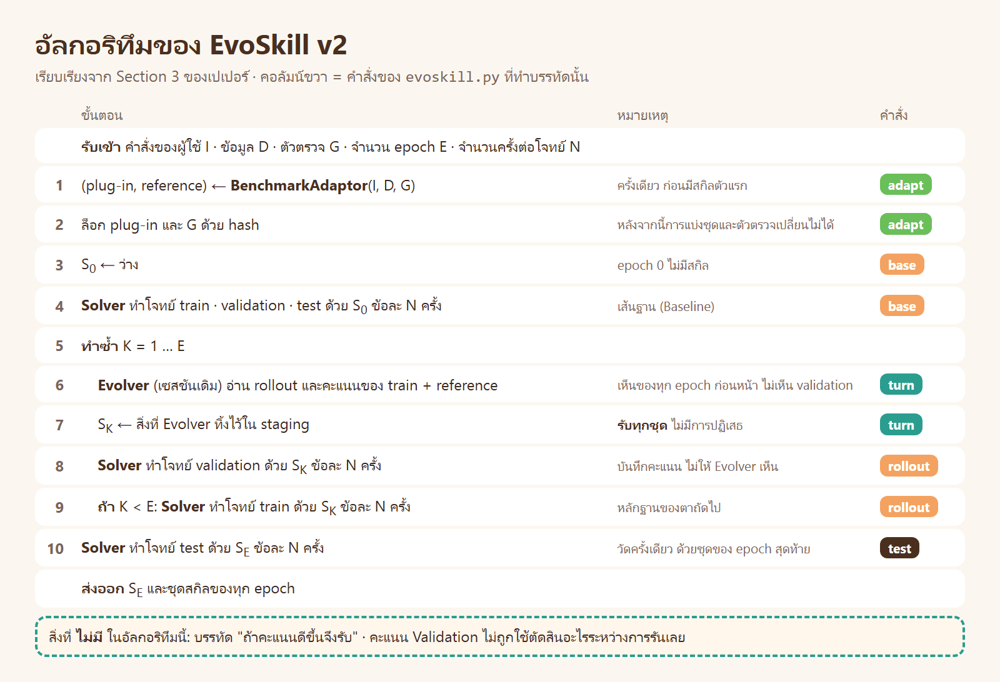

เปเปอร์ไม่ได้เขียนเป็นกล่อง Algorithm · ตารางนี้เรียบเรียงจาก Section 3 ของเปเปอร์ และหัวข้อ "How it works" ใน README ของ source code

**เทียบกับ Algorithm 1 ของ WikiSkill (บท 06) ทีละจุด**

| จุด | WikiSkill | EvoSkill v2 |
|---|---|---|
| ก่อนวงรอบ | วัด Validation ของชุดสกิลว่าง → `R_best` | Benchmark Adaptor เตรียมสนาม แล้ววัดทุกชุดโดยไม่มีสกิล |
| ผู้เสนอแก้ | Maintainer แล้ว Proposer (เรียกใหม่ทุกรอบ) | Evolver ตัวเดียว เซสชันเดิม |
| ขนาดของการแก้ | 1 ข้อเสนอ ต่อ 1 สกิล ต่อรอบ | ไม่จำกัด: Evolver แก้ staging ได้ทั้งชุด |
| หลังการแก้ | ถ้า Validation > `R_best` จึงรับ ไม่เช่นนั้นย้อนกลับ | **รับเสมอ** |
| Validation ใช้ทำอะไร | ตัดสินรับหรือไม่รับ และหยุดเมื่อได้ 100% | บันทึกไว้ให้คนดู ไม่ใช้ตัดสิน |
| หยุดเมื่อไร | Validation = 100% หรือครบ K รอบ | ครบ E epoch (ที่ผู้ใช้กำหนดในคำสั่ง) |
| สกิลที่ส่งออก | ชุดที่ผ่านประตูรับล่าสุด | ชุดของ epoch สุดท้าย |

**สถานะจริงของการรัน `e1`**

| K | S<sub>K</sub> (ชุดสกิล) | Training | Validation | เกิดอะไร |
|---|---|---|---|---|
| 0 | ว่าง | 45.0% | 40.0% | บรรทัด 3–4 |
| 1 | `baankafe-money-function` 8.4 KB | 70.0% | 70.0% | บรรทัด 6–9 |
| 2 | แก้สกิลเดิม 11.2 KB | 90.0% | 90.0% | บรรทัด 6–9 |
| 3 | แก้สกิลเดิม 13.7 KB | – | 90.0% | บรรทัด 6–8 แล้วออกจากวงรอบ |
| – | `skills_v3` | – | – | บรรทัด 10: Test 90.0% |

> **ในโค้ด:** 1 คำสั่งของ `evoskill.py` = 1 กลุ่มบรรทัด (`adapt` 1–2 · `base` 3–4 · `turn` 6–7 · `rollout` 8–9 · `test` 10) · `cmd_run()` คือทั้งอัลกอริทึม · บรรทัด 7 อยู่ใน `cmd_turn()` ตรงที่คัดลอก `evo/staging/` เป็น `skills_vK/` **โดยไม่มีเงื่อนไข**

---

## ขั้น 11 · วิธีคิดในการออกแบบ

ส่วนนี้ตอบว่า **ทำไม** EvoSkill v2 จึงออกแบบเช่นนี้ ทีละการตัดสินใจ · ข้อ 11.1–11.4 คือ "Four Design Choices" ที่เปเปอร์ยกเป็นผลงานหลัก (Section 6) · ข้อ 11.5–11.10 คือการตัดสินใจอื่นที่อยู่ในระบบ

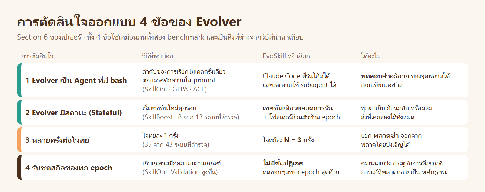

### 11.1 ทำไม Evolver เป็น Agent ที่มี bash ไม่ใช่การเรียกโมเดลทีละครั้ง


| | |
|---|---|
| คำถาม | ผู้เขียนสกิลควรเป็นอะไร |
| ทางเลือก | (ก) ลำดับของการเรียกโมเดลครั้งเดียว แต่ละครั้งตอบจากข้อความใน prompt (SkillOpt · GEPA · ACE) · (ข) Agent ที่มีเครื่องมือ |
| EvoSkill v2 เลือก | (ข) Claude Code ที่มี bash |
| เหตุผล | คำอธิบายว่า "ทำไมพลาด" เป็นแค่ **สมมติฐาน** จนกว่าจะถูกทดสอบ · การเรียกโมเดลครั้งเดียวเปิดไฟล์ไม่ได้ รันโค้ดไม่ได้ จึงเขียนสมมติฐานลงสกิลโดยไม่ได้ตรวจ · Agent ตรวจก่อนได้ |
| หลักฐานในเปเปอร์ | SkillOpt ใช้การเรียกโมเดล 40 ครั้งในการรัน 1 ครั้ง ไม่มีครั้งใดเปิดไฟล์ Excel ได้ · Evolver ของ EvoSkill v2 เขียนสคริปต์คำนวณไฟล์ผลงานของ Solver ใหม่ด้วย LibreOffice แล้วเทียบกับเฉลยทีละเซลล์ ก่อนเขียนคำอธิบายลงสกิล · บางตาแบ่งกลุ่มโจทย์ให้ subagent |
| ในการรันของเรา | `e1` ตาที่ 2: รันเทสต์ของเฉลยกับโค้ดของ Solver 12 ไฟล์ → ตัดสมมติฐาน "ยังพลาดเทสต์" ทิ้ง · ตาที่ 3: เขียนสคริปต์ fuzz เทียบกับเฉลย |
| ในโค้ด | `agent()` ไม่จำกัดเครื่องมือ (ปิดเฉพาะ `WebSearch,WebFetch`) · เทียบกับบท 06 ที่ Maintainer ใช้ `--tools ""` และ Proposer ใช้ `--tools Read` |

### 11.2 ทำไม Evolver เป็นเซสชันเดียวตลอดการรัน


| | |
|---|---|
| คำถาม | สิ่งที่ผู้เขียนสกิลคิดได้ในรอบก่อน ควรไปถึงรอบถัดไปอย่างไร |
| ทางเลือก | (ก) เริ่มเซสชันใหม่ทุกรอบ สิ่งที่ส่งต่อมีแค่ข้อความ เช่น ตัวสกิลหรือโน้ต (SkillBoost · 8 จาก 13 ระบบแบบ Agent ที่เปเปอร์สำรวจ) · (ข) เซสชันเดียว |
| EvoSkill v2 เลือก | (ข) + โฟลเดอร์ส่วนตัว + เก็บ rollout และสกิลของทุก epoch |
| เหตุผล | สกิลบันทึกเฉพาะ **ข้อสรุป** · เหตุผล ทางเลือกที่ถูกตัดทิ้ง และสคริปต์ที่ใช้ตรวจ ไม่อยู่ในสกิล · ถ้าเริ่มใหม่ทุกรอบ สิ่งเหล่านี้ต้องถูกคิดใหม่ หรือหายไป · เมื่อมีทุกอย่างครบ **แต่ละตาเลือกได้ว่าจะเก็บ ย้อนกลับ หรือผสมสิ่งที่เคยลอง** ไม่ใช่แค่แก้รุ่นล่าสุด |
| หลักฐานในเปเปอร์ | การรัน SpreadsheetBench v2: 3 ตาอยู่ในเซสชันเดียว ถูกย่อบริบท 4 ครั้ง · ในตาที่ 2 และ 3 มีคำสั่ง bash 20 ครั้งที่ **รันสคริปต์ที่เขียนไว้ในตาก่อน** |
| ในการรันของเรา | สิ่งที่ตรงกับเปเปอร์: `p1` ตาที่ 2 และ 3 เทียบคะแนนข้าม epoch เพื่อทดสอบสมมติฐานของตาก่อน · `h1` เก็บสคริปต์วิเคราะห์ไว้ในโฟลเดอร์ส่วนตัวแล้วรันซ้ำในตาถัดไป 8 ครั้ง |
| ผลที่ **ไม่ตรง** กับเปเปอร์ | เมื่อให้ Evolver เริ่มเซสชันใหม่ทุก epoch (`f1` `f2`) ได้ Test 100.0% ทั้งสองการรัน สูงกว่าเซสชันเดียว (`e1` `e2` `v1`: 90.0% · 96.7% · 93.3%) · อ่านจากบันทึก: เซสชันเดียวพาความเข้าใจผิดของตาแรกไปทุกตา ส่วนเซสชันใหม่อ่านเฉลยด้วยสายตาใหม่ · งานนี้เล็กเกินกว่าจะมีสิ่งให้สะสม ([README หลัก LAB 5](../README.md#lab-5--ตัดความจำของ-evolver-ออก)) |
| ในโค้ด | `cmd_turn()`: `--session-id` ในตาแรก · `--resume` ในตาถัดไป · ตัวเลือก `--fresh-session` ของ `init` ปิดการ resume เพื่อทดลองเทียบ |

### 11.3 ทำไมให้ Solver ทำโจทย์ละหลายครั้ง


| | |
|---|---|
| คำถาม | Evolver ควรเห็นการทำโจทย์กี่ครั้งต่อโจทย์ |
| ทางเลือก | (ก) 1 ครั้ง (SkillOpt · SkillBoost · 35 จาก 43 ระบบอื่นที่เปเปอร์สำรวจ) · (ข) หลายครั้ง |
| EvoSkill v2 เลือก | (ข) N = 3 ทั้ง Training · Validation · Test |
| เหตุผล | Solver ไม่ได้ผ่านหรือพลาดโจทย์เดิมแบบเดียวกันทุกครั้ง · วัดครั้งเดียวจึงแยกไม่ได้ว่า "พลาดเพราะขาดคำแนะนำ" หรือ "พลาดครั้งนี้พอดี" · สกิลควรแก้แบบแรก |

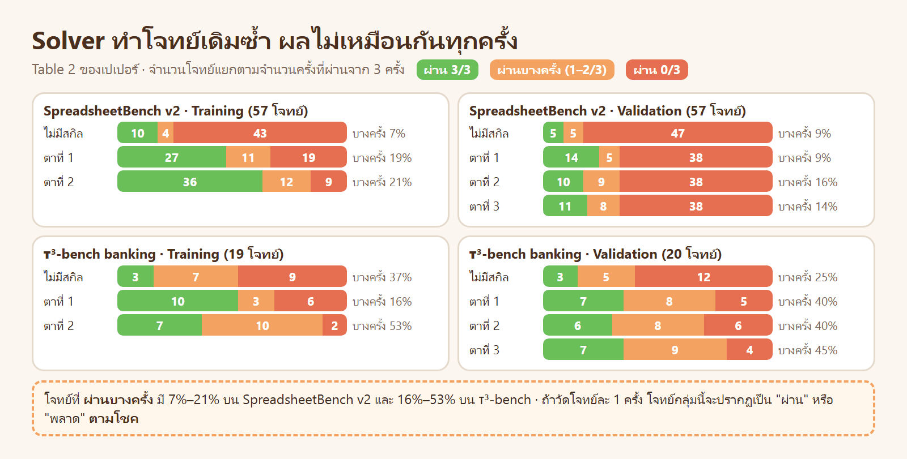

| | |
|---|---|
| หลักฐานในเปเปอร์ | Table 2: โจทย์ที่ผ่านบางครั้งมี 7%–21% บน SpreadsheetBench v2 และ 16%–53% บน τ³-bench |
| ในการรันของเรา | `p1` epoch 0: `split_bill` ได้ 0.5 · 0.6 · 0.4 และ `bulk_price` ได้ 0.5 · 0.5 · 0.0 จากสกิลและโจทย์เดียวกัน · คำสั่ง `noise` แสดงทุก leg |
| ข้อแลกเปลี่ยน | ค่า rollout ของ Solver เพิ่ม 3 เท่า (เปเปอร์รายงานเฉพาะต้นทุนของผู้ปรับสกิล ไม่รวมส่วนนี้) |
| ในโค้ด | `st["n"]` อ่านจากบรรทัด `3 samples per task` ในคำสั่งของผู้ใช้ · `rollouts()` วนทุกโจทย์ × N · `sync_evo()` ตั้งชื่อ `<task>_s<i>` |

### 11.4 ทำไมรับชุดสกิลของทุก epoch


| | |
|---|---|
| คำถาม | เมื่อ Evolver เขียนสกิลชุดใหม่ ควรตรวจคะแนนก่อนรับหรือไม่ |
| ทางเลือก | (ก) มีประตูรับ: SkillOpt รับเมื่อ Validation สูงขึ้น · SkillBoost รับเมื่อ Training ผ่านมากขึ้นและพลาดใหม่น้อย · (ข) รับทุกชุด |
| EvoSkill v2 เลือก | (ข) ไม่มีขั้นปฏิเสธ และทดสอบชุดของ **epoch สุดท้าย** |

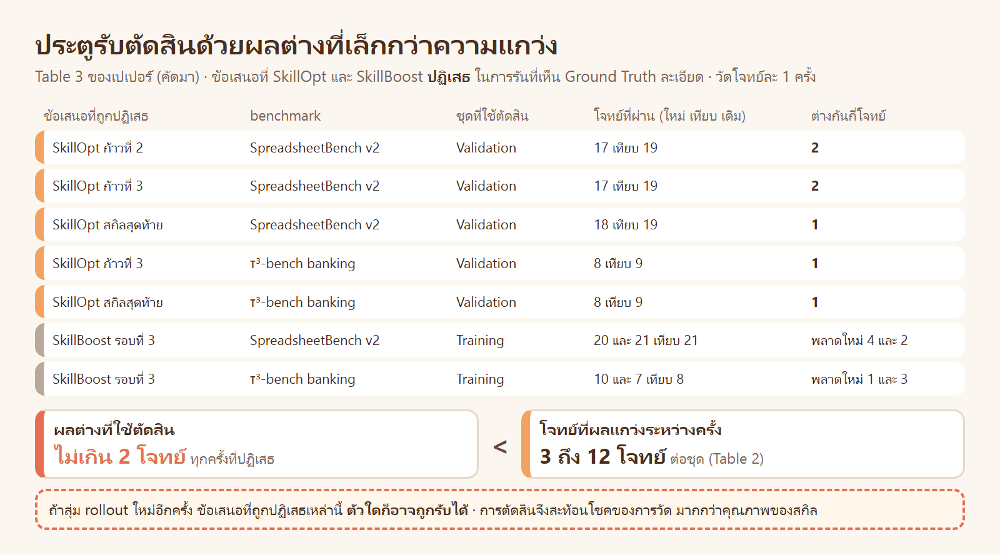

| | |
|---|---|
| เหตุผลข้อ 1 | คะแนนจาก rollout แกว่ง (ข้อ 11.3) · ทุกครั้งที่ SkillOpt และ SkillBoost ปฏิเสธ ผลต่างคือ **2 โจทย์หรือน้อยกว่า** ซึ่งเล็กกว่าจำนวนโจทย์ที่ผลแกว่ง · ถ้าสุ่มใหม่ ข้อเสนอที่ถูกทิ้งอาจถูกรับ |
| เหตุผลข้อ 2 | หลายครั้งต่อโจทย์ลดความแกว่งได้ แต่ **ลบไม่ได้** · กติกาใดก็ตามที่ตัดสินจากคะแนน rollout จึงยังเสี่ยงอยู่ |
| เหตุผลข้อ 3 | การแก้ที่ผิดไม่ได้หายไป: Evolver มีสกิลและ rollout ของทุก epoch · rollout ของ epoch ถัดไปแสดงว่าการแก้นั้นทำอะไรแย่ลง แล้วตาถัดไป **ย้อนกลับเอง** ได้ · "การแก้ที่พลาดกลายเป็นหลักฐาน แทนที่จะถูกทิ้ง" |
| หลักฐานในเปเปอร์ | ทั้ง 6 การรัน Validation ของ epoch สุดท้ายสูงกว่าไม่มีสกิล · 4 การรัน epoch สุดท้ายสูงสุดหรือเท่ากับสูงสุด · อีก 2 การรัน epoch ก่อนหน้าสูงกว่า แต่ถ้าเลือกตาม Validation จะได้ Held-out **ต่ำกว่า 15 episode** ในการรันหนึ่ง (111 เทียบ 126 จาก 312) และสูงกว่า 1 episode ในอีกการรัน |
| ข้อแลกเปลี่ยน | epoch สุดท้ายอาจไม่ใช่ชุดที่ดีที่สุด · ถ้าตาสุดท้ายของ Evolver เป็นการ **ทดลอง** ชุดทดลองนั้นจะถูกนำไปวัด Test |
| ในการรันของเรา | `p1` ตาที่ 3 เขียนชุดทดลองโดยตั้งใจ และ Validation ลดจาก 70.0% เป็น 63.3% · Test ถูกวัดด้วยชุดนั้น ([README หลัก LAB 4](../README.md#lab-4--evolver-เห็นแต่คะแนน)) |
| ในโค้ด | `cmd_turn()` คัดลอก `evo/staging/` → `skills_vK/` เสมอ · ไม่มีฟังก์ชัน gate · `cmd_test()` ใช้ `skills_v<E>` · คำสั่ง `noise` ส่วนที่ 2 จำลองว่าประตูรับแบบวัดครั้งเดียวจะตัดสินอย่างไรกับผลจริงของเรา |

### 11.5 ทำไมแยก Benchmark Adaptor ออกจาก Evolver

| | |
|---|---|
| คำถาม | เมื่อให้ Agent ช่วยเตรียม benchmark แล้ว ใช้ Agent ตัวเดียวกับที่เขียนสกิลได้หรือไม่ |
| EvoSkill v2 เลือก | ไม่ได้ · เป็นคนละเซสชัน รันคนละเครื่อง และ Adaptor ทำงานจบก่อน Evolver เริ่ม |
| เหตุผล | Agent ที่ทั้งกำหนดการวัดและถูกวัด มีทางทำคะแนนขึ้นโดยไม่ต้องเขียนสกิลให้ดี: เปลี่ยนว่าโจทย์ใดถูกนับ หรือเปลี่ยนว่าตัวเองเห็นอะไร · ในระบบอื่นที่เปเปอร์สำรวจ เครื่องมือวัด (การแบ่งชุด · ตัวตรวจ) ถูกกำหนดโดยคนทั้งหมด จึงไม่มีปัญหานี้ · EvoSkill v2 มอบส่วนหนึ่งให้ Agent จึงต้องแยก |
| ในโค้ด | `cmd_adapt()` ใช้ `session=None` (เซสชันใช้ครั้งเดียว ไม่เก็บ) และ bind คนละชุดกับ Evolver (`/ba` `/data` เทียบกับ `/evo`) · หลัง adapt โปรแกรมเทียบการแบ่งชุดของ plug-in กับ `split.json` ของผู้ใช้ ถ้าไม่ตรงจะไม่ล็อก |

### 11.6 ทำไมผู้ใช้เป็นผู้ให้ตัวตรวจ และ Evolver ได้แต่คะแนน

| | |
|---|---|
| คำถาม | ให้ Agent เขียนตัวตรวจ หรือให้ Evolver อ่านโค้ดของตัวตรวจ ได้หรือไม่ |
| EvoSkill v2 เลือก | ผู้ใช้เขียน · Adaptor อ่านได้แต่แก้ไม่ได้ · Evolver ไม่เห็น ได้เฉพาะคะแนน 0 ถึง 1 |
| เหตุผล | (1) ตัวตรวจคือนิยามของ "ทำถูก" จึงต้องมาจากคนที่รับผิดชอบงาน และต้องถูกตรวจก่อนรัน (เรื่องช่องโหว่ในขั้น 8) (2) ผู้ปรับสกิลที่อ่านโค้ดของตัวตรวจได้ จะเขียนสกิลให้เข้ากับ **วิธีตรวจ** แทน **งาน** |
| ข้อแลกเปลี่ยน | กฎที่มีอยู่เฉพาะในตัวตรวจและไม่ปรากฏในเฉลยหรือโจทย์ Evolver ค้นพบได้ยาก · ถ้าผู้ใช้ต้องการให้ Evolver รู้ ต้องใส่ผ่าน Reference Folder |
| ในการรันของเรา | `e1` ติดที่ 90% เพราะกฎ "ต้องส่งเทสต์อย่างน้อย 6 ข้อ" (ขั้น 9.3) · การรัน `n1` ให้ผู้ใช้เพิ่มหมายเหตุ 1 ประโยคใน reference ว่างานที่ได้คะแนนเต็มมี 2 ไฟล์ แล้วได้ Test **100.0%** ([README หลัก LAB 3](../README.md#lab-3--ผู้ใช้บอก-evolver-เพิ่ม-1-ประโยค)) |
| ในโค้ด | `sync_evo()` เขียน `scores/epoch_K.json` เป็นตัวเลขอย่างเดียว · ผลรายข้อ (`grade.json`) อยู่ใต้ `legs/` ซึ่งไม่ถูก mount เข้าเครื่องของ Evolver |

### 11.7 ทำไมวัด Validation ทุก epoch ทั้งที่ไม่ใช้ตัดสิน

| | |
|---|---|
| EvoSkill v2 เลือก | Solver ทำโจทย์ Validation ทุก epoch · คะแนนถูกบันทึก · Evolver ไม่เห็น · ไม่ใช้เลือก epoch |
| เหตุผล | Validation เป็น **มาตรวัดสำหรับคน**: บอกว่าสกิลของแต่ละ epoch ใช้กับโจทย์ที่ Evolver ไม่เคยเห็นได้หรือไม่ · ถ้าให้ Evolver เห็น มันจะกลายเป็นข้อมูลฝึกอีกชุด · ถ้าใช้เลือก epoch ก็เจอปัญหาความแกว่งของข้อ 11.4 |
| สิ่งที่ Validation เผย | Training ขึ้นมากกว่า Validation หลายเท่า = Evolver เขียนกฎที่เข้ากับโจทย์ของ Training โดยเฉพาะ (ขั้น 12.3) |
| ในโค้ด | `cmd_rollout()` รัน `vK_val` ก่อน `vK_train` · `sync_evo()` คัดลอกเฉพาะ rollout ที่ `split == "train"` |

### 11.8 ทำไม prompt ของ Evolver สั้นมาก

| | |
|---|---|
| EvoSkill v2 เลือก | ข้อความต่อท้าย system prompt บอก 3 เรื่อง: บทบาท · เป้าหมาย (คะแนนกับโจทย์ที่ไม่เคยเห็น) · แผนที่ของโฟลเดอร์ · **ไม่มี** ขั้นตอนการวิเคราะห์ ไม่มีรูปแบบคำตอบ ไม่มีจำนวนการแก้สูงสุด |
| เหตุผล | เมื่อผู้เขียนสกิลเป็น Agent ที่ทดสอบเองได้และจำเองได้ วิธีทำงานจึงปล่อยให้มันเลือก · กติกาที่เหลือ (เห็นอะไร เขียนที่ไหนได้) ถูกบังคับโดยโครงของเครื่อง ไม่ใช่ด้วยถ้อยคำ |
| เทียบกับบท 06 | prompt ของ Skill Proposer มี 6 หัวข้อ: ลำดับการทำงาน 7 ขั้น รูปแบบ JSON และกติกา 6 ข้อ เพราะผู้เสนอเขียนไฟล์เองไม่ได้ โปรแกรมต้องแปลงคำตอบเป็นไฟล์ |
| สิ่งเดียวที่ prompt เตือน | "โจทย์ชุด train เป็นเพียงตัวอย่างของ benchmark ที่ใหญ่กว่า สกิลที่บรรยายโจทย์เหล่านี้อย่างเจาะจงจึงใช้กับโจทย์อื่นไม่ได้" |
| ในโค้ด | [`prompts/evolver_system.md`](../evoskill/prompts/evolver_system.md) ยาว 15 บรรทัด · [`prompts/evolver_message.md`](../evoskill/prompts/evolver_message.md) ยาว 1 บรรทัด |

### 11.9 ทำไม staging เริ่มจากชุดเดิม

| | |
|---|---|
| EvoSkill v2 เลือก | แต่ละตา `staging/` มีชุดที่ Evolver ทิ้งไว้ครั้งก่อน · แก้ในที่เดิม · สิ่งที่อยู่ตอนจบตาคือชุดถัดไป · ถ้าหมดเวลา ใช้ตามสภาพที่เป็นอยู่ |
| เหตุผล | (1) ค่าเริ่มต้นคือ "ไม่เปลี่ยน" Evolver ที่ไม่มีหลักฐานพอจึง **เลือกไม่แก้ได้** (2) การแก้เป็นการแก้ทีละส่วนโดยธรรมชาติ ไม่ต้องเขียนใหม่ทั้งชุด (3) ไม่มีขั้น "ส่งงาน" ที่อาจผิดรูปแบบ |
| ในการรันของเรา | ในการรันทดสอบระหว่างพัฒนาบทนี้ (ไม่ได้เก็บไว้ใน `runs/`) ตาที่ 3 Evolver สรุปว่า "ไม่มีข้อมูลพอจะเดาเพิ่มโดยไม่เสี่ยงทำของที่ดีอยู่แล้วเสีย" และไม่แก้อะไรเลย |
| ในโค้ด | `cmd_turn()` เก็บ hash ของไฟล์ใน staging ก่อนและหลังตา แล้วรายงาน `files_added` `files_changed` `files_removed` ใน `stats.json` |

### 11.10 ทำไมขนาดของการรันอยู่ในคำสั่งของผู้ใช้

| | |
|---|---|
| EvoSkill v2 เลือก | จำนวน epoch และจำนวนครั้งต่อโจทย์ เขียนในคำสั่งของผู้ใช้ (`3 epochs · 3 samples per task`) · การรันที่ไม่ระบุถูกปฏิเสธ · ไม่มีการหยุดก่อนกำหนด |
| เหตุผล | ไม่มีประตูรับและไม่ใช้ Validation ตัดสิน จึงไม่มีสัญญาณในระบบที่จะบอกให้หยุด · งบประมาณจึงเป็นการตัดสินใจของคน และถูกล็อกพร้อมสิ่งอื่นก่อนเริ่ม |
| ข้อสังเกตจากการรันของเรา | Evolver **ไม่ถูกบอก** ว่ามีกี่ epoch · ใน `p1` มันวางแผนถึง "epoch 4" ซึ่งไม่มี (ขั้น 14) |
| ในโค้ด | `cmd_init()` อ่านด้วย regular expression และหยุดถ้าไม่พบ · เก็บใน `RUN.json` → `run_size` |

### สรุปการออกแบบใน 1 ตาราง

| หลัก | ผลในระบบ |
|---|---|
| คำอธิบายต้องถูกทดสอบก่อนเขียน | Evolver เป็น Agent ที่มี bash |
| ความเข้าใจต้องสะสม | เซสชันเดียว · โฟลเดอร์ส่วนตัว · เก็บของทุก epoch |
| หลักฐานต้องแยกสัญญาณออกจากความแกว่ง | โจทย์ละ 3 ครั้ง |
| อย่าตัดสินด้วยตัวเลขที่แกว่ง | รับทุก epoch · ทดสอบชุดสุดท้าย |
| ผู้ถูกวัดต้องไม่เป็นผู้กำหนดการวัด | แยก Adaptor · ล็อกด้วย hash · ผู้ใช้ให้ตัวตรวจ |
| ข้อสอบต้องไม่รั่ว | เครื่องของ Evolver ได้เฉพาะของ Training |
| เชื่อการตัดสินใจของ Agent ภายในกรอบที่บังคับได้จริง | prompt สั้น · กติกาอยู่ที่โครงของเครื่อง |

---

## ขั้น 12 · ผลในเปเปอร์

### 12.1 ทดลองอย่างไร

| หัวข้อ | SpreadsheetBench v2 | τ³-bench banking |
|---|---|---|
| งาน | แก้ไฟล์ Excel จริงตามคำสั่ง | เป็นพนักงานบริการลูกค้าของธนาคาร คุยกับลูกค้าจำลอง |
| การตรวจ | เทียบกับไฟล์เฉลยทีละเซลล์ หลังคำนวณสูตรใหม่ | ฐานข้อมูลสุดท้ายต้องตรง หรือเรียกเครื่องมือครบตามที่คาด |
| Solver | Claude Code + Sonnet 5.5 | Claude Code + Haiku 5.5 |
| โจทย์ (train / validation / test) | 57 / 57 / 104 | 19 / 20 / 31 |
| คะแนนสูงสุดบน leaderboard สาธารณะ | 54.5% | 55.2% |
| การให้คะแนน | ผ่านเมื่อถูก **ทุกจุด** (all-or-nothing) | เช่นเดียวกัน |
| ขนาดของการรัน | 3 epochs · 3 ครั้งต่อโจทย์ | เช่นเดียวกัน |

วิธีที่นำมาเทียบ: **SkillOpt** (บท 05 ภาคทฤษฎี) และ **SkillBoost** · ใช้ Solver การแบ่งชุด และตัวตรวจชุดเดียวกัน · ผู้ปรับสกิลของทุกวิธีคือ Sonnet 5.5

แต่ละการเทียบทำ 2 แบบ ตามสิ่งที่ผู้ปรับสกิลเห็น

| แบบ | EvoSkill v2 เห็น | SkillOpt และ SkillBoost เห็น |
|---|---|---|
| Fine-grained Ground Truth | เฉลยของ Training ใน Reference Folder | สิ่งที่ตัวตรวจพบว่าผิดในแต่ละครั้ง (SkillOpt ทุกจุด · SkillBoost จุดแรก) |
| Pass or Fail Only | แค่ผ่านหรือไม่ผ่าน | แค่ผ่านหรือไม่ผ่าน |

### 12.2 ได้ผลแค่ไหน

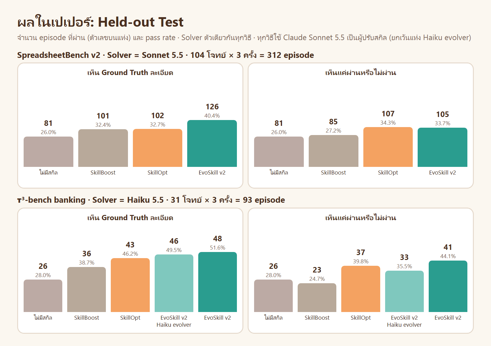

| ข้อค้นพบ | ตัวเลข |
|---|---|
| เห็น Ground Truth ละเอียด: EvoSkill v2 สูงสุดทั้งสอง benchmark | SpreadsheetBench v2: 126 เทียบ 102 จาก 312 (+7.7 จุด) · τ³-bench: 48 เทียบ 43 จาก 93 (+5.4 จุด) |
| เห็นแค่ผ่านหรือไม่ผ่าน: ใกล้เคียง SkillOpt บน SpreadsheetBench v2 และนำบน τ³-bench | 105 เทียบ 107 · 41 เทียบ 37 |
| ส่วนที่ดีขึ้นกระจุกในหมวดที่ไม่มีสกิลทำไม่ได้เลย | SpreadsheetBench v2 หมวด Debugging: 0 → 23 จาก 84 · หมวด Financial_Model เท่าเดิม 56 จาก 108 |
| โมเดลเล็กปรับสกิลของตัวเองได้ (Self-evolution) | Haiku 5.5 เป็นทั้ง Solver และ Evolver: 26 → 46 จาก 93 (+21.5 จุด) ห่างจาก Evolver ที่เป็น Sonnet 5.5 เพียง 2 episode |

**ภาพต้นฉบับ: Figure 2 และ 3 ของเปเปอร์** (SpreadsheetBench v2 · ซ้าย = Held-out · ขวา = คะแนนราย epoch)

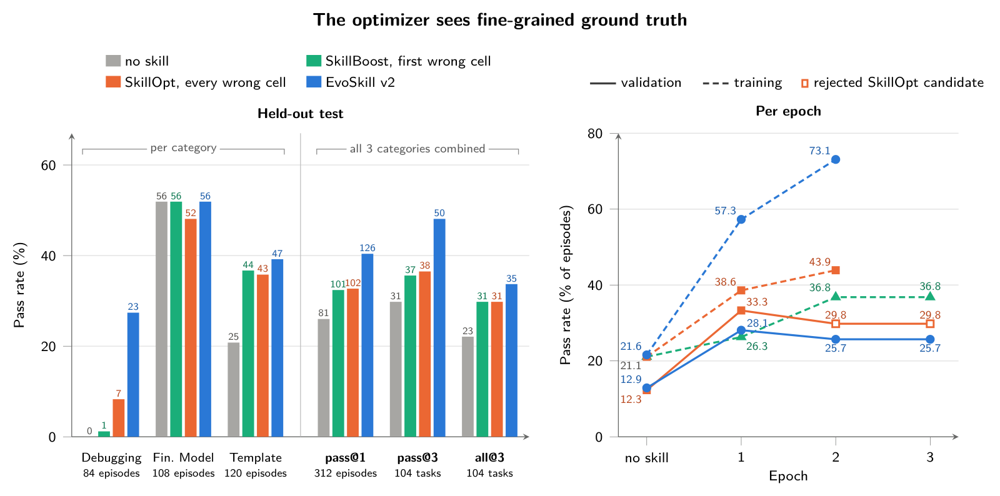

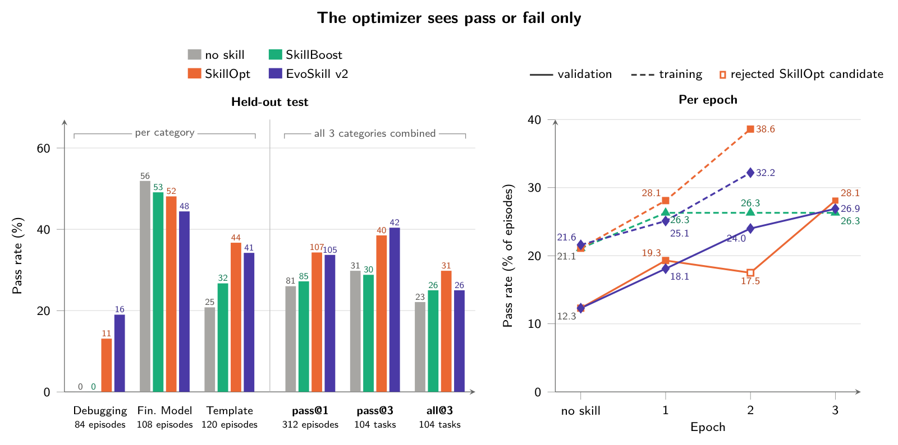

**ภาพต้นฉบับ: Figure 4 ของเปเปอร์** (τ³-bench banking · Held-out ทั้งสองแบบ)

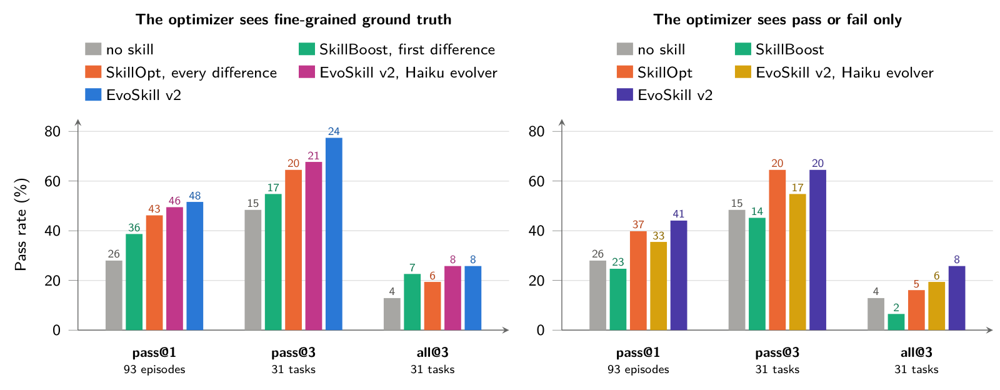

| ในภาพต้นฉบับ | ในภาพของเรา |
|---|---|
| แท่ง pass@1 (ตัวเลขบนแท่ง = จำนวน episode ที่ผ่าน) | แท่งทั้งหมดของเรา = pass@1 |
| แท่ง pass@3 และ all@3 | ไม่ได้วาด (ดูในภาพต้นฉบับ) |
| กราฟ "Per epoch" ทางขวาของ Figure 2 และ 3 | แยกไปเป็นภาพในข้อ 12.3 |

### 12.3 สิ่งที่คะแนนราย epoch บอก

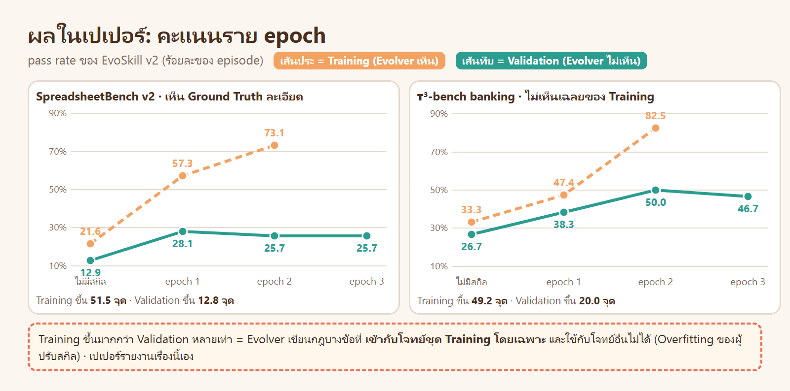

| สังเกต | ความหมาย |
|---|---|
| Training ขึ้นมากกว่า Validation หลายเท่า | Evolver เขียนกฎบางข้อที่ใช้ได้เฉพาะกับโจทย์ที่มันเห็น = Overfitting ของผู้ปรับสกิล |
| ตัวอย่างในเปเปอร์ | สกิล 2 จาก 4 ตัวของ SpreadsheetBench v2 เขียนสำหรับ Template 3 โฟลเดอร์ที่อยู่ใน Training เท่านั้น ซึ่งไม่มีโจทย์ Validation หรือ Test มาจากโฟลเดอร์เหล่านั้นเลย |
| Validation ของ epoch สุดท้ายไม่ได้สูงสุดเสมอ | SpreadsheetBench v2: 28.1 → 25.7 → 25.7 · แต่ชุดของ epoch สุดท้ายได้ Held-out สูงกว่าชุดของ epoch 1 (126 เทียบ 111) |

**ภาพต้นฉบับ: Figure 5 ของเปเปอร์** (τ³-bench banking ราย epoch ของ EvoSkill v2 ทั้ง 4 การรัน)

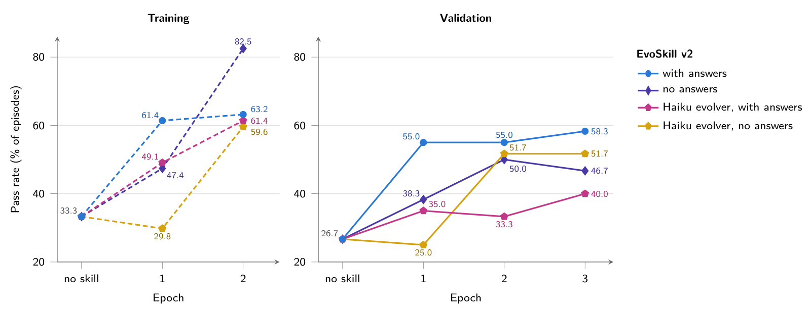

ภาพของเราแสดง 1 จาก 4 เส้นของ Figure 5 (no answers = ไม่เห็นเฉลยของ Training) คู่กับเส้นของ SpreadsheetBench v2 จาก Figure 2

### 12.4 ต้นทุนของผู้ปรับสกิล

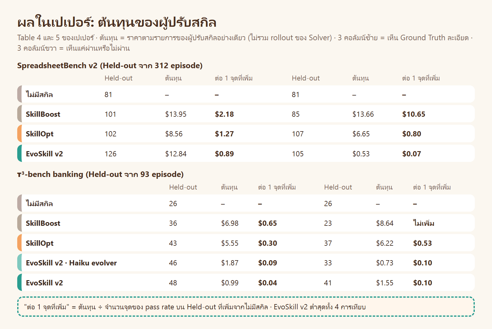

| ข้อค้นพบ | ตัวเลข |
|---|---|
| ต้นทุนต่อ 1 จุดที่เพิ่ม ต่ำสุดทั้ง 4 การเทียบ | เช่น τ³-bench แบบเห็น Ground Truth: $0.04 เทียบ $0.30 (SkillOpt) และ $0.65 (SkillBoost) |
| แบบเห็นแค่ผ่านหรือไม่ผ่านบน SpreadsheetBench v2 ต้นทุนต่ำกว่า SkillOpt กว่า 10 เท่า | $0.53 เทียบ $6.65 |
| ข้อควรระวังในการอ่าน | ต้นทุนนี้ **ไม่รวม** rollout ของ Solver ซึ่ง EvoSkill v2 ใช้มากกว่า 3 เท่าต่อโจทย์ · การรัน 2 ชุดของ SpreadsheetBench v2 ใช้ Claude Code คนละรุ่น |

### 12.5 สกิลที่ได้หน้าตาอย่างไร

| benchmark | สกิลหลัง epoch 3 | ขนาด | สคริปต์ |
|---|---|---|---|
| SpreadsheetBench v2 | 4 ตัว เขียนตั้งแต่ตาแรกและถูกแก้ทุกตา | `SKILL.md` รวม 71 KB | 5 ไฟล์ (ตัวสแกนสูตรที่น่าสงสัย · ตัวหาเซลล์ที่ถูกลบ ฯลฯ) |
| τ³-bench banking | 2 ตัว: ขั้นตอนการทำงาน และรายการจุดพลาดที่พบ | `SKILL.md` รวม 11 KB | ไม่มี |
| BaanKafe (บทนี้ · `e1`) | 1 ตัว ถูกแก้ทุกตา | 13.7 KB | ไม่มี |

---

## ขั้น 13 · เปรียบเทียบกับวิธีอื่น

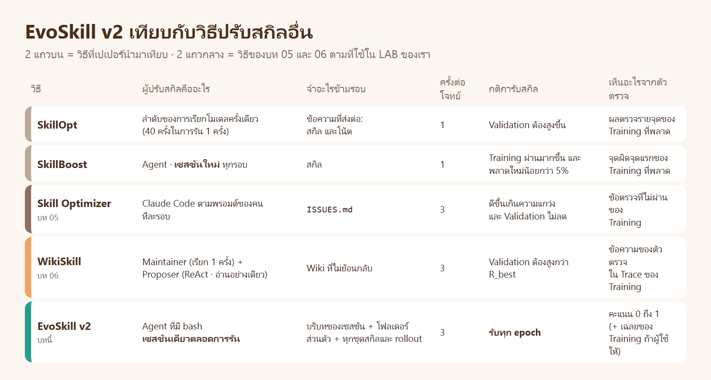

### 13.1 เส้นแบ่งที่เปเปอร์ใช้

| กลุ่ม | ขั้นเสนอการแก้ทำอย่างไร | ตัวอย่าง |
|---|---|---|
| Single-call Reflective | เรียกโมเดลครั้งเดียว อ่าน trace แล้วเขียนของใหม่ ไม่มีเครื่องมือ | GEPA |
| กึ่งกลาง | เรียกหลายครั้ง: เสนอทีละกลุ่มเล็ก แล้วรวมเป็นขั้น ๆ | SkillOpt |
| Agentic | ผู้เสนอมีเครื่องมือ | SkillOpt-Lite · SkillBoost · EvoSkill v1 และ v2 |
| Skill Library | Agent ที่ทำโจทย์สะสมวิธีทำของตัวเอง โดยไม่ตรวจกับชุดที่เก็บไว้ | Voyager · ExpeL · ACE |

ทุกระบบมีวงรอบ "เสนอ → วัด → ทำซ้ำ" เหมือนกัน · ที่ต่างคือ **ขั้นเสนอ**

### 13.2 กับ WikiSkill ของบท 06

| ประเด็น | WikiSkill | EvoSkill v2 |
|---|---|---|
| ความรู้ข้ามรอบอยู่ที่ไหน | Wiki ที่มีโครงสร้าง (pattern · index · skill-impact) เขียนโดย Agent เฉพาะทาง | ในเซสชันของ Evolver และไฟล์ที่มันเลือกเก็บเอง ไม่มีโครงสร้างบังคับ |
| ผู้เสนออ่านอะไร | index ก่อน แล้วเลือกเปิด (อ่านอย่างเดียว) | อะไรก็ได้ในเครื่องของตัวเอง และรันโค้ดได้ |
| ถ้าข้อเสนอแย่ลง | สกิลย้อนกลับทันที · Wiki จดว่าเคยลอง | ไม่ย้อนอัตโนมัติ · Evolver เห็นผลใน epoch ถัดไปแล้วย้อนเอง |
| คนอ่านความรู้ย้อนหลังได้หรือไม่ | ได้ เป็นหน้า Wiki | ได้เท่าที่ Evolver จดไว้ (`e1` ไม่จดอะไรเลย · `p1` จด 3 บรรทัด) |
| จุดร่วม | แยกผู้ทำโจทย์ออกจากผู้ปรับสกิล · ผู้ทำโจทย์เห็นเฉพาะสกิล · ปรับสกิลจากผลของ Training | |

### 13.3 กับ Skill Optimizer ของบท 05

| ประเด็น | Skill Optimizer (บท 05) | EvoSkill v2 |
|---|---|---|
| สกิลรุ่นแรก | คนเขียน | ว่าง |
| ใครตัดสินว่าแก้อะไร | Claude ตามพรอมต์ของคน ทีละรอบ | Evolver เอง ทุกรอบ |
| ประตูรับ | มี และคิดความแกว่ง | ไม่มี |
| คำตอบต่อปัญหาความแกว่ง | วัด 3 ครั้ง แล้วตั้งเกณฑ์จาก Standard Error | วัด 3 ครั้ง แล้ว **ไม่ตัดสินด้วยคะแนนเลย** |

บท 05 และ EvoSkill v2 เห็นปัญหาเดียวกัน (คะแนนแกว่ง) แต่ตอบคนละทาง

---

## ขั้น 14 · ข้อจำกัด

| ข้อจำกัด | ที่มา | ผล |
|---|---|---|
| แต่ละการตั้งค่ารันครั้งเดียว | เปเปอร์ | ผลต่างไม่กี่ episode ระหว่างวิธี อาจเป็นความบังเอิญ |
| Evolver เขียนกฎที่เข้ากับ Training โดยเฉพาะ | เปเปอร์ (ขั้น 12.3) | Training ขึ้นมากกว่า Validation หลายเท่า |
| epoch สุดท้ายไม่ใช่ชุดที่ดีที่สุดเสมอ | เปเปอร์ + การรัน `p1` ของเรา | ชุดที่ถูกนำไปใช้อาจแย่กว่าชุดก่อนหน้า |
| Evolver ไม่รู้ว่าตาใดเป็นตาสุดท้าย | การรัน `p1` ของเรา | Evolver วางการทดลองไว้ในตาสุดท้าย และแผน "epoch 4" ไม่เคยเกิด |
| สกิลถูกวัดกับโมเดลของ Solver ที่มันถูกเขียนให้เท่านั้น | เปเปอร์ | ยังไม่รู้ว่าสกิลย้ายข้ามโมเดลได้ดีเพียงใด (งานอื่นพบว่าสกิลจากโมเดลใหญ่ไม่ได้ช่วยโมเดลเล็กเสมอ) |
| ตัวตรวจที่มีช่องโหว่ถูกใช้ประโยชน์ได้ | เปเปอร์ (ขั้น 8) | ผู้ใช้ต้องตรวจตัวตรวจเอง |
| กฎที่อยู่เฉพาะในตัวตรวจ Evolver ค้นพบได้ยาก | การรัน `e1` ของเรา (ขั้น 9.3) | คะแนนติดเพดาน จนกว่าผู้ใช้จะบอกเพิ่มผ่าน Reference Folder |
| ต้นทุนที่รายงานไม่รวม rollout ของ Solver | เปเปอร์ | การวัด 3 ครั้งต่อโจทย์ทุก epoch เป็นต้นทุนส่วนใหญ่ของการรัน (ของเรา: Solver $8.65 เทียบ Evolver $0.46) |
| source code ต้นฉบับต้องใช้ macOS และ Daytona | README ของ source code | ยังรันบน Linux หรือ Docker ในเครื่องไม่ได้ |

---

## ขั้น 15 · เปเปอร์ เทียบกับ LAB ของบทนี้

### 15.1 ตรงกันตรงไหน

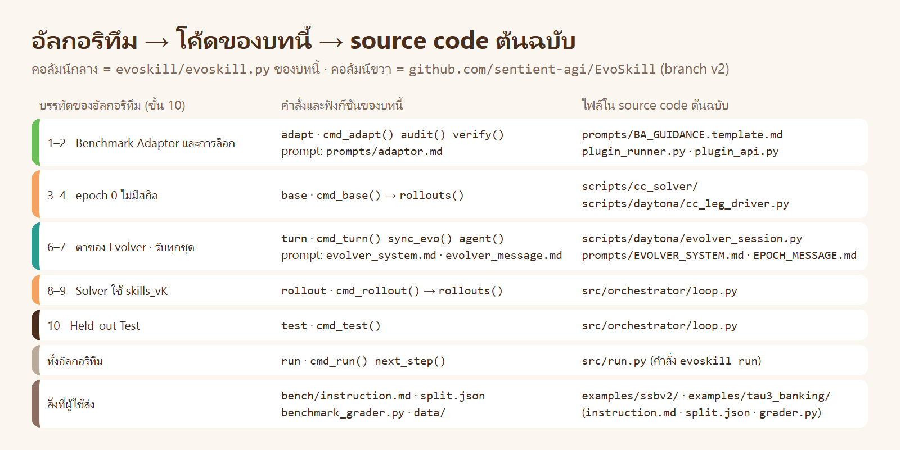

| ชิ้นส่วนของ EvoSkill v2 | ในเปเปอร์ | ใน LAB ของเรา |
|---|---|---|
| คำสั่งของผู้ใช้ | ข้อความ 5 หัวข้อ (Appendix 3–4) | [`bench/instruction.md`](../bench/instruction.md) 5 หัวข้อ |
| ตัวตรวจ | `grade(task, snapshot)` → 0 ถึง 1 | [`bench/benchmark_grader.py`](../bench/benchmark_grader.py) สัญญาเดียวกัน |
| Benchmark Adaptor | Claude Code 1 เซสชัน → plug-in + reference → ล็อกด้วย hash | `adapt` |
| Evolver | เซสชันเดียว · `--session-id` แล้ว `--resume` · ปิด WebSearch และ WebFetch | `turn` (เหมือนกัน) |
| เครื่องของ Evolver | 7 โฟลเดอร์ใต้ `/evo` (Table 1) | 7 โฟลเดอร์ใต้ `/evo` ชื่อเดียวกัน |
| ขนาดของการรัน | 3 epochs · 3 samples per task | เหมือนกัน |
| กติการับสกิล | รับทุก epoch · ทดสอบชุดสุดท้าย | เหมือนกัน |
| การตั้งค่า 2 แบบ | Fine-grained Ground Truth · Pass or Fail Only | `e1` · `p1` |

### 15.2 ต่างกันตรงไหน และทำไม

| หัวข้อ | เปเปอร์และ source code ต้นฉบับ | LAB ของเรา | เหตุผลของ LAB |
|---|---|---|---|
| การแยกเครื่อง | เครื่อง Daytona · container 1 ตัวต่อ 1 rollout | container เดียว · Adaptor และ Evolver ถูกแยกด้วย mount namespace | รันได้บนเครื่องของผู้เรียน |
| เครือข่าย | ปิด เหลือเฉพาะ API ของโมเดล | ไม่ได้ปิด (ปิดเฉพาะเครื่องมือค้นเว็บ) | container ของ LAB ใช้ร่วมกับงานอื่น |
| การส่งสกิลให้ Solver | `.claude/skills/` + Progressive Disclosure | `./skills/` และพรอมต์บอกให้อ่าน | ใช้ Solver ตัวเดียวกับบท 05 และ 06 เพื่อเทียบผล |
| คะแนน | ผ่านหรือไม่ผ่าน (all-or-nothing) | สัดส่วนของข้อตรวจ 10 ข้อ · รายงาน pass@1 ควบคู่ | ใช้ตัวตรวจเดิมของบท 05 และ 06 |
| จำนวนโจทย์ | 218 และ 70 | 9 (train 4 · validation 2 · test 3) | รันจบใน 10 นาที |
| เวลาต่อตาของ Evolver | 2 ชั่วโมง | 30 นาที (ใช้จริงไม่ถึง 1 นาที) | งานเล็ก |
| prompt | ภาษาอังกฤษ (Appendix 2, 5, 6) | เขียนใหม่เป็นภาษาไทยด้วยถ้อยคำของบทเรียน + 1 บรรทัด "เขียนสกิลเป็นภาษาไทย" | ผู้เรียนอ่านสกิลและ prompt ได้ |
| การตรวจ plug-in | รันใน sandbox (`python -I -S`) | ตรวจรายการ import ด้วย `ast` แล้วรันปกติ | ย่อให้อ่านง่าย |
| ขนาดโค้ด | `loop.py` 7,423 บรรทัด + โค้ดของ Daytona | [`evoskill.py`](../evoskill/evoskill.py) ไฟล์เดียว | อ่านจบได้ในบทเรียน |

### 15.3 ผลของ LAB อ่านด้วยภาษาของเปเปอร์

| เปเปอร์บอกว่า | เกิดใน LAB |
|---|---|
| ไม่มีสกิล พลาดแล้วมักพลาดซ้ำ | epoch 0 ไม่มี rollout ใดผ่านครบ 10 ข้อ (0/27) และพลาดข้อตรวจชุดเดิม |
| Agent ที่มี bash ทดสอบคำอธิบายก่อนเขียน | `e1` ตาที่ 2 และ 3 (ขั้น 9.2) |
| เห็นเฉลยของ Training ได้ผลดีกว่าเห็นแค่คะแนน | Test: `e1` 90.0% เทียบ `p1` 62.2% |
| ทุก epoch ถูกรับ และ epoch สุดท้ายไม่ได้ดีที่สุดเสมอ | `p1`: Validation 63.3% → 70.0% → 63.3% |
| ต้นทุนของ Evolver ต่ำ | 3 ตารวม $0.46 ต่อการรัน |
| ผู้ปรับสกิลที่เห็นแต่คะแนน อาจปรับไปในทางที่ผู้ใช้ไม่ตั้งใจ | `p1` ตาที่ 3 ให้ Solver เลือกวิธีปัดเศษตามหมายเลขของ rollout เพื่อทำการทดลอง |
| โมเดลเล็กปรับสกิลของตัวเองได้ | `h1` (haiku ทั้ง Solver และ Evolver): Test 57.8% → 92.2% ด้วยต้นทุนของ Evolver $0.11 |
| ประตูรับแบบวัดครั้งเดียวตัดสินตามโชค | `f1` v2 → v3 บน Validation: รับ 6 จาก 9 คู่ เสมอ 3 คู่ ทั้งที่เป็นการแก้ที่ทำให้ Test ถึง 100% |
| เซสชันเดียวดีกว่าเริ่มใหม่ทุกรอบ | **ไม่เห็นในโจทย์นี้:** `f1` `f2` (เริ่มใหม่) 100.0% ทั้งคู่ · `e1` `e2` `v1` (เซสชันเดียว) 90.0%–96.7% |

ผลของทุกการรันและการเทียบกับบท 05 และ 06 อยู่ใน [README หลัก](../README.md#4--เทียบกับบท-05-และ-06)

### 15.4 source code ต้นฉบับ อยู่ตรงไหนของ GitHub

[github.com/sentient-agi/EvoSkill](https://github.com/sentient-agi/EvoSkill/tree/v2) (branch `v2`)

| สิ่งที่อยากดู | ไฟล์ใน source code ต้นฉบับ | ไฟล์ของบทนี้ |
|---|---|---|
| วงรอบของ epoch | `src/orchestrator/loop.py` | `evoskill/evoskill.py` → `cmd_run()` |
| คำสั่ง `evoskill run` | `src/run.py` | `evoskill/evoskill.py` → `main()` |
| prompt ของ Benchmark Adaptor | `src/orchestrator/prompts/BA_GUIDANCE.template.md` | `evoskill/prompts/adaptor.md` |
| prompt ของ Evolver | `src/orchestrator/prompts/EVOLVER_SYSTEM.md` · `EPOCH_MESSAGE.md` | `evoskill/prompts/evolver_system.md` · `evolver_message.md` |
| รูปแบบของ plug-in | `src/orchestrator/plugin_api.py` | `evoskill/plugin_api.py` |
| เซสชันของ Evolver (`--resume`) | `scripts/daytona/evolver_session.py` | `evoskill/evoskill.py` → `agent()` · `cmd_turn()` |
| Solver | `scripts/cc_solver/` | `skill-optimizer/scripts/skillopt.py` → `run_trial()` |
| ตัวอย่างคำสั่ง · การแบ่งชุด · ตัวตรวจ | `examples/ssbv2/` · `examples/tau3_banking/` | `bench/` |

---

## ขั้น 16 · ทบทวน

<details><summary>1 ข้อสังเกตใดเป็นฐานของการปรับสกิล และมันบอกอะไร</summary>

Agent ที่ไม่มีสกิลซึ่งพลาดโจทย์ มักพลาดโจทย์นั้นอีกเมื่อทำซ้ำ · การพลาดซ้ำบอกว่าสาเหตุคือการขาดคำแนะนำอย่างสม่ำเสมอ ไม่ใช่ความบังเอิญ และคำแนะนำเป็นสิ่งที่ Agent อีกตัวเขียนให้ได้ (ขั้น 1)

</details>

<details><summary>2 EvoSkill v2 เปลี่ยนอะไร 2 อย่างจาก v1</summary>

รวม Proposer กับ Generator เป็น Evolver ตัวเดียวที่อยู่ตลอดการรัน และเพิ่ม Benchmark Adaptor ที่แปลงคำอธิบาย benchmark เป็น plug-in กับ Reference Folder (ขั้น 3)

</details>

<details><summary>3 ทำไม Benchmark Adaptor กับ Evolver ต้องเป็นคนละ Agent</summary>

Agent ที่ทั้งกำหนดการวัดและถูกวัด ทำคะแนนขึ้นได้โดยเปลี่ยนการแบ่งชุดหรือเปลี่ยนสิ่งที่ตัวเองเห็น แทนการเขียนสกิลให้ดี · การแบ่งชุดจึงถูกล็อกโดยอีก Agent หนึ่งก่อนมีสกิลตัวแรก (ข้อ 11.5)

</details>

<details><summary>4 การกันข้อมูลรับประกันอะไร และไม่รับประกันอะไร</summary>

รับประกันว่าคะแนนไม่ได้มาจากการอ่านคำตอบของชุดที่เก็บไว้ · ไม่รับประกันว่าคะแนนที่สูงขึ้นหมายถึงสกิลที่ดีขึ้น เพราะตัวตรวจเองอาจมีช่องโหว่ (ขั้น 8)

</details>

<details><summary>5 ทำไมประตูรับที่วัดโจทย์ละครั้งจึงเชื่อไม่ได้</summary>

โจทย์ 7%–53% ผ่านบางครั้งพลาดบางครั้ง · การปฏิเสธทุกครั้งของ SkillOpt และ SkillBoost ต่างกันไม่เกิน 2 โจทย์ ซึ่งน้อยกว่าจำนวนโจทย์ที่ผลแกว่ง การตัดสินจึงขึ้นกับว่าสุ่มได้ rollout ครั้งใด (ข้อ 11.3 และ 11.4)

</details>

<details><summary>6 ถ้ารับทุก epoch แล้วการแก้ที่ผิดถูกจัดการอย่างไร</summary>

Evolver มีสกิลและ rollout ของทุก epoch · rollout ของ epoch ถัดไปแสดงว่าการแก้นั้นทำอะไรแย่ลง ตาถัดไปจึงย้อนกลับหรือผสมกับรุ่นก่อนได้ · ข้อยกเว้นคือตาสุดท้าย ซึ่งไม่มีตาถัดไปให้แก้ (ข้อ 11.4)

</details>

<details><summary>7 ความจำของ Evolver มีกี่ชั้น และทำไมต้องมีโฟลเดอร์ส่วนตัว</summary>

3 ชั้น: บริบทของเซสชัน · โฟลเดอร์ส่วนตัว · โฟลเดอร์ของทุก epoch · บริบทของเซสชันอาจถูกย่ออัตโนมัติเมื่อยาวเกินไป สิ่งที่เขียนลงไฟล์ไม่หาย (ขั้น 7)

</details>

<details><summary>8 ในการรัน e1 ทำไม Evolver ที่เห็นเฉลยยังติดที่ 90%</summary>

ข้อตรวจที่เหลือคือ "ต้องส่งไฟล์เทสต์อย่างน้อย 6 เทสต์" ซึ่งเป็นกฎของตัวตรวจ · Evolver ได้แต่คะแนน ไม่เห็นข้อความของตัวตรวจ และโค้ดของ Solver ก็ทำงานเหมือนเฉลยแล้ว จึงไม่มีหลักฐานชี้ไปที่ไฟล์เทสต์ (ขั้น 9.3 และข้อ 11.6)

</details>

<details><summary>9 ต้นทุนที่เปเปอร์รายงานไม่รวมอะไร</summary>

ไม่รวม rollout ของ Solver · EvoSkill v2 ให้ Solver ทำโจทย์ Training และ Validation ข้อละ 3 ครั้งทุก epoch ซึ่งในการรันของเราเป็นต้นทุนส่วนใหญ่ ($8.65 เทียบกับ Evolver $0.46)

</details>

**ถัดไป:** [ข้างใน EvoSkill v2: `evoskill.py` และ prompt](../02_inside_evoskill/README.md) · [กลับไปบทหลัก](../README.md)

---

**อ้างอิง**

Huang, D., Nama, B., และ Alzubi, S. (2026). *EvoSkill v2: Fully Agentic Skill Evolution from Benchmark Adaptation to a Stateful Evolver.* arXiv:2610.25931. Source code: https://github.com/sentient-agi/EvoSkill (branch `v2`)

Alzubi, S. และคณะ (2026). *EvoSkill: Automated Skill Discovery for Agents.* Agent Skills '26 Workshop, CAIS 2026.

ขั้น 1–8 และ 10–14 เรียบเรียงจากเปเปอร์ฉบับ arXiv และ README ของ source code (อ่านเมื่อ 13 พ.ย. 2026) ด้วยถ้อยคำของบทเรียน · ภาพใน `img/paper/` เป็น Figure 1–5 ของเปเปอร์ (CC BY 4.0) ไม่ได้แก้ไข · ขั้น 9 และ 15 เป็นผลการรันจริงและคำอธิบายของบทเรียนนี้
