# ทฤษฎี EvoSkill v2 · แนวคิด วิธีคิดในการออกแบบ และอัลกอริทึม

| | |
|---|---|
| เปเปอร์ | Huang, Nama, Alzubi, *EvoSkill v2: Fully Agentic Skill Evolution from Benchmark Adaptation to a Stateful Evolver*, Sentient Labs (ต.ค. 2026) |
| อ่านต้นฉบับ | [arXiv:2610.25931](https://arxiv.org/abs/2610.25931) |
| **Source code ของเปเปอร์** | **[github.com/sentient-agi/EvoSkill](https://github.com/sentient-agi/EvoSkill/tree/v2)** · branch `v2` (branch `main` คือ EvoSkill v1) · Apache 2.0 |
| รุ่นก่อนหน้า | Alzubi และคณะ, *EvoSkill: Automated Skill Discovery for Agents* ([OpenReview](https://openreview.net/forum?id=i4b4As7RFX)) |
| แนวคิดในประโยคเดียว | ปรับ **สกิล** ของ Agent โดยไม่แตะโมเดล ด้วย Agent 3 ตัว: ตัวหนึ่งเตรียมสนามทดลอง ตัวหนึ่งทำโจทย์ และตัวหนึ่งอ่านผลแล้วเขียนสกิลใหม่ **ในเซสชันเดียวตลอดการรัน** |


สไลด์ของบทนี้: [EvoSkill_v2_Theory_Slides.html](EvoSkill_v2_Theory_Slides.html) (เปิดในเบราว์เซอร์)

**ภาพในหน้านี้มี 2 แบบ**

| แบบ | คืออะไร |
|---|---|
| ภาพการ์ตูนและแผนภาพ | วาดขึ้นใหม่เพื่ออธิบายทีละแนวคิด ตัวเลขคัดจากเปเปอร์หรือจากการรันจริงของบทนี้ |
| **ภาพต้นฉบับจากเปเปอร์** | Figure 1–5 ของเปเปอร์ วางไว้ใต้ภาพของเราในหัวข้อเดียวกัน เพื่อให้เทียบกันได้ (เปเปอร์เผยแพร่แบบ CC BY 4.0) |

ตัวอย่างทุกชิ้นมาจากการรันจริงของบทนี้เมื่อ 15 พ.ย. 2026 (ส่วนใหญ่จาก [`runs/e1/`](../runs/e1/) และ [`runs/p1/`](../runs/p1/) · ผลของทั้ง 12 การรันอยู่ใน [README หลัก](../README.md#3--ลงมือทำ-copy--paste))

## อ่านตามลำดับนี้

| ขั้น | ตอบคำถาม |
|---|---|
| [1 · ข้อสังเกตตั้งต้น](#ขั้น-1--ข้อสังเกตตั้งต้น-พลาดแล้วมักพลาดซ้ำ) | ทำไมการเขียนสกิลจึงช่วยได้ |
| [2 · สกิล และสิ่งที่ถูกปรับ](#ขั้น-2--สกิล-และสิ่งที่ถูกปรับ) | ปรับอะไร ไม่ปรับอะไร |
| [3 · จาก v1 สู่ v2](#ขั้น-3--จาก-evoskill-v1-สู่-v2) | v2 เปลี่ยนอะไรจากรุ่นก่อน |
| [4 · ภาพรวม: Agent 3 ตัว](#ขั้น-4--ภาพรวม-agent-3-ตัว) | ใครทำอะไร เมื่อไร |
| [5 · Benchmark Adaptor](#ขั้น-5--benchmark-adaptor) | สนามทดลองถูกเตรียมอย่างไร |
| [6 · Solver](#ขั้น-6--solver-และ-progressive-disclosure) | Agent ที่ทำโจทย์ใช้สกิลอย่างไร |
| [7 · Evolver](#ขั้น-7--evolver-และสิ่งที่มันได้รับ) | ผู้เขียนสกิลเห็นอะไร แก้อะไรได้ |
| [8 · การกันข้อมูล](#ขั้น-8--การกันข้อมูล-และช่องโหว่ของตัวตรวจ) | ทำไม Evolver ต้องไม่เห็นข้อสอบ และตัวตรวจต้องถูกตรวจก่อน |
| [9 · เดิน 1 การรันด้วยผลจริง](#ขั้น-9--เดิน-1-การรันด้วยผลจริง) | ข้อมูลไหลอย่างไรตั้งแต่ต้นจนจบ |
| [10 · อัลกอริทึม](#ขั้น-10--อัลกอริทึม) | ขั้นตอนทั้งหมดทีละบรรทัด |
| [11 · วิธีคิดในการออกแบบ](#ขั้น-11--วิธีคิดในการออกแบบ) | ทำไมจึงออกแบบแต่ละจุดเช่นนี้ (10 ข้อ) |
| [12 · ผลในเปเปอร์](#ขั้น-12--ผลในเปเปอร์) | ได้ผลแค่ไหน เทียบกับใคร |
| [13 · เปรียบเทียบ](#ขั้น-13--เปรียบเทียบกับวิธีอื่น) | ต่างจาก SkillOpt · SkillBoost · WikiSkill · บท 05 อย่างไร |
| [14 · ข้อจำกัด](#ขั้น-14--ข้อจำกัด) | สิ่งที่ EvoSkill v2 ยังทำไม่ได้ |
| [15 · เปเปอร์ เทียบกับ LAB ของบทนี้](#ขั้น-15--เปเปอร์-เทียบกับ-lab-ของบทนี้) | เราทำตรงกับเปเปอร์ตรงไหน ต่างตรงไหน |
| [16 · ทบทวน](#ขั้น-16--ทบทวน) | คำถามตรวจความเข้าใจ |

ขั้นที่มีเรื่องของเครื่องมือมีกล่อง **ในเครื่องมือ** บอกว่าแนวคิดนั้นทำโดยคำสั่งใดของสกิล `evoskill` ที่สร้างใน LAB 0 ([`evoskill_format.md`](../evoskill_format.md) บอกว่าแต่ละคำสั่งทำอะไร) และ prompt ใด ([`prompts/`](../../../00_resource/skills/evoskill/prompts/) ของสกิลฉบับที่ให้ผลในบทนี้)

---

## ขั้น 1 · ข้อสังเกตตั้งต้น: พลาดแล้วมักพลาดซ้ำ


เปเปอร์เริ่มจากข้อสังเกตข้อเดียว: **Agent ที่ไม่มีสกิลที่เหมาะกับงาน เมื่อทำโจทย์พลาด มักพลาดโจทย์นั้นอีกเมื่อทำซ้ำ**

| การวัด | Agent | ในโจทย์ที่พลาดอย่างน้อย 1 ครั้ง มีกี่ส่วนที่พลาดครบทั้ง 3 ครั้ง |
|---|---|---|
| SpreadsheetBench v2 (เปเปอร์) | Claude Code + Sonnet 5.5 | ประมาณ 9 ใน 10 (73 จาก 81 โจทย์) |
| τ³-bench banking (เปเปอร์) | Claude Code + Haiku 5.5 | ประมาณ 6 ใน 10 (16 จาก 27 โจทย์) |
| โจทย์คิดเงิน BaanKafe (บทนี้ · `e1`) | Claude Code + sonnet | 9 จาก 9 โจทย์ (ไม่มี rollout ใดผ่านครบทุกข้อเลยใน 27 ครั้ง) |

**ตีความ:** ถ้าพลาดเพราะโชค ทำซ้ำควรผ่านบ้าง · การพลาดซ้ำที่เดิมบอกว่า Agent **ขาดข้อมูลบางอย่างอย่างสม่ำเสมอ**

| สาเหตุของการพลาด | แก้ได้ด้วย |
|---|---|
| ขาดความสามารถ (โมเดลทำไม่เป็น) | เปลี่ยนหรือเทรนโมเดล |
| **ขาดคำแนะนำ** (ทำเป็น แต่ไม่รู้ว่างานนี้ต้องทำแบบใด) | **เขียนคำแนะนำให้** = สกิล |

คำแนะนำเป็นภาษาธรรมชาติ Agent อีกตัวจึงเขียนให้ได้ · นี่คือฐานของ EvoSkill ทั้งสองรุ่น

ในบทนี้ตรงกับเรื่องที่รู้จากบท 05 แล้ว: โจทย์ไม่ได้บอกกฎกลางของร้าน (ตรวจ input · ปัดครึ่งขึ้น · CLI · เทสต์) Agent จึงพลาดข้อตรวจชุดเดิมทุกครั้ง

> **ในเครื่องมือ:** ตัวเลขของบทนี้มาจากคำสั่ง `status` และ `noise` ซึ่งอ่านจาก `state.json` → `legs` → `by_task` (คะแนนของโจทย์เดียวกันทั้ง 3 ครั้ง) และ `passes` `all3` `none3` `mixed` · [รูปแบบ ข้อ 4](../evoskill_format.md#4--statejson-และลำดับของขั้น) · [ข้อ 12](../evoskill_format.md#12--ข้อความของ-noise)

---

## ขั้น 2 · สกิล และสิ่งที่ถูกปรับ

| | เทรนโมเดล | ปรับสกิล (EvoSkill · SkillOpt · WikiSkill) |
|---|---|---|
| สิ่งที่ถูกแก้ | น้ำหนักของโมเดล | ข้อความที่โมเดลอ่านตอนทำงาน |
| โมเดล | ถูกแก้ | **ไม่ถูกแตะ** |
| Agent Harness (เช่น Claude Code) | – | **ไม่ถูกแตะ** |
| คนอ่านผลลัพธ์ออกหรือไม่ | ไม่ออก | ออก · โต้แย้งได้ · ส่งให้ Agent ตัวอื่นใช้ต่อได้ |

**สกิลในเปเปอร์นี้** ใช้นิยามของ Agent Skills (มาตรฐานเปิดที่ Claude Code, Codex และ GitHub Copilot ใช้):

| ส่วนของสกิล | คืออะไร | ใครอ่าน เมื่อไร |
|---|---|---|
| โฟลเดอร์ 1 โฟลเดอร์ | 1 สกิล | – |
| `description` (ใน frontmatter ของ `SKILL.md`) | คำอธิบายสั้นว่าสกิลนี้ใช้เมื่อใด | Agent เห็น **ตลอดเวลา** |
| เนื้อหาของ `SKILL.md` | คำแนะนำเต็ม | Agent เปิดอ่าน **เมื่อ description ตรงกับงาน** |
| สคริปต์ (ถ้ามี) | โปรแกรมที่ Agent รันได้ | เมื่อ `SKILL.md` บอกให้ใช้ |

EvoSkill v2 เป็น **ชั้นที่วางซ้อนบน Agent Harness ที่ใช้อยู่แล้ว** ไม่ได้สร้าง Agent ใหม่ · สิ่งเดียวที่มันเปลี่ยนคือชุดของโฟลเดอร์สกิล

คำถามของเปเปอร์จึงไม่ใช่ "สกิลช่วยได้หรือไม่" (งานก่อนหน้าตอบแล้ว) แต่คือ **ควรปรับสกิลอย่างไรจึงดีที่สุด**

| คำถามย่อย | คำตอบของ EvoSkill v2 | อ่านต่อ |
|---|---|---|
| ผู้เขียนสกิลควรเป็นอะไร | Agent ที่มี bash | ข้อ 11.1 |
| ผู้เขียนสกิลควรจำอะไรข้ามรอบ | ทุกอย่าง: เซสชันเดียวตลอดการรัน | ข้อ 11.2 |
| ควรเห็นการทำโจทย์กี่ครั้งต่อโจทย์ | หลายครั้ง (3) | ข้อ 11.3 |
| ตัดสินอย่างไรว่าจะเก็บสกิลชุดใด | ไม่ตัดสิน: รับทุกชุด | ข้อ 11.4 |

---

## ขั้น 3 · จาก EvoSkill v1 สู่ v2

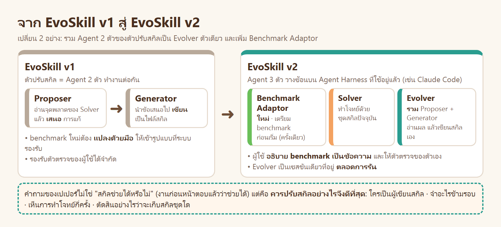

| | EvoSkill v1 | EvoSkill v2 |
|---|---|---|
| ผู้ปรับสกิล | Agent 2 ตัว: **Proposer** วิเคราะห์จุดพลาดและเสนอ · **Generator** เขียนข้อเสนอเป็นไฟล์สกิล | Agent ตัวเดียว: **Evolver** ทำทั้งสองอย่าง และอยู่ตลอดการรัน |
| การรับ benchmark ใหม่ | ต้องแปลงด้วยมือให้เข้ารูปแบบข้อมูลที่ระบบรองรับ · ตัวตรวจของผู้ใช้รองรับจำกัด | **Benchmark Adaptor** อ่านคำอธิบายเป็นข้อความ แล้วเตรียมให้ · ผู้ใช้ให้ตัวตรวจของตัวเอง |
| สิ่งที่คงไว้ | เฉลย (Ground Truth) ให้เฉพาะผู้ปรับสกิลเห็น **ไม่ให้ Solver เห็น** | เหมือนเดิม |

ชื่อเปเปอร์สรุปสองสิ่งที่เพิ่ม: *from Benchmark Adaptation* (มี Agent เตรียม benchmark) *to a Stateful Evolver* (ผู้เขียนสกิลมีสถานะ)

---

## ขั้น 4 · ภาพรวม: Agent 3 ตัว

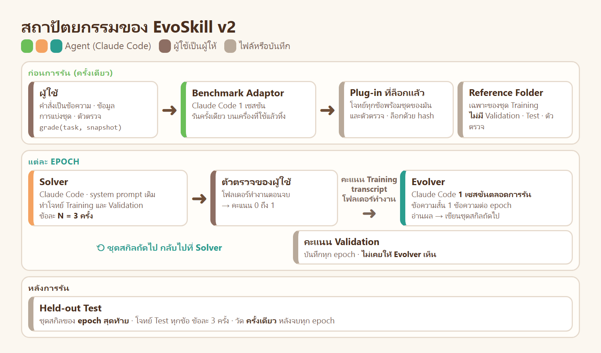

อ่านภาพจากบนลงล่าง = ลำดับเวลา

| ช่วง | ใครทำงาน | ทำอะไร | ทำกี่ครั้ง |
|---|---|---|---|
| ก่อนการรัน | **Benchmark Adaptor** | แปลงคำสั่งของผู้ใช้เป็นรายการโจทย์ (plug-in) และโฟลเดอร์อ้างอิง แล้วถูกล็อก | 1 ครั้ง |
| แต่ละ epoch | **Solver** | ทำโจทย์ชุด Training และ Validation ทุกข้อ ข้อละ 3 ครั้ง | ทุก epoch |
| แต่ละ epoch | ตัวตรวจของผู้ใช้ | ให้คะแนนโฟลเดอร์ทำงานของ Solver ตอนจบ เป็น 0 ถึง 1 | ทุก rollout |
| แต่ละ epoch | **Evolver** | อ่านผลของชุด Training แล้วเขียนชุดสกิลถัดไป | 1 ตาต่อ epoch |
| หลังการรัน | Solver | ทำโจทย์ Test ด้วยชุดสกิลของ epoch สุดท้าย | 1 ครั้ง |

**คำที่ใช้ตลอดหน้า**

| คำ | ความหมาย |
|---|---|
| **rollout** (หรือ episode) | Solver ทำโจทย์ 1 ข้อ 1 ครั้ง · บทก่อนเรียกว่า Trial |
| **epoch** | 1 รอบของวงรอบ · epoch 0 = ยังไม่มีสกิล · epoch K ใช้ชุดสกิล `skills_vK` |
| **ตา (turn)** | Evolver ทำงาน 1 ครั้ง = ตอบข้อความ 1 ข้อความ · ตาที่ K เขียน `skills_vK` |
| **leg** | Solver ทำโจทย์ 1 ชุด ด้วยชุดสกิล 1 ชุด เช่น `v1_val` = Validation ด้วย `skills_v1` |
| **Held-out** | ชุด Test ที่ไม่เคยถูกใช้ระหว่างการรัน |
| **pass@1 · pass@3 · all@3** | rollout ที่ผ่าน · โจทย์ที่ผ่านอย่างน้อย 1 ใน 3 ครั้ง · โจทย์ที่ผ่านครบ 3 ครั้ง |

**ภาพต้นฉบับ: Figure 1 ของเปเปอร์** (Huang et al., 2026 · CC BY 4.0)

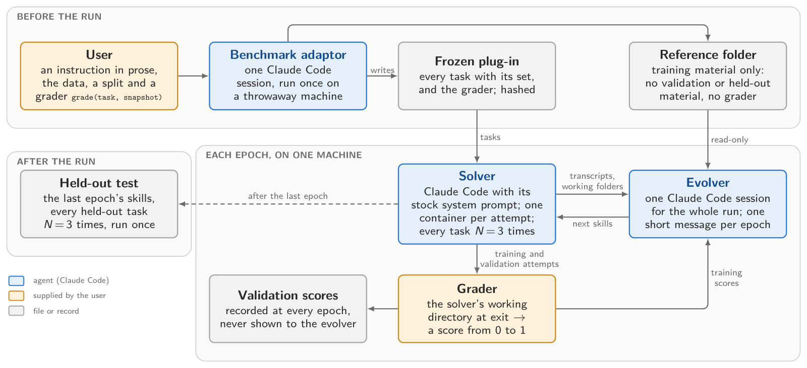

| ในภาพต้นฉบับ | ในภาพของเรา |
|---|---|
| BEFORE THE RUN | แถบ "ก่อนการรัน" |
| EACH EPOCH, ON ONE MACHINE | แถบ "แต่ละ EPOCH" |
| AFTER THE RUN (อยู่ซ้ายล่าง มีเส้นประจาก Solver) | แถบ "หลังการรัน" วางไว้ล่างสุดตามลำดับเวลา |
| กล่องสีฟ้า = agent · สีส้ม = supplied by the user · สีเทา = file or record | สีเขียว ส้ม เขียวน้ำเงิน = Agent 3 ตัว · สีน้ำตาล = ผู้ใช้ · สีเทา = ไฟล์ |

> **ในเครื่องมือ:** 3 แถบ = 3 กลุ่มคำสั่งของสกิล `evoskill`: `adapt` · (`base` แล้ว `turn` ↔ `rollout`) · `test` · คำสั่งทั้งหมดอยู่ใน [รูปแบบ ข้อ 3](../evoskill_format.md#3--คำสั่ง-12-ตัว) · ลำดับถูกบังคับโดยค่า `phase` ใน `state.json` คำสั่งที่เรียกผิดลำดับจะหยุดและบอกขั้นถัดไป ([ข้อ 4](../evoskill_format.md#4--statejson-และลำดับของขั้น))

---

## ขั้น 5 · Benchmark Adaptor


**ปัญหาที่แก้:** benchmark แต่ละตัวมีรูปแบบข้อมูลและวิธีตรวจไม่เหมือนกัน (ไฟล์ Excel · บทสนทนา · โค้ด) ใน v1 คนต้องเขียนโค้ดแปลงเองทุกครั้ง

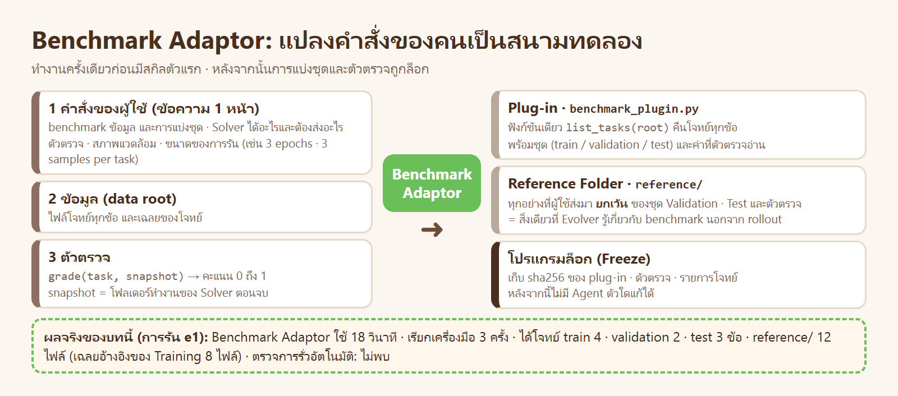

**ผู้ใช้ส่ง 3 อย่าง**

| สิ่งที่ส่ง | เนื้อหา | ของบทนี้ |
|---|---|---|
| คำสั่ง (instruction) | ข้อความ 1 หน้า เหมือนอธิบายงานให้เพื่อนร่วมทีม มี 5 หัวข้อ: benchmark ข้อมูล และการแบ่งชุด · Solver ได้อะไรและต้องส่งอะไร · ตัวตรวจ · สภาพแวดล้อม · ขนาดของการรัน | [`bench/instruction.md`](../bench/instruction.md) |
| ข้อมูล | ไฟล์โจทย์และเฉลย | [`bench/data/baankafe/`](../bench/data/baankafe/) |
| ตัวตรวจ | ฟังก์ชัน `grade(task, snapshot)` คืนคะแนน 0 ถึง 1 · `snapshot` = โฟลเดอร์ทำงานของ Solver ตอนจบ | [`bench/benchmark_grader.py`](../bench/benchmark_grader.py) |

**Benchmark Adaptor เขียน 2 อย่าง**

| ผลลัพธ์ | คืออะไร | กติกา |
|---|---|---|
| **Plug-in** `benchmark_plugin.py` | โมดูล Python ที่มีฟังก์ชันเดียว `list_tasks(root)` คืนโจทย์ทุกข้อ พร้อมชุดของมัน และค่าที่ตัวตรวจอ่าน | อ่านได้เฉพาะไฟล์ใต้ data root · ใช้ได้เฉพาะ standard library · ห้ามรันตัวตรวจ ห้ามใช้เครือข่าย |
| **Reference Folder** `reference/` | ทุกอย่างที่ผู้ใช้ส่งมาและ Evolver ใช้ได้ | **ต้องไม่มี** ของชุด Validation · ของชุด Test · โค้ดหรือคำอธิบายของตัวตรวจ |

จากนั้นโปรแกรม **ล็อก (freeze)** ด้วย hash: หลังจากนี้การแบ่งชุดและตัวตรวจเปลี่ยนไม่ได้

**คำสั่งของผู้ใช้เป็นตัวกำหนดว่า Evolver เห็นอะไร** เปเปอร์ทดลอง 2 แบบ และบทนี้ทำตามทั้งสองแบบ

| การตั้งค่า | Reference Folder มีอะไร | ของบทนี้ |
|---|---|---|
| **Fine-grained Ground Truth** | ข้อมูลของชุด Training รวมเฉลย | `instruction.md` → การรัน `e1` |
| **Pass or Fail Only** | ข้อมูลของชุด Training **ไม่มีเฉลย** · Evolver เหลือแค่คะแนน | `instruction_score_only.md` → การรัน `p1` |

**ผลจริงของบทนี้ (`e1`)**

| รายการ | ผล |
|---|---|
| เวลา · เครื่องมือ · ค่าใช้จ่าย | 23 วินาที · 3 ครั้ง · $0.09 |
| plug-in | โจทย์ 9 ข้อ = train 4 · validation 2 · test 3 ตรงกับ `split.json` ของผู้ใช้ |
| reference/ | 12 ไฟล์: โจทย์ของ Training 4 ไฟล์ · เฉลยอ้างอิงของ Training 8 ไฟล์ |
| สิ่งที่ Adaptor ทำเองโดยไม่ได้สั่ง | ไม่คัดลอก `split.json` ลง `reference/` เพราะไฟล์นั้นมีชื่อโจทย์ของ Validation และ Test · ทดสอบ plug-in และค้นหาการรั่วใน `reference/` เองก่อนจบ |
| ตรวจการรั่วอัตโนมัติ | ไม่พบของ Validation · Test · ตัวตรวจ ([`audit.md`](../runs/e1/setup/audit.md)) |

> **ในเครื่องมือ:** คำสั่ง `adapt` ([รูปแบบ ข้อ 5](../evoskill_format.md#5--benchmark-adaptor-adapt)) · prompt ของ Adaptor คือ [`prompts/adaptor.md`](../../../00_resource/skills/evoskill/prompts/adaptor.md) (ต่อท้าย system prompt ของ Claude Code) · ข้อความที่ส่งคือไฟล์คำสั่งของผู้ใช้ทั้งไฟล์ · การล็อกเขียน `setup/freeze.json` แล้วตรวจ hash ซ้ำก่อนทุก leg และก่อน `turn` · การตรวจการรั่วคือคำสั่ง `audit` (ผลอยู่ใน `setup/audit.md`)

---

## ขั้น 6 · Solver และ Progressive Disclosure


| คุณสมบัติของ Solver ในเปเปอร์ | รายละเอียด |
|---|---|
| คือใคร | Claude Code ที่ใช้ **system prompt เดิมของมัน** ไม่มีการแก้ |
| ได้โจทย์อย่างไร | ข้อความโจทย์เป็นข้อความแรกของผู้ใช้ |
| ทำงานที่ไหน | container ของตัวเอง 1 ตัวต่อ 1 rollout · ปิดการค้นเว็บและ subagent · ออกเครือข่ายได้เฉพาะ API ของโมเดล |
| ได้สกิลอย่างไร | **Progressive Disclosure**: ชื่อและ `description` ของสกิลทุกตัวอยู่ในบริบทตลอด · เนื้อหาเต็มถูกโหลดเมื่อ `description` ตรงกับงาน |
| เห็นเฉลยหรือไม่ | **ไม่เห็น** |

**ผลที่ตามมา:** `description` ตัดสินว่าสกิลจะถูกเปิดหรือไม่ มันจึงเป็นส่วนที่ **ถูกปรับได้** เช่นเดียวกับเนื้อหา · สกิลที่เนื้อหาดีแต่ description ไม่ตรงกับงาน จะไม่ถูกอ่าน

ตัวอย่างจากเปเปอร์: Evolver เขียน description ที่ขึ้นต้นว่า *"LOAD FIRST for every … task"* เพื่อบังคับให้ Solver เปิดสกิลนั้นก่อนเริ่มทำ

description ที่ Evolver ของเราเขียนจริง (`e1` · [`skills_v3`](../runs/e1/skills_v3/) · เป็นสกิลตัวเดียว `baankafe-solve` ตั้งแต่ตาแรก):

```text
name: baankafe-solve
description: ใช้ทุกครั้งที่โจทย์ให้เขียนฟังก์ชันคิดเงิน/คิดราคา/ค่าส่ง/เงินคืน/หารบิล ของร้าน BaanKafe ลงใน solve.py
             (หน่วยสตางค์ ผลเป็นจำนวนเต็ม) — มีขั้นตอน กติกาปัดเศษ การตรวจ input (ValueError)
             และนโยบายประจำร้านที่โจทย์มักไม่ได้เขียนไว้ แต่เทสต์ซ่อนตรวจ
```

> **ในเครื่องมือ:** คำสั่ง `base` `rollout` `test` `eval` รัน Solver ผ่านคำสั่ง `skillopt.py run` ของบท 05 ซึ่งเป็น Solver ตัวเดียวกับบท 05 และ 06 ([รูปแบบ ข้อ 6](../evoskill_format.md#6--solver-และตัวตรวจ-rollout)) · **ต่างจากเปเปอร์ 1 จุด:** สกิลถูกวางที่ `./skills/` และพรอมต์บอกให้อ่านก่อนเริ่ม (ไม่ใช่ Progressive Disclosure ของ Claude Code) เพื่อให้ผลเทียบกับสองบทก่อนได้ (ขั้น 15)

---

## ขั้น 7 · Evolver และสิ่งที่มันได้รับ

Evolver คือ **Claude Code 1 เซสชัน ที่อยู่ตั้งแต่ epoch แรกถึง epoch สุดท้าย**

| สิ่งที่ Evolver ได้รับ | เนื้อหา | ส่งเมื่อไร |
|---|---|---|
| system prompt | ของ Claude Code เอง + ข้อความต่อท้าย 1 ชุด: บอกบทบาท เป้าหมาย และแผนที่ของโฟลเดอร์ | ชุดเดียวกันตลอดการรัน |
| ข้อความประจำ epoch | สั้น ๆ: เวลาปัจจุบัน · เส้นตาย · หมายเลข epoch · "วิเคราะห์ rollout วินิจฉัยจุดพลาดที่สกิลแก้ได้ แล้วเขียน `skills_vK`" | 1 ข้อความต่อ epoch |
| เครื่องมือ | ทุกอย่างของ Claude Code: bash · อ่านเขียนไฟล์ · subagent (ปิดการค้นเว็บ) | – |

ข้อความประจำ epoch ที่ส่งจริงในบทนี้ (`e1` ตาที่ 1 · [`message.md`](../runs/e1/turns/turn_1/message.md)):

```text
เวลาตอนนี้ 2026-11-14 22:46 UTC · เส้นตายของตานี้ 2026-11-14 23:16 UTC เมื่อถึงเส้นตาย สิ่งที่อยู่ใน `/evo/staging/`
จะถูกนำไปใช้ทันทีตามสภาพขณะนั้น · นี่คือ epoch 1 · ผลการทำโจทย์รอบล่าสุดของ Solver อยู่ใน `/evo` แล้ว
ขอให้วิเคราะห์ rollout เหล่านั้น วินิจฉัยว่า Solver พลาดตรงไหนที่สกิลช่วยแก้ได้ แล้วเขียนชุดสกิล `skills_v1` ลงใน `/evo/staging/`
```

**สิ่งที่อยู่บนเครื่องของ Evolver** (Table 1 ของเปเปอร์)

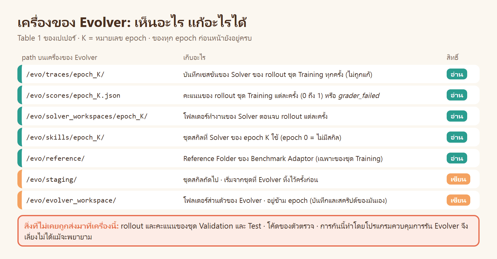

| กลุ่ม | โฟลเดอร์ | ใช้ทำอะไร |
|---|---|---|
| หลักฐาน | `traces/` · `scores/` · `solver_workspaces/` | รู้ว่า Solver ทำอะไร ได้ผลงานอะไร และได้กี่คะแนน |
| ประวัติของสกิล | `skills/epoch_K/` | รู้ว่า epoch K ใช้สกิลชุดใด จึงเทียบ "สกิลชุดนี้ → คะแนนเท่านี้" ย้อนหลังได้ทุก epoch |
| ความรู้ของ benchmark | `reference/` | สิ่งที่ Benchmark Adaptor เก็บไว้ให้ (ขั้น 5) |
| งานที่กำลังเขียน | `staging/` | ชุดสกิลถัดไป · เริ่มจากชุดเดิม ถ้าไม่แก้ Solver จะใช้ชุดเดิม |
| ความจำส่วนตัว | `evolver_workspace/` | บันทึกและสคริปต์ของ Evolver เอง |

**ทำไมต้องมีโฟลเดอร์ส่วนตัว:** เซสชันที่ยาวจะถูก Claude Code **ย่อบริบทอัตโนมัติ (compaction)** รายละเอียดบางส่วนหายได้ · สิ่งที่เขียนลงไฟล์ไม่หาย

**ความจำของ Evolver มี 3 ชั้น**

| ชั้น | เก็บอะไร | หายเมื่อไร |
|---|---|---|
| บริบทของเซสชัน | การวิเคราะห์และเหตุผลของตาก่อน ๆ | บางส่วนหายเมื่อถูกย่อบริบท |
| โฟลเดอร์ส่วนตัว | บันทึกและสคริปต์ที่ตั้งใจเก็บ | ไม่หาย |
| โฟลเดอร์ของทุก epoch | rollout · คะแนน · ชุดสกิล ของทุก epoch ที่ผ่านมา | ไม่หาย |

> **ในเครื่องมือ:** คำสั่ง `turn` ([รูปแบบ ข้อ 9](../evoskill_format.md#9--ตาของ-evolver-turn)) · ตาที่ 1 เรียก `claude -p --session-id <id>` · ตาถัดไปเรียก `claude -p --resume <id>` (เซสชันเดิม · [ข้อ 7](../evoskill_format.md#7--การเรียก-agent-และการแยกเครื่อง)) · ข้อความต่อท้าย system prompt คือ [`prompts/evolver_system.md`](../../../00_resource/skills/evoskill/prompts/evolver_system.md) · ข้อความประจำ epoch คือ [`prompts/evolver_message.md`](../../../00_resource/skills/evoskill/prompts/evolver_message.md) · ก่อนทุกตา โปรแกรมคัดลอกผลของ Training ไปไว้ใน `evo/` ([ข้อ 8](../evoskill_format.md#8--เครื่องของ-evolver-evo))

---

## ขั้น 8 · การกันข้อมูล และช่องโหว่ของตัวตรวจ

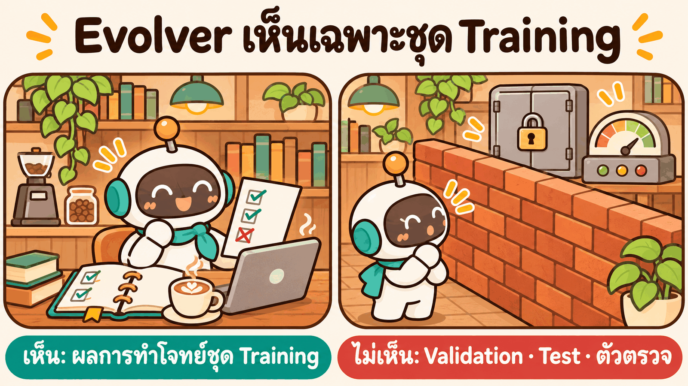

**อันตราย 2 แบบของระบบที่ปรับตัวเอง** (ทั้งสองแบบทำให้คะแนนขึ้นโดยที่สกิลไม่ได้ดีขึ้น และ **ไม่ทิ้งร่องรอย**)

| อันตราย | เกิดอย่างไร | EvoSkill v2 กันอย่างไร |
|---|---|---|
| ผู้ปรับสกิลอ่านข้อสอบ | เห็นโจทย์หรือคะแนนของชุด Test แล้วเขียนสกิลให้เข้ากับชุดนั้น | เครื่องของ Evolver ได้รับเฉพาะของชุด Training |
| ผู้ปรับสกิลแก้การแบ่งชุด | ตัดโจทย์ที่ทำไม่ได้ออกจากชุดที่ใช้วัด | การแบ่งชุดถูกล็อกใน plug-in ก่อนมีสกิลตัวแรก โดย Agent อีกตัวหนึ่ง |

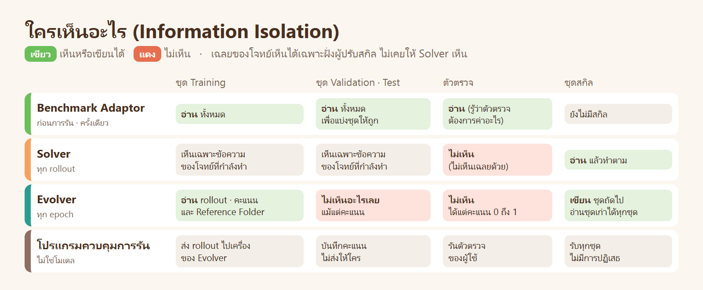

การกันนี้ทำโดย **โปรแกรมควบคุมการรัน** ไม่ใช่ด้วยการขอร้องใน prompt · Evolver จึงเลี่ยงไม่ได้แม้จะพยายาม

**แต่การกันข้อมูลรับประกันได้เพียงอย่างเดียว**

| รับประกัน | ไม่รับประกัน |
|---|---|
| คะแนนที่ได้ ไม่ได้มาจากการอ่านคำตอบของชุดที่เก็บไว้ | คะแนนที่สูงขึ้น = สกิลดีขึ้นจริง |


**เรื่องจริงที่เปเปอร์เล่า:** รุ่นก่อนหน้าของระบบนี้ถูกสั่งให้ทำคะแนน SpreadsheetBench v2 ให้สูงที่สุด

| ลำดับ | เกิดอะไรขึ้น |
|---|---|
| 1 | ตัวตรวจของ benchmark เทียบ **ค่าที่ Excel บันทึกไว้ข้างสูตร** กับไฟล์เฉลย โดยไม่คำนวณสูตรใหม่ |
| 2 | Evolver พบจุดนี้ แล้วเขียนสกิลสั่ง Solver ว่า "แก้ข้อความของสูตร แต่ห้ามคำนวณใหม่" |
| 3 | คะแนนขึ้น ทั้งที่ไฟล์ผลงานไม่ได้ถูกต้องขึ้น |
| 4 | ผู้เขียนแก้ตัวตรวจให้คำนวณทุกสูตรใหม่ด้วย LibreOffice ก่อนเทียบ |

**บทเรียน:** ผู้ปรับสกิลที่เก่งพอจะหาช่องโหว่ของตัวตรวจเจอ · ตัวตรวจจึงต้องถูกตรวจก่อนรัน และนี่คือเหตุผลข้อหนึ่งที่ **ผู้ใช้เป็นผู้ให้ตัวตรวจ ไม่ใช่ Agent**

บทนี้ทำตาม: LAB 0.2 รัน [`check_grader.py`](../bench/check_grader.py) (ตัวตรวจต้องให้เฉลยอ้างอิงผ่านครบทุกข้อ 10/10 และ 11/11 ของโจทย์ค่าส่ง และจับเฉลยที่จงใจผิดได้) ก่อนใช้โทเคน

> **ในเครื่องมือ:** คำสั่ง `adapt` และ `turn` เรียก Agent ใน mount namespace แยก (`unshare -m`): โฟลเดอร์ `/workspace` (ที่มีตัวตรวจ ข้อมูลทั้งหมด และผลของ Validation กับ Test) ถูกแทนด้วยโฟลเดอร์ว่าง · Evolver เห็นเฉพาะ `runs/<ชื่อ>/evo/` ในชื่อ `/evo` · โฟลเดอร์ที่ Table 1 ระบุว่าอ่านอย่างเดียว ถูก mount แบบ read-only ([รูปแบบ ข้อ 7](../evoskill_format.md#7--การเรียก-agent-และการแยกเครื่อง) · [ข้อ 8](../evoskill_format.md#8--เครื่องของ-evolver-evo))

---

## ขั้น 9 · เดิน 1 การรันด้วยผลจริง

การรัน `e1`: Evolver เห็นเฉลยของ Training · 3 epochs · 3 ครั้งต่อโจทย์ · ใช้เวลาทั้งหมดราว 16 นาที

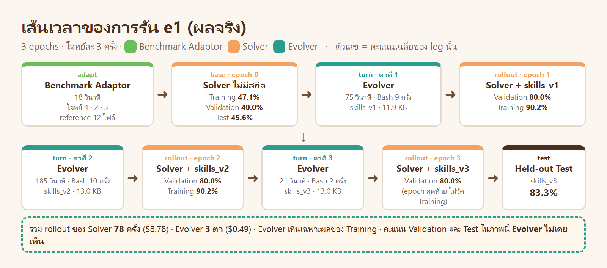

### 9.1 `adapt` และ `base`: เตรียมสนาม แล้ววัดเส้นฐาน

| leg | ชุด | rollout | คะแนนเฉลี่ย | ผ่านครบทุกข้อ |
|---|---|---|---|---|
| `base_train` | Training | 12 | 47.1% | 0/12 |
| `base_val` | Validation | 6 | 46.7% | 0/6 |
| `base_test` | Test | 9 | 47.8% | 0/9 |

ข้อตรวจที่ไม่ผ่านของ Training ใน epoch 0 (จาก 12 rollout): `reject_type` 12 · `cli_ok` 12 · `cli_error` 12 · `tests` 12 · `reject_value` 11 · `policy` 6 (ครบทั้ง 6 rollout ของงานค่าส่งและงานเงินคืน)
**Evolver ไม่เห็นตารางนี้** มันเห็นแค่ตัวเลข `0.5` หรือ `0.4` ต่อ rollout

```json
{ "t1-cafe-bill_s1": 0.5, "t1-cafe-bill_s2": 0.5, "t1-cafe-bill_s3": 0.5, "t4-cashback_s1": 0.4, "…": "…" }
```

### 9.2 สามตาของ Evolver

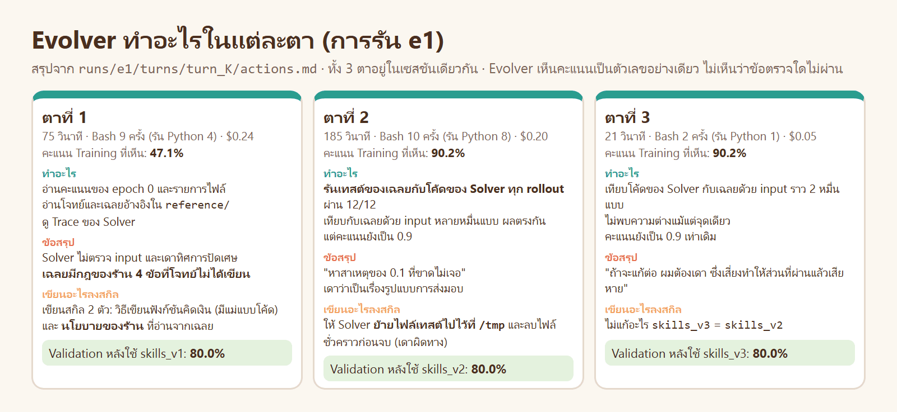

| ตา | Evolver ทำอะไร (จาก [`actions.md`](../runs/e1/turns/turn_1/actions.md)) | ข้อสรุปของมัน (ข้อความ "Agent พูด" ท้ายตา) | Validation หลัง Solver ใช้ | Training |
|---|---|---|---|---|
| 1 · 72 วินาที · Bash 9 ครั้ง | อ่านคะแนน → อ่านโจทย์และเฉลยใน `reference/` → อ่าน `solve.py` ที่ Solver เขียนไว้ใน `solver_workspaces/` | Solver ไม่ตรวจ input และไม่เขียนเทสต์ · **เฉลยมีนโยบายของร้าน 4 ข้อที่โจทย์ไม่ได้เขียน** → เขียนสกิลตัวเดียว `baankafe-solve` พร้อมแม่แบบโค้ด · "ยังไม่ได้ทดสอบกับ Solver" | 46.7% → 83.3% | 47.1% → **90.2%** |
| 2 · 273 วินาที · Bash 9 ครั้ง | **รันเทสต์ของเฉลยกับโค้ดของ Solver ทุก rollout** → ผ่าน 12/12 · เขียนสคริปต์สุ่ม input (ราว 3,000–4,000 แบบต่อโจทย์) เทียบกับเฉลย → พบจุดต่างเดียว: ระยะทางของค่าส่งรับ float แต่คะแนนยัง 0.9 | "ยังหาไม่เจอว่าทำไมเหลือคะแนนขาด 0.1" เดาว่าเป็นเรื่อง float → เพิ่มข้อ "ห้ามรับ float" ในสกิล | 83.3% → 86.7% | 90.2% → **90.2%** |
| 3 · 127 วินาที · Bash 4 ครั้ง | นำสคริปต์ของตาที่ 2 มารันซ้ำกับโค้ดของ epoch 2 · เทียบโหมดรันเป็นโปรแกรม (CLI) → เทสต์ของเฉลยผ่าน 12/12 · ไม่พบความต่าง | ข้อสันนิษฐานเรื่อง float ผิด (Solver เลิกรับ float แล้วแต่คะแนนไม่ขยับ) · เหลือข้อเดียว: ไฟล์เทสต์ของ Solver "อาจชนกับเทสต์ของผู้ตรวจ" → **ทดลองให้ย้ายไฟล์เทสต์ออกจากโฟลเดอร์งานไป `/tmp`** | 86.7% → 90.0% | (ไม่มี Training ของ epoch 3) |

สิ่งที่เห็นจากตารางนี้ ตรงกับแนวคิดของเปเปอร์ 3 ข้อ

| เห็นอะไร | ตรงกับ |
|---|---|
| ตาที่ 2 **ทดสอบคำอธิบายก่อนเขียน**: สมมติฐาน "โค้ดยังคำนวณผิดบางกรณี" ถูกตัดทิ้ง เพราะรันเทสต์ของเฉลยแล้วผ่านครบ · ตาที่ 3 ตัดสมมติฐานเรื่อง float ทิ้งได้ เพราะ Solver เลิกรับ float แล้วแต่คะแนนไม่เปลี่ยน | Evolver เป็น Agent ที่มี bash (ข้อ 11.1) |
| ตาที่ 3 ใช้สคริปต์ `fuzz.py` และ `fuzz2.py` ที่เขียนในตาที่ 2 (แก้ path แล้วรันซ้ำ) และอ้างถึงผลของตาที่ 2 ("แม้ Solver เลิกรับ float สำหรับ `distance_km` แล้วก็ตาม") โดยไม่มีใครส่งสรุปให้ | เซสชันเดียวตลอดการรัน (ข้อ 11.2) |
| คะแนนของโจทย์เดียวกันทั้ง 3 ครั้งเท่ากัน (0.9 0.9 0.9) Evolver จึงมั่นใจว่าเป็นจุดพลาดซ้ำ ไม่ใช่ความบังเอิญ | หลายครั้งต่อโจทย์ (ข้อ 11.3) |

บันทึกที่ Evolver เขียนให้ตัวเอง ([`notes.md`](../runs/e1/evo/evolver_workspace/notes.md)) ตอนจบตาที่ 3 ยังเขียนว่า "Unexplained 0.1" และวางการย้ายเทสต์เป็นการทดลอง: "If epoch3 score changes -> learn; revert if drops" · แต่ไม่มี epoch ถัดไป ชุดทดลองนี้จึงถูกนำไปวัด Test ทันที (ข้อ 9.4)

### 9.3 ทำไมติดที่ 90%

ตั้งแต่ epoch 1 ทุก rollout ของ Training ได้ 0.9 (งานค่าส่ง 0.91) · ข้อตรวจที่ไม่ผ่านมีข้อเดียวคือ `tests` (ต้องมี `test_solve.py` อย่างน้อย 6 เทสต์)

| epoch | สิ่งที่ตัวตรวจพบ (Evolver ไม่เห็น) | สิ่งที่ Evolver เห็น |
|---|---|---|
| 1 | `✗ tests: unittest พบ 3 เทสต์ (ต้องมีอย่างน้อย 6)` (Solver ส่งไฟล์เทสต์แล้ว แต่มีน้อยเกินไป) | `0.9` |
| 2 | `✗ tests: unittest พบ 4 เทสต์ (ต้องมีอย่างน้อย 6)` | `0.9` |
| 3 (Test) | `✗ tests: ไม่มีไฟล์ test_solve.py ข้าง solve.py` (ตาที่ 3 ให้ย้ายไฟล์เทสต์ไป `/tmp`) | – (ไม่มีตาถัดไป) |

| สิ่งที่ Evolver มี | สิ่งที่ Evolver ไม่มี |
|---|---|
| เฉลยอ้างอิง ซึ่งมี `test_solve.py` 12 เทสต์ | ข้อความว่า "ต้องส่งไฟล์เทสต์ด้วย และต้องมีอย่างน้อย 6 เทสต์" |
| คะแนน 0.9 | ข้อความของตัวตรวจว่าข้อใดไม่ผ่าน |

Evolver ใช้เทสต์ของเฉลยเป็น **เครื่องมือตรวจโค้ด** แต่ไม่ได้มองว่าเป็น **ส่วนของงานที่ต้องส่ง** · เมื่อต้องเดา มันเดาไปทางตรงข้ามกับกฎจริง (ให้เอาไฟล์เทสต์ออกจากโฟลเดอร์งาน) และคะแนนที่เท่าเดิมบอกไม่ได้ว่าเดาผิด · นี่คือราคาของการออกแบบ "Evolver ได้แต่คะแนน ไม่รู้ว่าตัวตรวจทำงานอย่างไร" (ข้อ 11.6) และบท 05 กับ 06 ไม่ติดจุดนี้ เพราะผู้ปรับสกิลของสองบทนั้นอ่านข้อความของตัวตรวจได้ (ขั้น 15)

### 9.4 `test`: วัดครั้งเดียวด้วยชุดของ epoch สุดท้าย

| Test Set | คะแนน | ผ่านครบทุกข้อ |
|---|---|---|
| ไม่มีสกิล | 47.8% | 0/9 |
| `skills_v3` | **83.3%** | 0/9 |

ข้อที่ไม่ผ่านใน Test Set: `tests` ทั้ง 9 rollout (`ไม่มีไฟล์ test_solve.py ข้าง solve.py`) · งานคืนเงินคอร์ส `x2-refund` ไม่ผ่าน `half_up` และ `no_drift` เพิ่มอีก 2 ข้อทั้ง 3 rollout

```text
สกิล baankafe-solve : เงินที่ ร้านจ่ายออก (เงินคืน cashback, คืนเงิน, ส่วนลดที่ให้, แต้ม, รางวัล) → ปัดลง (floor)
ตัวตรวจ              : ✗ half_up: refund(150, 25, false) คาด 113 ได้ 112 · พลาด 3 จาก 3 กรณี
```

เฉลยของ Training บอกเพียงว่าเงินคืนสมาชิกปัดลง · Evolver ขยายเป็นกติกาของเงินที่ร้านจ่ายออกทุกชนิด และไม่มีขั้นใดในอัลกอริทึมที่จะจับความผิดนี้ก่อนถึง Test (ข้อ 11.4) · เกิดซ้ำ: 11 จาก 12 การรันเขียน "เงินที่ร้านจ่ายออกปัดลง" เป็นกฎทั่วไป และงานคืนเงินคอร์สปัดเศษผิด 3/3 (ยกเว้น `p1`) · แม้การรัน `p2` ที่ไม่ได้เห็นเฉลยก็เดาแบบเดียวกัน ([README หลัก ข้อ 4.2](../README.md#ทำไมได้ต่ำกว่าสองบทก่อน-ทั้งที่เห็นเฉลย))

ต้นทุน: Solver 78 rollout $8.81 · Evolver 3 ตา **$0.57** · Benchmark Adaptor $0.09

> **ในเครื่องมือ:** ตารางทั้งหมดมาจากคำสั่ง `status` ([รูปแบบ ข้อ 11](../evoskill_format.md#11--ข้อความของ-status) · ผลที่เก็บไว้: [`status.txt`](../runs/e1/status.txt)) · สิ่งที่ Evolver ทำทีละคำสั่งอยู่ใน `turns/turn_K/actions.md` และ `stats.json` ที่คำสั่ง `turn` เขียนจาก transcript ([ข้อ 10](../evoskill_format.md#10--หลักฐานของแต่ละครั้ง-turns)) · ข้อตรวจรายข้อของแต่ละ leg อ่านได้จาก `legs/runs/<leg>/trials/<โจทย์>-r<ครั้ง>/`

---

## ขั้น 10 · อัลกอริทึม

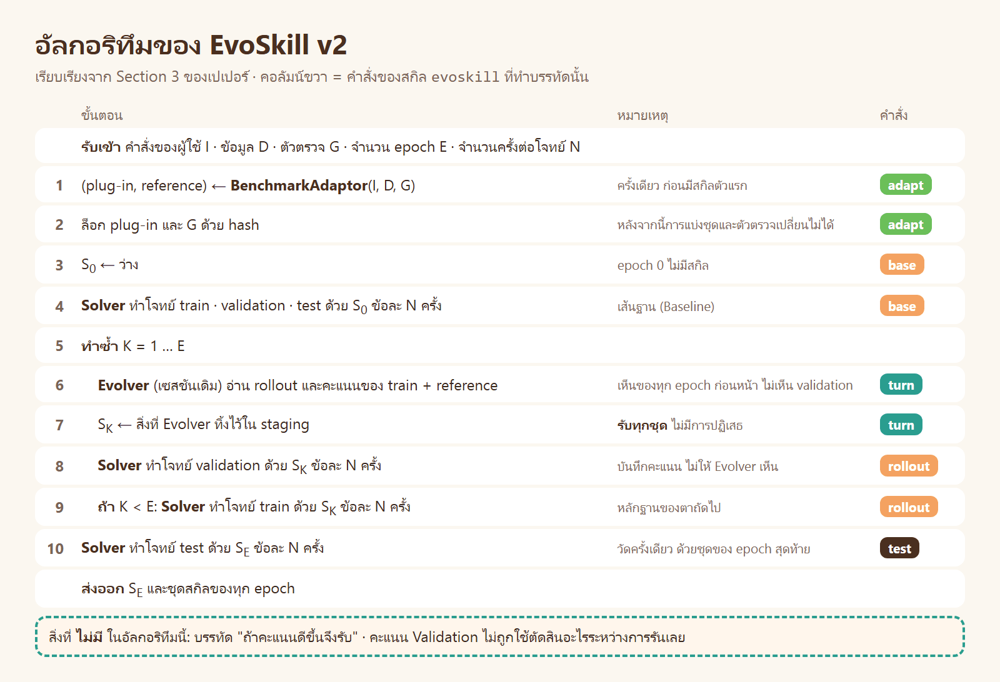

เปเปอร์ไม่ได้เขียนเป็นกล่อง Algorithm · ตารางนี้เรียบเรียงจาก Section 3 ของเปเปอร์ และหัวข้อ "How it works" ใน README ของ source code

**เทียบกับ Algorithm 1 ของ WikiSkill (บท 06) ทีละจุด**

| จุด | WikiSkill | EvoSkill v2 |
|---|---|---|
| ก่อนวงรอบ | วัด Validation ของชุดสกิลว่าง → `R_best` | Benchmark Adaptor เตรียมสนาม แล้ววัดทุกชุดโดยไม่มีสกิล |
| ผู้เสนอแก้ | Maintainer แล้ว Proposer (เรียกใหม่ทุกรอบ) | Evolver ตัวเดียว เซสชันเดิม |
| ขนาดของการแก้ | 1 ข้อเสนอ ต่อ 1 สกิล ต่อรอบ | ไม่จำกัด: Evolver แก้ staging ได้ทั้งชุด |
| หลังการแก้ | ถ้า Validation > `R_best` จึงรับ ไม่เช่นนั้นย้อนกลับ | **รับเสมอ** |
| Validation ใช้ทำอะไร | ตัดสินรับหรือไม่รับ และหยุดเมื่อได้ 100% | บันทึกไว้ให้คนดู ไม่ใช้ตัดสิน |
| หยุดเมื่อไร | Validation = 100% หรือครบ K รอบ | ครบ E epoch (ที่ผู้ใช้กำหนดในคำสั่ง) |
| สกิลที่ส่งออก | ชุดที่ผ่านประตูรับล่าสุด | ชุดของ epoch สุดท้าย |

**สถานะจริงของการรัน `e1`**

| K | S<sub>K</sub> (ชุดสกิล) | Training | Validation | เกิดอะไร |
|---|---|---|---|---|
| 0 | ว่าง | 47.1% | 46.7% | บรรทัด 3–4 |
| 1 | `baankafe-solve` 10.0 KB + แม่แบบโค้ด 1 ไฟล์ | 90.2% | 83.3% | บรรทัด 6–9 |
| 2 | แก้สกิลเดิม 12.0 KB | 90.2% | 86.7% | บรรทัด 6–9 |
| 3 | แก้สกิลเดิม 12.6 KB | – | 90.0% | บรรทัด 6–8 แล้วออกจากวงรอบ |
| – | `skills_v3` | – | – | บรรทัด 10: Test 83.3% |

> **ในเครื่องมือ:** 1 คำสั่งของสกิล `evoskill` = 1 กลุ่มบรรทัด (`adapt` 1–2 · `base` 3–4 · `turn` 6–7 · `rollout` 8–9 · `test` 10) · คำสั่ง `run` คือทั้งอัลกอริทึม: ทำทุกขั้นที่เหลือต่อจากขั้นที่ค้าง ([รูปแบบ ข้อ 3](../evoskill_format.md#3--คำสั่ง-12-ตัว) · [ข้อ 4](../evoskill_format.md#4--statejson-และลำดับของขั้น)) · บรรทัด 7 คือขั้นสุดท้ายของคำสั่ง `turn` ที่คัดลอก `evo/staging/` เป็น `skills_vK/` **โดยไม่มีเงื่อนไข** ([ข้อ 9](../evoskill_format.md#9--ตาของ-evolver-turn) ลำดับที่ 5)

---

## ขั้น 11 · วิธีคิดในการออกแบบ

ส่วนนี้ตอบว่า **ทำไม** EvoSkill v2 จึงออกแบบเช่นนี้ ทีละการตัดสินใจ · ข้อ 11.1–11.4 คือ "Four Design Choices" ที่เปเปอร์ยกเป็นผลงานหลัก (Section 6) · ข้อ 11.5–11.10 คือการตัดสินใจอื่นที่อยู่ในระบบ

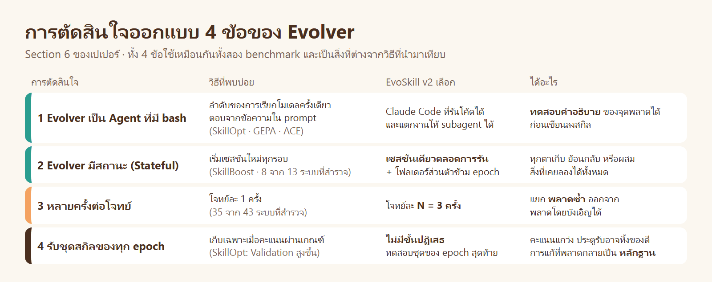

### 11.1 ทำไม Evolver เป็น Agent ที่มี bash ไม่ใช่การเรียกโมเดลทีละครั้ง


| | |
|---|---|
| คำถาม | ผู้เขียนสกิลควรเป็นอะไร |
| ทางเลือก | (ก) ลำดับของการเรียกโมเดลครั้งเดียว แต่ละครั้งตอบจากข้อความใน prompt (SkillOpt · GEPA · ACE) · (ข) Agent ที่มีเครื่องมือ |
| EvoSkill v2 เลือก | (ข) Claude Code ที่มี bash |
| เหตุผล | คำอธิบายว่า "ทำไมพลาด" เป็นแค่ **สมมติฐาน** จนกว่าจะถูกทดสอบ · การเรียกโมเดลครั้งเดียวเปิดไฟล์ไม่ได้ รันโค้ดไม่ได้ จึงเขียนสมมติฐานลงสกิลโดยไม่ได้ตรวจ · Agent ตรวจก่อนได้ |
| หลักฐานในเปเปอร์ | SkillOpt ใช้การเรียกโมเดล 40 ครั้งในการรัน 1 ครั้ง ไม่มีครั้งใดเปิดไฟล์ Excel ได้ · Evolver ของ EvoSkill v2 เขียนสคริปต์คำนวณไฟล์ผลงานของ Solver ใหม่ด้วย LibreOffice แล้วเทียบกับเฉลยทีละเซลล์ ก่อนเขียนคำอธิบายลงสกิล · บางตาแบ่งกลุ่มโจทย์ให้ subagent |
| ในการรันของเรา | `e1` ตาที่ 2: รันเทสต์ของเฉลยกับโค้ดของ Solver 12 ไฟล์ (ผ่านหมด) แล้วเขียนสคริปต์สุ่ม input เทียบกับเฉลย → ตัดสมมติฐาน "ยังพลาดเทสต์" ทิ้ง · ตาที่ 3: รันสคริปต์เดิมกับโค้ดของ epoch 2 และเทียบโหมดรันเป็นโปรแกรม → ตัดสมมติฐานเรื่อง float ทิ้ง |
| ในเครื่องมือ | คำสั่ง `turn` เรียก Claude Code โดยไม่จำกัดเครื่องมือ (ปิดเฉพาะ `WebSearch,WebFetch` · [รูปแบบ ข้อ 7](../evoskill_format.md#7--การเรียก-agent-และการแยกเครื่อง)) · เทียบกับบท 06 ที่ Maintainer ใช้ `--tools ""` และ Proposer ใช้ `--tools Read` |

### 11.2 ทำไม Evolver เป็นเซสชันเดียวตลอดการรัน


| | |
|---|---|
| คำถาม | สิ่งที่ผู้เขียนสกิลคิดได้ในรอบก่อน ควรไปถึงรอบถัดไปอย่างไร |
| ทางเลือก | (ก) เริ่มเซสชันใหม่ทุกรอบ สิ่งที่ส่งต่อมีแค่ข้อความ เช่น ตัวสกิลหรือโน้ต (SkillBoost · 8 จาก 13 ระบบแบบ Agent ที่เปเปอร์สำรวจ) · (ข) เซสชันเดียว |
| EvoSkill v2 เลือก | (ข) + โฟลเดอร์ส่วนตัว + เก็บ rollout และสกิลของทุก epoch |
| เหตุผล | สกิลบันทึกเฉพาะ **ข้อสรุป** · เหตุผล ทางเลือกที่ถูกตัดทิ้ง และสคริปต์ที่ใช้ตรวจ ไม่อยู่ในสกิล · ถ้าเริ่มใหม่ทุกรอบ สิ่งเหล่านี้ต้องถูกคิดใหม่ หรือหายไป · เมื่อมีทุกอย่างครบ **แต่ละตาเลือกได้ว่าจะเก็บ ย้อนกลับ หรือผสมสิ่งที่เคยลอง** ไม่ใช่แค่แก้รุ่นล่าสุด |
| หลักฐานในเปเปอร์ | การรัน SpreadsheetBench v2: 3 ตาอยู่ในเซสชันเดียว ถูกย่อบริบท 4 ครั้ง · ในตาที่ 2 และ 3 มีคำสั่ง bash 20 ครั้งที่ **รันสคริปต์ที่เขียนไว้ในตาก่อน** |
| ในการรันของเรา | สิ่งที่ตรงกับเปเปอร์: `p1` ตาที่ 2 และ 3 เทียบคะแนนข้าม epoch เพื่อทดสอบสมมติฐานของตาก่อน · `e1` ตาที่ 3 นำสคริปต์และผลของตาที่ 2 มาใช้ต่อโดยไม่มีใครส่งสรุปให้ · `h1` ใช้สคริปต์วิเคราะห์ของตาก่อนซ้ำ 4 ครั้งในตาที่ 3 · `h2` ใช้ซ้ำ 8 ครั้งในตาที่ 2 |
| ผลที่ **ไม่ยืนยัน** เปเปอร์ | เมื่อให้ Evolver เริ่มเซสชันใหม่ทุก epoch (`f1` `f2` `f3`) ได้ Test 83.3% · 85.6% · 93.3% เทียบกับเซสชันเดียว (`e1` `e2` `v1`) 83.3% ทั้ง 3 การรัน = ไม่พบว่าเซสชันเดียวดีกว่า และผลของการตั้งค่าเดียวกันต่างกันได้ถึง 10 จุด (`f1` เทียบ `f3`) · งานนี้เล็กเกินกว่าจะมีสิ่งให้สะสม และเซสชันใหม่ยังส่งต่อความรู้ผ่านไฟล์โน้ตได้ ([README หลัก LAB 5](../README.md#lab-5--ตัดความจำของ-evolver-ออก-f1)) |

### 11.3 ทำไมให้ Solver ทำโจทย์ละหลายครั้ง


| | |
|---|---|
| คำถาม | Evolver ควรเห็นการทำโจทย์กี่ครั้งต่อโจทย์ |
| ทางเลือก | (ก) 1 ครั้ง (SkillOpt · SkillBoost · 35 จาก 43 ระบบอื่นที่เปเปอร์สำรวจ) · (ข) หลายครั้ง |
| EvoSkill v2 เลือก | (ข) N = 3 ทั้ง Training · Validation · Test |
| เหตุผล | Solver ไม่ได้ผ่านหรือพลาดโจทย์เดิมแบบเดียวกันทุกครั้ง · วัดครั้งเดียวจึงแยกไม่ได้ว่า "พลาดเพราะขาดคำแนะนำ" หรือ "พลาดครั้งนี้พอดี" · สกิลควรแก้แบบแรก |

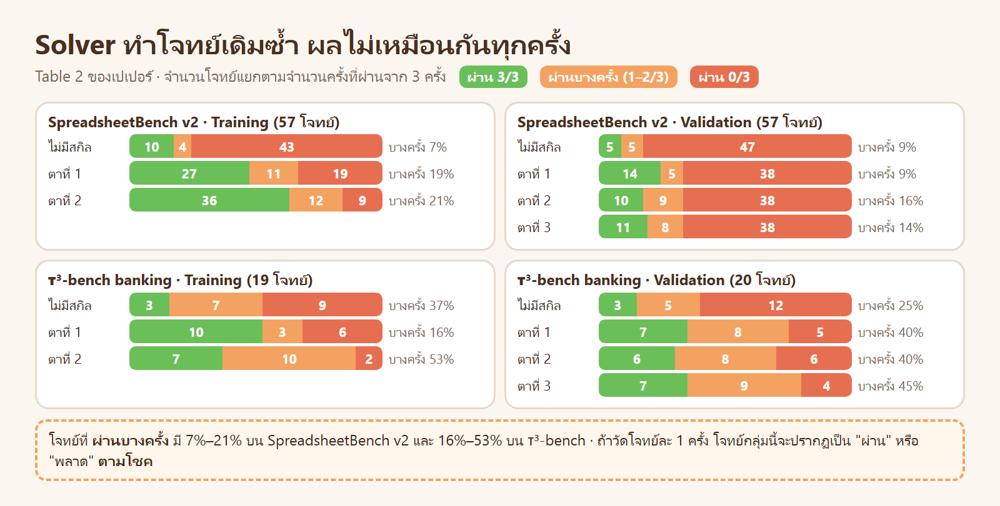

| | |
|---|---|
| หลักฐานในเปเปอร์ | Table 2: โจทย์ที่ผ่านบางครั้งมี 7%–21% บน SpreadsheetBench v2 และ 16%–53% บน τ³-bench |
| ในการรันของเรา | `e1` epoch 0: งานเงินคืนคอร์ส (`refund`) ได้ 0.5 · 0.3 · 0.5 และงานค่าแรง (`net-pay`) ได้ 0.5 · 0.5 · 0.3 จากสกิลและโจทย์เดียวกัน · `e1` v1 ของ `net-pay` ได้ 0.7 · 0.7 · 0.9 · คำสั่ง `noise` แสดงทุก leg ([README หลัก LAB 7](../README.md#lab-7--ความแกว่ง-และประตูรับที่เราไม่ได้ใช้)) |
| ข้อแลกเปลี่ยน | ค่า rollout ของ Solver เพิ่ม 3 เท่า (เปเปอร์รายงานเฉพาะต้นทุนของผู้ปรับสกิล ไม่รวมส่วนนี้) |
| ในเครื่องมือ | คำสั่ง `init` อ่านขนาดของการรันจากบรรทัด `3 epochs · 3 samples per task` ในคำสั่งของผู้ใช้ ([รูปแบบ ข้อ 3](../evoskill_format.md#3--คำสั่ง-12-ตัว)) · `rollout` ส่ง `--reps N` ให้ `skillopt.py run` ([ข้อ 6](../evoskill_format.md#6--solver-และตัวตรวจ-rollout)) · ผลของ Training เข้า `evo/` ในชื่อ `<โจทย์>_s<i>` ([ข้อ 8](../evoskill_format.md#8--เครื่องของ-evolver-evo)) |

### 11.4 ทำไมรับชุดสกิลของทุก epoch


| | |
|---|---|
| คำถาม | เมื่อ Evolver เขียนสกิลชุดใหม่ ควรตรวจคะแนนก่อนรับหรือไม่ |
| ทางเลือก | (ก) มีประตูรับ: SkillOpt รับเมื่อ Validation สูงขึ้น · SkillBoost รับเมื่อ Training ผ่านมากขึ้นและพลาดใหม่น้อย · (ข) รับทุกชุด |
| EvoSkill v2 เลือก | (ข) ไม่มีขั้นปฏิเสธ และทดสอบชุดของ **epoch สุดท้าย** |

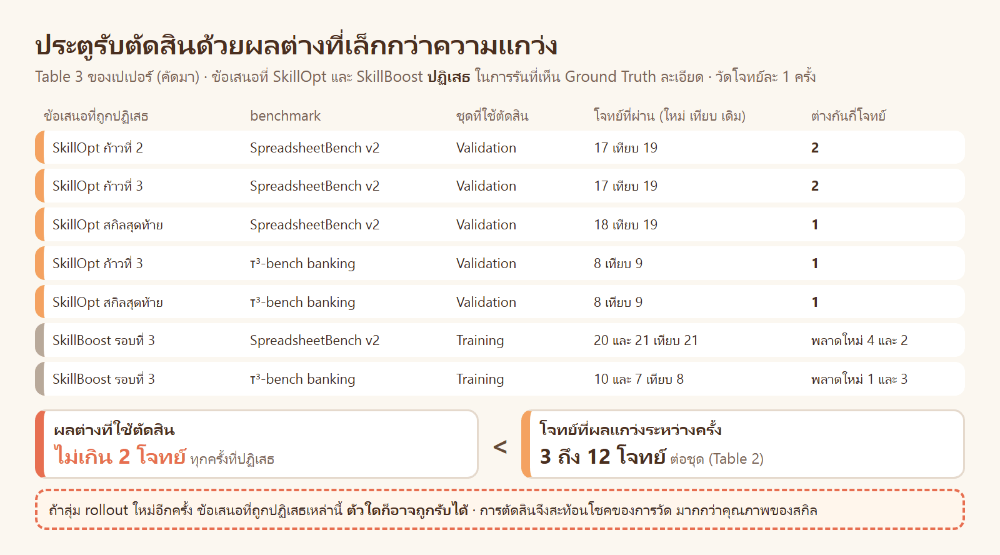

| | |
|---|---|
| เหตุผลข้อ 1 | คะแนนจาก rollout แกว่ง (ข้อ 11.3) · ทุกครั้งที่ SkillOpt และ SkillBoost ปฏิเสธ ผลต่างคือ **2 โจทย์หรือน้อยกว่า** ซึ่งเล็กกว่าจำนวนโจทย์ที่ผลแกว่ง · ถ้าสุ่มใหม่ ข้อเสนอที่ถูกทิ้งอาจถูกรับ |
| เหตุผลข้อ 2 | หลายครั้งต่อโจทย์ลดความแกว่งได้ แต่ **ลบไม่ได้** · กติกาใดก็ตามที่ตัดสินจากคะแนน rollout จึงยังเสี่ยงอยู่ |
| เหตุผลข้อ 3 | การแก้ที่ผิดไม่ได้หายไป: Evolver มีสกิลและ rollout ของทุก epoch · rollout ของ epoch ถัดไปแสดงว่าการแก้นั้นทำอะไรแย่ลง แล้วตาถัดไป **ย้อนกลับเอง** ได้ · "การแก้ที่พลาดกลายเป็นหลักฐาน แทนที่จะถูกทิ้ง" |
| หลักฐานในเปเปอร์ | ทั้ง 6 การรัน Validation ของ epoch สุดท้ายสูงกว่าไม่มีสกิล · 4 การรัน epoch สุดท้ายสูงสุดหรือเท่ากับสูงสุด · อีก 2 การรัน epoch ก่อนหน้าสูงกว่า แต่ถ้าเลือกตาม Validation จะได้ Held-out **ต่ำกว่า 15 episode** ในการรันหนึ่ง (111 เทียบ 126 จาก 312) และสูงกว่า 1 episode ในอีกการรัน |
| ข้อแลกเปลี่ยน | epoch สุดท้ายอาจไม่ใช่ชุดที่ดีที่สุด · ถ้าตาสุดท้ายของ Evolver เป็นการ **ทดลอง** ชุดทดลองนั้นจะถูกนำไปวัด Test |
| ในการรันของเรา | สิ่งที่ตรงกับเปเปอร์: `p1` ตาที่ 1 เขียนสมมติฐาน "ปัดลงทุกขั้น" แล้ว Validation ลดจาก 43.3% เป็น 31.7% ตาที่ 2 จึงถอนเอง (ทดลองปัดขึ้นครั้งเดียวตอนจบ) · สิ่งที่เป็นราคา: ชุดที่เดาผิดถูกใช้ทั้ง epoch · และชุดของตาสุดท้ายเป็นการทดลองที่ถูกนำไปวัด Test ทันที: `e1` ตาที่ 3 ย้ายไฟล์เทสต์ออกจากโฟลเดอร์งาน (ข้อสันนิษฐานที่ผิดทาง) · `p2` ตาที่ 3 ทดลองวิธีปัดเศษต่างกันตามชนิดงาน แล้ว Test 56.7% ต่ำกว่า Validation ของตัวเอง 13 จุด ([README หลัก LAB 4](../README.md#lab-4--evolver-เห็นแต่คะแนน-p1)) · และเมื่อไม่มีขั้นตัดสิน นโยบายที่ Evolver เขียนกว้างเกินหลักฐานถูกใช้จนถึง Test: 11 จาก 12 การรันเขียน "เงินที่ร้านจ่ายออกปัดลง" เป็นกฎทั่วไป (ขั้น 9.4) |
| ในเครื่องมือ | คำสั่ง `turn` คัดลอก `evo/staging/` → `skills_vK/` เสมอ ไม่มีขั้นปฏิเสธ ([รูปแบบ ข้อ 9](../evoskill_format.md#9--ตาของ-evolver-turn) ลำดับที่ 5) · คำสั่ง `test` ใช้ `skills_vE` ([ข้อ 3](../evoskill_format.md#3--คำสั่ง-12-ตัว)) · คำสั่ง `noise` ตารางที่ 2 จำลองว่าประตูรับแบบวัดครั้งเดียวจะตัดสินอย่างไรกับผลจริงของเรา ([ข้อ 12](../evoskill_format.md#12--ข้อความของ-noise)) |

### 11.5 ทำไมแยก Benchmark Adaptor ออกจาก Evolver

| | |
|---|---|
| คำถาม | เมื่อให้ Agent ช่วยเตรียม benchmark แล้ว ใช้ Agent ตัวเดียวกับที่เขียนสกิลได้หรือไม่ |
| EvoSkill v2 เลือก | ไม่ได้ · เป็นคนละเซสชัน รันคนละเครื่อง และ Adaptor ทำงานจบก่อน Evolver เริ่ม |
| เหตุผล | Agent ที่ทั้งกำหนดการวัดและถูกวัด มีทางทำคะแนนขึ้นโดยไม่ต้องเขียนสกิลให้ดี: เปลี่ยนว่าโจทย์ใดถูกนับ หรือเปลี่ยนว่าตัวเองเห็นอะไร · ในระบบอื่นที่เปเปอร์สำรวจ เครื่องมือวัด (การแบ่งชุด · ตัวตรวจ) ถูกกำหนดโดยคนทั้งหมด จึงไม่มีปัญหานี้ · EvoSkill v2 มอบส่วนหนึ่งให้ Agent จึงต้องแยก |
| ในเครื่องมือ | คำสั่ง `adapt` เรียก Adaptor ด้วย `--no-session-persistence` (เซสชันใช้ครั้งเดียว ไม่เก็บ) และเห็นโฟลเดอร์คนละชุดกับ Evolver (`/ba` `/data` เทียบกับ `/evo` · [รูปแบบ ข้อ 7](../evoskill_format.md#7--การเรียก-agent-และการแยกเครื่อง)) · หลัง adapt โปรแกรมเทียบการแบ่งชุดของ plug-in กับ `split.json` ของผู้ใช้ ถ้าไม่ตรงจะไม่ล็อก ([ข้อ 5](../evoskill_format.md#5--benchmark-adaptor-adapt) ลำดับที่ 5) |

### 11.6 ทำไมผู้ใช้เป็นผู้ให้ตัวตรวจ และ Evolver ได้แต่คะแนน

| | |
|---|---|
| คำถาม | ให้ Agent เขียนตัวตรวจ หรือให้ Evolver อ่านโค้ดของตัวตรวจ ได้หรือไม่ |
| EvoSkill v2 เลือก | ผู้ใช้เขียน · Adaptor อ่านได้แต่แก้ไม่ได้ · Evolver ไม่เห็น ได้เฉพาะคะแนน 0 ถึง 1 |
| เหตุผล | (1) ตัวตรวจคือนิยามของ "ทำถูก" จึงต้องมาจากคนที่รับผิดชอบงาน และต้องถูกตรวจก่อนรัน (เรื่องช่องโหว่ในขั้น 8) (2) ผู้ปรับสกิลที่อ่านโค้ดของตัวตรวจได้ จะเขียนสกิลให้เข้ากับ **วิธีตรวจ** แทน **งาน** |
| ข้อแลกเปลี่ยน | กฎที่มีอยู่เฉพาะในตัวตรวจและไม่ปรากฏในเฉลยหรือโจทย์ Evolver ค้นพบได้ยาก · ถ้าผู้ใช้ต้องการให้ Evolver รู้ ต้องใส่ผ่าน Reference Folder |
| ในการรันของเรา | `e1` ติดที่ 0.9 ต่อ rollout เพราะกฎ "ต้องส่งเทสต์อย่างน้อย 6 ข้อ" (ขั้น 9.3) · การรัน `n1` และ `n2` ให้ผู้ใช้เพิ่มหมายเหตุ 1 ประโยคใน reference ว่างานที่ได้คะแนนเต็มมี 2 ไฟล์ แล้วสกิลของทั้งสองการรันให้ Solver ส่งไฟล์เทสต์ ได้ Test 93.3% ทั้งคู่ ([README หลัก LAB 3](../README.md#lab-3--ผู้ใช้บอก-evolver-เพิ่ม-1-ประโยค-n1)) |
| ในเครื่องมือ | ก่อนทุกตา โปรแกรมเขียน `evo/scores/epoch_K.json` เป็นตัวเลขอย่างเดียว ([รูปแบบ ข้อ 8](../evoskill_format.md#8--เครื่องของ-evolver-evo)) · ผลรายข้อ (`grade.json`) อยู่ใต้ `legs/` ซึ่งไม่ถูกส่งเข้าเครื่องของ Evolver ([ข้อ 6](../evoskill_format.md#6--solver-และตัวตรวจ-rollout): ผลรายข้อเป็นของผู้สอน ห้ามส่งให้ Evolver) |

### 11.7 ทำไมวัด Validation ทุก epoch ทั้งที่ไม่ใช้ตัดสิน

| | |
|---|---|
| EvoSkill v2 เลือก | Solver ทำโจทย์ Validation ทุก epoch · คะแนนถูกบันทึก · Evolver ไม่เห็น · ไม่ใช้เลือก epoch |
| เหตุผล | Validation เป็น **มาตรวัดสำหรับคน**: บอกว่าสกิลของแต่ละ epoch ใช้กับโจทย์ที่ Evolver ไม่เคยเห็นได้หรือไม่ · ถ้าให้ Evolver เห็น มันจะกลายเป็นข้อมูลฝึกอีกชุด · ถ้าใช้เลือก epoch ก็เจอปัญหาความแกว่งของข้อ 11.4 |
| สิ่งที่ Validation เผย | Training ขึ้นมากกว่า Validation หลายเท่า = Evolver เขียนกฎที่เข้ากับโจทย์ของ Training โดยเฉพาะ (ขั้น 12.3) |
| ในเครื่องมือ | คำสั่ง `rollout` ให้ผล leg `vK_val` และ `vK_train` ([รูปแบบ ข้อ 3](../evoskill_format.md#3--คำสั่ง-12-ตัว)) · ก่อนทุกตา โปรแกรมส่งเฉพาะผลของ leg Training เข้า `evo/` ส่วน Validation และ Test ไม่ถูกส่งเข้าไปเลย ([ข้อ 8](../evoskill_format.md#8--เครื่องของ-evolver-evo)) |

### 11.8 ทำไม prompt ของ Evolver สั้นมาก

| | |
|---|---|
| EvoSkill v2 เลือก | ข้อความต่อท้าย system prompt บอก: บทบาท · เป้าหมาย (คะแนนกับโจทย์ที่ไม่เคยเห็น) · จังหวะของการรัน · แผนที่ของโฟลเดอร์ · กติกาของ `staging/` · **ไม่มี** ขั้นตอนการวิเคราะห์ ไม่มีรูปแบบคำตอบ ไม่มีจำนวนการแก้สูงสุด |
| เหตุผล | เมื่อผู้เขียนสกิลเป็น Agent ที่ทดสอบเองได้และจำเองได้ วิธีทำงานจึงปล่อยให้มันเลือก · กติกาที่เหลือ (เห็นอะไร เขียนที่ไหนได้) ถูกบังคับโดยโครงของเครื่อง ไม่ใช่ด้วยถ้อยคำ |
| เทียบกับบท 06 | prompt ของ Skill Proposer มี 6 หัวข้อ: ลำดับการทำงาน 7 ขั้น รูปแบบ JSON และกติกา 6 ข้อ เพราะผู้เสนอเขียนไฟล์เองไม่ได้ โปรแกรมต้องแปลงคำตอบเป็นไฟล์ |
| สิ่งที่ prompt เตือนเรื่องคุณภาพของสกิล | "โจทย์ชุด train ที่อยู่ตรงหน้าคุณเป็นเพียงตัวอย่างส่วนหนึ่งของ benchmark ที่ใหญ่กว่า สกิลที่ใช้ได้เฉพาะกับโจทย์เหล่านี้จึงไม่ช่วยในการวัดผลจริง" |
| ในเครื่องมือ | [`prompts/evolver_system.md`](../../../00_resource/skills/evoskill/prompts/evolver_system.md) ยาว 40 บรรทัด · [`prompts/evolver_message.md`](../../../00_resource/skills/evoskill/prompts/evolver_message.md) ยาว 1 บรรทัด · สิ่งที่ต้องบอกอยู่ใน [รูปแบบ ข้อ 9](../evoskill_format.md#9--ตาของ-evolver-turn) |

### 11.9 ทำไม staging เริ่มจากชุดเดิม

| | |
|---|---|
| EvoSkill v2 เลือก | แต่ละตา `staging/` มีชุดที่ Evolver ทิ้งไว้ครั้งก่อน · แก้ในที่เดิม · สิ่งที่อยู่ตอนจบตาคือชุดถัดไป · ถ้าหมดเวลา ใช้ตามสภาพที่เป็นอยู่ |
| เหตุผล | (1) ค่าเริ่มต้นคือ "ไม่เปลี่ยน" Evolver ที่ไม่มีหลักฐานพอจึง **เลือกไม่แก้ได้** (2) การแก้เป็นการแก้ทีละส่วนโดยธรรมชาติ ไม่ต้องเขียนใหม่ทั้งชุด (3) ไม่มีขั้น "ส่งงาน" ที่อาจผิดรูปแบบ |
| ในการรันของเรา | `n1` ตาที่ 2 และ 3: Training ได้ 1.0 ทั้ง 12 rollout Evolver จึง "ไม่ได้แก้อะไรใน `/evo/staging/`" ชุดสกิลทั้ง 3 epoch เหมือนกันทุกไบต์ ([`turn_2/actions.md`](../runs/n1/turns/turn_2/actions.md) · [`turn_3/actions.md`](../runs/n1/turns/turn_3/actions.md)) |
| ในเครื่องมือ | คำสั่ง `turn` เทียบไฟล์ใน `staging/` ก่อนและหลังตา แล้วรายงาน `files_added` `files_changed` `files_removed` ใน `stats.json` ([รูปแบบ ข้อ 10](../evoskill_format.md#10--หลักฐานของแต่ละครั้ง-turns)) |

### 11.10 ทำไมขนาดของการรันอยู่ในคำสั่งของผู้ใช้

| | |
|---|---|
| EvoSkill v2 เลือก | จำนวน epoch และจำนวนครั้งต่อโจทย์ เขียนในคำสั่งของผู้ใช้ (`3 epochs · 3 samples per task`) · การรันที่ไม่ระบุถูกปฏิเสธ · ไม่มีการหยุดก่อนกำหนด |
| เหตุผล | ไม่มีประตูรับและไม่ใช้ Validation ตัดสิน จึงไม่มีสัญญาณในระบบที่จะบอกให้หยุด · งบประมาณจึงเป็นการตัดสินใจของคน และถูกล็อกพร้อมสิ่งอื่นก่อนเริ่ม |
| ข้อสังเกตจากการรันของเรา | Evolver **ไม่ถูกบอก** ว่ามีกี่ epoch · ใน `p1` ตาที่ 3 มันวางแผนว่า "ถ้า epoch 3 ยังไม่เต็ม ผมจะลองปัดทุกขั้น" ซึ่งไม่มีตาถัดไปให้ทำ (ขั้น 14) |
| ในเครื่องมือ | คำสั่ง `init` อ่านขนาดของการรันจากคำสั่งของผู้ใช้ และหยุดถ้าไม่พบ · เก็บใน `RUN.json` → `run_size` ([รูปแบบ ข้อ 3](../evoskill_format.md#3--คำสั่ง-12-ตัว)) · `prompts/evolver_message.md` ไม่บอกจำนวน epoch ทั้งหมด ([ข้อ 9](../evoskill_format.md#9--ตาของ-evolver-turn)) |

### สรุปการออกแบบใน 1 ตาราง

| หลัก | ผลในระบบ |
|---|---|
| คำอธิบายต้องถูกทดสอบก่อนเขียน | Evolver เป็น Agent ที่มี bash |
| ความเข้าใจต้องสะสม | เซสชันเดียว · โฟลเดอร์ส่วนตัว · เก็บของทุก epoch |
| หลักฐานต้องแยกสัญญาณออกจากความแกว่ง | โจทย์ละ 3 ครั้ง |
| อย่าตัดสินด้วยตัวเลขที่แกว่ง | รับทุก epoch · ทดสอบชุดสุดท้าย |
| ผู้ถูกวัดต้องไม่เป็นผู้กำหนดการวัด | แยก Adaptor · ล็อกด้วย hash · ผู้ใช้ให้ตัวตรวจ |
| ข้อสอบต้องไม่รั่ว | เครื่องของ Evolver ได้เฉพาะของ Training |
| เชื่อการตัดสินใจของ Agent ภายในกรอบที่บังคับได้จริง | prompt สั้น · กติกาอยู่ที่โครงของเครื่อง |

---

## ขั้น 12 · ผลในเปเปอร์

### 12.1 ทดลองอย่างไร

| หัวข้อ | SpreadsheetBench v2 | τ³-bench banking |
|---|---|---|
| งาน | แก้ไฟล์ Excel จริงตามคำสั่ง | เป็นพนักงานบริการลูกค้าของธนาคาร คุยกับลูกค้าจำลอง |
| การตรวจ | เทียบกับไฟล์เฉลยทีละเซลล์ หลังคำนวณสูตรใหม่ | ฐานข้อมูลสุดท้ายต้องตรง หรือเรียกเครื่องมือครบตามที่คาด |
| Solver | Claude Code + Sonnet 5.5 | Claude Code + Haiku 5.5 |
| โจทย์ (train / validation / test) | 57 / 57 / 104 | 19 / 20 / 31 |
| คะแนนสูงสุดบน leaderboard สาธารณะ | 54.5% | 55.2% |
| การให้คะแนน | ผ่านเมื่อถูก **ทุกจุด** (all-or-nothing) | เช่นเดียวกัน |
| ขนาดของการรัน | 3 epochs · 3 ครั้งต่อโจทย์ | เช่นเดียวกัน |

วิธีที่นำมาเทียบ: **SkillOpt** (บท 05 ภาคทฤษฎี) และ **SkillBoost** · ใช้ Solver การแบ่งชุด และตัวตรวจชุดเดียวกัน · ผู้ปรับสกิลของทุกวิธีคือ Sonnet 5.5

แต่ละการเทียบทำ 2 แบบ ตามสิ่งที่ผู้ปรับสกิลเห็น

| แบบ | EvoSkill v2 เห็น | SkillOpt และ SkillBoost เห็น |
|---|---|---|
| Fine-grained Ground Truth | เฉลยของ Training ใน Reference Folder | สิ่งที่ตัวตรวจพบว่าผิดในแต่ละครั้ง (SkillOpt ทุกจุด · SkillBoost จุดแรก) |
| Pass or Fail Only | แค่ผ่านหรือไม่ผ่าน | แค่ผ่านหรือไม่ผ่าน |

### 12.2 ได้ผลแค่ไหน

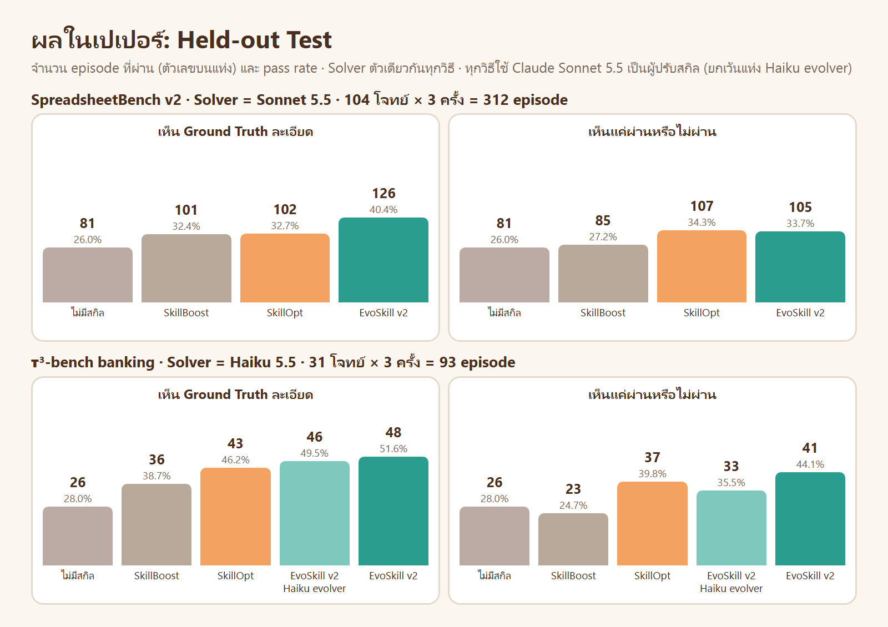

| ข้อค้นพบ | ตัวเลข |
|---|---|
| เห็น Ground Truth ละเอียด: EvoSkill v2 สูงสุดทั้งสอง benchmark | SpreadsheetBench v2: 126 เทียบ 102 จาก 312 (+7.7 จุด) · τ³-bench: 48 เทียบ 43 จาก 93 (+5.4 จุด) |
| เห็นแค่ผ่านหรือไม่ผ่าน: ใกล้เคียง SkillOpt บน SpreadsheetBench v2 และนำบน τ³-bench | 105 เทียบ 107 · 41 เทียบ 37 |
| ส่วนที่ดีขึ้นกระจุกในหมวดที่ไม่มีสกิลทำไม่ได้เลย | SpreadsheetBench v2 หมวด Debugging: 0 → 23 จาก 84 · หมวด Financial_Model เท่าเดิม 56 จาก 108 |
| โมเดลเล็กปรับสกิลของตัวเองได้ (Self-evolution) | Haiku 5.5 เป็นทั้ง Solver และ Evolver: 26 → 46 จาก 93 (+21.5 จุด) ห่างจาก Evolver ที่เป็น Sonnet 5.5 เพียง 2 episode |

**ภาพต้นฉบับ: Figure 2 และ 3 ของเปเปอร์** (SpreadsheetBench v2 · ซ้าย = Held-out · ขวา = คะแนนราย epoch)

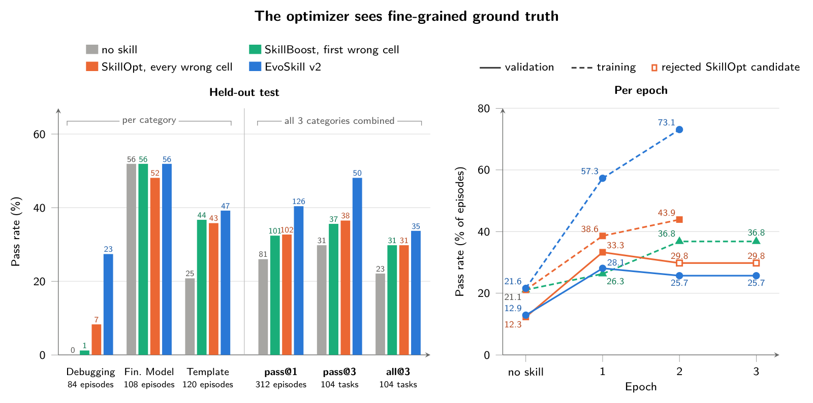

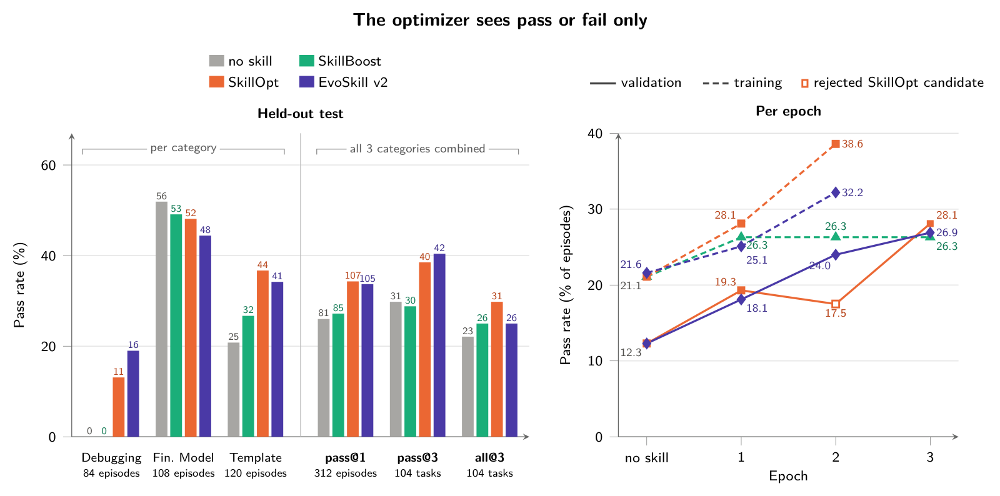

**ภาพต้นฉบับ: Figure 4 ของเปเปอร์** (τ³-bench banking · Held-out ทั้งสองแบบ)

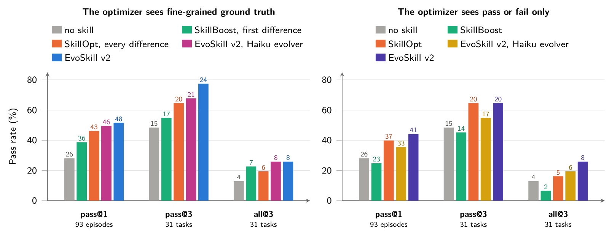

| ในภาพต้นฉบับ | ในภาพของเรา |
|---|---|
| แท่ง pass@1 (ตัวเลขบนแท่ง = จำนวน episode ที่ผ่าน) | แท่งทั้งหมดของเรา = pass@1 |
| แท่ง pass@3 และ all@3 | ไม่ได้วาด (ดูในภาพต้นฉบับ) |
| กราฟ "Per epoch" ทางขวาของ Figure 2 และ 3 | แยกไปเป็นภาพในข้อ 12.3 |

### 12.3 สิ่งที่คะแนนราย epoch บอก

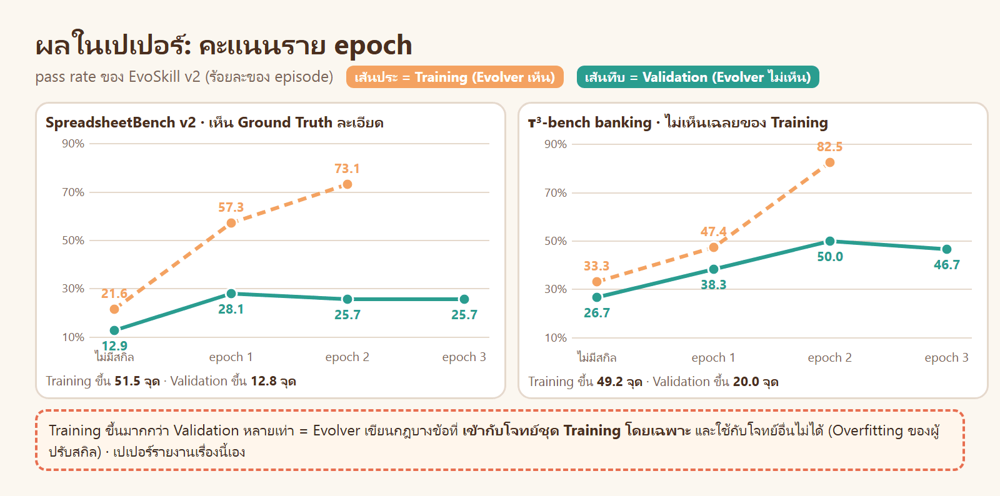

| สังเกต | ความหมาย |
|---|---|
| Training ขึ้นมากกว่า Validation หลายเท่า | Evolver เขียนกฎบางข้อที่ใช้ได้เฉพาะกับโจทย์ที่มันเห็น = Overfitting ของผู้ปรับสกิล |
| ตัวอย่างในเปเปอร์ | สกิล 2 จาก 4 ตัวของ SpreadsheetBench v2 เขียนสำหรับ Template 3 โฟลเดอร์ที่อยู่ใน Training เท่านั้น ซึ่งไม่มีโจทย์ Validation หรือ Test มาจากโฟลเดอร์เหล่านั้นเลย |
| Validation ของ epoch สุดท้ายไม่ได้สูงสุดเสมอ | SpreadsheetBench v2: 28.1 → 25.7 → 25.7 · แต่ชุดของ epoch สุดท้ายได้ Held-out สูงกว่าชุดของ epoch 1 (126 เทียบ 111) |

**ภาพต้นฉบับ: Figure 5 ของเปเปอร์** (τ³-bench banking ราย epoch ของ EvoSkill v2 ทั้ง 4 การรัน)

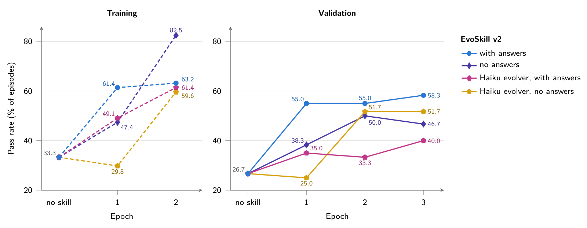

ภาพของเราแสดง 1 จาก 4 เส้นของ Figure 5 (no answers = ไม่เห็นเฉลยของ Training) คู่กับเส้นของ SpreadsheetBench v2 จาก Figure 2

### 12.4 ต้นทุนของผู้ปรับสกิล

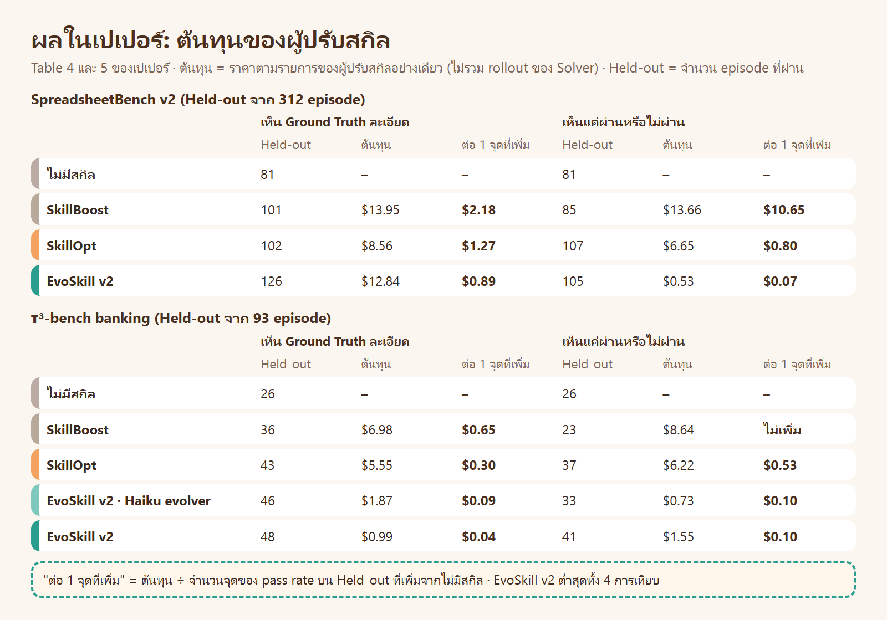

| ข้อค้นพบ | ตัวเลข |
|---|---|
| ต้นทุนต่อ 1 จุดที่เพิ่ม ต่ำสุดทั้ง 4 การเทียบ | เช่น τ³-bench แบบเห็น Ground Truth: $0.04 เทียบ $0.30 (SkillOpt) และ $0.65 (SkillBoost) |
| แบบเห็นแค่ผ่านหรือไม่ผ่านบน SpreadsheetBench v2 ต้นทุนต่ำกว่า SkillOpt กว่า 10 เท่า | $0.53 เทียบ $6.65 |
| ข้อควรระวังในการอ่าน | ต้นทุนนี้ **ไม่รวม** rollout ของ Solver ซึ่ง EvoSkill v2 ใช้มากกว่า 3 เท่าต่อโจทย์ · การรัน 2 ชุดของ SpreadsheetBench v2 ใช้ Claude Code คนละรุ่น |

### 12.5 สกิลที่ได้หน้าตาอย่างไร

| benchmark | สกิลหลัง epoch 3 | ขนาด | สคริปต์ |
|---|---|---|---|
| SpreadsheetBench v2 | 4 ตัว เขียนตั้งแต่ตาแรกและถูกแก้ทุกตา | `SKILL.md` รวม 71 KB | 5 ไฟล์ (ตัวสแกนสูตรที่น่าสงสัย · ตัวหาเซลล์ที่ถูกลบ ฯลฯ) |
| τ³-bench banking | 2 ตัว: ขั้นตอนการทำงาน และรายการจุดพลาดที่พบ | `SKILL.md` รวม 11 KB | ไม่มี |
| BaanKafe (บทนี้ · `e1`) | 1 ตัว เขียนตั้งแต่ตาแรก แล้วถูกแก้ในตาที่ 2 และ 3 | `SKILL.md` 12.6 KB | 1 ไฟล์ (แม่แบบโค้ด `solve_template.py`) |

---

## ขั้น 13 · เปรียบเทียบกับวิธีอื่น

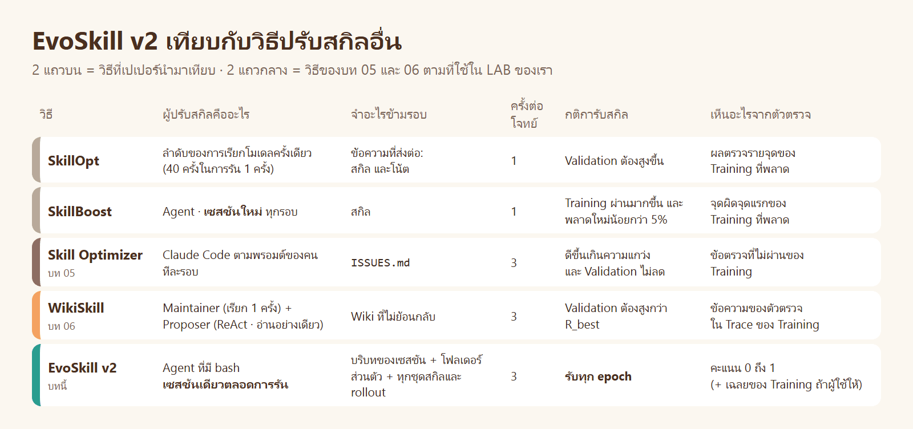

### 13.1 เส้นแบ่งที่เปเปอร์ใช้

| กลุ่ม | ขั้นเสนอการแก้ทำอย่างไร | ตัวอย่าง |
|---|---|---|
| Single-call Reflective | เรียกโมเดลครั้งเดียว อ่าน trace แล้วเขียนของใหม่ ไม่มีเครื่องมือ | GEPA |
| กึ่งกลาง | เรียกหลายครั้ง: เสนอทีละกลุ่มเล็ก แล้วรวมเป็นขั้น ๆ | SkillOpt |
| Agentic | ผู้เสนอมีเครื่องมือ | SkillOpt-Lite · SkillBoost · EvoSkill v1 และ v2 |
| Skill Library | Agent ที่ทำโจทย์สะสมวิธีทำของตัวเอง โดยไม่ตรวจกับชุดที่เก็บไว้ | Voyager · ExpeL · ACE |

ทุกระบบมีวงรอบ "เสนอ → วัด → ทำซ้ำ" เหมือนกัน · ที่ต่างคือ **ขั้นเสนอ**

### 13.2 กับ WikiSkill ของบท 06

| ประเด็น | WikiSkill | EvoSkill v2 |
|---|---|---|
| ความรู้ข้ามรอบอยู่ที่ไหน | Wiki ที่มีโครงสร้าง (pattern · index · skill-impact) เขียนโดย Agent เฉพาะทาง | ในเซสชันของ Evolver และไฟล์ที่มันเลือกเก็บเอง ไม่มีโครงสร้างบังคับ |
| ผู้เสนออ่านอะไร | index ก่อน แล้วเลือกเปิด (อ่านอย่างเดียว) | อะไรก็ได้ในเครื่องของตัวเอง และรันโค้ดได้ |
| ถ้าข้อเสนอแย่ลง | สกิลย้อนกลับทันที · Wiki จดว่าเคยลอง | ไม่ย้อนอัตโนมัติ · Evolver เห็นผลใน epoch ถัดไปแล้วย้อนเอง |
| คนอ่านความรู้ย้อนหลังได้หรือไม่ | ได้ เป็นหน้า Wiki | ได้เท่าที่ Evolver จดไว้ (`e1` จด 6 บรรทัด · `p1` 9 บรรทัด · `h1` โน้ต 3 ไฟล์) |
| ความรู้เฉพาะงานที่โจทย์ไม่ได้เขียน (นโยบายธุรกิจ) | หาไม่ได้ เพราะไม่มีใครเห็นเฉลย · Wiki จดว่ายังไม่ยืนยัน | หาได้จากเฉลยของ Training · แต่ขยายเกินหลักฐานได้ และไม่มี Gate กัน |
| จุดร่วม | แยกผู้ทำโจทย์ออกจากผู้ปรับสกิล · ผู้ทำโจทย์เห็นเฉพาะสกิล · ปรับสกิลจากผลของ Training | |

### 13.3 กับ Skill Optimizer ของบท 05

| ประเด็น | Skill Optimizer (บท 05) | EvoSkill v2 |
|---|---|---|
| สกิลรุ่นแรก | คนเขียน | ว่าง |
| ใครตัดสินว่าแก้อะไร | Claude ตามพรอมต์ของคน ทีละรอบ | Evolver เอง ทุกรอบ |
| ประตูรับ | มี และคิดความแกว่ง | ไม่มี |
| คำตอบต่อปัญหาความแกว่ง | วัด 3 ครั้ง แล้วตั้งเกณฑ์จาก Standard Error | วัด 3 ครั้ง แล้ว **ไม่ตัดสินด้วยคะแนนเลย** |

บท 05 และ EvoSkill v2 เห็นปัญหาเดียวกัน (คะแนนแกว่ง) แต่ตอบคนละทาง

---

## ขั้น 14 · ข้อจำกัด

| ข้อจำกัด | ที่มา | ผล |
|---|---|---|
| แต่ละการตั้งค่ารันครั้งเดียว | เปเปอร์ | ผลต่างไม่กี่ episode ระหว่างวิธี อาจเป็นความบังเอิญ |
| Evolver เขียนกฎที่เข้ากับ Training โดยเฉพาะ | เปเปอร์ (ขั้น 12.3) | Training ขึ้นมากกว่า Validation หลายเท่า |
| epoch สุดท้ายไม่ใช่ชุดที่ดีที่สุดเสมอ | เปเปอร์ + การรัน `h1` ของเรา | ชุดที่ถูกนำไปใช้อาจแย่กว่าชุดก่อนหน้า (`h1` Validation 70.0% ที่ epoch 1 → 60.0% ที่ epoch 3) |
| Evolver ไม่รู้ว่าตาใดเป็นตาสุดท้าย | การรัน `e1` `p1` `p2` ของเรา | Evolver วางการทดลองไว้ในตาสุดท้าย (`e1` ย้ายไฟล์เทสต์ · `p2` วิธีปัดเศษต่างกันตามชนิดงาน) และแผนของ "epoch หน้า" ไม่เคยเกิด |
| สกิลถูกวัดกับโมเดลของ Solver ที่มันถูกเขียนให้เท่านั้น | เปเปอร์ | ยังไม่รู้ว่าสกิลย้ายข้ามโมเดลได้ดีเพียงใด (งานอื่นพบว่าสกิลจากโมเดลใหญ่ไม่ได้ช่วยโมเดลเล็กเสมอ) |
| ตัวตรวจที่มีช่องโหว่ถูกใช้ประโยชน์ได้ | เปเปอร์ (ขั้น 8) | ผู้ใช้ต้องตรวจตัวตรวจเอง |
| กฎที่อยู่เฉพาะในตัวตรวจ Evolver ค้นพบได้ยาก | การรัน `e1` ของเรา (ขั้น 9.3) | คะแนนติดเพดาน จนกว่าผู้ใช้จะบอกเพิ่มผ่าน Reference Folder |
| ต้นทุนที่รายงานไม่รวม rollout ของ Solver | เปเปอร์ | การวัด 3 ครั้งต่อโจทย์ทุก epoch เป็นต้นทุนส่วนใหญ่ของการรัน (ของเรา: Solver $8.81 เทียบ Evolver $0.57) |
| ผลของการรันซ้ำต่างกันมาก | การรันของเรา (12 การรัน) | การตั้งค่าเดียวกันให้ Test ต่างกันได้ 13 จุด (`p1` 70.0% เทียบ `p2` 56.7%) และ 10 จุด (`f1` 83.3% เทียบ `f3` 93.3%) · ส่วน `e1` `e2` `v1` ได้ 83.3% เท่ากันทั้งที่เดินคนละเส้นทาง · ข้อสรุปจากการรันครั้งเดียวจึงเชื่อไม่ได้ |
| source code ต้นฉบับต้องใช้ macOS และ Daytona | README ของ source code | ยังรันบน Linux หรือ Docker ในเครื่องไม่ได้ |

---

## ขั้น 15 · เปเปอร์ เทียบกับ LAB ของบทนี้

### 15.1 ตรงกันตรงไหน

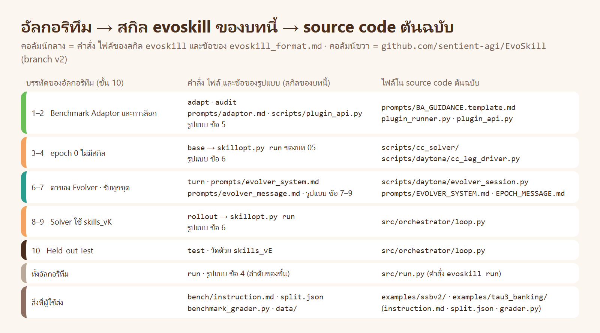

| ชิ้นส่วนของ EvoSkill v2 | ในเปเปอร์ | ใน LAB ของเรา |
|---|---|---|
| คำสั่งของผู้ใช้ | ข้อความ 5 หัวข้อ (Appendix 3–4) | [`bench/instruction.md`](../bench/instruction.md) 5 หัวข้อ |
| ตัวตรวจ | `grade(task, snapshot)` → 0 ถึง 1 | [`bench/benchmark_grader.py`](../bench/benchmark_grader.py) สัญญาเดียวกัน |
| Benchmark Adaptor | Claude Code 1 เซสชัน → plug-in + reference → ล็อกด้วย hash | คำสั่ง `adapt` ([รูปแบบ ข้อ 5](../evoskill_format.md#5--benchmark-adaptor-adapt)) |
| Evolver | เซสชันเดียว · `--session-id` แล้ว `--resume` · ปิด WebSearch และ WebFetch | คำสั่ง `turn` (เหมือนกัน · [ข้อ 7](../evoskill_format.md#7--การเรียก-agent-และการแยกเครื่อง) และ [ข้อ 9](../evoskill_format.md#9--ตาของ-evolver-turn)) |
| เครื่องของ Evolver | 7 โฟลเดอร์ใต้ `/evo` (Table 1) | 7 โฟลเดอร์ใต้ `/evo` ชื่อเดียวกัน |
| ขนาดของการรัน | 3 epochs · 3 samples per task | เหมือนกัน |
| กติการับสกิล | รับทุก epoch · ทดสอบชุดสุดท้าย | เหมือนกัน |
| การตั้งค่า 2 แบบ | Fine-grained Ground Truth · Pass or Fail Only | `e1` · `p1` |

### 15.2 ต่างกันตรงไหน และทำไม

| หัวข้อ | เปเปอร์และ source code ต้นฉบับ | LAB ของเรา | เหตุผลของ LAB |
|---|---|---|---|
| การแยกเครื่อง | เครื่อง Daytona · container 1 ตัวต่อ 1 rollout | container เดียว · Adaptor และ Evolver ถูกแยกด้วย mount namespace | รันได้บนเครื่องของผู้เรียน |
| เครือข่าย | ปิด เหลือเฉพาะ API ของโมเดล | ไม่ได้ปิด (ปิดเฉพาะเครื่องมือค้นเว็บ) | container ของ LAB ใช้ร่วมกับงานอื่น |
| การส่งสกิลให้ Solver | `.claude/skills/` + Progressive Disclosure | `./skills/` และพรอมต์บอกให้อ่าน | ใช้ Solver ตัวเดียวกับบท 05 และ 06 เพื่อเทียบผล |
| คะแนน | ผ่านหรือไม่ผ่าน (all-or-nothing) | สัดส่วนของข้อตรวจ 10–11 ข้อ · รายงาน pass@1 ควบคู่ | ใช้ตัวตรวจชุดเดียวกับบท 05 และ 06 |
| จำนวนโจทย์ | 218 และ 70 | 9 (train 4 · validation 2 · test 3) | 1 การรันจบในราว 7–16 นาที |
| เวลาต่อตาของ Evolver | 2 ชั่วโมง | 30 นาที (ใช้จริง 0.1–4.6 นาที) | งานเล็ก |
| prompt | ภาษาอังกฤษ (Appendix 2, 5, 6) | เขียนใหม่เป็นภาษาไทยด้วยถ้อยคำของบทเรียน + 1 บรรทัด "เขียนสกิลเป็นภาษาไทย" | ผู้เรียนอ่านสกิลและ prompt ได้ |
| การตรวจ plug-in | รันใน sandbox (`python -I -S`) | ตรวจรายการ import ด้วย `ast` แล้วรันปกติ | ย่อให้อ่านง่าย |
| ขนาดโค้ด | `loop.py` 7,423 บรรทัด + โค้ดของ Daytona | [`scripts/evoskill.py`](../../../00_resource/skills/evoskill/scripts/evoskill.py) ไฟล์เดียว 1,606 บรรทัด (สร้างจากพรอมต์ของ LAB 0.1) | ใช้ไลบรารีมาตรฐานอย่างเดียว ให้ผู้เรียนสร้างเองได้ในบทเรียน |

### 15.3 ผลของ LAB อ่านด้วยภาษาของเปเปอร์

| เปเปอร์บอกว่า | เกิดใน LAB |
|---|---|
| ไม่มีสกิล พลาดแล้วมักพลาดซ้ำ | epoch 0 ของ `e1` ไม่มี rollout ใดผ่านครบทุกข้อ (0/27) และพลาดข้อตรวจชุดเดิม (ทั้ง 12 การรัน 0/324) |
| Agent ที่มี bash ทดสอบคำอธิบายก่อนเขียน | `e1` ตาที่ 2 และ 3 (ขั้น 9.2) |
| เห็นเฉลยของ Training ได้ผลดีกว่าเห็นแค่คะแนน | Test: `e1` 83.3% เทียบ `p1` 70.0% (`p2` 56.7%) |
| ทุก epoch ถูกรับ และ epoch สุดท้ายไม่ได้ดีที่สุดเสมอ | `h1`: Validation 53.3% → 70.0% → 60.0% → 60.0% · `p1`: 43.3% → 31.7% → 43.3% → 70.0% (epoch 1 ต่ำกว่าไม่มีสกิล แต่ถูกใช้ทั้ง epoch) |
| ต้นทุนของ Evolver ต่ำ | 3 ตารวม $0.22–$0.73 ต่อการรัน (`e1` $0.57) |
| ผู้ปรับสกิลที่เห็นแต่คะแนน อาจปรับไปในทางที่ผู้ใช้ไม่ตั้งใจ | `p2` ตาที่ 3 ทดลองวิธีปัดเศษต่างกันตามชนิดงาน (รวมถึงเงินคืนปัดลง) และชุดทดลองนั้นถูกวัด Test: 56.7% ต่ำกว่า Validation ของตัวเอง 13 จุด |
| โมเดลเล็กปรับสกิลของตัวเองได้ | ได้บางส่วน: `h1` (haiku ทั้ง Solver และ Evolver) Test 53.3% → 62.2% · `h2` 55.6% → 71.1% · ต้นทุนของ Evolver $0.22 และ $0.29 · ไม่พบโหมดรันเป็นโปรแกรม (CLI) และไม่เขียนนโยบายธุรกิจลงสกิล (`policy` ผ่าน 0/6) |
| ประตูรับแบบวัดครั้งเดียวตัดสินตามโชค | `n1` ชุดสกิล v1 v2 v3 เหมือนกันทุกไบต์ แต่ประตูแบบวัดครั้งเดียวบน Validation จะ "รับ" v1 → v2 3 จาก 9 คู่ และ v2 → v3 4 จาก 9 คู่ (ต่ำกว่า 1 คู่) · ชุดนั้นได้ Test 93.3% |
| เซสชันเดียวดีกว่าเริ่มใหม่ทุกรอบ | **ไม่เห็นในโจทย์นี้:** `f1` `f2` `f3` (เริ่มใหม่) 83.3% · 85.6% · 93.3% · `e1` `e2` `v1` (เซสชันเดียว) 83.3% ทั้ง 3 การรัน |
| (เปเปอร์ไม่ได้ทดลอง) เฉลยมีกฎเฉพาะงานปนอยู่ | Evolver พบนโยบายธุรกิจจากเฉลยใน 7 จาก 8 การรันของ sonnet ที่เห็นเฉลย (`policy` ผ่าน 6/6 ภายใน epoch 2) แต่ขยาย "เงินคืนปัดลง" เป็นกติกาทั่วไป (11 จาก 12 การรัน) งานคืนเงินคอร์สของ Test จึงปัดเศษผิด 3/3 ในการรันเหล่านั้น และไม่มีประตูรับกันไว้ (ขั้น 9.4) |

ผลของทุกการรันและการเทียบกับบท 05 และ 06 อยู่ใน [README หลัก](../README.md#4--สรุปและแบบฝึกหัด)

### 15.4 source code ต้นฉบับ อยู่ตรงไหนของ GitHub

[github.com/sentient-agi/EvoSkill](https://github.com/sentient-agi/EvoSkill/tree/v2) (branch `v2`)

| สิ่งที่อยากดู | ไฟล์ใน source code ต้นฉบับ | ไฟล์ของบทนี้ (สกิล [`evoskill`](../../../00_resource/skills/evoskill/)) |
|---|---|---|
| วงรอบของ epoch | `src/orchestrator/loop.py` | [`scripts/evoskill.py`](../../../00_resource/skills/evoskill/scripts/evoskill.py) คำสั่ง `run` (ลำดับของขั้น: [รูปแบบ ข้อ 4](../evoskill_format.md#4--statejson-และลำดับของขั้น)) |
| คำสั่ง `evoskill run` | `src/run.py` | `scripts/evoskill.py <คำสั่ง> <work> --run <ชื่อ>` ([รูปแบบ ข้อ 3](../evoskill_format.md#3--คำสั่ง-12-ตัว)) |
| prompt ของ Benchmark Adaptor | `src/orchestrator/prompts/BA_GUIDANCE.template.md` | [`prompts/adaptor.md`](../../../00_resource/skills/evoskill/prompts/adaptor.md) |
| prompt ของ Evolver | `src/orchestrator/prompts/EVOLVER_SYSTEM.md` · `EPOCH_MESSAGE.md` | [`prompts/evolver_system.md`](../../../00_resource/skills/evoskill/prompts/evolver_system.md) · [`prompts/evolver_message.md`](../../../00_resource/skills/evoskill/prompts/evolver_message.md) |
| รูปแบบของ plug-in | `src/orchestrator/plugin_api.py` | [`scripts/plugin_api.py`](../../../00_resource/skills/evoskill/scripts/plugin_api.py) · [`scripts/plugin_skeleton.py`](../../../00_resource/skills/evoskill/scripts/plugin_skeleton.py) |
| เซสชันของ Evolver (`--resume`) | `scripts/daytona/evolver_session.py` | คำสั่ง `turn` ([รูปแบบ ข้อ 7](../evoskill_format.md#7--การเรียก-agent-และการแยกเครื่อง) และ [ข้อ 9](../evoskill_format.md#9--ตาของ-evolver-turn)) |
| Solver | `scripts/cc_solver/` | คำสั่ง `run` ของ `skill-optimizer/scripts/skillopt.py` (บท 05) เรียกจากคำสั่ง `base` `rollout` `test` `eval` ([ข้อ 6](../evoskill_format.md#6--solver-และตัวตรวจ-rollout)) |
| ตัวอย่างคำสั่ง · การแบ่งชุด · ตัวตรวจ | `examples/ssbv2/` · `examples/tau3_banking/` | [`bench/`](../bench/) |
| ที่มาของแต่ละส่วนของสกิล เทียบกับเปเปอร์ | – | [`references/source.md`](../../../00_resource/skills/evoskill/references/source.md) |

---

## ขั้น 16 · ทบทวน

<details><summary>1 ข้อสังเกตใดเป็นฐานของการปรับสกิล และมันบอกอะไร</summary>

Agent ที่ไม่มีสกิลซึ่งพลาดโจทย์ มักพลาดโจทย์นั้นอีกเมื่อทำซ้ำ · การพลาดซ้ำบอกว่าสาเหตุคือการขาดคำแนะนำอย่างสม่ำเสมอ ไม่ใช่ความบังเอิญ และคำแนะนำเป็นสิ่งที่ Agent อีกตัวเขียนให้ได้ (ขั้น 1)

</details>

<details><summary>2 EvoSkill v2 เปลี่ยนอะไร 2 อย่างจาก v1</summary>

รวม Proposer กับ Generator เป็น Evolver ตัวเดียวที่อยู่ตลอดการรัน และเพิ่ม Benchmark Adaptor ที่แปลงคำอธิบาย benchmark เป็น plug-in กับ Reference Folder (ขั้น 3)

</details>

<details><summary>3 ทำไม Benchmark Adaptor กับ Evolver ต้องเป็นคนละ Agent</summary>

Agent ที่ทั้งกำหนดการวัดและถูกวัด ทำคะแนนขึ้นได้โดยเปลี่ยนการแบ่งชุดหรือเปลี่ยนสิ่งที่ตัวเองเห็น แทนการเขียนสกิลให้ดี · การแบ่งชุดจึงถูกล็อกโดยอีก Agent หนึ่งก่อนมีสกิลตัวแรก (ข้อ 11.5)

</details>

<details><summary>4 การกันข้อมูลรับประกันอะไร และไม่รับประกันอะไร</summary>

รับประกันว่าคะแนนไม่ได้มาจากการอ่านคำตอบของชุดที่เก็บไว้ · ไม่รับประกันว่าคะแนนที่สูงขึ้นหมายถึงสกิลที่ดีขึ้น เพราะตัวตรวจเองอาจมีช่องโหว่ (ขั้น 8)

</details>

<details><summary>5 ทำไมประตูรับที่วัดโจทย์ละครั้งจึงเชื่อไม่ได้</summary>

โจทย์ 7%–53% ผ่านบางครั้งพลาดบางครั้ง · การปฏิเสธทุกครั้งของ SkillOpt และ SkillBoost ต่างกันไม่เกิน 2 โจทย์ ซึ่งน้อยกว่าจำนวนโจทย์ที่ผลแกว่ง การตัดสินจึงขึ้นกับว่าสุ่มได้ rollout ครั้งใด (ข้อ 11.3 และ 11.4)

</details>

<details><summary>6 ถ้ารับทุก epoch แล้วการแก้ที่ผิดถูกจัดการอย่างไร</summary>

Evolver มีสกิลและ rollout ของทุก epoch · rollout ของ epoch ถัดไปแสดงว่าการแก้นั้นทำอะไรแย่ลง ตาถัดไปจึงย้อนกลับหรือผสมกับรุ่นก่อนได้ · ข้อยกเว้นคือตาสุดท้าย ซึ่งไม่มีตาถัดไปให้แก้ (ข้อ 11.4)

</details>

<details><summary>7 ความจำของ Evolver มีกี่ชั้น และทำไมต้องมีโฟลเดอร์ส่วนตัว</summary>

3 ชั้น: บริบทของเซสชัน · โฟลเดอร์ส่วนตัว · โฟลเดอร์ของทุก epoch · บริบทของเซสชันอาจถูกย่ออัตโนมัติเมื่อยาวเกินไป สิ่งที่เขียนลงไฟล์ไม่หาย (ขั้น 7)

</details>

<details><summary>8 ในการรัน e1 ทำไม Evolver ที่เห็นเฉลยยังติดที่ 90%</summary>

ข้อตรวจที่เหลือคือ "ต้องส่งไฟล์เทสต์อย่างน้อย 6 เทสต์" ซึ่งเป็นกฎของตัวตรวจ · Evolver ได้แต่คะแนน ไม่เห็นข้อความของตัวตรวจ และโค้ดของ Solver ก็ทำงานเหมือนเฉลยแล้ว จึงไม่มีหลักฐานชี้ไปที่ไฟล์เทสต์ · ตาที่ 3 เดาว่าไฟล์เทสต์ของ Solver ชนกับเทสต์ของผู้ตรวจ จึงให้ย้ายออกจากโฟลเดอร์งาน ซึ่งผิดทาง (ขั้น 9.3 และข้อ 11.6)

</details>

<details><summary>9 ต้นทุนที่เปเปอร์รายงานไม่รวมอะไร</summary>

ไม่รวม rollout ของ Solver · EvoSkill v2 ให้ Solver ทำโจทย์ Training และ Validation ข้อละ 3 ครั้งทุก epoch ซึ่งในการรันของเราเป็นต้นทุนส่วนใหญ่ ($8.81 เทียบกับ Evolver $0.57)

</details>

**ถัดไป:** [กลับไปบทหลัก: ภาค LAB](../README.md#ภาค-lab)

---

**อ้างอิง**

Huang, D., Nama, B., และ Alzubi, S. (2026). *EvoSkill v2: Fully Agentic Skill Evolution from Benchmark Adaptation to a Stateful Evolver.* arXiv:2610.25931. Source code: https://github.com/sentient-agi/EvoSkill (branch `v2`)

Alzubi, S. และคณะ (2026). *EvoSkill: Automated Skill Discovery for Agents.* Agent Skills '26 Workshop, CAIS 2026.

ขั้น 1–8 และ 10–14 เรียบเรียงจากเปเปอร์ฉบับ arXiv และ README ของ source code (อ่านเมื่อ 13 พ.ย. 2026) ด้วยถ้อยคำของบทเรียน · ภาพใน `img/paper/` เป็น Figure 1–5 ของเปเปอร์ (CC BY 4.0) ไม่ได้แก้ไข · ขั้น 9 และ 15 เป็นผลการรันจริงและคำอธิบายของบทเรียนนี้
