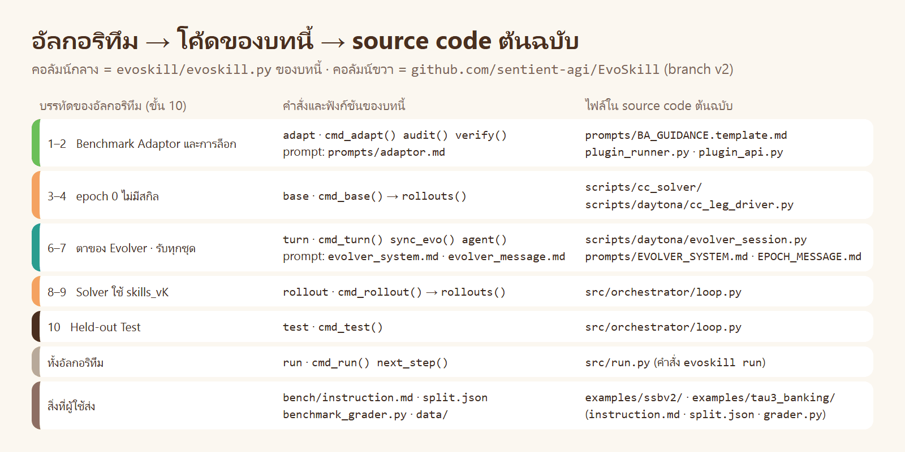

# ข้างใน EvoSkill v2 · `evoskill.py` และ prompt ทำงานอย่างไร

> [บทหลัก](../README.md) ใช้ `evoskill.py` เป็นเครื่องมือ · [ทฤษฎี](../01_theory/README.md) อธิบายว่าทำไมจึงออกแบบเช่นนี้ · หน้านี้เปิดโค้ดและ prompt ทีละส่วน แล้วชี้กลับไปที่ทฤษฎีข้อที่เกี่ยวข้อง

| ส่วน | ตอบคำถาม |
|---|---|
| [1 · ไฟล์ทั้งหมด](#1--ไฟล์ทั้งหมด) | มีไฟล์อะไร ใครเขียน |
| [2 · จากอัลกอริทึมสู่คำสั่ง](#2--จากอัลกอริทึมสู่คำสั่ง) | บรรทัดใดของอัลกอริทึมคือคำสั่งใด |
| [3 · เดินโค้ดทีละคำสั่ง](#3--เดินโค้ดทีละคำสั่ง) | แต่ละคำสั่งอ่านอะไร เขียนอะไร |
| [4 · การแยกเครื่อง](#4--การแยกเครื่อง) | กัน Evolver ไม่ให้เห็นข้อสอบอย่างไร |
| [5 · prompt ของ Benchmark Adaptor](#5--prompt-ของ-benchmark-adaptor) | แต่ละย่อหน้าทำหน้าที่อะไร |
| [6 · prompt ของ Evolver](#6--prompt-ของ-evolver) | ทำไมสั้น และแต่ละประโยคมาจากการออกแบบข้อใด |
| [7 · การออกแบบ 10 ข้อ อยู่ตรงไหนของโค้ด](#7--การออกแบบ-10-ข้อ-อยู่ตรงไหนของโค้ด) | ตารางเชื่อมทฤษฎีกับโค้ด |
| [8 · ต่างจาก source code ต้นฉบับตรงไหน](#8--ต่างจาก-source-code-ต้นฉบับตรงไหน) | สิ่งที่ย่อ และเหตุผล |
| [9 · ลองเอง](#9--ลองเอง) | แบบฝึกหัดที่ไม่ใช้โทเคน |

source code ต้นฉบับของเปเปอร์: [github.com/sentient-agi/EvoSkill](https://github.com/sentient-agi/EvoSkill/tree/v2) (branch `v2`) · โค้ดของบทนี้เขียนใหม่ให้อ่านจบได้ในไฟล์เดียว และใช้ Solver ของบท 05

---

# 1 · ไฟล์ทั้งหมด

```text
07_EvoSkill_v2/
├── evoskill/
│   ├── evoskill.py              ตัวรันทั้งวงรอบ 12 คำสั่ง (Python มาตรฐาน ไม่ต้องติดตั้งอะไรเพิ่ม)
│   ├── plugin_api.py            รูปแบบของ 1 โจทย์ (Task) ที่ plug-in ต้องคืน
│   ├── plugin_skeleton.py       โครงเปล่าของ plug-in ที่ส่งให้ Benchmark Adaptor
│   └── prompts/
│       ├── adaptor.md           ต่อท้าย system prompt ของ Benchmark Adaptor
│       ├── evolver_system.md    ต่อท้าย system prompt ของ Evolver (ชุดเดียวกันตลอดการรัน)
│       └── evolver_message.md   ข้อความประจำ epoch (1 บรรทัด)
└── bench/                       สิ่งที่ "ผู้ใช้" ส่งให้การรัน
    ├── instruction.md           คำสั่งของผู้ใช้: Evolver เห็นเฉลยของ Training
    ├── instruction_with_note.md เหมือนข้างบน + ให้เขียนหมายเหตุ 1 ประโยคไว้ใน reference
    ├── instruction_score_only.md  Evolver ไม่เห็นเฉลยของชุดใดเลย
    ├── split.json               การแบ่งชุด train 4 · validation 2 · test 3
    ├── benchmark_grader.py      ตัวตรวจ: grade(task, snapshot) → 0 ถึง 1 (การตรวจ 10 ข้อเดิมของบท 05 และ 06)
    ├── check_grader.py          ตรวจตัวตรวจก่อนใช้
    ├── solver_prompt.txt        พรอมต์ของ Solver (ข้อความเดียวกับบท 05 และ 06)
    └── data/baankafe/           tasks/<id>.json (โจทย์) · answers/<id>/ (เฉลยอ้างอิง)
```

| ใคร | เขียนอะไร |
|---|---|
| ผู้สอน (แทน "ผู้ใช้" ของเปเปอร์) | ทุกไฟล์ใน `bench/` |
| ผู้สอน | `evoskill/` ทั้งโฟลเดอร์ |
| **Benchmark Adaptor** (ตอนรัน) | `runs/<ชื่อ>/setup/benchmark_plugin.py` และ `runs/<ชื่อ>/reference/` |
| **Evolver** (ตอนรัน) | `runs/<ชื่อ>/skills_v1…v3/` และ `runs/<ชื่อ>/evo/evolver_workspace/` |
| **Solver** (ตอนรัน) | `solve.py` `test_solve.py` ใน `runs/<ชื่อ>/legs/runs/<leg>/<rollout>/sandbox/` |

Solver ไม่ได้อยู่ในโฟลเดอร์นี้: `evoskill.py` เรียก `run_trial()` ของ [`skillopt.py`](../../../00_resource/skills/skill-optimizer/scripts/skillopt.py) ซึ่งเป็นตัวรัน Trial ของบท 05 (อธิบายใน [ข้างใน skill-optimizer](../../05_Skill_Optimizer_Basic/inside_skill_optimizer/README.md))

---

# 2 · จากอัลกอริทึมสู่คำสั่ง



วงรอบเก็บสถานะไว้ใน `state.json` จึงรันทีละขั้น หยุดกลางทาง แล้วรันต่อได้

```text
init ─▶ adapt ─▶ base ─▶ turn ─▶ rollout ─┬─▶ test ─▶ จบ
                          ▲               │
                          └── epoch ถัดไป ─┘   (จนครบจำนวน epoch ในคำสั่งของผู้ใช้)
```

| ฟิลด์ใน `state.json` | ความหมาย | ตัวอย่างจริง ([`runs/e1/state.json`](../runs/e1/state.json)) |
|---|---|---|
| `phase` | ขั้นล่าสุดที่ทำเสร็จ | `"test"` |
| `k` | epoch ปัจจุบัน | `3` |
| `epochs` · `n` | ขนาดของการรัน อ่านจากคำสั่งของผู้ใช้ | `3` · `3` |
| `session_id` | เซสชันของ Evolver ที่ใช้ `--resume` | UUID 1 ตัวตลอดการรัน |
| `adapt` | สถิติของ Benchmark Adaptor และผลตรวจการรั่ว | `audit_ok: true` · reference 13 ไฟล์ |
| `turns[]` | สถิติของแต่ละตา: เวลา · เครื่องมือ · ค่าใช้จ่าย · ไฟล์ของสกิลที่เพิ่ม แก้ ลบ | 3 รายการ |
| `legs{}` | ผลของแต่ละ leg: คะแนน · จำนวนที่ผ่าน · คะแนนของแต่ละโจทย์ทั้ง 3 ครั้ง (`by_task`) | 9 leg |

`next_step()` อ่าน `phase` กับ `k` แล้วบอกขั้นถัดไป · คำสั่งที่ถูกเรียกผิดลำดับจะหยุดและบอกว่าต้องรันอะไรก่อน

---

# 3 · เดินโค้ดทีละคำสั่ง

## 3.1 `init` · รับของจากผู้ใช้

| ทำอะไร | ในโค้ด | ทฤษฎี |
|---|---|---|
| อ่านขนาดของการรันจากคำสั่งของผู้ใช้ ถ้าไม่มีให้หยุด | `re.search(r"(\d+)\s*epochs?…samples?\s*per\s*task")` | ข้อ 11.10 |
| คัดลอกคำสั่ง การแบ่งชุด และตัวตรวจ เข้า `inputs/` พร้อม sha256 ใน `RUN.json` | `cmd_init()` | ขั้น 5 |
| เก็บการตั้งค่า: โมเดลของ Solver · Evolver · Adaptor · `--fresh-session` | `st["cfg"]` | – |

## 3.2 `adapt` · Benchmark Adaptor แล้วล็อก

```python
m = agent(st, "adaptor", [(ad, "/ba", "rw"), (os.path.join(ad, "data"), "/data", "ro")], "/ba/work",
          system, user, …, cfg["adaptor_model"], "high")          # session=None = เซสชันใช้ครั้งเดียว
```

| ลำดับ | ทำอะไร | ในโค้ด |
|---|---|---|
| 1 | เตรียมโฟลเดอร์ `adapt/`: `setup/` (API · โครงเปล่า · ตัวตรวจ) · `data/` (ข้อมูลและ `split.json`) · `reference/` ว่าง | `cmd_adapt()` ส่วนต้น |
| 2 | เรียก Adaptor: system prompt = `adaptor.md` · ข้อความ = คำสั่งของผู้ใช้ทั้งไฟล์ | `agent()` |
| 3 | ตรวจว่า plug-in import เฉพาะสิ่งที่อนุญาต | `plugin_imports()` ใช้ `ast` |
| 4 | รัน `list_tasks(root)` → `setup/tasks.json` | subprocess แยก |
| 5 | เทียบการแบ่งชุดของ plug-in กับ `split.json` ของผู้ใช้ ถ้าไม่ตรงให้หยุด | `got != want` |
| 6 | **ล็อก:** sha256 ของ plug-in · ตัวตรวจ · รายการโจทย์ → `setup/freeze.json` | `fz = {...}` |
| 7 | **ตรวจการรั่ว** ของ `reference/` ถ้าพบให้หยุด | `audit()` |

`audit()` ค้น 3 อย่างในทุกไฟล์ของ `reference/`: ชื่อโจทย์และชื่อฟังก์ชันของ Validation และ Test · 60 ตัวอักษรแรกของข้อความโจทย์เหล่านั้น · บรรทัดของโค้ดตัวตรวจ (ยาวตั้งแต่ 40 ตัวอักษร ที่ไม่ได้อยู่ในข้อมูลของผู้ใช้อยู่แล้ว)

ตัวตรวจที่ใช้จริงคือ **ไฟล์ของผู้ใช้** จาก `inputs/` ไม่ใช่สำเนาที่ Adaptor แตะได้ · `freeze.json` บันทึก `grader_unchanged_by_adaptor` ไว้ให้ดู

## 3.3 `base` และ `rollout` · Solver

```python
def rollouts(ws, st, label, split, skills_src, model=None):
    verify(ws)                                              # hash ต้องตรงกับ freeze.json
    suite = {…, "grader": "../setup/benchmark_grader.py", "prompt": cfg["solver_prompt"]}
    if skills_src and skill_names(skills_src):
        … suite["files"] = [sk]                             # วางเป็น ./skills ใน sandbox ของ Solver
    …
    return so.run_trial(suite_dir, suite, j[0], j[1], a, acc)   # Solver ตัวเดียวกับบท 05 และ 06
```

| ทำอะไร | ในโค้ด | ทฤษฎี |
|---|---|---|
| ทุกโจทย์ของชุดนั้น × N ครั้ง กระจายไปทุกบัญชี | `ThreadPoolExecutor(cfg["par"])` | ข้อ 11.3 |
| rollout ที่เสร็จแล้วไม่รันซ้ำ | ตรวจ `grade.json` และ `metrics.json` | – |
| สรุป leg: คะแนนเฉลี่ย · pass@1 · pass@3 · all@3 · คะแนนรายโจทย์ทั้ง N ครั้ง | `leg_stats()` → `legs/<label>.json` | ขั้น 4 |
| `base` = 3 leg ไม่มีสกิล: `base_train` `base_val` `base_test` | `cmd_base()` | อัลกอริทึมบรรทัด 3–4 |
| `rollout` = `vK_val` เสมอ และ `vK_train` ถ้ายังไม่ใช่ epoch สุดท้าย | `cmd_rollout()` | บรรทัด 8–9 |

## 3.4 `turn` · ตาของ Evolver

```python
n = sync_evo(ws, st, k - 1)                     # ส่งผลของ Training ของ epoch ก่อนหน้าเข้าเครื่องของ Evolver
…
fresh = cfg["fresh_session"] or not st.get("session_id")
m = agent(st, "evolver", evo_binds(ws), "/evo", system, user, tp, cfg["evolver_model"], cfg["evolver_effort"],
          session=st["session_id"], resume=not fresh, timeout=cfg["turn_minutes"] * 60 + 60)
…
shutil.copytree(os.path.join(ev, "staging"), sv, ignore=IGN)    # staging -> skills_vK  ไม่มีเงื่อนไข
```

| ลำดับ | ทำอะไร | ในโค้ด | ทฤษฎี |
|---|---|---|---|
| 1 | คัดลอก transcript · โฟลเดอร์ทำงาน · คะแนน ของ rollout ชุด **Training เท่านั้น** เข้า `evo/` | `sync_evo()` (`if r["split"] != "train": continue`) | ขั้น 7 และ 8 |
| 2 | คะแนนถูกเขียนเป็นตัวเลขอย่างเดียว | `scores[name] = … r["score"]` | ข้อ 11.6 |
| 3 | สร้างข้อความประจำ epoch: เวลา · เส้นตาย · หมายเลข epoch | `evolver_message.md` + `.format()` | ขั้น 7 |
| 4 | ตาแรก `--session-id` · ตาถัดไป `--resume` | `agent(…, resume=not fresh)` | ข้อ 11.2 |
| 5 | จบตา: คัดลอก `staging/` เป็น `skills_vK/` เสมอ | `shutil.copytree` | ข้อ 11.4 |
| 6 | เทียบ hash ของ staging ก่อนและหลัง → ไฟล์ที่เพิ่ม แก้ ลบ | `before` / `after` | ข้อ 11.9 |
| 7 | แปลง transcript เป็นสถิติและ `actions.md` | `turn_stats()` | – |

**ค่าใช้จ่ายของตา:** Claude Code รายงาน `total_cost_usd` เป็น **ยอดสะสมของทั้งเซสชัน** เมื่อใช้ `--resume` · โค้ดจึงเก็บยอดของตาก่อน (`st["session_cost"]`) แล้วหักออก

`turn_stats()` นับจาก transcript: จำนวนเครื่องมือ · คำสั่ง Bash · คำสั่งที่รัน Python · คำสั่งที่รันสคริปต์ซึ่งมีอยู่ใน `evolver_workspace/` ตั้งแต่ก่อนตานี้ · การเรียก subagent · จำนวนครั้งที่ถูกย่อบริบท

## 3.5 `test` · `run` · `status` · `noise` · `eval`

| คำสั่ง | ทำอะไร | ในโค้ด |
|---|---|---|
| `test` | วัด `skills_v<E>` กับ Test Set 1 ครั้ง (leg `v<E>_test`) | `cmd_test()` |
| `run` | เรียกขั้นถัดไปซ้ำจนจบ หรือจนถึง `--stop-after` | `cmd_run()` |
| `status` | ตารางราย epoch · ตาราง Test Set · ต้นทุน | `cmd_status()` อ่าน `state.json` อย่างเดียว |
| `noise` | (1) โจทย์แยกตามจำนวนครั้งที่ผ่าน (2) จำลองประตูรับแบบวัดครั้งเดียว | `cmd_noise()` อ่าน `legs[..]["by_task"]` |
| `eval` | วัดชุดสกิลใดก็ได้กับชุดโจทย์ใดก็ได้ | `cmd_eval()` → `rollouts()` |

**ส่วนที่ 2 ของ `noise` คิดอย่างไร:** ประตูรับแบบ "วัดโจทย์ละ 1 ครั้ง รับเมื่อคะแนนสูงกว่าเดิม" ต้องใช้ rollout 1 ครั้งของชุดเดิม และ 1 ครั้งของชุดใหม่ · เรามีอย่างละ 3 ครั้ง จึงจับคู่ได้ 3 × 3 = 9 แบบ แล้วนับว่ากี่แบบ "รับ" · ถ้าคำตอบไม่ใช่ 0/9 หรือ 9/9 แปลว่าการตัดสินขึ้นกับว่าสุ่มได้ครั้งใด (ทฤษฎีข้อ 11.4)

---

# 4 · การแยกเครื่อง

เปเปอร์ใช้เครื่องแยกจริง (Daytona) · บทนี้ใช้ **mount namespace** ของ Linux ใน container เดียว

```bash
unshare -m --propagation private bash -c '
  mount --bind <โฟลเดอร์จริง> <path ที่ Agent เห็น>     # ทำซ้ำตามรายการ binds · บางรายการ remount เป็น read-only
  mount -t tmpfs tmpfs /workspace                      # ทับ /workspace ด้วยโฟลเดอร์ว่าง
  cd <โฟลเดอร์ทำงาน> && exec claude -p …
'
```

| Agent | สิ่งที่เห็น | สิทธิ์ | สิ่งที่มองไม่เห็น |
|---|---|---|---|
| Benchmark Adaptor | `/ba/setup` · `/ba/reference` · `/ba/work` | เขียน | ผลของการรันอื่น · โฟลเดอร์ของบทอื่น |
| | `/data` (ข้อมูลทั้งหมด + `split.json`) | อ่าน | |
| Evolver | `/evo/traces` `scores` `solver_workspaces` `skills` `reference` | อ่าน | ตัวตรวจ · ข้อมูลของ Validation และ Test · ผลของ leg ที่ไม่ใช่ Training · `bench/` ทั้งโฟลเดอร์ |
| | `/evo/staging` · `/evo/evolver_workspace` | เขียน | |

ทุกอย่างที่ต้องซ่อนอยู่ใต้ `/workspace` (รวมผลของบท 05 และ 06 ที่อยู่ใน container เดียวกัน) การทับ `/workspace` จึงซ่อนได้ทั้งหมดในคำสั่งเดียว · `mount --bind` ทำก่อนการทับ โฟลเดอร์ `/evo` จึงยังชี้ไปที่ของจริง

> **ในโค้ด:** ตัวแปร `NS_SCRIPT` และฟังก์ชัน `agent()` · รายการของ Evolver สร้างโดย `evo_binds()` จาก `EVO_RO`

**สิ่งที่การแยกนี้ไม่ได้ทำ** (ต่างจากเปเปอร์): ไม่ได้ปิดเครือข่าย (ปิดเฉพาะเครื่องมือ `WebSearch` และ `WebFetch`) และ Solver ไม่ได้อยู่ใน container ของตัวเอง

---

# 5 · prompt ของ Benchmark Adaptor

ไฟล์: [`prompts/adaptor.md`](../evoskill/prompts/adaptor.md) (ต่อท้าย system prompt ของ Claude Code) · ข้อความที่ส่ง = คำสั่งของผู้ใช้ทั้งไฟล์

| ส่วนของ prompt | บอกอะไร | เหตุผล | ทฤษฎี |
|---|---|---|---|
| ย่อหน้าเปิด | คุณคือ Benchmark Adaptor · งานคือทำ 2 อย่าง: ไฟล์ 1 ไฟล์ให้ loop และโฟลเดอร์ 1 โฟลเดอร์ให้ Evolver | ขอบเขตของงานชัดตั้งแต่ประโยคแรก | ขั้น 5 |
| "การรันแบบ skill evolution ทำอะไร" | อธิบายวงรอบ และความหมายของ train · validation · test | Adaptor ต้องเข้าใจว่าแต่ละชุด **ใช้ทำอะไร** จึงจะรู้ว่าอะไรรั่วไม่ได้ | ขั้น 8 |
| "งานของคุณ" ข้อ `benchmark_plugin.py` | ฟังก์ชันเดียว `list_tasks(root)` · อ่านเฉพาะใต้ root · standard library เท่านั้น · ห้ามรันตัวตรวจ | plug-in ต้องรันซ้ำได้ผลเดิม และไม่มีทางแตะสิ่งอื่น | ข้อ 11.5 |
| "งานของคุณ" ข้อ `reference/` | คัดลอกทุกอย่าง **ยกเว้น 2 ประเภท**: ของ Validation และ Test · ตัวตรวจและคำอธิบายวิธีตรวจ | นิยามของสิ่งที่ Evolver เห็นได้ | ขั้น 8 · ข้อ 11.6 |
| ข้อสุดท้ายของ "งานของคุณ" | ถ้าคำสั่งของผู้ใช้จำกัดมากกว่านี้ ให้ทำตามผู้ใช้ | ทำให้การตั้งค่า "เห็นแต่คะแนน" ทำได้ด้วยการแก้คำสั่งของผู้ใช้อย่างเดียว | ขั้น 5 |
| "สิ่งที่คุณอ่านได้" | อ่านตัวตรวจได้ · ทดสอบ plug-in ก่อนจบ | Adaptor ต้องรู้ว่าตัวตรวจอ่านค่าอะไรจาก `Task` | ขั้น 5 |

สิ่งที่ Adaptor ทำจริงใน `e1` ([`actions.md`](../runs/e1/turns/adaptor/actions.md)): อ่านไฟล์ใน `/ba/setup` และ `/data` → เขียน plug-in → ทดสอบ → คัดลอกโจทย์และเฉลยของ Training เข้า reference → เขียน `split.json` ใหม่ที่มีเฉพาะชื่อโจทย์ของ Training (ไฟล์เดิมมีชื่อโจทย์ของ Validation และ Test)

---

# 6 · prompt ของ Evolver

## 6.1 ข้อความต่อท้าย system prompt

ไฟล์: [`prompts/evolver_system.md`](../evoskill/prompts/evolver_system.md) · ส่งชุดเดียวกันทุกตา

| ส่วนของ prompt | บอกอะไร | มาจากการออกแบบข้อใด |
|---|---|---|
| "Solver ทำโจทย์ชุด train ทุกข้อ ข้อละ {n} ครั้ง" | Evolver รู้ว่ามีหลายครั้งต่อโจทย์ให้เทียบ | 11.3 |
| "เป้าหมายคือชุดสกิลที่ทำให้ Solver ได้คะแนนสูงขึ้นกับโจทย์ที่ไม่เคยเห็น" | เป้าหมายคือ Generalization ไม่ใช่คะแนนของ Training | 11.7 |
| "โจทย์ชุด train เป็นเพียงตัวอย่าง… สกิลที่บรรยายโจทย์เหล่านี้อย่างเจาะจงจึงใช้กับโจทย์อื่นไม่ได้" | คำเตือนเดียวเรื่อง Overfitting | 11.8 |
| "เซสชันนี้อยู่ตลอดการรัน: แต่ละ epoch ส่งข้อความมา 1 ข้อความ" | Evolver รู้ว่าตัวเองมีสถานะ | 11.2 |
| รายการ `/evo/traces` `scores` `solver_workspaces` `skills` | แผนที่ของหลักฐาน | ขั้น 7 |
| `/evo/staging`: "เริ่มจากชุดที่คุณทิ้งไว้… ถ้าไม่แก้อะไร Solver จะใช้ชุดเดิม" | ค่าเริ่มต้นคือไม่เปลี่ยน | 11.9 |
| `/evo/staging`: "ใน frontmatter ให้เขียนเฉพาะ `name` กับ `description`" | รูปแบบของสกิลตามมาตรฐาน | ขั้น 2 |
| `/evo/evolver_workspace`: "บริบทของคุณอาจถูกย่ออัตโนมัติ… จึงควรเก็บสิ่งที่อยากรักษาไว้ที่นี่" | ความจำชั้นที่ 2 | ขั้น 7 · 11.2 |
| `/evo/reference`: "โดยไม่มีสิ่งใดเกี่ยวกับ validation test หรือตัวตรวจ" | Evolver รู้ขอบเขตของสิ่งที่ตัวเองเห็น | ขั้น 8 |
| "เขียนสกิลเป็นภาษาไทย" | บรรทัดที่บทนี้เพิ่ม | (ไม่อยู่ในเปเปอร์) |

**สิ่งที่ prompt ไม่ได้บอก:** ขั้นตอนการวิเคราะห์ · จำนวนสกิล · ขนาดสูงสุดของสกิล · จำนวนการแก้ต่อตา · รูปแบบของคำตอบ · **จำนวน epoch ทั้งหมด**

## 6.2 ข้อความประจำ epoch

ไฟล์: [`prompts/evolver_message.md`](../evoskill/prompts/evolver_message.md) (1 บรรทัด มีตัวแปร 3 ตัว)

| ตัวแปร | ค่า | ทำไมต้องมี |
|---|---|---|
| `{now}` · `{deadline}` | เวลาปัจจุบัน และเวลาที่ staging จะถูกนำไปใช้ | Evolver แบ่งเวลาเองได้ · ถ้าหมดเวลา ใช้ staging ตามสภาพ |
| `{k}` | หมายเลข epoch | บอกว่าต้องอ่าน `epoch_<k-1>` และเขียน `skills_v<k>` |

## 6.3 เทียบความยาวกับบท 06

| | WikiSkill (บท 06) | EvoSkill v2 (บทนี้) |
|---|---|---|
| prompt ของผู้เสนอแก้ | `proposer.md` 6 หัวข้อ: เครื่องมือ · ไฟล์ · ลำดับการทำงาน 7 ขั้น · รูปแบบ JSON · กติกา 6 ข้อ · ภาษา | `evolver_system.md` 15 บรรทัด + ข้อความ 1 บรรทัด |
| เครื่องมือ | `Read` อย่างเดียว | ทุกอย่างของ Claude Code |
| ผลลัพธ์ | JSON ที่โปรแกรมนำไปสร้างไฟล์ | ไฟล์ที่ Evolver เขียนเองใน `staging/` |
| การตรวจข้อเสนอโดยโปรแกรม | `target` ต้องพบในไฟล์ · ต้องอ่าน Trace อย่างน้อย 4 ไฟล์ | ไม่มี (ตรวจเฉพาะว่าแต่ละสกิลมี `description`) |

---

# 7 · การออกแบบ 10 ข้อ อยู่ตรงไหนของโค้ด

| ทฤษฎีข้อ | การตัดสินใจ | อยู่ที่ |
|---|---|---|
| 11.1 | Evolver เป็น Agent ที่มี bash | `agent()`: ไม่มี `--tools` จำกัด · `--disallowedTools WebSearch,WebFetch` |
| 11.2 | เซสชันเดียวตลอดการรัน | `cmd_turn()`: `--session-id` แล้ว `--resume` · `st["session_id"]` |
| 11.3 | หลายครั้งต่อโจทย์ | `st["n"]` · `rollouts()` · `sync_evo()` ตั้งชื่อ `_s<i>` |
| 11.4 | รับทุก epoch | `cmd_turn()`: `copytree(staging → skills_vK)` ไม่มีเงื่อนไข · `cmd_test()` ใช้ `skills_v<E>` |
| 11.5 | แยก Adaptor ออกจาก Evolver | `cmd_adapt()` ใช้ `session=None` และ binds คนละชุด · เทียบการแบ่งชุดกับของผู้ใช้ |
| 11.6 | ผู้ใช้ให้ตัวตรวจ · Evolver ได้แต่คะแนน | `inputs/benchmark_grader.py` → `setup/` · `sync_evo()` เขียนเฉพาะตัวเลข |
| 11.7 | วัด Validation แต่ไม่ให้ Evolver เห็น | `cmd_rollout()` รัน `vK_val` · `sync_evo()` ข้ามทุกอย่างที่ไม่ใช่ train |
| 11.8 | prompt สั้น | `prompts/evolver_system.md` |
| 11.9 | staging เริ่มจากชุดเดิม | `evo/staging/` ไม่ถูกล้างระหว่างตา · `before`/`after` ใน `cmd_turn()` |
| 11.10 | ขนาดของการรันอยู่ในคำสั่งของผู้ใช้ | `cmd_init()` |
| ขั้น 8 | การกันข้อมูลบังคับโดยโปรแกรม | `NS_SCRIPT` · `EVO_RO` · `audit()` · `verify()` |

---

# 8 · ต่างจาก source code ต้นฉบับตรงไหน

| หัวข้อ | source code ต้นฉบับ ([EvoSkill `v2`](https://github.com/sentient-agi/EvoSkill/tree/v2)) | บทนี้ | ผลต่อการอ่านผล |
|---|---|---|---|
| ขนาด | `src/orchestrator/loop.py` 7,423 บรรทัด + โค้ดของ Daytona หลายพันบรรทัด | `evoskill.py` ไฟล์เดียว | – |
| เครื่อง | Daytona: เครื่องสำหรับ Adaptor · เครื่องของการรัน · container ต่อ rollout | container เดียว + mount namespace | การกันข้อมูลเทียบเท่าในระดับไฟล์ · ไม่ได้กันเครือข่าย |
| Solver | `scripts/cc_solver/` · สกิลอยู่ที่ `.claude/skills/` (Progressive Disclosure) | `run_trial()` ของบท 05 · สกิลอยู่ที่ `./skills/` และพรอมต์บอกให้อ่าน | Solver อ่านสกิลทุกครั้ง `description` จึงไม่มีผลต่อการเปิดสกิลในบทนี้ |
| การรัน plug-in | sandbox แบบออฟไลน์ (`python -I -S`) | ตรวจ import ด้วย `ast` แล้วรันปกติ | – |
| ตัวตรวจล้ม | ตรวจซ้ำ 1 ครั้ง แล้วบันทึก `grader_failed` | `grade_trial()` ของ `skillopt.py` ให้ 0 คะแนนพร้อมเหตุผล · แสดงใน `scores` เป็น `grader_failed` | ไม่เกิดในการรันของเรา |
| effort ของ Evolver | ไม่ระบุ (ค่าเริ่มต้นของ Claude Code) | `--effort high` | เท่ากับผู้ปรับสกิลของบท 06 |
| เวลาต่อตา | 2 ชั่วโมง | 30 นาที | ใช้จริงไม่ถึง 2 นาที |
| prompt | ภาษาอังกฤษ | ภาษาไทย ถ้อยคำของบทเรียน | – |
| คะแนน | 0 หรือ 1 | สัดส่วนของข้อตรวจ 10 ข้อ | Evolver ของเราได้สัญญาณละเอียดกว่า (เช่น 0.7 → 0.9) |

---

# 9 · ลองเอง

ทุกข้อรันบนเครื่อง จากโฟลเดอร์ `07_EvoSkill_v2` ไม่ใช้โทเคน

| # | ทำ | ได้เห็นอะไร |
|---|---|---|
| 1 | `python evoskill/evoskill.py status runs/e1` | ตารางราย epoch และต้นทุนของการรันหลัก |
| 2 | `python evoskill/evoskill.py noise runs/f1` | โจทย์ที่ผ่านบางครั้ง และประตูรับแบบวัดครั้งเดียวที่ตัดสินไม่เหมือนกันทุกคู่ |
| 3 | เปิด [`runs/e1/turns/turn_2/actions.md`](../runs/e1/turns/turn_2/actions.md) | ทุกคำสั่ง bash ที่ Evolver รัน และข้อสรุปของมัน |
| 4 | เทียบ [`runs/e1/skills_v1`](../runs/e1/skills_v1/) กับ [`skills_v3`](../runs/e1/skills_v3/) | สกิลโตจาก 8.4 KB เป็น 13.7 KB: หัวข้อใดถูกเพิ่มในตาใด |
| 5 | เปิด [`runs/e1/setup/freeze.json`](../runs/e1/setup/freeze.json) แล้วคำนวณ sha256 ของ [`benchmark_plugin.py`](../runs/e1/setup/benchmark_plugin.py) เอง | hash ตรงกัน = ไฟล์ไม่ถูกแก้หลังล็อก |
| 6 | เปิด [`runs/p1/evo/evolver_workspace/notes.txt`](../runs/p1/evo/evolver_workspace/notes.txt) | บันทึกที่ Evolver เขียนให้ตัวเองข้าม epoch |
| 7 | อ่าน `cmd_turn()` แล้วหาบรรทัดที่ต้องแก้ ถ้าจะเพิ่มประตูรับแบบบท 05 | เข้าใจว่า "รับทุก epoch" คือการ **ไม่มี** โค้ดส่วนใด |

**กลับไป:** [บทหลัก](../README.md) · [ทฤษฎี](../01_theory/README.md)
