# EvoSkill v2 · ให้ Agent 3 ตัวปรับสกิลกันเอง


**บทนี้แบ่งเป็น 2 ภาค แยกจากกัน**

| ภาค | ส่วน | ตอบคำถาม | ผู้เรียนทำอะไร |
|---|---|---|---|
| [**ภาคทฤษฎี**](#ภาคทฤษฎี) | [1 · โจทย์ (ฉบับย่อ)](#1--โจทย์-ฉบับย่อ) | โจทย์เดิมของบท 05 และ 06 คืออะไร · บทนี้เปลี่ยนอะไร | อ่าน ไม่ต้องรันอะไร |
| | [2 · EvoSkill v2](#2--evoskill-v2) | EvoSkill v2 คืออะไร · ทำงานอย่างไร · นำมาใช้กับโจทย์นี้อย่างไร | อ่าน ไม่ต้องรันอะไร |
| [**ภาค LAB**](#ภาค-lab) | [3 · ลงมือทำ](#3--ลงมือทำ-copy--paste) | พรอมต์ Copy & Paste 8 ขั้น (LAB 0–7) พร้อมผลจริงของแต่ละ LAB | คัดลอกพรอมต์ แล้วรัน |
| | [4 · สรุปและแบบฝึกหัด](#4--สรุปและแบบฝึกหัด) | เทียบกับบท 05 และ 06 · บทเรียนจากผลจริง · โจทย์ให้ลองต่อ | อ่านผล แล้วทำแบบฝึกหัด |

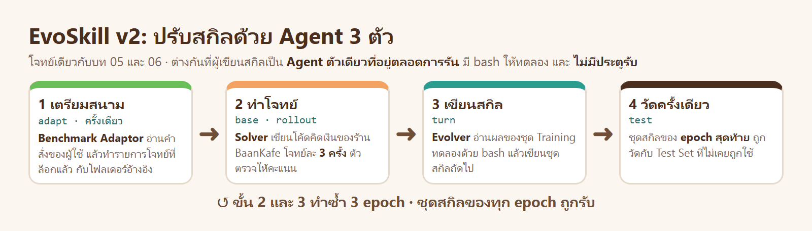

**อ่านเพิ่ม (ไม่บังคับ)**

| หน้า | ตอบคำถาม |
|---|---|
| [ทฤษฎี · EvoSkill v2 ฉบับละเอียด](01_theory/README.md) | งานวิจัยต้นทาง 16 ขั้น: แนวคิด · **วิธีคิดในการออกแบบ 10 ข้อ** · อัลกอริทึม · ผลในเปเปอร์ · ภาพต้นฉบับจากเปเปอร์ |
| [สไลด์ของทฤษฎี EvoSkill v2](01_theory/EvoSkill_v2_Theory_Slides.html) | สไลด์ของบททฤษฎี (เปิดไฟล์ `.html` ในเบราว์เซอร์) |
| [รูปแบบของ `evoskill`](evoskill_format.md) | เครื่องมือที่สร้างใน LAB 0 ต้องมีคำสั่งและไฟล์อะไร |
| [สไลด์ของบทนี้](EvoSkill_v2_Slides.html) | สไลด์ HTML สำหรับสอน: ภาคทฤษฎี + ภาค LAB พร้อมปุ่มคัดลอกพรอมต์และรายการตรวจผล (เปิดไฟล์ `.html` ในเบราว์เซอร์) |

เปเปอร์ต้นทาง: Huang, Nama, Alzubi, *EvoSkill v2: Fully Agentic Skill Evolution from Benchmark Adaptation to a Stateful Evolver*, Sentient Labs, [arXiv:2610.25931](https://arxiv.org/abs/2610.25931) · source code ของเปเปอร์: [github.com/sentient-agi/EvoSkill](https://github.com/sentient-agi/EvoSkill/tree/v2) (branch `v2`)

---

# ภาคทฤษฎี

> [!NOTE]
> **ภาคนี้อ่านอย่างเดียว ไม่ต้องรันอะไร และไม่ใช้โทเคน**
>
> - ส่วนที่ 1 ทบทวนโจทย์ของบท 05 และ 06 สั้น ๆ · ส่วนที่ 2 อธิบาย EvoSkill v2
> - ตัวเลขที่กำกับว่า **"ตัวอย่างจากผล LAB"** ยกมาจากการรันจริงใน [ภาค LAB](#ภาค-lab) เพื่อประกอบคำอธิบายเท่านั้น

## 1 · โจทย์ (ฉบับย่อ)

บทนี้ใช้ **โจทย์ ตัวตรวจ และกติกาชุดเดียวกับบท 05 และ 06** จึงทบทวนแค่ภาพเดียว · คำอธิบายเต็มอยู่ที่ [บท 05 ส่วนที่ 1](../05_Skill_Optimizer/README.md#1--โจทย์และข้อกำหนดของร้าน)

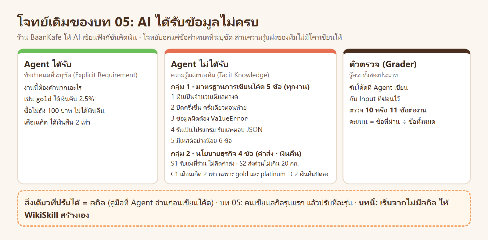

| ชุดโจทย์ | โจทย์ | ใช้ทำอะไรในบทนี้ |
|---|---|---|
| **Training** 4 ข้อ | `t1` บิลหน้าร้าน · `t2` หารบิล · `t3` ค่าส่ง · `t4` เงินคืน | ให้ผู้ปรับสกิลเรียนรู้ · `t3` และ `t4` มีนโยบายธุรกิจที่โจทย์ไม่ได้เขียน |
| **Validation** 2 ข้อ | `v1` ค่าจอดรถ · `v2` ค่าแรง | ดูคะแนนของแต่ละ epoch |
| **Test** 3 ข้อ | `x1` ค่าปรับ · `x2` คืนเงินคอร์ส · `x3` ราคาขายส่ง | วัดตอนจบครั้งเดียว ([รายละเอียดในบท 06](../06_WikiSkill/README.md#12-test-set-3-ข้อ)) |

### 1.1 สิ่งที่บทนี้เปลี่ยน


| | บท 05 · Skill Optimizer | บท 06 · WikiSkill | บทนี้ · EvoSkill v2 |
|---|---|---|---|
| สกิลรุ่นแรก | คนเขียน | ว่าง | ว่าง |
| ผู้ปรับสกิล | Claude ตามพรอมต์ของเรา | AI 2 บทบาท เรียกใหม่ทุกรอบ | **AI ตัวเดียว เซสชันเดียวตลอดการรัน มี bash** |
| ที่เก็บสิ่งที่เรียนรู้ | `ISSUES.md` | `wiki/` | ความจำของเซสชัน + โฟลเดอร์ส่วนตัวของ Evolver |
| ผู้ปรับสกิลเห็นอะไรจากตัวตรวจ | ข้อตรวจที่ไม่ผ่าน พร้อมข้อความ | ข้อตรวจที่ไม่ผ่าน พร้อมข้อความ | **คะแนน 0 ถึง 1 อย่างเดียว** |
| ผู้ปรับสกิลเห็นเฉลยหรือไม่ | ไม่ | ไม่ | เห็นเฉลยของ Training ถ้าคำสั่งของเราอนุญาต |
| เมื่อไรสกิลใหม่ถูกใช้ | ผ่านประตูรับที่คิดความแกว่ง | Validation สูงกว่าเดิม | **ทุกครั้ง** (ไม่มีประตูรับ) |

โจทย์ ตัวตรวจ พรอมต์ของ Solver โมเดลของ Solver (sonnet · effort medium) และจำนวนครั้งต่อโจทย์ (3) **เหมือนสองบทก่อนทุกค่า** ผลจึงเทียบกันได้

คำถามใหม่ของบทนี้: นโยบายธุรกิจ 4 ข้อไม่อยู่ในโจทย์ แต่ **อยู่ในเฉลยอ้างอิงของงานค่าส่งและงานเงินคืน** · Evolver ที่ได้เห็นเฉลยจะพบหรือไม่ และจะเขียนลงสกิลอย่างไร (ในบท 06 ไม่มีใครเห็นเฉลย WikiSkill จึงหาไม่ได้)

## 2 · EvoSkill v2

คำอธิบายเต็มพร้อมเหตุผลของการออกแบบทุกจุดอยู่ใน [ทฤษฎีฉบับละเอียด](01_theory/README.md) · ส่วนนี้ให้เห็นภาพรวมพอสำหรับทำ LAB

### 2.1 ข้อสังเกตตั้งต้น: พลาดแล้วมักพลาดซ้ำ


Agent ที่ไม่มีสกิล เมื่อพลาดโจทย์ มักพลาดโจทย์นั้นอีกเมื่อทำซ้ำ = **ขาดคำแนะนำ ไม่ใช่ขาดความสามารถ** · คำแนะนำเป็นภาษาธรรมชาติ Agent อีกตัวจึงเขียนให้ได้

### 2.2 Agent 3 ตัว


| Agent | ทำอะไร | ทำเมื่อไร |
|---|---|---|
| **Benchmark Adaptor** | อ่านคำสั่งของผู้ใช้ แล้วเตรียมรายการโจทย์ (plug-in) กับโฟลเดอร์ `reference/` จากนั้นโปรแกรมล็อกด้วย hash | 1 ครั้ง ก่อนเริ่ม |
| **Solver** | ทำโจทย์ด้วยชุดสกิลปัจจุบัน (ตัวที่ถูกปรับ) · ไม่เห็นเฉลย | ทุก epoch โจทย์ละ 3 ครั้ง |
| **Evolver** | อ่านผลของชุด Training ทดลองด้วย bash แล้วเขียนชุดสกิลถัดไป · **เซสชันเดียวตั้งแต่ต้นจนจบ** | 1 ตาต่อ epoch |

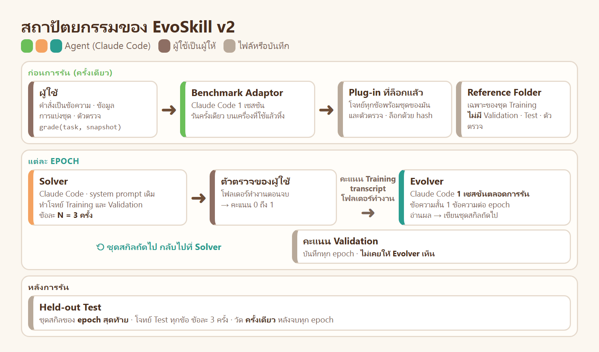

### 2.3 ผู้ใช้ส่ง 3 อย่าง

EvoSkill v2 ไม่มีพรอมต์ให้เราแก้ระหว่างทาง · สิ่งที่เราควบคุมคือของ 3 อย่างที่ส่งให้ก่อนเริ่ม ([`bench/`](bench/))

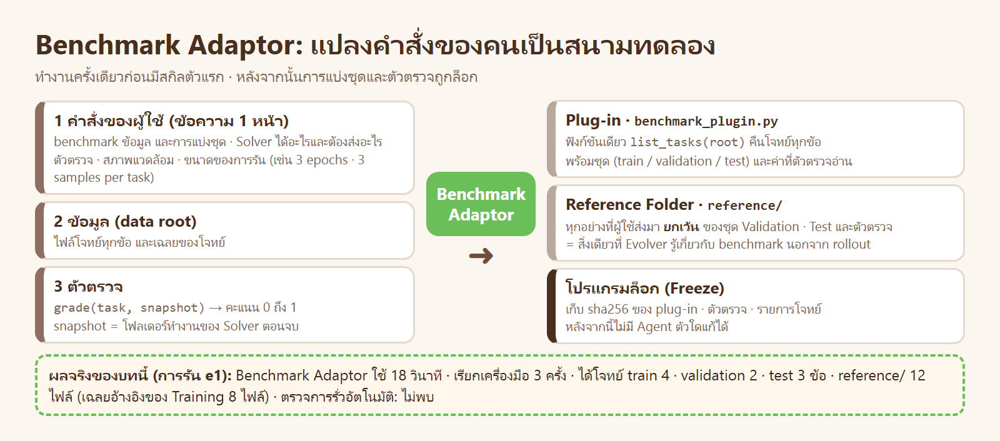

| สิ่งที่ส่ง | ไฟล์ | เนื้อหา |
|---|---|---|
| คำสั่ง 1 หน้า | [`instruction.md`](bench/instruction.md) | benchmark และข้อมูลอยู่ที่ไหน · Solver ได้อะไร · ตัวตรวจคืออะไร · **Evolver เห็นอะไรได้** · ขนาดของการรัน `3 epochs · 3 samples per task` |
| ข้อมูล | [`data/baankafe/`](bench/data/baankafe/) | `tasks/` โจทย์ 9 ข้อ · `answers/` เฉลยอ้างอิงของทุกข้อ · การแบ่งชุดอยู่ใน [`split.json`](bench/split.json) |
| ตัวตรวจ | [`benchmark_grader.py`](bench/benchmark_grader.py) | `grade(task, snapshot)` คืนคะแนน 0 ถึง 1 |

### 2.4 ใครเห็นอะไร


การกันข้อมูลทำโดย **โปรแกรมควบคุมการรัน** ไม่ใช่ด้วยการขอร้องใน prompt: Evolver ทำงานในเครื่องที่มีเฉพาะของชุด Training · ไม่เห็นโจทย์และคะแนนของ Validation กับ Test · ไม่เห็นตัวตรวจ เห็นแค่คะแนน


### 2.5 อัลกอริทึม

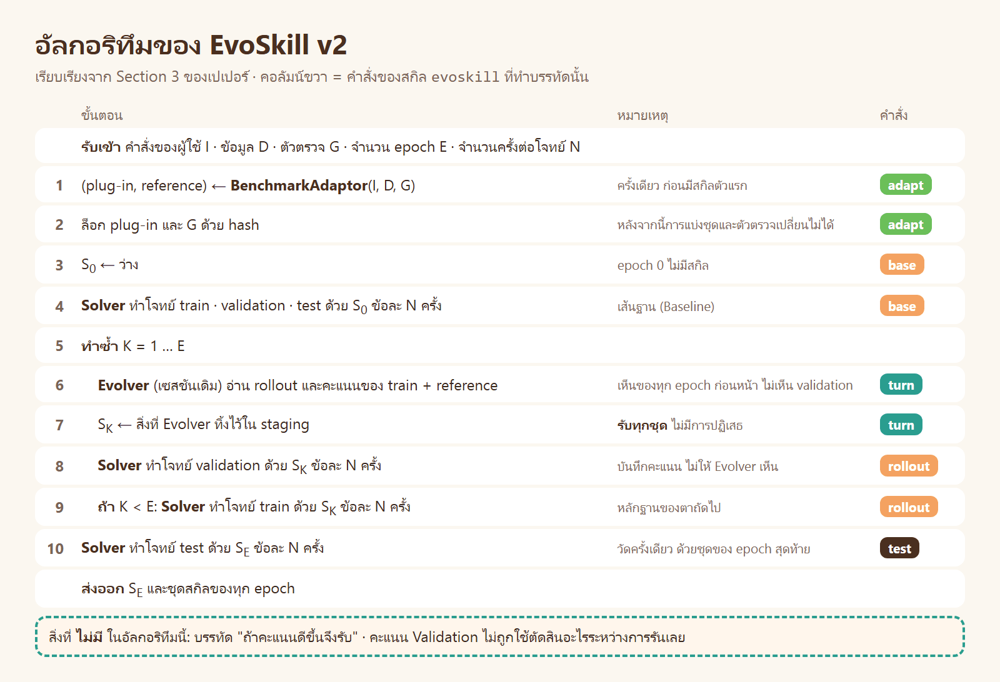

| ขั้น | คำสั่งของเครื่องมือ | เกิดอะไรขึ้น |
|---|---|---|
| ก่อนการรัน | `adapt` | Benchmark Adaptor เตรียมสนาม แล้วถูกล็อก |
| epoch 0 | `base` | Solver ทำโจทย์ทุกชุดโดยไม่มีสกิล |
| epoch K | `turn` → `rollout` | Evolver เขียน `skills_vK` → Solver ทำ Validation และ Training ด้วยชุดนั้น · **รับทุกชุด** |
| หลังการรัน | `test` | ชุดสกิลของ epoch สุดท้ายถูกวัดกับ Test Set 1 ครั้ง |

### 2.6 การตัดสินใจออกแบบ 4 ข้อ

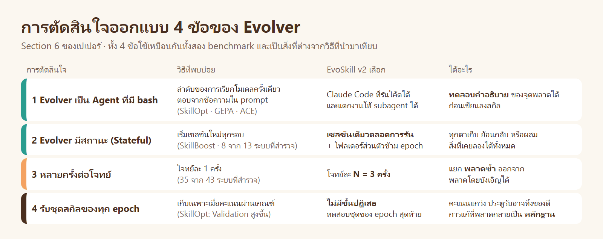

เหตุผลของแต่ละข้อ พร้อมหลักฐานจากเปเปอร์: [ทฤษฎี ขั้น 11](01_theory/README.md#ขั้น-11--วิธีคิดในการออกแบบ)

### 2.7 สิ่งที่นำมาใช้กับโจทย์นี้

เครื่องมือของบทนี้ทำตามวงรอบของเปเปอร์ทุกขั้น ต่างกันที่ขนาดของงานและวิธีแยกเครื่อง

| ประเด็น | ในเปเปอร์ | ในบทนี้ |
|---|---|---|
| งาน | SpreadsheetBench v2 · τ³-bench banking | เขียนฟังก์ชันคิดเงิน 9 ข้อของร้าน BaanKafe |
| ชุดโจทย์ | train · validation · test ต่อ benchmark | Training 4 · Validation 2 · Test 3 |
| ขนาดของการรัน | หลาย epoch · 3 ครั้งต่อโจทย์ | 3 epochs · 3 ครั้งต่อโจทย์ = 78 rollout |
| Solver | Claude Code + Sonnet 5.5 หรือ Haiku 5.5 · สกิลแบบ Progressive Disclosure | sonnet (effort medium) เท่ากับบท 05 และ 06 · สกิลวางใน `./skills` พรอมต์บอกให้อ่านก่อนเริ่ม |
| Evolver และ Benchmark Adaptor | Claude Code 1 เซสชัน · prompt ของเปเปอร์ | Claude Code 1 เซสชัน · sonnet (effort high) · prompt ภาษาไทยที่เขียนใหม่ใน LAB 0 |
| การแยกเครื่อง | เครื่องแยกของแต่ละ Agent · ปิดเครือข่าย | mount namespace ใน container เดียว (Evolver เห็นเฉพาะ `/evo`) · ไม่ได้ปิดเครือข่าย |
| คะแนนจากตัวตรวจ | ผ่านหรือไม่ผ่าน | สัดส่วนข้อตรวจที่ผ่าน 10 หรือ 11 ข้อ |
| การรัน rollout | ระบบของเปเปอร์ | คำสั่ง `run` ของ `skill-optimizer` ที่สร้างในบท 05 |
| ความรู้แฝงเฉพาะงาน (นโยบายธุรกิจ) | ไม่มี | อยู่ในเฉลยของ Training 2 ข้อ · **ไม่มีข้อตรวจใน Validation** |

### 2.8 คำถามที่ภาค LAB จะตอบ

| # | คำถาม | LAB |
|---|---|---|
| 1 | เริ่มจากไม่มีสกิล Evolver ที่เห็นแค่คะแนนกับเฉลยของ Training เขียนสกิลที่ใช้ได้หรือไม่ | 1 · 2 |
| 2 | นโยบายธุรกิจ 4 ข้อที่ไม่มีใครบอก Evolver ค้นพบจากเฉลยได้หรือไม่ และเขียนลงสกิลอย่างไร | 2 |
| 3 | กฎที่อยู่เฉพาะในตัวตรวจ ผู้ใช้บอก Evolver ได้ทางใด | 3 |
| 4 | ถ้า Evolver ไม่ได้เห็นเฉลย เหลือแค่คะแนน ผลต่างกันอย่างไร | 4 |
| 5 | ถ้าตัดความจำของเซสชันออก ผลต่างกันอย่างไร | 5 |
| 6 | โมเดลเล็กปรับสกิลของตัวเองได้หรือไม่ | 6 |
| 7 | ทำไมเปเปอร์ไม่ใช้ประตูรับ และการไม่มีประตูรับมีราคาเท่าไร | 7 |

---

# ภาค LAB

> [!TIP]
> **ภาคนี้ลงมือทำ: คัดลอกพรอมต์ → วางใน Claude Code → อ่านผล**
>
> ผลจริงทุกตัวในภาคนี้มาจากการรันเมื่อ 15 พ.ย. 2026 ด้วยเครื่องมือที่สร้างจากพรอมต์ของ LAB 0 · Solver sonnet · effort medium · ผลดิบอยู่ใน [`runs/`](runs/)

## 3 · ลงมือทำ (Copy & Paste)

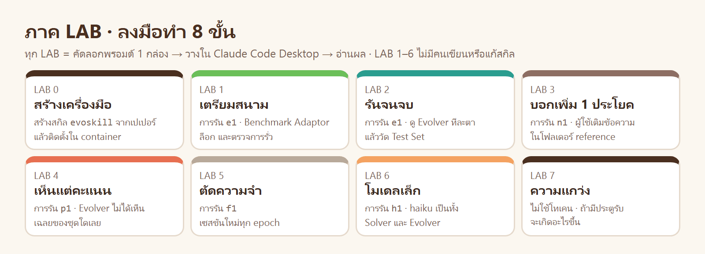


**วิธีใช้:** เปิดโฟลเดอร์ `Teaching` ใน Claude Code Desktop → คัดลอกกล่อง **📋 IMPORTANT** → วาง → รอผล
**ต้องมี:** container `multi-account` · บัญชี `yolo` ที่ล็อกอินแล้วอย่างน้อย 1 บัญชี · สกิล `skill-optimizer` ที่สร้างใน [บท 05 LAB 0](../05_Skill_Optimizer/README.md#lab-0--เตรียมเครื่องมือและโจทย์)

| LAB | ทำอะไร | การรัน | rollout | เวลาจริง | ผลจริง |
|---|---|---|---|---|---|
| [0](#lab-0--เตรียมเครื่องมือและโจทย์) | สร้างเครื่องมือ `evoskill` แล้วติดตั้งใน container พร้อมโจทย์ | – | – | 0.1 ใช้ 20 นาที · 0.2 ไม่ถึง 1 นาที | ทดสอบผ่าน 3 ข้อ · ตัวตรวจผ่าน |
| [1](#lab-1--benchmark-adaptor-เตรียมสนาม-e1) | Benchmark Adaptor เตรียมสนาม | `e1` | – | 2 นาที | reference 12 ไฟล์ · ตรวจการรั่ว: สะอาด |
| [2](#lab-2--รัน-1-การรันจนจบ-e1) | รัน 1 การรันจนจบ ดู Evolver ทำงานทีละตา | `e1` | 78 | 16 นาที | Test 47.8% → **83.3%** |
| [3](#lab-3--ผู้ใช้บอก-evolver-เพิ่ม-1-ประโยค-n1) | ผู้ใช้บอก Evolver เพิ่ม 1 ประโยค | `n1` | 78 | 9 นาที | Test **93.3%** (ผ่านครบ 6/9) |
| [4](#lab-4--evolver-เห็นแต่คะแนน-p1) | Evolver เห็นแต่คะแนน | `p1` | 78 | 8 นาที | Test **70.0%** |
| [5](#lab-5--ตัดความจำของ-evolver-ออก-f1) | ตัดความจำของ Evolver ออก | `f1` | 78 | 7 นาที | Test **83.3%** เท่ากับ `e1` |
| [6](#lab-6--โมเดลเล็กปรับสกิลของตัวเอง-h1) | โมเดลเล็กปรับสกิลของตัวเอง | `h1` | 78 | 12 นาที | Test 53.3% → **62.2%** |
| [7](#lab-7--ความแกว่ง-และประตูรับที่เราไม่ได้ใช้) | ความแกว่ง และประตูรับที่เราไม่ได้ใช้ | – | 0 | ไม่ถึง 1 นาที | ชุดสกิลเดียวกัน ถูกตัดสินต่างกันได้ |

เวลาจริงของ LAB 3–6 วัดขณะรัน 4 การรันพร้อมกัน

### แผนการทดลอง: วัดอะไร กับ Input อะไร

| หัวข้อ | ค่าที่ใช้ |
|---|---|
| **Input** | สิ่งที่ผู้ใช้ส่งใน [`bench/`](bench/): คำสั่ง 1 หน้า · โจทย์ 9 ข้อและเฉลยอ้างอิง · ตัวตรวจ (ชุดเดียวกับบท 05 และ 06) |
| **Training Set** 4 ข้อ | `t1` บิลหน้าร้าน · `t2` หารบิล · `t3` ค่าส่ง · `t4` เงินคืน → Evolver เห็น rollout คะแนน และ (ถ้าคำสั่งอนุญาต) เฉลย |
| **Validation Set** 2 ข้อ | `v1` ค่าจอดรถ · `v2` ค่าแรง → ดูคะแนนของแต่ละ epoch · Evolver ไม่เห็นอะไรของชุดนี้ |
| **Test Set** 3 ข้อ | `x1` ค่าปรับ · `x2` คืนเงินคอร์ส · `x3` ราคาขายส่ง → วัดตอนจบครั้งเดียว |
| **1 rollout** | Solver 1 ตัว + โจทย์ 1 ข้อ + ชุดสกิล 1 ชุด → ได้ `solve.py` และ `test_solve.py` (บทก่อนเรียกว่า Trial) |
| **การให้คะแนน 1 rollout** | ตัวตรวจสรุปเป็นข้อตรวจ 10 ข้อ (งาน `t3` มี 11 ข้อ) · คะแนน = สัดส่วนข้อที่ผ่าน · ผ่าน = ครบทุกข้อ |
| **1 การรัน** | 3 epochs · โจทย์ละ 3 ครั้ง = **78 rollout** (epoch 0: 27 · epoch 1 และ 2: ชุดละ 18 · epoch 3: 6 · Test: 9) + Evolver 3 ตา + Benchmark Adaptor 1 ครั้ง |
| **โมเดล** | Solver: `sonnet` effort `medium` · Evolver และ Benchmark Adaptor: `sonnet` effort `high` (ยกเว้น LAB 6) |
| **บัญชี** | ทุกบัญชี `yolo` ที่ล็อกอินแล้วช่วยกันรัน พร้อมกัน 6 rollout (ผลจริง: `e1` ใช้ `yolo1` `yolo3` · การรันอื่นใช้ `yolo1`) |

Solver ทุกตัวได้รับพรอมต์เดียวกับบท 05 และ 06: `เขียนโค้ด Python ตามโจทย์ด้านล่าง … ถ้าใน ./skills มีสกิล ให้อ่านและทำตามก่อนเริ่ม` ตามด้วยโจทย์ 1 ข้อ

### โครงสร้างโฟลเดอร์

ของที่ป้อนเข้าอยู่ใน `bench/` · ผลลัพธ์ทั้งหมดอยู่ใน `runs/` · **1 การรัน EvoSkill v2 = 1 โฟลเดอร์**

```text
07_EvoSkill_v2/
├── README.md               บทเรียนนี้
├── EvoSkill_v2_Slides.html สไลด์ของบทนี้ (สร้างด้วย tools/build_slides.py)
├── evoskill_format.md      รูปแบบที่เครื่องมือ evoskill ต้องทำตาม
├── bench/                  สิ่งที่ผู้ใช้ส่ง: คำสั่ง 3 แบบ · split.json · ตัวตรวจ · data/baankafe (โจทย์ 9 ข้อและเฉลย)
├── runs/                   ผลลัพธ์
│   └── e1/                 1 การรัน (LAB 1–2) · n1 p1 f1 h1 และการรันซ้ำ โครงเดียวกัน
│       ├── setup/          รายการโจทย์ที่ถูกล็อก: benchmark_plugin.py · tasks.json · freeze.json · audit.md
│       ├── reference/      สิ่งที่ Evolver อ่านได้เกี่ยวกับ benchmark
│       ├── skills_v1/ skills_v2/ skills_v3/   ชุดสกิลหลังแต่ละตาของ Evolver
│       ├── turns/          สิ่งที่ Agent ได้รับและทำ: adaptor/ · turn_1/ turn_2/ turn_3/ (message.md · actions.md · stats.json)
│       ├── evo/            โฟลเดอร์ส่วนตัวของ Evolver (evolver_workspace/) และคะแนนที่มันเห็น (scores/)
│       ├── legs/           ผลของทุก rollout แยกตาม leg (base_train · v1_val · … · v3_test)
│       └── state.json status.txt noise.txt
├── tools/                  สคริปต์วาดกราฟและแผนภาพจาก runs/
└── 01_theory/              ทฤษฎีจากเปเปอร์ EvoSkill v2
```

| ที่ | โฟลเดอร์ |
|---|---|
| เครื่องมือที่สร้างใน LAB 0.1 | `Teaching/my-evoskill/` → ติดตั้งใน container เป็น global skill ชื่อ `evoskill` |
| ที่ทำงานใน container | `/workspace/evlab/` มี `bench/` และ `runs/` โครงเดียวกับข้างบน |
| สกิลที่ Evolver เขียน | อยู่ใน `runs/<ชื่อ>/skills_vK/` เท่านั้น ห้ามเป็น global skill |

### LAB 0 · เตรียมเครื่องมือและโจทย์


#### ขั้น 0.1 · สร้างโฟลเดอร์ `evoskill`

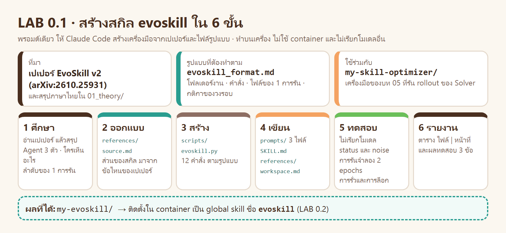

> [!IMPORTANT]
> **📋 คัดลอกกล่องนี้ → Claude Code Desktop แล้วกด Enter**
>
> ```text
> งาน: สร้างสกิล evoskill ไว้ในโฟลเดอร์ใหม่ ./my-evoskill (ทำบนเครื่องนี้ ไม่ใช้ container)
>
> ที่มา    : เปเปอร์ EvoSkill v2 (arXiv:2610.25931) · สรุปภาษาไทย 03_week03/07_EvoSkill_v2/01_theory/README.md
> รูปแบบ   : 03_week03/07_EvoSkill_v2/evoskill_format.md
> ใช้ร่วมกับ : ./my-skill-optimizer (เครื่องมือของบท 05 ที่รัน rollout ของ Solver)
> เงื่อนไข : ห้ามเปิดฉบับสำเร็จที่ 00_resource/skills/evoskill · prompt ต้องเขียนด้วยถ้อยคำของตัวเอง
>
> ทำตามลำดับ:
> 1. ศึกษา    อ่านที่มา แล้วสรุปวงรอบของ EvoSkill v2: Agent 3 ตัว ใครเห็นอะไร และลำดับของ 1 การรัน
> 2. ออกแบบ   จด references/source.md: ส่วนของสกิล | มาจากข้อไหนของเปเปอร์ | เหมือนหรือต่าง
> 3. สร้าง     scripts/evoskill.py 12 คำสั่ง (init adapt audit base turn rollout test run status noise eval export) พร้อม plugin_api.py และ plugin_skeleton.py ตามรูปแบบ
> 4. เขียน     prompts/ 3 ไฟล์ (adaptor evolver_system evolver_message) · SKILL.md · references/workspace.md
> 5. ทดสอบ    ไม่เรียกโมเดล: (ก) status และ noise ของทุกการรันใน 03_week03/07_EvoSkill_v2/runs ต้องพิมพ์ตรงกับ status.txt และ noise.txt ที่เก็บไว้ (ข) รัน 1 การรันขนาด 2 epochs ด้วย Agent จำลองจนจบถึง test แล้วตรวจว่า skills_v1 และ skills_v2 ถูกเก็บทั้งคู่ · Test ใช้ skills_v2 · ใน evo/ ไม่มีสิ่งใดของ Validation และ Test (ค) ให้ Benchmark Adaptor จำลองคัดลอกโจทย์ของ Validation ลง reference การรันต้องหยุดที่ adapt · และเมื่อแก้ setup/tasks.json หลังล็อก คำสั่งถัดไปต้องหยุด
> 6. รายงาน   ตาราง ไฟล์ | หน้าที่ และผลทดสอบ 3 ข้อ
> ```

**ผลจริง** · agent ใหม่รันพรอมต์นี้ตามตัวอักษรเมื่อ 15 พ.ย. 2026 · ใช้ 20 นาที · ไม่เรียกโมเดลอื่น

| ไฟล์ที่ได้ใน `my-evoskill/` | บรรทัด | หน้าที่ |
|---|---|---|
| `SKILL.md` | 62 | คู่มือที่ AI อ่าน: ใช้เมื่อไร · ตารางคำสั่ง 12 ตัว · ขั้นตอน · ข้อห้าม |
| `scripts/evoskill.py` | 1,606 | โปรแกรมควบคุมการรัน ไฟล์เดียว ใช้ไลบรารีมาตรฐานเท่านั้น |
| `scripts/plugin_api.py` | 33 | รูปแบบของ 1 โจทย์ (`class Task`) และกติกาของ plug-in |
| `scripts/plugin_skeleton.py` | 30 | โครงเปล่าของ `benchmark_plugin.py` ให้ Benchmark Adaptor เติม |
| `prompts/adaptor.md` | 53 | ข้อความต่อท้าย system prompt ของ Benchmark Adaptor |
| `prompts/evolver_system.md` | 40 | ข้อความต่อท้าย system prompt ของ Evolver: บทบาท · เป้าหมาย · แผนที่ของ `/evo` · กติกาของ `staging/` |
| `prompts/evolver_message.md` | 1 | ข้อความประจำ epoch: เวลา · เส้นตาย · หมายเลข epoch |
| `references/source.md` | 55 | สรุปวงรอบ และตารางตรวจย้อนกลับ 25 แถว |
| `references/workspace.md` | 149 | โครงของ 1 การรัน และไฟล์ที่แต่ละคำสั่งอ่านและเขียน |

| ทดสอบ (ไม่เรียกโมเดล) | ผล |
|---|---|
| (ก) `status` และ `noise` ของการรันที่เก็บไว้ | ✅ พิมพ์ตรงกับ `status.txt` และ `noise.txt` ทุกไบต์ ทั้ง 12 การรัน (24/24) |
| (ข) การรันจำลอง 2 epochs จนจบ `test` | ✅ `skills_v1` และ `skills_v2` ถูกเก็บทั้งคู่ · Test ใช้ `skills_v2` · ใน `evo/` (52 ไฟล์) ไม่พบชื่อโจทย์ ชื่อฟังก์ชัน หรือข้อความโจทย์ของ Validation และ Test · Evolver ตาที่ 1 ได้เซสชันใหม่ ตาที่ 2 ทำต่อในเซสชันเดิม |
| (ค) การรั่วและการล็อก | ✅ Adaptor จำลองเขียนโจทย์ของ `v1` ลง `reference/` → หยุดที่ `adapt` ไม่มี rollout ใดถูกรัน · แก้ `setup/tasks.json` หลังล็อก → คำสั่งถัดไปหยุดพร้อมบอกชื่อไฟล์ |
| การแยกเครื่องด้วย `unshare` และการเรียกโมเดลจริง | ⚠️ ทดสอบบน Windows ไม่ได้ (รู้ผลใน LAB 1) |

👀 **สิ่งที่การรันจริงครั้งแรกสอน:** บัญชี 1 ใน 3 ติดลิมิตการใช้งานกลางการรัน rollout ของบัญชีนั้นจบใน 3 วินาทีโดยไม่ได้ทำอะไร และเครื่องมือรุ่นแรก **นับเป็นคะแนน 0** (คะแนน epoch 0 ตกจากราว 47% เหลือ 17%) · จึงเพิ่มกติกา 1 ข้อใน [`evoskill_format.md` ข้อ 6](evoskill_format.md#6--solver-และตัวตรวจ-rollout) ("rollout ที่ Solver ไม่ได้ทำงาน ต้องหยุด leg ไม่นับเป็นผลของสกิล") แล้วให้ agent เดิมแก้ตาม · ผลจริงทั้งหมดในบทนี้มาจากรุ่นที่แก้แล้ว

<details><summary>ตัวอย่างตารางตรวจย้อนกลับใน <code>references/source.md</code></summary>

| ส่วนของสกิล | มาจากข้อไหนของเปเปอร์ | เหมือนหรือต่าง |
|---|---|---|
| `adapt`: Agent แยกเซสชัน เขียน plug-in `list_tasks(root)` และ Reference Folder | Section 3 Benchmark Adaptor · Figure 1 แถบ BEFORE THE RUN | เหมือน |
| การล็อกด้วย hash (`setup/freeze.json`) และตรวจ hash ก่อนทุก leg | Section 3: การแบ่งชุดและตัวตรวจถูกตรึงก่อนมีสกิลตัวแรก | เหมือน |
| ตรวจการรั่วใน `reference/` (`audit`) | Reference Folder ต้องไม่มีของ Validation · Test · ตัวตรวจ | เพิ่มจากเปเปอร์: เปเปอร์ฝากไว้กับ Adaptor · สกิลนี้ตรวจซ้ำด้วยโปรแกรม |
| Solver = `skillopt.py run` ของบท 05 กับโฟลเดอร์ `legs/` | Solver คือ Claude Code ที่ใช้ system prompt เดิม | ต่าง: สกิลวางที่ `./skills/` และพรอมต์บอกให้อ่าน (ไม่ใช่ Progressive Disclosure) |
| `turn`: Evolver เป็น Claude Code ที่มีเครื่องมือครบ ปิดเฉพาะ WebSearch และ WebFetch | Design choice: Evolver เป็น Agent ที่มี bash | เหมือน |
| เซสชันเดียว: `--session-id` ในตาแรก แล้ว `--resume` | Design choice: Stateful Evolver | เหมือน · `--fresh-session` เป็นการทดลองตัดส่วนประกอบของบทเรียน |
| `evo/` 7 โฟลเดอร์ (traces · scores · solver_workspaces · skills · reference · staging · evolver_workspace) | Table 1 | เหมือน (ชื่อเดียวกัน) |
| ส่งเฉพาะผลของ Training เข้า `evo/` · `scores` เป็นตัวเลขอย่างเดียว | Section 3: Evolver ได้เฉพาะของ Training และได้แต่คะแนน | เหมือน |
| คัดลอก `staging/` เป็น `skills_vK` โดยไม่มีเงื่อนไข · Test ใช้ `skills_vE` | Design choice: รับทุก epoch ทดสอบชุดสุดท้าย | เหมือน |
| การแยกเครื่องด้วย `unshare -m` + bind mount + tmpfs บน `/workspace` | เปเปอร์: เครื่อง Daytona แยกกัน ปิดเครือข่ายเหลือ API ของโมเดล | ต่าง: container เดียว แยกด้วย mount namespace |
| `noise`: โจทย์ที่ผ่านบางครั้ง และประตูรับแบบวัดครั้งเดียวจะตัดสินอย่างไร | Table 2 และเหตุผลของการไม่มีประตูรับ | เพิ่มจากเปเปอร์ |
| `eval` · `export` | ไม่มีในเปเปอร์ | เพิ่ม: ใช้ใน LAB (วัดชุดสกิลอื่น · เก็บผลลงเครื่อง) |

</details>

#### ขั้น 0.2 · ติดตั้งเครื่องมือ และตรวจตัวตรวจ

> [!IMPORTANT]
> **📋 คัดลอกกล่องนี้ → Claude Code Desktop แล้วกด Enter**
>
> ```text
> งาน: เตรียม container multi-account ให้พร้อมสำหรับ LAB 1–7 (ยังไม่วัดอะไร)
>
> ทำตามลำดับ:
> 1. ติดตั้ง   my-evoskill เป็น global skill ชื่อ evoskill ของบัญชี yolo (ไว้ข้างสกิล skill-optimizer ของบท 05)
> 2. คัดลอก   bench ของ 03_week03/07_EvoSkill_v2 ไปไว้ที่ /workspace/evlab/bench
> 3. ตรวจ     มีสกิล skill-optimizer อยู่แล้วหรือไม่ · ตัวตรวจด้วย bench/check_grader.py · บัญชี yolo1–yolo5 ตัวไหนล็อกอินแล้ว
> 4. รายงาน   ตาราง รายการ | ผล
> ```

| Input · ไฟล์ที่ใช้ | Output · สิ่งที่ได้ใน container |
|---|---|
| `my-evoskill/` (จากขั้น 0.1) | global skill ชื่อ `evoskill` ของทุกบัญชี yolo |
| [`bench/`](bench/) | `/workspace/evlab/bench/` |

**ผลจริง:** ติดตั้งสกิล ✅ · มี `skill-optimizer` อยู่แล้ว ✅ · ตัวตรวจผ่าน ✅ (เฉลยอ้างอิงผ่าน 10/10 แปดโจทย์ และ 11/11 โจทย์ค่าส่ง · เฉลยที่จงใจใส่ความผิดไม่ผ่านเฉพาะข้อนั้น: `half_up` `reject_type` `cli_error` `policy`) · บัญชีที่ล็อกอินแล้ว `yolo1` `yolo2` `yolo3` · ใช้ไม่ถึง 1 นาที

👀 EvoSkill v2 ให้ผู้ใช้เป็นผู้ให้ตัวตรวจ และผู้ปรับสกิลที่เก่งหาช่องโหว่ของตัวตรวจเจอได้ ([ทฤษฎี ขั้น 8](01_theory/README.md#ขั้น-8--การกันข้อมูล-และช่องโหว่ของตัวตรวจ)) จึงต้องตรวจตัวตรวจก่อนเสมอ

### LAB 1 · Benchmark Adaptor เตรียมสนาม (`e1`)


| Input · ไฟล์ที่ใช้ | Output · ไฟล์ที่ได้เพิ่มหลังรัน |
|---|---|
| [`bench/instruction.md`](bench/instruction.md) คำสั่งของผู้ใช้ | [`runs/e1/setup/`](runs/e1/setup/) รายการโจทย์ที่ถูกล็อก: [`benchmark_plugin.py`](runs/e1/setup/benchmark_plugin.py) · [`freeze.json`](runs/e1/setup/freeze.json) · [`audit.md`](runs/e1/setup/audit.md) |
| [`bench/data/baankafe/`](bench/data/baankafe/) · [`split.json`](bench/split.json) | [`runs/e1/reference/`](runs/e1/reference/) สิ่งที่ Evolver จะได้อ่าน |
| `bench/benchmark_grader.py` ตัวตรวจ | [`runs/e1/turns/adaptor/`](runs/e1/turns/adaptor/) สิ่งที่ Adaptor ได้รับและทำ |

> [!IMPORTANT]
> **📋 คัดลอกกล่องนี้ → Claude Code Desktop แล้วกด Enter**
>
> ```text
> งาน: ให้ Benchmark Adaptor เตรียมสนามทดลองของการรัน e1 (ยังไม่ให้ Solver ทำโจทย์)
>
> ที่ทำงาน  : container multi-account โฟลเดอร์ /workspace/evlab
> เครื่องมือ : สกิล evoskill
> เงื่อนไข   : ห้ามเปิดตัวตรวจ (bench/benchmark_grader.py bench/check_grader.py) และเฉลย bench/data/baankafe/answers/ · โจทย์ของ Validation Set ดูได้แค่คะแนน · ผลรายข้อของ Test Set เปิดได้หลังขั้น test จบ · ห้ามแก้ไฟล์ใน setup/ reference/ skills_v*/ evo/ เอง
>
> Input: สิ่งที่ผู้ใช้ส่งให้ EvoSkill v2 อยู่ใน bench/
> - คำสั่ง 1 หน้า bench/instruction.md: Evolver อ่านโจทย์และเฉลยอ้างอิงของ Training ได้ · ขนาดของการรัน 3 epochs · 3 samples per task
> - ข้อมูล bench/data/baankafe: โจทย์ 9 ข้อ (ข้อละ 1 ฟังก์ชันคิดเงิน) และเฉลยอ้างอิง · การแบ่งชุด bench/split.json = Training 4 · Validation 2 · Test 3
> - ตัวตรวจ bench/benchmark_grader.py
>
> วิธีทดลอง:
> - การรันชื่อ e1 · ใช้ทุกบัญชี yolo ที่ล็อกอินแล้ว · ค่าอื่นใช้ค่าเริ่มต้นของสกิล
> - LAB นี้รันขั้น adapt ขั้นเดียว: Benchmark Adaptor (sonnet · effort high · 1 เซสชัน) อ่านคำสั่ง แล้วเขียนรายการโจทย์ (plug-in) กับโฟลเดอร์ reference ที่ Evolver จะได้อ่าน จากนั้นโปรแกรมล็อกด้วย hash และตรวจการรั่ว
>
> ทำตามลำดับ:
> 1. สร้าง     การรัน e1 แล้วรันขั้น adapt
> 2. เปิดดู    setup/benchmark_plugin.py · setup/freeze.json · setup/audit.md · รายการไฟล์ใน reference/ · turns/adaptor/message.md และ actions.md
> 3. รายงาน   ตาราง รายการ | ผล (เวลา เครื่องมือ และค่าใช้จ่ายของ Benchmark Adaptor · จำนวนโจทย์แต่ละชุด · ไฟล์ใน reference · ผลตรวจการรั่ว) · สิ่งที่ Benchmark Adaptor ทำเองโดยไม่ได้สั่ง
> ```

**ผลจริง:** Benchmark Adaptor ใช้ 23 วินาที · เครื่องมือ 3 ครั้ง · $0.09 · ตรวจการรั่ว: สะอาด

| รายการ | ผล |
|---|---|
| [`benchmark_plugin.py`](runs/e1/setup/benchmark_plugin.py) | `list_tasks(root)` คืนโจทย์ 9 ข้อ = train 4 · validation 2 · test 3 ตรงกับ `split.json` |
| [`freeze.json`](runs/e1/setup/freeze.json) | sha256 ของ plug-in · ตัวตรวจ · รายการโจทย์ · `grader_unchanged_by_adaptor: true` |
| [`reference/`](runs/e1/reference/) | 12 ไฟล์: โจทย์ของ Training 4 · เฉลยอ้างอิงของ Training 8 (`solve.py` และ `test_solve.py`) |
| [`audit.md`](runs/e1/setup/audit.md) | ของ Validation หรือ Test: ไม่พบ · โค้ดของตัวตรวจ: ไม่พบ |
| สิ่งที่ Adaptor ทำเองโดยไม่ได้สั่ง | ไม่คัดลอก `split.json` ลง `reference/` (ไฟล์นั้นมีชื่อโจทย์ของ Validation และ Test) · ทดสอบ plug-in เอง · ค้นหาชื่อโจทย์ ชื่อฟังก์ชัน และคำว่า grader ใน `reference/` เองก่อนจบ |

👀 หลังขั้นนี้ การแบ่งชุดและตัวตรวจถูกล็อก · Agent ที่จะเขียนสกิลยังไม่ได้เริ่มทำงานเลย จึงไม่มีทางแก้การวัดให้ตัวเองได้เปรียบ

👀 เฉลยอ้างอิง 8 ไฟล์ใน `reference/` รวมเฉลยของงานค่าส่งและงานเงินคืน ซึ่ง **ทำตามนโยบายธุรกิจ 4 ข้อที่โจทย์ไม่ได้เขียน** · นี่คือช่องทางเดียวที่ Evolver จะรู้นโยบายเหล่านี้ได้

### LAB 2 · รัน 1 การรันจนจบ (`e1`)


| Input · ไฟล์ที่ใช้ | Output · ไฟล์ที่ได้เพิ่มหลังรัน |
|---|---|
| การรัน `e1` ที่ผ่านขั้น adapt แล้ว | [`runs/e1/skills_v1/`](runs/e1/skills_v1/) · [`skills_v2/`](runs/e1/skills_v2/) · [`skills_v3/`](runs/e1/skills_v3/) ชุดสกิลของแต่ละ epoch |
| โจทย์ 9 ข้อ และตัวตรวจ (ล็อกแล้ว) | [`runs/e1/turns/turn_1/`](runs/e1/turns/turn_1/) ถึง `turn_3/` สิ่งที่ Evolver ทำทีละคำสั่ง ([`actions.md`](runs/e1/turns/turn_1/actions.md)) |
| สกิล `evoskill` (จาก LAB 0) | [`runs/e1/legs/`](runs/e1/legs/) ผลของ 78 rollout · [`status.txt`](runs/e1/status.txt) ตารางสรุป · [`noise.txt`](runs/e1/noise.txt) |
|  | [`runs/e1/evo/evolver_workspace/notes.md`](runs/e1/evo/evolver_workspace/notes.md) บันทึกที่ Evolver เขียนให้ตัวเอง |

> [!IMPORTANT]
> **📋 คัดลอกกล่องนี้ → Claude Code Desktop แล้วกด Enter**
>
> ```text
> งาน: รันการรัน e1 ต่อจนจบ · ดู Evolver เขียนสกิลทีละตา แล้ววัดกับ Test Set
>
> ที่ทำงาน  : container multi-account โฟลเดอร์ /workspace/evlab
> เครื่องมือ : สกิล evoskill
> เงื่อนไข   : ห้ามเปิดตัวตรวจ (bench/benchmark_grader.py bench/check_grader.py) และเฉลย bench/data/baankafe/answers/ · โจทย์ของ Validation Set ดูได้แค่คะแนน · ผลรายข้อของ Test Set เปิดได้หลังขั้น test จบ · ห้ามแก้ไฟล์ใน setup/ reference/ skills_v*/ evo/ เอง
>
> Input: การรัน e1 ที่ผ่านขั้น adapt แล้ว (LAB 1)
> - Training Set 4 ข้อ ใช้ให้ Evolver เรียนรู้: t1-cafe-bill t2-split-bill t3-shipping-fee t4-cashback
> - Validation Set 2 ข้อ ใช้ดูคะแนนของแต่ละ epoch: v1-parking-fee v2-net-pay
> - Test Set 3 ข้อ ใช้วัดตอนจบ: x1-late-fee x2-refund x3-bulk-price
>
> วิธีทดลอง:
> - 1 rollout = Solver 1 ตัว (sonnet · effort medium) ได้โจทย์ 1 ข้อ แล้วเขียน solve.py และ test_solve.py ในโฟลเดอร์ว่าง · โจทย์ละ 3 ครั้ง
> - epoch 0 ไม่มีสกิล: Training 12 + Validation 6 + Test 9 rollout
> - epoch 1–3: Evolver (sonnet · effort high · เซสชันเดียวตลอดการรัน) อ่าน rollout ของ Training แล้วเขียน skills_vK → Solver ทำ Validation 6 และ Training 12 rollout ด้วยชุดนั้น (epoch 3 ไม่ทำ Training)
> - จบแล้ววัด skills_v3 กับ Test Set 9 rollout · รวมทั้งการรัน 78 rollout
>
> วิธีตรวจ:
> - ทุก rollout ตัวตรวจของผู้ใช้รันโค้ดที่ Solver เขียน แล้วให้คะแนน 0–1 = สัดส่วนข้อตรวจที่ผ่าน (10 หรือ 11 ข้อต่อโจทย์) · ผ่าน = ครบทุกข้อ
> - Evolver เห็นแค่คะแนนของ Training · ไม่มีประตูรับ: ชุดสกิลของทุก epoch ถูกใช้ และ Test Set วัดด้วยชุดของ epoch สุดท้าย 1 ครั้ง
>
> ทำตามลำดับ:
> 1. epoch 0    รันขั้น base
> 2. epoch 1    รันขั้น turn แล้วเปิด turns/turn_1/actions.md และ skills_v1/ สรุปว่า Evolver ทำอะไร และเขียนสกิลอะไร · จากนั้นรันขั้น rollout
> 3. รันต่อ     run จนจบ
> 4. เก็บผล     export การรัน e1 แล้วคัดลอกโฟลเดอร์ e1 ที่ได้ มาแทน 03_week03/07_EvoSkill_v2/runs/e1 บนเครื่อง
> 5. รายงาน    ตาราง ขั้น | ไฟล์ที่เกิด | สรุป 1 บรรทัด · สรุป 3 ตาของ Evolver จาก turns/turn_1 ถึง turn_3/actions.md (ทำอะไร · ข้อสรุป · คะแนน Validation หลังจากนั้น) · ตาราง status · ข้อตรวจที่ไม่ผ่านใน Test Set
> ```

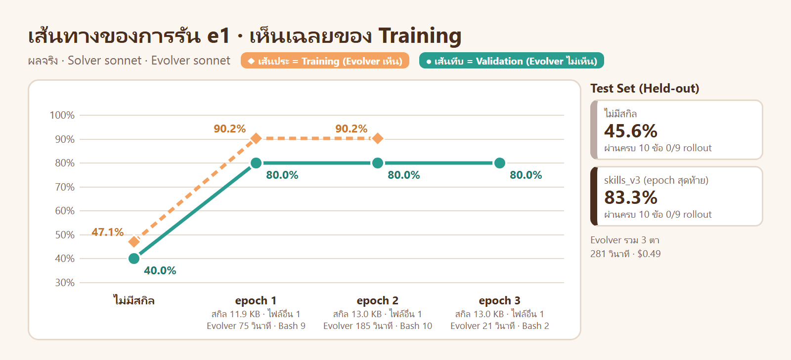

**ผลจริง:** Test Set 47.8% → **83.3%** · Validation 46.7% → 83.3% → 86.7% → 90.0% · 78 rollout · ใช้ 16 นาที · Evolver 3 ตารวม 7.9 นาที $0.57

| epoch | ชุดสกิล | Training | Validation | ตาของ Evolver |
|---|---|---|---|---|
| 0 | (ไม่มี) | 47.1% | 46.7% | – |
| 1 | [`baankafe-solve`](runs/e1/skills_v1/baankafe-solve/SKILL.md) 10.0 KB + แม่แบบโค้ด 1 ไฟล์ | 90.2% | 83.3% | 1.2 นาที · Bash 9 ครั้ง · $0.24 |
| 2 | แก้สกิลเดิม 12.0 KB | 90.2% | 86.7% | 4.6 นาที · Bash 9 ครั้ง · $0.22 |
| 3 | แก้สกิลเดิม 12.6 KB | – | 90.0% | 2.1 นาที · Bash 4 ครั้ง · $0.11 |

| ตา | สิ่งที่ Evolver ทำด้วย bash | ข้อสรุปของมัน | เปิดดูได้ที่ |
|---|---|---|---|
| 1 | อ่านคะแนน → เทียบโค้ดของ Solver กับเฉลยใน `reference/` | Solver ไม่ตรวจ input ไม่เขียนเทสต์ และ **เฉลยมีนโยบายของร้าน 4 ข้อที่โจทย์ไม่ได้เขียน** → เขียนสกิล 1 ตัว | [`turn_1/actions.md`](runs/e1/turns/turn_1/actions.md) |
| 2 | รันเทสต์ของเฉลยกับโค้ดของ Solver ทั้ง 12 rollout (ผ่านหมด) · เทียบกับเฉลยด้วย input สุ่มและ input ผิดชนิด | พบจุดต่างจุดเดียว (ระยะทางรับ float) จึงเดาว่าเป็นสาเหตุ · "ยังหาไม่เจอว่าทำไมขาด 0.1" | [`turn_2/actions.md`](runs/e1/turns/turn_2/actions.md) |
| 3 | เทียบซ้ำ รวมถึงโหมดรันเป็นโปรแกรม: ตรงกับเฉลยทุกกรณี | ข้อสันนิษฐานเรื่อง float ผิด · เหลือข้อเดียวคือไฟล์เทสต์ของ Solver "อาจชนกับเทสต์ของผู้ตรวจ" → **ทดลองให้ย้ายไฟล์เทสต์ออกไป `/tmp`** | [`turn_3/actions.md`](runs/e1/turns/turn_3/actions.md) |

👀 สามเรื่องที่ควรอ่านแยกกัน

**เรื่องที่ 1 · Evolver พบนโยบายธุรกิจครบ 4 ข้อเอง ในตาแรก**

มันอ่านเฉลยของงานค่าส่งและงานเงินคืน แล้วเขียนลงสกิล · ข้อตรวจ `policy` ของ Training ผ่านครบ 6/6 ตั้งแต่ epoch 1 · นี่คือสิ่งที่ WikiSkill ของบท 06 หาเองไม่ได้ (`policy` 0/6) เพราะไม่มีใครได้เห็นเฉลย

**เรื่องที่ 2 · แต่นโยบายถูกเขียนกว้างกว่าที่เฉลยบอก และไม่มีอะไรกันไว้**


```text
สกิลที่ Evolver เขียน : เงินที่ร้านจ่ายออก (เงินคืน cashback, คืนเงิน, ส่วนลดที่ให้, แต้ม, รางวัล) → ปัดลง (floor)
ผลใน Test Set        : ✗ half_up: refund(150, 25, false) คาด 113 ได้ 112 · พลาด 3 จาก 3 กรณี      ← x2-refund ทั้ง 3 rollout
```

เฉลยของ Training บอกเพียงว่า **เงินคืนสมาชิก** ปัดลง · Evolver ขยายเป็นกติกาของ "เงินที่ร้านจ่ายออก" ทุกชนิด งานคืนเงินคอร์สของ Test Set จึงผิด · นี่คือความผิดแบบเดียวกับรุ่น `w1p` ของ [บท 06 LAB 5](../06_WikiSkill/README.md#lab-5--เติมความรู้จากทีม-w1p--w1q) ซึ่งประตูรับของบท 05 ปฏิเสธ · EvoSkill v2 **ไม่มีประตูรับ** และ Validation 2 โจทย์ไม่มีงานแบบนี้ ชุดสกิลจึงถูกใช้ต่อจนถึง Test

**เรื่องที่ 3 · 0.1 ที่ขาด คือกฎที่อยู่เฉพาะในตัวตรวจ และ Evolver เดาผิดทาง**


| epoch | สิ่งที่ตัวตรวจพบ (Evolver ไม่เห็น) | สิ่งที่ Evolver เห็น | สิ่งที่ Evolver ทำ |
|---|---|---|---|
| 1 | `✗ tests: unittest พบ 3 เทสต์ (ต้องมีอย่างน้อย 6)` | `0.9` | เดาว่าเป็นเรื่องระยะทางรับ float → ห้าม float |
| 2 | `✗ tests: unittest พบ 4 เทสต์ (ต้องมีอย่างน้อย 6)` | `0.9` | คะแนนเท่าเดิม → เดาใหม่ว่าไฟล์เทสต์ชนกับผู้ตรวจ → ให้ย้ายไป `/tmp` |
| 3 (Test) | `✗ tests: ไม่มีไฟล์ test_solve.py ข้าง solve.py` | – | ไม่มีตาถัดไปให้แก้ |

Solver ส่งไฟล์เทสต์มาตลอด ขาดแค่จำนวนเทสต์ · การแก้ของตาที่ 3 ทำให้ห่างจากกฎจริงมากขึ้น และเพราะเป็นตาสุดท้าย ชุดนี้จึงถูกนำไปวัด Test ทันที · บันทึกของ Evolver เอง ([`notes.md`](runs/e1/evo/evolver_workspace/notes.md)):

```text
- epoch2: identical scores (0.9), solver == reference on fuzz+CLI. Unexplained 0.1.
  v3 experiment: move solver tests out of workspace (only solve.py left). If epoch3 score changes -> learn; revert if drops.
```

<details><summary>ชุดสกิลที่ได้ทั้งไฟล์: <code>skills_v3</code> ของ <code>e1</code></summary>

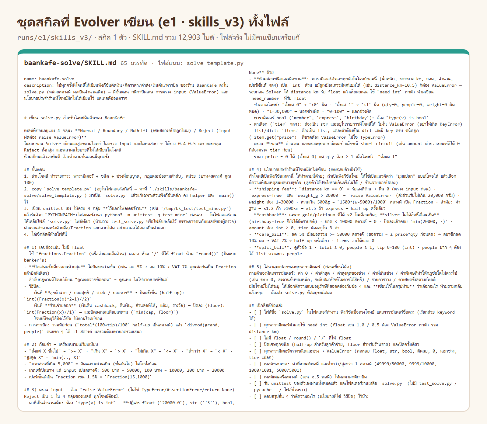

ไฟล์จริง: [`SKILL.md`](runs/e1/skills_v3/baankafe-solve/SKILL.md) · [`solve_template.py`](runs/e1/skills_v3/baankafe-solve/solve_template.py)

</details>

**ผู้สอนรันซ้ำด้วยการตั้งค่าเดิมอีก 2 ครั้ง** ([status e2](runs/e2/status.txt) · [status v1](runs/v1/status.txt))

| | `e1` | `e2` | `v1` |
|---|---|---|---|
| Validation ราย epoch | 46.7 → 83.3 → 86.7 → 90.0 | 43.3 → 70.0 → 80.0 → 80.0 | 40.0 → 63.3 → 80.0 → 80.0 |
| Test Set | 83.3% (0/9) | 83.3% (0/9) | 83.3% (0/9) |
| นโยบายธุรกิจ | เขียนลงสกิลในตาแรก | ตาแรกเขียนเฉพาะกฎปัดเศษ · อีก 3 ข้อเพิ่มในตาที่ 3 | เขียนลงสกิลในตาแรก |
| การเดาเรื่องคะแนนที่ขาด | ระยะทางรับ float → ไฟล์เทสต์ชนกับผู้ตรวจ (ผิดทาง) | ตาที่ 2 สังเกตว่า rollout ที่มี `main()` ได้สูงกว่า 0.2 → ให้มี `main()` และ `test_solve.py` (ถูกทาง) | ตาที่ 2 เพิ่มแม่แบบไฟล์เทสต์ แต่เขียนว่า "แนะนำ" · ตาที่ 3 "หาสาเหตุไม่ได้" จึงไม่แก้ |
| ข้อ `tests` ใน Test Set | ไม่ผ่าน 9/9 · `ไม่มีไฟล์ test_solve.py` | ไม่ผ่าน 9/9 · `unittest พบ 4 เทสต์` | ไม่ผ่าน 9/9 · `ไม่มีไฟล์ test_solve.py` |
| `x2-refund` ใน Test Set | ผิด 3/3 | ผิด 3/3 | ผิด 3/3 |

👀 การตั้งค่าเดียวกัน 3 ครั้ง ได้ Test 83.3% เท่ากัน ทั้งที่เดินคนละเส้นทาง · สิ่งที่เหมือนกันคือ 2 เรื่องที่ไม่มีการรันใดแก้ได้: จำนวนเทสต์ขั้นต่ำ (Evolver ต้อง **เดา** โดยไม่มีหลักฐาน) และกฎปัดเศษที่เขียนกว้าง

### LAB 3 · ผู้ใช้บอก Evolver เพิ่ม 1 ประโยค (`n1`)


`e1` ติดที่ 0.9 ต่อ rollout เพราะ Evolver ไม่รู้ว่าไฟล์เทสต์เป็นส่วนของงานที่ต้องส่ง · ใน EvoSkill v2 เราไม่แก้ prompt ของ Evolver และไม่เปิดตัวตรวจให้ดู · ช่องทางเดียวคือ **คำสั่งของผู้ใช้** ซึ่งกำหนดว่าโฟลเดอร์ reference มีอะไร

[`instruction_with_note.md`](bench/instruction_with_note.md) ต่างจาก `instruction.md` ที่ย่อหน้าเดียว:

```text
ให้เขียนไฟล์ `README.md` ไว้ที่ชั้นบนสุดของโฟลเดอร์ reference ด้วย มีข้อความนี้ข้อความเดียว:
"โฟลเดอร์ `answers/<task id>/` คือผลงานของโจทย์นั้นที่ได้คะแนนเต็ม ประกอบด้วย 2 ไฟล์ คือ `solve.py` และ `test_solve.py`"
```

| Input · ไฟล์ที่ใช้ | Output · ไฟล์ที่ได้เพิ่มหลังรัน |
|---|---|
| [`bench/instruction_with_note.md`](bench/instruction_with_note.md) | [`runs/n1/`](runs/n1/) การรันใหม่ทั้งโฟลเดอร์ · [`reference/README.md`](runs/n1/reference/README.md) 1 ประโยค |
| ไฟล์อื่นใน `bench/` ชุดเดียวกับ `e1` | [`runs/n1/status.txt`](runs/n1/status.txt) · [`skills_v3/`](runs/n1/skills_v3/) |

> [!IMPORTANT]
> **📋 คัดลอกกล่องนี้ → Claude Code Desktop แล้วกด Enter**
>
> ```text
> งาน: รัน EvoSkill v2 อีก 1 การรัน (n1) ที่ผู้ใช้บอก Evolver เพิ่ม 1 ประโยค ผ่านโฟลเดอร์ reference · เทียบกับ e1
>
> ที่ทำงาน  : container multi-account โฟลเดอร์ /workspace/evlab
> เครื่องมือ : สกิล evoskill
> เงื่อนไข   : ห้ามเปิดตัวตรวจ (bench/benchmark_grader.py bench/check_grader.py) และเฉลย bench/data/baankafe/answers/ · โจทย์ของ Validation Set ดูได้แค่คะแนน · ผลรายข้อของ Test Set เปิดได้หลังขั้น test จบ · ห้ามแก้ไฟล์ใน setup/ reference/ skills_v*/ evo/ เอง
>
> Input: สิ่งที่ผู้ใช้ส่งใน bench/ ชุดเดียวกับ e1 ยกเว้นไฟล์คำสั่ง
> - bench/instruction_with_note.md = instruction.md + 1 ย่อหน้า: ให้ Benchmark Adaptor เขียน README.md ไว้ในโฟลเดอร์ reference มีข้อความเดียวว่า "โฟลเดอร์ answers/<task id>/ คือผลงานของโจทย์นั้นที่ได้คะแนนเต็ม ประกอบด้วย 2 ไฟล์ คือ solve.py และ test_solve.py"
>
> วิธีทดลอง:
> - การรันชื่อ n1 · ต่างจาก e1 จุดเดียว: ใช้คำสั่งของผู้ใช้ bench/instruction_with_note.md
> - ค่าอื่นเหมือน e1 ทุกค่า: 3 epochs · โจทย์ละ 3 ครั้ง · Solver sonnet effort medium · Evolver sonnet effort high · ใช้ทุกบัญชี yolo ที่ล็อกอินแล้ว รันพร้อมกันไม่เกิน 6 rollout
> - 1 การรัน = 78 rollout: epoch 0 ไม่มีสกิล 27 (Training 12 · Validation 6 · Test 9) · epoch 1 และ 2 ชุดละ 18 · epoch 3 เฉพาะ Validation 6 · Test 9 ด้วยชุดสกิลของ epoch 3
>
> วิธีตรวจ:
> - ทุก rollout ตัวตรวจของผู้ใช้รันโค้ดที่ Solver เขียน แล้วให้คะแนน 0–1 = สัดส่วนข้อตรวจที่ผ่าน (10 หรือ 11 ข้อต่อโจทย์) · ผ่าน = ครบทุกข้อ
> - Evolver เห็นแค่คะแนนของ Training · ไม่มีประตูรับ: ชุดสกิลของทุก epoch ถูกใช้ และ Test Set วัดด้วยชุดของ epoch สุดท้าย 1 ครั้ง
>
> ทำตามลำดับ:
> 1. สร้าง     การรัน n1 แล้ว run จนจบ
> 2. เก็บผล    export การรัน n1 แล้วคัดลอกโฟลเดอร์ n1 ที่ได้ มาแทน 03_week03/07_EvoSkill_v2/runs/n1 บนเครื่อง
> 3. รายงาน   เนื้อหาของ reference/README.md · ตาราง status ของ n1 เทียบ e1 · สรุป 3 ตาของ Evolver (ทำอะไร · ข้อสรุป · คะแนน Validation หลังจากนั้น) · ข้อตรวจที่ไม่ผ่านใน Test Set
> ```

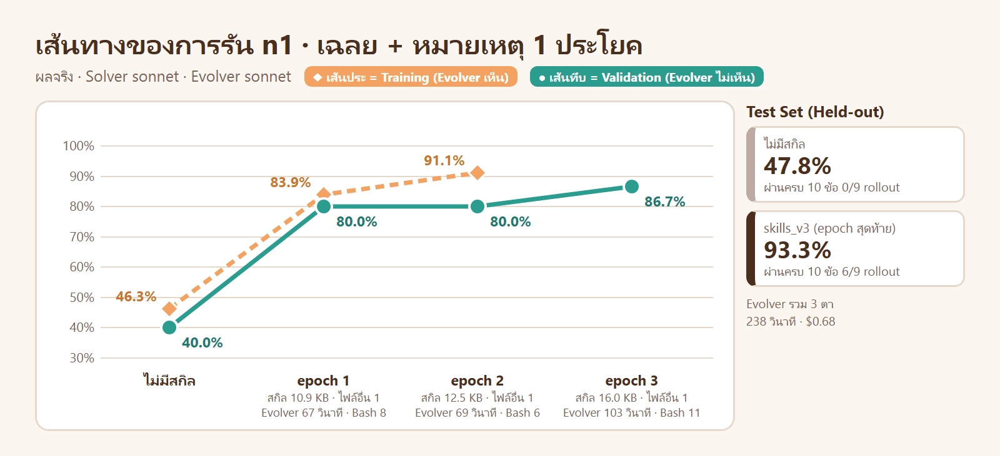

**ผลจริง:** Test Set 47.8% → **93.3%** (ผ่านครบ 6/9 rollout) · Validation 43.3% → 90.0% → 93.3% → 96.7% · Training **100%** ตั้งแต่ epoch 1 · Evolver 3 ตารวม $0.30

| ตา | Evolver ทำอะไร | Validation หลังจากนั้น |
|---|---|---|
| 1 · 76 วินาที | อ่าน `README.md` และเฉลย → รัน `test_solve.py` ของเฉลยกับโค้ดของ Solver ทั้ง 12 rollout → เขียนสกิล 2 ตัว: [`baankafe-money-fn`](runs/n1/skills_v3/baankafe-money-fn/SKILL.md) (**ต้องเขียนและรัน `test_solve.py` ก่อนจบ** พร้อมแม่แบบ `template_test.py`) และ [`baankafe-policies`](runs/n1/skills_v3/baankafe-policies/SKILL.md) (นโยบายที่โจทย์ไม่ได้เขียน) | 43.3% → 90.0% |
| 2 · 9 วินาที | Training ได้ 1.0 ทั้ง 12 rollout → **ไม่แก้** ("ไม่มีจุดพลาดให้แก้ และไม่อยากให้สกิลเอนเข้าหาโจทย์ train 4 ข้อ") | 90.0% → 93.3% |
| 3 · 6 วินาที | เหมือนตาที่ 2 → ไม่แก้ | 93.3% → 96.7% |

| | `e1` | `n1` |
|---|---|---|
| สิ่งที่ต่าง | – | reference มี `README.md` 1 ประโยค |
| สกิลให้ Solver ส่ง `test_solve.py` หรือไม่ | ไม่ (ตาที่ 3 ให้ย้ายไป `/tmp`) | **ให้ส่งตั้งแต่ตาแรก** พร้อมแม่แบบไฟล์เทสต์ |
| ข้อ `tests` ของ Training (epoch 1) | ไม่ผ่าน 12/12 · `unittest พบ 3 เทสต์` | **ผ่าน 12/12** |
| Training ราย epoch | 47.1% → 90.2% → 90.2% | 45.5% → **100%** → **100%** |
| Test Set | 83.3% (0/9) | **93.3% (6/9)** |
| ต้นทุนของ Evolver | $0.57 | $0.30 |

👀 ประโยคที่เพิ่มไม่ได้บอกว่าตัวตรวจตรวจอย่างไร บอกเพียงว่า **งานที่สมบูรณ์มีไฟล์อะไรบ้าง** · Evolver จึงเลิกมองไฟล์เทสต์ของเฉลยเป็นแค่เครื่องมือตรวจโค้ด และสั่งให้ Solver ส่งไฟล์เทสต์ด้วย

👀 Validation ที่ขยับ 90.0% → 93.3% → 96.7% **ไม่ได้มาจากการแก้สกิล** (ตาที่ 2 และ 3 ไม่ได้แก้อะไร ชุดสกิลทั้ง 3 epoch เหมือนกันทุกไบต์) · เป็นความแกว่งของ Solver ล้วน ๆ ([LAB 7](#lab-7--ความแกว่ง-และประตูรับที่เราไม่ได้ใช้))

👀 **93.3% คือเพดานของทุกการรันที่เห็นเฉลย:** งาน `x2-refund` ยังผิด 2 ข้อตรวจทั้ง 3 rollout เพราะนโยบายปัดเศษที่เขียนกว้าง ("เงินออกจากร้าน = ปัดลง") · ประโยคที่เราเพิ่มแก้ได้เฉพาะเรื่องที่เราบอก

**ผู้สอนรันซ้ำ (`n2`):** Validation 46.7 → 60.0 → 90.0 → 90.0 · Test **93.3% (6/9)** เท่ากับ `n1` ([status](runs/n2/status.txt)) · ต่างกันที่เส้นทาง: `n2` ให้ Solver ส่งไฟล์เทสต์ตั้งแต่ตาแรกเช่นกัน แต่ epoch 1 Solver เขียนเพียง 2 เทสต์ และส่วนใหญ่ไม่เขียน `main()` (Training 69.8%) · ตาที่ 2 Evolver สังเกตจากคะแนนว่า rollout ที่มี `main()` ได้สูงกว่า จึงบังคับทั้งสองเรื่อง → Training 100%

บทเรียน: ใน EvoSkill v2 สิ่งที่คนปรับได้คือ "Evolver ได้เห็นอะไร" ไม่ใช่ "Evolver ต้องคิดอย่างไร" · ถ้ากฎใดอยู่เฉพาะในตัวตรวจและเราต้องการให้สกิลรู้ ต้องบอกผ่านโฟลเดอร์ reference

### LAB 4 · Evolver เห็นแต่คะแนน (`p1`)


การตั้งค่าที่สองของเปเปอร์ (Pass or Fail Only): โฟลเดอร์ reference ไม่มีเฉลยของชุดใดเลย

| Input · ไฟล์ที่ใช้ | Output · ไฟล์ที่ได้เพิ่มหลังรัน |
|---|---|
| [`bench/instruction_score_only.md`](bench/instruction_score_only.md) | [`runs/p1/`](runs/p1/) การรันใหม่ทั้งโฟลเดอร์ · [`reference/`](runs/p1/reference/) มีแต่โจทย์ของ Training |
| ไฟล์อื่นใน `bench/` ชุดเดียวกับ `e1` | [`runs/p1/evo/evolver_workspace/notes.md`](runs/p1/evo/evolver_workspace/notes.md) บันทึกการทดลองของ Evolver |

> [!IMPORTANT]
> **📋 คัดลอกกล่องนี้ → Claude Code Desktop แล้วกด Enter**
>
> ```text
> งาน: รัน EvoSkill v2 อีก 1 การรัน (p1) ที่ Evolver ไม่ได้เห็นเฉลยของชุดใดเลย เห็นแต่คะแนน · เทียบกับ e1
>
> ที่ทำงาน  : container multi-account โฟลเดอร์ /workspace/evlab
> เครื่องมือ : สกิล evoskill
> เงื่อนไข   : ห้ามเปิดตัวตรวจ (bench/benchmark_grader.py bench/check_grader.py) และเฉลย bench/data/baankafe/answers/ · โจทย์ของ Validation Set ดูได้แค่คะแนน · ผลรายข้อของ Test Set เปิดได้หลังขั้น test จบ · ห้ามแก้ไฟล์ใน setup/ reference/ skills_v*/ evo/ เอง
>
> Input: สิ่งที่ผู้ใช้ส่งใน bench/ ชุดเดียวกับ e1 ยกเว้นไฟล์คำสั่ง
> - bench/instruction_score_only.md = instruction.md ที่เปลี่ยนหัวข้อ "สิ่งที่ Evolver เห็นได้" เป็น: อ่านได้เฉพาะข้อความโจทย์ของ Training ห้ามเห็นเฉลยอ้างอิงของชุดใดเลย
>
> วิธีทดลอง:
> - การรันชื่อ p1 · ต่างจาก e1 จุดเดียว: ใช้คำสั่งของผู้ใช้ bench/instruction_score_only.md
> - ค่าอื่นเหมือน e1 ทุกค่า: 3 epochs · โจทย์ละ 3 ครั้ง · Solver sonnet effort medium · Evolver sonnet effort high · ใช้ทุกบัญชี yolo ที่ล็อกอินแล้ว รันพร้อมกันไม่เกิน 6 rollout
> - 1 การรัน = 78 rollout: epoch 0 ไม่มีสกิล 27 (Training 12 · Validation 6 · Test 9) · epoch 1 และ 2 ชุดละ 18 · epoch 3 เฉพาะ Validation 6 · Test 9 ด้วยชุดสกิลของ epoch 3
>
> วิธีตรวจ:
> - ทุก rollout ตัวตรวจของผู้ใช้รันโค้ดที่ Solver เขียน แล้วให้คะแนน 0–1 = สัดส่วนข้อตรวจที่ผ่าน (10 หรือ 11 ข้อต่อโจทย์) · ผ่าน = ครบทุกข้อ
> - Evolver เห็นแค่คะแนนของ Training · ไม่มีประตูรับ: ชุดสกิลของทุก epoch ถูกใช้ และ Test Set วัดด้วยชุดของ epoch สุดท้าย 1 ครั้ง
>
> ทำตามลำดับ:
> 1. สร้าง     การรัน p1 แล้ว run จนจบ
> 2. เก็บผล    export การรัน p1 แล้วคัดลอกโฟลเดอร์ p1 ที่ได้ มาแทน 03_week03/07_EvoSkill_v2/runs/p1 บนเครื่อง
> 3. รายงาน   รายการไฟล์ใน reference/ · ตาราง status ของ p1 เทียบ e1 · สรุป 3 ตาของ Evolver (ทำอะไร · ข้อสรุป · คะแนน Validation หลังจากนั้น) · เนื้อหาของ evo/evolver_workspace/ · ข้อตรวจที่ไม่ผ่านใน Test Set
> ```


**ผลจริง:** Test Set 47.8% → **70.0%** (0/9) · Validation 43.3% → **31.7%** → 43.3% → 70.0% · reference มี 5 ไฟล์ (โจทย์ของ Training 4 + `README.md` ที่ Adaptor เขียนอธิบาย benchmark เอง) · Evolver 3 ตารวม $0.46

| ตา | Evolver ทำอะไร (ไม่มีเฉลยให้เทียบ) | Validation หลังจากนั้น |
|---|---|---|
| 1 | เห็นว่า Solver ทุกตัวปัดครึ่งขึ้นแล้วยังได้ 0.5 → ตั้งสมมติฐานว่า "กฎของร้านคือ **ปัดลงทุกขั้น**" → เขียนลงสกิล | 43.3% → **31.7%** (ต่ำกว่าไม่มีสกิล) |
| 2 | ปัดลงแย่กว่าเดิม → "ความจริงน่าจะเป็น **ปัดขึ้น**" → ทดลองปัดขึ้นครั้งเดียวตอนจบ | 31.7% → 43.3% |
| 3 | เทียบคะแนนราย rollout: ครั้งที่ Solver บังเอิญตรวจ input แล้ว `raise ValueError` ได้คะแนนสูงกว่า → สรุปว่าตัวตรวจมีกรณี input ผิด → กลับไปปัดครึ่งขึ้น + **ตรวจ input เข้มงวด** | 43.3% → **70.0%** |

บันทึกที่ Evolver เขียนให้ตัวเอง ([`notes.md`](runs/p1/evo/evolver_workspace/notes.md)):

```text
# epoch1 hypothesis tested: floor at EVERY step (integer //). If scores don't improve, try: half-even final, ceil, per-step half-up.
# epoch1 result: floor per-step WORSE: t1 .2, t2 .4, t3 .3636, t4 .4 … => truth likely CEIL. epoch2 test: exact math, ceil once at end.
# KEY: t3 s2 and t4 s3 had ValueError input validation => +1 test each. … => hidden tests include invalid-input cases expecting exceptions.
# epoch3: half-up exact final + strict validation … Next if <1: per-step rounding, empty items handling, validation strictness
```

| | `e1` (เห็นเฉลย) | `p1` (เห็นแต่คะแนน) |
|---|---|---|
| reference/ | 12 ไฟล์ | 5 ไฟล์ (ไม่มีเฉลย) |
| Test Set | 83.3% | **70.0%** |
| มาตรฐานการเขียนโค้ดที่ค้นพบ | ตรวจ input · ปัดครึ่งขึ้นครั้งเดียว · จำนวนเต็ม · รันเป็นโปรแกรม (CLI) | ตรวจ input (ช่วงและชนิด) · ปัดครึ่งขึ้นครั้งเดียว (หลังเดาผิด 2 ตา) |
| สิ่งที่ไม่เคยค้นพบ | จำนวนเทสต์ขั้นต่ำ | **รันเป็นโปรแกรม (CLI) · ไฟล์เทสต์ · นโยบายธุรกิจ 4 ข้อ** |
| ข้อตรวจที่ไม่ผ่านใน Test Set | `tests` 9/9 · `half_up` `no_drift` 3/9 | `cli_ok` `cli_error` `tests` 9/9 |

**ผู้สอนรันซ้ำ (`p2`):** Validation 40.0 → 70.0 → 70.0 → 70.0 · Test **56.7% (0/9)** ([status](runs/p2/status.txt)) · ตาแรกเดาถูกเรื่องการตรวจ input (จาก rollout 2 ครั้งที่ได้คะแนนสูงกว่า) · ตาที่ 3 คะแนนไม่ขยับ จึงทดลอง **วิธีปัดเศษต่างกันในแต่ละชนิดของงาน** รวมถึง "เงินคืนที่ร้านจ่ายให้ลูกค้า → ปัดลง" ชุดทดลองนี้ถูกนำไปวัด Test ทันที และต่ำกว่า Validation ของตัวเอง 13 จุด ([`notes.md`](runs/p2/evo/evolver_workspace/notes.md))

👀 สามเรื่องที่เห็นจากการรันนี้
- **epoch คือการทดลองของ Evolver:** เมื่อไม่มีเฉลย มันเปลี่ยนทีละเรื่อง แล้วใช้คะแนนของ epoch ถัดไปเป็นคำตอบ (ปัดลง → ปัดขึ้น → ปัดครึ่งขึ้น + ตรวจ input) · 2 ใน 3 epoch ชุดสกิลแย่กว่าหรือเท่ากับไม่มีสกิล และ **ถูกใช้ทั้งหมด** เพราะไม่มีประตูรับ
- **สิ่งที่ไม่มีใน rollout ใดเลย คะแนนบอกไม่ได้:** ไม่มี Solver ตัวใดเขียนโหมดรันเป็นโปรแกรมหรือไฟล์เทสต์ จึงไม่มีคะแนนที่ต่างกันให้ Evolver สังเกต ข้อตรวจ 3 ข้อนี้จึงไม่ผ่านจนจบ
- **Evolver ไม่รู้ว่าตาใดเป็นตาสุดท้าย** เพราะ prompt ไม่ได้บอกจำนวน epoch บันทึกของมันยังวางแผน "ถ้ายังไม่ถึง 1 จะลอง…" ต่อ ([แบบฝึกหัดข้อ 3](#46-แบบฝึกหัด))

### LAB 5 · ตัดความจำของ Evolver ออก (`f1`)


เปเปอร์ให้เหตุผลว่าเซสชันเดียวดีกว่าการเริ่มใหม่ทุกรอบ · ลองกับโจทย์ของเรา: เหมือน `e1` ทุกค่า แต่ Evolver เริ่มเซสชันใหม่ทุก epoch (ไฟล์ทุกอย่างยังอยู่ หายเฉพาะความจำในเซสชัน)

| Input · ไฟล์ที่ใช้ | Output · ไฟล์ที่ได้เพิ่มหลังรัน |
|---|---|
| ไฟล์ใน `bench/` ชุดเดียวกับ `e1` ทุกไฟล์ | [`runs/f1/`](runs/f1/) การรันใหม่ทั้งโฟลเดอร์ · [`status.txt`](runs/f1/status.txt) |
|  | [`runs/f1/evo/evolver_workspace/notes.md`](runs/f1/evo/evolver_workspace/notes.md) สิ่งเดียวที่ส่งความรู้ข้ามตา |

> [!IMPORTANT]
> **📋 คัดลอกกล่องนี้ → Claude Code Desktop แล้วกด Enter**
>
> ```text
> งาน: รัน EvoSkill v2 อีก 1 การรัน (f1) ที่ Evolver เริ่มเซสชันใหม่ทุก epoch (ตัดความจำของเซสชันออก) · เทียบกับ e1
>
> ที่ทำงาน  : container multi-account โฟลเดอร์ /workspace/evlab
> เครื่องมือ : สกิล evoskill
> เงื่อนไข   : ห้ามเปิดตัวตรวจ (bench/benchmark_grader.py bench/check_grader.py) และเฉลย bench/data/baankafe/answers/ · โจทย์ของ Validation Set ดูได้แค่คะแนน · ผลรายข้อของ Test Set เปิดได้หลังขั้น test จบ · ห้ามแก้ไฟล์ใน setup/ reference/ skills_v*/ evo/ เอง
>
> Input: สิ่งที่ผู้ใช้ส่งใน bench/ ชุดเดียวกับ e1 ทุกไฟล์ (คำสั่ง bench/instruction.md)
>
> วิธีทดลอง:
> - การรันชื่อ f1 · ต่างจาก e1 จุดเดียว: Evolver เริ่มเซสชันใหม่ทุก epoch (ตัวเลือก fresh session ของสกิล) · ไฟล์ทุกอย่างใน evo/ ยังอยู่ข้าม epoch หายเฉพาะความจำในเซสชัน
> - ค่าอื่นเหมือน e1 ทุกค่า: 3 epochs · โจทย์ละ 3 ครั้ง · Solver sonnet effort medium · Evolver sonnet effort high · ใช้ทุกบัญชี yolo ที่ล็อกอินแล้ว รันพร้อมกันไม่เกิน 6 rollout
> - 1 การรัน = 78 rollout: epoch 0 ไม่มีสกิล 27 (Training 12 · Validation 6 · Test 9) · epoch 1 และ 2 ชุดละ 18 · epoch 3 เฉพาะ Validation 6 · Test 9 ด้วยชุดสกิลของ epoch 3
>
> วิธีตรวจ:
> - ทุก rollout ตัวตรวจของผู้ใช้รันโค้ดที่ Solver เขียน แล้วให้คะแนน 0–1 = สัดส่วนข้อตรวจที่ผ่าน (10 หรือ 11 ข้อต่อโจทย์) · ผ่าน = ครบทุกข้อ
> - Evolver เห็นแค่คะแนนของ Training · ไม่มีประตูรับ: ชุดสกิลของทุก epoch ถูกใช้ และ Test Set วัดด้วยชุดของ epoch สุดท้าย 1 ครั้ง
>
> ทำตามลำดับ:
> 1. สร้าง     การรัน f1 แล้ว run จนจบ
> 2. เก็บผล    export การรัน f1 แล้วคัดลอกโฟลเดอร์ f1 ที่ได้ มาแทน 03_week03/07_EvoSkill_v2/runs/f1 บนเครื่อง
> 3. รายงาน   ตาราง status ของ f1 เทียบ e1 · สรุป 3 ตาของ Evolver (ทำอะไร · ข้อสรุป · คะแนน Validation หลังจากนั้น · ตานั้นรู้เรื่องของตาก่อนจากที่ใด) · ไฟล์ใน evo/evolver_workspace/ · ข้อตรวจที่ไม่ผ่านใน Test Set
> ```

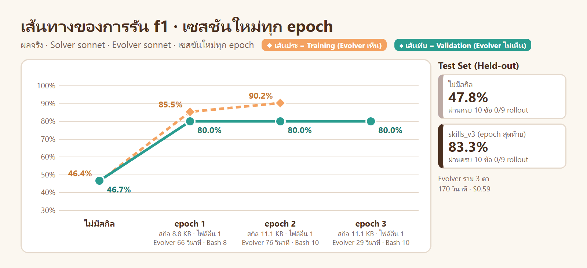

**ผลจริง:** Test Set 45.6% → **83.3%** (0/9) เท่ากับ `e1` · Validation 40.0% → 80.0% → 80.0% → 80.0% · Evolver 3 ตารวม $0.69

| ตา (เซสชันใหม่ทุกครั้ง) | Evolver ทำอะไร | รู้เรื่องของตาก่อนจากที่ใด | Validation หลังจากนั้น |
|---|---|---|---|
| 1 | อ่านเฉลย เห็นนโยบายของร้านและการตรวจ input → เขียนสกิล 1 ตัว + แม่แบบโค้ด · จดโน้ตไว้ให้ตาถัดไปเอง | – | 40.0% → 80.0% |
| 2 | เทียบโค้ดของ Solver กับเฉลย (เครื่องมือ 18 ครั้ง) → แก้ rollout ที่ลืมแก้ชื่อฟังก์ชันในแม่แบบ · ห้าม float · เพิ่มสคริปต์ `check_solve.py` | `notes.md` + ชุดสกิลใน `staging/` + `skills/epoch_1/` | 80.0% → 80.0% |
| 3 | โค้ดตรงกับเฉลยทุกกรณี → "0.1 ที่เหลือน่าจะไม่เกี่ยวกับโค้ด อย่าแก้เพิ่ม" → เพิ่มขั้นตรวจก่อนส่ง 1 ข้อ | `notes.md` + `staging/` | 80.0% → 80.0% |

**ผู้สอนรันซ้ำ** ([status f2](runs/f2/status.txt) · [status f3](runs/f3/status.txt))

| การตั้งค่า | การรัน | Validation ราย epoch | Test Set | ข้อ `tests` ใน Test Set |
|---|---|---|---|---|
| เซสชันเดียว | `e1` | 46.7 → 83.3 → 86.7 → 90.0 | 83.3% (0/9) | ไม่ผ่าน 9/9 |
| เซสชันเดียว | `e2` | 43.3 → 70.0 → 80.0 → 80.0 | 83.3% (0/9) | ไม่ผ่าน 9/9 |
| เซสชันเดียว | `v1` | 40.0 → 63.3 → 80.0 → 80.0 | 83.3% (0/9) | ไม่ผ่าน 9/9 |
| เซสชันใหม่ทุก epoch | `f1` | 40.0 → 80.0 → 80.0 → 80.0 | 83.3% (0/9) | ไม่ผ่าน 9/9 |
| เซสชันใหม่ทุก epoch | `f2` | 43.3 → 80.0 → 85.0 → 88.3 | 85.6% (2/9) | ไม่ผ่าน 7/9 · `unittest พบ 5 เทสต์` |
| เซสชันใหม่ทุก epoch | `f3` | 43.3 → 76.7 → 83.3 → 90.0 | **93.3% (6/9)** | **ผ่าน 9/9** |

👀 ผลของเรา **ไม่พบว่าเซสชันเดียวดีกว่า** ในโจทย์นี้: เซสชันเดียวได้ 83.3% ทั้ง 3 การรัน · เซสชันใหม่ทุก epoch ได้ 83.3% · 85.6% · 93.3% · จำนวนการรันน้อยเกินกว่าจะสรุปว่าแบบใดดีกว่า
สิ่งที่ชี้ขาดคือ **มีตาใดทำให้ Solver ส่งไฟล์เทสต์ที่ครบเกณฑ์หรือไม่**: `f3` ตาที่ 3 เดาว่า "0.1 ที่เหลือน่าจะเป็นคุณภาพของ `test_solve.py` เพราะของ Solver มี 3 เมธอด ส่วนเฉลยมี 12 เมธอด · นี่เป็นการเดา ไม่มีหลักฐานจากคะแนนยืนยัน" แล้วเพิ่มแม่แบบไฟล์เทสต์ 12 เมธอด → เป็นการรันเดียวที่ไม่ได้รับหมายเหตุจากผู้ใช้ แต่ผ่านข้อ `tests` ครบ

👀 ไฟล์ทำหน้าที่แทนความจำได้ในงานขนาดนี้: Evolver ที่เริ่มเซสชันใหม่ **จดโน้ตให้ตัวเองโดยไม่มีใครสั่ง** แล้วตาถัดไปก็เปิดอ่านก่อนเริ่ม · ข้อควรระวัง: งานนี้เล็ก (ตาละราว 1–5 นาที ไม่มีการย่อบริบท) ประโยชน์ที่เปเปอร์วัดได้มาจากงานที่ Evolver ต้องสะสมเครื่องมือและการวิเคราะห์ข้ามตา

### LAB 6 · โมเดลเล็กปรับสกิลของตัวเอง (`h1`)


เปเปอร์รายงานว่า Haiku 5.5 เป็นทั้ง Solver และ Evolver แล้วยังปรับสกิลของตัวเองได้ (+21.5 จุดบน τ³-bench)

| Input · ไฟล์ที่ใช้ | Output · ไฟล์ที่ได้เพิ่มหลังรัน |
|---|---|
| ไฟล์ใน `bench/` ชุดเดียวกับ `e1` ทุกไฟล์ | [`runs/h1/`](runs/h1/) การรันใหม่ทั้งโฟลเดอร์ · [`status.txt`](runs/h1/status.txt) · [`skills_v3/`](runs/h1/skills_v3/) |
|  | [`runs/h1/evo/evolver_workspace/`](runs/h1/evo/evolver_workspace/) โน้ต 3 ไฟล์ และสคริปต์วิเคราะห์ของ Evolver |

> [!IMPORTANT]
> **📋 คัดลอกกล่องนี้ → Claude Code Desktop แล้วกด Enter**
>
> ```text
> งาน: รัน EvoSkill v2 อีก 1 การรัน (h1) ที่โมเดลเล็ก (haiku) เป็นทั้ง Solver และ Evolver · เทียบกับ e1
>
> ที่ทำงาน  : container multi-account โฟลเดอร์ /workspace/evlab
> เครื่องมือ : สกิล evoskill
> เงื่อนไข   : ห้ามเปิดตัวตรวจ (bench/benchmark_grader.py bench/check_grader.py) และเฉลย bench/data/baankafe/answers/ · โจทย์ของ Validation Set ดูได้แค่คะแนน · ผลรายข้อของ Test Set เปิดได้หลังขั้น test จบ · ห้ามแก้ไฟล์ใน setup/ reference/ skills_v*/ evo/ เอง
>
> Input: สิ่งที่ผู้ใช้ส่งใน bench/ ชุดเดียวกับ e1 ทุกไฟล์ (คำสั่ง bench/instruction.md)
>
> วิธีทดลอง:
> - การรันชื่อ h1 · ต่างจาก e1 จุดเดียว: โมเดลของ Solver และของ Evolver เป็น haiku (effort คงเดิม)
> - ค่าอื่นเหมือน e1 ทุกค่า: 3 epochs · โจทย์ละ 3 ครั้ง · Solver sonnet effort medium · Evolver sonnet effort high · ใช้ทุกบัญชี yolo ที่ล็อกอินแล้ว รันพร้อมกันไม่เกิน 6 rollout
> - 1 การรัน = 78 rollout: epoch 0 ไม่มีสกิล 27 (Training 12 · Validation 6 · Test 9) · epoch 1 และ 2 ชุดละ 18 · epoch 3 เฉพาะ Validation 6 · Test 9 ด้วยชุดสกิลของ epoch 3
>
> วิธีตรวจ:
> - ทุก rollout ตัวตรวจของผู้ใช้รันโค้ดที่ Solver เขียน แล้วให้คะแนน 0–1 = สัดส่วนข้อตรวจที่ผ่าน (10 หรือ 11 ข้อต่อโจทย์) · ผ่าน = ครบทุกข้อ
> - Evolver เห็นแค่คะแนนของ Training · ไม่มีประตูรับ: ชุดสกิลของทุก epoch ถูกใช้ และ Test Set วัดด้วยชุดของ epoch สุดท้าย 1 ครั้ง
>
> ทำตามลำดับ:
> 1. สร้าง     การรัน h1 แล้ว run จนจบ
> 2. เก็บผล    export การรัน h1 แล้วคัดลอกโฟลเดอร์ h1 ที่ได้ มาแทน 03_week03/07_EvoSkill_v2/runs/h1 บนเครื่อง
> 3. รายงาน   ตาราง status ของ h1 เทียบ e1 · ชื่อและ description ของสกิลใน skills_v3 · ไฟล์ใน evo/evolver_workspace/ · ต้นทุนรวมของ Evolver 3 ตา และของ Solver · ข้อตรวจที่ไม่ผ่านใน Test Set
> ```


**ผลจริง:** Test Set 53.3% → **62.2%** (0/9) · Validation 53.3% → 70.0% → 60.0% → 60.0% · ต้นทุนทั้งการรัน $1.01

| | sonnet ทั้งคู่ (`e1`) | haiku ทั้งคู่ (`h1`) |
|---|---|---|
| Test Set: ไม่มีสกิล → ชุดสุดท้าย | 47.8% → 83.3% (+35.6 จุด) | 53.3% → **62.2%** (+8.9 จุด) |
| จำนวนสกิล · ขนาด | 1 ตัว · 12.6 KB + แม่แบบโค้ด | 3 ตัว · 18.7 KB · ไม่มีไฟล์แนบ |
| มาตรฐานการเขียนโค้ดที่สกิลสอน | ตรวจ input · ปัดเศษ · รันเป็นโปรแกรม · เขียนเทสต์ | ตรวจ input · ปัดเศษ |
| รันเป็นโปรแกรม (CLI) | พบจากเฉลย และใส่แม่แบบ `main()` | **ไม่พบ** · `cli_ok` `cli_error` ไม่ผ่านทุก rollout จนจบ |
| นโยบายธุรกิจ 4 ข้อ | พบ และเขียนลงสกิล (`policy` ผ่าน 6/6) | **พบ แต่ไม่ได้เขียนลงสกิล** (`policy` ผ่าน 0/6) |
| ใช้สคริปต์ของตาก่อนซ้ำ | 0 ครั้ง | ตาที่ 2: 1 ครั้ง · ตาที่ 3: **4 ครั้ง** |
| ต้นทุนของ Evolver 3 ตา | $0.57 | $0.22 |
| ต้นทุนของ Solver 78 rollout | $8.81 | $0.69 |

👀 haiku ทำงานเป็นระบบกว่าที่คาด: ตาแรกเขียนสคริปต์รันเทสต์ของเฉลยกับโค้ดของ Solver ทุก rollout ([`analysis/runtests.sh`](runs/h1/evo/evolver_workspace/analysis/runtests.sh)) จดผลเป็นตาราง แล้ว **เรียกสคริปต์เดิมซ้ำในตาถัดไป** (พฤติกรรมที่เปเปอร์ยกเป็นประโยชน์ของโฟลเดอร์ส่วนตัว และเป็นการรันเดียวของ LAB 2–6 ที่เกิดขึ้น)

👀 แต่จุดที่ทำให้คะแนนต่างจาก sonnet มี 2 จุด: (1) มันเทียบเฉพาะ **ค่าที่ฟังก์ชันคืน** จึงไม่เคยเห็นว่าเฉลยมี `main()` ที่รับส่ง JSON · (2) การเทียบกับเฉลยพบความต่างของนโยบาย (silver ในเดือนเกิด · ส่งด่วนเกิน 20,000 กรัม · ระยะ 0 กม.) และจดไว้ในโน้ต แต่สกิลที่เขียนสอนแค่เรื่องทั่วไป (จำนวนเต็ม · การตรวจ input · รายการตรวจก่อนส่ง) · prompt ของ Evolver ไม่ได้กำกับเรื่องนี้ การรันแต่ละครั้งจึงตัดสินใจต่างกันได้

**ผู้สอนรันซ้ำ (`h2`):** Validation 50.0 → 70.0 → 70.0 → 68.3 · Test 55.6% → **71.1% (0/9)** · สกิล 4 ตัว 20.5 KB · ต้นทุนของ Evolver $0.29 ([status](runs/h2/status.txt)) · เส้นทางคล้าย `h1`: รันเทสต์ของเฉลยกับโค้ดของ Solver ทุก rollout ใช้สคริปต์เดิมซ้ำ 8 ครั้งในตาที่ 2 · ไม่พบโหมดรันเป็นโปรแกรม (`cli_ok` `cli_error` ไม่ผ่านทุก rollout) · ไม่เขียนนโยบาย 3 ข้อลงสกิล (`policy` ผ่าน 0/6) · ต่างจาก `h1` ที่ให้ Solver ส่งไฟล์เทสต์ (ข้อ `tests` ผ่าน 7/9 ใน Test)

### LAB 7 · ความแกว่ง และประตูรับที่เราไม่ได้ใช้

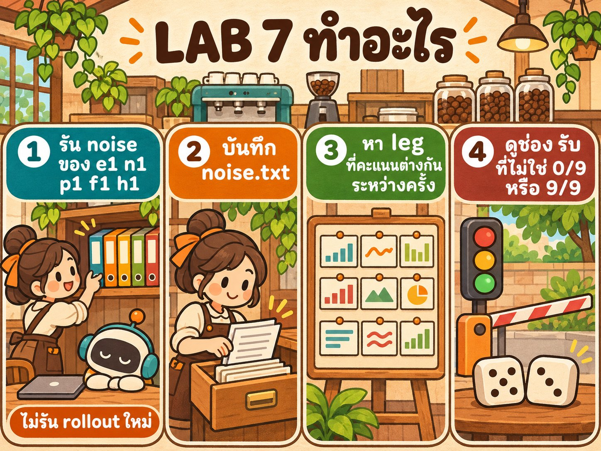


LAB นี้ไม่ใช้โทเคน: นำผลที่มีอยู่มาตอบว่า "ถ้าเราใช้ประตูรับแบบวัดโจทย์ละ 1 ครั้ง จะเกิดอะไรขึ้น"

| Input · ไฟล์ที่ใช้ | Output · ไฟล์ที่ได้เพิ่มหลังรัน |
|---|---|
| การรัน `e1` `n1` `p1` `f1` `h1` ที่จบแล้ว (คะแนนราย rollout ใน `state.json`) | `runs/<ชื่อ>/noise.txt` ของทั้ง 5 การรัน เช่น [`runs/n1/noise.txt`](runs/n1/noise.txt) |

> [!IMPORTANT]
> **📋 คัดลอกกล่องนี้ → Claude Code Desktop แล้วกด Enter**
>
> ```text
> งาน: ดูความแกว่งของคะแนน และตอบว่าถ้า EvoSkill v2 มีประตูรับแบบวัดโจทย์ละ 1 ครั้ง จะเกิดอะไรขึ้น (ไม่รัน rollout ใหม่ ไม่ใช้โทเคน)
>
> ที่ทำงาน  : container multi-account โฟลเดอร์ /workspace/evlab
> เครื่องมือ : สกิล evoskill
> เงื่อนไข   : ใช้ผลที่มีอยู่เท่านั้น ห้ามรัน rollout หรือ Agent ใหม่
>
> Input: การรันที่จบแล้วจาก LAB 2–6: e1 n1 p1 f1 h1 (การรันละ 78 rollout · โจทย์ละ 3 ครั้ง)
>
> วิธีตรวจ:
> - คำสั่ง noise ของสกิลอ่านคะแนนราย rollout ที่บันทึกไว้ แล้วพิมพ์ 2 ตาราง: (1) โจทย์ที่ผ่านทุกครั้ง ไม่ผ่านเลย ผ่านบางครั้ง และโจทย์ที่คะแนนของ 3 ครั้งไม่เท่ากัน (2) ประตูรับสมมติ "วัดโจทย์ละ 1 ครั้ง รับเมื่อคะแนนสูงกว่าชุดก่อน": จับคู่ครั้งที่ i ของชุดเดิมกับครั้งที่ j ของชุดใหม่ = 9 คู่ แล้วนับว่ารับ เสมอ หรือต่ำกว่า กี่คู่
>
> ทำตามลำดับ:
> 1. รัน       noise ของการรัน e1 n1 p1 f1 h1
> 2. เก็บผล    บันทึกผลของแต่ละการรันไว้ที่ 03_week03/07_EvoSkill_v2/runs/<ชื่อ>/noise.txt บนเครื่อง
> 3. รายงาน   (1) leg ใดบ้างที่มีโจทย์ผ่านบางครั้ง หรือคะแนนต่างกันระหว่างครั้ง (2) การเทียบบน Validation ใดที่ช่อง "รับ" ไม่ใช่ 0/9 หรือ 9/9 · ถ้าใช้ประตูรับนั้นจะทิ้งชุดสกิลใด และชุดนั้นได้คะแนน Test เท่าไร (ดูจาก status ของการรันนั้น)
> ```

**ผลจริง** (ใช้ 2 วินาที)

**1) Solver ทำโจทย์เดิมซ้ำ ผลไม่เท่ากัน** (สกิลและโจทย์เดียวกัน)

| การรัน · leg | โจทย์ | คะแนน 3 ครั้ง |
|---|---|---|
| `e1` · base_train | `shipping-fee` | 0.45 · 0.55 · 0.45 |
| `e1` · v1_val | `net-pay` | 0.7 · 0.7 · 0.9 |
| `e1` · v2_val | `net-pay` | 0.9 · 0.9 · 0.7 |
| `n1` · v2_val | `net-pay` | 0.8 · 0.8 · 1 |
| `n1` · v3_val | `net-pay` | 1 · 0.8 · 1 |
| `p1` · v2_train | `shipping-fee` | 0.36 · 0.45 · 0.36 |
| `p1` · v2_train | `cashback` | 0.3 · 0.3 · 0.4 |
| `f1` · v1_train | `shipping-fee` | 0.91 · 0.73 · 0.91 |
| `f1` · v1_train | `cashback` | 0.9 · 0.7 · 0.9 |
| `h1` · v3_test | `late-fee` | 0.7 · 0.7 · 0.6 |

ก่อนมีสกิล (epoch 0) ทุกการรันมีโจทย์ที่คะแนนของ 3 ครั้งไม่เท่ากัน 1–3 โจทย์ · หลังมีสกิลยังเหลือในบาง leg ตามตาราง · มีเพียง `n1` ที่มีโจทย์ "ผ่านบางครั้ง" (`net-pay` ใน Validation)

**2) ประตูรับแบบ "วัดโจทย์ละ 1 ครั้ง รับเมื่อสูงกว่าเดิม"** (จับคู่ครั้งที่ i ของชุดเดิม กับครั้งที่ j ของชุดใหม่ = 9 คู่)

| การรัน | เทียบบน Validation | ค่าเฉลี่ย 3 ครั้ง | รับ | เสมอ (ไม่รับ) | ต่ำกว่า (ไม่รับ) |
|---|---|---|---|---|---|
| `e1` | v1 → v2 | 83.3% → 86.7% | **4/9** | 4/9 | 1/9 |
| `e1` | v2 → v3 | 86.7% → 90.0% | **3/9** | 6/9 | 0/9 |
| `n1` | v1 → v2 | 90.0% → 93.3% | **3/9** | 6/9 | 0/9 |
| `n1` | v2 → v3 | 93.3% → 96.7% | **4/9** | 4/9 | 1/9 |
| `p1` | ไม่มีสกิล → v1 | 43.3% → 31.7% | 0/9 | 0/9 | 9/9 |
| `p1` | v1 → v2 | 31.7% → 43.3% | 9/9 | 0/9 | 0/9 |
| `p1` | v2 → v3 | 43.3% → 70.0% | 9/9 | 0/9 | 0/9 |
| `f1` | v1 → v2 | 80.0% → 80.0% | 0/9 | 9/9 | 0/9 |
| `f1` | v2 → v3 | 80.0% → 80.0% | 0/9 | 9/9 | 0/9 |
| `h1` | v1 → v2 | 70.0% → 60.0% | 0/9 | 0/9 | 9/9 |
| `h1` | v2 → v3 | 60.0% → 60.0% | 0/9 | 9/9 | 0/9 |

👀 `n1` v1 → v2 → v3 คือ **ชุดสกิลเดียวกันทุกไบต์** (Evolver ไม่ได้แก้) แต่ประตูรับแบบวัดครั้งเดียวจะ "รับ" 3 และ 4 ใน 9 คู่ และ "ปฏิเสธเพราะต่ำกว่า" 1 คู่ · การตัดสินทั้งหมดนั้นมาจากความแกว่งของ Solver ล้วน ๆ · นี่คือเหตุผลของเปเปอร์ที่ไม่ใช้ประตูรับ ([ทฤษฎี ข้อ 11.4](01_theory/README.md#114-ทำไมรับชุดสกิลของทุก-epoch)) และเป็นเหตุผลเดียวกับที่บท 05 ตั้งเกณฑ์จากความแกว่ง

👀 อีกด้านหนึ่ง: `p1` ไม่มีสกิล → v1 **ต่ำกว่าทั้ง 9 คู่** ประตูรับแบบใดก็จะปฏิเสธชุดที่เดาผิด (ปัดลงทุกขั้น) ได้ · EvoSkill v2 ใช้ชุดนั้นไปทั้ง epoch แล้วให้ Evolver เรียนจากคะแนนที่ตก

👀 และประตูรับที่ใช้ Validation ชุดนี้ **ก็จับปัญหาของงานคืนเงินคอร์สไม่ได้** เช่นกัน: ทุกแถวข้างบนวัดด้วย Validation 2 โจทย์ ซึ่งไม่มีงานแบบที่นโยบายปัดเศษเขียนกว้างจะทำให้ผิด (LAB 2) · เครื่องมือตัดสินดีได้เท่าที่ชุดโจทย์ที่ใช้ตัดสินครอบคลุม

---

## 4 · สรุปและแบบฝึกหัด

### 4.1 ผลของทุกการรัน

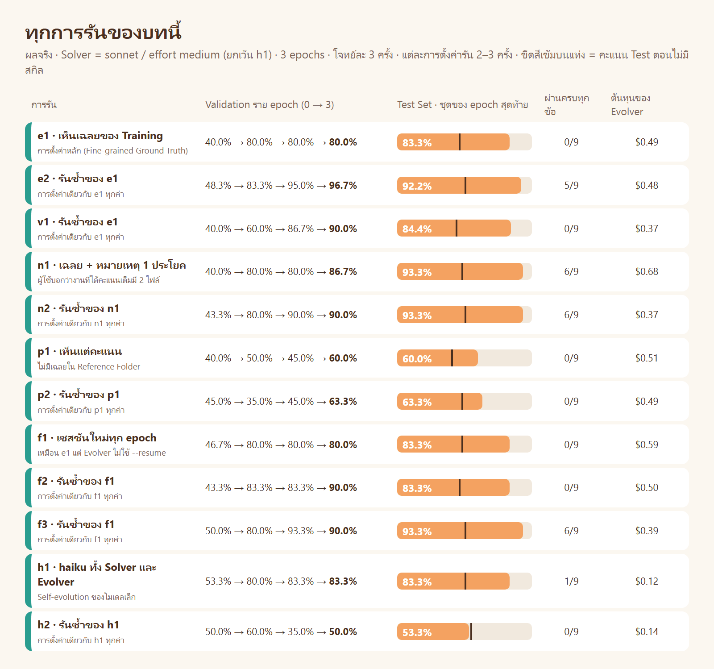

5 การรันแรกของแต่ละการตั้งค่า (`e1` `n1` `p1` `f1` `h1`) มาจากพรอมต์ของ LAB 1–6 · อีก 7 การรัน ผู้สอนรันซ้ำด้วยการตั้งค่าเดิม เพื่อดูว่าผลซ้ำได้แค่ไหน

| การตั้งค่า | การรัน | Validation ราย epoch (%) | Test: ไม่มีสกิล → ชุดสุดท้าย | ผ่านครบ | `policy` ของ Training (epoch 2) | `tests` ใน Test | งานคืนเงินคอร์ส (`x2`) ปัดเศษ |
|---|---|---|---|---|---|---|---|
| เห็นเฉลยของ Training | `e1` | 46.7 → 83.3 → 86.7 → 90.0 | 47.8% → **83.3%** | 0/9 | ผ่าน 6/6 | ไม่ผ่าน 9/9 | ผิด 3/3 |
| | `e2` | 43.3 → 70.0 → 80.0 → 80.0 | 41.1% → **83.3%** | 0/9 | ไม่ผ่าน 6/6 | ไม่ผ่าน 9/9 | ผิด 3/3 |
| | `v1` | 40.0 → 63.3 → 80.0 → 80.0 | 50.0% → **83.3%** | 0/9 | ผ่าน 6/6 | ไม่ผ่าน 9/9 | ผิด 3/3 |
| เฉลย + หมายเหตุ 1 ประโยค | `n1` | 43.3 → 90.0 → 93.3 → 96.7 | 47.8% → **93.3%** | 6/9 | ผ่าน 6/6 | **ผ่าน 9/9** | ผิด 3/3 |
| | `n2` | 46.7 → 60.0 → 90.0 → 90.0 | 41.1% → **93.3%** | 6/9 | ผ่าน 6/6 | **ผ่าน 9/9** | ผิด 3/3 |
| เห็นแต่คะแนน | `p1` | 43.3 → 31.7 → 43.3 → 70.0 | 47.8% → **70.0%** | 0/9 | ไม่ผ่าน 6/6 | ไม่ผ่าน 9/9 | ถูก 3/3 |
| | `p2` | 40.0 → 70.0 → 70.0 → 70.0 | 50.0% → **56.7%** | 0/9 | ไม่ผ่าน 6/6 | ไม่ผ่าน 9/9 | ผิด 3/3 |
| เซสชันใหม่ทุก epoch | `f1` | 40.0 → 80.0 → 80.0 → 80.0 | 45.6% → **83.3%** | 0/9 | ผ่าน 6/6 | ไม่ผ่าน 9/9 | ผิด 3/3 |
| | `f2` | 43.3 → 80.0 → 85.0 → 88.3 | 43.3% → **85.6%** | 2/9 | ผ่าน 6/6 | ไม่ผ่าน 7/9 | ผิด 3/3 |
| | `f3` | 43.3 → 76.7 → 83.3 → 90.0 | 45.6% → **93.3%** | 6/9 | ผ่าน 6/6 | **ผ่าน 9/9** | ผิด 3/3 |
| haiku ทั้ง Solver และ Evolver | `h1` | 53.3 → 70.0 → 60.0 → 60.0 | 53.3% → **62.2%** | 0/9 | ไม่ผ่าน 6/6 | ไม่ผ่าน 9/9 | ผิด 3/3 |
| | `h2` | 50.0 → 70.0 → 70.0 → 68.3 | 55.6% → **71.1%** | 0/9 | ไม่ผ่าน 6/6 | ไม่ผ่าน 2/9 | ผิด 3/3 |

รวมทั้งบท: 12 การรัน = rollout ของ Solver 936 ครั้ง ($93.95) · ตาของ Evolver 36 ตา ($5.82) · Benchmark Adaptor 12 ครั้ง ($1.09) · ไม่มี rollout ใดจบไม่ปกติ

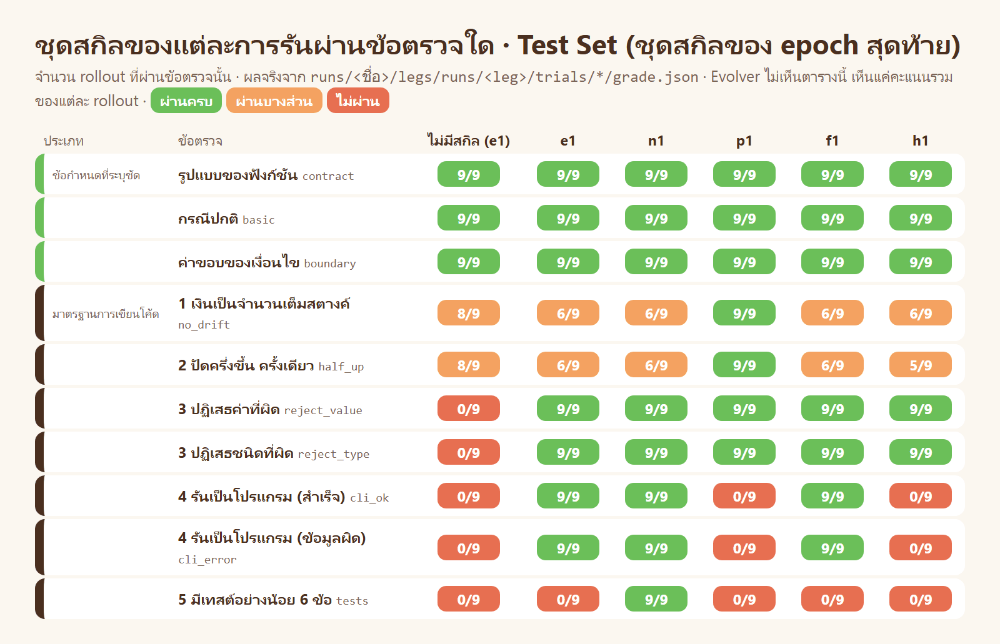

### 4.2 เทียบกับบท 05 และ 06


| ประเด็น | Skill Optimizer (บท 05) | WikiSkill (บท 06) | EvoSkill v2 (บทนี้) |
|---|---|---|---|
| คะแนน Test Set | 100.0% (9/9) | `w1` 100.0% (9/9) · `w1q` 100.0% (9/9) | เห็นเฉลย: 83.3% ทั้ง 3 การรัน · เฉลย + หมายเหตุ: 93.3% ทั้ง 2 การรัน · เซสชันใหม่ทุก epoch: 83.3% 85.6% 93.3% · เห็นแต่คะแนน: 70.0% 56.7% |
| ความรู้แฝงที่รู้ตั้งแต่ต้น | มาตรฐานการเขียนโค้ด 5 ข้อ (คนเขียน) | 0 ข้อ | 0 ข้อ |
| นโยบายธุรกิจ 4 ข้อ | คนบอกใน LAB 3 | ค้นพบเองไม่ได้ (`policy` 0/6) · คนตอบใน LAB 5 | **ค้นพบเองจากเฉลยของ Training** ใน 7 จาก 8 การรันของ sonnet ที่เห็นเฉลย (`policy` ผ่าน 6/6 ภายใน epoch 2) · แต่กฎปัดเศษถูกเขียนกว้างจนงานอื่นผิด |
| ผู้ปรับสกิลเห็นอะไรจากตัวตรวจ | ข้อความของข้อที่ไม่ผ่าน | ข้อความของข้อที่ไม่ผ่าน | คะแนนอย่างเดียว |
| สิ่งที่กันสกิลที่ทำงานอื่นพัง | ประตูรับที่คิดความแกว่ง | Gate ของ WikiSkill · ประตูรับของบท 05 ใน LAB 5 (ปฏิเสธ `w1p`) | ไม่มี · ชุดสกิลของทุก epoch ถูกใช้ |
| สิ่งที่คนทำ | เขียน `v0` · 5 พรอมต์ · อ่านผลทุกรอบ | 1 พรอมต์ต่อการรัน · ตอบนโยบาย 4 ข้อ | เขียนคำสั่ง 1 หน้า + ตัวตรวจ · 1 พรอมต์ต่อการรัน |
| ความรู้ที่เหลือหลังปรับ | `ISSUES.md` | `wiki/` ที่มีโครงสร้าง | เท่าที่ Evolver จดเอง (ส่วนใหญ่ `notes.md` ไฟล์เดียว) + `actions.md` ของทุกตา |
| ต้นทุนของผู้ปรับสกิลต่อการรัน | ไม่ได้วัด | ดูภาพ | $0.22–$0.73 (3 ตา ตาละราว 0.1–4.6 นาที) |
| สกิลที่ได้ | 6.7 KB · 1 ไฟล์ | 7.8–10.4 KB · 1 ไฟล์ (12.8 KB หลังเติมนโยบาย) | 7.9–20.5 KB · สกิล 1–4 ตัว มีไฟล์แนบ 0–3 ไฟล์ |

#### ทำไมได้ต่ำกว่าสองบทก่อน ทั้งที่เห็นเฉลย

มี 2 สาเหตุ และทั้งสองมาจากการออกแบบโดยตั้งใจ

**สาเหตุที่ 1 · กฎที่อยู่เฉพาะในตัวตรวจ ถูกส่งมาเป็นตัวเลขเดียว**

| | บท 05 และ 06 | EvoSkill v2 |
|---|---|---|
| เมื่อ Solver ส่งเทสต์ 3 ข้อ ผู้ปรับสกิลเห็นอะไร | `✗ tests: unittest พบ 3 เทสต์ (ต้องมีอย่างน้อย 6)` | `0.9` |
| สิ่งที่ต้องทำเพื่อรู้กฎข้อนี้ | อ่าน | ตั้งสมมติฐานจากเฉลย แล้วใช้ 1 epoch ทดสอบ |
| ถ้าเดาผิดทาง | – | คะแนนยังเป็น `0.9` เท่าเดิม แยกไม่ออก (`e1`) |

ผู้ปรับสกิลที่อ่านข้อความของตัวตรวจได้ จะปรับเข้าหา **วิธีตรวจ** · ผู้ปรับสกิลที่เห็นแต่คะแนนกับเฉลย ต้องปรับเข้าหา **งานที่ถูกต้อง** ([ทฤษฎี ข้อ 11.6](01_theory/README.md#116-ทำไมผู้ใช้เป็นผู้ให้ตัวตรวจ-และ-evolver-ได้แต่คะแนน)) · ราคาคือกฎที่มีอยู่เฉพาะในตัวตรวจจะถูกพบช้าหรือไม่พบ จนกว่าผู้ใช้จะบอก (LAB 3)

**สาเหตุที่ 2 · ความรู้ที่ได้จากเฉลย ถูกขยายเกินหลักฐาน และไม่มีขั้นตัดสิน**

| | บท 06 (`w1p`) | EvoSkill v2 (8 การรันของ sonnet ที่เห็นเฉลย) |
|---|---|---|
| ที่มาของนโยบาย "เงินคืนปัดลง" | คนในทีมบอก | Evolver อ่านจากเฉลยของงานเงินคืน |
| ข้อความในสกิล | "เงินที่ร้านจ่ายออก ให้ปัดลง" | "เงินที่ร้านจ่ายออก (เงินคืน cashback, คืนเงิน, แต้ม) → ปัดลง" |
| งานคืนเงินคอร์สของ Test Set | ผิด 3/3 | ผิด 3/3 **ทุกการรัน** |
| สิ่งที่เกิดต่อ | ประตูรับของบท 05 **ปฏิเสธ** → เขียนใหม่แบบมีขอบเขต (`w1q` 100%) | ไม่มีประตูรับ · Validation ไม่มีงานแบบนี้ → ใช้จนถึง Test |

เปเปอร์เลือกไม่ใช้ประตูรับเพราะคะแนนแกว่ง (LAB 7) · ผลของเราแสดงอีกด้านของข้อแลกเปลี่ยนนั้น: เมื่อไม่มีขั้นตัดสิน ความผิดที่ชุดโจทย์ระหว่างปรับมองไม่เห็น จะไปปรากฏที่ Test Set

### 4.3 คำตอบของคำถาม 7 ข้อ

| # | คำถาม | คำตอบจากผลจริง |
|---|---|---|
| 1 | เริ่มจากไม่มีสกิล Evolver เขียนสกิลที่ใช้ได้หรือไม่ | ได้: Test 41–50% → 83.3% ใน 3 จาก 3 การรัน ด้วย Evolver 3 ตา $0.50–$0.57 · แต่ไม่มี rollout ใดผ่านครบทุกข้อ |
| 2 | ค้นพบนโยบายธุรกิจจากเฉลยได้หรือไม่ | ได้ และเร็ว (ตาแรกใน 6 จาก 8 การรัน) · แต่กฎ "เงินคืนปัดลง" ถูกเขียนเป็นกฎของเงินที่ร้านจ่ายออกทุกชนิด งานคืนเงินคอร์สจึงผิดทุกการรัน |
| 3 | กฎที่อยู่เฉพาะในตัวตรวจ ผู้ใช้บอกได้ทางใด | ผ่านโฟลเดอร์ reference: 1 ประโยคว่า "งานที่ได้คะแนนเต็มมี 2 ไฟล์" ทำให้ Test เป็น 93.3% ทั้ง 2 การรัน |
| 4 | เห็นแต่คะแนน ผลต่างกันอย่างไร | Test 70.0% และ 56.7% · ค้นพบได้เฉพาะสิ่งที่ Solver บางตัวบังเอิญทำ (ตรวจ input) · ชุดสุดท้ายของ `p2` ยังเป็นการทดลองที่ค้างอยู่ |
| 5 | ตัดความจำของเซสชัน ผลต่างกันอย่างไร | ไม่แย่ลง: 83.3% 85.6% 93.3% เทียบกับเซสชันเดียว 83.3% ทั้ง 3 การรัน · Evolver จดโน้ตให้ตัวเองแทน |
| 6 | โมเดลเล็กปรับสกิลของตัวเองได้หรือไม่ | ได้บางส่วน: +8.9 และ +15.6 จุด (sonnet +33 ถึง +42 จุด) · ไม่พบโหมดรันเป็นโปรแกรม และไม่เขียนนโยบายลงสกิล |
| 7 | ทำไมไม่ใช้ประตูรับ และมีราคาเท่าไร | ประตูรับแบบวัดครั้งเดียวตัดสินชุดสกิลที่ **เหมือนกันทุกไบต์** ต่างกันได้ (`n1`) · ราคาคือชุดที่เดาผิดถูกใช้ทั้ง epoch (`p1` epoch 1) และความผิดที่ Validation มองไม่เห็นไปถึง Test |

### 4.4 สิ่งที่ผลจริงสอน


| ผล | บทเรียน |
|---|---|
| epoch 0 ทุกการรัน: ไม่มี rollout ใดผ่านครบทุกข้อ (0/324) และพลาดข้อตรวจชุดเดิม | ข้อสังเกตของเปเปอร์เป็นจริงกับโจทย์นี้: พลาดซ้ำ = ขาดคำแนะนำ |
| `e1` `e2` `v1`: Test 83.3% เท่ากันทั้ง 3 การรัน ทั้งที่เดาเรื่องคะแนนที่ขาดไปคนละทาง | สิ่งที่ Evolver หาได้จากเฉลยและคะแนนซ้ำได้ดี · สิ่งที่ต้องเดา (จำนวนเทสต์ขั้นต่ำ) ไม่มีการรันใดเดาถูกครบ |
| 11 จาก 12 การรันเขียน "เงินคืนปัดลง" เป็นกฎทั่วไป แม้การรันที่ไม่ได้เห็นเฉลย (`p2`) ก็เดาแบบเดียวกัน | ผู้ปรับสกิลขยายความรู้เกินหลักฐานได้ · ไม่มีประตูรับ และ Validation ไม่มีงานแบบนี้ จึงไม่มีอะไรจับ · Test สูงสุดจึงเป็น 93.3% |
| `e1` ตาที่ 3: ให้ย้ายไฟล์เทสต์ออกจากโฟลเดอร์งาน แล้วชุดนั้นถูกวัด Test ทันที | คะแนนตัวเลขเดียวบอกไม่ได้ว่าการแก้พาเข้าใกล้หรือออกห่าง · ตาสุดท้ายไม่มีตาถัดไปให้แก้ |
| เพิ่ม 1 ประโยค: `n1` และ `n2` ได้ 93.3% ทั้งคู่ | สิ่งที่คนปรับได้ใน EvoSkill v2 คือสิ่งที่ Evolver ได้เห็น |
| `p1` epoch 1: Validation 43.3% → 31.7% และชุดนั้นถูกใช้ทั้ง epoch | "รับทุก epoch" ใช้ epoch เป็นการทดลอง · ดีเมื่อมีตาถัดไป และมีราคาเมื่อชุดที่เดาผิดถูกใช้งานจริง |
| เซสชันใหม่ทุก epoch (`f1` `f2` `f3`) ไม่แย่กว่าเซสชันเดียว | ในงานเล็ก ไฟล์โน้ตแทนความจำของเซสชันได้ · ข้ออ้างของเปเปอร์มาจากงานที่ใหญ่กว่านี้มาก |
| haiku: `h1` 62.2% · `h2` 71.1% | โมเดลเล็กวิเคราะห์เป็นระบบ (เขียนสคริปต์ ใช้ซ้ำข้ามตา) แต่ตัดสินใจระวังกว่า: ไม่ใส่สิ่งที่โจทย์ไม่ได้เขียน |
| `n1`: ชุดสกิลเดียวกัน Validation 90.0% → 93.3% → 96.7% | คะแนนจาก rollout แกว่งพอที่จะทำให้การตัดสินรับหรือไม่รับขึ้นกับโชค |
| LAB 0: บัญชี 1 ใน 3 ติดลิมิต แล้ว rollout ที่ไม่ได้รันถูกนับเป็นคะแนน 0 | เครื่องมือวัดต้องแยก "Solver ทำผิด" ออกจาก "Solver ไม่ได้ทำ" · ตรวจเครื่องวัดก่อนเชื่อตัวเลข |

### 4.5 เลือกใช้เมื่อไร

| สถานการณ์ | ทางที่เหมาะ | เหตุผล |
|---|---|---|
| มีคนที่รู้กฎของงาน และต้องคุมขนาดกับต้นทุนของสกิล | Skill Optimizer | เริ่มจากความรู้ของคน · มีรอบลดต้นทุน · ทุกการแก้มีคนเห็น |
| ต้องการความรู้ที่อ่านย้อนได้เป็นระบบ และงานต้องปรับหลายรอบ | WikiSkill | Wiki สะสมข้ามรอบและมีโครงสร้าง · จดไว้ด้วยว่าเรื่องใดยังไม่ยืนยัน |
| มีตัวตรวจและเฉลยอ้างอิงอยู่แล้ว ต้องการให้ระบบทำเองทั้งหมด และงานต้องการการทดลองจริง (เปิดไฟล์ รันโค้ด เทียบผล) | EvoSkill v2 | Evolver ทดสอบคำอธิบายได้เอง และหาความรู้จากเฉลยได้ · คนทำแค่เขียนคำสั่ง 1 หน้า |
| เฉลยอ้างอิงมีกฎเฉพาะงานปนอยู่ | EvoSkill v2 แล้วตามด้วยประตูรับของบท 05 | Evolver พบกฎได้ แต่ขยายเกินหลักฐานได้ ต้องมีชุดโจทย์ที่ไม่ได้ใช้ตอนปรับมาตัดสิน |
| ตัวตรวจยังไม่น่าเชื่อถือ หรือมีช่องโหว่ | ยังไม่ควรใช้วิธีอัตโนมัติวิธีใด | ผู้ปรับสกิลจะปรับเข้าหาช่องโหว่ (ทฤษฎี ขั้น 8) |

### 4.6 แบบฝึกหัด


| # | โจทย์ | ได้ฝึกอะไร |
|---|---|---|
| 1 | ใช้สกิล `evoskill` ดู `status` ของ `runs/e1` และ `noise` ของ `runs/n1` บนเครื่อง แล้วเปิด [`runs/e1/turns/turn_2/actions.md`](runs/e1/turns/turn_2/actions.md) | อ่านผลและดูว่า Evolver ทดสอบสมมติฐานอย่างไร (ไม่ใช้โทเคน) |
| 2 | คัดลอก `bench/instruction_score_only.md` เป็นไฟล์ใหม่ แก้เป็น `5 epochs · 3 samples per task` แล้วรันการตั้งค่าของ `p1` | เมื่อมี epoch มากขึ้น การทดลองของ Evolver ได้ใช้ผลหรือไม่ |
| 3 | แก้ `prompts/evolver_message.md` ของสกิลให้บอกว่า "epoch นี้เป็น epoch สุดท้าย" เมื่อถึงตาสุดท้าย แล้วรันการตั้งค่าของ `p1` | Evolver ที่รู้ว่าเป็นตาสุดท้าย ยังทดลองหรือไม่ |
| 4 | ใช้คำสั่ง `eval` วัด `skills_v1` และ `skills_v2` ของ `p1` กับ Test Set แล้วเทียบกับ `skills_v3` | ข้อแลกเปลี่ยนของ "ทดสอบชุดสุดท้าย" กับ "เลือกตาม Validation" (ทฤษฎี ข้อ 11.4) |
| 5 | ใช้คำสั่ง `eval` วัดสกิล `v3` ของบท 05 (`../05_Skill_Optimizer/runs/v3/skills`) กับโจทย์ทุกชุดในการรัน `e1` | เทียบสกิลของ 3 วิธีด้วยตัวรันเดียวกัน |
| 6 | แก้ `bench/instruction_with_note.md` ให้หมายเหตุบอกเพิ่มว่า "กฎในเฉลยใช้กับฟังก์ชันนั้นเท่านั้น" แล้วรันการตั้งค่าของ `n1` | ผู้ใช้กำกับขอบเขตของนโยบายผ่านโฟลเดอร์ reference ได้หรือไม่ (เพดาน 93.3%) |
| 7 | ใช้ EvoSkill v2 กับงานของตัวเอง: เขียนคำสั่ง 1 หน้า · ข้อมูล 4 + 2 + 2 ข้อ · ตัวตรวจ แล้วรัน | ทำทั้งกระบวนการเอง เริ่มจากการตรวจตัวตรวจ |

### 4.7 ข้อจำกัด

| ข้อจำกัด | ผล |
|---|---|
| แต่ละการตั้งค่ารัน 2–3 ครั้ง | ผลของการตั้งค่าเดียวกันต่างกันได้ถึง 13 จุด (`p1` 70.0% กับ `p2` 56.7%) ผลต่างระหว่างการตั้งค่าจึงยังไม่ใช่ข้อสรุปทางสถิติ |
| โจทย์เล็ก (Training 4 · Validation 2 · Test 3) และตาของ Evolver สั้น | ไม่มีการย่อบริบท ไม่มี subagent จึงยังไม่ได้เห็นประโยชน์ของเซสชันเดียวแบบที่เปเปอร์รายงาน |
| นโยบายธุรกิจมีข้อตรวจเฉพาะใน Training 2 โจทย์ | Validation และ Test ไม่ได้วัดว่าสกิลรู้นโยบายหรือไม่ วัดได้เพียงว่านโยบายที่เขียนกว้างทำงานอื่นผิดหรือไม่ (พบ 1 งาน คือ `x2-refund`) |
| คะแนนเป็นสัดส่วนของข้อตรวจ 10–11 ข้อ ไม่ใช่ผ่านหรือไม่ผ่านแบบเปเปอร์ | Evolver ของเราได้สัญญาณละเอียดกว่า (0.7 → 0.9) |
| Solver ไม่ได้ใช้ Progressive Disclosure | อ่านสกิลทุกครั้ง · ผลของ `description` ไม่ได้ถูกวัด |
| การแยกเครื่องใช้ mount namespace ไม่ได้ปิดเครือข่าย | ต่างจากเปเปอร์ที่ปิดเครือข่ายทั้งหมดยกเว้น API ของโมเดล |
| เครื่องมือและ prompt สร้างจากพรอมต์ของ LAB 0 ด้วยถ้อยคำของผู้สร้าง | ผู้เรียนที่สร้างเองจะได้ prompt ที่ต่างออกไป ตัวเลขจึงไม่ตรงกับบทนี้ทุกตัว · เครื่องมือที่ให้ผลในบทนี้เก็บไว้ที่ `00_resource/skills/evoskill` |
| บัญชีที่ใช้ต่างกัน: `e1` ใช้ `yolo1` และ `yolo3` · การรันอื่นใช้ `yolo1` บัญชีเดียว | บัญชี `yolo2` ติดลิมิตระหว่างการรัน · โมเดลและค่าอื่นเหมือนกันทุกการรัน |
| เทียบกับบท 05 และ 06 ด้วยข้อมูลที่ผู้ปรับสกิลเห็นไม่เท่ากัน | คะแนนที่ต่างกันมาจากทั้งวิธีและข้อมูลที่เห็น (ข้อ 4.2) |

**ก่อนหน้า:** [WikiSkill](../06_WikiSkill/README.md) · [Skill Optimizer ฉบับเริ่มต้น](../05_Skill_Optimizer/README.md) โจทย์เดียวกัน ปรับสกิลด้วยวิธีอื่น
