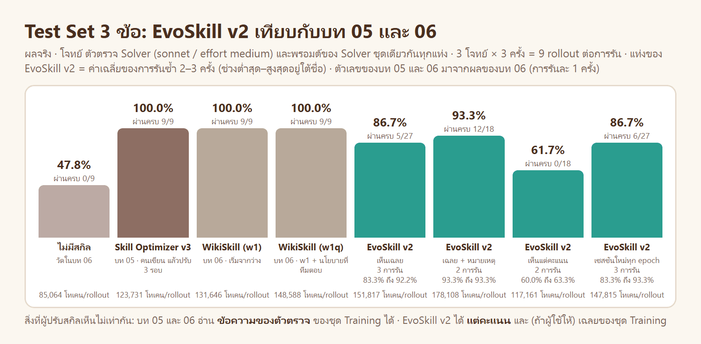
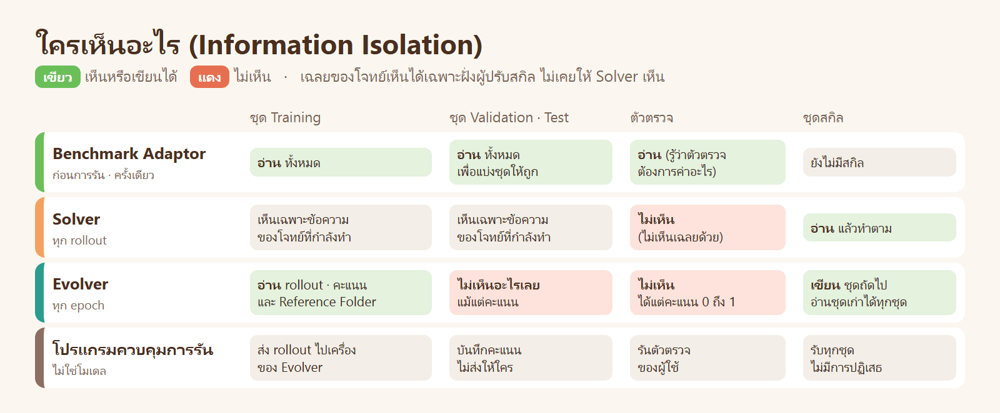
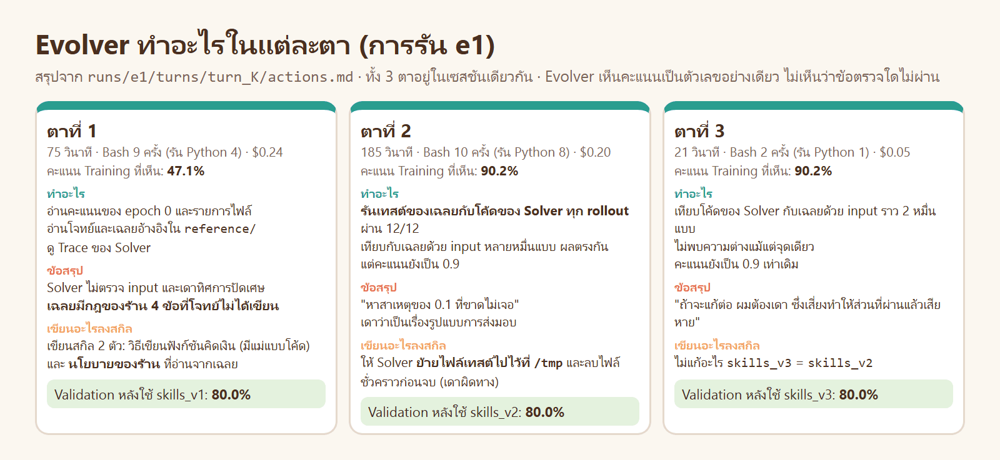
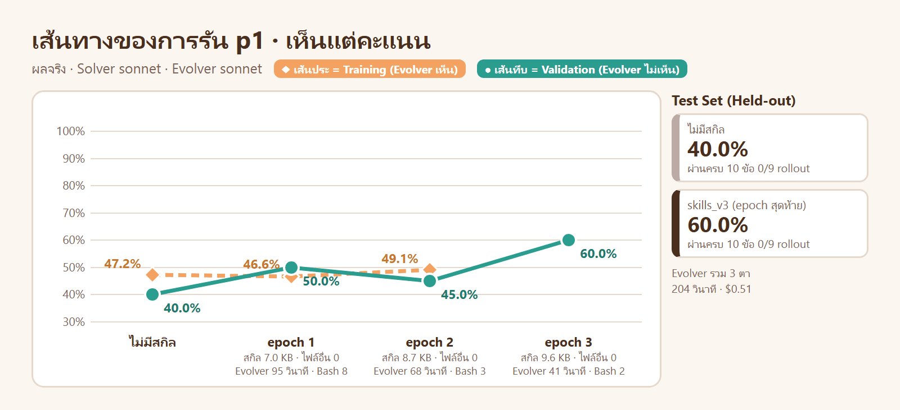
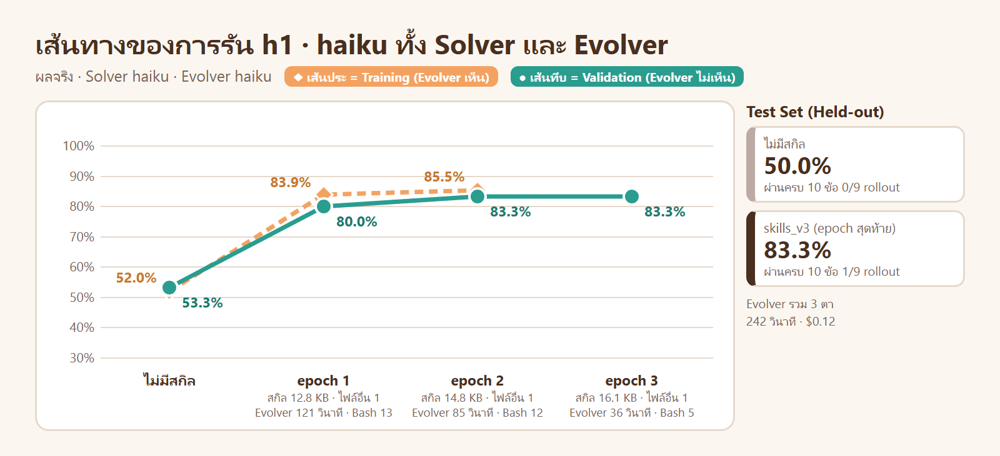
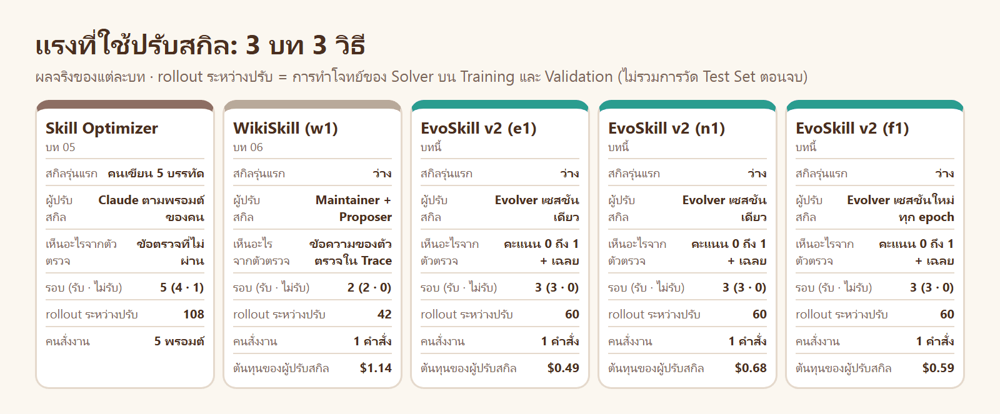

# EvoSkill v2 · ให้ Agent 3 ตัวปรับสกิลกันเอง


## เรื่องทั้งหมดในภาพเดียว


| ขั้น | เกิดอะไรขึ้น |
|---|---|
| 1 เตรียมสนาม | **Benchmark Adaptor** อ่านคำสั่งของเรา (ข้อความ 1 หน้า) แล้วทำรายการโจทย์ที่ล็อกแล้ว กับโฟลเดอร์อ้างอิงที่มีเฉพาะของชุด Training |
| 2 ทำโจทย์ | **Solver** เขียนโค้ดคิดเงินของร้าน BaanKafe (โจทย์ชุดเดียวกับ [บท 05](../05_Skill_Optimizer/README.md) และ [บท 06](../06_WikiSkill/README.md)) โจทย์ละ 3 ครั้ง |
| 3 เขียนสกิล | **Evolver** อ่านผลของชุด Training ทดลองด้วย bash แล้วเขียนชุดสกิลถัดไป · เป็นเซสชันเดียวตั้งแต่ต้นจนจบ |
| 4 วัดครั้งเดียว | ชุดสกิลของ epoch สุดท้ายถูกวัดกับ Test Set · **ไม่มีประตูรับ** ชุดสกิลของทุก epoch ถูกใช้ |

บท 05 คนเขียนสกิลรุ่นแรกแล้วสั่งปรับทีละรอบ · บท 06 AI 2 บทบาทจดสมุดความรู้แล้วเขียนสกิล · บทนี้ **AI ตัวเดียวที่จำทุกอย่างได้และรันโค้ดได้** เป็นผู้เขียนสกิล และมันเห็นจากตัวตรวจแค่ **คะแนน** · ผลจริงเทียบกัน:



## อ่านตามลำดับนี้

| ส่วน | ตอบคำถาม |
|---|---|
| [1 · โจทย์](#1--โจทย์) | โจทย์เดิมคืออะไร บทนี้เปลี่ยนอะไร |
| [2 · EvoSkill v2 ฉบับย่อ](#2--evoskill-v2-ฉบับย่อ) | แนวคิดหลักใน 5 ภาพ |
| [ทฤษฎี (ละเอียด 16 ขั้น)](01_theory/README.md) | แนวคิด · **วิธีคิดในการออกแบบ 10 ข้อ** · อัลกอริทึม · ผลในเปเปอร์ · ภาพต้นฉบับจากเปเปอร์ |
| [ข้างใน EvoSkill v2](02_inside_evoskill/README.md) | `evoskill.py` และ prompt ทำงานอย่างไร เชื่อมกับทฤษฎีข้อใด |
| [3 · ลงมือทำ](#3--ลงมือทำ-copy--paste) | พรอมต์ Copy & Paste 8 ขั้น พร้อมผลจริง |
| [4 · เทียบกับบท 05 และ 06](#4--เทียบกับบท-05-และ-06) | วิธีไหนได้อะไร เสียอะไร |
| [5 · สรุปและแบบฝึกหัด](#5--สรุปและแบบฝึกหัด) | บทเรียนจากผลจริง ข้อจำกัด และโจทย์ให้ลองต่อ |

| | |
|---|---|
| เปเปอร์ต้นทาง | Huang, Nama, Alzubi, *EvoSkill v2: Fully Agentic Skill Evolution from Benchmark Adaptation to a Stateful Evolver*, [arXiv:2610.25931](https://arxiv.org/abs/2610.25931) |
| Source code ของเปเปอร์ | [github.com/sentient-agi/EvoSkill](https://github.com/sentient-agi/EvoSkill/tree/v2) (branch `v2`) · โค้ดของบทนี้เขียนใหม่ให้อ่านจบได้ในไฟล์เดียว ([เทียบกันที่นี่](02_inside_evoskill/README.md#8--ต่างจาก-source-code-ต้นฉบับตรงไหน)) |
| ผลจริง | ตัวเลขทุกตัวมาจากการรันจริงเมื่อ 15 พ.ย. 2026 (รันใหม่ทั้งหมดด้วยตัวตรวจชุดเดียวกับบท 05) · ผลดิบอยู่ใน [`runs/`](runs/) และ [`results/`](results/) |

---

# 1 · โจทย์

## 1.1 โจทย์เดิมของบท 05 และ 06

| หัวข้อ | คืออะไร |
|---|---|
| สถานการณ์ | ร้าน BaanKafe ให้ AI เขียนฟังก์ชันคิดเงิน เช่น `cashback(amount, tier, birthday)` |
| ข้อกำหนด 2 ประเภท | **ข้อกำหนดที่ระบุชัด** อยู่ในโจทย์ AI เห็น · **ความรู้แฝงของทีม** ไม่อยู่ในโจทย์ AI ไม่เห็นถ้าสกิลไม่บอก |
| ความรู้แฝงกลุ่ม 1 · มาตรฐานการเขียนโค้ด 5 ข้อ | เงินเป็นจำนวนเต็มสตางค์ · ปัดครึ่งขึ้นครั้งเดียว · ข้อมูลผิดต้อง `ValueError` · รันเป็นโปรแกรมรับส่ง JSON · มีเทสต์อย่างน้อย 6 ข้อ |
| ความรู้แฝงกลุ่ม 2 · นโยบายธุรกิจ 4 ข้อ | ค่าส่ง: 0 กม. = รับเองที่ร้าน ไม่คิดค่าส่ง · ส่งด่วนรับไม่เกิน 20,000 กรัม · เงินคืน: สิทธิ์ 2 เท่าในเดือนเกิดเฉพาะ gold และ platinum · เงินคืนปัดลง |
| ตัวตรวจ | ตรวจ 10 ข้อ (งานค่าส่ง 11 ข้อ) · งานค่าส่งและงานเงินคืนมีข้อ `policy` ที่ตรวจนโยบายธุรกิจ · คะแนนของ 1 งาน = สัดส่วนข้อที่ผ่าน · **ผ่าน** = ครบทุกข้อ |
| ชุดโจทย์ | Training 4 ข้อ (มีงานค่าส่งและงานเงินคืน) · Validation 2 ข้อ · Test 3 ข้อ (ชุดเดียวกับบท 06) |
| สิ่งเดียวที่ปรับได้ | สกิล |

รายละเอียดของข้อกำหนดและตัวตรวจ: [บท 05 ส่วนที่ 1](../05_Skill_Optimizer/README.md#1--โจทย์และข้อกำหนดของร้าน) · Test Set: [บท 06 ข้อ 1.2](../06_WikiSkill/README.md#12-test-set-3-ข้อ)

## 1.2 สิ่งที่บทนี้เปลี่ยน

| | บท 05 · Skill Optimizer | บท 06 · WikiSkill | บทนี้ · EvoSkill v2 |
|---|---|---|---|
| สกิลรุ่นแรก | คนเขียน | ว่าง | ว่าง |
| ผู้ปรับสกิล | Claude ตามพรอมต์ของเรา | AI 2 บทบาท เรียกใหม่ทุกรอบ | AI ตัวเดียว เซสชันเดียวตลอดการรัน มี bash |
| ที่เก็บสิ่งที่เรียนรู้ | `ISSUES.md` | `wiki/` | ความจำของเซสชัน + โฟลเดอร์ส่วนตัวของ Evolver |
| ผู้ปรับสกิลเห็นอะไรจากตัวตรวจ | ข้อตรวจที่ไม่ผ่าน พร้อมข้อความ | ข้อตรวจที่ไม่ผ่าน พร้อมข้อความ | **คะแนน 0 ถึง 1 อย่างเดียว** |
| ผู้ปรับสกิลเห็นเฉลยหรือไม่ | ไม่ | ไม่ | เห็นเฉลยของ Training ถ้าคำสั่งของเราอนุญาต |
| เมื่อไรสกิลใหม่ถูกใช้ | ผ่านประตูรับที่คิดความแกว่ง | Validation สูงกว่าเดิม | **ทุกครั้ง** |

โจทย์ ตัวตรวจ (ชุดเดียวกับบท 05 รวมข้อตรวจ `policy`) พรอมต์ของ Solver โมเดลของ Solver (sonnet / effort medium) และจำนวนครั้งต่อโจทย์ (3) **เหมือนสองบทก่อนทุกค่า** ผลจึงเทียบกันได้

คำถามใหม่ของบทนี้: นโยบายธุรกิจ 4 ข้อไม่อยู่ในโจทย์ แต่ **อยู่ในเฉลยอ้างอิงของงานค่าส่งและงานเงินคืน** · Evolver ที่ได้เห็นเฉลยจะพบหรือไม่ และจะเขียนลงสกิลอย่างไร (ในบท 06 ไม่มีใครเห็นเฉลย WikiSkill จึงหาไม่ได้)

## 1.3 สิ่งที่เราต้องเตรียมในฐานะ "ผู้ใช้"

EvoSkill v2 ไม่มีพรอมต์ให้เราแก้ระหว่างทาง · สิ่งที่เราควบคุมคือของ 3 อย่างที่ส่งให้ก่อนเริ่ม ([`bench/`](bench/))

| สิ่งที่ส่ง | ไฟล์ | เนื้อหา |
|---|---|---|
| คำสั่ง | [`instruction.md`](bench/instruction.md) | benchmark และข้อมูลอยู่ที่ไหน · Solver ได้อะไร · ตัวตรวจคืออะไร · **Evolver เห็นอะไรได้** · ขนาดของการรัน `3 epochs · 3 samples per task` |
| ข้อมูล | [`data/baankafe/`](bench/data/baankafe/) | `tasks/` โจทย์ 9 ข้อ · `answers/` เฉลยอ้างอิงของทุกข้อ · การแบ่งชุดอยู่ใน [`split.json`](bench/split.json) |
| ตัวตรวจ | [`benchmark_grader.py`](bench/benchmark_grader.py) | `grade(task, snapshot)` คืนคะแนน 0 ถึง 1 |

---

# 2 · EvoSkill v2 ฉบับย่อ

ส่วนนี้ให้เห็นภาพรวมก่อนลงมือ · คำอธิบายเต็มพร้อมเหตุผลของการออกแบบทุกจุดอยู่ใน [ทฤษฎี](01_theory/README.md)

## 2.1 ข้อสังเกตตั้งต้น


Agent ที่ไม่มีสกิล เมื่อพลาดโจทย์ มักพลาดโจทย์นั้นอีก = ขาดคำแนะนำ ไม่ใช่ขาดความสามารถ · คำแนะนำเป็นสิ่งที่ Agent อีกตัวเขียนให้ได้

## 2.2 Agent 3 ตัว


## 2.3 ใครเห็นอะไร



## 2.4 อัลกอริทึม


## 2.5 การตัดสินใจออกแบบ 4 ข้อ


เหตุผลของแต่ละข้อ พร้อมหลักฐานจากเปเปอร์และจากการรันของเรา: [ทฤษฎี ขั้น 11](01_theory/README.md#ขั้น-11--วิธีคิดในการออกแบบ)

---

# 3 · ลงมือทำ (Copy & Paste)

**วิธีใช้:** เปิดโฟลเดอร์ `Teaching` ใน Claude Code Desktop → คัดลอกพรอมต์ → วาง → รอผล
ต้องมี container `multi-account` และบัญชี `yolo` ที่ล็อกอินแล้วอย่างน้อย 1 บัญชี

กติกาที่ Claude ต้องทำตามอยู่ใน [`AGENT.md`](AGENT.md) พรอมต์จึงสั้น · Claude ในที่นี้เป็นเพียงผู้กดรันคำสั่ง ผู้ปรับสกิลคือ Evolver ของ `evoskill.py`

| LAB | ทำอะไร | การรัน | rollout | เวลาจริง |
|---|---|---|---|---|
| [0](#lab-0--เตรียม) | ส่งไฟล์เข้า container ตรวจตัวตรวจ | – | – | ไม่ถึง 1 นาที |
| [1](#lab-1--benchmark-adaptor-เตรียมสนาม) | Benchmark Adaptor เตรียมสนาม | `e1` | – | 1 นาที |
| [2](#lab-2--รัน-1-การรันจนจบ) | รัน 1 การรันจนจบ ดู Evolver ทำงานทีละตา | `e1` | 78 | 10 นาที |
| [3](#lab-3--ผู้ใช้บอก-evolver-เพิ่ม-1-ประโยค) | ผู้ใช้บอก Evolver เพิ่ม 1 ประโยค | `n1` | 78 | 12 นาที |
| [4](#lab-4--evolver-เห็นแต่คะแนน) | Evolver เห็นแต่คะแนน | `p1` | 78 | 10 นาที |
| [5](#lab-5--ตัดความจำของ-evolver-ออก) | ตัดความจำของ Evolver ออก | `f1` | 78 | 9 นาที |
| [6](#lab-6--โมเดลเล็กปรับสกิลของตัวเอง) | โมเดลเล็กปรับสกิลของตัวเอง | `h1` | 78 | 13 นาที |
| [7](#lab-7--ความแกว่ง-และประตูรับที่เราไม่ได้ใช้) | ความแกว่ง และประตูรับที่เราไม่ได้ใช้ | – | 0 | 1 นาที |


## LAB 0 · เตรียม

```text
อ่าน ./03_week03/07_EvoSkill_v2/AGENT.md แล้วทำตาม
เตรียม LAB: ส่งไฟล์เข้า container · ตรวจ Grader ด้วย bench/check_grader.py · ตรวจว่าบัญชี yolo ใดล็อกอินแล้ว
ยังไม่ต้องสร้างการรันหรือรัน rollout · ตอบเป็นตาราง รายการ | ผล
```

ผลจริง

| รายการ | ผล |
|---|---|
| ส่งไฟล์เข้า container | ✅ `evoskill` `bench` `skill-optimizer` `baselines/so-v3` `baselines/wiki-w1` อยู่ใน `/workspace/evlab` |
| Grader กับเฉลยอ้างอิง | ✅ ผ่านครบทุกข้อทั้ง 9 โจทย์ (10/10 แปดโจทย์ · 11/11 โจทย์ค่าส่ง) |
| Grader กับเฉลยที่จงใจใส่ความผิด 1 จุด | ✅ ไม่ผ่านเฉพาะข้อนั้น (`half_up` · `reject_type` · `cli_error` · `policy` 4 แบบ: ข้ามนโยบายทีละข้อ) |
| บัญชี | ✅ `yolo1` `yolo2` `yolo3` |

👀 EvoSkill v2 ให้ผู้ใช้เป็นผู้ให้ตัวตรวจ และผู้ปรับสกิลที่เก่งหาช่องโหว่ของตัวตรวจเจอได้ ([ทฤษฎี ขั้น 8](01_theory/README.md#ขั้น-8--การกันข้อมูล-และช่องโหว่ของตัวตรวจ)) จึงต้องตรวจตัวตรวจก่อนเสมอ

## LAB 1 · Benchmark Adaptor เตรียมสนาม


```text
อ่าน ./03_week03/07_EvoSkill_v2/AGENT.md แล้วทำตาม
สร้างการรันชื่อ e1 แล้วรันขั้น adapt อย่างเดียว
จากนั้นเปิด setup/benchmark_plugin.py · setup/freeze.json · setup/audit.md และดูรายการไฟล์ใน reference/
ตอบ: ตาราง รายการ | ผล (เวลาและเครื่องมือของ Benchmark Adaptor · จำนวนโจทย์แต่ละชุด · ไฟล์ใน reference · ผลตรวจการรั่ว) · สิ่งที่ Adaptor ทำเองโดยไม่ได้สั่ง (เทียบ turns/adaptor/message.md กับ turns/adaptor/actions.md)
```

ผลจริง ([`runs/e1/setup/`](runs/e1/setup/) · [`runs/e1/reference/`](runs/e1/reference/))

| รายการ | ผล |
|---|---|
| Benchmark Adaptor | 18 วินาที · เครื่องมือ 3 ครั้ง · $0.11 |
| [`benchmark_plugin.py`](runs/e1/setup/benchmark_plugin.py) | `list_tasks(root)` คืนโจทย์ 9 ข้อ = train 4 · validation 2 · test 3 |
| [`freeze.json`](runs/e1/setup/freeze.json) | sha256 ของ plug-in · ตัวตรวจ · รายการโจทย์ |
| `reference/` | 12 ไฟล์: โจทย์ของ Training 4 · เฉลยอ้างอิงของ Training 8 |
| [`audit.md`](runs/e1/setup/audit.md) | ของ Validation หรือ Test: ไม่พบ · โค้ดของตัวตรวจ: ไม่พบ |
| สิ่งที่ Adaptor ทำเอง | ไม่คัดลอก `split.json` ลง `reference/` เพราะไฟล์นั้นมีชื่อโจทย์ของ Validation และ Test · ทดสอบ plug-in และค้นหาการรั่วใน `reference/` เองก่อนจบ |

👀 หลังขั้นนี้ การแบ่งชุดและตัวตรวจถูกล็อก · Agent ที่จะเขียนสกิลยังไม่ได้เริ่มทำงานเลย จึงไม่มีทางแก้การวัดให้ตัวเองได้เปรียบ

👀 เฉลยอ้างอิง 8 ไฟล์ใน `reference/` รวมเฉลยของงานค่าส่งและงานเงินคืน ซึ่ง **ทำตามนโยบายธุรกิจ 4 ข้อที่โจทย์ไม่ได้เขียน** · นี่คือช่องทางเดียวที่ Evolver จะรู้นโยบายเหล่านี้ได้

## LAB 2 · รัน 1 การรันจนจบ

```text
อ่าน ./03_week03/07_EvoSkill_v2/AGENT.md แล้วทำตาม
รันการรัน e1 ต่อทีละขั้น: base → turn → rollout (epoch 1) หลังแต่ละขั้นบอกว่าไฟล์ใดเกิดขึ้น
หลังขั้น turn ให้เปิด turns/turn_1/actions.md และ skills_v1/ แล้วสรุปว่า Evolver ทำอะไร และเขียนสกิลอะไร
จากนั้นรัน run ต่อจนจบ เก็บผลลงเครื่อง และบันทึก status กับ noise ลง results/
ตอบ: ตาราง ขั้น | ไฟล์ที่เกิด | สรุป 1 บรรทัด · สรุป 3 ตาของ Evolver จาก turns/turn_1 ถึง turn_3/actions.md (ทำอะไร · ข้อสรุป · คะแนน Validation หลังจากนั้น) · ตาราง status · คะแนน Test Set
```

ผลจริง ([`runs/e1/`](runs/e1/) · [status](results/status-e1.txt))


| epoch | ชุดสกิล | Training | Validation | ตาของ Evolver |
|---|---|---|---|---|
| 0 | (ไม่มี) | 47.1% | 40.0% | – |
| 1 | [`baankafe-money-function`](runs/e1/skills_v1/baankafe-money-function/SKILL.md) + [`baankafe-house-policies`](runs/e1/skills_v1/baankafe-house-policies/SKILL.md) 11.9 KB | 90.2% | 80.0% | 75 วินาที · Bash 9 ครั้ง · $0.24 |
| 2 | แก้สกิลแรก 13.0 KB | 90.2% | 80.0% | 185 วินาที · Bash 10 ครั้ง · $0.20 |
| 3 | ไม่แก้ 13.0 KB | – | 80.0% | 21 วินาที · Bash 2 ครั้ง · $0.05 |

| Test Set | คะแนน | ผ่านครบทุกข้อ |
|---|---|---|
| ไม่มีสกิล | 45.6% | 0/9 |
| `skills_v3` | **83.3%** | 0/9 |



| ตา | สิ่งที่ Evolver ทำด้วย bash | เปิดดูได้ที่ |
|---|---|---|
| 1 | อ่านเฉลยอ้างอิงใน `reference/` แล้วพบกฎของร้าน 4 ข้อที่โจทย์ไม่ได้เขียน → เขียนสกิล 2 ตัว | [`turn_1/actions.md`](runs/e1/turns/turn_1/actions.md) |
| 2 | รันเทสต์ของเฉลยกับโค้ดของ Solver ทุก rollout (ผ่าน 12/12) และเทียบกับเฉลยด้วย input หลายหมื่นแบบ → หาสาเหตุของ 0.1 ที่ขาดไม่เจอ จึงเดา | [`turn_2/actions.md`](runs/e1/turns/turn_2/actions.md) |
| 3 | เทียบอีกครั้งด้วย input ราว 2 หมื่นแบบ ไม่พบความต่าง → ไม่แก้อะไร | [`turn_3/actions.md`](runs/e1/turns/turn_3/actions.md) |

การรันนี้มี 3 เรื่องที่ควรอ่านแยกกัน

**เรื่องที่ 1 · Evolver พบนโยบายธุรกิจครบ 4 ข้อเอง ในตาแรก**

มันอ่านเฉลยของงานค่าส่งและงานเงินคืน แล้วเขียนสกิล [`baankafe-house-policies`](runs/e1/skills_v3/baankafe-house-policies/SKILL.md) · ข้อตรวจ `policy` ของ Training ผ่านครบตั้งแต่ epoch 1 · นี่คือสิ่งที่ WikiSkill ของบท 06 หาเองไม่ได้ (`policy` 0/6) เพราะไม่มีใครได้เห็นเฉลย

**เรื่องที่ 2 · แต่นโยบายถูกเขียนกว้างกว่าที่เฉลยบอก และไม่มีอะไรกันไว้**

```text
สกิลที่ Evolver เขียน : เงินที่ร้านจ่ายออกให้ลูกค้า (เงินคืน/cashback/refund/แต้มแลกเงิน) → ปัดลง (floor)
ผลใน Test Set        : ✗ half_up: refund(150, 25, false) คาด 113 ได้ 112 · พลาด 3 จาก 3 กรณี      ← x2-refund ทั้ง 3 rollout
```

เฉลยของ Training บอกเพียงว่า **เงินคืนสมาชิก** ปัดลง · Evolver ขยายเป็นกติกาของ "เงินที่ร้านจ่ายออก" ทุกชนิด งานคืนเงินคอร์สของ Test Set จึงผิด · นี่คือความผิดแบบเดียวกับรุ่น `w1p` ของ [บท 06 LAB 5](../06_WikiSkill/README.md#lab-5--เติมความรู้จากทีม-w1p--w1q) ซึ่งประตูรับของบท 05 ปฏิเสธ · EvoSkill v2 **ไม่มีประตูรับ** และ Validation 2 โจทย์ไม่มีงานแบบนี้ ชุดสกิลจึงถูกใช้ต่อจนถึง Test

**เรื่องที่ 3 · 0.1 ที่ขาด คือกฎที่อยู่เฉพาะในตัวตรวจ และ Evolver เดาผิดทาง**

| epoch | สิ่งที่ตัวตรวจพบ (Evolver ไม่เห็น) | สิ่งที่ Evolver เห็น | สิ่งที่ Evolver ทำ |
|---|---|---|---|
| 1 | `✗ tests: unittest พบ 2 เทสต์ (ต้องมีอย่างน้อย 6)` | `0.9` | เดาว่าเป็น "รูปแบบการส่งมอบ" → ให้ Solver ย้ายไฟล์เทสต์ไปไว้ที่ `/tmp` |
| 2 | `✗ tests: ไม่มีไฟล์ test_solve.py ข้าง solve.py` | `0.9` | คะแนนเท่าเดิม แยกไม่ออกว่าดีขึ้นหรือแย่ลง → ไม่แก้ต่อ |

ใน epoch 1 Solver ส่งไฟล์เทสต์แล้ว ขาดแค่จำนวนเทสต์ · การแก้ของตาที่ 2 ทำให้ห่างจากกฎจริงมากขึ้น แต่คะแนนไม่เปลี่ยน Evolver จึงสรุปในตาที่ 3 ว่า "ถ้าจะแก้ต่อ ผมต้องเดา ซึ่งเสี่ยงทำให้ส่วนที่ผ่านแล้วเสียหาย" ([ทฤษฎี ขั้น 9.3](01_theory/README.md#93-ทำไมติดที่-90))

**รันซ้ำด้วยการตั้งค่าเดิมอีก 2 ครั้ง** ([status e2](results/status-e2.txt) · [status v1](results/status-v1.txt))

| | `e1` | `e2` | `v1` |
|---|---|---|---|
| Validation ราย epoch | 40.0 → 80.0 → 80.0 → 80.0 | 48.3 → 83.3 → 95.0 → 96.7 | 40.0 → 60.0 → 86.7 → 90.0 |
| Test Set | 83.3% (0/9) | **92.2% (5/9)** | 84.4% (0/9) |
| นโยบายธุรกิจ | พบในตาแรก เขียนกว้าง | พบในตาแรก เขียนกว้าง | พบในตาแรก เขียนกว้าง |
| การเดาเรื่อง 0.1 ที่ขาด | "รูปแบบการส่งมอบ" → ย้ายไฟล์เทสต์ออก (ผิดทาง) | "ไฟล์เทสต์" → ให้ส่ง `test_solve.py` 4 กลุ่ม กลุ่มละ 2–4 เคส (ถูกทาง) | "ส่วนห่อรอบฟังก์ชันและไฟล์เทสต์" → เพิ่มสกิลที่ 3 `deliverable-format` (ถูกทาง แต่กำหนดจำนวนเทสต์ไม่พอ) |
| ข้อ `tests` ใน Test Set | ไม่ผ่าน 9/9 | ไม่ผ่าน 1/9 | ไม่ผ่าน 8/9 · `unittest พบ 4 เทสต์` |
| `x2-refund` ใน Test Set | ผิด 3/3 | ผิด 3/3 | ผิด 3/3 |

👀 การตั้งค่าเดียวกัน 3 ครั้ง ได้ Test ต่างกัน 9 จุด · ทั้ง 3 ครั้ง Evolver ต้อง **เดา** เรื่องเดียวกันโดยไม่มีหลักฐาน (`e2` เขียนเองว่า "นี่เป็นข้อสันนิษฐาน ยังไม่มีหลักฐานยืนยัน" · `v1` เขียนว่า "สกิลนี้เป็นการเดา") · ผลขึ้นกับว่าเดาไปทางใด · ส่วนเรื่องที่ 2 เกิดซ้ำทั้ง 3 ครั้ง

## LAB 3 · ผู้ใช้บอก Evolver เพิ่ม 1 ประโยค

`e1` ติดที่ 0.9 ต่อ rollout เพราะ Evolver ไม่รู้ว่าไฟล์เทสต์เป็นส่วนของงานที่ต้องส่ง · ใน EvoSkill v2 เราไม่แก้ prompt ของ Evolver และไม่เปิดตัวตรวจให้ดู · ช่องทางเดียวคือ **คำสั่งของผู้ใช้** ซึ่งกำหนดว่า Reference Folder มีอะไร

[`instruction_with_note.md`](bench/instruction_with_note.md) ต่างจาก `instruction.md` ที่ย่อหน้าเดียว:

```text
ให้เขียนไฟล์ `README.md` ไว้ที่ชั้นบนสุดของโฟลเดอร์ reference ด้วย มีข้อความนี้ข้อความเดียว:
"โฟลเดอร์ `answers/<task id>/` คือผลงานของโจทย์นั้นที่ได้คะแนนเต็ม ประกอบด้วย 2 ไฟล์ คือ `solve.py` และ `test_solve.py`"
```

```text
อ่าน ./03_week03/07_EvoSkill_v2/AGENT.md แล้วทำตาม
สร้างการรันชื่อ n1 เหมือน e1 แต่ใช้ --instruction bench/instruction_with_note.md แล้วรัน run จนจบ เก็บผลลงเครื่อง
ตอบ: เนื้อหาของ reference/README.md · ตาราง status ของ n1 เทียบ e1 · สรุป 3 ตาของ Evolver (ทำอะไร · ข้อสรุป · คะแนน Validation หลังจากนั้น)
```

ผลจริง ([`runs/n1/`](runs/n1/) · [status](results/status-n1.txt))


| ตา | Evolver ทำอะไร | Validation หลังจากนั้น |
|---|---|---|
| 1 | เขียนสกิล 2 ตัว และให้ Solver ส่ง `test_solve.py` ข้าง `solve.py` ตั้งแต่ตาแรก · เห็นนโยบายธุรกิจครบ 4 ข้อ แต่ **ตั้งใจไม่ใส่ 3 ข้อ** เพราะเห็นว่าเป็นกฎเฉพาะงาน | 40.0% → 80.0% |
| 2 | เทียบโค้ดของ Solver กับเฉลยด้วย input แปลก ๆ พบความต่างที่ระยะ 0 กม. · ส่งด่วนเกิน 20,000 กรัม · silver ในเดือนเกิด → กลับมาเขียนนโยบายลงสกิล เป็น "ค่าตั้งต้นของร้าน" | 80.0% → 80.0% |
| 3 | สุ่ม input 20,000 ชุดต่อ rollout เทียบกับเฉลย: ตรงกันหมด → ตั้งสมมติฐานว่าคะแนนที่ขาดมาจาก **คุณภาพของไฟล์เทสต์** → เพิ่มหัวข้อ "คุณภาพของ test_solve.py" | 80.0% → **86.7%** |

| | `e1` | `n1` | `n2` (รันซ้ำ) |
|---|---|---|---|
| สิ่งที่ต่าง | – | reference มี `README.md` 1 ประโยค | เหมือน `n1` |
| Validation ราย epoch | 40.0 → 80.0 → 80.0 → 80.0 | 40.0 → 80.0 → 80.0 → 86.7 | 43.3 → 80.0 → 90.0 → 90.0 |
| Test Set | 83.3% (0/9) | **93.3% (6/9)** | **93.3% (6/9)** |
| สกิลให้ Solver ส่ง `test_solve.py` หรือไม่ | ไม่ (ตาที่ 2 ให้ย้ายไป `/tmp`) | ให้ส่งตั้งแต่ตาแรก · ตาที่ 3 เพิ่มเกณฑ์คุณภาพ | ให้ส่งตั้งแต่ตาที่ 2 พร้อมจำนวนขั้นต่ำต่อกลุ่ม |
| ข้อ `tests` ของ Training (epoch 2) | ไม่ผ่าน 12/12 · ไม่มีไฟล์ | ไม่ผ่าน 11/12 · `unittest พบ 4 เทสต์ (ต้องมีอย่างน้อย 6)` | ผ่าน 12/12 |
| ต้นทุนของ Evolver | $0.49 | $0.68 | $0.37 |

👀 ประโยคที่เพิ่มไม่ได้บอกว่าตัวตรวจตรวจอย่างไร บอกเพียงว่า **งานที่สมบูรณ์มีไฟล์อะไรบ้าง** · ทั้งสองการรันจบด้วยสกิลที่ให้ Solver ส่งไฟล์เทสต์ และได้ Test 93.3% เท่ากัน · แต่เส้นทางต่างกัน: `n1` ให้ส่งตั้งแต่ตาแรกแล้วใช้อีก 2 ตากว่าจะได้จำนวนเทสต์ถึงเกณฑ์ · `n2` อ่านประโยคนี้ในตาแรกแต่ยังไม่ใช้ จนตาที่ 2 จึงสรุปว่า "ส่วนที่ขาดน่าจะเป็นไฟล์เทสต์ แต่ยืนยันไม่ได้"

👀 **93.3% คือเพดานของทุกการรันที่เห็นเฉลย:** งาน `x2-refund` ยังผิด 2 ข้อตรวจทั้ง 3 rollout เพราะนโยบายปัดเศษที่เขียนกว้าง (LAB 2 เรื่องที่ 2) · ประโยคที่เราเพิ่มแก้ได้เฉพาะเรื่องที่เราบอก

บทเรียน: ใน EvoSkill v2 สิ่งที่คนปรับได้คือ "Evolver ได้เห็นอะไร" ไม่ใช่ "Evolver ต้องคิดอย่างไร" · ถ้ากฎใดอยู่เฉพาะในตัวตรวจและเราต้องการให้สกิลรู้ ต้องบอกผ่าน Reference Folder

## LAB 4 · Evolver เห็นแต่คะแนน

การตั้งค่าที่สองของเปเปอร์ (Pass or Fail Only): Reference Folder ไม่มีเฉลยของชุดใดเลย

```text
อ่าน ./03_week03/07_EvoSkill_v2/AGENT.md แล้วทำตาม
สร้างการรันชื่อ p1 เหมือน e1 แต่ใช้ --instruction bench/instruction_score_only.md แล้วรัน run จนจบ เก็บผลลงเครื่อง
ตอบ: รายการไฟล์ใน reference/ · ตาราง status ของ p1 เทียบ e1 · สรุป 3 ตาของ Evolver · เนื้อหาของ evo/evolver_workspace/
```

ผลจริง ([`runs/p1/`](runs/p1/) · [status](results/status-p1.txt))



| ตา | Evolver ทำอะไร (ไม่มีเฉลยให้เทียบ) | Validation หลังจากนั้น |
|---|---|---|
| 1 | เทียบ rollout 3 ครั้งของโจทย์หารบิล: ครั้งที่ปฏิเสธ input นอกช่วงได้ 0.6 ครั้งที่ไม่ปฏิเสธได้ 0.5 → ตั้งสมมติฐานว่าตัวตรวจลองค่านอกช่วง · ให้ปัดครึ่งขึ้นหลังทุกขั้น | 40.0% → 50.0% |
| 2 | เทียบคะแนนกับ epoch ก่อน: ปัดทุกขั้นทำให้งานค่าส่งแย่ลง · rollout ที่ไม่รับ `bool` เป็นจำนวนเต็มได้สูงกว่า 0.1 → เลิกปัดกลางทาง ตรวจชนิดทุกพารามิเตอร์ และ **ทดลองปัดลงครั้งเดียวตอนจบ** | 50.0% → 45.0% |
| 3 | ปัดลงแย่กว่าปัดครึ่งขึ้นใน 3 โจทย์ → เดาว่า "เฉลยของตัวตรวจน่าจะเขียนด้วย `round()`" → **ทดลองปัดแบบ `round()` ของ Python** เป็นชุดสุดท้าย | 45.0% → **60.0%** |

บันทึกที่ Evolver เขียนให้ตัวเอง ([`notes.md`](runs/p1/evo/evolver_workspace/notes.md)):

```text
## epoch 2 experiment (skills_v2): single final rounding = FLOOR (Fraction all the way), strict range+type validation on every param.
- If t1/t3 improve vs epoch0 (.5/.4545) keep floor; if worse try ceil next (or revert half-up final + validation).
## epoch 3 experiment (skills_v3): Fraction all the way + single final round-half-EVEN (python round) + strict validation.
```

| | `e1` (เห็นเฉลย) | `p1` (เห็นแต่คะแนน) |
|---|---|---|
| reference/ | 12 ไฟล์ | 4 ไฟล์ (โจทย์ของ Training) |
| Test Set | 83.3% | **60.0%** |
| มาตรฐานการเขียนโค้ดที่ค้นพบ | ตรวจ input · ปัดครึ่งขึ้นครั้งเดียว · จำนวนเต็ม · CLI | ตรวจ input (ช่วงและชนิด) |
| นโยบายธุรกิจ 4 ข้อ | พบครบ (จากเฉลย) | ไม่พบ และไม่เคยเดา |
| วิธีปัดเศษในชุดสุดท้าย | ปัดครึ่งขึ้น (ถูก) | `round()` ของ Python (ผิด · เป็นการทดลองที่ค้างอยู่) |

**รันซ้ำ (`p2`):** Validation 45.0 → 35.0 → 45.0 → 63.3 · Test **63.3% (0/9)** ([status](results/status-p2.txt)) · ครั้งนี้ Evolver ทำการทดลองแบบ A/B/C **ภายใน epoch เดียว**: ให้ Solver เลือกกติกาตามหมายเลขของ rollout (`-r1` `-r2` `-r3` จากชื่อโฟลเดอร์) ทุกตา (วิธีปัดเศษ 3 แบบ → วิธีปัดเศษอีก 3 แบบ → ความเข้มของการตรวจ input 3 แบบ) เก็บแบบที่ชนะไว้ทีละเรื่อง และชุดสุดท้ายก็ยังมีการทดลองค้างอยู่เช่นเดียวกับ `p1` ([`notes.md`](runs/p2/evo/evolver_workspace/notes.md))

👀 สามเรื่องที่เห็นจากการรันนี้
- **epoch คือการทดลองของ Evolver:** เมื่อไม่มีเฉลย มันเปลี่ยนทีละเรื่อง แล้วใช้คะแนนของ epoch ถัดไปเป็นคำตอบ (ปัดทุกขั้น → ปัดลง → `round()`) โดยไม่ได้รันโค้ดทดลองเองเลย
- **รับทุก epoch มีราคา:** ชุดสกิลของตาที่ 3 เป็นการเดาที่ยังไม่ได้ตรวจ และถูกนำไปวัด Test ทันที เพราะการรันมี 3 epoch
- **Evolver ไม่รู้ว่าตาใดเป็นตาสุดท้าย** เพราะ prompt ไม่ได้บอกจำนวน epoch ([แบบฝึกหัดข้อ 3](#52-แบบฝึกหัด))

## LAB 5 · ตัดความจำของ Evolver ออก


เปเปอร์ให้เหตุผลว่าเซสชันเดียวดีกว่าการเริ่มใหม่ทุกรอบ · ลองกับโจทย์ของเรา: เหมือน `e1` ทุกค่า แต่ Evolver เริ่มเซสชันใหม่ทุก epoch (ไฟล์ทุกอย่างยังอยู่ หายเฉพาะความจำในเซสชัน)

```text
อ่าน ./03_week03/07_EvoSkill_v2/AGENT.md แล้วทำตาม
สร้างการรันชื่อ f1 เหมือน e1 แต่เพิ่ม --fresh-session แล้วรัน run จนจบ เก็บผลลงเครื่อง
ตอบ: ตาราง status ของ f1 เทียบ e1 · สรุป 3 ตาของ Evolver (จากข้อความ "Agent พูด" ช่วงท้ายของ turns/turn_K/actions.md) · ไฟล์ใน evo/evolver_workspace/ · ผลของ noise ws/f1
```

ผลจริง ([`runs/f1/`](runs/f1/) · [status](results/status-f1.txt))


| ตา (เซสชันใหม่ทุกครั้ง) | Evolver ทำอะไร | Validation หลังจากนั้น |
|---|---|---|
| 1 | อ่านเฉลย เห็นกฎของร้านที่โจทย์ไม่ได้เขียน แต่ใส่ลงสกิลเป็น **คำใบ้กว้าง ๆ** (เช่น "ระดับล่างสุดมักไม่ได้สิทธิ์โบนัสเดือนเกิด") | 46.7% → 80.0% |
| 2 | อ่าน Trace แล้วพบว่า Solver เห็นคำใบ้ แต่ **เลือกไม่ทำเพราะ "โจทย์ไม่ได้ระบุ"** → เขียนใหม่เป็น "มาตรฐานร้านที่บังคับใช้" พร้อมค่าจริง · จดโน้ตไว้ให้ตาถัดไปเอง | 80.0% → 80.0% |
| 3 | อ่านโน้ตของตาก่อน · รันเทสต์ของเฉลยกับโค้ดของ Solver ผ่าน 12/12 → หาสาเหตุของ 0.1 ที่ขาดไม่ได้ → ไม่แก้ | 80.0% → 80.0% |

| การตั้งค่า | การรัน | Validation ราย epoch | Test Set |
|---|---|---|---|
| เซสชันเดียว | `e1` | 40.0 → 80.0 → 80.0 → 80.0 | 83.3% (0/9) |
| เซสชันเดียว | `e2` | 48.3 → 83.3 → 95.0 → 96.7 | 92.2% (5/9) |
| เซสชันเดียว | `v1` | 40.0 → 60.0 → 86.7 → 90.0 | 84.4% (0/9) |
| เซสชันใหม่ทุก epoch | `f1` | 46.7 → 80.0 → 80.0 → 80.0 | 83.3% (0/9) |
| เซสชันใหม่ทุก epoch | `f2` | 43.3 → 83.3 → 83.3 → 90.0 | 83.3% (0/9) |
| เซสชันใหม่ทุก epoch | `f3` | 50.0 → 80.0 → 93.3 → 90.0 | **93.3% (6/9)** |

การรันซ้ำ ([status f2](results/status-f2.txt) · [status f3](results/status-f3.txt)): `f2` จดโน้ตและอ่านโน้ตของตาก่อนทุกตา แต่ไม่เคยตั้งสมมติฐานเรื่องไฟล์เทสต์ · `f3` ไม่มีโน้ต แต่ตาที่ 2 อ่านสกิลใน staging แล้วรันเทสต์ของเฉลยกับโค้ดของ Solver ทั้ง 12 rollout (ผ่านหมดแต่ยังได้ 0.9) จึงสังเกตว่า "เฉลยมีไฟล์เทสต์แต่ Solver ไม่เคยเขียน" และให้ส่ง `test_solve.py`

👀 ผลของเรา **ไม่พบความต่าง** ระหว่างสองแบบในโจทย์นี้: เซสชันเดียวได้ Test 83.3% · 92.2% · 84.4% · เซสชันใหม่ทุก epoch ได้ 83.3% · 83.3% · 93.3% (เฉลี่ย 86.7% เท่ากัน) · ผลของการตั้งค่าเดียวกันต่างกันเองถึง 10 จุด จึง **สรุปไม่ได้ว่าแบบใดดีกว่า**
สิ่งที่ชี้ขาดคือ **มีตาใดทำให้ Solver ส่งไฟล์เทสต์ที่ครบเกณฑ์หรือไม่**: การรันที่ไปถึง 92–93% (`e2` `f3`) คือการรันที่ทำได้ · การรันที่ติดที่ 83% (`e1` `f1` `f2`) ไม่มี `test_solve.py` ในโฟลเดอร์งานเลยจนจบ
ข้อควรระวัง: งานนี้เล็ก (ตาละราว 1–3 นาที ไม่มีการย่อบริบท ไม่มีสคริปต์ให้ใช้ซ้ำ) และเซสชันใหม่ก็ยังส่งต่อความรู้ผ่านไฟล์โน้ตได้ · ประโยชน์ที่เปเปอร์วัดได้มาจากงานที่ Evolver ต้องสะสมเครื่องมือและการวิเคราะห์ข้ามตา

## LAB 6 · โมเดลเล็กปรับสกิลของตัวเอง

เปเปอร์รายงานว่า Haiku 5.5 เป็นทั้ง Solver และ Evolver แล้วยังปรับสกิลของตัวเองได้ (+21.5 จุดบน τ³-bench)

```text
อ่าน ./03_week03/07_EvoSkill_v2/AGENT.md แล้วทำตาม
สร้างการรันชื่อ h1 เหมือน e1 แต่เพิ่ม --solver-model haiku --evolver-model haiku แล้วรัน run จนจบ เก็บผลลงเครื่อง
ตอบ: ตาราง status ของ h1 เทียบ e1 · ชื่อและ description ของสกิลใน skills_v3 · ไฟล์ใน evo/evolver_workspace/ · ต้นทุนรวมของ Evolver 3 ตา
```

ผลจริง ([`runs/h1/`](runs/h1/) · [status](results/status-h1.txt))



| epoch | ชุดสกิล | Training | Validation | ตาของ Evolver (haiku) |
|---|---|---|---|---|
| 0 | (ไม่มี) | 52.0% | 53.3% | – |
| 1 | สกิล 2 ตัว 12.8 KB + `money_helpers.py` | 83.9% | 80.0% | 121 วินาที · เครื่องมือ 17 ครั้ง · $0.03 |
| 2 | แก้ 1 ไฟล์ 14.8 KB | 85.5% | 83.3% | 85 วินาที · เครื่องมือ 17 ครั้ง · $0.03 |
| 3 | แก้ 1 ไฟล์ 16.1 KB | – | 83.3% | 36 วินาที · เครื่องมือ 7 ครั้ง · $0.06 |

| | sonnet ทั้งคู่ (`e1`) | haiku ทั้งคู่ (`h1`) |
|---|---|---|
| Test Set: ไม่มีสกิล → ชุดสุดท้าย | 45.6% → 83.3% (0/9) | 50.0% → **83.3% (1/9)** |
| จำนวนสกิล · ขนาด | 2 ตัว · 13.0 KB | 2 ตัว · 16.1 KB |
| นโยบายธุรกิจ 4 ข้อ | พบ และเขียนลงสกิล | **พบ แต่ตั้งใจไม่เขียนลงสกิล** |
| ข้อ `policy` ของ Training (epoch 2) | ผ่าน 6/6 | ผ่าน 0/6 |
| ต้นทุนของ Evolver 3 ตา | $0.49 | $0.12 |
| ต้นทุนของ Solver 78 rollout | $8.78 | $0.72 |

**รันซ้ำ (`h2`):** Validation 50.0 → 60.0 → 35.0 → 50.0 · Test 54.4% → **53.3% (0/9)** · สกิล 3 ตัว · ต้นทุนของ Evolver $0.14 ([status](results/status-h2.txt)) · ครั้งนี้ Evolver (haiku) **เลือกไม่เปิดเฉลยใน `reference/`** โดยให้เหตุผลว่า "จะเป็นการเรียนจากเฉลยที่ไม่ generalize" จึงต้องทดลองแบบเดียวกับ `p1`: ตาที่ 2 เปลี่ยนค่าเริ่มต้นของการปัดเศษเป็นปัดลงกับเงินทุกค่า คะแนน Validation ตกจาก 60.0% เหลือ 35.0% · ตาที่ 3 ถอนแล้วลองปัดแบบ `round()` ของ Python แทน

👀 haiku ปรับสกิลของตัวเองได้ในการรัน `h1` (Test 50.0% → 83.3% เท่ากับ `e1` ด้วยต้นทุนราว 1 ใน 12) · วิธีทำงานคล้าย sonnet: เปิดเฉลย รันเทสต์ของเฉลยกับโค้ดของ Solver แล้วเขียนเรื่องการตรวจ input การปัดเศษครั้งเดียว และ `main()`

👀 จุดที่ต่างคือ **การตัดสินใจเรื่องนโยบายธุรกิจ**: Evolver (haiku) จดกฎ 4 ข้อไว้ในโน้ตว่า "reference has but the brief does not (hidden rules)" แต่ไม่เขียนลงสกิล เพราะเห็นว่าเป็นของโจทย์ Training เท่านั้น และขัดกับข้อความในโจทย์ · สกิลจึงบอก Solver ว่า "ถ้าโจทย์ไม่ได้เขียนไว้ ให้ทำตามตัวอักษรของโจทย์และระบุในสรุปว่าเป็นจุดที่ควรยืนยัน" · ผลคือคะแนน Training ต่ำกว่า `e1` แต่ **ไม่ได้เพิ่มกฎที่โจทย์ไม่ได้ให้** · prompt ของ Evolver ไม่ได้กำกับเรื่องนี้ การรันแต่ละครั้งจึงตัดสินใจต่างกันได้

## LAB 7 · ความแกว่ง และประตูรับที่เราไม่ได้ใช้


LAB นี้ไม่ใช้โทเคน: นำผลที่มีอยู่มาตอบว่า "ถ้าเราใช้ประตูรับแบบวัดโจทย์ละ 1 ครั้ง จะเกิดอะไรขึ้น"

```text
อ่าน ./03_week03/07_EvoSkill_v2/AGENT.md แล้วทำตาม
รัน noise ของการรัน e1 e2 p1 f1 แล้วบันทึกลง results/noise-<ชื่อ>.txt (ไม่ต้องรัน rollout ใหม่)
ตอบ: (1) leg ใดบ้างที่มีโจทย์ผ่านบางครั้ง หรือคะแนนต่างกันระหว่างครั้ง (2) การเทียบใดที่ช่อง "รับ" ไม่ใช่ 0/9 หรือ 9/9 และถ้าใช้ประตูรับนั้นจะเสียอะไร (ดูคะแนน Test ของการรันนั้นใน results/status-<ชื่อ>.txt)
```

ผลจริง ([noise-e1](results/noise-e1.txt) · [noise-e2](results/noise-e2.txt) · [noise-p1](results/noise-p1.txt) · [noise-f1](results/noise-f1.txt) · การรันอื่นอยู่ใน [`results/`](results/))

**1) Solver ทำโจทย์เดิมซ้ำ ผลไม่เท่ากัน** (สกิลและโจทย์เดียวกัน · คะแนนราย rollout อยู่ใน `runs/<ชื่อ>/legs/*.json`)

| การรัน · leg | โจทย์ | คะแนน 3 ครั้ง |
|---|---|---|
| `e1` · ไม่มีสกิล | `split_bill` | 0.4 · 0.5 · 0.6 |
| `p1` · ไม่มีสกิล | `bulk_price` | 0.5 · 0.0 · 0.5 |
| `e2` · `skills_v2` | `shipping_fee` | 0.91 · 1.0 · 1.0 |
| `n1` · `skills_v1` | `shipping_fee` | 0.64 · 0.82 · 0.82 |
| `p2` · `skills_v2` | `shipping_fee` | 0.55 · 0.36 · 0.27 |

ใน `e1` `p1` `f1` ไม่มีโจทย์ใดผ่านครบแม้แต่ครั้งเดียว ความต่างระหว่างครั้งจึงอยู่ที่ leg ไม่มีสกิลเกือบทั้งหมด · `e2` เป็นการรันเดียวใน 4 การรันนี้ที่มีโจทย์ "ผ่านบางครั้ง" · `p2` (เห็นแต่คะแนน) แกว่งมากที่สุดในบท

**2) ประตูรับแบบ "วัดโจทย์ละ 1 ครั้ง รับเมื่อสูงกว่าเดิม"** (จับคู่ครั้งที่ i ของชุดเดิม กับครั้งที่ j ของชุดใหม่ = 9 คู่)

| การรัน | เทียบบน Validation | ค่าเฉลี่ย 3 ครั้ง | รับ | เสมอ (ไม่รับ) | ต่ำกว่า (ไม่รับ) |
|---|---|---|---|---|---|
| `e2` | v1 → v2 | 83.3% → 95.0% | **8/9** | 1/9 | 0/9 |
| `e2` | v2 → v3 | 95.0% → 96.7% | **4/9** | 3/9 | 2/9 |
| `n1` | v2 → v3 | 80.0% → 86.7% | **6/9** | 3/9 | 0/9 |
| `v1` | v2 → v3 | 86.7% → 90.0% | **6/9** | 3/9 | 0/9 |
| `f2` | v1 → v2 | 83.3% → 83.3% | **2/9** | 5/9 | 2/9 |
| `f2` | v2 → v3 | 83.3% → 90.0% | **6/9** | 3/9 | 0/9 |
| `p2` | v1 → v2 | 35.0% → 45.0% | **5/9** | 2/9 | 2/9 |
| `p2` | v2 → v3 | 45.0% → 63.3% | **7/9** | 2/9 | 0/9 |
| `h1` | v1 → v2 | 80.0% → 83.3% | **3/9** | 6/9 | 0/9 |
| `f3` | v2 → v3 | 93.3% → 90.0% | 0/9 | 6/9 | 3/9 |
| `e1` `f1` | v1 → v2 · v2 → v3 | 80.0% → 80.0% | 0/9 | 9/9 | 0/9 |

👀 `n1` v2 → v3 คือการแก้ที่ทำให้งานของ Test ผ่านครบ 6 จาก 9 rollout · ประตูรับแบบวัดครั้งเดียวจะ **ทิ้งมัน 1 ใน 3 ครั้ง** เพราะสุ่มได้คะแนนเท่ากัน · นี่คือเหตุผลของเปเปอร์ที่ไม่ใช้ประตูรับ ([ทฤษฎี ข้อ 11.4](01_theory/README.md#114-ทำไมรับชุดสกิลของทุก-epoch)) และเป็นเหตุผลเดียวกับที่บท 05 ตั้งเกณฑ์จากความแกว่ง

👀 แต่ประตูรับที่ใช้ Validation ชุดนี้ **ก็จับปัญหาของงานคืนเงินคอร์สไม่ได้** เช่นกัน: ทุกแถวข้างบนวัดด้วย Validation 2 โจทย์ ซึ่งไม่มีงานแบบที่นโยบายปัดเศษเขียนกว้างจะทำให้ผิด (LAB 2) · เครื่องมือตัดสินดีได้เท่าที่ชุดโจทย์ที่ใช้ตัดสินครอบคลุม

---

# 4 · เทียบกับบท 05 และ 06




| ประเด็น | Skill Optimizer (บท 05) | WikiSkill (บท 06) | EvoSkill v2 (บทนี้) |
|---|---|---|---|
| คะแนน Test Set | 100.0% (9/9) | `w1` 100.0% (9/9) · `w1q` 100.0% (9/9) | เห็นเฉลย: 83.3% 92.2% 84.4% · เฉลย + หมายเหตุ: 93.3% 93.3% · เซสชันใหม่ทุก epoch: 83.3% 83.3% 93.3% · เห็นแต่คะแนน: 60.0% 63.3% |
| ความรู้แฝงที่รู้ตั้งแต่ต้น | มาตรฐานการเขียนโค้ด 5 ข้อ (คนเขียน) | 0 ข้อ | 0 ข้อ |
| นโยบายธุรกิจ 4 ข้อ | คนบอกใน LAB 3 | ค้นพบเองไม่ได้ (`policy` 0/6) · คนตอบใน LAB 5 | **ค้นพบเองจากเฉลยของ Training** ในทุกการรันที่เห็นเฉลยและเปิดอ่าน · แต่เขียนกว้างจนงานอื่นผิด |
| ผู้ปรับสกิลเห็นอะไรจากตัวตรวจ | ข้อความของข้อที่ไม่ผ่าน | ข้อความของข้อที่ไม่ผ่าน | คะแนนอย่างเดียว |
| สิ่งที่กันสกิลที่ทำงานอื่นพัง | ประตูรับที่คิดความแกว่ง | Gate ของ WikiSkill · ประตูรับของบท 05 ใน LAB 5 (ปฏิเสธ `w1p`) | ไม่มี · ชุดสกิลของทุก epoch ถูกใช้ |
| สิ่งที่คนทำ | เขียน `v0` · 5 พรอมต์ · อ่านผลทุกรอบ | 1 พรอมต์ต่อการรัน · ตอบนโยบาย 4 ข้อ | เขียนคำสั่ง 1 หน้า + ตัวตรวจ · 1 คำสั่ง |
| ความรู้ที่เหลือหลังปรับ | `ISSUES.md` | `wiki/` ที่มีโครงสร้าง | เท่าที่ Evolver จดเอง (`e1` ไม่จด · `p1` 18 บรรทัด) + `actions.md` ของทุกตา |
| ต้นทุนของผู้ปรับสกิลต่อการรัน | ไม่ได้วัด | ดูภาพ | $0.37–$0.68 (3 ตา ตาละราว 1–3 นาที) |
| สกิลที่ได้ | 6.7 KB · 1 ไฟล์ | 7.8–10.4 KB · 1 ไฟล์ (12.8 KB หลังเติมนโยบาย) | 9.6–16.4 KB · สกิล 1–3 ตัว มีแม่แบบโค้ดแนบ 0–2 ไฟล์ |

## 4.1 ทำไมได้ต่ำกว่าสองบทก่อน ทั้งที่เห็นเฉลย

มี 2 สาเหตุ และทั้งสองมาจากการออกแบบโดยตั้งใจ

**สาเหตุที่ 1 · กฎที่อยู่เฉพาะในตัวตรวจ ถูกส่งมาเป็นตัวเลขเดียว**

| | บท 05 และ 06 | EvoSkill v2 |
|---|---|---|
| เมื่อ Solver ส่งเทสต์ 2 ข้อ ผู้ปรับสกิลเห็นอะไร | `✗ tests: unittest พบ 2 เทสต์ (ต้องมีอย่างน้อย 6)` | `0.9` |
| สิ่งที่ต้องทำเพื่อรู้กฎข้อนี้ | อ่าน | ตั้งสมมติฐานจากเฉลย แล้วใช้ 1 epoch ทดสอบ |
| ถ้าเดาผิดทาง | – | คะแนนยังเป็น `0.9` เท่าเดิม แยกไม่ออก (`e1`) |

ผู้ปรับสกิลที่อ่านข้อความของตัวตรวจได้ จะปรับเข้าหา **วิธีตรวจ** · ผู้ปรับสกิลที่เห็นแต่คะแนนกับเฉลย ต้องปรับเข้าหา **งานที่ถูกต้อง** ([ทฤษฎี ข้อ 11.6](01_theory/README.md#116-ทำไมผู้ใช้เป็นผู้ให้ตัวตรวจ-และ-evolver-ได้แต่คะแนน)) · ราคาคือกฎที่มีอยู่เฉพาะในตัวตรวจจะถูกพบช้าหรือไม่พบ จนกว่าผู้ใช้จะบอก (LAB 3)

**สาเหตุที่ 2 · ความรู้ที่ได้จากเฉลย ถูกขยายเกินหลักฐาน และไม่มีขั้นตัดสิน**

| | บท 06 (`w1p`) | EvoSkill v2 (8 การรันที่เห็นเฉลย) |
|---|---|---|
| ที่มาของนโยบาย "เงินคืนปัดลง" | คนในทีมบอก | Evolver อ่านจากเฉลยของงานเงินคืน |
| ข้อความในสกิล | "เงินที่ร้านจ่ายออก ให้ปัดลง" | "เงินที่ร้านจ่ายออก (เงินคืน cashback refund แต้ม) → ปัดลง" |
| งานคืนเงินคอร์สของ Test Set | ผิด 3/3 | ผิด 3/3 ทุกการรัน |
| สิ่งที่เกิดต่อ | ประตูรับของบท 05 **ปฏิเสธ** → เขียนใหม่แบบมีขอบเขต (`w1q` 100%) | ไม่มีประตูรับ · Validation ไม่มีงานแบบนี้ → ใช้จนถึง Test |

เปเปอร์เลือกไม่ใช้ประตูรับเพราะคะแนนแกว่ง (LAB 7) · ผลของเราแสดงอีกด้านของข้อแลกเปลี่ยนนั้น: เมื่อไม่มีขั้นตัดสิน ความผิดที่ชุดโจทย์ระหว่างปรับมองไม่เห็น จะไปปรากฏที่ Test Set

## 4.2 เลือกใช้เมื่อไร

| สถานการณ์ | ทางที่เหมาะ | เหตุผล |
|---|---|---|
| มีคนที่รู้กฎของงาน และต้องคุมขนาดกับต้นทุนของสกิล | Skill Optimizer | เริ่มจากความรู้ของคน · มีรอบลดต้นทุน · ทุกการแก้มีคนเห็น |
| ต้องการความรู้ที่อ่านย้อนได้เป็นระบบ และงานต้องปรับหลายรอบ | WikiSkill | Wiki สะสมข้ามรอบและมีโครงสร้าง · จดไว้ด้วยว่าเรื่องใดยังไม่ยืนยัน |
| มีตัวตรวจและเฉลยอ้างอิงอยู่แล้ว ต้องการให้ระบบทำเองทั้งหมด และงานต้องการการทดลองจริง (เปิดไฟล์ รันโค้ด เทียบผล) | EvoSkill v2 | Evolver ทดสอบคำอธิบายได้เอง และหาความรู้จากเฉลยได้ · คนทำแค่เขียนคำสั่ง 1 หน้า |
| เฉลยอ้างอิงมีกฎเฉพาะงานปนอยู่ | EvoSkill v2 แล้วตามด้วยประตูรับของบท 05 | Evolver พบกฎได้ แต่ขยายเกินหลักฐานได้ ต้องมีชุดโจทย์ที่ไม่ได้ใช้ตอนปรับมาตัดสิน |
| ตัวตรวจยังไม่น่าเชื่อถือ หรือมีช่องโหว่ | ยังไม่ควรใช้วิธีอัตโนมัติวิธีใด | ผู้ปรับสกิลจะปรับเข้าหาช่องโหว่ (ทฤษฎี ขั้น 8) |

---

# 5 · สรุปและแบบฝึกหัด

## 5.1 สิ่งที่ผลจริงสอน

| ผล | บทเรียน |
|---|---|
| epoch 0 ทุกการรัน: ไม่มี rollout ใดผ่านครบทุกข้อ และพลาดข้อตรวจชุดเดิม | ข้อสังเกตของเปเปอร์เป็นจริงกับโจทย์นี้: พลาดซ้ำ = ขาดคำแนะนำ |
| `e1`: Test 45.6% → 83.3% ด้วย Evolver 3 ตา รวม 4.7 นาที $0.49 | Agent ที่มี bash ค้นพบมาตรฐานการเขียนโค้ด 4 ใน 5 ข้อจากเฉลยและคะแนน โดยทดสอบสมมติฐานก่อนเขียน |
| ทั้ง 8 การรันที่ Evolver เปิดเฉลย พบนโยบายธุรกิจครบ 4 ข้อในตาแรก | ความรู้เฉพาะงานที่ WikiSkill หาไม่ได้ (บท 06) หาได้เมื่อผู้ปรับสกิลได้เห็นงานที่ถูกต้อง |
| ทั้ง 8 การรันนั้นเขียน "ปัดลง" เป็นกติกาของเงินที่ร้านจ่ายออกทุกชนิด → งานคืนเงินคอร์สของ Test Set ผิด 3/3 ทุกการรัน | ผู้ปรับสกิลขยายความรู้เกินหลักฐานได้ · ไม่มีประตูรับ และ Validation ไม่มีงานแบบนี้ จึงไม่มีอะไรจับ · Test สูงสุดจึงเป็น 93.3% |
| `e1`: epoch 1 ขาดจำนวนเทสต์ → Evolver เดาว่าเป็นรูปแบบการส่งมอบ ให้ย้ายไฟล์เทสต์ออก → คะแนนยัง 0.9 เท่าเดิม | คะแนนตัวเลขเดียวบอกไม่ได้ว่าการแก้พาเข้าใกล้หรือออกห่าง · กฎที่อยู่เฉพาะในตัวตรวจต้องมีคนบอก |
| เพิ่ม 1 ประโยค: `n1` และ `n2` ได้ 93.3% ทั้งคู่ | สิ่งที่คนปรับได้ใน EvoSkill v2 คือสิ่งที่ Evolver ได้เห็น |
| `p1` และ `p2` (เห็นแต่คะแนน) ได้ 60.0% และ 63.3% | เฉลยของ Training มีค่ามาก · ตรงกับเปเปอร์ที่การตั้งค่า Pass or Fail Only ได้ต่ำกว่า |
| `p1` `p2` `h2`: ชุดสกิลสุดท้ายยังเป็นการทดลองวิธีปัดเศษ และถูกนำไปวัด Test | "รับทุก epoch + ทดสอบชุดสุดท้าย" ทำงานได้ดีเมื่อมีตาถัดไปให้แก้ · ตาสุดท้ายไม่มี |
| เซสชันเดียว (`e1` `e2` `v1`) ได้ 83.3% 92.2% 84.4% · เซสชันใหม่ทุก epoch (`f1` `f2` `f3`) ได้ 83.3% 83.3% 93.3% | ไม่พบความต่างในโจทย์เล็กนี้ · ผลของการตั้งค่าเดียวกันแกว่งมากกว่าผลต่างระหว่างสองแบบ · ข้ออ้างของเปเปอร์มาจากงานที่ใหญ่กว่านี้มาก |
| haiku ทั้ง Solver และ Evolver: `h1` 83.3% แต่ `h2` 53.3% | โมเดลเล็กปรับสกิลของตัวเองได้ แต่ผลขึ้นกับการตัดสินใจของ Evolver ว่าจะเปิดเฉลยหรือไม่ ซึ่ง prompt ไม่ได้กำกับ |
| `n1` v2 → v3: ประตูรับแบบวัดครั้งเดียวจะรับ 6 ใน 9 คู่ | คะแนนจาก rollout แกว่งพอที่จะทำให้การตัดสินรับหรือไม่รับขึ้นกับโชค |
| การตั้งค่าหลัก 3 ครั้งได้ 83.3% 92.2% 84.4% | การรัน 1 ครั้งไม่ใช่ข้อสรุป · ความแกว่งระหว่างการรันใหญ่พอ ๆ กับผลของสิ่งที่เราอยากวัด (เปเปอร์เองก็รันการตั้งค่าละครั้ง) |

รวมทั้งบท: 12 การรัน (`e1` `e2` `v1` `n1` `n2` `p1` `p2` `f1` `f2` `f3` `h1` `h2`) = rollout ของ Solver 936 ครั้ง · ตาของ Evolver 36 ตา · Benchmark Adaptor 12 ครั้ง · ในจำนวนนี้ 5 การรัน (`e1` `n1` `p1` `f1` `h1`) และ LAB 0 กับ LAB 7 รันโดย Agent ใหม่ที่ทำตามพรอมต์ของ LAB ตามตัวอักษร ไม่มีคำสั่งใดล้ม · อีก 7 การรันเป็นการรันซ้ำด้วยการตั้งค่าเดิม · Evolver และ Adaptor ใช้ sonnet / effort high (ยกเว้น `h1` `h2`)

## 5.2 แบบฝึกหัด

| # | โจทย์ | ได้ฝึกอะไร |
|---|---|---|
| 1 | รัน `python evoskill/evoskill.py status runs/e1` และ `noise runs/e2` บนเครื่อง แล้วเปิด [`runs/e1/turns/turn_2/actions.md`](runs/e1/turns/turn_2/actions.md) | อ่านผลและดูว่า Evolver ทดสอบสมมติฐานอย่างไร (ไม่ใช้โทเคน) |
| 2 | แก้ `bench/instruction.md` เป็น `5 epochs · 3 samples per task` (บันทึกเป็นไฟล์ใหม่) แล้วรันการตั้งค่าของ `p1` | เมื่อมี epoch มากขึ้น การทดลองของ Evolver ได้ใช้ผลหรือไม่ |
| 3 | เพิ่มประโยค "epoch นี้เป็น epoch สุดท้าย" ใน `prompts/evolver_message.md` เมื่อ K = E แล้วรันการตั้งค่าของ `p1` | Evolver ที่รู้ว่าเป็นตาสุดท้าย ยังทดลองหรือไม่ |
| 4 | เพิ่มขั้นเลือก epoch: หลังจบทุก epoch ให้ `test` ใช้ชุดที่ Validation สูงสุดแทนชุดสุดท้าย แล้วเทียบกับผลเดิมของ `p1` | ข้อแลกเปลี่ยนของ "ทดสอบชุดสุดท้าย" กับ "เลือกตาม Validation" (ทฤษฎี ข้อ 11.4) |
| 5 | เปลี่ยน Solver ให้ใช้ Progressive Disclosure จริง: วางสกิลที่ `.claude/skills/` และลบบรรทัด "ถ้าใน ./skills มีสกิล…" ออกจาก `solver_prompt.txt` | `description` ของสกิลมีผลต่อการเปิดสกิลหรือไม่ (ทฤษฎี ขั้น 6) |
| 6 | วัดสกิลของบท 05 และ 06 ด้วย `eval ws/e1 --label so-v3 --skills baselines/so-v3/skills --split all` | เทียบสกิลของ 3 วิธีด้วยตัวรันเดียวกัน |
| 7 | ใช้ EvoSkill v2 กับงานของตัวเอง: เขียนคำสั่ง 1 หน้า · ข้อมูล 4 + 2 + 2 ข้อ · ตัวตรวจ แล้วรัน `run` | ทำทั้งกระบวนการเอง เริ่มจากการตรวจตัวตรวจ |

## 5.3 ข้อจำกัด

| ข้อจำกัด | ผล |
|---|---|
| แต่ละการตั้งค่ารัน 2–3 ครั้ง | ผลของการตั้งค่าเดียวกันต่างกันได้ถึง 10 จุด (เช่น `f1` 83.3% กับ `f3` 93.3%) ผลต่างระหว่างการตั้งค่าจึงยังไม่ใช่ข้อสรุปทางสถิติ |
| โจทย์เล็ก (Training 4 · Validation 2 · Test 3) และตาของ Evolver สั้น | ไม่มีการย่อบริบท ไม่มี subagent และแทบไม่มีการใช้สคริปต์ซ้ำข้ามตา จึงยังไม่ได้เห็นประโยชน์ของเซสชันเดียวแบบที่เปเปอร์รายงาน |
| นโยบายธุรกิจมีข้อตรวจเฉพาะใน Training 2 โจทย์ | Validation และ Test ไม่ได้วัดว่าสกิลรู้นโยบายหรือไม่ วัดได้เพียงว่านโยบายที่เขียนกว้างทำงานอื่นผิดหรือไม่ (พบ 1 งาน คือ `x2-refund`) |
| คะแนนเป็นสัดส่วนของข้อตรวจ 10–11 ข้อ ไม่ใช่ผ่านหรือไม่ผ่านแบบเปเปอร์ | Evolver ของเราได้สัญญาณละเอียดกว่า (0.8 → 0.9) |
| Solver ไม่ได้ใช้ Progressive Disclosure | อ่านสกิลทุกครั้ง · ผลของ `description` ไม่ได้ถูกวัด (แบบฝึกหัดข้อ 5) |
| การแยกเครื่องใช้ mount namespace ไม่ได้ปิดเครือข่าย | ต่างจากเปเปอร์ที่ปิดเครือข่ายทั้งหมดยกเว้น API ของโมเดล |
| prompt เขียนใหม่เป็นภาษาไทย | ผลอาจต่างจากการใช้ prompt ต้นฉบับ |
| เทียบกับบท 05 และ 06 ด้วยข้อมูลที่ผู้ปรับสกิลเห็นไม่เท่ากัน | คะแนนที่ต่างกันมาจากทั้งวิธีและข้อมูลที่เห็น (ข้อ 4.1) |
| บทนี้รันใหม่ทั้งหมดเมื่อ 15 พ.ย. 2026 หลังบท 05 เพิ่มข้อตรวจ `policy` | ตัวเลขทุกตัวต่างจากฉบับแรกของบท (13 พ.ย. 2026 ตัวตรวจ 10 ข้อ) ซึ่งยังอยู่ในประวัติของ git |

## 5.4 ไฟล์ในโฟลเดอร์นี้

| ที่อยู่ | คืออะไร |
|---|---|
| [`01_theory/`](01_theory/README.md) | ทฤษฎี 16 ขั้น: แนวคิด · วิธีคิดในการออกแบบ · อัลกอริทึม · ผลในเปเปอร์ · ภาพต้นฉบับจากเปเปอร์ (`img/paper/`) |
| [`02_inside_evoskill/`](02_inside_evoskill/README.md) | เดินอ่าน `evoskill.py` และ prompt ทีละส่วน เชื่อมกับทฤษฎีและ source code ต้นฉบับ |
| [`evoskill/`](evoskill/) | [`evoskill.py`](evoskill/evoskill.py) (วงรอบ 12 คำสั่ง) · [`prompts/`](evoskill/prompts/) (Adaptor · Evolver) · `plugin_api.py` |
| [`bench/`](bench/) | สิ่งที่ผู้ใช้ส่ง: คำสั่ง 3 แบบ · การแบ่งชุด · ตัวตรวจ · ข้อมูลโจทย์ 9 ข้อและเฉลยอ้างอิง |
| [`runs/`](runs/) | โฟลเดอร์จริงของทุกการรัน: `setup/` `reference/` `skills_v1…v3/` `turns/` `evo/evolver_workspace/` `legs/` |
| [`results/`](results/) | `status-*.txt` และ `noise-*.txt` ของทุกการรัน |
| [`tools/`](tools/) | `push.sh` `pull.sh` · `diagrams.py` `charts.py` วาดภาพจากผลจริง |
| [`AGENT.md`](AGENT.md) | กติกาของ LAB ที่ Claude อ่านก่อนทำทุกพรอมต์ |

**ก่อนหน้า:** [WikiSkill](../06_WikiSkill/README.md) · [Skill Optimizer ฉบับเริ่มต้น](../05_Skill_Optimizer/README.md) โจทย์เดียวกัน ปรับสกิลด้วยวิธีอื่น
