# EvoSkill v2 · ให้ Agent 3 ตัวปรับสกิลกันเอง


## เรื่องทั้งหมดในภาพเดียว

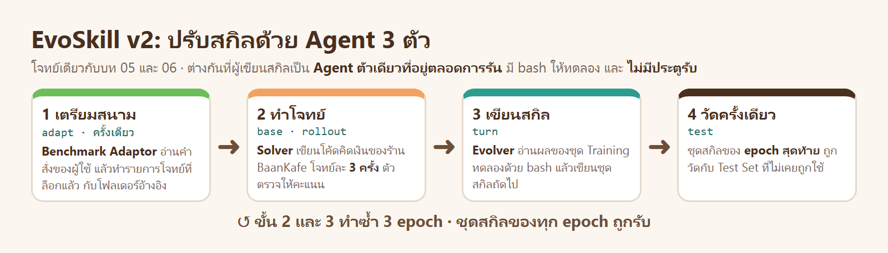

| ขั้น | เกิดอะไรขึ้น |
|---|---|
| 1 เตรียมสนาม | **Benchmark Adaptor** อ่านคำสั่งของเรา (ข้อความ 1 หน้า) แล้วทำรายการโจทย์ที่ล็อกแล้ว กับโฟลเดอร์อ้างอิงที่มีเฉพาะของชุด Training |
| 2 ทำโจทย์ | **Solver** เขียนโค้ดคิดเงินของร้าน BaanKafe (โจทย์ชุดเดียวกับ [บท 05](../05_Skill_Optimizer_Basic/README.md) และ [บท 06](../06_WikiSkill/README.md)) โจทย์ละ 3 ครั้ง |
| 3 เขียนสกิล | **Evolver** อ่านผลของชุด Training ทดลองด้วย bash แล้วเขียนชุดสกิลถัดไป · เป็นเซสชันเดียวตั้งแต่ต้นจนจบ |
| 4 วัดครั้งเดียว | ชุดสกิลของ epoch สุดท้ายถูกวัดกับ Test Set · **ไม่มีประตูรับ** ชุดสกิลของทุก epoch ถูกใช้ |

บท 05 คนเขียนสกิลรุ่นแรกแล้วสั่งปรับทีละรอบ · บท 06 AI 2 บทบาทจดสมุดความรู้แล้วเขียนสกิล · บทนี้ **AI ตัวเดียวที่จำทุกอย่างได้และรันโค้ดได้** เป็นผู้เขียนสกิล และมันเห็นจากตัวตรวจแค่ **คะแนน** · ผลจริงเทียบกัน:

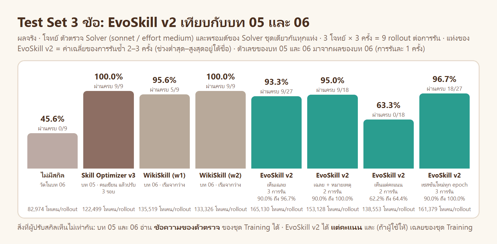

## อ่านตามลำดับนี้

| ส่วน | ตอบคำถาม |
|---|---|
| [1 · โจทย์](#1--โจทย์) | โจทย์เดิมคืออะไร บทนี้เปลี่ยนอะไร |
| [2 · EvoSkill v2 ฉบับย่อ](#2--evoskill-v2-ฉบับย่อ) | แนวคิดหลักใน 5 ภาพ |
| [ทฤษฎี (ละเอียด 16 ขั้น)](01_theory/README.md) | แนวคิด · **วิธีคิดในการออกแบบ 10 ข้อ** · อัลกอริทึม · ผลในเปเปอร์ · ภาพต้นฉบับจากเปเปอร์ |
| [ข้างใน EvoSkill v2](02_inside_evoskill/README.md) | `evoskill.py` และ prompt ทำงานอย่างไร เชื่อมกับทฤษฎีข้อใด |
| [3 · ลงมือทำ](#3--ลงมือทำ-copy--paste) | พรอมต์ Copy & Paste 8 ขั้น พร้อมผลจริง |
| [4 · เทียบกับบท 05 และ 06](#4--เทียบกับบท-05-และ-06) | วิธีไหนได้อะไร เสียอะไร |
| [5 · สรุปและแบบฝึกหัด](#5--สรุปและแบบฝึกหัด) | บทเรียนจากผลจริง ข้อจำกัด และโจทย์ให้ลองต่อ |

| | |
|---|---|
| เปเปอร์ต้นทาง | Huang, Nama, Alzubi, *EvoSkill v2: Fully Agentic Skill Evolution from Benchmark Adaptation to a Stateful Evolver*, [arXiv:2610.25931](https://arxiv.org/abs/2610.25931) |
| Source code ของเปเปอร์ | [github.com/sentient-agi/EvoSkill](https://github.com/sentient-agi/EvoSkill/tree/v2) (branch `v2`) · โค้ดของบทนี้เขียนใหม่ให้อ่านจบได้ในไฟล์เดียว ([เทียบกันที่นี่](02_inside_evoskill/README.md#8--ต่างจาก-source-code-ต้นฉบับตรงไหน)) |
| ผลจริง | ตัวเลขทุกตัวมาจากการรันจริงเมื่อ 13 พ.ย. 2026 · ผลดิบอยู่ใน [`runs/`](runs/) และ [`results/`](results/) |

---

# 1 · โจทย์

## 1.1 โจทย์เดิมของบท 05 และ 06

| หัวข้อ | คืออะไร |
|---|---|
| สถานการณ์ | ร้าน BaanKafe ให้ AI เขียนฟังก์ชันคิดเงิน เช่น `cashback(amount, tier, birthday)` |
| กฎ 2 ชั้น | **กฎเฉพาะของงาน** อยู่ในโจทย์ AI เห็น · **กฎกลางของร้าน 5 ข้อ** ไม่อยู่ในโจทย์ AI ไม่เห็นถ้าสกิลไม่บอก |
| กฎกลาง 5 ข้อ | เงินเป็นจำนวนเต็มสตางค์ · ปัดครึ่งขึ้นครั้งเดียว · ข้อมูลผิดต้อง `ValueError` · รันเป็นโปรแกรมรับส่ง JSON · มีเทสต์อย่างน้อย 6 ข้อ |
| ตัวตรวจ | ตรวจ 10 ข้อ · คะแนนของ 1 งาน = ข้อที่ผ่าน ÷ 10 · **ผ่าน** = ครบ 10 ข้อ |
| ชุดโจทย์ | Training 4 ข้อ · Validation 2 ข้อ · Test 3 ข้อ (ชุดเดียวกับบท 06) |
| สิ่งเดียวที่ปรับได้ | สกิล |

รายละเอียดของกฎและตัวตรวจ: [บท 05 ส่วนที่ 1](../05_Skill_Optimizer_Basic/README.md#1--โจทย์และกฎของร้าน) · Test Set: [บท 06 ข้อ 1.3](../06_WikiSkill/README.md#13-test-set-3-ข้อใหม่)

## 1.2 สิ่งที่บทนี้เปลี่ยน

| | บท 05 · Skill Optimizer | บท 06 · WikiSkill | บทนี้ · EvoSkill v2 |
|---|---|---|---|
| สกิลรุ่นแรก | คนเขียน | ว่าง | ว่าง |
| ผู้ปรับสกิล | Claude ตามพรอมต์ของเรา | AI 2 บทบาท เรียกใหม่ทุกรอบ | AI ตัวเดียว เซสชันเดียวตลอดการรัน มี bash |
| ที่เก็บสิ่งที่เรียนรู้ | `ISSUES.md` | `wiki/` | ความจำของเซสชัน + โฟลเดอร์ส่วนตัวของ Evolver |
| ผู้ปรับสกิลเห็นอะไรจากตัวตรวจ | ข้อตรวจที่ไม่ผ่าน พร้อมข้อความ | ข้อตรวจที่ไม่ผ่าน พร้อมข้อความ | **คะแนน 0 ถึง 1 อย่างเดียว** |
| ผู้ปรับสกิลเห็นเฉลยหรือไม่ | ไม่ | ไม่ | เห็นเฉลยของ Training ถ้าคำสั่งของเราอนุญาต |
| เมื่อไรสกิลใหม่ถูกใช้ | ผ่านประตูรับที่คิดความแกว่ง | Validation สูงกว่าเดิม | **ทุกครั้ง** |

โจทย์ ตัวตรวจ (การตรวจ 10 ข้อเดิม) พรอมต์ของ Solver โมเดลของ Solver (sonnet / effort medium) และจำนวนครั้งต่อโจทย์ (3) **เหมือนสองบทก่อนทุกค่า** ผลจึงเทียบกันได้

## 1.3 สิ่งที่เราต้องเตรียมในฐานะ "ผู้ใช้"

EvoSkill v2 ไม่มีพรอมต์ให้เราแก้ระหว่างทาง · สิ่งที่เราควบคุมคือของ 3 อย่างที่ส่งให้ก่อนเริ่ม ([`bench/`](bench/))

| สิ่งที่ส่ง | ไฟล์ | เนื้อหา |
|---|---|---|
| คำสั่ง | [`instruction.md`](bench/instruction.md) | benchmark และข้อมูลอยู่ที่ไหน · Solver ได้อะไร · ตัวตรวจคืออะไร · **Evolver เห็นอะไรได้** · ขนาดของการรัน `3 epochs · 3 samples per task` |
| ข้อมูล | [`data/baankafe/`](bench/data/baankafe/) | `tasks/` โจทย์ 9 ข้อ · `answers/` เฉลยอ้างอิงของทุกข้อ · การแบ่งชุดอยู่ใน [`split.json`](bench/split.json) |
| ตัวตรวจ | [`benchmark_grader.py`](bench/benchmark_grader.py) | `grade(task, snapshot)` คืนคะแนน 0 ถึง 1 |

---

# 2 · EvoSkill v2 ฉบับย่อ

ส่วนนี้ให้เห็นภาพรวมก่อนลงมือ · คำอธิบายเต็มพร้อมเหตุผลของการออกแบบทุกจุดอยู่ใน [ทฤษฎี](01_theory/README.md)

## 2.1 ข้อสังเกตตั้งต้น


Agent ที่ไม่มีสกิล เมื่อพลาดโจทย์ มักพลาดโจทย์นั้นอีก = ขาดคำแนะนำ ไม่ใช่ขาดความสามารถ · คำแนะนำเป็นสิ่งที่ Agent อีกตัวเขียนให้ได้

## 2.2 Agent 3 ตัว


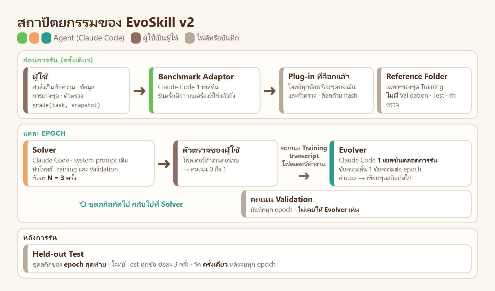

## 2.3 ใครเห็นอะไร

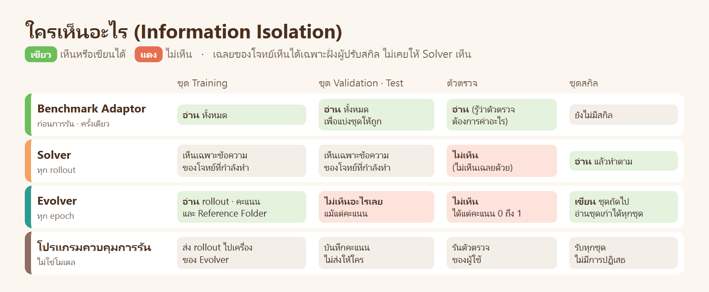

## 2.4 อัลกอริทึม

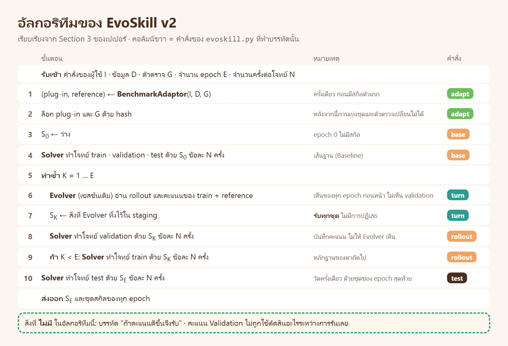

## 2.5 การตัดสินใจออกแบบ 4 ข้อ

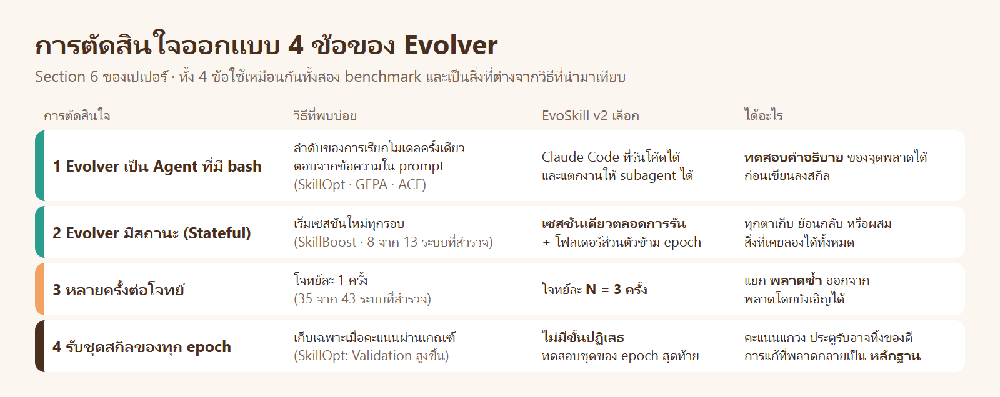

เหตุผลของแต่ละข้อ พร้อมหลักฐานจากเปเปอร์และจากการรันของเรา: [ทฤษฎี ขั้น 11](01_theory/README.md#ขั้น-11--วิธีคิดในการออกแบบ)

---

# 3 · ลงมือทำ (Copy & Paste)

**วิธีใช้:** เปิดโฟลเดอร์ `Teaching` ใน Claude Code Desktop → คัดลอกพรอมต์ → วาง → รอผล
ต้องมี container `multi-account` และบัญชี `yolo` ที่ล็อกอินแล้วอย่างน้อย 1 บัญชี

กติกาที่ Claude ต้องทำตามอยู่ใน [`AGENT.md`](AGENT.md) พรอมต์จึงสั้น · Claude ในที่นี้เป็นเพียงผู้กดรันคำสั่ง ผู้ปรับสกิลคือ Evolver ของ `evoskill.py`

| LAB | ทำอะไร | การรัน | rollout | เวลาจริง |
|---|---|---|---|---|
| [0](#lab-0--เตรียม) | ส่งไฟล์เข้า container ตรวจตัวตรวจ | – | – | 1 นาที |
| [1](#lab-1--benchmark-adaptor-เตรียมสนาม) | Benchmark Adaptor เตรียมสนาม | `e1` | – | 1 นาที |
| [2](#lab-2--รัน-1-การรันจนจบ) | รัน 1 การรันจนจบ ดู Evolver ทำงานทีละตา | `e1` | 78 | 9 นาที |
| [3](#lab-3--ผู้ใช้บอก-evolver-เพิ่ม-1-ประโยค) | ผู้ใช้บอก Evolver เพิ่ม 1 ประโยค | `n1` | 78 | 10 นาที |
| [4](#lab-4--evolver-เห็นแต่คะแนน) | Evolver เห็นแต่คะแนน | `p1` | 78 | 9 นาที |
| [5](#lab-5--ตัดความจำของ-evolver-ออก) | ตัดความจำของ Evolver ออก | `f1` | 78 | 8 นาที |
| [6](#lab-6--โมเดลเล็กปรับสกิลของตัวเอง) | โมเดลเล็กปรับสกิลของตัวเอง | `h1` | 78 | 11 นาที |
| [7](#lab-7--ความแกว่ง-และประตูรับที่เราไม่ได้ใช้) | ความแกว่ง และประตูรับที่เราไม่ได้ใช้ | – | 0 | 1 นาที |

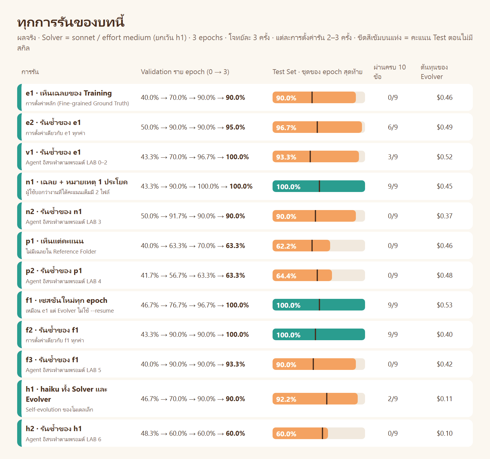

## LAB 0 · เตรียม

```text
อ่าน ./03_week03/07_EvoSkill_v2/AGENT.md แล้วทำตาม
เตรียม LAB: ส่งไฟล์เข้า container · ตรวจ Grader ด้วย bench/check_grader.py · ตรวจว่าบัญชี yolo ใดล็อกอินแล้ว
ยังไม่ต้องสร้างการรันหรือรัน rollout · ตอบเป็นตาราง รายการ | ผล
```

ผลจริง

| รายการ | ผล |
|---|---|
| ส่งไฟล์เข้า container | ✅ `evoskill` `bench` `skill-optimizer` `baselines/so-v3` `baselines/wiki-w2` อยู่ใน `/workspace/evlab` |
| Grader กับเฉลยอ้างอิง | ✅ ผ่าน 10/10 ทั้ง 9 โจทย์ |
| Grader กับเฉลยที่จงใจใส่ความผิด 1 จุด | ✅ ไม่ผ่านเฉพาะข้อนั้น (`half_up` · `reject_type` · `cli_error`) |
| บัญชี | ✅ `yolo1` `yolo2` `yolo3` |

👀 EvoSkill v2 ให้ผู้ใช้เป็นผู้ให้ตัวตรวจ และผู้ปรับสกิลที่เก่งหาช่องโหว่ของตัวตรวจเจอได้ ([ทฤษฎี ขั้น 8](01_theory/README.md#ขั้น-8--การกันข้อมูล-และช่องโหว่ของตัวตรวจ)) จึงต้องตรวจตัวตรวจก่อนเสมอ

## LAB 1 · Benchmark Adaptor เตรียมสนาม


```text
อ่าน ./03_week03/07_EvoSkill_v2/AGENT.md แล้วทำตาม
สร้างการรันชื่อ e1 แล้วรันขั้น adapt อย่างเดียว
จากนั้นเปิด setup/benchmark_plugin.py · setup/freeze.json · setup/audit.md และดูรายการไฟล์ใน reference/
ตอบ: ตาราง รายการ | ผล (เวลาและเครื่องมือของ Benchmark Adaptor · จำนวนโจทย์แต่ละชุด · ไฟล์ใน reference · ผลตรวจการรั่ว) · สิ่งที่ Adaptor ทำเองโดยไม่ได้สั่ง (เทียบ turns/adaptor/message.md กับ turns/adaptor/actions.md)
```

ผลจริง ([`runs/e1/setup/`](runs/e1/setup/) · [`runs/e1/reference/`](runs/e1/reference/))

| รายการ | ผล |
|---|---|
| Benchmark Adaptor | 17 วินาที · เครื่องมือ 3 ครั้ง · $0.11 |
| [`benchmark_plugin.py`](runs/e1/setup/benchmark_plugin.py) | `list_tasks(root)` คืนโจทย์ 9 ข้อ = train 4 · validation 2 · test 3 |
| [`freeze.json`](runs/e1/setup/freeze.json) | sha256 ของ plug-in · ตัวตรวจ · รายการโจทย์ |
| `reference/` | 13 ไฟล์: โจทย์ของ Training 4 · เฉลยอ้างอิงของ Training 8 · `split.json` 1 |
| [`audit.md`](runs/e1/setup/audit.md) | ของ Validation หรือ Test: ไม่พบ · โค้ดของตัวตรวจ: ไม่พบ |
| สิ่งที่ Adaptor ทำเอง | เขียน `split.json` ใหม่ให้เหลือเฉพาะชื่อโจทย์ของ Training เพราะไฟล์เดิมมีชื่อโจทย์ของ Validation และ Test |

👀 หลังขั้นนี้ การแบ่งชุดและตัวตรวจถูกล็อก · Agent ที่จะเขียนสกิลยังไม่ได้เริ่มทำงานเลย จึงไม่มีทางแก้การวัดให้ตัวเองได้เปรียบ

## LAB 2 · รัน 1 การรันจนจบ

```text
อ่าน ./03_week03/07_EvoSkill_v2/AGENT.md แล้วทำตาม
รันการรัน e1 ต่อทีละขั้น: base → turn → rollout (epoch 1) หลังแต่ละขั้นบอกว่าไฟล์ใดเกิดขึ้น
หลังขั้น turn ให้เปิด turns/turn_1/actions.md และ skills_v1/ แล้วสรุปว่า Evolver ทำอะไร และเขียนสกิลอะไร
จากนั้นรัน run ต่อจนจบ เก็บผลลงเครื่อง และบันทึก status กับ noise ลง results/
ตอบ: ตาราง ขั้น | ไฟล์ที่เกิด | สรุป 1 บรรทัด · สรุป 3 ตาของ Evolver จาก turns/turn_1 ถึง turn_3/actions.md (ทำอะไร · ข้อสรุป · คะแนน Validation หลังจากนั้น) · ตาราง status · คะแนน Test Set
```

ผลจริง ([`runs/e1/`](runs/e1/) · [status](results/status-e1.txt))

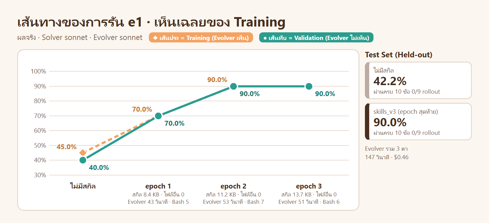

| epoch | ชุดสกิล | Training | Validation | ตาของ Evolver |
|---|---|---|---|---|
| 0 | (ไม่มี) | 45.0% | 40.0% | – |
| 1 | [`baankafe-money-function`](runs/e1/skills_v1/baankafe-money-function/SKILL.md) 8.4 KB | 70.0% | 70.0% | 43 วินาที · Bash 5 ครั้ง · $0.16 |
| 2 | แก้สกิลเดิม 11.2 KB | 90.0% | 90.0% | 53 วินาที · Bash 7 ครั้ง · $0.15 |
| 3 | แก้สกิลเดิม 13.7 KB | – | 90.0% | 51 วินาที · Bash 6 ครั้ง · $0.15 |

| Test Set | คะแนน | ผ่านครบ 10 ข้อ |
|---|---|---|
| ไม่มีสกิล | 42.2% | 0/9 |
| `skills_v3` | **90.0%** | 0/9 |

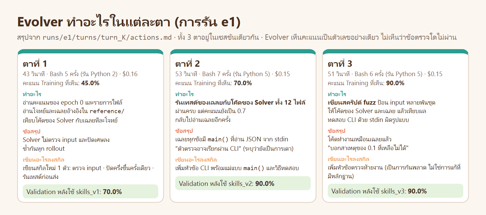

| ตา | สิ่งที่ Evolver ทำด้วย bash | เปิดดูได้ที่ |
|---|---|---|
| 1 | เทียบโค้ดของ Solver กับเฉลยอ้างอิงใน `reference/` | [`turn_1/actions.md`](runs/e1/turns/turn_1/actions.md) |
| 2 | รันเทสต์ของเฉลยกับโค้ดของ Solver 12 ไฟล์ เพื่อทดสอบสมมติฐานก่อนเขียน | [`turn_2/actions.md`](runs/e1/turns/turn_2/actions.md) |
| 3 | เขียนสคริปต์ fuzz เทียบกับเฉลย แล้วยอมรับว่า "บอกสาเหตุของ 0.1 ที่เหลือไม่ได้" | [`turn_3/actions.md`](runs/e1/turns/turn_3/actions.md) |

👀 Evolver ค้นพบกฎกลาง 4 จาก 5 ข้อเองใน 2 ตา (ตรวจ input · ปัดครึ่งขึ้น · จำนวนเต็ม · CLI) โดยเห็นแค่คะแนนกับเฉลยของ Training · ข้อที่เหลือคือ "ต้องส่งเทสต์อย่างน้อย 6 ข้อ" ซึ่งเป็นกฎที่อยู่ในตัวตรวจ: โค้ดของ Solver ทำงานเหมือนเฉลยแล้ว จึงไม่มีหลักฐานชี้ไปที่ไฟล์เทสต์ ([ทฤษฎี ขั้น 9.3](01_theory/README.md#93-ทำไมติดที่-90))

**รันซ้ำด้วยการตั้งค่าเดิม (`e2`):** Validation 50.0% → 90.0% → 90.0% → 95.0% · Test **96.7%** (ผ่านครบ 6/9) ([status](results/status-e2.txt)) = การตั้งค่าเดียวกัน ได้ผลใกล้กันแต่ไม่เท่ากัน

**รันซ้ำโดย Agent อิสระ (`v1`):** พรอมต์ LAB 0–2 ถูกรันตามตัวอักษรอีกครั้งโดย Agent ที่ไม่รู้จักบทนี้ (การรัน [`v1`](runs/v1/) · [status](results/status-v1.txt)) ไม่มีคำสั่งใดล้ม · ครั้งนั้น Validation 43.3% → 70.0% → 96.7% → 100.0% และ Test 93.3% (ผ่านครบ 3/9) · จุดที่ Agent ตัวนั้นบอกว่ากำกวมถูกนำไปแก้ใน `AGENT.md` แล้ว

## LAB 3 · ผู้ใช้บอก Evolver เพิ่ม 1 ประโยค

`e1` ติดที่ 90% เพราะ Evolver ไม่รู้ว่าไฟล์เทสต์เป็นส่วนของงานที่ต้องส่ง · ใน EvoSkill v2 เราไม่แก้ prompt ของ Evolver และไม่เปิดตัวตรวจให้ดู · ช่องทางเดียวคือ **คำสั่งของผู้ใช้** ซึ่งกำหนดว่า Reference Folder มีอะไร

[`instruction_with_note.md`](bench/instruction_with_note.md) ต่างจาก `instruction.md` ที่ย่อหน้าเดียว:

```text
ให้เขียนไฟล์ `README.md` ไว้ที่ชั้นบนสุดของโฟลเดอร์ reference ด้วย มีข้อความนี้ข้อความเดียว:
"โฟลเดอร์ `answers/<task id>/` คือผลงานของโจทย์นั้นที่ได้คะแนนเต็ม ประกอบด้วย 2 ไฟล์ คือ `solve.py` และ `test_solve.py`"
```

```text
อ่าน ./03_week03/07_EvoSkill_v2/AGENT.md แล้วทำตาม
สร้างการรันชื่อ n1 เหมือน e1 แต่ใช้ --instruction bench/instruction_with_note.md แล้วรัน run จนจบ เก็บผลลงเครื่อง
ตอบ: เนื้อหาของ reference/README.md · ตาราง status ของ n1 เทียบ e1 · สรุป 3 ตาของ Evolver (ทำอะไร · ข้อสรุป · คะแนน Validation หลังจากนั้น)
```

ผลจริง ([`runs/n1/`](runs/n1/) · [status](results/status-n1.txt))

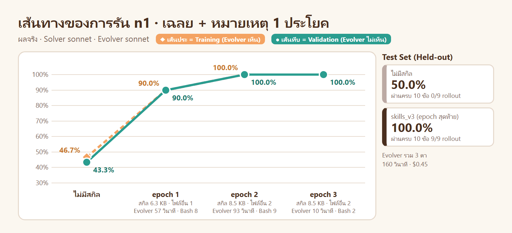

| ตา | Evolver ทำอะไร | Validation หลังจากนั้น |
|---|---|---|
| 1 | เขียนสกิลพร้อมแม่แบบ `solve.py` ที่มี CLI ตั้งแต่ตาแรก และให้ Solver ส่ง `test_solve.py` ด้วย | 43.3% → 90.0% |
| 2 | สุ่ม input 4,000 ชุดต่อโจทย์เทียบกับเฉลย: ตรงกันหมด → หันไปตรวจ **คุณภาพของเทสต์ที่ Solver เขียน** ด้วยการแก้โค้ดให้ผิดทีละจุดแล้วดูว่าเทสต์จับได้หรือไม่ (Mutation Testing) → เพิ่มแม่แบบของไฟล์เทสต์ | 90.0% → **100.0%** |
| 3 | "ไม่มีจุดพลาดเหลือให้แก้" → ไม่แก้อะไร `skills_v3` = `skills_v2` | 100.0% |

| | `e1` | `n1` | `n2` (รันซ้ำโดย Agent อิสระ) |
|---|---|---|---|
| สิ่งที่ต่าง | – | reference มี `README.md` 1 ประโยค | เหมือน `n1` |
| Validation ราย epoch | 40.0 → 70.0 → 90.0 → 90.0 | 43.3 → 90.0 → 100.0 → 100.0 | 50.0 → 91.7 → 90.0 → 90.0 |
| Test Set | 90.0% (0/9) | **100.0% (9/9)** | 90.0% (0/9) |
| สกิลให้ Solver ส่ง `test_solve.py` หรือไม่ | ไม่ได้บังคับ | บังคับตั้งแต่ตาแรก · หลังตาที่ 2 เทสต์ครบตามเกณฑ์ | บังคับตั้งแต่ตาแรก แต่ Solver เขียนเทสต์ 2–5 ข้อ |
| ต้นทุนของ Evolver | $0.46 | $0.45 | $0.37 |

👀 ประโยคที่เพิ่มไม่ได้บอกว่าตัวตรวจตรวจอย่างไร บอกเพียงว่า **งานที่สมบูรณ์มีไฟล์อะไรบ้าง** · ทั้งสองการรัน Evolver อ่านประโยคนี้ตั้งแต่ตาแรก และให้ Solver ส่ง `test_solve.py` ทันที
แต่ผลไม่เท่ากัน: `n1` ไปถึง 100% เพราะตาที่ 2 กำหนดจำนวนเทสต์ขั้นต่ำต่อกลุ่มไว้ในแม่แบบ · `n2` ติดที่ 90.0% เพราะกฎ "อย่างน้อย 6 เทสต์" ยังอยู่ในตัวตรวจ และ Evolver สรุปว่า "หาไม่ได้ว่า 0.1 ที่ขาดมาจากอะไร" ([status](results/status-n2.txt))
บทเรียน: ใน EvoSkill v2 สิ่งที่คนปรับได้คือ "Evolver ได้เห็นอะไร" ไม่ใช่ "Evolver ต้องคิดอย่างไร" · **บอกครึ่งเดียวได้ผลไม่แน่นอน** ถ้ากฎใดอยู่เฉพาะในตัวตรวจและเราต้องการให้สกิลรู้ ต้องบอกกฎนั้นให้ครบใน Reference Folder

## LAB 4 · Evolver เห็นแต่คะแนน

การตั้งค่าที่สองของเปเปอร์ (Pass or Fail Only): Reference Folder ไม่มีเฉลยของชุดใดเลย

```text
อ่าน ./03_week03/07_EvoSkill_v2/AGENT.md แล้วทำตาม
สร้างการรันชื่อ p1 เหมือน e1 แต่ใช้ --instruction bench/instruction_score_only.md แล้วรัน run จนจบ เก็บผลลงเครื่อง
ตอบ: รายการไฟล์ใน reference/ · ตาราง status ของ p1 เทียบ e1 · สรุป 3 ตาของ Evolver · เนื้อหาของ evo/evolver_workspace/
```

ผลจริง ([`runs/p1/`](runs/p1/) · [status](results/status-p1.txt))

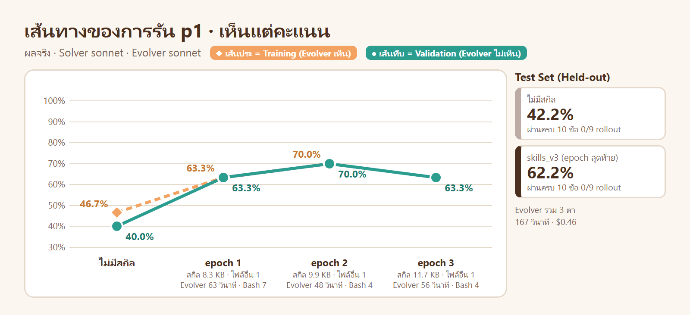

| ตา | Evolver ทำอะไร (ไม่มีเฉลยให้เทียบ) | Validation หลังจากนั้น |
|---|---|---|
| 1 | เทียบ rollout 3 ครั้งของโจทย์เดียวกัน: ครั้งที่ตรวจ input ได้ 0.6 ครั้งที่ไม่ตรวจได้ 0.5 → ตั้งสมมติฐานว่าตัวตรวจลองค่านอกช่วง | 40.0% → 63.3% |
| 2 | เทียบคะแนนกับ epoch ก่อน: ครั้งที่รับ `5.0` ได้ต่ำกว่า 0.1 → ให้รับเฉพาะ `int` จริง · ไม่รู้ว่าตัวตรวจต้องการ error ชนิดใด จึงสร้าง error ที่เป็นทั้ง `ValueError` และ `TypeError` | 63.3% → 70.0% |
| 3 | ทุก rollout ได้ 0.7 เท่ากันหมด ไม่มีความต่างให้เทียบ → **สร้างความต่างเอง**: ให้ Solver เลือกวิธีปัดเศษตามหมายเลขของ rollout (`-r1` `-r2` `-r3` จากชื่อโฟลเดอร์) เพื่อเทียบใน epoch ถัดไป | 70.0% → **63.3%** |

บันทึกที่ Evolver เขียนให้ตัวเอง ([`notes.txt`](runs/p1/evo/evolver_workspace/notes.txt)):

```text
epoch3: e2 all 0.7 … plateau; code identical across rollouts. v3 = EXPERIMENT: r1 half-up / r2 half-even /
r3 per-step half-up chosen by pwd -rN. Compare scores per rollout index in epoch3; then KEEP winner and
REMOVE experiment section in v4.
```

| | `e1` (เห็นเฉลย) | `p1` (เห็นแต่คะแนน) |
|---|---|---|
| reference/ | 13 ไฟล์ | 4 ไฟล์ (โจทย์ของ Training) |
| Test Set | 90.0% | **62.2%** |
| กฎกลางที่ค้นพบ | ตรวจ input · ปัดครึ่งขึ้น · CLI | ตรวจ input · ปัดครึ่งขึ้น |

**รันซ้ำโดย Agent อิสระ (`p2`):** Validation 41.7 → 56.7 → 63.3 → 63.3 · Test **64.4% (0/9)** ([status](results/status-p2.txt)) · ครั้งนี้ Evolver ใช้หมายเลขของ rollout ทำการทดลองแบบ A/B/C **ทุกตา** ตั้งแต่ตาแรก (วิธีปัดเศษ → ความเข้มของการตรวจ input → วิธีปัดขั้นสุดท้าย) เก็บวิธีที่ชนะไว้ทีละเรื่อง และชุดสุดท้ายก็ยังมีการทดลองค้างอยู่เช่นเดียวกับ `p1` ([`notes.md`](runs/p2/evo/evolver_workspace/notes.md))

👀 สามเรื่องที่เห็นจากการรันนี้
- **โจทย์ละ 3 ครั้งคือเครื่องมือของ Evolver:** เมื่อไม่มีเฉลย ความต่างระหว่างครั้งคือสัญญาณเดียวที่มี และเมื่อไม่มีความต่าง มันก็สร้างเอง
- **รับทุก epoch มีราคา:** ตาที่ 3 เป็นการทดลองที่ Evolver รู้ว่าเสี่ยง และแผนคือ "epoch 4 จะเก็บวิธีที่ชนะ" แต่การรันมี 3 epoch · ชุดทดลองจึงถูกนำไปวัด Test
- **Evolver ไม่รู้ว่าตาใดเป็นตาสุดท้าย** เพราะ prompt ไม่ได้บอกจำนวน epoch ([แบบฝึกหัดข้อ 3](#52-แบบฝึกหัด))

## LAB 5 · ตัดความจำของ Evolver ออก


เปเปอร์ให้เหตุผลว่าเซสชันเดียวดีกว่าการเริ่มใหม่ทุกรอบ · ลองกับโจทย์ของเรา: เหมือน `e1` ทุกค่า แต่ Evolver เริ่มเซสชันใหม่ทุก epoch (ไฟล์ทุกอย่างยังอยู่ หายเฉพาะความจำในเซสชัน)

```text
อ่าน ./03_week03/07_EvoSkill_v2/AGENT.md แล้วทำตาม
สร้างการรันชื่อ f1 เหมือน e1 แต่เพิ่ม --fresh-session แล้วรัน run จนจบ เก็บผลลงเครื่อง
ตอบ: ตาราง status ของ f1 เทียบ e1 · สรุป 3 ตาของ Evolver (จากข้อความ "Agent พูด" ช่วงท้ายของ turns/turn_K/actions.md) · ไฟล์ใน evo/evolver_workspace/ · ผลของ noise ws/f1
```

ผลจริง ([`runs/f1/`](runs/f1/) · [status](results/status-f1.txt))

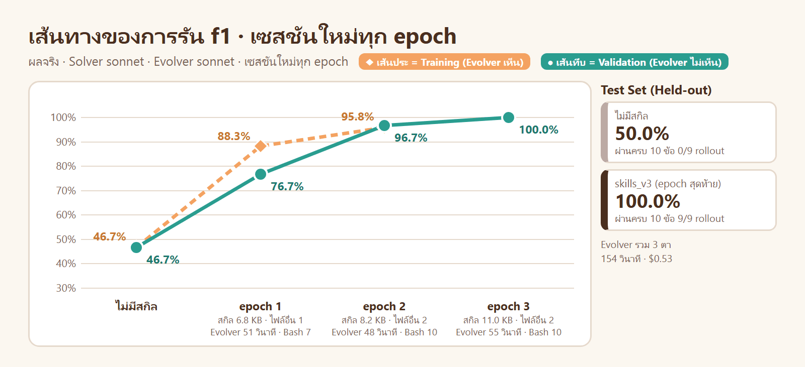

| ตา (เซสชันใหม่ทุกครั้ง) | Evolver ทำอะไร | Validation หลังจากนั้น |
|---|---|---|
| 1 | เขียนสกิลพร้อม `template.py` ที่มี CLI ตั้งแต่ตาแรก | 46.7% → 76.7% |
| 2 | สังเกตว่า "โฟลเดอร์ทำงานของ Solver มีแต่ `solve.py` ส่วนเฉลยมีทั้ง `solve.py` และ `test_solve.py`" → เพิ่มแม่แบบของไฟล์เทสต์ · จดโน้ตไว้ให้ตาถัดไปเอง | 76.7% → 96.7% |
| 3 | อ่านโน้ตของตาก่อน · เทียบ rollout ที่ได้ 1.0 กับ 0.9 → เพิ่มเช็กลิสต์คุณภาพของเทสต์ | 96.7% → **100.0%** |

| การตั้งค่า | การรัน | Validation ราย epoch | Test Set |
|---|---|---|---|
| เซสชันเดียว | `e1` | 40.0 → 70.0 → 90.0 → 90.0 | 90.0% (0/9) |
| เซสชันเดียว | `e2` | 50.0 → 90.0 → 90.0 → 95.0 | 96.7% (6/9) |
| เซสชันเดียว | `v1` (Agent อิสระ) | 43.3 → 70.0 → 96.7 → 100.0 | 93.3% (3/9) |
| เซสชันใหม่ทุก epoch | `f1` | 46.7 → 76.7 → 96.7 → 100.0 | **100.0% (9/9)** |
| เซสชันใหม่ทุก epoch | `f2` | 43.3 → 90.0 → 90.0 → 100.0 | **100.0% (9/9)** |
| เซสชันใหม่ทุก epoch | `f3` (Agent อิสระ) | 40.0 → 90.0 → 90.0 → 93.3 | 90.0% (0/9) |

👀 ผลของเรา **ไม่พบว่าเซสชันเดียวดีกว่า** ในโจทย์นี้: เซสชันใหม่ทุก epoch ได้ Test 100.0% · 100.0% · 90.0% · เซสชันเดียวได้ 90.0% · 96.7% · 93.3% (เฉลี่ย 96.7% เทียบ 93.3% จากอย่างละ 3 การรัน) · ผลของการตั้งค่าเดียวกันต่างกันเองถึง 10 จุด มากกว่าผลต่างระหว่างสองการตั้งค่า จึง **สรุปไม่ได้ว่าแบบใดดีกว่า**
สิ่งที่อ่านได้จาก `actions.md`: การรันที่ไปถึง 100% (`f1` `f2`) คือการรันที่ Evolver ตาใดตาหนึ่งสังเกตว่า "เฉลยมี 2 ไฟล์ แต่โฟลเดอร์ทำงานของ Solver มีไฟล์เดียว" แล้วให้ Solver ส่งไฟล์เทสต์แยกเป็นหมวด · การรันที่ติดที่ 90% (`e1` `f3`) ตั้งสมมติฐานนี้ไม่ได้ หรือตั้งได้ในตาสุดท้ายโดยไม่มีตาถัดไปให้ปรับ · สิ่งที่ชี้ขาดในโจทย์นี้จึงเป็น "มีตาใดตั้งสมมติฐานถูกหรือไม่" มากกว่าการมีหรือไม่มีความจำของเซสชัน
ข้อควรระวัง: งานนี้เล็ก (ตาละไม่ถึง 2 นาที ไม่มีการย่อบริบท ไม่มีสคริปต์ให้ใช้ซ้ำ) ประโยชน์ที่เปเปอร์วัดได้มาจากงานที่ Evolver ต้องสะสมเครื่องมือและการวิเคราะห์ข้ามตา

## LAB 6 · โมเดลเล็กปรับสกิลของตัวเอง

เปเปอร์รายงานว่า Haiku 5.5 เป็นทั้ง Solver และ Evolver แล้วยังปรับสกิลของตัวเองได้ (+21.5 จุดบน τ³-bench)

```text
อ่าน ./03_week03/07_EvoSkill_v2/AGENT.md แล้วทำตาม
สร้างการรันชื่อ h1 เหมือน e1 แต่เพิ่ม --solver-model haiku --evolver-model haiku แล้วรัน run จนจบ เก็บผลลงเครื่อง
ตอบ: ตาราง status ของ h1 เทียบ e1 · ชื่อและ description ของสกิลใน skills_v3 · ไฟล์ใน evo/evolver_workspace/ · ต้นทุนรวมของ Evolver 3 ตา
```

ผลจริง ([`runs/h1/`](runs/h1/) · [status](results/status-h1.txt))

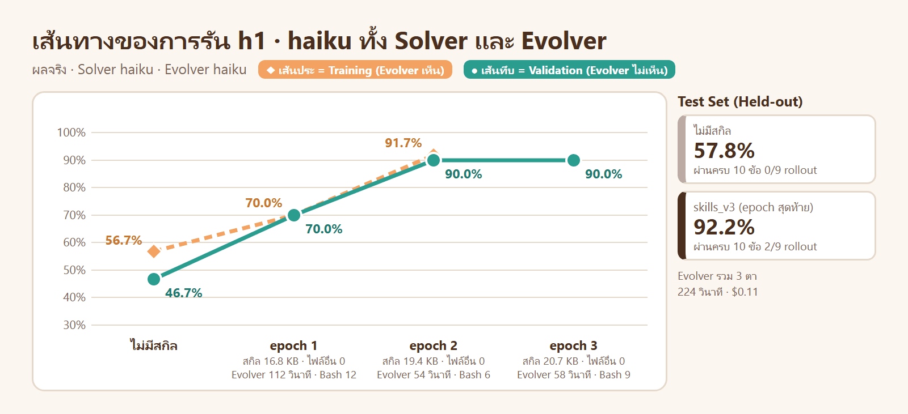

| epoch | ชุดสกิล | Training | Validation | ตาของ Evolver (haiku) |
|---|---|---|---|---|
| 0 | (ไม่มี) | 56.7% | 46.7% | – |
| 1 | สกิล 4 ตัว 16.8 KB | 70.0% | 70.0% | 112 วินาที · เครื่องมือ 18 ครั้ง · รันสคริปต์เดิมซ้ำ 0 ครั้ง · $0.03 |
| 2 | แก้ 2 ไฟล์ 19.4 KB | 91.7% | 90.0% | 54 วินาที · เครื่องมือ 11 ครั้ง · รันสคริปต์เดิมซ้ำ 1 ครั้ง · $0.02 |
| 3 | แก้ 1 ไฟล์ 20.7 KB | – | 90.0% | 58 วินาที · เครื่องมือ 10 ครั้ง · รันสคริปต์เดิมซ้ำ 7 ครั้ง · $0.07 |

| | sonnet ทั้งคู่ (`e1`) | haiku ทั้งคู่ (`h1`) |
|---|---|---|
| Test Set: ไม่มีสกิล → ชุดสุดท้าย | 42.2% → 90.0% (0/9) | 57.8% → **92.2% (2/9)** |
| จำนวนสกิล · ขนาด | 1 ตัว · 13.7 KB | 4 ตัว · 20.7 KB |
| ไฟล์ในโฟลเดอร์ส่วนตัวของ Evolver | 0 | 9 (บันทึก + สคริปต์วิเคราะห์) |
| คำสั่งที่รันสคริปต์ของตาก่อนซ้ำ | 0 | 8 |
| ต้นทุนของ Evolver 3 ตา | $0.46 | $0.11 |
| ต้นทุนของ Solver 78 rollout | $8.65 | $0.71 |

**รันซ้ำโดย Agent อิสระ (`h2`):** Validation 48.3 → 60.0 → 60.0 → 60.0 · Test 53.3% → **60.0% (0/9)** · สกิล 1 ตัว · ต้นทุนของ Evolver $0.10 ([status](results/status-h2.txt)) · ครั้งนี้ Evolver (haiku) **เลือกไม่เปิดเฉลยใน `reference/`** โดยให้เหตุผลว่าเป็นการรั่วของคำตอบของ Training และบอก Solver ให้รับตัวเลขทุกชนิด คะแนนของ Training จึงค้างที่ 0.6 ทุก rollout

👀 haiku ปรับสกิลของตัวเองได้ในการรัน `h1` (Test 57.8% → 92.2% ด้วยต้นทุนของ Evolver $0.11 ราว 1 ใน 4 ของ sonnet) แต่แทบไม่ได้ใน `h2` (53.3% → 60.0%) · ความต่างอยู่ที่ **การตัดสินใจว่าจะใช้ข้อมูลใด**: prompt ของ Evolver ไม่ได้บอกว่าเฉลยของ Training ใช้ได้ `h2` จึงตีความเองว่าไม่ควรใช้ · วิธีทำงานของ haiku ใน `h1` ต่างจาก sonnet: แยกเป็นสกิล 4 ตัว และเก็บสคริปต์วิเคราะห์ไว้ในโฟลเดอร์ส่วนตัวแล้ว **รันซ้ำในตาถัดไป** 8 ครั้ง ซึ่งเป็นพฤติกรรมที่เปเปอร์รายงานในการรันขนาดใหญ่ · บท 06 ให้ haiku ปรับสกิลด้วย WikiSkill ได้ Test 88.9%

## LAB 7 · ความแกว่ง และประตูรับที่เราไม่ได้ใช้


LAB นี้ไม่ใช้โทเคน: นำผลที่มีอยู่มาตอบว่า "ถ้าเราใช้ประตูรับแบบวัดโจทย์ละ 1 ครั้ง จะเกิดอะไรขึ้น"

```text
อ่าน ./03_week03/07_EvoSkill_v2/AGENT.md แล้วทำตาม
รัน noise ของการรัน e1 e2 p1 f1 แล้วบันทึกลง results/noise-<ชื่อ>.txt (ไม่ต้องรัน rollout ใหม่)
ตอบ: (1) leg ใดบ้างที่มีโจทย์ผ่านบางครั้ง หรือคะแนนต่างกันระหว่างครั้ง (2) การเทียบใดที่ช่อง "รับ" ไม่ใช่ 0/9 หรือ 9/9 และถ้าใช้ประตูรับนั้นจะเสียอะไร (ดูคะแนน Test ของการรันนั้นใน results/status-<ชื่อ>.txt)
```

ผลจริง ([noise-f1](results/noise-f1.txt) · [noise-p1](results/noise-p1.txt) · [noise-p2](results/noise-p2.txt) · [noise-e2](results/noise-e2.txt))

**1) Solver ทำโจทย์เดิมซ้ำ ผลไม่เท่ากัน** (สกิลและโจทย์เดียวกัน)

| การรัน · leg | โจทย์ | คะแนน 3 ครั้ง |
|---|---|---|
| `p1` · ไม่มีสกิล | `split_bill` | 0.5 · 0.6 · 0.4 |
| `p1` · ไม่มีสกิล | `bulk_price` | 0.5 · 0.5 · 0.0 |
| `f1` · `skills_v2` | `shipping_fee` | 1.0 · 0.9 · 0.9 |
| `e2` · `skills_v2` | `split_bill` | 0.9 · 0.9 · 1.0 |

**2) ประตูรับแบบ "วัดโจทย์ละ 1 ครั้ง รับเมื่อสูงกว่าเดิม"** (จับคู่ครั้งที่ i ของชุดเดิม กับครั้งที่ j ของชุดใหม่ = 9 คู่)

| การรัน | เทียบบน Validation | ค่าเฉลี่ย 3 ครั้ง | รับ | เสมอ (ไม่รับ) | ต่ำกว่า (ไม่รับ) |
|---|---|---|---|---|---|
| `f1` | v1 → v2 | 76.7% → 96.7% | 9/9 | 0/9 | 0/9 |
| `f1` | v2 → v3 | 96.7% → 100.0% | **6/9** | 3/9 | 0/9 |
| `f3` | v2 → v3 | 90.0% → 93.3% | **6/9** | 3/9 | 0/9 |
| `p2` | ไม่มีสกิล → v1 | 41.7% → 56.7% | **8/9** | 1/9 | 0/9 |
| `p2` | v1 → v2 | 56.7% → 63.3% | **5/9** | 2/9 | 2/9 |
| `p2` | v2 → v3 | 63.3% → 63.3% | **2/9** | 5/9 | 2/9 |
| `v1` | v2 → v3 | 96.7% → 100.0% | **6/9** | 3/9 | 0/9 |
| `p1` | v2 → v3 | 70.0% → 63.3% | 0/9 | 3/9 | 6/9 |

👀 `f1` v2 → v3 คือการแก้ที่ทำให้ Test ถึง 100% · ประตูรับแบบวัดครั้งเดียวจะ **ทิ้งมัน 1 ใน 3 ครั้ง** เพราะสุ่มได้คะแนนเท่ากัน · นี่คือเหตุผลของเปเปอร์ที่ไม่ใช้ประตูรับ ([ทฤษฎี ข้อ 11.4](01_theory/README.md#114-ทำไมรับชุดสกิลของทุก-epoch)) และเป็นเหตุผลเดียวกับที่บท 05 ตั้งเกณฑ์จากความแกว่ง

---

# 4 · เทียบกับบท 05 และ 06


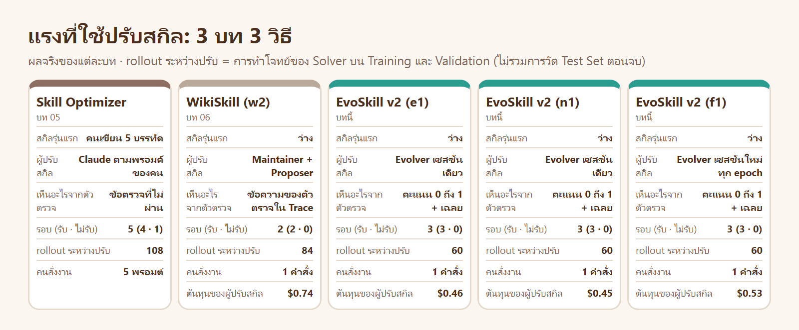

| ประเด็น | Skill Optimizer (บท 05) | WikiSkill (บท 06) | EvoSkill v2 (บทนี้) |
|---|---|---|---|
| คะแนน Test Set | 100.0% (9/9) | `w1` 95.6% (5/9) · `w2` 100.0% (9/9) | เห็นเฉลย: 90.0% 96.7% 93.3% · เฉลย + หมายเหตุ: 100.0% 90.0% · เซสชันใหม่ทุก epoch: 100.0% 100.0% 90.0% · เห็นแต่คะแนน: 62.2% 64.4% |
| กฎของร้านที่รู้ตั้งแต่ต้น | 5 ข้อ (คนเขียน) | 0 ข้อ | 0 ข้อ |
| ผู้ปรับสกิลเห็นอะไรจากตัวตรวจ | ข้อความของข้อที่ไม่ผ่าน | ข้อความของข้อที่ไม่ผ่าน | คะแนนอย่างเดียว |
| ทำอย่างไรกับคะแนนที่แกว่ง | เกณฑ์จาก Standard Error | ไม่ทำ (รับเมื่อสูงกว่า) | ไม่ตัดสินด้วยคะแนนเลย |
| สิ่งที่คนทำ | เขียน `v0` · 5 พรอมต์ · อ่านผลทุกรอบ | 1 คำสั่ง | เขียนคำสั่ง 1 หน้า + ตัวตรวจ · 1 คำสั่ง |
| ความรู้ที่เหลือหลังปรับ | `ISSUES.md` | `wiki/` ที่มีโครงสร้าง | เท่าที่ Evolver จดเอง (`e1` ไม่จด · `p1` 3 บรรทัด) + `actions.md` ของทุกตา |
| ต้นทุนของผู้ปรับสกิลต่อการรัน | ไม่ได้วัด | ดูภาพ | $0.45–$0.53 (3 ตา ตาละไม่ถึง 2 นาที) |
| สกิลที่ได้ | 3.8 KB · 1 ไฟล์ | 5.8–6.9 KB · 1 ไฟล์ | 8.5–13.7 KB · มีแม่แบบโค้ดแนบ 0–2 ไฟล์ |

## 4.1 ทำไม `e1` ได้ต่ำกว่าสองบทก่อน ทั้งที่เห็นเฉลย

| | บท 05 และ 06 | EvoSkill v2 |
|---|---|---|
| เมื่อ Solver ส่งเทสต์ 5 ข้อ ผู้ปรับสกิลเห็นอะไร | `✗ tests: unittest พบ 5 เทสต์ (ต้องมีอย่างน้อย 6)` | `0.9` |
| สิ่งที่ต้องทำเพื่อรู้กฎข้อนี้ | อ่าน | ตั้งสมมติฐานจากเฉลย แล้วใช้ 1 epoch ทดสอบ |

นี่คือการออกแบบโดยตั้งใจ ([ทฤษฎี ข้อ 11.6](01_theory/README.md#116-ทำไมผู้ใช้เป็นผู้ให้ตัวตรวจ-และ-evolver-ได้แต่คะแนน)): ผู้ปรับสกิลที่อ่านข้อความของตัวตรวจได้ จะปรับเข้าหา **วิธีตรวจ** · ผู้ปรับสกิลที่เห็นแต่คะแนนกับเฉลย ต้องปรับเข้าหา **งานที่ถูกต้อง** · ราคาคือกฎที่มีอยู่เฉพาะในตัวตรวจจะถูกพบช้าหรือไม่พบ จนกว่าผู้ใช้จะบอก (LAB 3)

## 4.2 เลือกใช้เมื่อไร

| สถานการณ์ | ทางที่เหมาะ | เหตุผล |
|---|---|---|
| มีคนที่รู้กฎของงาน และต้องคุมขนาดกับต้นทุนของสกิล | Skill Optimizer | เริ่มจากความรู้ของคน · มีรอบลดต้นทุน · ทุกการแก้มีคนเห็น |
| ต้องการความรู้ที่อ่านย้อนได้เป็นระบบ และงานต้องปรับหลายรอบ | WikiSkill | Wiki สะสมข้ามรอบและมีโครงสร้าง |
| มีตัวตรวจและข้อมูลอยู่แล้ว ต้องการให้ระบบทำเองทั้งหมด และงานต้องการการทดลองจริง (เปิดไฟล์ รันโค้ด เทียบผล) | EvoSkill v2 | Evolver ทดสอบคำอธิบายได้เอง · คนทำแค่เขียนคำสั่ง 1 หน้า |
| ตัวตรวจยังไม่น่าเชื่อถือ หรือมีช่องโหว่ | ยังไม่ควรใช้วิธีอัตโนมัติวิธีใด | ผู้ปรับสกิลจะปรับเข้าหาช่องโหว่ (ทฤษฎี ขั้น 8) |
| ชุดโจทย์เล็ก คะแนนแกว่ง | EvoSkill v2 หรือ Skill Optimizer | ทั้งสองวัดหลายครั้งต่อโจทย์ · WikiSkill หยุดเร็วเกินไปเมื่อ Validation เต็มโดยบังเอิญ (บท 06 LAB 3) |

---

# 5 · สรุปและแบบฝึกหัด

## 5.1 สิ่งที่ผลจริงสอน

| ผล | บทเรียน |
|---|---|
| epoch 0 ทุกการรัน: ไม่มี rollout ใดผ่านครบ 10 ข้อ และพลาดข้อตรวจชุดเดิม | ข้อสังเกตของเปเปอร์เป็นจริงกับโจทย์นี้: พลาดซ้ำ = ขาดคำแนะนำ |
| `e1`: 42.2% → 90.0% ด้วย Evolver 3 ตา รวม 2.4 นาที $0.46 | Agent ที่มี bash ค้นพบกฎกลาง 4 ใน 5 ข้อจากเฉลยและคะแนน โดยทดสอบสมมติฐานก่อนเขียน |
| `e1` ติดที่ 90% · เพิ่ม 1 ประโยคแล้ว `n1` ได้ 100% แต่ `n2` ได้ 90.0% | สิ่งที่คนปรับได้ใน EvoSkill v2 คือสิ่งที่ Evolver ได้เห็น · กฎที่อยู่เฉพาะในตัวตรวจต้องมีคนบอก **ให้ครบ** บอกครึ่งเดียวได้ผลไม่แน่นอน |
| `p1` และ `p2` (เห็นแต่คะแนน) ได้ 62.2% และ 64.4% | เฉลยของ Training มีค่ามาก · ตรงกับเปเปอร์ที่การตั้งค่า Pass or Fail Only ได้ต่ำกว่า |
| `p1` ตาที่ 3 เป็นการทดลอง และถูกนำไปวัด Test | "รับทุก epoch + ทดสอบชุดสุดท้าย" ทำงานได้ดีเมื่อมีตาถัดไปให้แก้ · ตาสุดท้ายไม่มี |
| เซสชันใหม่ทุก epoch (`f1` `f2` `f3`) ได้ 100.0% 100.0% 90.0% · เซสชันเดียว (`e1` `e2` `v1`) ได้ 90.0% 96.7% 93.3% | ไม่พบว่าเซสชันเดียวดีกว่าในโจทย์เล็กนี้ · ผลของการตั้งค่าเดียวกันแกว่งมากกว่าผลต่างระหว่างสองแบบ · ข้ออ้างของเปเปอร์มาจากงานที่ใหญ่กว่านี้มาก |
| haiku ทั้ง Solver และ Evolver: `h1` 92.2% แต่ `h2` 60.0% | โมเดลเล็กปรับสกิลของตัวเองได้ แต่ผลขึ้นกับการตัดสินใจของ Evolver ว่าจะใช้เฉลยหรือไม่ ซึ่ง prompt ไม่ได้กำกับ |
| `f1` v2 → v3: ประตูรับแบบวัดครั้งเดียวจะรับ 6 ใน 9 คู่ | คะแนนจาก rollout แกว่งพอที่จะทำให้การตัดสินรับหรือไม่รับขึ้นกับโชค |
| รันซ้ำเปลี่ยนข้อสรุป 3 เรื่อง: หมายเหตุของผู้ใช้ (100% → 90%) · เซสชันใหม่ (100% → 90%) · haiku (92% → 60%) | การรัน 1 ครั้งไม่ใช่ข้อสรุป · ความแกว่งระหว่างการรันใหญ่พอ ๆ กับผลของสิ่งที่เราอยากวัด (เปเปอร์เองก็รันการตั้งค่าละครั้ง) |

รวมทั้งบท: 12 การรัน (`e1` `e2` `v1` `n1` `n2` `p1` `p2` `f1` `f2` `f3` `h1` `h2`) = rollout ของ Solver 936 ครั้ง · ตาของ Evolver 36 ตา · Benchmark Adaptor 12 ครั้ง · ในจำนวนนี้ 5 การรัน (`v1` `n2` `p2` `f3` `h2`) รันโดย Agent อิสระที่ทำตามพรอมต์ของ LAB ตามตัวอักษร ไม่มีคำสั่งใดล้ม · Evolver และ Adaptor ใช้ sonnet / effort high (ยกเว้น `h1` `h2`)

## 5.2 แบบฝึกหัด

| # | โจทย์ | ได้ฝึกอะไร |
|---|---|---|
| 1 | รัน `python evoskill/evoskill.py status runs/e1` และ `noise runs/f1` บนเครื่อง แล้วเปิด [`runs/e1/turns/turn_2/actions.md`](runs/e1/turns/turn_2/actions.md) | อ่านผลและดูว่า Evolver ทดสอบสมมติฐานอย่างไร (ไม่ใช้โทเคน) |
| 2 | แก้ `bench/instruction.md` เป็น `5 epochs · 3 samples per task` (บันทึกเป็นไฟล์ใหม่) แล้วรันการตั้งค่าของ `p1` | เมื่อมี epoch มากขึ้น การทดลองของ Evolver ได้ใช้ผลหรือไม่ |
| 3 | เพิ่มประโยค "epoch นี้เป็น epoch สุดท้าย" ใน `prompts/evolver_message.md` เมื่อ K = E แล้วรันการตั้งค่าของ `p1` | Evolver ที่รู้ว่าเป็นตาสุดท้าย ยังทดลองหรือไม่ |
| 4 | เพิ่มขั้นเลือก epoch: หลังจบทุก epoch ให้ `test` ใช้ชุดที่ Validation สูงสุดแทนชุดสุดท้าย แล้วเทียบกับผลเดิมของ `p1` | ข้อแลกเปลี่ยนของ "ทดสอบชุดสุดท้าย" กับ "เลือกตาม Validation" (ทฤษฎี ข้อ 11.4) |
| 5 | เปลี่ยน Solver ให้ใช้ Progressive Disclosure จริง: วางสกิลที่ `.claude/skills/` และลบบรรทัด "ถ้าใน ./skills มีสกิล…" ออกจาก `solver_prompt.txt` | `description` ของสกิลมีผลต่อการเปิดสกิลหรือไม่ (ทฤษฎี ขั้น 6) |
| 6 | วัดสกิลของบท 05 และ 06 ด้วย `eval ws/e1 --label so-v3 --skills baselines/so-v3/skills --split all` | เทียบสกิลของ 3 วิธีด้วยตัวรันเดียวกัน |
| 7 | ใช้ EvoSkill v2 กับงานของตัวเอง: เขียนคำสั่ง 1 หน้า · ข้อมูล 4 + 2 + 2 ข้อ · ตัวตรวจ แล้วรัน `run` | ทำทั้งกระบวนการเอง เริ่มจากการตรวจตัวตรวจ |

## 5.3 ข้อจำกัด

| ข้อจำกัด | ผล |
|---|---|
| แต่ละการตั้งค่ารัน 2–3 ครั้ง | ผลของการตั้งค่าเดียวกันต่างกันได้ถึง 10 จุด (เช่น `n1` 100% กับ `n2` 90%) ผลต่างระหว่างการตั้งค่าจึงยังไม่ใช่ข้อสรุปทางสถิติ |
| โจทย์เล็ก (Training 4 · Validation 2 · Test 3) และตาของ Evolver สั้น | ไม่มีการย่อบริบท ไม่มี subagent และแทบไม่มีการใช้สคริปต์ซ้ำข้ามตา จึงยังไม่ได้เห็นประโยชน์ของเซสชันเดียวแบบที่เปเปอร์รายงาน |
| คะแนนเป็นสัดส่วนของ 10 ข้อ ไม่ใช่ผ่านหรือไม่ผ่านแบบเปเปอร์ | Evolver ของเราได้สัญญาณละเอียดกว่า (0.7 → 0.9) |
| Solver ไม่ได้ใช้ Progressive Disclosure | อ่านสกิลทุกครั้ง · ผลของ `description` ไม่ได้ถูกวัด (แบบฝึกหัดข้อ 5) |
| การแยกเครื่องใช้ mount namespace ไม่ได้ปิดเครือข่าย | ต่างจากเปเปอร์ที่ปิดเครือข่ายทั้งหมดยกเว้น API ของโมเดล |
| prompt เขียนใหม่เป็นภาษาไทย | ผลอาจต่างจากการใช้ prompt ต้นฉบับ |
| เทียบกับบท 05 และ 06 ด้วยข้อมูลที่ผู้ปรับสกิลเห็นไม่เท่ากัน | คะแนนที่ต่างกันมาจากทั้งวิธีและข้อมูลที่เห็น (ข้อ 4.1) |

## 5.4 ไฟล์ในโฟลเดอร์นี้

| ที่อยู่ | คืออะไร |
|---|---|
| [`01_theory/`](01_theory/README.md) | ทฤษฎี 16 ขั้น: แนวคิด · วิธีคิดในการออกแบบ · อัลกอริทึม · ผลในเปเปอร์ · ภาพต้นฉบับจากเปเปอร์ (`img/paper/`) |
| [`02_inside_evoskill/`](02_inside_evoskill/README.md) | เดินอ่าน `evoskill.py` และ prompt ทีละส่วน เชื่อมกับทฤษฎีและ source code ต้นฉบับ |
| [`evoskill/`](evoskill/) | [`evoskill.py`](evoskill/evoskill.py) (วงรอบ 12 คำสั่ง) · [`prompts/`](evoskill/prompts/) (Adaptor · Evolver) · `plugin_api.py` |
| [`bench/`](bench/) | สิ่งที่ผู้ใช้ส่ง: คำสั่ง 3 แบบ · การแบ่งชุด · ตัวตรวจ · ข้อมูลโจทย์ 9 ข้อและเฉลยอ้างอิง |
| [`runs/`](runs/) | โฟลเดอร์จริงของทุกการรัน: `setup/` `reference/` `skills_v1…v3/` `turns/` `evo/evolver_workspace/` `legs/` |
| [`results/`](results/) | `status-*.txt` และ `noise-*.txt` ของทุกการรัน |
| [`tools/`](tools/) | `push.sh` `pull.sh` · `diagrams.py` `charts.py` วาดภาพจากผลจริง |
| [`AGENT.md`](AGENT.md) | กติกาของ LAB ที่ Claude อ่านก่อนทำทุกพรอมต์ |

**ก่อนหน้า:** [WikiSkill](../06_WikiSkill/README.md) · [Skill Optimizer ฉบับเริ่มต้น](../05_Skill_Optimizer_Basic/README.md) โจทย์เดียวกัน ปรับสกิลด้วยวิธีอื่น
