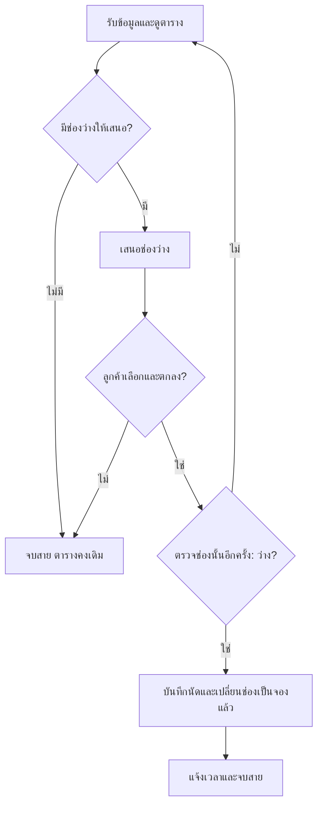
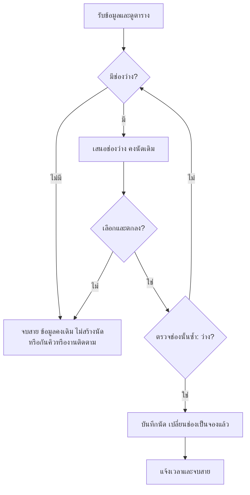

### 🟩 OUTPUT ล่าสุด: ผลรันจริงของ workflow ใหม่

**ผู้สร้างทุกไฟล์: Astra high · คำสั่งสำเร็จ exit code 0** แยกคำสั่งร่าง ตรวจ สรุป และประเมินสถานการณ์ ผลนี้ไม่ใช่การตรวจอิสระข้ามโมเดล

[หลักฐานการรันและข้อจำกัด](clinic-booking-workflow/execution-report.md)

#### OUTPUT จริง: plan-v1.md

[เปิดไฟล์](clinic-booking-workflow/plan-v1.md) · [input ที่ใช้จริง](clinic-booking-workflow/plan-v1-input.txt)

````markdown
เอกสารขั้นตอนธุรกิจ: รับนัดใหม่ของคลินิกเพื่อนสัตว์ วันที่ 15 กันยายน 2570

ปัญหา P1: พนักงานอาจรับนัดซ้ำ เพราะมองไม่ชัดว่าช่องใดถูกจองแล้ว จึงต้องแสดงสถานะทุกช่องให้ชัด และตรวจช่องที่ลูกค้าตกลงอีกครั้งก่อนบันทึก

มีเพียง 2 ฟีเจอร์:

- **ตารางช่องว่าง/จองแล้ว:** แสดงช่องเวลาทั้ง 4 ช่องพร้อมข้อความ “ว่าง” หรือ “จองแล้ว” และชื่อเจ้าของกับสัตว์สำหรับช่องที่มีนัด เชื่อมกับ P1 โดยช่วยให้พนักงานเห็นช่องที่เสนอได้และช่องที่ห้ามจองซ้ำ
- **การบันทึกนัดใหม่:** บันทึกชื่อเจ้าของสมมติ ชื่อสัตว์ และหนึ่งช่องเวลา เมื่อได้รับความตกลงและตรวจว่าช่องยังว่างแล้วเท่านั้น จากนั้นเปลี่ยนสถานะเป็น “จองแล้ว” เชื่อมกับ P1 โดยไม่อนุญาตให้เพิ่มนัดในช่องที่มีนัดอยู่

ตารางตั้งต้นมีนัดของเจ้าของ ข. กับสุนัข โบ้ เวลา 09:30–10:00 จำนวน 1 นัด อีก 3 ช่องว่าง

ขั้นตอนรับนัด:

1. **รับสายและข้อมูล:** รับชื่อเจ้าของสมมติ ชื่อสัตว์ และเวลาที่ต้องการ หนึ่งนัดใช้สำหรับสัตว์หนึ่งตัวและหนึ่งช่องที่กำหนด ขั้นนี้ยังไม่เปลี่ยนตาราง
2. **ดูตารางก่อนเสนอเวลา:**  
   - ถ้าช่องที่ขอว่าง ให้เสนอช่องนั้น  
   - ถ้าช่องที่ขอจองแล้ว ให้คงนัดเดิมและเสนอช่องว่างอื่น  
   - ถ้าไม่มีช่องว่าง ให้แจ้งว่าไม่มีเวลาว่างและจบการสนทนา ตารางและจำนวนนัดคงเดิม
3. **รับการตัดสินใจ:**  
   - ถ้าลูกค้าเลือกช่องและตกลง ให้ไปขั้นที่ 4  
   - ถ้ายังไม่เลือกหรือยังไม่ตกลง ให้จบการสนทนาโดยไม่สร้างนัด ไม่กันคิว และไม่สร้างงานติดตาม ตารางคงเดิม ลูกค้าสามารถโทรมาใหม่ได้
4. **ตรวจช่องที่ตกลงอีกครั้งก่อนบันทึก:**  
   - ถ้าว่าง ให้ไปขั้นที่ 5  
   - ถ้าจองแล้ว ห้ามบันทึกหรือแก้นัดเดิม ให้กลับขั้นที่ 2 เพื่อเสนอช่องว่างอื่น ต้องได้รับความตกลงกับช่องใหม่และตรวจช่องใหม่อีกครั้ง
5. **บันทึกและเปลี่ยนตาราง:** บันทึกชื่อเจ้าของ ชื่อสัตว์ และช่องที่ตกลง เพิ่มนัดใหม่ 1 รายการ พร้อมเปลี่ยนเฉพาะช่องนั้นจาก “ว่าง” เป็น “จองแล้ว” ช่องอื่นและนัดเดิมคงเดิม ห้ามมีสองนัดในช่องเดียวกัน
6. **จบการสนทนา:** แจ้งเวลาที่บันทึกแล้ว และรับลูกค้ารายถัดไปหลังจบสายนี้



การไล่กรณี A–C เริ่มจากตารางตั้งต้นใหม่ทุกกรณี สำหรับ B สมมติสัตว์ของ ก. คือแมว มะลิ เพื่อให้ข้อมูลนัดครบ

**A:** ก. ขอ 09:00–09:30 สำหรับแมว มะลิ พนักงานดูตาราง เสนอเวลา ได้รับความตกลง ตรวจซ้ำพบว่าว่าง แล้วบันทึก

| ช่องเวลา | สถานะสุดท้าย | นัด |
|---|---|---|
| 09:00–09:30 | จองแล้ว | ก. / แมว มะลิ |
| 09:30–10:00 | จองแล้ว | ข. / สุนัข โบ้ |
| 10:00–10:30 | ว่าง | — |
| 10:30–11:00 | ว่าง | — |

เพิ่ม 1 นัด รวม 2 นัด นัดเดิมของ ข. ไม่เปลี่ยน

**B:** ก. ขอ 09:30–10:00 ซึ่งจองแล้ว พนักงานคงนัดของ ข. เสนอ 10:00–10:30 เมื่อ ก. ตกลงจึงตรวจช่องใหม่นี้อีกครั้ง พบว่าว่างแล้วบันทึก

| ช่องเวลา | สถานะสุดท้าย | นัด |
|---|---|---|
| 09:00–09:30 | ว่าง | — |
| 09:30–10:00 | จองแล้ว | ข. / สุนัข โบ้ |
| 10:00–10:30 | จองแล้ว | ก. / แมว มะลิ |
| 10:30–11:00 | ว่าง | — |

เพิ่มเฉพาะนัดของ ก. เวลา 10:00–10:30 รวม 2 นัด ไม่มีช่องใดมีสองนัด

**C:** ก. ขอ 09:30–10:00 ซึ่งจองแล้ว พนักงานเสนอช่องว่างอื่น แต่ ก. ยังไม่เลือก จึงจบสายโดยไม่เปลี่ยนตาราง

| ช่องเวลา | สถานะสุดท้าย | นัด |
|---|---|---|
| 09:00–09:30 | ว่าง | — |
| 09:30–10:00 | จองแล้ว | ข. / สุนัข โบ้ |
| 10:00–10:30 | ว่าง | — |
| 10:30–11:00 | ว่าง | — |

ยังมี 1 นัด ไม่มีนัดใหม่ คิวชั่วคราว หรืองานติดตาม

ข้อจำกัดของสมมติฐาน: ใช้วันสมมติเดียว สัตวแพทย์ 1 คน พนักงาน 1 คน และ 4 ช่องที่อยู่ในเวลาให้บริการ รับทางโทรศัพท์ทีละราย ไม่มีการแก้ข้อมูลพร้อมกัน เอกสารนี้จึงไม่ได้ครอบคลุมสถานการณ์หลายคนรับนัดพร้อมกันหรือกิจกรรมนอกขอบเขต การไล่กรณีข้างต้นเป็นการตรวจขั้นตอนในเอกสาร ไม่ใช่ผลทดสอบระบบใช้งานจริง
````

#### OUTPUT จริง: review-final.md

[เปิดไฟล์](clinic-booking-workflow/review-final.md) · [input ที่ใช้จริง](clinic-booking-workflow/review-1-input.txt)

````markdown
ผลตรวจอิสระเอกสาร plan-v1.md

ตรวจโดยเริ่มจากตารางตั้งต้นใหม่ทุกกรณี: วันที่ 15 กันยายน 2570 มีนัด ข. / สุนัข โบ้ ที่ 09:30–10:00 เพียง 1 นัด อีก 3 ช่องว่าง

**ผลไล่กรณี A–C**

| กรณี | ขั้นตอนที่ตรวจ | ผลลัพธ์ | ผลตรวจ |
|---|---|---|---|
| A | ขั้น 1 รับข้อมูล ก. / แมว มะลิ → ขั้น 2 ดูตารางและเสนอ 09:00–09:30 → ขั้น 3 ได้รับความตกลง → ขั้น 4 ตรวจว่าว่าง → ขั้น 5 บันทึก | เพิ่ม 1 นัดที่ 09:00–09:30 ช่องนี้เป็นจองแล้ว รวม 2 นัด นัด ข. คงเดิม อีก 2 ช่องว่าง | PASS |
| B | ขั้น 2 พบว่า 09:30–10:00 จองแล้ว จึงคงนัด ข. และเสนอ 10:00–10:30 → ขั้น 3 ได้รับความตกลงกับช่องใหม่ → ขั้น 4 ตรวจว่าว่าง → ขั้น 5 บันทึก | เพิ่มนัด ก. เฉพาะ 10:00–10:30 รวม 2 นัด นัด ข. คงเดิม อีก 2 ช่องว่าง ไม่มีช่องซ้ำ การสมมติชื่อสัตว์เป็นแมว มะลิระบุไว้ชัดเจน | PASS |
| C | ขั้น 2 พบว่า 09:30–10:00 จองแล้วและเสนอช่องว่างอื่น → ขั้น 3 ลูกค้ายังไม่เลือก จึงจบสาย ไม่เข้าสู่ขั้น 4–5 | ทุกช่องคงสถานะตั้งต้น รวม 1 นัดของ ข. ไม่มีนัดใหม่ คิวชั่วคราว หรืองานติดตาม | PASS |

**ผลตรวจรายเกณฑ์**

| เกณฑ์ | ผล | หลักฐานอ้างอิงขั้นตอน |
|---|---|---|
| 1. ไม่มีช่องซ้ำ | PASS | ขั้น 2 เสนอช่องว่าง ขั้น 4 ตรวจช่องที่ตกลงอีกครั้งและห้ามบันทึกหากจองแล้ว ขั้น 5 เปลี่ยนเฉพาะช่องว่างเป็นจองแล้วและห้ามสองนัดในช่องเดียวกัน ผล A–C สอดคล้อง |
| 2. นัดเดิมของ ข. คงอยู่ | PASS | ขั้น 2 และ 4 ห้ามแก้นัดเดิม ขั้น 5 กำหนดให้ช่องอื่นและนัดเดิมคงเดิม ทั้งสามกรณียังคงนัด ข. ที่ 09:30–10:00 |
| 3. ต้องตกลงก่อนบันทึก | PASS | ขั้น 3 อนุญาตให้ไปขั้น 4 เมื่อเลือกและตกลงแล้วเท่านั้น หากเปลี่ยนช่อง ขั้น 4 กำหนดให้ได้รับความตกลงใหม่และตรวจใหม่ ก่อนบันทึกตามขั้น 5 |
| 4. กรณี C ไม่เปลี่ยนข้อมูล | PASS | ขั้น 1 ยังไม่เปลี่ยนตาราง ขั้น 2 คงนัดเดิม ขั้น 3 จบสายโดยไม่สร้างนัด ไม่กันคิว ไม่สร้างงานติดตาม และคงตารางเดิม |
| 5. ครบ 2 ฟีเจอร์และไม่เพิ่มขอบเขต | PASS | ตารางสถานะรองรับขั้น 2 และ 4 ส่วนการบันทึกนัดใหม่รองรับขั้น 5 ทั้งคู่เชื่อมกับ P1 โดยทำให้เห็นช่องที่จองแล้วและป้องกันการเพิ่มนัดซ้ำ ขั้น 1, 3 และ 6 เป็นขั้นตอนสนทนาประกอบ ไม่เพิ่มฟีเจอร์ |

ขั้นตอนและผังงานไม่ขัดกันภายใต้สมมติฐานพนักงานรับสายทีละราย ไม่มีการแก้ข้อมูลพร้อมกัน ใช้แพทย์หนึ่งคน วันเดียว และสี่ช่องที่กำหนด ข้อจำกัดระบุชัดเจนและไม่มีงานนอกขอบเขต

READY นี้เป็นผลตรวจความสอดคล้องของเอกสาร ไม่ใช่ผลทดสอบระบบใช้งานจริง

VERDICT: READY
````

#### OUTPUT จริง: solution.md

[เปิดไฟล์](clinic-booking-workflow/solution.md) · [input ที่ใช้จริง](clinic-booking-workflow/solution-input.txt)

````markdown
เอกสารขั้นตอนธุรกิจรับนัดใหม่ของคลินิกเพื่อนสัตว์ วันที่ 15 กันยายน 2570 สรุปจาก plan-v1.md และผลตรวจ review-final.md

ปัญหา **P1** คือพนักงานอาจรับนัดซ้ำ เพราะเห็นช่องที่จองแล้วไม่ชัดเจน จึงใช้เพียง 2 ฟีเจอร์:

- **ตารางช่องว่าง/จองแล้ว:** แสดงทั้ง 4 ช่องด้วยข้อความสถานะ พร้อมชื่อเจ้าของและสัตว์ในช่องที่มีนัด ช่วยแก้ P1 โดยทำให้เห็นว่าช่องใดเสนอได้
- **การบันทึกนัดใหม่:** บันทึกชื่อเจ้าของสมมติ ชื่อสัตว์ และช่องเวลา หลังลูกค้าตกลงและตรวจซ้ำว่าว่างเท่านั้น แล้วเปลี่ยนช่องเป็น “จองแล้ว” ช่วยแก้ P1 โดยห้ามเพิ่มนัดในช่องที่มีนัดอยู่

ตารางตั้งต้น:

| ช่องเวลา | สถานะ | นัด |
|---|---|---|
| 09:00–09:30 | ว่าง | — |
| 09:30–10:00 | จองแล้ว | ข. / สุนัข โบ้ |
| 10:00–10:30 | ว่าง | — |
| 10:30–11:00 | ว่าง | — |

พนักงานใช้งานตามลำดับดังนี้:

1. รับสายและรับชื่อเจ้าของสมมติ ชื่อสัตว์ และเวลาที่ต้องการ โดยยังไม่เปลี่ยนตาราง หนึ่งนัดสำหรับสัตว์หนึ่งตัว ใช้หนึ่งช่องที่กำหนด
2. ดูตารางก่อนเสนอเวลา หากช่องที่ขอว่างให้เสนอช่องนั้น หากจองแล้วให้คงนัดเดิมและเสนอช่องว่างอื่น หากไม่มีช่องว่างให้แจ้งและจบสายโดยไม่เปลี่ยนข้อมูล
3. เมื่อลูกค้าเลือกและตกลง ให้ตรวจช่องนั้นอีกครั้งก่อนบันทึก หากยังไม่เลือกหรือยังไม่ตกลง ให้จบสายโดยไม่สร้างนัด ไม่กันคิว และไม่สร้างงานติดตาม ลูกค้าโทรมาใหม่ได้
4. ถ้าตรวจซ้ำแล้วว่าง ให้เพิ่มนัด 1 รายการและเปลี่ยนเฉพาะช่องนั้นเป็น “จองแล้ว” ช่องอื่นและนัดเดิมคงเดิม ห้ามมีสองนัดในช่องเดียวกัน หากจองแล้วให้กลับไปเสนอช่องว่างอื่น ต้องได้รับความตกลงและตรวจช่องใหม่อีกครั้ง
5. แจ้งเวลาที่บันทึกแล้วและจบสาย ก่อนรับลูกค้ารายถัดไป

ตารางการตัดสินใจ:

| จุดตัดสินใจ | เงื่อนไข | การดำเนินการ |
|---|---|---|
| ดูตาราง | ช่องที่ขอว่าง | เสนอช่องนั้น |
| ดูตาราง | ช่องที่ขอจองแล้ว | ห้ามแก้นัดเดิม เสนอช่องว่างอื่น |
| ดูตาราง | ไม่มีช่องว่าง | แจ้งและจบสาย ข้อมูลคงเดิม |
| รับคำตอบ | ยังไม่เลือกหรือไม่ตกลง | จบสาย ข้อมูลคงเดิม ไม่มีนัด คิวชั่วคราว หรืองานติดตามเพิ่ม |
| รับคำตอบ | เลือกและตกลง | ตรวจช่องที่ตกลงอีกครั้ง |
| ตรวจซ้ำ | จองแล้ว | กลับไปเสนอช่องว่างอื่น รับความตกลงใหม่และตรวจใหม่ |
| ตรวจซ้ำ | ว่าง | บันทึกนัด เปลี่ยนช่องเป็นจองแล้ว แจ้งเวลาและจบสาย |



ผลตรวจแต่ละกรณี **เริ่มจากตารางตั้งต้นใหม่เสมอ** โดยกรณี B สมมติสัตว์ของ ก. เป็นแมว มะลิ:

| กรณี | ผลลัพธ์ตามขั้นตอน | ผลตรวจ |
|---|---|---|
| A: ก. / แมว มะลิ ตกลง 09:00–09:30 | ตรวจซ้ำแล้วเพิ่ม 1 นัด ช่องนี้จองแล้ว รวม 2 นัด นัด ข. คงเดิม อีก 2 ช่องว่าง | PASS |
| B: ก. ขอช่องเต็ม 09:30–10:00 แล้วตกลง 10:00–10:30 | ตรวจช่องใหม่แล้วเพิ่มเฉพาะนัด ก. ที่ 10:00–10:30 รวม 2 นัด นัด ข. คงเดิม อีก 2 ช่องว่าง ไม่มีช่องซ้ำ | PASS |
| C: ก. ขอช่องเต็ม 09:30–10:00 แต่ยังไม่เลือกเวลาอื่น | จบสาย ทุกช่องคงเดิม มีนัด ข. เพียง 1 นัด ไม่มีนัดใหม่ คิวชั่วคราว หรืองานติดตาม | PASS |

ข้อจำกัด: ใช้ข้อมูลสมมติ วันเดียว สัตวแพทย์ 1 คน พนักงาน 1 คน และ 4 ช่องในเวลาให้บริการ รับโทรศัพท์ทีละราย ไม่มีการแก้ข้อมูลพร้อมกัน ไม่ครอบคลุมการเลื่อนหรือยกเลิกนัด งานติดตาม เปลี่ยนกะ แพทย์หลายคน ช่องทางอื่น ตารางเวร รายงาน การเตือน การรักษา การเงิน หรือการสร้างซอฟต์แวร์

**VERDICT: READY** — ครอบคลุม P1 และกรณี A–C ขั้นตอน ตารางการตัดสินใจ และผังงานสอดคล้องกัน ไม่มีฟีเจอร์นอกขอบเขต ผลนี้เป็นการตรวจความสอดคล้องของเอกสาร ไม่ใช่ผลทดสอบระบบใช้งานจริง
````

#### OUTPUT จริง: scenario-results.md

[เปิดไฟล์](clinic-booking-workflow/scenario-results.md) · [input ที่ใช้จริง](clinic-booking-workflow/scenario-results-input.txt)

````markdown
ผลประเมิน **solution.md: READY** — ขั้นตอน ตารางการตัดสินใจ และผังงานสอดคล้องกันในกรณี A–C การประเมินนี้ตรวจเอกสารที่ให้มา ไม่ใช่การทดสอบซอฟต์แวร์ และไม่ได้ยืนยันผลของ review-final.md ซึ่งไม่ได้แนบมา

ทุกกรณีใช้วันที่สมมติ **15 กันยายน 2570** และเริ่มจากตารางตั้งต้นใหม่ มีนัด ข. / สุนัข โบ้ เวลา 09:30–10:00 เพียง 1 นัด ไม่สะสมผลจากกรณีก่อนหน้า

**A — ขอช่องว่างและตกลง: PASS**

สิ่งคาดหวัง: เพิ่มนัด ก. / แมว มะลิ ที่ 09:00–09:30 จำนวน 1 รายการ เปลี่ยนช่องนี้เป็นจองแล้ว และคงนัด ข.

การไล่ขั้นตอนในเอกสาร: ขั้นที่ 2 ดูตารางและเสนอ 09:00–09:30 → ขั้นที่ 3 รับความตกลงและตรวจช่องซ้ำ → ขั้นที่ 4 พบว่าว่าง จึงบันทึกและเปลี่ยนเฉพาะช่องนี้ → ขั้นที่ 5 แจ้งเวลาและจบสาย

| ช่องเวลา | สถานะสุดท้าย | นัด |
|---|---|---|
| 09:00–09:30 | จองแล้ว | ก. / แมว มะลิ |
| 09:30–10:00 | จองแล้ว | ข. / สุนัข โบ้ |
| 10:00–10:30 | ว่าง | — |
| 10:30–11:00 | ว่าง | — |

**รวม 2 นัด เพิ่มใหม่ 1 นัด** ตรงตามสิ่งคาดหวัง นัดเดิมไม่เปลี่ยน ไม่มีช่องซ้ำ

**B — ขอช่องเต็มแล้วตกลงช่องอื่น: PASS**

ใช้สมมติฐานตามเอกสารว่าสัตว์ของ ก. คือแมว มะลิ

สิ่งคาดหวัง: คงนัด ข. ที่ 09:30–10:00 และเพิ่มนัด ก. เฉพาะ 10:00–10:30 ไม่มีช่องใดมีสองนัด

การไล่ขั้นตอนในเอกสาร: ขั้นที่ 2 พบว่าช่องที่ขอจองแล้ว จึงคงนัดเดิมและเสนอ 10:00–10:30 → ขั้นที่ 3 รับความตกลงกับช่องใหม่และตรวจช่องใหม่นี้ซ้ำ → ขั้นที่ 4 พบว่าว่างจึงบันทึก → ขั้นที่ 5 แจ้งเวลาและจบสาย

| ช่องเวลา | สถานะสุดท้าย | นัด |
|---|---|---|
| 09:00–09:30 | ว่าง | — |
| 09:30–10:00 | จองแล้ว | ข. / สุนัข โบ้ |
| 10:00–10:30 | จองแล้ว | ก. / แมว มะลิ |
| 10:30–11:00 | ว่าง | — |

**รวม 2 นัด เพิ่มใหม่ 1 นัด** ตรงตามสิ่งคาดหวัง ไม่มีการแทนที่นัด ข. หรือเพิ่มนัดในช่องเต็ม

**C — ขอช่องเต็มและยังไม่เลือกช่องอื่น: PASS**

สิ่งคาดหวัง: ทุกช่องและจำนวนนัดคงเดิม ไม่มีนัดใหม่หรือคิวชั่วคราว

การไล่ขั้นตอนในเอกสาร: ขั้นที่ 2 พบช่องเต็มและเสนอช่องว่างอื่น → ลูกค้ายังไม่เลือก จึงจบสายตามขั้นที่ 3 ไม่เข้าสู่การบันทึกในขั้นที่ 4 ตารางการตัดสินใจและผังงานระบุทางออกเดียวกัน โดยไม่สร้างนัด ไม่กันคิว และไม่สร้างงานติดตาม

| ช่องเวลา | สถานะสุดท้าย | นัด |
|---|---|---|
| 09:00–09:30 | ว่าง | — |
| 09:30–10:00 | จองแล้ว | ข. / สุนัข โบ้ |
| 10:00–10:30 | ว่าง | — |
| 10:30–11:00 | ว่าง | — |

**รวม 1 นัด เพิ่มใหม่ 0 นัด** ตรงตามสิ่งคาดหวัง ข้อมูลทุกช่องคงเดิม

**เหตุผลของ READY:** ทั้งสามกรณีผ่านจากการไล่ขั้นตอน ฟีเจอร์ตารางช่วยแก้ P1 ด้วยการแสดงสถานะชัดเจน ส่วนการบันทึกกำหนดให้ลูกค้าตกลงและตรวจช่องว่างซ้ำก่อนเพิ่มนัด พร้อมห้ามจองซ้ำ มีเพียง 2 ฟีเจอร์และไม่เพิ่มงานนอกขอบเขต ผลประเมินจำกัดอยู่ภายใต้สมมติฐานวันเดียว 4 ช่อง แพทย์และพนักงานอย่างละ 1 คน รับโทรศัพท์ทีละราย และไม่มีการแก้ข้อมูลพร้อมกัน
````


