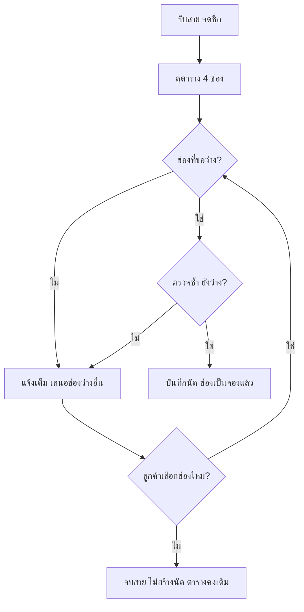

# แผนรับนัดใหม่โดยไม่จองช่องซ้ำ (คลินิกเพื่อนสัตว์ วันที่ 15 กันยายน 2570)

**ปัญหา P1:** พนักงานรับนัดอาจบันทึกนัดสองรายการลงช่องเดียวกัน เพราะไม่มีตารางที่แสดงสถานะ "ว่าง/จองแล้ว" ของแต่ละช่องอย่างชัดเจน ณ เวลาที่คุยกับลูกค้า ผลคือแพทย์ 1 คนถูกนัดซ้อนเวลา

**สมมติฐานและข้อจำกัด**
- แพทย์ 1 คน พนักงานรับนัด 1 คน ทำงานทีละรายทางโทรศัพท์ จึงไม่มีการแก้ข้อมูลพร้อมกัน แผนนี้ไม่ครอบคลุมกรณีมีผู้บันทึกหลายคน
- มี 4 ช่องเท่านั้น และทุกช่องอยู่ในเวลาให้บริการของแพทย์ จึงไม่ต้องตรวจเวลาทำการ
- ใช้ข้อมูลสมมติทั้งหมด ไม่ระบุวิธีเก็บตาราง (กระดาษหรือระบบใดก็ได้) เพราะการสร้างซอฟต์แวร์อยู่นอกขอบเขต

**ฟีเจอร์ที่เสนอ (2 รายการ)**

1. **ตารางช่องนัดรายวัน** แสดง 4 ช่องพร้อมสถานะ "ว่าง" หรือ "จองแล้ว (เจ้าของ/สัตว์)" พนักงานต้องเปิดดูก่อนเสนอเวลา และดูซ้ำก่อนบันทึก ตอบ P1 โดยทำให้ช่องที่ถูกจองแล้วมองเห็นได้ทันที
2. **การบันทึกนัดใหม่** บันทึกได้เฉพาะเมื่อช่องมีสถานะ "ว่าง" หนึ่งนัดต่อสัตว์หนึ่งตัวต่อหนึ่งช่อง เก็บชื่อเจ้าของ ชื่อสัตว์ และช่องเวลา แล้วเปลี่ยนช่องเป็น "จองแล้ว" ทันที ตอบ P1 โดยห้ามบันทึกทับช่องที่จองแล้วในทุกกรณี

**ตารางตั้งต้น**

| ช่อง | สถานะ |
|---|---|
| 09:00–09:30 | ว่าง |
| 09:30–10:00 | จองแล้ว (ข. / โบ้) |
| 10:00–10:30 | ว่าง |
| 10:30–11:00 | ว่าง |

## ขั้นตอนรับนัด

1. รับสาย จดชื่อเจ้าของและชื่อสัตว์ (ยังไม่บันทึกลงตาราง)
2. เปิดตารางช่องนัด ดูสถานะทั้ง 4 ช่อง
3. ถามช่องที่ลูกค้าต้องการ
4. ถ้าช่องนั้น "ว่าง" ให้ไปข้อ 6 ถ้า "จองแล้ว" ให้ไปข้อ 5
5. แจ้งว่าช่องเต็ม ห้ามแก้หรือย้ายนัดเดิม เสนอช่องที่มีสถานะ "ว่าง" ทั้งหมด แล้วกลับไปข้อ 4 ด้วยช่องที่ลูกค้าเลือกใหม่ ถ้าลูกค้าไม่เลือก ให้ไปข้อ 8
6. เมื่อลูกค้าตกลงช่องแล้ว ดูตารางซ้ำอีกครั้ง ถ้ายัง "ว่าง" ให้ไปข้อ 7 ถ้าไม่ว่างแล้ว ให้กลับไปข้อ 5
7. บันทึกนัด (เจ้าของ สัตว์ ช่อง) เปลี่ยนช่องเป็น "จองแล้ว" ทวนเวลากับลูกค้า จบสาย
8. ลูกค้ายังไม่เลือกหรือไม่ตกลง: จบสายโดยไม่สร้างนัด ไม่กันคิว ไม่สร้างงานติดตาม ตารางคงเดิม แจ้งว่าโทรกลับมาใหม่ได้

**การเปลี่ยนตารางในแต่ละทางแยก**
- ข้อ 7 เท่านั้นที่เปลี่ยนตาราง และเปลี่ยนเพียงช่องเดียวจาก "ว่าง" เป็น "จองแล้ว"
- ข้อ 5 และข้อ 8 ไม่เปลี่ยนตารางใดๆ

## ไล่กรณีทดสอบ (เริ่มจากตารางตั้งต้นทุกกรณี)

**กรณี A** ก. พาแมว มะลิ ขอ 09:00–09:30
- ข้อ 2 ดูตาราง ข้อ 4 ช่องว่าง ไปข้อ 6 ตรวจซ้ำยังว่าง ข้อ 7 บันทึก
- ผล: นัดใหม่ 1 รายการ นัดของ ข. ไม่เปลี่ยน

| ช่อง | สถานะ |
|---|---|
| 09:00–09:30 | จองแล้ว (ก. / มะลิ) |
| 09:30–10:00 | จองแล้ว (ข. / โบ้) |
| 10:00–10:30 | ว่าง |
| 10:30–11:00 | ว่าง |

**กรณี B** ก. ขอ 09:30–10:00 ที่เต็ม แล้วตกลง 10:00–10:30
- ข้อ 4 ช่องจองแล้ว ไปข้อ 5 ไม่แตะนัดของ ข. เสนอ 09:00, 10:00, 10:30 ลูกค้าเลือก 10:00–10:30 กลับข้อ 4 ว่าง ข้อ 6 ตรวจซ้ำยังว่าง ข้อ 7 บันทึก
- ผล: นัดของ ข. คงอยู่ เพิ่มนัดของ ก. เฉพาะ 10:00–10:30 ไม่มีช่องใดมีสองนัด

| ช่อง | สถานะ |
|---|---|
| 09:00–09:30 | ว่าง |
| 09:30–10:00 | จองแล้ว (ข. / โบ้) |
| 10:00–10:30 | จองแล้ว (ก. / มะลิ) |
| 10:30–11:00 | ว่าง |

**กรณี C** ก. ขอ 09:30–10:00 ที่เต็ม แต่ยังไม่เลือกเวลาอื่น
- ข้อ 4 ช่องจองแล้ว ไปข้อ 5 เสนอช่องว่าง ลูกค้าไม่เลือก ไปข้อ 8 จบสาย
- ผล: ไม่มีนัดใหม่ ไม่มีคิวชั่วคราว ไม่มีงานติดตาม จำนวนนัดยังเป็น 1 รายการเท่าเดิม

| ช่อง | สถานะ |
|---|---|
| 09:00–09:30 | ว่าง |
| 09:30–10:00 | จองแล้ว (ข. / โบ้) |
| 10:00–10:30 | ว่าง |
| 10:30–11:00 | ว่าง |

**การเชื่อมกับกฎ 1–5:** ข้อ 7 ทำตามกฎ 1 และ 3 ข้อ 2 และข้อ 6 ทำตามกฎ 2 ข้อ 5 ทำตามกฎ 4 ข้อ 8 ทำตามกฎ 5 ไม่มีขั้นตอนใดเลื่อน ยกเลิก หรือแก้นัดเดิม และไม่มีการสร้างงานติดตาม จึงอยู่ในขอบเขตที่กำหนด ยังไม่สรุปผล READY/NOT READY ตามที่ขอ