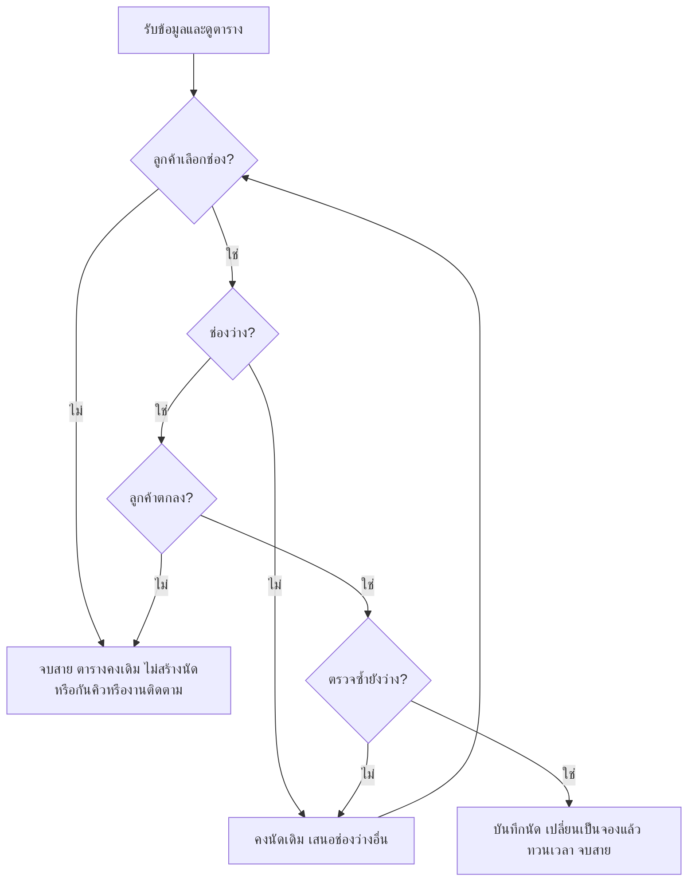

**ขั้นตอนรับนัดใหม่ — คลินิกเพื่อนสัตว์ วันที่ 15 กันยายน 2570**

ปัญหา **P1** คือพนักงานอาจรับนัดซ้ำ เพราะมองไม่เห็นชัดเจนว่าช่องใดถูกจองแล้ว ทำให้สัตวแพทย์ 1 คนมีนัดซ้อนเวลา

ใช้เพียง 2 ฟีเจอร์ตามแผนที่ผ่านการตรวจ:

1. **ตารางช่องนัด:** แสดงสถานะ “ว่าง” หรือ “จองแล้ว (เจ้าของ/สัตว์)” ช่วยแก้ P1 โดยให้พนักงานเห็นช่องที่จองแล้วก่อนเสนอเวลาและตรวจซ้ำก่อนบันทึก
2. **การบันทึกนัดใหม่:** บันทึกชื่อเจ้าของสมมติ ชื่อสัตว์ และช่องเวลา หนึ่งนัดต่อสัตว์หนึ่งตัว ใช้หนึ่งช่องที่กำหนด ช่วยแก้ P1 โดยรับนัดเฉพาะช่องว่างหลังลูกค้าตกลง แล้วเปลี่ยนเป็น “จองแล้ว” ทันที ห้ามมีสองนัดในช่องเดียวกัน

**ตารางตั้งต้น**

| ช่องเวลา | สถานะ |
|---|---|
| 09:00–09:30 | ว่าง |
| 09:30–10:00 | จองแล้ว (ข. / โบ้) |
| 10:00–10:30 | ว่าง |
| 10:30–11:00 | ว่าง |

**ขั้นตอนใช้งาน**

1. รับสายและรับชื่อเจ้าของกับชื่อสัตว์ โดยยังไม่สร้างนัด
2. ดูตารางทั้ง 4 ช่องก่อนเสนอเวลา แล้วถามช่องที่ลูกค้าต้องการ หากยังไม่เลือก ให้จบสายตามข้อ 6
3. ตรวจสถานะช่องที่เลือก ถ้าว่างให้ขอคำตกลง ถ้าเต็มให้คงนัดเดิมและเสนอช่องว่างอื่น เมื่อลูกค้าเลือกใหม่ ให้ตรวจสถานะช่องใหม่ด้วยขั้นตอนเดียวกัน
4. เมื่อลูกค้าตกลงแล้ว จึงตรวจช่องนั้นซ้ำก่อนบันทึก หากยังว่างให้ไปข้อ 5 หากเต็มให้กลับไปเสนอช่องว่างอื่นตามข้อ 3
5. บันทึกชื่อเจ้าของ ชื่อสัตว์ และช่องเวลา เปลี่ยนช่องนั้นเป็น “จองแล้ว” ทวนเวลากับลูกค้าแล้วจบสาย **ขั้นตอนนี้เท่านั้นที่เปลี่ยนตาราง และเปลี่ยนเพียงช่องเดียว**
6. หากลูกค้ายังไม่เลือกหรือยังไม่ตกลง ให้จบสายโดยตารางคงเดิม ไม่สร้างนัด ไม่กันคิว และไม่สร้างงานติดตาม แจ้งว่าสามารถโทรมาใหม่ได้ หากยังไม่ตกลงจะไม่เข้าสู่การตรวจซ้ำก่อนบันทึก

**ตารางการตัดสินใจ**

| เงื่อนไข | การดำเนินการ | ผลต่อตาราง |
|---|---|---|
| ยังไม่เลือกช่อง | จบสายตามข้อ 6 | คงเดิม |
| ช่องที่เลือกเต็ม | ห้ามแก้นัดเดิม เสนอช่องว่างอื่น | คงเดิม |
| ช่องว่าง แต่ยังไม่ตกลง | จบสายตามข้อ 6 | คงเดิม |
| ตกลงแล้ว ตรวจซ้ำพบว่าเต็ม | เสนอช่องว่างอื่น และขอคำตกลงสำหรับช่องใหม่ | คงเดิม |
| ตกลงแล้ว ตรวจซ้ำยังว่าง | บันทึกนัดและจบสาย | ช่องนั้นเป็นจองแล้ว |

**ตรวจกรณี A–C**

แต่ละกรณีเริ่มจากตารางตั้งต้นใหม่ มีนัด ข. / โบ้ เพียง 1 นัด

| กรณี | ผลตามขั้นตอน | ผลตรวจ |
|---|---|---|
| A: ก. / มะลิ ตกลง 09:00–09:30 | ตรวจซ้ำแล้วเพิ่ม 1 นัด ช่องนี้เป็นจองแล้ว รวม 2 นัด นัด ข. และอีกสองช่องคงเดิม | PASS |
| B: ก. ขอช่องเต็ม 09:30–10:00 แล้วตกลง 10:00–10:30 | คงนัด ข. ตรวจช่องใหม่และตรวจซ้ำหลังตกลง เพิ่ม ก. / มะลิ เฉพาะ 10:00–10:30 รวม 2 นัด อีกสองช่องยังว่าง ไม่มีนัดซ้ำ | PASS |
| C: ก. ขอช่องเต็ม 09:30–10:00 แต่ไม่เลือกเวลาอื่น | ทั้ง 4 ช่องคงเดิม มี 1 นัด ไม่มีนัดใหม่ คิวชั่วคราว หรืองานติดตาม | PASS |

**ข้อจำกัด:** ใช้ข้อมูลสมมติสำหรับวันเดียว มีแพทย์ 1 คน พนักงาน 1 คน รับโทรศัพท์ทีละรายและจบสายก่อนรับรายถัดไป ไม่มีการแก้ข้อมูลพร้อมกัน ทั้ง 4 ช่องอยู่ในเวลาให้บริการ ผลนี้ไม่ครอบคลุมผู้บันทึกหลายคน และไม่เพิ่มงานนอกขอบเขตที่กำหนดหรือการสร้างซอฟต์แวร์

**VERDICT: READY** — ครบ P1 และกรณี A–C ขั้นตอน ตารางตัดสินใจ และผังงานสอดคล้องกัน อยู่ภายใน 2 ฟีเจอร์ ผลนี้เป็นการตรวจความสอดคล้องของเอกสาร ไม่ใช่ผลทดสอบระบบใช้งานจริง