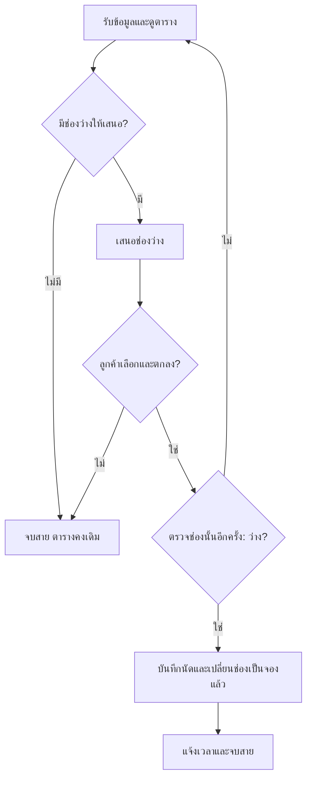

เอกสารขั้นตอนธุรกิจ: รับนัดใหม่ของคลินิกเพื่อนสัตว์ วันที่ 15 กันยายน 2570

ปัญหา P1: พนักงานอาจรับนัดซ้ำ เพราะมองไม่ชัดว่าช่องใดถูกจองแล้ว จึงต้องแสดงสถานะทุกช่องให้ชัด และตรวจช่องที่ลูกค้าตกลงอีกครั้งก่อนบันทึก

มีเพียง 2 ฟีเจอร์:

- **ตารางช่องว่าง/จองแล้ว:** แสดงช่องเวลาทั้ง 4 ช่องพร้อมข้อความ “ว่าง” หรือ “จองแล้ว” และชื่อเจ้าของกับสัตว์สำหรับช่องที่มีนัด เชื่อมกับ P1 โดยช่วยให้พนักงานเห็นช่องที่เสนอได้และช่องที่ห้ามจองซ้ำ
- **การบันทึกนัดใหม่:** บันทึกชื่อเจ้าของสมมติ ชื่อสัตว์ และหนึ่งช่องเวลา เมื่อได้รับความตกลงและตรวจว่าช่องยังว่างแล้วเท่านั้น จากนั้นเปลี่ยนสถานะเป็น “จองแล้ว” เชื่อมกับ P1 โดยไม่อนุญาตให้เพิ่มนัดในช่องที่มีนัดอยู่

ตารางตั้งต้นมีนัดของเจ้าของ ข. กับสุนัข โบ้ เวลา 09:30–10:00 จำนวน 1 นัด อีก 3 ช่องว่าง

ขั้นตอนรับนัด:

1. **รับสายและข้อมูล:** รับชื่อเจ้าของสมมติ ชื่อสัตว์ และเวลาที่ต้องการ หนึ่งนัดใช้สำหรับสัตว์หนึ่งตัวและหนึ่งช่องที่กำหนด ขั้นนี้ยังไม่เปลี่ยนตาราง
2. **ดูตารางก่อนเสนอเวลา:**  
   - ถ้าช่องที่ขอว่าง ให้เสนอช่องนั้น  
   - ถ้าช่องที่ขอจองแล้ว ให้คงนัดเดิมและเสนอช่องว่างอื่น  
   - ถ้าไม่มีช่องว่าง ให้แจ้งว่าไม่มีเวลาว่างและจบการสนทนา ตารางและจำนวนนัดคงเดิม
3. **รับการตัดสินใจ:**  
   - ถ้าลูกค้าเลือกช่องและตกลง ให้ไปขั้นที่ 4  
   - ถ้ายังไม่เลือกหรือยังไม่ตกลง ให้จบการสนทนาโดยไม่สร้างนัด ไม่กันคิว และไม่สร้างงานติดตาม ตารางคงเดิม ลูกค้าสามารถโทรมาใหม่ได้
4. **ตรวจช่องที่ตกลงอีกครั้งก่อนบันทึก:**  
   - ถ้าว่าง ให้ไปขั้นที่ 5  
   - ถ้าจองแล้ว ห้ามบันทึกหรือแก้นัดเดิม ให้กลับขั้นที่ 2 เพื่อเสนอช่องว่างอื่น ต้องได้รับความตกลงกับช่องใหม่และตรวจช่องใหม่อีกครั้ง
5. **บันทึกและเปลี่ยนตาราง:** บันทึกชื่อเจ้าของ ชื่อสัตว์ และช่องที่ตกลง เพิ่มนัดใหม่ 1 รายการ พร้อมเปลี่ยนเฉพาะช่องนั้นจาก “ว่าง” เป็น “จองแล้ว” ช่องอื่นและนัดเดิมคงเดิม ห้ามมีสองนัดในช่องเดียวกัน
6. **จบการสนทนา:** แจ้งเวลาที่บันทึกแล้ว และรับลูกค้ารายถัดไปหลังจบสายนี้

การไล่กรณี A–C เริ่มจากตารางตั้งต้นใหม่ทุกกรณี สำหรับ B สมมติสัตว์ของ ก. คือแมว มะลิ เพื่อให้ข้อมูลนัดครบ

**A:** ก. ขอ 09:00–09:30 สำหรับแมว มะลิ พนักงานดูตาราง เสนอเวลา ได้รับความตกลง ตรวจซ้ำพบว่าว่าง แล้วบันทึก

| ช่องเวลา | สถานะสุดท้าย | นัด |
|---|---|---|
| 09:00–09:30 | จองแล้ว | ก. / แมว มะลิ |
| 09:30–10:00 | จองแล้ว | ข. / สุนัข โบ้ |
| 10:00–10:30 | ว่าง | — |
| 10:30–11:00 | ว่าง | — |

เพิ่ม 1 นัด รวม 2 นัด นัดเดิมของ ข. ไม่เปลี่ยน

**B:** ก. ขอ 09:30–10:00 ซึ่งจองแล้ว พนักงานคงนัดของ ข. เสนอ 10:00–10:30 เมื่อ ก. ตกลงจึงตรวจช่องใหม่นี้อีกครั้ง พบว่าว่างแล้วบันทึก

| ช่องเวลา | สถานะสุดท้าย | นัด |
|---|---|---|
| 09:00–09:30 | ว่าง | — |
| 09:30–10:00 | จองแล้ว | ข. / สุนัข โบ้ |
| 10:00–10:30 | จองแล้ว | ก. / แมว มะลิ |
| 10:30–11:00 | ว่าง | — |

เพิ่มเฉพาะนัดของ ก. เวลา 10:00–10:30 รวม 2 นัด ไม่มีช่องใดมีสองนัด

**C:** ก. ขอ 09:30–10:00 ซึ่งจองแล้ว พนักงานเสนอช่องว่างอื่น แต่ ก. ยังไม่เลือก จึงจบสายโดยไม่เปลี่ยนตาราง

| ช่องเวลา | สถานะสุดท้าย | นัด |
|---|---|---|
| 09:00–09:30 | ว่าง | — |
| 09:30–10:00 | จองแล้ว | ข. / สุนัข โบ้ |
| 10:00–10:30 | ว่าง | — |
| 10:30–11:00 | ว่าง | — |

ยังมี 1 นัด ไม่มีนัดใหม่ คิวชั่วคราว หรืองานติดตาม

ข้อจำกัดของสมมติฐาน: ใช้วันสมมติเดียว สัตวแพทย์ 1 คน พนักงาน 1 คน และ 4 ช่องที่อยู่ในเวลาให้บริการ รับทางโทรศัพท์ทีละราย ไม่มีการแก้ข้อมูลพร้อมกัน เอกสารนี้จึงไม่ได้ครอบคลุมสถานการณ์หลายคนรับนัดพร้อมกันหรือกิจกรรมนอกขอบเขต การไล่กรณีข้างต้นเป็นการตรวจขั้นตอนในเอกสาร ไม่ใช่ผลทดสอบระบบใช้งานจริง