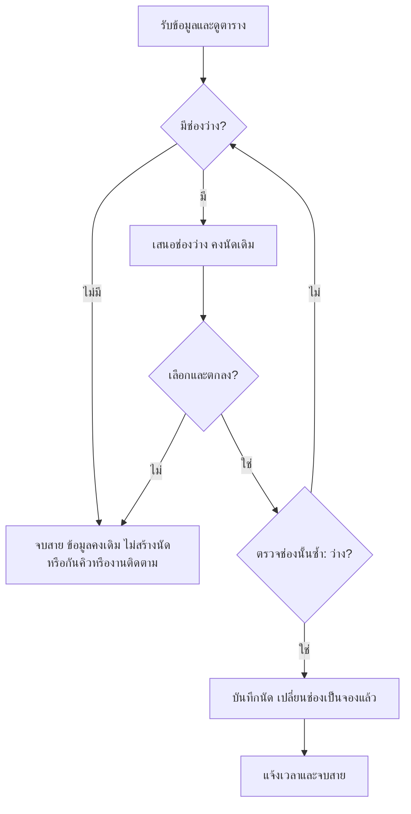

เอกสารขั้นตอนธุรกิจรับนัดใหม่ของคลินิกเพื่อนสัตว์ วันที่ 15 กันยายน 2570 สรุปจาก plan-v1.md และผลตรวจ review-final.md

ปัญหา **P1** คือพนักงานอาจรับนัดซ้ำ เพราะเห็นช่องที่จองแล้วไม่ชัดเจน จึงใช้เพียง 2 ฟีเจอร์:

- **ตารางช่องว่าง/จองแล้ว:** แสดงทั้ง 4 ช่องด้วยข้อความสถานะ พร้อมชื่อเจ้าของและสัตว์ในช่องที่มีนัด ช่วยแก้ P1 โดยทำให้เห็นว่าช่องใดเสนอได้
- **การบันทึกนัดใหม่:** บันทึกชื่อเจ้าของสมมติ ชื่อสัตว์ และช่องเวลา หลังลูกค้าตกลงและตรวจซ้ำว่าว่างเท่านั้น แล้วเปลี่ยนช่องเป็น “จองแล้ว” ช่วยแก้ P1 โดยห้ามเพิ่มนัดในช่องที่มีนัดอยู่

ตารางตั้งต้น:

| ช่องเวลา | สถานะ | นัด |
|---|---|---|
| 09:00–09:30 | ว่าง | — |
| 09:30–10:00 | จองแล้ว | ข. / สุนัข โบ้ |
| 10:00–10:30 | ว่าง | — |
| 10:30–11:00 | ว่าง | — |

พนักงานใช้งานตามลำดับดังนี้:

1. รับสายและรับชื่อเจ้าของสมมติ ชื่อสัตว์ และเวลาที่ต้องการ โดยยังไม่เปลี่ยนตาราง หนึ่งนัดสำหรับสัตว์หนึ่งตัว ใช้หนึ่งช่องที่กำหนด
2. ดูตารางก่อนเสนอเวลา หากช่องที่ขอว่างให้เสนอช่องนั้น หากจองแล้วให้คงนัดเดิมและเสนอช่องว่างอื่น หากไม่มีช่องว่างให้แจ้งและจบสายโดยไม่เปลี่ยนข้อมูล
3. เมื่อลูกค้าเลือกและตกลง ให้ตรวจช่องนั้นอีกครั้งก่อนบันทึก หากยังไม่เลือกหรือยังไม่ตกลง ให้จบสายโดยไม่สร้างนัด ไม่กันคิว และไม่สร้างงานติดตาม ลูกค้าโทรมาใหม่ได้
4. ถ้าตรวจซ้ำแล้วว่าง ให้เพิ่มนัด 1 รายการและเปลี่ยนเฉพาะช่องนั้นเป็น “จองแล้ว” ช่องอื่นและนัดเดิมคงเดิม ห้ามมีสองนัดในช่องเดียวกัน หากจองแล้วให้กลับไปเสนอช่องว่างอื่น ต้องได้รับความตกลงและตรวจช่องใหม่อีกครั้ง
5. แจ้งเวลาที่บันทึกแล้วและจบสาย ก่อนรับลูกค้ารายถัดไป

ตารางการตัดสินใจ:

| จุดตัดสินใจ | เงื่อนไข | การดำเนินการ |
|---|---|---|
| ดูตาราง | ช่องที่ขอว่าง | เสนอช่องนั้น |
| ดูตาราง | ช่องที่ขอจองแล้ว | ห้ามแก้นัดเดิม เสนอช่องว่างอื่น |
| ดูตาราง | ไม่มีช่องว่าง | แจ้งและจบสาย ข้อมูลคงเดิม |
| รับคำตอบ | ยังไม่เลือกหรือไม่ตกลง | จบสาย ข้อมูลคงเดิม ไม่มีนัด คิวชั่วคราว หรืองานติดตามเพิ่ม |
| รับคำตอบ | เลือกและตกลง | ตรวจช่องที่ตกลงอีกครั้ง |
| ตรวจซ้ำ | จองแล้ว | กลับไปเสนอช่องว่างอื่น รับความตกลงใหม่และตรวจใหม่ |
| ตรวจซ้ำ | ว่าง | บันทึกนัด เปลี่ยนช่องเป็นจองแล้ว แจ้งเวลาและจบสาย |

ผลตรวจแต่ละกรณี **เริ่มจากตารางตั้งต้นใหม่เสมอ** โดยกรณี B สมมติสัตว์ของ ก. เป็นแมว มะลิ:

| กรณี | ผลลัพธ์ตามขั้นตอน | ผลตรวจ |
|---|---|---|
| A: ก. / แมว มะลิ ตกลง 09:00–09:30 | ตรวจซ้ำแล้วเพิ่ม 1 นัด ช่องนี้จองแล้ว รวม 2 นัด นัด ข. คงเดิม อีก 2 ช่องว่าง | PASS |
| B: ก. ขอช่องเต็ม 09:30–10:00 แล้วตกลง 10:00–10:30 | ตรวจช่องใหม่แล้วเพิ่มเฉพาะนัด ก. ที่ 10:00–10:30 รวม 2 นัด นัด ข. คงเดิม อีก 2 ช่องว่าง ไม่มีช่องซ้ำ | PASS |
| C: ก. ขอช่องเต็ม 09:30–10:00 แต่ยังไม่เลือกเวลาอื่น | จบสาย ทุกช่องคงเดิม มีนัด ข. เพียง 1 นัด ไม่มีนัดใหม่ คิวชั่วคราว หรืองานติดตาม | PASS |

ข้อจำกัด: ใช้ข้อมูลสมมติ วันเดียว สัตวแพทย์ 1 คน พนักงาน 1 คน และ 4 ช่องในเวลาให้บริการ รับโทรศัพท์ทีละราย ไม่มีการแก้ข้อมูลพร้อมกัน ไม่ครอบคลุมการเลื่อนหรือยกเลิกนัด งานติดตาม เปลี่ยนกะ แพทย์หลายคน ช่องทางอื่น ตารางเวร รายงาน การเตือน การรักษา การเงิน หรือการสร้างซอฟต์แวร์

**VERDICT: READY** — ครอบคลุม P1 และกรณี A–C ขั้นตอน ตารางการตัดสินใจ และผังงานสอดคล้องกัน ไม่มีฟีเจอร์นอกขอบเขต ผลนี้เป็นการตรวจความสอดคล้องของเอกสาร ไม่ใช่ผลทดสอบระบบใช้งานจริง