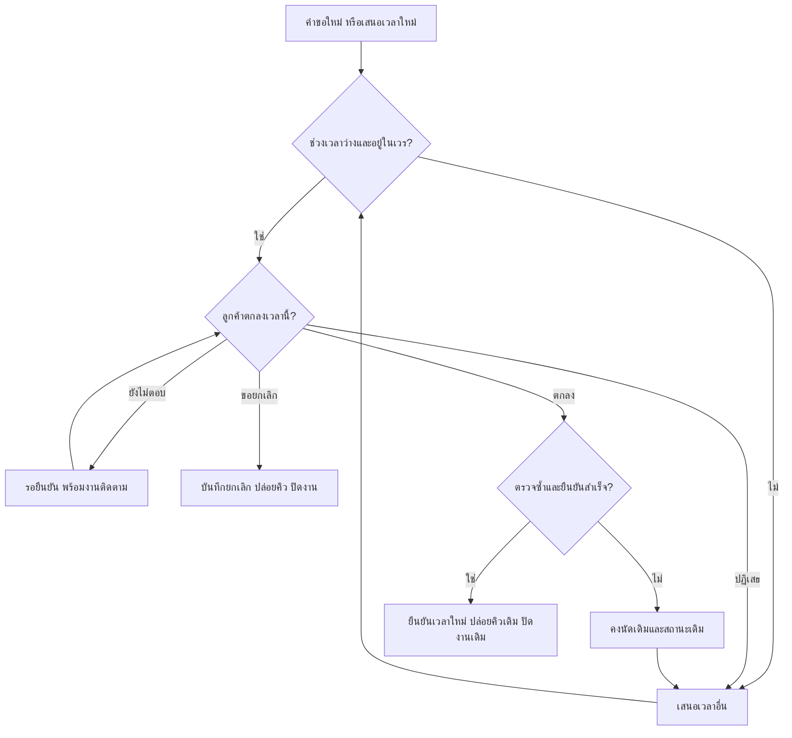

ข้อเสนอสำหรับคลินิกเพื่อนสัตว์ 1 สาขา อ้างอิง `baseline-case.txt`, `plan-v5.md` และ `review-final.md` ซึ่งผ่านเกณฑ์พร้อมสรุปข้อเสนอ ไม่ใช่การรับรองความพร้อมพัฒนาหรือใช้งานจริง ข้อมูลทั้งหมดเป็นกรณีสมมติ

เริ่มต้นเพียง **3 กลุ่มฟีเจอร์**: **A** นัดกลางและเวรรายแพทย์ **B** สถานะและงานติดตาม **C** ผลหลังนัดและภาพรวม ลูกค้าใช้โทรศัพท์ แชต และหน้าร้านตามเดิม ต้อนรับบันทึกข้อมูลชุดเดียว สัตว์หนึ่งตัวต่อนัด; หลายตัวผูกนัดเป็นชุดโดยไม่กรอกข้อมูลลูกค้าซ้ำ

| P1–P5 | ฟีเจอร์ | ทำก่อน/ภายหลัง | เหตุผล |
|---|---|---|---|
| P1 คิวชน | **A:** ตรวจช่วงเวลาตลอดนัดกับเวรล่าสุดรายแพทย์ เสนอเวลาอื่นเมื่อเต็ม ตรวจและยืนยันในขั้นตอนเดียว | **ก่อน:** นัดกลางและป้องกันยืนยันพร้อมกัน; **ภายหลัง:** ลูกค้าจองเอง | แก้ต้นเหตุที่แต่ละช่องทางยืนยันแยกกัน เกณฑ์ตรวจคือสองคนยืนยันช่วงทับซ้อนของแพทย์คนเดียวกัน ต้องสำเร็จเพียงรายการเดียว |
| P2 สถานะไม่ชัด | **B:** แยกคำขอ/รอยืนยันพร้อมเหตุ/ยืนยันแล้ว มีผู้รับผิดชอบ ประวัติติดต่อและงานค้าง | **ก่อน:** สถานะและติดตามโดยพนักงาน; **ภายหลัง:** ข้อความอัตโนมัติ | กะถัดไปตรวจได้ว่าใครติดต่อ เมื่อใด ผลอะไร โดยไม่อ่านทุกแชต |
| P3 เลื่อนไม่ถึงอีกกะ | **B:** แก้นัดเดิม แยกเวลาที่มีผลกับเวลาที่เสนอ เก็บผู้แก้และเวลาเดิม–ใหม่ ส่งต่องาน | **ก่อน:** ทั้งหมด รวมหน้าที่เปิดค้างปรับตามข้อมูลล่าสุดเอง | เสนอเลื่อนให้พักงานเตือนเดิม; เลื่อนสำเร็จหรือยกเลิกให้ปิดงานเดิม หน้าค้างต้องหยุดคำสั่งเก่าและล็อกบันทึกจนรับทราบ |
| P4 เวรเปลี่ยน | **A+B:** กำหนดช่วงเปิดรับรายคน หยุดรับช่วงไม่ว่าง แสดงนัดกระทบทุกสถานะพร้อมผู้รับผิดชอบ | **ก่อน:** เวรและจัดการนัดกระทบ; **ภายหลัง:** ปล่อยคิวชั่วคราวอัตโนมัติ | ตรวจได้ว่าไม่มีการยืนยันนอกเวร และเวลาทดแทนต้องมีหลักฐานลูกค้าตกลงก่อนยืนยัน |
| P5 ไม่เห็นภาพรวม | **C:** บันทึกผลหลังนัด สรุปรายวันตามสถานะ เปิดถึงนัดต้นทางและงานค้าง | **ก่อน:** ผลและสรุปพื้นฐาน | แยกมา/ไม่มา/ไม่ทราบ พร้อมผู้บันทึก; ยกเลิกเป็นสถานะนัด ไม่รวมเป็นผลหลังนัด และไม่ตีความข้อมูลว่างว่าไม่มา |

**ขั้นตอนใช้งานไม่เกิน 5 ขั้น**

1. **รับเรื่อง:** ต้อนรับบันทึกคำขอทันที ระบุลูกค้า สัตว์ แพทย์ ระยะเวลาโดยประมาณ และผู้รับผิดชอบเริ่มต้นเป็นผู้บันทึก
2. **เสนอและยืนยัน:** ตรวจเวรกับคิวตามช่วงเวลาทั้งนัด ถ้ารอตอบให้ถือเวลาที่เสนอชั่วคราว เมื่อลูกค้าตกลงให้ตรวจซ้ำและยืนยันในขั้นตอนเดียว หากไม่สำเร็จคงข้อมูลเดิมและเสนอทางเลือก
3. **เลื่อนหรือยกเลิก:** แก้นัดเดิม ระหว่างรอเลื่อนยังถือคิวเดิมและพักงานเตือนเดิม เลื่อนสำเร็จจึงปล่อยคิวเดิม; ยกเลิกโดยชัดแจ้งจึงปล่อยทุกคิว ปฏิเสธข้อเสนอไม่เท่ากับยกเลิก
4. **รับเวรเปลี่ยนและส่งต่อ:** แพทย์แจ้งเวร ต้อนรับติดตามนัดกระทบและส่งงานเปิด/พักให้กะถัดไป ผลติดต่อขัดกันต้องแสดงทั้งสองรายการให้คนตัดสินติดต่อซ้ำ
5. **ปิดกะและดูภาพรวม:** ผู้ปิดกะบันทึกผลหรือคง “ไม่ทราบ” นัดคร่อมกะให้กะรับช่วงดูแล เจ้าของตรวจสรุปและงานค้าง ทั้งการแบ่งหน้าที่นี้ต้องยืนยันกับคลินิก

**กฎสำคัญเมื่อเวรกลับมา:** คืนสถานะก่อนเวรเปลี่ยนได้เฉพาะนัดที่เคยตกลงแล้วและยังไม่มีผลติดต่อหลังเวรเปลี่ยน หากเดิมรอเลื่อนต้องกลับไปรอเลื่อน พร้อมข้อเสนอและคิวชั่วคราวที่ยังอยู่ในเวร รวมถึงงานติดตามเดิม หากข้อเสนอถูกล้างเพราะนอกเวร ให้แสดง “ต้องเสนอใหม่” ห้ามคืนเป็นยืนยันแล้วหรือยืนยันคำขอใหม่โดยอัตโนมัติ

**จุดตัดสินใจหลัก**

**ส่วนที่ทำภายหลังและวิธีชั่วคราว**

- ข้อความอัตโนมัติ: ใช้รายการติดตามให้พนักงานโทรและบันทึกผล เพราะระยะแรกยังไม่จำเป็น
- ลูกค้าจองเอง: ใช้ช่องทางเดิม ต้อนรับลงนัดกลาง เพราะยังไม่ต้องบังคับแอปหรือบัญชี
- ระยะเวลาตามประเภท: สมมติเริ่ม 30 นาทีและแก้รายนัด ต้องตรวจค่ากับคลินิกก่อนใช้
- กฎมาสาย/ขาดนัด/ไม่ได้นัด: ให้พนักงานพิจารณาและบันทึกหมายเหตุในรายการเดิม ยังไม่ตัดสิทธิ์อัตโนมัติ เพราะไม่มีนโยบาย
- ปล่อยคิวชั่วคราวอัตโนมัติ: แสดงอายุการรอให้คนตัดสิน เพราะยังไม่ทราบระยะเวลาถือคิวที่เหมาะสม

**คำถามที่ต้องถามคลินิก**

- ระยะเวลานัดแต่ละประเภทและเวลาสำรองควรเท่าไร?
- ช่วงเร่งด่วนบันทึกก่อนยืนยันได้อย่างไร และสัตว์หลายตัวควรแยกนัดตามสมมติฐานหรือไม่?
- ใครแก้เวร ใครรับงานข้ามกะ บันทึกผล และติดต่อซ้ำเมื่อข้อมูลขัดกัน?
- ถือคิวชั่วคราวและคิวเดิมที่ไม่มีแพทย์นานเท่าไร ใครมีสิทธิ์ปล่อย?
- นโยบายมาสาย ขาดนัด และรับลูกค้าไม่ได้นัดเป็นอย่างไร?
- งบประมาณและเครื่องมือเดิมมีอะไร เพื่อพิจารณาซื้อ ปรับ หรือสร้าง?

ขอบเขตนี้ไม่รวมประวัติรักษา คลังยา หรือการชำระเงิน และไม่มีการพัฒนาโปรแกรม ส่งข้อความจริง หรืออ้างผลลดต้นทุนและยอดขาย