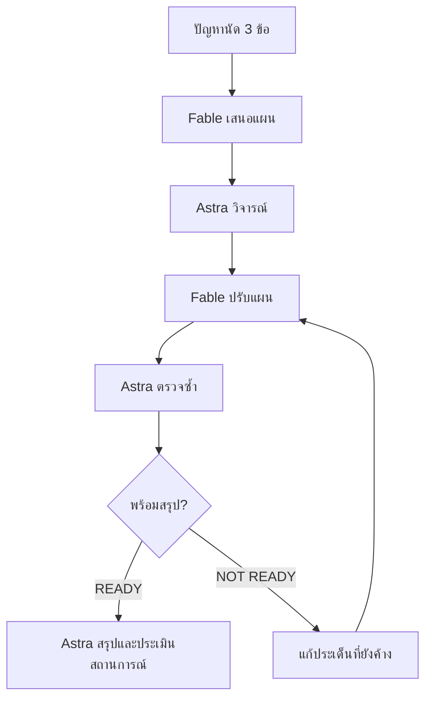
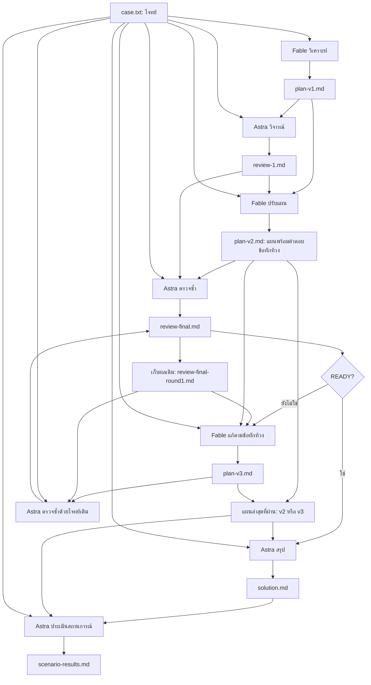

## ขั้นที่ 4 · จากปัญหาคลินิกสู่แผนฟีเจอร์

ใช้โจทย์เล็กหนึ่งเรื่องเพื่อฝึกให้ **Fable วิเคราะห์ → Astra วิจารณ์ → Fable ปรับแผน → Astra ตรวจซ้ำ** แล้วสรุปข้อเสนอเป็นขั้นตอน ทั้งสองโมเดลใช้ effort **high**

### 4.1 อ่านโจทย์: ช่วยคลินิกจัดนัดให้ตรงกัน

> **คลินิกเดียวกัน ทุกคนควรเห็นคิวชุดเดียวกัน**
>
> ลูกค้านัดทางโทรศัพท์ แชต และหน้าร้าน แต่พนักงานจดคนละที่ จึงรับคิวซ้ำหรือยังใช้เวลาเดิมหลังลูกค้าขอเลื่อน ภารกิจคือออกแบบรายการนัดกลางและวิธีทำงานที่พนักงานทั้งสองกะใช้ร่วมกันได้

| รู้จักคลินิก | รายละเอียดสมมติ |
|---|---|
| ขนาดและเวลาเปิด | 1 สาขา · 09:00–19:00 น. |
| ทีมงาน | สัตวแพทย์ 2 คน · พนักงานต้อนรับ 4 คน แบ่ง 2 กะ |
| หนึ่งนัด | สัตว์ 1 ตัว · แพทย์ 1 คน · ช่องเวลา 30 นาที |
| ตารางแพทย์ | กำหนดช่วงว่างไว้ก่อน และไม่เปลี่ยนระหว่างแบบฝึก |
| ผู้ยืนยันนัด | มีผู้รับผิดชอบแก้รายการกลางทีละคน ส่งมอบงานและสิทธิ์ให้กะถัดไป |

**สมมติฐานเหล่านี้ใช้ให้แล็บง่ายขึ้นเท่านั้น** ไม่ใช่นโยบายที่เหมาะกับทุกคลินิก พนักงานคนอื่นรับเรื่องได้ แต่ต้องส่งให้ผู้รับผิดชอบยืนยันในรายการกลาง

#### ปัญหา 3 ข้อที่ต้องแก้

| ปัญหา | ตัวอย่าง | ฟีเจอร์ต้องช่วยอะไร |
|---|---|---|
| **P1 รับคิวซ้ำ** | โทรศัพท์จองแพทย์ ก. เวลา 10:00 แล้วแชตขอช่องเดียวกัน | ตรวจช่องว่างก่อนยืนยัน คำขอยังไม่กันคิว ถ้าเต็มให้เสนอเวลาอื่นและรอลูกค้าตกลง |
| **P2 เปลี่ยนนัดแล้วข้อมูลไม่ตรง** | ลูกค้าขอเลื่อน แต่พนักงานยังใช้เวลาเดิม | แก้นัดเดิม เก็บประวัติ คิวเดิมยังมีผลจนเลื่อนสำเร็จ; ยกเลิกชัดเจนแล้วจึงปล่อยคิว |
| **P3 งานตกหล่นตอนเปลี่ยนกะ** | กะใหม่ไม่รู้ว่ารอลูกค้าตอบอะไร | แสดงข้อมูลล่าสุด ผลการติดต่อ และผู้รับผิดชอบงานค้าง ก่อนติดต่อให้อ่านรายการกลางล่าสุด |

**ตัวอย่างที่ต้องอธิบายให้ได้:** จองช่องว่าง, ขอช่องที่เต็ม, เลื่อนนัดสำเร็จหรือยังไม่สำเร็จ, ยกเลิกนัดและส่งต่องาน

**งานส่ง:** แผนไม่เกิน 3 กลุ่มฟีเจอร์ พร้อมขั้นตอน เหตุผล และเกณฑ์ตรวจ ใช้ข้อมูลสมมติ ไม่ต้องสร้างเว็บหรือเขียนโปรแกรม

เรื่องเปลี่ยนเวรแพทย์ คิวชั่วคราว การแก้พร้อมกันหลายคน รายงานสถิติ และการแจ้งเตือนอัตโนมัติอยู่นอกขอบเขตครั้งนี้ จึงไม่ควรนำมาเพิ่มเป็นเงื่อนไขบังคับในการตรวจ

### 4.2 ดูภาพรวมก่อนเริ่ม



**รายละเอียดไฟล์ที่ส่งต่อ** — ทุกไฟล์อยู่ในโฟลเดอร์งานเดียวกัน



### 4.3 เตรียมโจทย์และส่งให้ Fable

สร้างโฟลเดอร์สำหรับแล็บนี้ แล้วเปิดทั้งสอง Terminal ที่โฟลเดอร์เดียวกัน บันทึกข้อความต่อไปนี้เป็น `case.txt` เพียงครั้งเดียว จากนั้นทุกขั้นจะอ่านไฟล์นี้เป็นโจทย์เดียวกัน

```text
โจทย์สมมติ: คลินิกเพื่อนสัตว์ต้องการรายการนัดกลาง
คลินิก 1 สาขา เปิด 09:00–19:00 มีสัตวแพทย์ 2 คนและพนักงานต้อนรับ 4 คนแบ่ง 2 กะ ลูกค้าติดต่อทางโทรศัพท์ แชต หรือหน้าร้าน ปัจจุบันจดสมุดและตารางแยกกัน จึงรับเวลาซ้ำและเลื่อนนัดแล้วอีกกะไม่รู้
ขอบเขตการฝึก: ออกแบบขั้นตอนธุรกิจและฟีเจอร์ ไม่สร้างเว็บหรือโค้ด ใช้ข้อมูลสมมติเท่านั้น
สมมติฐานเพื่อลดความซับซ้อน (ไม่ใช่นโยบายจริง): นัดละ 30 นาที เริ่มตรงชั่วโมงหรือครึ่งชั่วโมง ตารางเวลาว่างของแพทย์กำหนดไว้ล่วงหน้าและไม่เปลี่ยนระหว่างการฝึก หนึ่งนัดต่อสัตว์หนึ่งตัวและแพทย์หนึ่งคน พนักงานคนอื่นรับเรื่องได้ แต่มีผู้รับผิดชอบแก้/ยืนยันรายการกลางเพียงคนเดียวในแต่ละขณะ ส่งมอบสิทธิ์และงานค้างเมื่อเปลี่ยนกะ จึงไม่ทดสอบการเขียนพร้อมกัน
P1 รับนัด: บันทึกชื่อสมมติของเจ้าของ สัตว์ แพทย์ วันเวลา และช่องทางในรายการกลาง แยกคำขอออกจากนัดยืนยัน คำขอไม่กันคิว ตรวจเวลาว่างก่อนยืนยัน ถ้าเต็มเสนอช่องอื่น และต้องได้รับความตกลงจากลูกค้าสำหรับช่องที่จะยืนยัน ห้ามมีสองนัดยืนยันในช่องเดียวกันของแพทย์เดียวกัน
P2 เลื่อน/ยกเลิก: แก้ในนัดเดิม เมื่อขอเลื่อนให้คิวเดิมยังมีผลจนลูกค้าตกลงและตรวจช่องใหม่ว่างแล้วจึงเปลี่ยนเวลาและปล่อยคิวเดิม ถ้าช่องใหม่เต็มหรือยังไม่ตกลงให้คงเดิม ไม่กันคิวใหม่ชั่วคราว ไม่สร้างนัดซ้ำ ยกเลิกเมื่อได้รับคำยกเลิกชัดเจนและปล่อยคิว เก็บผู้แก้และการเปลี่ยนแปลง
P3 ส่งต่องาน: รายการเดียวแสดงนัดล่าสุด ผลการติดต่อล่าสุด และผู้รับผิดชอบงานที่ยังรอลูกค้าตอบ ก่อนติดต่อลูกค้าให้เปิดอ่านข้อมูลกลางล่าสุด และส่งต่องานค้างให้ผู้รับผิดชอบกะใหม่ ไม่ต้องออกแบบการอัปเดตหน้าจออัตโนมัติหรือโทรเตือนอัตโนมัติ
เสนอไม่เกิน 3 กลุ่มฟีเจอร์ เชื่อม P1–P3 กับขั้นตอนและเกณฑ์ตรวจให้ครบ ไม่เพิ่มขั้นตอนซับซ้อนนอกโจทย์
นอกขอบเขต: การแก้เวรแพทย์ การถือคิวชั่วคราว การแก้ข้อมูลพร้อมกันหลายคน รายงานมา/ไม่มา การแจ้งเตือนอัตโนมัติ การรักษา คลังยา การเงิน และข้อมูลจริง
ตรวจ 4 สถานการณ์: จองช่องว่าง; ขอช่องที่มีนัดยืนยันแล้ว; เลื่อนนัด (สำเร็จ/ช่องใหม่เต็มหรือยังไม่ตกลง); ยกเลิกและส่งต่องานข้ามกะ
ผลที่ต้องได้คือข้อเสนอที่ทำตามเป็นขั้นตอนได้ พร้อมข้อจำกัดของสมมติฐาน ไม่กล่าวอ้างว่าทดสอบซอฟต์แวร์จริง
```

**วิธีใช้พรอมต์ด้านล่าง:** เปิด `yolo1 --model fable --effort high` สำหรับ Fable และ `cyolo1 --model gpt-6-astra -c model_reasoning_effort=high` สำหรับ Astra จากนั้นคัดลอกพรอมต์ไปวางในหน้าสนทนาของค่ายที่ระบุ รอให้เขียนไฟล์เสร็จก่อนเริ่มขั้นถัดไป ผู้เรียนเป็นผู้สลับ Terminal ส่งงานผ่านไฟล์ร่วมกัน

**ที่มาของตัวอย่างผลจริง:** รอบนี้รัน CLI แยกทีละขั้น โดยส่งเนื้อหาไฟล์ input ให้แต่ละโมเดลและบันทึกคำตอบเป็นไฟล์ output จึงเป็นหลักฐานการส่งงานผ่านไฟล์ ไม่ใช่หลักฐานว่าโมเดลเรียกอีกค่ายโดยอัตโนมัติ

#### Fable: เขียนแผนฉบับแรก

**พรอมต์สำหรับคัดลอก → yolo1**

```text
อ่าน case.txt ในโฟลเดอร์ปัจจุบัน ถ้าไฟล์ไม่ครบให้หยุดและแจ้งชื่อไฟล์ที่ขาด
วิเคราะห์สาเหตุ เสนอไม่เกิน 3 กลุ่มฟีเจอร์ ตาราง P1–P3 → ฟีเจอร์ → ขั้นตอน → เกณฑ์ตรวจ ระบุสมมติฐานและจุดอ่อน 2 ข้อ
ใช้ภาษาไทย บันทึกคำตอบลง plan-v1.md โดยไม่แก้ไฟล์ input
```

| INPUT ที่อ่าน | OUTPUT ที่สร้าง |
|---|---|
| `case.txt` | `plan-v1.md` |

#### 🟩 OUTPUT จริง: plan-v1.md

> **คำตอบจาก Fable · high · exit code 0**
> ข้อความด้านล่างเป็นผลรันจริงของโจทย์ฉบับง่าย ไม่ใช่ตัวอย่างที่แต่งขึ้น

[เปิดไฟล์ output](clinic-simple/plan-v1.md) · [input ที่ส่งจริง](clinic-simple/plan-v1-input.txt)

````markdown
## 1. สาเหตุของปัญหา

ปัญหารับเวลาซ้ำและเลื่อนนัดแล้วอีกกะไม่รู้ มาจากสาเหตุร่วมกัน 4 ข้อ

- **ไม่มีแหล่งข้อมูลเดียว** สมุดจดและตารางแยกกันตามช่องทางและตามกะ จึงไม่มีที่ใดแสดงนัดล่าสุดของแพทย์แต่ละคนครบทั้งวัน
- **ไม่แยกคำขอออกจากนัดยืนยัน** พนักงานจดคำขอของลูกค้าเหมือนเป็นนัดจริง ทั้งที่ยังไม่ได้ตรวจช่องว่างและยังไม่ได้ความตกลง จึงกันคิวผิดหรือรับซ้ำ
- **ไม่มีขั้นตรวจก่อนยืนยัน** การรับนัดพึ่งความจำของพนักงานว่าช่องนั้นว่างหรือไม่ ไม่มีจุดบังคับให้เปิดดูรายการกลางก่อนตอบลูกค้า
- **งานค้างไม่ถูกส่งมอบ** เรื่องที่รอลูกค้าตอบ เช่น เสนอช่องใหม่แล้วลูกค้าขอคิดก่อน ถูกจดไว้ในสมุดของกะเดิม กะถัดไปไม่เห็นและไม่รู้ว่าใครต้องตามต่อ

## 2. กลุ่มฟีเจอร์ที่เสนอและการเชื่อมกับ P1–P3

เสนอ 3 กลุ่ม โดยทุกกลุ่มทำงานบนรายการนัดกลางชุดเดียว

- **กลุ่ม A รายการนัดกลางและสถานะ** หนึ่งแถวต่อหนึ่งนัด มีช่อง ชื่อเจ้าของ ชื่อสัตว์ แพทย์ วันเวลา ช่องทางติดต่อ สถานะ ผู้แก้ล่าสุด และประวัติการเปลี่ยนแปลง สถานะมี 3 ค่าคือ คำขอ ยืนยัน และยกเลิก เฉพาะสถานะยืนยันเท่านั้นที่กันคิว
- **กลุ่ม B ตรวจช่องว่างและยืนยันโดยได้ความตกลง** มุมมองตารางช่องเวลาของแพทย์แต่ละคนแบบ 30 นาที ใช้ตรวจว่าช่องใดมีนัดยืนยันอยู่แล้ว ก่อนเปลี่ยนสถานะเป็นยืนยันหรือเปลี่ยนเวลา ต้องผ่านการตรวจนี้และบันทึกว่าลูกค้าตกลงแล้ว
- **กลุ่ม C บันทึกการติดต่อและส่งมอบกะ** ทุกนัดมีช่อง ผลการติดต่อล่าสุด และ ผู้รับผิดชอบงานค้าง มีรายการรวมงานที่ยังรอลูกค้าตอบ ใช้เป็นเอกสารส่งมอบเมื่อเปลี่ยนกะ

| ขั้นตอน | ฟีเจอร์ | ลำดับการทำงาน | เกณฑ์ตรวจ |
|---|---|---|---|
| P1 รับนัด | A, B | 1. รับข้อมูลจากลูกค้าและสร้างแถวสถานะ คำขอ 2. เปิดตารางช่องเวลาของแพทย์ที่ขอ 3. ถ้าว่างเสนอช่องนั้น ถ้าเต็มเสนอช่องอื่นอย่างน้อย 1 ช่อง 4. เมื่อลูกค้าตกลง บันทึกความตกลงและเปลี่ยนสถานะเป็น ยืนยัน 5. ถ้ายังไม่ตกลง คงสถานะ คำขอ และบันทึกผู้รับผิดชอบติดตาม | แถวสถานะ คำขอ ไม่ปรากฏเป็นช่องเต็มในตาราง ไม่มีสองแถวสถานะ ยืนยัน ที่แพทย์และเวลาตรงกัน ทุกแถวสถานะ ยืนยัน มีบันทึกความตกลงและช่องทางติดต่อ |
| P2 เลื่อน หรือยกเลิก | A, B | เลื่อน 1. เปิดแถวเดิม 2. ตรวจช่องใหม่ในตาราง 3. ถ้าว่างและลูกค้าตกลง แก้เวลาในแถวเดิม ช่องเดิมว่างทันที 4. ถ้าเต็มหรือยังไม่ตกลง คงเวลาเดิม บันทึกผลการติดต่อและผู้ติดตาม ยกเลิก 1. ได้คำยกเลิกชัดเจน 2. เปลี่ยนสถานะเป็น ยกเลิก ช่องเดิมว่าง | ไม่มีการสร้างแถวใหม่จากการเลื่อน ระหว่างรอคำตอบ ช่องเดิมยังถือว่าเต็มและช่องใหม่ยังว่าง ประวัติบันทึกเวลาเก่า เวลาใหม่ ผู้แก้ และเวลาที่แก้ แถวยกเลิกยังคงอยู่แต่ไม่กันคิว |
| P3 ส่งต่องาน | A, C | 1. ก่อนติดต่อลูกค้าทุกครั้ง เปิดแถวล่าสุดของนัดนั้น 2. หลังติดต่อ บันทึกผลการติดต่อล่าสุดและผู้รับผิดชอบถ้ายังรอคำตอบ 3. เมื่อเปลี่ยนกะ ผู้รับผิดชอบเดิมเปิดรายการงานค้าง โอนชื่อผู้รับผิดชอบเป็นคนของกะใหม่ทีละรายการ | ทุกงานค้างมีผู้รับผิดชอบเพียงคนเดียวและเป็นคนที่อยู่ในกะปัจจุบัน ไม่มีงานค้างที่ผู้รับผิดชอบเป็นคนของกะที่ออกไปแล้ว ผลการติดต่อล่าสุดของแถวตรงกับสิ่งที่ลูกค้าได้ยินครั้งสุดท้าย |

## 3. การตรวจ 4 สถานการณ์ สมมติฐาน และจุดอ่อน

การตรวจนี้เป็นการเดินตามขั้นตอนบนกระดาษด้วยข้อมูลสมมติ ไม่ใช่การทดสอบซอฟต์แวร์จริง

- **จองช่องว่าง** เจ้าของ สมชาย พาแมว ปุย ขอพบ หมอ ก เวลา 10:00 ทางโทรศัพท์ สร้างแถว คำขอ ตรวจตารางพบว่า 10:00 ของหมอ ก ว่าง ลูกค้าตกลง เปลี่ยนเป็น ยืนยัน ผลที่ต้องได้ ตารางแสดง 10:00 ของหมอ ก เต็ม และมีแถวยืนยันเพียงแถวเดียวในช่องนั้น
- **ขอช่องที่มีนัดยืนยันแล้ว** เจ้าของ สมหญิง ติดต่อทางแชต ขอ 10:00 ของหมอ ก เช่นกัน สร้างแถว คำขอ ตรวจตารางพบเต็ม เสนอ 10:30 ของหมอ ก หรือ 10:00 ของหมอ ข ลูกค้าเลือก 10:30 และตกลง จึงยืนยันที่ 10:30 ผลที่ต้องได้ ช่อง 10:00 ของหมอ ก ยังมีแถวยืนยันแถวเดียว ถ้าลูกค้าขอคิดก่อน แถวคง คำขอ และมีชื่อผู้ติดตาม
- **เลื่อนนัด** สมชายขอเลื่อนจาก 10:00 เป็น 14:00 กรณีสำเร็จ ตรวจ 14:00 ว่าง ลูกค้าตกลง แก้เวลาในแถวเดิม ช่อง 10:00 ว่างทันที กรณี 14:00 เต็ม เสนอช่องอื่น ถ้าลูกค้ายังไม่ตกลง แถวเดิมยังอยู่ที่ 10:00 สถานะ ยืนยัน ไม่มีการกันช่องใหม่ และบันทึกผู้ติดตาม ผลที่ต้องได้ จำนวนแถวของสมชายยังเป็น 1 ตลอดกระบวนการ
- **ยกเลิกและส่งต่องานข้ามกะ** สมหญิงส่งแชตว่าขอยกเลิกชัดเจน พนักงานกะเช้าเปลี่ยนสถานะเป็น ยกเลิก ช่อง 10:30 ว่าง ส่วนกรณีสมชายที่ยังรอตอบเรื่องเลื่อน ตอนเปลี่ยนกะ ผู้รับผิดชอบกะเช้าเปิดรายการงานค้าง โอนชื่อผู้ติดตามให้ผู้รับผิดชอบกะบ่าย เมื่อสมชายโทรกลับ พนักงานกะบ่ายเปิดแถวล่าสุดก่อนคุย จึงเห็นว่าเสนอช่องใดไปแล้ว ผลที่ต้องได้ ไม่มีงานค้างที่ผู้รับผิดชอบเป็นคนกะเช้า

**สมมติฐานที่ข้อเสนอนี้พึ่งพา** นัดละ 30 นาทีเริ่มตรงชั่วโมงหรือครึ่งชั่วโมง ตารางว่างของแพทย์คงที่ หนึ่งนัดต่อสัตว์หนึ่งตัวและแพทย์หนึ่งคน และมีผู้แก้รายการกลางเพียงคนเดียวในแต่ละขณะ

**จุดอ่อน 2 ข้อ**

1. **ผู้แก้คนเดียวเป็นคอขวด** เมื่อพนักงานอีก 3 คนรับเรื่องได้แต่แก้ไม่ได้ คำขอที่ค้างส่งให้ผู้แก้อาจถูกยืนยันช้า และช่วงที่ผู้แก้ยังไม่ทันบันทึก คนรับเรื่องอาจตอบลูกค้าไปก่อนโดยไม่รู้ว่าอีกคนกำลังส่งคำขอช่องเดียวกัน ข้อเสนอนี้ยังไม่ทดสอบการเขียนพร้อมกันตามขอบเขต จึงไม่รับประกันในกรณีนั้น
2. **ตารางแพทย์คงที่ไม่ตรงกับความจริง** ถ้าแพทย์ลาหรือปรับเวลา ช่องที่ยืนยันไปแล้วจะไม่ถูกต้องทันที และไม่มีขั้นตอนไล่ติดต่อลูกค้าทั้งหมดในช่องที่หายไป การแก้เวรแพทย์อยู่นอกขอบเขตของการฝึกนี้ จึงต้องออกแบบเพิ่มก่อนใช้จริง
````

### 4.4 Astra: ตรวจแผนรอบแรก

**พรอมต์สำหรับคัดลอก → cyolo1**

```text
อ่าน case.txt, plan-v1.md ในโฟลเดอร์ปัจจุบัน ถ้าไฟล์ไม่ครบให้หยุดและแจ้งชื่อไฟล์ที่ขาด
วิจารณ์แผนตามโจทย์ ระบุปัญหาจริง ผลกระทบ และข้อเสนอแก้ พร้อมจุดอ่อนของข้อเสนอของคุณ ห้ามเพิ่มข้อกำหนดนอกขอบเขต ถ้าไม่มีข้อขัดแย้งให้บอกตามจริง
ใช้ภาษาไทย บันทึกคำตอบลง review-1.md โดยไม่แก้ไฟล์ input
```

| INPUT ที่อ่าน | OUTPUT ที่สร้าง |
|---|---|
| `case.txt`, `plan-v1.md` | `review-1.md` |

#### 🟩 OUTPUT จริง: review-1.md

> **คำตอบจาก Astra · high · exit code 0**
> ข้อความด้านล่างเป็นผลรันจริงของโจทย์ฉบับง่าย ไม่ใช่ตัวอย่างที่แต่งขึ้น

[เปิดไฟล์ output](clinic-simple/review-1.md) · [input ที่ส่งจริง](clinic-simple/review-1-input.txt)

````markdown
แผน v1 ตรงกับโจทย์ในสาระหลัก และไม่จำเป็นต้องเพิ่มกลุ่มฟีเจอร์ แผนแยกคำขอออกจากนัดยืนยัน ให้เฉพาะนัดยืนยันกันคิว เลื่อนโดยแก้นัดเดิม เก็บคิวเดิมระหว่างรอคำตอบ และยกเลิกเมื่อได้รับคำยกเลิกชัดเจน ทั้งยังระบุถูกต้องว่าตรวจด้วยการเดินตามขั้นตอนบนกระดาษ ไม่ใช่ทดสอบซอฟต์แวร์จริง อย่างไรก็ตาม มีข้อขัดแย้งเฉพาะจุดในเกณฑ์ตรวจการเลื่อนนัด และรายละเอียดบางส่วนยังไม่ชัดพอให้พนักงานต่างกะทำตามได้ตรงกัน

1. **สาเหตุบางข้อเป็นข้อสันนิษฐาน แต่เขียนเหมือนข้อเท็จจริง**

   โจทย์ยืนยันว่ามีสมุดและตารางแยกกัน เกิดการรับเวลาซ้ำ และอีกกะไม่ทราบการเลื่อนนัด แต่ไม่ได้ยืนยันว่าพนักงานจดคำขอเหมือนนัดจริง หรือรับนัดโดยพึ่งความจำเสมอ การระบุพฤติกรรมเหล่านี้เป็นสาเหตุแน่นอนอาจทำให้ข้อเสนอแก้ปัญหาตั้งอยู่บนข้อสรุปที่ไม่มีหลักฐาน

   ควรแยกเป็น “ปัญหาที่โจทย์ระบุ” กับ “ช่องโหว่ที่แผนต้องป้องกัน” เช่น การไม่แยกคำขอและการไม่ตรวจเวลาซ้ำเป็นความเสี่ยงที่ขั้นตอนใหม่จะควบคุม วิธีนี้ยังใช้ข้อเสนอเดิมได้ครบ โดยไม่ต้องเพิ่มการสำรวจหรือกิจกรรมนอกการฝึก

2. **การตรวจช่องว่างยังไม่ครอบคลุมเงื่อนไข และจังหวะตรวจก่อนยืนยันยังคลุมเครือ**

   กลุ่ม B เน้นตรวจว่ามีนัดยืนยันอยู่แล้วหรือไม่ แต่ช่องที่ไม่มีนัดไม่ได้หมายความว่าแพทย์ว่างเสมอไป ต้องอยู่ในตารางเวลาว่างที่กำหนดไว้ล่วงหน้าด้วย และนัดต้องอยู่ภายในเวลาเปิดคลินิก สำหรับนัด 30 นาที ช่องเริ่มสุดท้ายจึงเป็น 18:30

   อีกจุดหนึ่งคือ P1 ให้ตรวจช่องก่อนเสนอ แล้วเปลี่ยนสถานะเมื่อลูกค้าตกลง โดยไม่ได้เขียนชัดว่าต้องตรวจอีกครั้งก่อนบันทึกยืนยัน หากลูกค้าตอบภายหลัง ผู้แก้คนเดียวอาจยืนยันช่องนั้นให้รายอื่นไปแล้วระหว่างรอ ปัญหานี้เกิดได้แม้ไม่มีการเขียนพร้อมกัน

   ควรใช้เกณฑ์เดียวกันทั้ง P1 และ P2 ว่า ก่อนยืนยันหรือเปลี่ยนเวลา ผู้รับผิดชอบต้องตรวจแพทย์ วันที่ เวลาเริ่ม ตารางว่าง และนัดยืนยันล่าสุด พร้อมตรวจว่าความตกลงของลูกค้าตรงกับช่องที่จะบันทึก หากช่องนั้นเต็มแล้วให้เสนอช่องอื่นและรอความตกลงใหม่ คำขอยังคงไม่กันคิว

3. **เกณฑ์ตรวจการเลื่อนนัดมีข้อขัดแย้งจริงหนึ่งจุด**

   ข้อความ “ระหว่างรอคำตอบ ช่องเดิมยังถือว่าเต็มและช่องใหม่ยังว่าง” ไม่ถูกต้องทุกกรณี เพราะช่องใหม่อาจเต็มตั้งแต่แรก หรือมีลูกค้ารายอื่นจองระหว่างรอคำตอบได้ การยืนยันว่าช่องใหม่ต้องว่างจึงขัดกับหลักที่คำขอเลื่อนไม่กันคิว

   ควรแก้เป็น “ระหว่างรอคำตอบ นัดเดิมยังยืนยันเวลาเดิม และคำขอเลื่อนไม่กันช่องใหม่ ส่วนช่องใหม่แสดงสถานะตามนัดยืนยันที่มีอยู่จริง” เมื่อได้รับความตกลงและตรวจช่องใหม่ว่างแล้ว จึงเปลี่ยนเวลาในนัดเดิมและปล่อยคิวเก่า

   ควรระบุด้วยว่าช่องที่เสนอเพื่อเลื่อนและผลการติดต่อบันทึกไว้ในนัดเดิม โดยไม่เปลี่ยนวันเวลานัดที่ยืนยันอยู่จนกว่าจะเลื่อนสำเร็จ มิฉะนั้นกะใหม่อาจเห็นเวลาที่เสนอแล้วเข้าใจว่าเปลี่ยนนัดเรียบร้อย

4. **การส่งมอบงานค้างยังไม่เท่ากับการส่งมอบสิทธิ์แก้รายการกลาง**

   P3 โอนชื่อผู้ติดตามทีละงาน แต่ไม่ได้กำหนดขั้นตอนส่งมอบหน้าที่ผู้แก้และยืนยันรายการกลาง ทั้งสองบทบาทควรแยกให้เข้าใจชัด เพราะผู้ติดตามหลายงานอาจเป็นคนละคนได้ ขณะที่ผู้แก้รายการกลางต้องมีเพียงคนเดียวในแต่ละขณะ

   ควรเพิ่มรายละเอียดภายในกลุ่ม C ว่า เมื่อเปลี่ยนกะ ผู้รับผิดชอบเดิมบันทึกผลล่าสุดและงานที่รับมาแต่ยังจัดการไม่เสร็จ ส่งมอบงานค้างให้กะใหม่ แล้วระบุให้ชัดว่าใครรับหน้าที่แก้และยืนยันต่อ ผู้รับผิดชอบเดิมหยุดแก้เมื่อส่งมอบหน้าที่แล้ว พนักงานคนอื่นยังรับเรื่องและส่งให้ผู้รับผิดชอบได้ แต่การยืนยันต้องผ่านผู้รับผิดชอบรายการกลาง

   ผลที่ต้องตรวจคือ ทั้งงานรอลูกค้าตอบและหน้าที่แก้รายการมีผู้รับช่วงชัดเจน โดยไม่ต้องออกแบบระบบสิทธิ์ทางเทคนิคหรือทดสอบการเขียนพร้อมกัน

5. **ข้อมูลการติดต่อมีอยู่แล้ว แต่เกณฑ์ตรวจและการปิดงานควรชัดขึ้น**

   เกณฑ์ “ตรงกับสิ่งที่ลูกค้าได้ยินครั้งสุดท้าย” ตรวจได้ยากและไม่ครอบคลุมแชต ควรเปลี่ยนเป็น “ตรงกับเหตุการณ์ติดต่อล่าสุดในข้อมูลสมมติ” เช่น เสนอช่องใด ลูกค้าตอบว่าอย่างไร และยังรอคำตอบเรื่องใด โดยใช้ช่องผลการติดต่อล่าสุดที่เสนอไว้แล้ว

   เมื่อยืนยัน เลื่อนสำเร็จ หรือยกเลิกจนไม่เหลือเรื่องรอตอบ ต้องนำเรื่องนั้นออกจากรายการงานค้างด้วย แต่ยังเก็บประวัติเดิมไว้ มิฉะนั้นกะใหม่อาจติดต่อต่อจากงานที่จบแล้ว การยกเลิกควรตรวจว่ามีบันทึกคำยกเลิกชัดเจน ผู้แก้ และการเปลี่ยนสถานะตามข้อกำหนดเดิม

   นอกจากนี้ ตารางเชื่อมโยงควรระบุ P1 และ P2 ว่าใช้กลุ่ม C ด้วย เพราะทั้งสองขั้นตอนมีการบันทึกการติดต่อและผู้ติดตามอยู่แล้ว เรื่องนี้เป็นการแก้ความครบถ้วนของเอกสาร ไม่ใช่การเพิ่มฟีเจอร์

การตรวจสี่สถานการณ์ควรปรับให้มีข้อมูลตั้งต้นและผลที่คาดหวังแน่นอน โดยระบุวันที่สมมติเดียวกันเมื่อเปรียบเทียบช่อง และใส่ชื่อสัตว์ในกรณีของสมหญิงด้วย เพราะหนึ่งนัดผูกกับสัตว์หนึ่งตัว ตัวอย่างเดิมระบุเพียงเวลา จึงยังไม่ชัดว่านัดใดชนกันในวันเดียวกัน

- **จองช่องว่าง:** ตรวจว่าช่องอยู่ในเวลาทำการและตารางว่างของแพทย์ คำขอไม่กันคิว จากนั้นได้รับความตกลง ตรวจล่าสุด และยืนยันเพียงนัดเดียว พร้อมข้อมูลตาม P1 ครบ
- **ขอช่องที่มีนัดยืนยันแล้ว:** นัดเดิมต้องคงอยู่ เสนอช่องอื่นที่ว่าง หากลูกค้าตกลงจึงตรวจและยืนยันช่องที่เลือก หากยังไม่ตกลงให้คงคำขอและมีผู้รับผิดชอบงานค้าง
- **เลื่อนนัด:** แยกตรวจสามทางจากข้อมูลตั้งต้นเดียวกัน ได้แก่ สำเร็จ ช่องใหม่เต็ม และช่องใหม่ว่างแต่ลูกค้ายังไม่ตกลง กรณีสำเร็จแก้นัดเดิมและปล่อยคิวเก่า อีกสองกรณีคงนัดเดิม ไม่กันคิวใหม่ และไม่สร้างรายการนัดเพิ่ม
- **ยกเลิกและส่งต่องานข้ามกะ:** ตรวจคำยกเลิก การปล่อยคิว และประวัติผู้แก้ พร้อมส่งมอบงานเลื่อนที่ยังรอตอบและหน้าที่แก้รายการให้กะใหม่ ผู้รับช่วงต้องอ่านข้อมูลล่าสุดก่อนติดต่อ และเห็นข้อเสนอเดิมกับสถานะนัดที่ยังมีผลตรงกัน

ควรระบุว่ากรณีย่อยของการเลื่อนเริ่มใหม่จากนัดเดิมเวลา 10:00 ไม่ใช่ดำเนินต่อจากกรณีที่เลื่อนไป 14:00 สำเร็จแล้ว และตรวจจำนวนรายการของ “นัดที่กำลังเลื่อน” แทนจำนวนแถวทั้งหมดของเจ้าของ เพราะเจ้าของคนหนึ่งอาจมีสัตว์หลายตัวได้

ข้อเสนอแก้นี้ยังมีจุดอ่อน คือพึ่งความครบถ้วนของการบันทึกและการทำตามขั้นตอนของผู้รับผิดชอบคนเดียว จึงยังเกิดความล่าช้าหรือตกหล่นได้ การเดินสถานการณ์บนกระดาษช่วยตรวจความสอดคล้องของขั้นตอน แต่ไม่ยืนยันว่าซอฟต์แวร์ป้องกันนัดซ้ำได้จริง และไม่แสดงความสามารถรองรับงานพร้อมกัน สมมติฐานเรื่องระยะเวลานัดและตารางแพทย์คงที่ยังจำกัดการนำผลไปใช้จริง อย่างไรก็ตาม ข้อจำกัดเหล่านี้ไม่ใช่เหตุให้เพิ่มการแก้เวร การถือคิว หรือระบบอัตโนมัติเข้ามาในการฝึกครั้งนี้
````

## ขั้นที่ 5 · ปรับแผนและตรวจซ้ำ

### 5.1 Fable: ตอบข้อทักท้วงและปรับแผน

**พรอมต์สำหรับคัดลอก → yolo1**

```text
อ่าน case.txt, plan-v1.md, review-1.md ในโฟลเดอร์ปัจจุบัน ถ้าไฟล์ไม่ครบให้หยุดและแจ้งชื่อไฟล์ที่ขาด
ตอบข้อทักท้วงว่ารับหรือไม่รับพร้อมเหตุผล แล้วเขียนแผนฉบับสมบูรณ์ที่ปรับแล้วในคำตอบเดียว ครบ P1–P3 สถานะ ขั้นตอน และเกณฑ์ตรวจ ทบทวนจุดอ่อนของแผนตนเอง
ใช้ภาษาไทย บันทึกคำตอบลง plan-v2.md โดยไม่แก้ไฟล์ input
```

| INPUT ที่อ่าน | OUTPUT ที่สร้าง |
|---|---|
| `case.txt`, `plan-v1.md`, `review-1.md` | `plan-v2.md` |

#### 🟩 OUTPUT จริง: plan-v2.md

> **คำตอบจาก Fable · high · exit code 0**
> ข้อความด้านล่างเป็นผลรันจริงของโจทย์ฉบับง่าย ไม่ใช่ตัวอย่างที่แต่งขึ้น

[เปิดไฟล์ output](clinic-simple/plan-v2.md) · [input ที่ส่งจริง](clinic-simple/plan-v2-input.txt)

````markdown
## ส่วนที่ 1 คำตอบต่อข้อทักท้วง

รับทุกข้อ โดยมีเงื่อนไขในข้อ 5 หนึ่งจุด

1. **รับ** สาเหตุข้อ 2–3 ของ v1 เป็นข้อสันนิษฐาน ไม่ใช่ข้อเท็จจริงจากโจทย์ v2 แยกเป็น "ปัญหาที่โจทย์ระบุ" กับ "ช่องโหว่ที่ขั้นตอนต้องป้องกัน" โดยไม่เพิ่มการสำรวจ
2. **รับ** การตรวจช่องว่างต้องรวมเวลาทำการ ตารางว่างของแพทย์ และตรวจซ้ำก่อนบันทึกยืนยัน เพราะช่องอาจถูกยืนยันให้รายอื่นระหว่างรอลูกค้าตอบ แม้มีผู้แก้คนเดียว v2 กำหนดเกณฑ์ตรวจร่วมชุดเดียวใช้ทั้ง P1 และ P2
3. **รับ** เกณฑ์ "ช่องใหม่ยังว่าง" ของ v1 ขัดกับหลักคำขอเลื่อนไม่กันคิว แก้ตามที่เสนอ และระบุว่าช่องที่เสนอบันทึกในผลการติดต่อ ไม่แตะวันเวลาที่ยืนยันอยู่
4. **รับ** แยกบทบาท "ผู้รับผิดชอบรายการกลาง" (คนเดียวต่อขณะ) ออกจาก "ผู้ติดตามงาน" (หลายคนได้) และเพิ่มขั้นส่งมอบหน้าที่แก้ในการเปลี่ยนกะ
5. **รับโดยมีเงื่อนไข** เปลี่ยนเกณฑ์ผลการติดต่อและเพิ่มการปิดงานค้างตามที่เสนอ แต่ไม่เพิ่มสถานะนัดค่าที่สี่ ใช้ช่อง "งานค้าง" แยกจากสถานะนัด เพื่อคงสถานะ 3 ค่าและไม่เพิ่มความซับซ้อน
6. **รับ** ข้อเสนอเรื่องสถานการณ์ตรวจ ใช้วันสมมติเดียวกัน ระบุชื่อสัตว์ทุกกรณี แยกกรณีเลื่อน 3 ทางจากข้อมูลตั้งต้นเดียวกัน และนับจำนวนรายการของ "นัดที่กำลังเลื่อน" ไม่ใช่ของเจ้าของ

## ส่วนที่ 2 แผนฉบับปรับแล้ว (v2)

### 2.1 ปัญหาและช่องโหว่

**ปัญหาที่โจทย์ระบุ** สมุดและตารางแยกตามช่องทางและกะ ทำให้รับเวลาซ้ำ และเลื่อนนัดแล้วอีกกะไม่รู้

**ช่องโหว่ที่ขั้นตอนใหม่ต้องป้องกัน** (ความเสี่ยง ไม่ใช่ข้อสรุปเรื่องพฤติกรรม)
- คำขอถูกนับเป็นนัดจริงก่อนตรวจและก่อนได้ความตกลง
- ยืนยันโดยไม่ตรวจข้อมูลล่าสุด หรือตรวจครั้งเดียวแล้วบันทึกทีหลัง
- งานที่รอลูกค้าตอบและหน้าที่แก้รายการไม่ถูกส่งมอบข้ามกะ

### 2.2 กลุ่มฟีเจอร์ 3 กลุ่ม บนรายการนัดกลางชุดเดียว

- **กลุ่ม A รายการนัดกลางและสถานะ** หนึ่งแถวต่อหนึ่งนัด ช่องข้อมูล: เจ้าของ สัตว์ แพทย์ วันที่ เวลาเริ่ม ช่องทาง สถานะ ผู้แก้ล่าสุด และประวัติการเปลี่ยนแปลง (เวลาแก้ ผู้แก้ ค่าเก่า ค่าใหม่) สถานะมี 3 ค่า: **คำขอ / ยืนยัน / ยกเลิก** เฉพาะ ยืนยัน กันคิว
- **กลุ่ม B ตรวจช่องและยืนยันโดยความตกลง** ตารางช่อง 30 นาทีต่อแพทย์ต่อวัน แสดงเวลาทำการ ตารางว่างของแพทย์ และนัดยืนยันล่าสุด ใช้ตาม "เกณฑ์ตรวจร่วม" ข้อ 2.3
- **กลุ่ม C บันทึกการติดต่อและส่งมอบกะ** ทุกแถวมีช่อง ผลการติดต่อล่าสุด (เสนอช่องใด ลูกค้าตอบอย่างไร รอเรื่องใด) ช่อง งานค้าง (มี/ไม่มี) และ ผู้ติดตาม พร้อมรายการรวมงานค้าง และช่อง "ผู้รับผิดชอบรายการกลางปัจจุบัน" ระบุคนเดียว

**บทบาท** พนักงานทุกคนรับเรื่องและส่งให้ผู้รับผิดชอบรายการกลางได้ ผู้รับผิดชอบรายการกลางเป็นคนเดียวที่แก้และยืนยัน ผู้ติดตามงานเป็นได้หลายคนตามงาน

### 2.3 เกณฑ์ตรวจร่วมก่อนยืนยันหรือเปลี่ยนเวลา (ใช้ทั้ง P1 และ P2)

ผู้รับผิดชอบรายการกลางต้องตรวจ ณ เวลาที่จะบันทึก ไม่ใช่เวลาที่เสนอ
1. เวลาเริ่มตรงชั่วโมงหรือครึ่งชั่วโมง อยู่ในเวลาทำการ ช่องเริ่มสุดท้าย 18:30
2. ช่องอยู่ในตารางว่างของแพทย์คนนั้น
3. ไม่มีนัดสถานะ ยืนยัน ของแพทย์ วันที่ และเวลาเดียวกัน
4. มีบันทึกความตกลงของลูกค้าที่ระบุแพทย์ วันที่ เวลา ตรงกับช่องที่จะบันทึก
5. ถ้าข้อใดไม่ผ่าน ไม่บันทึก เสนอช่องอื่น รอความตกลงใหม่ แถวยังไม่กันคิว

### 2.4 ขั้นตอนและเกณฑ์ตรวจ P1–P3

| ขั้นตอน | ฟีเจอร์ | ลำดับการทำงาน | เกณฑ์ตรวจ |
|---|---|---|---|
| P1 รับนัด | A, B, C | 1. สร้างแถว คำขอ พร้อมข้อมูลครบและช่องทาง 2. ดูตารางแพทย์ที่ขอ ถ้าว่างเสนอช่องนั้น ถ้าไม่ว่างเสนออย่างน้อย 1 ช่อง 3. บันทึกผลการติดต่อ ถ้ารอตอบ ตั้ง งานค้าง = มี และผู้ติดตาม 4. เมื่อลูกค้าตกลง ตรวจตาม 2.3 ทั้ง 5 ข้อแล้วเปลี่ยนเป็น ยืนยัน ตั้ง งานค้าง = ไม่มี 5. ถ้าตรวจไม่ผ่าน กลับไปข้อ 2 | แถว คำขอ ไม่ทำให้ช่องเต็ม ไม่มีสองแถว ยืนยัน ที่แพทย์ วันที่ เวลาตรงกัน ทุกแถว ยืนยัน มีบันทึกความตกลงตรงกับช่อง และประวัติผู้แก้ |
| P2 เลื่อน / ยกเลิก | A, B, C | **เลื่อน** 1. เปิดแถวเดิม 2. ดูตารางช่องใหม่ เสนอลูกค้า บันทึกช่องที่เสนอในผลการติดต่อโดยไม่แก้วันเวลา 3. เมื่อตกลง ตรวจตาม 2.3 แล้วแก้วันเวลาในแถวเดิม ช่องเก่าว่างทันที 4. ถ้าไม่ผ่านหรือยังไม่ตกลง คงเวลาเดิม ตั้ง งานค้าง = มี และผู้ติดตาม **ยกเลิก** 1. บันทึกคำยกเลิกชัดเจนพร้อมช่องทาง 2. เปลี่ยนเป็น ยกเลิก ช่องว่าง ตั้ง งานค้าง = ไม่มี | ไม่สร้างแถวใหม่จากการเลื่อน ระหว่างรอคำตอบ นัดเดิมยัง ยืนยัน เวลาเดิม คำขอเลื่อนไม่กันช่องใหม่ ช่องใหม่แสดงตามนัดยืนยันที่มีจริง ประวัติมีเวลาเก่า เวลาใหม่ ผู้แก้ เวลาแก้ แถว ยกเลิก คงอยู่แต่ไม่กันคิว และมีบันทึกคำยกเลิก |
| P3 ส่งต่องาน | A, C | 1. ก่อนติดต่อลูกค้า เปิดแถวล่าสุดและอ่านผลการติดต่อล่าสุด 2. หลังติดต่อ บันทึกผล ปรับงานค้างและผู้ติดตาม 3. เปลี่ยนกะ: ผู้รับผิดชอบเดิมบันทึกผลล่าสุดทุกงาน โอนผู้ติดตามงานค้างให้คนกะใหม่ทีละรายการ แล้วเปลี่ยนช่อง ผู้รับผิดชอบรายการกลาง เป็นคนกะใหม่ 4. ผู้รับผิดชอบเดิมหยุดแก้หลังส่งมอบ | ทุกงานค้างมีผู้ติดตามคนเดียวและอยู่กะปัจจุบัน ผู้รับผิดชอบรายการกลางมีชื่อเดียวและเป็นคนกะปัจจุบัน ผลการติดต่อล่าสุดตรงกับเหตุการณ์ติดต่อล่าสุดในข้อมูลสมมติ งานที่ยืนยัน เลื่อนสำเร็จ หรือยกเลิกแล้วไม่อยู่ในรายการงานค้าง |

### 2.5 การตรวจ 4 สถานการณ์ (เดินขั้นตอนบนกระดาษ ไม่ใช่ทดสอบซอฟต์แวร์)

**ข้อมูลตั้งต้น** วันที่ 15 ก.ย. 2569 หมอ ก ว่าง 09:00–19:00 หมอ ข ว่าง 13:00–19:00 ไม่มีนัดยืนยัน กะเช้าผู้รับผิดชอบรายการกลางคือ นิด กะบ่ายคือ หน่อย

1. **จองช่องว่าง** สมชาย แมว ปุย ขอหมอ ก 10:00 ทางโทรศัพท์ สร้างแถว คำขอ ตรวจผ่านทั้ง 5 ข้อ สมชายตกลงในสาย ยืนยัน **ผล** หมอ ก 10:00 มีแถว ยืนยัน 1 แถว งานค้าง = ไม่มี
2. **ขอช่องที่มีนัดยืนยันแล้ว** สมหญิง สุนัข โบ้ ขอหมอ ก 10:00 ทางแชต สร้างแถว คำขอ ตรวจข้อ 3 ไม่ผ่าน เสนอหมอ ก 10:30 (หมอ ข 10:00 ไม่ผ่านข้อ 2 เพราะไม่อยู่ในตารางว่าง) ทาง ก. ตกลง 10:30 ตรวจซ้ำผ่าน ยืนยัน ทาง ข. ขอคิดก่อน คงคำขอ งานค้าง = มี ผู้ติดตาม นิด **ผล** นัดของปุยที่ 10:00 คงเดิม ไม่มีแถวคำขอใดทำให้ช่องเต็ม
3. **เลื่อนนัด** ตั้งต้นทุกทางจากนัดปุย หมอ ก 10:00 ยืนยัน ขอเลื่อนเป็น 14:00
   - สำเร็จ: 14:00 ตรวจผ่าน สมชายตกลง แก้เวลาในแถวเดิม 10:00 ว่างทันที
   - ช่องใหม่เต็ม: มีนัดยืนยันอื่นที่ 14:00 อยู่แล้ว เสนอ 14:30 บันทึกในผลการติดต่อ นัดคง 10:00
   - ช่องใหม่ว่างแต่ยังไม่ตกลง: บันทึกช่องที่เสนอ นัดคง 10:00 ไม่กัน 14:00 งานค้าง = มี ผู้ติดตาม นิด
   **ผล** จำนวนแถวของนัดปุยเป็น 1 ทุกทาง เวลาที่ยืนยันเปลี่ยนเฉพาะกรณีสำเร็จ
4. **ยกเลิกและส่งต่อข้ามกะ** สมหญิงส่งแชต "ขอยกเลิกนัดโบ้ 10:30" นิดบันทึกคำยกเลิก เปลี่ยนเป็น ยกเลิก 10:30 ว่าง ต่อมาถึงเวลาเปลี่ยนกะ นิดบันทึกผลล่าสุดของนัดปุยที่รอตอบเรื่องเลื่อน โอนผู้ติดตามเป็น หน่อย และเปลี่ยนผู้รับผิดชอบรายการกลางเป็น หน่อย เมื่อสมชายโทรกลับ หน่อยเปิดแถวล่าสุดก่อนคุย เห็นว่าเสนอ 14:00 และนัดยังยืนยัน 10:00 **ผล** ไม่มีงานค้างหรือหน้าที่แก้ที่ชื่อ นิด แถวโบ้ยังอยู่ในสถานะ ยกเลิก พร้อมประวัติผู้แก้

### 2.6 สมมติฐานและข้อจำกัด

แผนพึ่งสมมติฐานว่านัดละ 30 นาที ตารางแพทย์คงที่ หนึ่งนัดต่อสัตว์หนึ่งตัวและแพทย์หนึ่งคน และผู้แก้รายการกลางคนเดียวต่อขณะ การเดินสถานการณ์บนกระดาษยืนยันความสอดคล้องของขั้นตอนเท่านั้น ไม่ยืนยันว่าซอฟต์แวร์ใดป้องกันนัดซ้ำได้จริง และไม่ครอบคลุมการเขียนพร้อมกัน การแก้เวรแพทย์ การถือคิว และการแจ้งเตือนอัตโนมัติ

### 2.7 จุดอ่อนของแผน v2

1. **ช่องว่างระหว่างเสนอกับบันทึก** เกณฑ์ตรวจซ้ำก่อนบันทึกลดปัญหาช่องถูกใช้ไประหว่างรอ แต่ลูกค้าที่ตอบช้าอาจเสียช่องที่เคยเสนอ ต้องเสนอใหม่ซ้ำ เป็นผลจากการไม่ถือคิวชั่วคราวซึ่งอยู่นอกขอบเขต
2. **พึ่งวินัยการบันทึกของคนเดียว** ถ้าผู้รับผิดชอบรายการกลางบันทึกผลการติดต่อไม่ครบก่อนส่งมอบ กะใหม่จะทำงานบนข้อมูลผิด แผนไม่มีกลไกตรวจจับนอกจากรายการงานค้างในขั้นส่งมอบ
3. **ตารางแพทย์คงที่** หากแพทย์ลา นัดยืนยันที่ตกในช่วงนั้นจะไม่ถูกต้องทันทีและไม่มีขั้นตอนไล่ติดต่อ ต้องออกแบบเพิ่มก่อนใช้จริง
````

### 5.2 Astra: ตรวจแผนฉบับปรับปรุง

**พรอมต์สำหรับคัดลอก → cyolo1**

```text
อ่าน case.txt, plan-v2.md และ review-1.md ในโฟลเดอร์ปัจจุบัน
ตรวจว่าแผนครบ P1–P3 ไม่มีข้อขัดแย้งสำคัญ และรองรับสถานการณ์ตามโจทย์ ไม่เพิ่มเกณฑ์นอกขอบเขต
บันทึกเหตุผลลง review-final.md ลงท้าย VERDICT: READY หรือ VERDICT: NOT READY ตามจริง
```

| INPUT | OUTPUT |
|---|---|
| `case.txt`, `plan-v2.md`, `review-1.md` | `review-final.md` |

#### 🟩 OUTPUT จริง: review-final.md

> **คำตอบจาก Astra · high · exit code 0**
> ข้อความด้านล่างเป็นผลรันจริงของโจทย์ฉบับง่าย ไม่ใช่ตัวอย่างที่แต่งขึ้น

[เปิดไฟล์ output](clinic-simple/review-final.md) · [input ที่ส่งจริง](clinic-simple/review-final-input.txt)

````markdown
แผน v2 แก้ข้อทักท้วงเดิมได้เกือบครบ และจัดขั้นตอน P1–P3 ภายในสามกลุ่มฟีเจอร์ตามโจทย์ แต่ยังไม่พร้อมผ่าน เพราะมีข้อความขัดแย้งสำคัญสองจุด ได้แก่ เกณฑ์ตรวจร่วมที่อาจทำให้ปล่อยคิวเดิมเมื่อเลื่อนไม่สำเร็จ และเกณฑ์งานค้างที่อาจตัดงานรอเลื่อนออกเพียงเพราะนัดยังมีสถานะยืนยัน ทั้งสองจุดกระทบสถานการณ์หลักโดยตรง การระบุในส่วนคำตอบว่า “รับและแก้แล้ว” จึงยังไม่เพียงพอ ต้องพิจารณาขั้นตอนและเกณฑ์ตรวจในแผนประกอบกัน

1. **ส่วนที่แก้ได้ครบและควรคงไว้**

   แผนแยกปัญหาที่โจทย์ระบุออกจากความเสี่ยงที่ขั้นตอนต้องป้องกันแล้ว จึงไม่ต้องอาศัยข้อสรุปว่าพนักงานมีพฤติกรรมผิดพลาดแบบใดโดยไม่มีข้อมูลรองรับ กลุ่ม A–C ครอบคลุมข้อมูลนัด การตรวจช่อง การติดต่อ และการส่งมอบ โดยเชื่อม P1 และ P2 กับกลุ่ม C ถูกต้อง

   เกณฑ์ตรวจช่องครอบคลุมเวลาทำการ ช่องเริ่มสุดท้าย 18:30 ตารางว่างของแพทย์ นัดยืนยันล่าสุด และความตกลงที่ตรงกับแพทย์ วันที่ และเวลาที่จะบันทึก การตรวจ ณ เวลาบันทึกช่วยรองรับกรณีช่องถูกยืนยันให้รายอื่นระหว่างรอคำตอบ แม้มีผู้แก้เพียงคนเดียว

   P2 ระบุให้บันทึกช่องที่เสนอในผลการติดต่อ ไม่แก้เวลานัดเดิมระหว่างรอ ไม่สร้างนัดเพิ่ม และให้ช่องใหม่แสดงตามนัดยืนยันจริง ส่วนการยกเลิกมีคำยกเลิกชัดเจน ปล่อยคิว และเก็บประวัติครบตามหลักที่โจทย์ต้องการ

2. **ช่องโหว่สำคัญ: ข้อ 2.3 ข้อ 5 ขัดกับการรักษาคิวเดิมของ P2**

   เกณฑ์ตรวจร่วมประกาศว่าใช้ทั้งก่อนยืนยันและก่อนเปลี่ยนเวลา แต่ข้อ 5 ระบุว่า หากตรวจไม่ผ่านให้ “แถวยังไม่กันคิว” ข้อความนี้ใช้ได้กับคำขอรับนัดใหม่ใน P1 แต่ใช้กับแถวนัดเดิมที่ยืนยันแล้วใน P2 ไม่ได้ เพราะเมื่อช่องใหม่เต็มหรือยังไม่ได้ความตกลง นัดเดิมต้องยังกันคิวเดิมอยู่

   แม้ตาราง P2 จะเขียนให้คงเวลาเดิมไว้ถูกต้อง แต่ผู้ปฏิบัติยังได้รับคำสั่งสองแบบจากเอกสารเดียวกัน จึงเป็นข้อขัดแย้งสำคัญ ไม่ใช่เพียงรายละเอียดถ้อยคำ

   ควรแก้ข้อ 5 เป็น “หากเงื่อนไขไม่ครบ ห้ามยืนยันหรือเปลี่ยนเวลา สำหรับ P1 ให้คงสถานะคำขอและไม่กันคิว สำหรับ P2 ให้คงนัดยืนยันและคิวเดิม โดยไม่กันช่องใหม่ หากช่องที่เสนอใช้ไม่ได้ให้เสนอช่องอื่นและรอความตกลงสำหรับช่องนั้น” กรณีช่องยังว่างแต่ลูกค้ายังไม่ตอบ สามารถรอคำตอบเดิมได้ โดยตรวจซ้ำก่อนบันทึก ไม่จำเป็นต้องเสนอช่องอื่นทันที

3. **ช่องโหว่สำคัญ: เกณฑ์ปิดงานค้างของ P3 กว้างเกินไป**

   เกณฑ์ว่า “งานที่ยืนยัน เลื่อนสำเร็จ หรือยกเลิกแล้วไม่อยู่ในรายการงานค้าง” ยังไม่แยกสถานะนัดออกจากสถานะงานติดตามอย่างชัดเจน นัดที่ยืนยันเวลา 10:00 และกำลังรอลูกค้าตอบเรื่องเลื่อนไป 14:00 ต้องมีทั้งสถานะยืนยันและงานค้างพร้อมกัน หากตีความว่าทุกนัดยืนยันต้องไม่มีงานค้าง งานเลื่อนที่ต้องส่งต่อข้ามกะจะหายไปจากรายการติดตาม

   ควรแก้เป็น “เมื่อคำขอรับนัดได้รับการยืนยัน การเลื่อนสำเร็จ หรือการยกเลิกเสร็จสิ้น และไม่มีเรื่องรอลูกค้าตอบ ให้ตั้งงานค้างเป็นไม่มี ส่วนนัดยืนยันที่ยังรอคำตอบเรื่องเลื่อนต้องคงงานค้างและผู้ติดตามไว้” พร้อมเพิ่มขั้นตั้งงานค้างเป็นไม่มีในเส้นทางเลื่อนสำเร็จของ P2 เพื่อให้ผู้ปฏิบัติทำตามได้ทันที

   การใช้ช่องงานค้างแยกจากสถานะนัดเป็นทางเลือกที่เหมาะสม และตอบข้อทักท้วงเดิมได้โดยไม่ต้องเพิ่มสถานะนัดค่าที่สี่ ปัญหาอยู่ที่เงื่อนไขปิดงาน มิใช่จำนวนสถานะ

4. **การส่งมอบบทบาทและข้อมูลรองรับ P3 แล้ว**

   แผนแยกผู้รับผิดชอบรายการกลางออกจากผู้ติดตามงาน มีผู้แก้และยืนยันคนเดียวต่อขณะ และให้ผู้รับผิดชอบเดิมหยุดแก้หลังส่งมอบ จึงแก้ข้อทักท้วงเรื่องโอนงานแต่ไม่โอนหน้าที่แก้ได้แล้ว ข้อความว่าผู้ติดตามเป็นได้หลายคนตามงาน สอดคล้องกับเกณฑ์หนึ่งผู้ติดตามต่อหนึ่งงาน โดยพนักงานแต่ละคนอาจรับผิดชอบคนละรายการ

   การอ่านแถวล่าสุดก่อนติดต่อ บันทึกผลตามเหตุการณ์สมมติ และโอนงานค้างให้กะใหม่ มีองค์ประกอบเพียงพอสำหรับการฝึกนี้ เมื่อแก้เงื่อนไขงานค้างตามข้อ 3 ก็จะรองรับการส่งต่อคำขอเลื่อนโดยยังเห็นเวลานัดเดิมที่มีผลอยู่ ไม่จำเป็นต้องเพิ่มระบบสิทธิ์ทางเทคนิค การอัปเดตหน้าจออัตโนมัติ หรือการทดสอบผู้แก้หลายคน

5. **สี่สถานการณ์ครอบคลุมโจทย์ แต่ควรจัดลำดับและระบุเส้นทางให้แน่นอน**

   กรณีจองช่องว่างมีข้อมูลเจ้าของ สัตว์ แพทย์ วันเวลา และช่องทาง พร้อมผลยืนยันหนึ่งรายการ อย่างไรก็ตาม ข้อความ “ตรวจผ่านทั้ง 5 ข้อ” ก่อน “สมชายตกลงในสาย” สลับลำดับกับเงื่อนไขที่ต้องมีบันทึกความตกลง ควรเขียนเป็นตรวจช่องเบื้องต้น รับและบันทึกความตกลง แล้วตรวจเงื่อนไขล่าสุดก่อนยืนยัน

   กรณีขอช่องที่เต็มรองรับทั้งลูกค้าตกลงช่องอื่นและขอคิดก่อน โดยนัดเดิมไม่เปลี่ยนและคำขอไม่กันคิว ถือว่าครบ ส่วนกรณีเลื่อนแยกสามทางจากนัดตั้งต้นเดียวกันถูกต้องแล้ว แต่ทางสำเร็จควรเรียงความตกลงก่อนการตรวจสุดท้าย และระบุผลว่างานค้างปิดลง ทางช่องใหม่เต็มควรระบุเพิ่มว่า หากยังรอคำตอบต่อข้อเสนอ 14:30 ให้มีงานค้างและผู้ติดตามด้วย

   กรณียกเลิกและส่งต่อควรระบุว่าใช้ผลจากกรณี 2 ทาง ก ซึ่งโบ้ยืนยัน 10:30 แล้ว ร่วมกับกรณี 3 ทางที่ปุยยังรอตอบข้อเสนอ 14:00 เพื่อให้ข้อมูลตั้งต้นไม่ต้องอาศัยการอนุมาน ผลที่คาดหวังเรื่องปล่อยคิวโบ้ เก็บแถวและประวัติ และให้หน่อยเห็นนัดปุยยังเป็น 10:00 นั้นถูกต้อง การปรับส่วนนี้เป็นการทำให้สถานการณ์เดิมตรวจตามได้ชัดเจน ไม่ใช่เพิ่มสถานการณ์ใหม่

6. **ข้อจำกัดระบุเหมาะสมและไม่ใช่เหตุให้ขยายขอบเขต**

   แผนยอมรับข้อจำกัดเรื่องนัด 30 นาที ตารางแพทย์คงที่ และการพึ่งผู้แก้คนเดียวได้ตรงโจทย์ การที่ช่องเสนออาจถูกจองก่อนลูกค้าตอบเป็นผลที่ยอมรับได้จากการไม่ถือคิว ส่วนความครบถ้วนของบันทึกยังพึ่งการทำตามขั้นตอนของพนักงาน การเดินสถานการณ์บนกระดาษใช้ประเมินความสอดคล้องของแผนเท่านั้น ไม่ใช่หลักฐานว่าซอฟต์แวร์ป้องกันนัดซ้ำได้จริง

   เหตุที่ยังไม่ผ่านจึงจำกัดอยู่ที่ข้อขัดแย้งเรื่องคิวเดิมและงานค้าง พร้อมรายละเอียดสถานการณ์ที่ควรทำให้ตรงกับขั้นตอน ไม่ได้เกิดจากการขาดฟีเจอร์นอกขอบเขต เมื่อแก้สองข้อสำคัญและปรับข้อความตรวจให้สอดคล้องกัน จึงค่อยประเมินความพร้อมอีกครั้งจากเอกสารที่แก้จริง

VERDICT: NOT READY
````

### 5.3 ถ้ายังไม่ผ่าน ให้แก้ตามข้อทักท้วง

**ผลรันครั้งนี้: NOT READY** — ต้องแก้ข้อความในแผนสองเรื่องให้ตรงกัน:

1. รับนัดใหม่ไม่สำเร็จต้องไม่กันคิว แต่เลื่อนนัดไม่สำเร็จต้องยังรักษาคิวเดิม
2. นัดที่ยืนยันแล้วอาจยังมีงานรอตอบเรื่องเลื่อน ห้ามปิดงานค้างเพียงเพราะสถานะนัดเป็นยืนยัน

เก็บผลตรวจเดิมไว้เป็น `review-final-round1.md` ก่อนเริ่มรอบถัดไป แล้วใช้พรอมต์นี้ใน Fable:

```text
อ่าน case.txt, plan-v2.md และ review-final-round1.md
แก้ข้อทักท้วงทั้งหมดโดยไม่เพิ่มฟีเจอร์นอกโจทย์ แยกกรณีรับนัดใหม่กับเลื่อนนัดเมื่อไม่สำเร็จ และแยกสถานะนัดออกจากงานติดตาม ตรวจขั้นตอนและเกณฑ์ให้สอดคล้องกัน
เขียนแผนฉบับสมบูรณ์ลง plan-v3.md
```

| INPUT | OUTPUT ที่ต้องสร้างในรอบถัดไป |
|---|---|
| `case.txt`, `plan-v2.md`, `review-final-round1.md` | `plan-v3.md` |

เมื่อได้แผน v3 จึงให้ Astra ตรวจซ้ำด้วยโจทย์เดิมและผลตรวจเดิม โดยเขียนผลใหม่ลง `review-final.md`

> **สถานะการรันต่อ:** ยังไม่ได้ `plan-v3.md` เพราะ Claude CLI แจ้งว่า OAuth session หมดอายุและรีเฟรชไม่ได้ ต้องล็อกอิน `yolo1` ใหม่ก่อน ไม่ได้แก้ข้อความ output เพื่อทำให้ผ่าน

## ขั้นที่ 6 · สรุปโซลูชันและเทียบสถานการณ์

### 6.1 Astra: สรุปแนวทางที่ผ่านการตรวจ

ขั้นที่ 6 เป็นแนวทางสำหรับทำต่อหลังตรวจผ่าน ยังไม่ได้รันในรอบโจทย์ฉบับง่าย

ทำขั้นนี้เมื่อ `review-final.md` ระบุ `VERDICT: READY` เท่านั้น หากยังไม่ผ่านให้กลับไปแก้ตามข้อทักท้วงและตรวจใหม่

**พรอมต์สำหรับคัดลอก → cyolo1**

```text
อ่าน case.txt, plan-v3.md, review-final.md ในโฟลเดอร์ปัจจุบัน ถ้าไฟล์ไม่ครบให้หยุดและแจ้งชื่อไฟล์ที่ขาด
หาก review-final ไม่ใช่ READY ให้ระบุว่ายังสรุปไม่ได้และรายการที่ต้องแก้ หาก READY ให้สรุปโซลูชันเป็นขั้นตอนที่พนักงานทำตามได้ ตารางฟีเจอร์กับ P1–P3 และ Mermaid สั้นๆ รักษากฎทุกข้อของแผน ไม่อ้างประสิทธิภาพที่ไม่ได้วัด
ใช้ภาษาไทย บันทึกคำตอบลง solution.md โดยไม่แก้ไฟล์ input
```

| INPUT ที่อ่าน | OUTPUT ที่สร้าง |
|---|---|
| `case.txt`, `plan-v3.md`, `review-final.md` | `solution.md` |

> **ยังไม่มี OUTPUT จริง:** หยุดก่อนขั้นนี้เพราะ `review-final.md` ยังเป็น NOT READY

### 6.2 Astra: ประเมินด้วยสถานการณ์สมมติ

**พรอมต์สำหรับคัดลอก → cyolo1**

```text
อ่าน case.txt, plan-v3.md, solution.md ในโฟลเดอร์ปัจจุบัน ถ้าไฟล์ไม่ครบให้หยุดและแจ้งชื่อไฟล์ที่ขาด
ประเมินเอกสาร solution กับโจทย์ทั้ง 4 สถานการณ์ รวมทางเลือกย่อยของการเลื่อน ระบุตัวอย่างข้อมูลสมมติ สิ่งที่คาดหวัง สิ่งที่ขั้นตอนรองรับ PASS/FAIL และเหตุผล ตามจริง หากพบข้อขัดแย้งให้ FAIL เฉพาะกรณีที่เกี่ยวข้องและอธิบาย นี่คือการประเมินเอกสารไม่ใช่รันซอฟต์แวร์
ใช้ภาษาไทย บันทึกคำตอบลง scenario-results.md โดยไม่แก้ไฟล์ input
```

| INPUT ที่อ่าน | OUTPUT ที่สร้าง |
|---|---|
| `case.txt`, `plan-v3.md`, `solution.md` | `scenario-results.md` |

> **ยังไม่มี OUTPUT จริง:** ยังไม่ได้สรุปโซลูชัน จึงยังไม่ได้ประเมินสถานการณ์รอบนี้

### อ่านผลอย่างไร

- `review-final.md` บอกว่าแผนพร้อมสรุปหรือยัง โดยพิจารณาโจทย์ฉบับง่าย P1–P3
- `scenario-results.md` แยกผลแต่ละสถานการณ์ ต้องอ่านเหตุผลด้วย ไม่ดูเพียงคำว่า PASS
- READY และ PASS ในแล็บนี้เป็นการตรวจเอกสารโดยโมเดล ไม่ใช่หลักฐานว่าระบบคลินิกทำงานจริง

[ผลการรันรอบนี้](clinic-simple/execution-report.md) · [เนื้อหาและผลโจทย์เดิม](clinic-before-simple.md)

**ผลรอบโจทย์ฉบับง่าย:** NOT READY — อ่านเหตุผลใน output ของ `review-final.md` และผลแต่ละกรณีใน `scenario-results.md` ข้างบน
