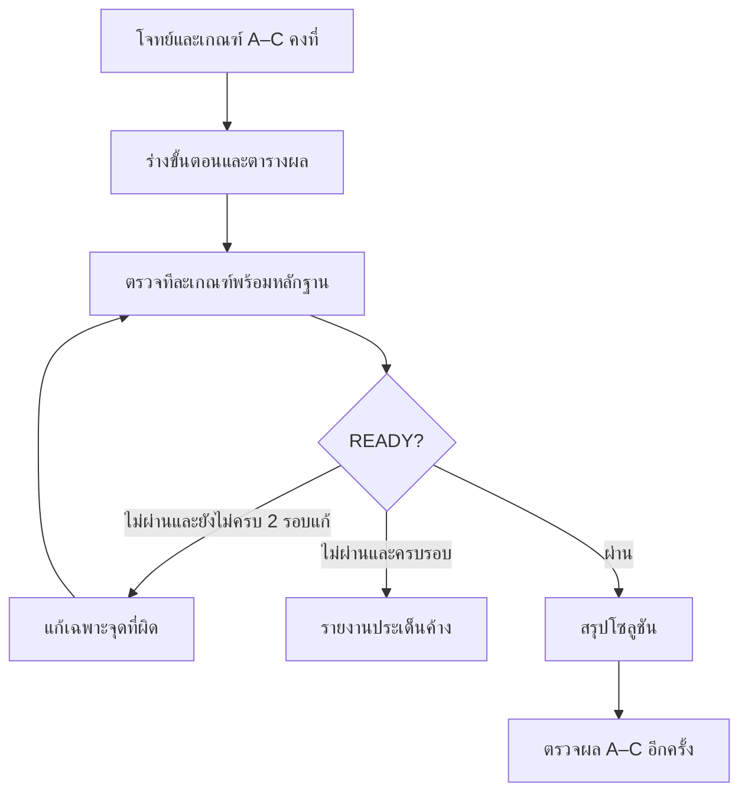
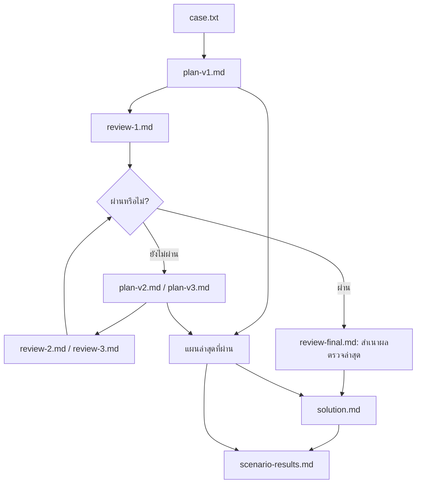
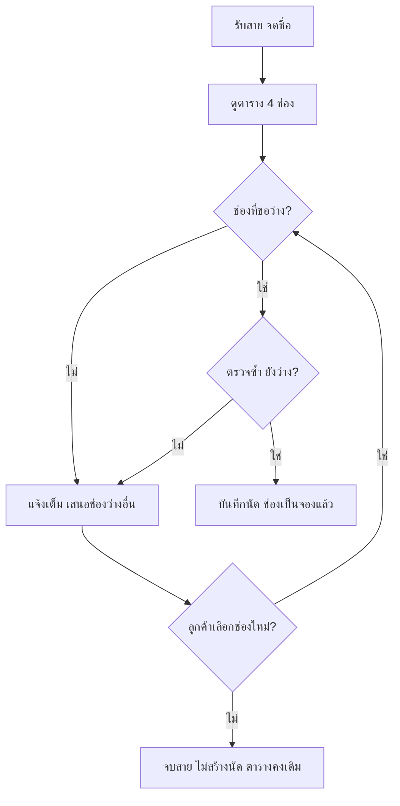
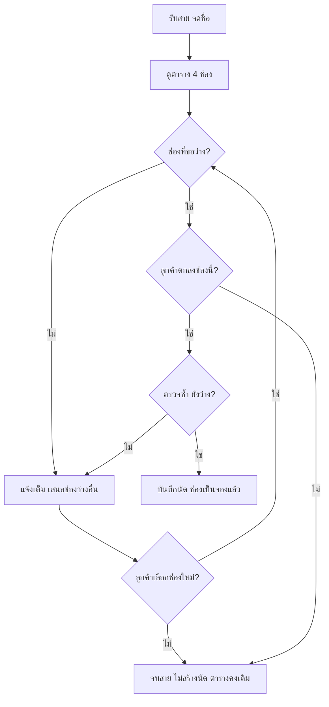
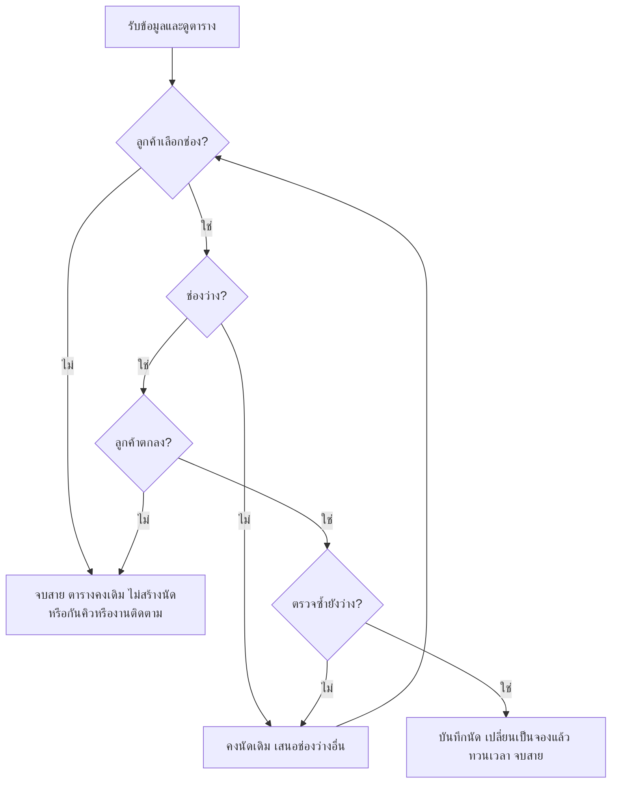

# LAB 001 · Setup Multi Account (Claude Code + Codex CLI)

เวลาโดยประมาณ: 60–75 นาที
สิ่งที่จะได้: ติดตั้ง Claude Code และ Codex CLI หลายบัญชี แยก “ติดตั้งครบ” “ล็อกอินและตอบได้” “ส่งต่องานข้ามค่ายได้จริง”
บทเรียนที่เชื่อมโยง: [AI Agent Routing](../ai-agent-routing.html) หัวข้อ 1.0 และ 4.0–4.3
ขอบเขตแลปนี้: เฉพาะ Claude Code (`yolo1`–`yolo5`) และ Codex CLI (`cyolo1`–`cyolo5`) **ไม่รวม Qwen Code**
วิธีทำ: อ่านโจทย์ → ทำตามป้าย 🖥️ Terminal / 💬 ช่องสนทนา AI → ดูผล → เทียบ Expected → ขั้นถัดไป

**ลำดับแลป:** ติดตั้ง Claude → ตั้งค่าหลายบัญชี → ล็อกอินและเลือกโมเดล → Claude เรียก Codex ตรวจ → เปลี่ยนโมเดลแล้วทำต่อ

## Introduction · รู้จักธุรกิจก่อนเริ่ม Lab

**คลินิกเพื่อนสัตว์** เป็นคลินิกสัตว์เลี้ยงขนาดเล็กในชุมชน ให้บริการเจ้าของสุนัขและแมวที่ต้องการพาสัตว์เลี้ยงเข้าพบสัตวแพทย์ โดยลูกค้าโทรศัพท์มาสอบถามและนัดหมายก่อนเดินทาง คลินิกต้องจัดเวลาของแพทย์ให้สอดคล้องกับนัดที่รับไว้ และแจ้งเวลาให้ลูกค้าเข้าใจตรงกัน

ในสถานการณ์ของ Lab นี้ คลินิกมีสัตวแพทย์ 1 คนและพนักงานรับนัด 1 คน พนักงานเป็นผู้รับโทรศัพท์ ตรวจเวลาว่าง และบันทึกนัด ส่วนสัตวแพทย์ให้บริการตามตารางที่พนักงานจัดไว้ การตอบรับนัดจึงเป็นคำสัญญากับลูกค้าว่าช่วงเวลานั้นมีที่ให้บริการจริง

| ผู้เกี่ยวข้อง | สิ่งที่ต้องการจากการรับนัด |
|---|---|
| เจ้าของสัตว์เลี้ยง | ทราบเวลาที่จองได้และได้รับการยืนยันที่ชัดเจนก่อนเดินทาง |
| พนักงานรับนัด | เห็นว่าช่องไหนว่าง ตอบลูกค้าได้ และบันทึกนัดได้ถูกช่อง |
| สัตวแพทย์ | มีตารางที่ไม่รับสัตว์เลี้ยงสองนัดในเวลาเดียวกัน |
| เจ้าของคลินิก | ให้บริการตามนัด ลดการแก้ปัญหาหน้างาน และรักษาความเชื่อมั่นของลูกค้า |

**เป้าหมายทางธุรกิจของโจทย์:** รับนัดใหม่ได้โดยไม่ชนกับนัดที่ยืนยันไว้ และรักษานัดเดิมของลูกค้าทุกราย ผู้เรียนต้องอธิบายให้ได้ว่าขั้นตอนที่เสนอช่วยให้พนักงานทำตามเป้าหมายนี้อย่างไร

*ธุรกิจ บุคคล เหตุการณ์ และข้อมูลทั้งหมดเป็นสถานการณ์สมมติเพื่อการเรียนรู้ ระยะเวลานัดและจำนวนช่องเป็นกติกาของแบบฝึก ไม่ใช่มาตรฐานการให้บริการคลินิกจริง*

## ปัญหาทางธุรกิจ · เมื่อการตอบรับไม่ตรงกับตารางนัด

### วิธีทำงานเดิม

พนักงานรับโทรศัพท์ ฟังเวลาที่ลูกค้าต้องการ แล้วไล่ดูรายการนัดที่จดไว้เพื่อหาว่าเวลานั้นมีใครจองหรือยัง รายการเดิมไม่ได้แสดงช่องว่างและช่องที่จองแล้วให้เห็นเทียบกันชัดเจน พนักงานจึงต้องตีความจากข้อความก่อนตอบลูกค้า เมื่อคุยตกลงกันแล้วจึงจดชื่อเจ้าของ ชื่อสัตว์เลี้ยง และเวลาเพิ่มเติม

แม้จะมีผู้รับนัดเพียงคนเดียวและรับโทรศัพท์ทีละสาย ความผิดพลาดก็เกิดขึ้นได้ หากพนักงานมองข้ามรายการเดิม หรือตอบรับจากความจำโดยไม่ได้ตรวจตาราง ปัญหานี้จึงเกิดได้โดยไม่ต้องมีคนแก้ข้อมูลพร้อมกัน

### เหตุการณ์ที่ทำให้เห็นปัญหา

สมมติว่าช่อง 09:30–10:00 มีนัดของเจ้าของ ข. ที่จะพาสุนัขชื่อโบ้มาพบแพทย์อยู่แล้ว ต่อมาเจ้าของ ก. โทรมาขอพาแมวชื่อมะลิมาในเวลา 09:30 หากพนักงานมองไม่เห็นนัดเดิมและตอบว่า “ได้ค่ะ” ลูกค้าทั้งสองรายจะเข้าใจว่าตนได้รับเวลานัดเดียวกัน ทั้งที่แพทย์มีช่องบริการเพียงหนึ่งช่อง

ความผิดพลาดเริ่มตั้งแต่การยืนยันเวลาที่ไม่ว่าง และจะกลายเป็นข้อมูลนัดซ้ำเมื่อพนักงานบันทึกเพิ่มโดยไม่ตรวจอีกครั้ง การมีรายชื่อลูกค้าครบจึงยังไม่เพียงพอ ต้องรู้ด้วยว่าเวลาใดถูกใช้ไปแล้วก่อนรับนัดใหม่

### สาเหตุและผลกระทบที่ต้องวิเคราะห์

| จุดในงานเดิม | สิ่งที่อาจผิดพลาด | ผลกระทบต่อธุรกิจ |
|---|---|---|
| ตรวจเวลาที่ลูกค้าขอ | มองข้ามนัดเดิม เพราะสถานะช่องเวลาไม่ชัด | เสนอเวลาที่มีผู้จองแล้วให้ลูกค้ารายใหม่ |
| ตอบรับทางโทรศัพท์ | ยืนยันก่อนตรวจว่าช่องว่างจริง | ลูกค้าได้รับคำสัญญาที่คลินิกทำตามไม่ได้ |
| บันทึกหลังตกลง | เพิ่มรายการลงช่องที่มีนัดอยู่แล้ว | แพทย์มีสองนัดในช่วงเดียวกัน และต้องแก้ปัญหาหน้างาน |
| เสนอเวลาอื่น | เปลี่ยนตารางทั้งที่ลูกค้ายังไม่ตกลง | ตารางไม่ตรงกับนัดที่ยืนยันจริง ช่องว่างอาจถูกกันโดยไม่มีนัด |
| ลูกค้ามาถึง | พบว่ามีผู้อื่นได้รับนัดเวลาเดียวกัน | ลูกค้าอาจต้องรอ พนักงานต้องอธิบาย และความเชื่อมั่นลดลง |

**ปัญหาหลัก P1:** พนักงานอาจรับนัดใหม่ซ้ำกับนัดเดิม เพราะมองไม่เห็นสถานะช่องเวลาชัดเจน และไม่มีลำดับตรวจ–ตกลง–บันทึกที่แน่นอน ผลกระทบข้างต้นเป็นเหตุผลที่ต้องแก้ P1 ไม่ใช่คำสั่งให้เพิ่มระบบจัดคิว การเงิน หรือบริการอื่น

### ภารกิจของผู้เรียน

คุณรับบทเป็นผู้ช่วยวิเคราะห์งานให้เจ้าของคลินิก ออกแบบเอกสารเสนอวิธีรับนัดใหม่ โดยใช้ไม่เกิน **2 ฟีเจอร์: ตารางแสดงช่องว่าง/จองแล้ว และการบันทึกนัดใหม่** อธิบายตั้งแต่รับคำขอจนจบสาย รวมทั้งทางเลือกเมื่อช่องเต็มและเมื่อลูกค้ายังไม่ตกลง

ผลงานต้องเชื่อม **บริบทธุรกิจ → ปัญหา P1 → ฟีเจอร์ → ขั้นตอนทำงาน → ผลตรวจจากสถานการณ์ A–C** รายละเอียดข้อมูลตั้งต้นและเกณฑ์ตรวจอยู่ในขั้นที่ 4.1 ส่วนข้อความโจทย์สำหรับส่งให้ AI อยู่ในขั้นที่ 4.3

Lab นี้เริ่มจากเตรียม Claude Code และ Codex CLI เพื่อให้ใช้ AI สองค่ายช่วยร่างและตรวจแผนจากโจทย์เดียวกัน จากนั้นผู้เรียนอ่านหลักฐานและตัดสินว่าแผนตอบปัญหาธุรกิจครบหรือยัง การติดตั้งสำเร็จเป็นจุดเริ่มต้น ส่วนผลลัพธ์ของงานธุรกิจคือแผนรับนัดที่ตรวจสอบได้

## ขั้นที่ 1 · เตรียมเครื่องมือ (🖥️ Terminal + 💬 AI | ~15 นาที)

### 🎯 เป้าหมายของขั้นนี้
มี Claude Code เป็น “AI ตัวช่วยตั้งค่า” บนเครื่อง Ubuntu โดยเริ่มจากติดตั้ง Claude Code เพียงตัวเดียว

### 1.1 ตรวจว่ามี Claude Code อยู่แล้วหรือไม่ (🖥️ Terminal)

```bash
claude --version
```

- ได้ตัวเลขเวอร์ชัน → ข้ามไป 1.4
- ได้ `command not found` → ทำ 1.2

### 1.2 ติดตั้ง Claude Code (🖥️ Terminal)

**ติดตั้งก่อน** — คัดลอกคำสั่งนี้ไปวางใน Terminal แล้วกด Enter

```bash
curl -fsSL https://claude.ai/install.sh | bash
```

รอจนติดตั้งเสร็จและเห็นข้อความ `Claude Code successfully installed!`


**จากนั้นตรวจเวอร์ชัน** — พิมพ์คำสั่งนี้แล้วกด Enter

```bash
claude --version
```


เห็นเลขเวอร์ชันแล้วไปหัวข้อ 1.4 ได้เลย ตัวเลขอาจต่างจากภาพ

### 1.4 เปิดและล็อกอิน Claude Code เพื่อเตรียมทำขั้นที่ 2


1. เปิด 🖥️ Terminal ในโฟลเดอร์งาน แล้วพิมพ์:
   ```bash
   claude
   ```
2. ล็อกอินด้วยบัญชีของตัวเองตามคำแนะนำบนหน้าจอ หากยังไม่ได้ล็อกอิน ให้พิมพ์ `/login` ในช่องสนทนา Claude Code แล้วทำตามขั้นตอน
3. เมื่อพร้อมใช้งาน ให้เปิด Claude Code ค้างไว้ แล้วไปขั้นที่ 2 เพื่อคัดลอกพรอมต์ทั้งกรอบมาวางใน 💬 ช่องสนทนา Claude Code

ขั้นนี้ติดตั้งเฉพาะ Claude Code เพื่อใช้เป็น AI ตัวช่วยตั้งค่าก่อน ส่วนการติดตั้งเครื่องมือที่ยังขาดและตั้งค่าหลายบัญชีของทั้ง Claude Code และ Codex CLI จะให้ AI ดำเนินการในขั้นที่ 2

### ✅ Expected Output (ตัวอย่างสำหรับเทียบ — ไม่ใช่ผลการรันจริง)
| CHECK | ACTUAL EXAMPLE |
|---|---|
| `claude --version` | `2.1.258 (Claude Code)` |
| AI ตัวช่วยตั้งค่า | เปิด Claude Code และล็อกอินพร้อมใช้งานแล้ว |
- **ต้องตรง:** (1) มีเวอร์ชัน Claude Code (2) เปิด AI ตัวช่วยได้
- **ต่างได้:** ตัวเลขเวอร์ชัน

## ขั้นที่ 2 · ให้ Claude Code ตั้งค่าหลายบัญชี (~20 นาที)

ให้ Claude Code ติดตั้งเครื่องมือที่ยังขาดและสร้างคำสั่ง `yolo1`–`yolo5` กับ `cyolo1`–`cyolo5` สำหรับใช้งานหลายบัญชี โดยแยกข้อมูลแต่ละบัญชีและยังไม่ล็อกอินบัญชีเหล่านี้

คัดลอกพรอมต์ทั้งกรอบไปวางใน Claude Code ที่เปิดไว้จากขั้นที่ 1

### 📋 พรอมต์สำหรับคัดลอก (คัดลอกทั้งกรอบ วางใน 💬 ช่องสนทนา AI แล้ว Enter)
```text
สร้าง CLI บน Ubuntu สำหรับรัน Claude Code และ Codex CLI หลายบัญชี
ตรวจเครื่องมือที่มีอยู่ก่อน และติดตั้งเครื่องมือที่ยังขาด รวมถึง Codex CLI ก่อนตั้งค่าหลายบัญชี
แยก credential/config กัน 100% ห้ามอ่านไฟล์ README ของ LAB เพื่อหาเฉลย

## ตัวแปรตั้งค่า (แก้ที่นี่ที่เดียว ที่อื่นต้องอ้างอิงตัวแปรนี้)
BASE_PATH="$HOME/ai-accounts"

## คำสั่งที่ต้องได้
- yolo1..yolo5   → Claude Code + บัญชี Anthropic คนละบัญชี
- cyolo1..cyolo5 → Codex CLI + บัญชี OpenAI/ChatGPT คนละบัญชี

## โครงสร้าง
$BASE_PATH/
├── .Claude/
│   ├── yolo1/ … yolo5/     # config root ต่อบัญชี (CLAUDE_CONFIG_DIR) credential/session/history/cache แยกกัน
│   └── shared/
│       ├── skills/         # skill ใช้ร่วมทุก yoloN
│       └── mcp/            # MCP config ใช้ร่วมทุก yoloN
└── .Codex/
    ├── cyolo1/ … cyolo5/   # config root ต่อบัญชี (CODEX_HOME)
    └── shared/
        ├── skills/
        └── mcp/

หลักการ: <tool>/<account>/ = ของใครของมัน, <tool>/shared/ = แก้ครั้งเดียวทุกบัญชีของ CLI นั้นเห็น

## Isolation
1. ทุกบัญชีแยก credential/config/session/history/cache สมบูรณ์ เปิดพร้อมกันได้ไม่ชน
2. ห้ามเปลี่ยน $HOME ใช้กลไก official ของแต่ละ CLI เท่านั้น
   (Claude Code: CLAUDE_CONFIG_DIR, Codex CLI: CODEX_HOME)
3. ห้ามแก้ .bashrc, Git config, SSH config หรือ environment เดิมโดยไม่จำเป็น
   ถ้าต้องเพิ่ม PATH ให้บอกบรรทัดที่เพิ่มและขอยืนยันก่อน

## Wrapper
4. ทุกคำสั่งส่งต่อ "$@" ครบ และรันแบบข้ามการขออนุญาตด้วย flag ล่าสุดของแต่ละ CLI
   - yoloN  → claude --dangerously-skip-permissions
   - cyoloN → codex --dangerously-bypass-approvals-and-sandbox
   ตรวจชื่อ flag จาก --help ของเวอร์ชันที่ติดตั้งจริงก่อนใช้
5. wrapper ต้องแสดงข้อความชัดเจนถ้าโฟลเดอร์บัญชียังไม่มี และต้องไม่พิมพ์ข้อมูลลับใด ๆ ออกหน้าจอ

## Shared
6. Skills/MCP ใน <tool>/shared เป็น source เดียว ถ้า CLI ใดไม่รองรับส่วนใด ให้ระบุชัดและทำเท่าที่รองรับ

## Installer
7. รันซ้ำได้โดยไม่ลบหรือเขียนทับ credential/config เดิม
8. วิธีติดตั้งและตำแหน่งวางไฟล์ให้เลือกเอง พร้อมอธิบายเหตุผลสั้น ๆ

## Docs
9. ตรวจ official docs และ --help ของเวอร์ชันจริงก่อน implement ห้ามเดา env/path/flag
   - https://code.claude.com/docs/
   - https://github.com/openai/codex

## หมายเหตุจากการทดลองจริง (ตรวจว่ายังจริงกับเวอร์ชันบนเครื่องนี้หรือไม่)
- ถ้ารันเป็น root ต้องตั้ง IS_SANDBOX=1 ไม่งั้น claude ปฏิเสธ --dangerously-skip-permissions
- CODEX_HOME ต้อง mkdir -p ก่อน codex ไม่สร้างโฟลเดอร์ให้เอง
- codex login status ไม่ตรวจว่า token ยังใช้ได้ ให้ยืนยันด้วย codex exec เท่านั้น

## ทดสอบ (รายงานตามจริง PASS / FAIL / SKIP)
- yolo1..yolo5 --version และ cyolo1..cyolo5 --version ทำงานครบ 10 ตัว
- แต่ละคำสั่งชี้ config root คนละโฟลเดอร์ ตรวจด้วย find <root>
- installer รอบ 2 ไม่ทำลายของเดิม
- Git/SSH ทำงานปกติ
- ทุกอย่างที่ต้องล็อกอินหรือใช้ credential จริง รอบนี้เป็น SKIP เจ้าของบัญชีจะทำเองภายหลัง

## รายงาน
เขียน 3 ไฟล์ในโฟลเดอร์ปัจจุบัน: setup-report.md (โครงสร้าง config root ตำแหน่ง credential ข้อจำกัด),
login-guide.md (ขั้นตอนล็อกอินทีละบัญชีที่ผู้ใช้ทำเองใน Terminal), checklist.md (ตาราง รายการ | หลักฐาน | PASS/FAIL/SKIP | เหตุผล)
ห้ามใส่ข้อมูลลับในไฟล์ใด ๆ

ทำเฉพาะขั้นนี้ เมื่อเสร็จให้แสดงเนื้อหาสำคัญของไฟล์ที่สร้าง (ไม่ใช่แค่ชื่อไฟล์) เป็นตารางที่ฉันอ่านตรวจได้ แล้วหยุดรอ ห้ามล็อกอินแทนฉัน ห้ามทำขั้นถัดไปเอง
```


ข้อความ `[Pasted text …]` คือพรอมต์ที่วางแล้ว กด Enter เพื่อเริ่มทำงาน

### ✅ Expected Output (ตัวอย่างสำหรับเทียบ — ไม่ใช่ผลการรันจริง)
| CHECK | ACTUAL EXAMPLE |
|---|---|
| CLI | 2 PASS: `2.1.258 / 0.153.4` |
| yolo | 5/5 PASS (`--version` ผ่าน) |
| cyolo | 5/5 PASS (`--version` ผ่าน) |
| config root แยก | `.Claude/yolo1`…`yolo5`, `.Codex/cyolo1`…`cyolo5` คนละ path |
| reports | `setup-report.md`, `login-guide.md`, `checklist.md` |
| real login | SKIP |
- **ต้องตรง:** (1) CLI = 2 (2) wrapper = 10 (3) ไฟล์รายงาน 3 ไฟล์ และ login = `SKIP`
- **ต่างได้:** (1) เวอร์ชัน (2) `BASE_PATH` (3) ถ้อยคำ/ลำดับ

### 🔍 จุดที่ผู้เรียนต้องตรวจ (🖥️ Terminal เปิดหน้าต่างใหม่)
```bash
yolo1 --version; cyolo1 --version
yolo2 --version; cyolo2 --version
yolo3 --version; cyolo3 --version
```


- [ ] คำสั่งของบัญชี 1–3 ทั้งสอง CLI แสดงเวอร์ชันครบ 6 ตัว
- [ ] มีไฟล์รายงาน 3 ไฟล์ในโฟลเดอร์งาน
- [ ] งานที่ใช้บัญชีจริงเป็น `SKIP` พร้อมเหตุผล
- [ ] ไม่มีข้อมูลลับในไฟล์และบนหน้าจอ

## ขั้นที่ 3 · ล็อกอินและเลือกโมเดล (~10 นาที)

ใช้บัญชี `yolo1` และ `cyolo1` จากขั้นที่ 2 ทำงานในโฟลเดอร์เดียวกันตลอดแลป

### 3.1 ล็อกอินด้วยบัญชี subscription (🖥️ Terminal)

ทำทีละค่ายในโฟลเดอร์งานเดียวกัน จนเห็นช่องพร้อมพิมพ์พรอมต์ของทั้งสองโปรแกรม

#### A · Claude Code — yolo1

**1. เปิดโปรแกรมและเลือกบัญชี subscription**

```bash
yolo1
```

หากมีหน้าจอเลือกธีม ให้เลือกธีมก่อน จากนั้นเลือก **Claude account with subscription** แล้วกด Enter


**2. ยืนยันบัญชีในเบราว์เซอร์**

เปิดลิงก์ที่ Terminal แสดง ล็อกอินด้วยบัญชี Claude ที่มี subscription และยืนยันการเชื่อมต่อ หากหน้าจอให้คัดลอกรหัสกลับมา ให้ทำตามขั้นตอนนั้นด้วยตัวเอง

**3. ยืนยันโฟลเดอร์และโหมดของแลป**

กลับมาที่ Terminal หากเป็นโฟลเดอร์แลปที่เตรียมไว้ ให้เลือก **Yes, I trust this folder**


คำสั่ง yolo1 จากขั้นที่ 2 เปิดโหมด Bypass Permissions หากกำลังใช้คอนเทนเนอร์แลปที่เตรียมไว้ ให้เลือก **Yes, I accept** เพื่อทำต่อ


**4. พร้อมพิมพ์พรอมต์**

เห็นหน้า Claude Code และช่องพิมพ์ข้อความ แสดงว่ามาถึงหน้าสนทนาแล้ว


#### B · Codex CLI — cyolo1

**1. เปิดโปรแกรมและเลือก Sign in with ChatGPT**

```bash
cyolo1
```

เลือก **Sign in with ChatGPT** แล้วกด Enter เพื่อใช้บัญชี ChatGPT ที่มีสิทธิ์ใช้งาน Codex


**2. ยืนยันบัญชีในเบราว์เซอร์**

ล็อกอินด้วยบัญชี ChatGPT ที่ต้องการใช้และยืนยันการเชื่อมต่อ หากใช้ SSH แล้วเบราว์เซอร์กลับมาที่ CLI ไม่ได้ ให้เลือก **Sign in with Device Code** และทำตามขั้นตอนบนหน้าจอ

**3. ยืนยันโฟลเดอร์งาน**

กลับมาที่ Terminal หากเป็นโฟลเดอร์แลปที่เตรียมไว้ ให้เลือก **Yes, continue**


**4. พร้อมพิมพ์พรอมต์**

เห็นหน้า Codex พร้อมชื่อโมเดลและช่องพิมพ์ข้อความ แสดงว่ามาถึงหน้าสนทนาแล้ว


ผู้เรียนทำขั้นตอนยืนยันตัวตนเอง ไม่ส่งรหัสหรือข้อมูลบัญชีให้ AI เมื่อทั้งสองหน้าต่างพร้อมแล้ว ไปส่งโจทย์ในหัวข้อ 3.2

*ภาพ Terminal เป็นภาพจริง หน้าหลังล็อกอินถ่ายโดยใช้ข้อมูล subscription เดิมที่ได้รับอนุญาตในเครื่องทดสอบ ไม่ได้บันทึกขั้นยืนยันตัวตนในเบราว์เซอร์ ชื่อโมเดลเริ่มต้นอาจต่างจากภาพ โดยจะเลือกโมเดลในหัวข้อ 3.2*

### 3.2 ลองส่งคำถามเดียวกันสองวิธี

หลังล็อกอินในหัวข้อ 3.1 แล้ว ให้ลองส่งคำถามผ่านหน้าสนทนา AI ก่อน จากนั้นส่งคำถามเดิมด้วยคำสั่งจาก shell เพื่อดูความต่างของวิธีใช้งาน

ทั้งสองรอบใช้ **yolo1: Fable · medium** และ **cyolo1: Astra · medium** โดยไม่เปลี่ยนโจทย์

**คำถามที่ใช้ตลอดหัวข้อนี้**

```text
ร้านค้าลดราคา 10% เมื่อซื้อครบ 1000 บาท จงคำนวณยอดจ่ายสำหรับยอดซื้อ 999, 1000 และ 1500 บาท ตอบเป็นตารางยอดซื้อและยอดจ่ายทศนิยม 2 ตำแหน่ง ตามด้วยคำอธิบายสั้น ๆ และข้อควรระวัง 1 ข้อ ไม่ต้องสร้างไฟล์หรือรันคำสั่งอื่น
```

#### วิธีที่ 1 · พิมพ์ในหน้าสนทนา AI

เริ่มจากหน้าสนทนาที่เปิดค้างไว้ในหัวข้อ 3.1 เลือกโมเดลและระดับ effort ให้ตรงก่อนวางคำถาม

**A · Claude Code (yolo1)**

**1. เลือก Fable และปรับ effort**

พิมพ์ `/model` แล้วกด Enter เลื่อนมาที่ **Fable** ใช้ลูกศรซ้าย/ขวาปรับเป็น **Medium** แล้วกด Enter ยืนยัน


**2. วางคำถาม**

คัดลอกคำถามด้านบนมาวางในช่องสนทนา ตรวจว่าหน้าจอแสดง Fable และ medium


**3. ส่งและดูคำตอบ**

กด Enter แล้วรอจนตอบจบ จะเห็นตารางยอดจ่ายพร้อมคำอธิบาย และยังพิมพ์ถามต่อในหน้าเดิมได้


**B · Codex (cyolo1)**

**1. เลือก Astra**

ในหน้าสนทนา Codex พิมพ์ `/model` แล้วกด Enter เลือก **gpt-6-astra** และกด Enter อีกครั้ง


**2. ปรับ effort**

หน้าถัดไปให้เลือกระดับ reasoning เป็น **Medium** แล้วกด Enter ยืนยัน


**3. วางคำถามเดียวกัน**

คัดลอกคำถามด้านบนมาวางในช่องสนทนา ตรวจว่าหน้าจอแสดง `gpt-6-astra medium`


**4. ส่งและดูคำตอบ**

กด Enter แล้วรอจนตอบจบ เช่นเดียวกับ Claude หน้าสนทนาจะยังเปิดไว้ให้ถามต่อได้


#### วิธีที่ 2 · ส่งด้วยคำสั่งจาก shell

เมื่อดูคำตอบของวิธีแรกแล้ว ให้ออกจากหน้า AI กลับมาที่ shell ของแต่ละหน้าต่าง โดยกด Ctrl+C สองครั้ง จากนั้นรันคำสั่งด้านล่างในโฟลเดอร์งานเดิม

วิธีนี้ระบุโมเดล ระดับ effort และคำถามไว้ในคำสั่งเดียว เมื่อ AI ตอบจบจะกลับมาที่ shell

**A · ส่งให้ Fable ผ่าน yolo1**

```bash
yolo1 --model fable --effort medium -p 'ร้านค้าลดราคา 10% เมื่อซื้อครบ 1000 บาท จงคำนวณยอดจ่ายสำหรับยอดซื้อ 999, 1000 และ 1500 บาท ตอบเป็นตารางยอดซื้อและยอดจ่ายทศนิยม 2 ตำแหน่ง ตามด้วยคำอธิบายสั้น ๆ และข้อควรระวัง 1 ข้อ ไม่ต้องสร้างไฟล์หรือรันคำสั่งอื่น'
```


**B · ส่งให้ Astra ผ่าน cyolo1**

```bash
cyolo1 exec --skip-git-repo-check --model gpt-6-astra -c model_reasoning_effort=medium 'ร้านค้าลดราคา 10% เมื่อซื้อครบ 1000 บาท จงคำนวณยอดจ่ายสำหรับยอดซื้อ 999, 1000 และ 1500 บาท ตอบเป็นตารางยอดซื้อและยอดจ่ายทศนิยม 2 ตำแหน่ง ตามด้วยคำอธิบายสั้น ๆ และข้อควรระวัง 1 ข้อ ไม่ต้องสร้างไฟล์หรือรันคำสั่งอื่น'
```


ตอนนี้มีคำตอบจากทั้งสองค่ายครบทั้งสองวิธีแล้ว ให้เก็บภาพผลตอบและเปรียบเทียบตามหัวข้อ 3.3

### 3.3 เปรียบเทียบผลของ Fable และ Astra

ตารางนี้สรุปผลจากภาพการทดลองในหัวข้อ 3.2 แยกตามโมเดลและวิธีส่งคำถาม ทั้งสองโมเดลใช้ effort **medium**

| คำตอบที่ถูกต้อง | Fable: หน้าสนทนา | Fable: shell | Astra: หน้าสนทนา | Astra: shell |
|---|---|---|---|---|
| 999.00 | 999.00 | 999.00 | 999.00 | 999.00 |
| 900.00 | 900.00 | 900.00 | 900.00 | 900.00 |
| 1350.00 | 1350.00 | 1350.00 | 1350.00 | 1350.00 |

**ผล:** Fable และ Astra คำนวณถูกครบทั้งสองวิธี โดยลด 10% ตั้งแต่ยอดซื้อ 1000 บาทขึ้นไป ถ้อยคำอาจต่างกันได้ แต่ยอดจ่ายต้องตรงตาราง

เมื่อทดลองเอง ให้ตรวจชื่อโมเดลและ effort จากหน้าจอ แล้วเก็บภาพคำตอบไว้เทียบ หากรันไม่ได้ ให้บันทึกว่า **ยังไม่ได้ทดลอง**


## ขั้นที่ 4 · จากปัญหาคลินิกสู่แผนฟีเจอร์

ฝึกให้ **Fable วิเคราะห์ → Astra วิจารณ์ → Fable ปรับแผน → Astra ตรวจซ้ำ** ด้วยปัญหาเดียว ทั้งสองโมเดลใช้ effort **high**

> **ผลรัน workflow ล่าสุด: READY · กรณี A–C ผ่านทั้ง 3 กรณี**
> รอบล่าสุดใช้ Fable high ร่างและแก้แผน แล้ว Astra high ตรวจผ่านหลังแก้ 1 รอบ ผลเก่าเก็บแยกไว้เพื่อเปรียบเทียบ

### 4.1 ข้อมูลและเงื่อนไขของโจทย์: รับนัดใหม่อย่างไรไม่ให้คิวซ้ำ?

> **มีตารางเดียว เห็นช่องว่างชัด แล้วจึงรับนัด**
>
> สมมติว่าคุณเป็นพนักงานรับนัดของคลินิกเพื่อนสัตว์ ลูกค้าโทรมาขอเวลา คุณต้องดูให้ได้ว่าช่องนั้นว่างหรือมีนัดแล้ว ก่อนตอบรับลูกค้า โจทย์นี้ให้ช่วยคิดฟีเจอร์ที่ทำให้ขั้นตอนนี้ง่ายและไม่รับนัดซ้ำ

#### ข้อมูลตั้งต้นสำหรับออกแบบและตรวจแผน

| เรื่อง | กติกาสำหรับแบบฝึก |
|---|---|
| ทีมงาน | แพทย์ 1 คน และพนักงานรับนัด 1 คน |
| วันที่ | 15 กันยายน 2570 วันเดียว |
| การรับเรื่อง | ทางโทรศัพท์ ทีละราย จบสายเดิมก่อนรับรายถัดไป |
| ระยะเวลานัด | นัดละ 30 นาที เลือกได้เฉพาะ 4 ช่องด้านล่าง |
| ข้อมูลที่บันทึก | ชื่อเจ้าของ ชื่อสัตว์เลี้ยง และช่องเวลา |

*ทุกชื่อและเหตุการณ์เป็นข้อมูลสมมติ กติกาถูกย่อเพื่อใช้ฝึกออกแบบ ไม่ใช่นโยบายสำหรับคลินิกจริง*

#### ตารางตั้งต้น

| ช่องเวลา | สถานะ | นัดที่มีอยู่ |
|---|---|---|
| 09:00–09:30 | ว่าง | — |
| 09:30–10:00 | จองแล้ว | เจ้าของ ข. · สุนัข โบ้ |
| 10:00–10:30 | ว่าง | — |
| 10:30–11:00 | ว่าง | — |

**ปัญหาหลัก P1 จากบทนำ:** พนักงานอาจรับนัดซ้ำเพราะสถานะช่องเวลาไม่ชัดและลำดับตรวจ–ตกลง–บันทึกไม่แน่นอน ใช้ข้อมูลชุดนี้พิสูจน์ว่าแผนที่เสนอป้องกันปัญหาได้ โดยรักษานัดเดิมไว้

**ภารกิจของคุณ:** เสนอไม่เกิน **2 ฟีเจอร์** ได้แก่ ตารางดูช่องว่าง/จองแล้ว และการบันทึกนัดใหม่ พร้อมอธิบายว่าพนักงานใช้สองฟีเจอร์นี้ตามลำดับอย่างไร

#### ขั้นตอนที่แผนต้องอธิบายให้ชัด

1. ลูกค้าบอกช่องเวลาที่ต้องการ พนักงานเปิดตารางดูช่องนั้น
2. ถ้าว่าง ให้ถามยืนยันความตกลง หากเต็มให้เสนอช่องว่างอื่น โดยไม่แก้นัดเดิม
3. เมื่อลูกค้าตกลง ให้ตรวจช่องที่เลือกอีกครั้ง แล้วบันทึกนัดเพียงรายการเดียวในช่องนั้น
4. ถ้าลูกค้ายังไม่เลือกหรือยังไม่ตกลง ให้จบสายโดยไม่เปลี่ยนตาราง ลูกค้าโทรมาใหม่ได้

**ขอบเขตของโจทย์:** ออกแบบเฉพาะการรับนัดใหม่ ไม่มีการเลื่อนหรือยกเลิกนัด งานติดตาม การส่งต่อกะ แพทย์หลายคน หรือการแก้ข้อมูลพร้อมกัน รายละเอียดเหล่านี้ไม่นำมารวมในฟีเจอร์และเกณฑ์ตรวจของ Lab นี้

#### รู้ได้อย่างไรว่าแผนถูกต้อง?

เริ่มจากตารางตั้งต้นใหม่ทุกครั้ง ไม่ใช้ผลของกรณีก่อนหน้ามาต่อกัน

| กรณี | ลูกค้าต้องการอะไร | ผลที่ต้องได้ |
|---|---|---|
| **A · ช่องว่าง** | เจ้าของ ก. พาแมว มะลิ ขอ 09:00 และตกลง | เพิ่มนัดที่ 09:00 เพียง 1 รายการ นัดเดิมของ ข. คงอยู่ |
| **B · ช่องเต็ม แต่เลือกเวลาอื่น** | ขอ 09:30 แล้วตกลงใช้ 10:00 | คงนัด ข. ที่ 09:30 เพิ่มนัด ก. ที่ 10:00 ไม่มีช่องซ้ำ |
| **C · ยังไม่ตกลง** | ขอ 09:30 แต่ยังไม่เลือกเวลาอื่น | ตารางและจำนวนนัดคงเดิม ไม่กันคิว ไม่สร้างงานค้าง |

**งานส่งเป็นเอกสาร:** ปัญหา → ฟีเจอร์ → ขั้นตอน → ผลที่คาดหวังทั้ง 3 กรณี ไม่ต้องสร้างเว็บหรือเขียนโปรแกรม

### 4.2 Workflow ใหม่: ตรวจผลก่อนขยายคำอธิบาย

รอบล่าสุดทำตามลำดับข้ามค่ายนี้จริง โดย Fable ร่างและแก้แผน ส่วน Astra ตรวจ สรุป และประเมินสถานการณ์ ดูผู้สร้างและเนื้อหาจริงในหัวข้อ OUTPUT ล่าสุด

ใช้โจทย์และเกณฑ์ A–C ชุดเดิมตลอดรอบ การแก้แผนต้องแก้ขั้นตอนให้ถูก ไม่เปลี่ยนผลที่คาดหวังเพื่อให้ผ่าน

| ลำดับ | ใครทำ | สิ่งที่ต้องทำ | ไฟล์ออก |
|---|---|---|---|
| 1 | ผู้เรียน | เตรียมโจทย์และตารางตั้งต้นชุดเดียวกัน | `case.txt` |
| 2 | Fable | เสนอ 2 ฟีเจอร์ เขียนขั้นตอนมีหมายเลข และตารางผล A–C | `plan-v1.md` |
| 3 | Astra | ตรวจแต่ละเกณฑ์ อ้างขั้นตอนและชี้จุดผิดที่แก้ได้ | `review-1.md` |
| 4 | Fable เมื่อยังไม่ผ่าน | แก้เฉพาะข้อผิดพลาด เก็บส่วนที่ถูกต้อง แล้วส่งตรวจใหม่ | `plan-v2.md` และ `review-2.md` (Astra ตรวจ) |
| 5 | ผู้เรียน | เก็บผลตรวจล่าสุดเป็นผลสุดท้าย ไม่แก้ข้อความ verdict | `review-final.md` |
| 6 | Astra เมื่อ READY | สรุปขั้นตอนจากแผนที่ผ่าน แล้วตรวจโซลูชันด้วย A–C อีกครั้ง | `solution.md`, `scenario-results.md` |

**กติกาการแก้:** อนุญาตแก้เพิ่มไม่เกิน 2 รอบในหนึ่งการทดลอง ถ้ายังไม่ผ่านให้รายงานข้อที่ค้าง ไม่วนแก้ไม่สิ้นสุด หากผ่านตั้งแต่แผนแรกให้ข้ามรอบแก้ได้ ทุกครั้งเก็บแผนและผลตรวจเก่าไว้



**เส้นทางไฟล์** — ทุกคำสั่งอ่าน `case.txt` ร่วมด้วย



### 4.3 คัดลอกโจทย์ฉบับเดียวกันให้ทั้งสองโมเดล

ใช้ **โฟลเดอร์งานใหม่** สำหรับโจทย์ฉบับนี้ เพื่อไม่ปนกับ output เดิม เปิดทั้งสอง Terminal ที่โฟลเดอร์เดียวกัน บันทึกข้อความนี้เป็น `case.txt` หรือคัดลอกจาก [ไฟล์โจทย์ฉบับนี้](examples/clinic-booking-only/case.txt)

```text
โจทย์สมมติ: ออกแบบฟีเจอร์รับนัดใหม่โดยไม่จองช่องซ้ำ
บริบทธุรกิจ:
คลินิกเพื่อนสัตว์เป็นคลินิกสัตว์เลี้ยงขนาดเล็กในชุมชน ลูกค้าโทรมานัดก่อนพาสุนัขหรือแมวเข้าพบสัตวแพทย์
พนักงานรับนัดตรวจเวลา ตอบลูกค้า และบันทึกนัด ส่วนสัตวแพทย์ให้บริการตามตาราง เป้าหมายคือรับนัดใหม่ได้โดยไม่ชนกับนัดที่ยืนยันไว้และรักษานัดเดิมทุกราย
วิธีทำงานเดิมและปัญหา:
พนักงานไล่ดูรายการนัดที่จดไว้ ซึ่งไม่แสดงช่องว่างและจองแล้วเทียบกันชัดเจน จึงอาจมองข้ามนัดเดิมหรือตอบรับจากความจำ แล้วบันทึกเพิ่มโดยไม่ตรวจซ้ำ
ตัวอย่างความผิดพลาด: เจ้าของ ข. จอง 09:30 ให้สุนัข โบ้ ไว้แล้ว แต่พนักงานตอบรับเจ้าของ ก. ที่ขอเวลาเดียวกัน ทำให้สองรายเข้าใจว่าได้เวลานัดเดียวกัน
ผลกระทบที่อาจเกิดขึ้นคือแพทย์มีนัดชน ลูกค้าต้องรอ พนักงานต้องแก้ปัญหาหน้างาน และลูกค้าลดความเชื่อมั่น หากยังไม่ตกลงแต่กันช่องไว้ ตารางก็ไม่ตรงกับนัดที่ยืนยันจริง
ผลกระทบเหล่านี้ใช้อธิบายปัญหา P1 ไม่ใช่ข้อกำหนดให้เพิ่มฟีเจอร์นอกขอบเขต
บทบาทผู้เรียน: ผู้ช่วยวิเคราะห์งานที่ต้องเสนอขั้นตอนรับนัดใหม่ให้เจ้าของคลินิกในรูปเอกสาร โดยเชื่อมธุรกิจ ปัญหา ฟีเจอร์ ขั้นตอน และผลตรวจ
ข้อมูลทั้งหมดเป็นสถานการณ์สมมติ กติกาต่อไปนี้ใช้เฉพาะแบบฝึก ไม่ใช่มาตรฐานคลินิกจริง

ข้อมูลและเงื่อนไขสำหรับออกแบบ:
คลินิกเพื่อนสัตว์มีสัตวแพทย์ 1 คนและพนักงานรับนัด 1 คน ใช้วันสมมติเพียงวันเดียว คือ 15 กันยายน 2570
มี 4 ช่องเท่านั้น: 09:00–09:30, 09:30–10:00, 10:00–10:30 และ 10:30–11:00 ทุกช่องอยู่ในเวลาให้บริการของแพทย์
ตอนเริ่มต้น 09:30–10:00 มีนัดของเจ้าของ ข. กับสุนัข โบ้ แล้ว อีก 3 ช่องว่าง
ลูกค้าติดต่อทางโทรศัพท์ พนักงานรับเรื่องทีละราย และจบการสนทนากับรายเดิมก่อนรับรายถัดไป ไม่มีการแก้ข้อมูลพร้อมกัน
ปัญหาหลัก P1: พนักงานอาจรับนัดซ้ำ เพราะสถานะช่องเวลาไม่ชัดและไม่มีลำดับตรวจ–ตกลง–บันทึกที่แน่นอน
ต้องการไม่เกิน 2 ฟีเจอร์: ตารางแสดงช่องว่าง/จองแล้ว และการบันทึกนัดใหม่
กฎ:
1. หนึ่งนัดต่อสัตว์หนึ่งตัว ใช้ช่องที่กำหนดหนึ่งช่อง บันทึกชื่อเจ้าของสมมติ ชื่อสัตว์ และช่องเวลา
2. ดูตารางก่อนเสนอเวลา เมื่อลูกค้าตกลงแล้ว ตรวจช่องนั้นอีกครั้งก่อนบันทึก
3. ถ้าช่องว่างและลูกค้าตกลง ให้บันทึกนัดและเปลี่ยนช่องนั้นเป็นจองแล้ว ห้ามมีสองนัดในช่องเดียวกัน
4. ถ้าช่องเต็ม ห้ามแก้นัดที่มีอยู่ ให้เสนอช่องว่างอื่น หากลูกค้าตกลงจึงตรวจและจองช่องใหม่
5. ถ้าลูกค้ายังไม่เลือกหรือยังไม่ตกลง ให้จบการสนทนาโดยไม่สร้างนัด ไม่กันคิว และไม่สร้างงานติดตาม ลูกค้าสามารถโทรมาใหม่ได้
นอกขอบเขต: เลื่อนหรือยกเลิกนัด งานติดตาม เปลี่ยนกะ แพทย์หลายคน ช่องทางอื่น ตารางเวร รายงาน การเตือน การรักษา การเงิน และการสร้างซอฟต์แวร์
ออกแบบเป็นเอกสารขั้นตอนธุรกิจเท่านั้น ไม่สร้างเว็บ ไม่เขียนโค้ด ไม่ใช้ข้อมูลจริง
งานที่ต้องส่ง: อธิบายปัญหา เสนอไม่เกิน 2 ฟีเจอร์ เชื่อมแต่ละฟีเจอร์กับ P1 ระบุขั้นตอนรับนัดและข้อจำกัดของสมมติฐาน
ตรวจ 3 กรณีโดยเริ่มจากตารางตั้งต้นใหม่ทุกกรณี:
A ลูกค้า ก. พาแมว มะลิ ขอ 09:00–09:30 และตกลง: มีนัดใหม่ 1 รายการ ช่องนี้เป็นจองแล้ว นัดเดิมของ ข. ไม่เปลี่ยน
B ลูกค้า ก. ขอ 09:30–10:00 ที่เต็ม แล้วตกลงใช้ 10:00–10:30: นัดเดิมของ ข. คงอยู่ เพิ่มนัดของ ก. เฉพาะ 10:00–10:30 และไม่มีช่องใดมีสองนัด
C ลูกค้า ก. ขอ 09:30–10:00 ที่เต็ม แต่ยังไม่เลือกเวลาอื่น: ตารางทุกช่องและจำนวนนัดคงเดิม ไม่มีนัดใหม่หรือคิวชั่วคราว
เกณฑ์ READY: ครบ P1 และทั้ง 3 กรณี ขั้นตอนไม่ขัดกัน และไม่เพิ่มฟีเจอร์นอกขอบเขต หากไม่ครบให้ NOT READY พร้อมเหตุผล ห้ามบังคับให้ผ่าน
READY เป็นผลตรวจความสอดคล้องของเอกสาร ไม่ใช่ผลทดสอบระบบใช้งานจริง
```

เปิด Fable ด้วย `yolo1 --model fable --effort high` และ Astra ด้วย `cyolo1 --model gpt-6-astra -c model_reasoning_effort=high` จากนั้นวางพรอมต์ในหน้าสนทนาของค่ายที่ระบุ รอให้เขียน output เสร็จก่อนส่งต่อ ผู้เรียนสลับ Terminal เองโดยใช้ไฟล์ร่วมกัน

#### Fable: ร่างขั้นตอนที่ตรวจได้

**พรอมต์ → yolo1**

```text
อ่าน case.txt ถ้าไฟล์ขาดให้หยุด
เสนอไม่เกิน 2 ฟีเจอร์ เขียน workflow รับนัดเป็นขั้นตอนมีหมายเลข ระบุเงื่อนไขและสิ่งที่เปลี่ยนในตารางแต่ละทางแยก พร้อม Mermaid สั้นๆ
ไล่กรณี A–C จากตารางตั้งต้นใหม่ทุกครั้ง แสดงตารางสุดท้ายครบ 4 ช่องและจำนวนนัด ห้ามเพิ่มกฎนอกโจทย์ ยังไม่ต้องให้ verdict
เขียนลง plan-v1.md
```

| INPUT | OUTPUT |
|---|---|
| `case.txt` | `plan-v1.md` |

### 4.4 Astra: ตรวจแผนด้วยหลักฐาน

**พรอมต์ → cyolo1**

```text
อ่าน case.txt และ plan-v1.md ถ้าไฟล์ขาดให้หยุด
ไล่ A–C โดยเริ่มใหม่จากตารางตั้งต้น ตรวจ:
1. ไม่มีช่องที่มีสองนัด
2. นัดเดิมของ ข. คงอยู่
3. ได้ความตกลงและตรวจช่องก่อนบันทึก
4. กรณี C ไม่เปลี่ยนตาราง ไม่สร้างนัดหรือคิวชั่วคราว
5. ครบฟีเจอร์ที่โจทย์ต้องการและไม่เพิ่มขอบเขต
แสดง PASS/FAIL ต่อเกณฑ์ อ้างหมายเลขขั้นตอน หากผิดระบุข้อความที่ขัดแย้งและข้อแก้เฉพาะจุด ไม่บังคับให้ผ่าน
เขียนลง review-1.md ลงท้าย VERDICT: READY หรือ VERDICT: NOT READY
```

| INPUT | OUTPUT |
|---|---|
| `case.txt`, `plan-v1.md` | `review-1.md` |

## ขั้นที่ 5 · แก้เฉพาะจุดและตรวจซ้ำเมื่อจำเป็น

ถ้า `review-1.md` เป็น READY ให้ใช้แผน v1 และเก็บสำเนา review-1 เป็น `review-final.md` แล้วไปขั้นที่ 6 ได้เลย ถ้า NOT READY ให้ทำตามนี้

**พรอมต์ → yolo1**

```text
อ่าน case.txt, plan-v1.md และ review-1.md
แก้เฉพาะข้อผิดพลาดที่ผู้ตรวจระบุ คงส่วนที่ถูกต้อง ไม่เปลี่ยนโจทย์หรือเกณฑ์ผ่าน
เขียนแผนฉบับสมบูรณ์พร้อมขั้นตอนหมายเลขและตาราง A–C ลง plan-v2.md
```

| INPUT | OUTPUT |
|---|---|
| `case.txt`, `plan-v1.md`, `review-1.md` | `plan-v2.md` |

ให้ Astra ใช้พรอมต์ตรวจใน 4.4 อีกครั้ง เปลี่ยน input เป็น `plan-v2.md` และ output เป็น `review-2.md` ถ้ายังต้องแก้ รอบถัดไปใช้ `plan-v3.md` และ `review-3.md` เก็บทุกฉบับไว้ แล้วคัดลอก **ผลตรวจล่าสุดตามจริง** เป็น `review-final.md` หากแก้ครบ 2 รอบแล้วยัง NOT READY ให้หยุดและรายงานข้อค้าง

## ขั้นที่ 6 · สรุปโซลูชันแล้วตรวจคำตอบสุดท้าย

ทำต่อเมื่อ `review-final.md` เป็น READY เท่านั้น ใช้ชื่อไฟล์แผนที่ผ่านจริงในพรอมต์ด้านล่าง รอบล่าสุดผ่านที่ `plan-v2.md` พรอมต์ด้านล่างจึงใช้ชื่อนี้ หากรอบของคุณผ่านฉบับอื่นให้ใช้ไฟล์ฉบับนั้น

**พรอมต์สรุป → cyolo1**

```text
อ่าน case.txt, plan-v2.md และ review-final.md
ถ้า review-final.md ไม่ใช่ READY ให้หยุด
สรุปโซลูชันจากแผนที่ผ่านเป็นขั้นตอนอ่านง่าย พร้อมตารางตัดสินใจและ Mermaid สั้นๆ ไม่เพิ่มกฎหรือฟีเจอร์
บันทึกลง solution.md
```

| INPUT | OUTPUT |
|---|---|
| `case.txt`, แผนล่าสุดที่ผ่าน, `review-final.md` | `solution.md` |

**พรอมต์ตรวจโซลูชัน → cyolo1**

```text
อ่าน case.txt, plan-v2.md และ solution.md
ประเมินขั้นตอนใน solution ด้วย A–C เริ่มตารางตั้งต้นใหม่ทุกกรณี
แสดงตารางสุดท้ายครบ 4 ช่องและจำนวนนัด เทียบกับสิ่งที่คาดหวัง พร้อม PASS/FAIL และเหตุผลตามจริง ถ้าพบความขัดแย้งต้องระบุ FAIL
เขียนลง scenario-results.md ระบุว่าเป็นการประเมินเอกสาร ไม่ใช่ทดสอบซอฟต์แวร์
```

| INPUT | OUTPUT |
|---|---|
| `case.txt`, แผนล่าสุดที่ผ่าน, `solution.md` | `scenario-results.md` |

ถ้า scenario-results มี FAIL แม้แผนผ่านแล้ว ให้แก้โซลูชันและประเมินใหม่ ห้ามสรุปว่าทุกอย่างผ่านจาก review-final เพียงไฟล์เดียว

### 🟩 OUTPUT ล่าสุด: Fable ร่างและแก้ → Astra ตรวจ

**ผล: review-final READY · A–C PASS ครบ** รอบแรกพบผังงานข้ามการขอความตกลง Fable แก้ในแผน v2 แล้ว Astra ตรวจผ่าน โดยใช้โจทย์และเกณฑ์เดิม

ทุกไฟล์ด้านล่างเป็นคำตอบจริง รัน CLI แยกขั้นและส่งเนื้อหาไฟล์ข้ามค่าย ไม่ใช่หลักฐานว่าโมเดลเรียกอีกค่ายโดยอัตโนมัติ

[หลักฐานรอบนี้](examples/clinic-booking-cross/execution-report.md) · [ผลรอบ Astra อย่างเดียว](examples/clinic-astra-only-output.md)

#### OUTPUT จริง: plan-v1.md

**Fable · high · exit code 0**

[เปิด output](examples/clinic-booking-cross/plan-v1.md) · [input จริง](examples/clinic-booking-cross/plan-v1-input.txt)

````markdown
# แผนรับนัดใหม่โดยไม่จองช่องซ้ำ (คลินิกเพื่อนสัตว์ วันที่ 15 กันยายน 2570)

**ปัญหา P1:** พนักงานรับนัดอาจบันทึกนัดสองรายการลงช่องเดียวกัน เพราะไม่มีตารางที่แสดงสถานะ "ว่าง/จองแล้ว" ของแต่ละช่องอย่างชัดเจน ณ เวลาที่คุยกับลูกค้า ผลคือแพทย์ 1 คนถูกนัดซ้อนเวลา

**สมมติฐานและข้อจำกัด**
- แพทย์ 1 คน พนักงานรับนัด 1 คน ทำงานทีละรายทางโทรศัพท์ จึงไม่มีการแก้ข้อมูลพร้อมกัน แผนนี้ไม่ครอบคลุมกรณีมีผู้บันทึกหลายคน
- มี 4 ช่องเท่านั้น และทุกช่องอยู่ในเวลาให้บริการของแพทย์ จึงไม่ต้องตรวจเวลาทำการ
- ใช้ข้อมูลสมมติทั้งหมด ไม่ระบุวิธีเก็บตาราง (กระดาษหรือระบบใดก็ได้) เพราะการสร้างซอฟต์แวร์อยู่นอกขอบเขต

**ฟีเจอร์ที่เสนอ (2 รายการ)**

1. **ตารางช่องนัดรายวัน** แสดง 4 ช่องพร้อมสถานะ "ว่าง" หรือ "จองแล้ว (เจ้าของ/สัตว์)" พนักงานต้องเปิดดูก่อนเสนอเวลา และดูซ้ำก่อนบันทึก ตอบ P1 โดยทำให้ช่องที่ถูกจองแล้วมองเห็นได้ทันที
2. **การบันทึกนัดใหม่** บันทึกได้เฉพาะเมื่อช่องมีสถานะ "ว่าง" หนึ่งนัดต่อสัตว์หนึ่งตัวต่อหนึ่งช่อง เก็บชื่อเจ้าของ ชื่อสัตว์ และช่องเวลา แล้วเปลี่ยนช่องเป็น "จองแล้ว" ทันที ตอบ P1 โดยห้ามบันทึกทับช่องที่จองแล้วในทุกกรณี

**ตารางตั้งต้น**

| ช่อง | สถานะ |
|---|---|
| 09:00–09:30 | ว่าง |
| 09:30–10:00 | จองแล้ว (ข. / โบ้) |
| 10:00–10:30 | ว่าง |
| 10:30–11:00 | ว่าง |

## ขั้นตอนรับนัด

1. รับสาย จดชื่อเจ้าของและชื่อสัตว์ (ยังไม่บันทึกลงตาราง)
2. เปิดตารางช่องนัด ดูสถานะทั้ง 4 ช่อง
3. ถามช่องที่ลูกค้าต้องการ
4. ถ้าช่องนั้น "ว่าง" ให้ไปข้อ 6 ถ้า "จองแล้ว" ให้ไปข้อ 5
5. แจ้งว่าช่องเต็ม ห้ามแก้หรือย้ายนัดเดิม เสนอช่องที่มีสถานะ "ว่าง" ทั้งหมด แล้วกลับไปข้อ 4 ด้วยช่องที่ลูกค้าเลือกใหม่ ถ้าลูกค้าไม่เลือก ให้ไปข้อ 8
6. เมื่อลูกค้าตกลงช่องแล้ว ดูตารางซ้ำอีกครั้ง ถ้ายัง "ว่าง" ให้ไปข้อ 7 ถ้าไม่ว่างแล้ว ให้กลับไปข้อ 5
7. บันทึกนัด (เจ้าของ สัตว์ ช่อง) เปลี่ยนช่องเป็น "จองแล้ว" ทวนเวลากับลูกค้า จบสาย
8. ลูกค้ายังไม่เลือกหรือไม่ตกลง: จบสายโดยไม่สร้างนัด ไม่กันคิว ไม่สร้างงานติดตาม ตารางคงเดิม แจ้งว่าโทรกลับมาใหม่ได้

**การเปลี่ยนตารางในแต่ละทางแยก**
- ข้อ 7 เท่านั้นที่เปลี่ยนตาราง และเปลี่ยนเพียงช่องเดียวจาก "ว่าง" เป็น "จองแล้ว"
- ข้อ 5 และข้อ 8 ไม่เปลี่ยนตารางใดๆ



## ไล่กรณีทดสอบ (เริ่มจากตารางตั้งต้นทุกกรณี)

**กรณี A** ก. พาแมว มะลิ ขอ 09:00–09:30
- ข้อ 2 ดูตาราง ข้อ 4 ช่องว่าง ไปข้อ 6 ตรวจซ้ำยังว่าง ข้อ 7 บันทึก
- ผล: นัดใหม่ 1 รายการ นัดของ ข. ไม่เปลี่ยน

| ช่อง | สถานะ |
|---|---|
| 09:00–09:30 | จองแล้ว (ก. / มะลิ) |
| 09:30–10:00 | จองแล้ว (ข. / โบ้) |
| 10:00–10:30 | ว่าง |
| 10:30–11:00 | ว่าง |

**กรณี B** ก. ขอ 09:30–10:00 ที่เต็ม แล้วตกลง 10:00–10:30
- ข้อ 4 ช่องจองแล้ว ไปข้อ 5 ไม่แตะนัดของ ข. เสนอ 09:00, 10:00, 10:30 ลูกค้าเลือก 10:00–10:30 กลับข้อ 4 ว่าง ข้อ 6 ตรวจซ้ำยังว่าง ข้อ 7 บันทึก
- ผล: นัดของ ข. คงอยู่ เพิ่มนัดของ ก. เฉพาะ 10:00–10:30 ไม่มีช่องใดมีสองนัด

| ช่อง | สถานะ |
|---|---|
| 09:00–09:30 | ว่าง |
| 09:30–10:00 | จองแล้ว (ข. / โบ้) |
| 10:00–10:30 | จองแล้ว (ก. / มะลิ) |
| 10:30–11:00 | ว่าง |

**กรณี C** ก. ขอ 09:30–10:00 ที่เต็ม แต่ยังไม่เลือกเวลาอื่น
- ข้อ 4 ช่องจองแล้ว ไปข้อ 5 เสนอช่องว่าง ลูกค้าไม่เลือก ไปข้อ 8 จบสาย
- ผล: ไม่มีนัดใหม่ ไม่มีคิวชั่วคราว ไม่มีงานติดตาม จำนวนนัดยังเป็น 1 รายการเท่าเดิม

| ช่อง | สถานะ |
|---|---|
| 09:00–09:30 | ว่าง |
| 09:30–10:00 | จองแล้ว (ข. / โบ้) |
| 10:00–10:30 | ว่าง |
| 10:30–11:00 | ว่าง |

**การเชื่อมกับกฎ 1–5:** ข้อ 7 ทำตามกฎ 1 และ 3 ข้อ 2 และข้อ 6 ทำตามกฎ 2 ข้อ 5 ทำตามกฎ 4 ข้อ 8 ทำตามกฎ 5 ไม่มีขั้นตอนใดเลื่อน ยกเลิก หรือแก้นัดเดิม และไม่มีการสร้างงานติดตาม จึงอยู่ในขอบเขตที่กำหนด ยังไม่สรุปผล READY/NOT READY ตามที่ขอ
````

#### OUTPUT จริง: review-1.md

**Astra · high · exit code 0**

[เปิด output](examples/clinic-booking-cross/review-1.md) · [input จริง](examples/clinic-booking-cross/review-1-input.txt)

````markdown
ผลตรวจอิสระ `plan-v1.md` โดยเริ่มจากตารางตั้งต้นใหม่ทุกกรณี: มีนัด ข./โบ้ เวลา 09:30–10:00 เพียง 1 รายการ อีก 3 ช่องว่าง

| กรณี | ขั้นตอนที่ไล่ตรวจ | ผล |
|---|---|---|
| A | 1 → 2 → 3 → 4 → 6 (ก. ตกลงและตรวจซ้ำว่าว่าง) → 7 | **PASS** เพิ่ม ก./มะลิ ที่ 09:00–09:30 หนึ่งรายการ รวม 2 นัด นัด ข./โบ้ คงเดิม อีก 2 ช่องว่าง |
| B | 1 → 2 → 3 → 4 → 5 → 4 → 6 (ก. ตกลงเวลาใหม่และตรวจซ้ำว่าว่าง) → 7 | **PASS** เพิ่ม ก./มะลิ เฉพาะ 10:00–10:30 รวม 2 นัด นัด ข./โบ้ คงเดิม ช่อง 09:00–09:30 และ 10:30–11:00 ยังว่าง |
| C | 1 → 2 → 3 → 4 → 5 → 8 | **PASS** ทุกช่องคงเดิม มีนัด ข./โบ้ เพียง 1 รายการ ไม่มีนัดใหม่ คิวชั่วคราว หรืองานติดตาม |

แม้ A–C ให้ผลถูกต้องตามขั้นตอนข้อความ แต่ผังงานยังไม่สอดคล้องกับเงื่อนไขการตกลงก่อนบันทึก

| เกณฑ์ | ผล | หลักฐานอ้างอิง |
|---|---|---|
| 1. ไม่มีช่องซ้ำ | **PASS** | ข้อ 4–6 ตรวจสถานะ และข้อ 7 เปลี่ยนเฉพาะช่องว่างหนึ่งช่องเป็นจองแล้ว |
| 2. นัดเดิมของ ข. คงอยู่ | **PASS** | ข้อ 5 ห้ามแก้หรือย้ายนัดเดิม ข้อ 7 เปลี่ยนเฉพาะช่องว่าง |
| 3. ต้องตกลงก่อนบันทึก | **FAIL** | ข้อ 6 กำหนดให้ลูกค้าตกลงก่อน แต่ผังงานไปตรวจซ้ำและบันทึกได้โดยไม่มีเงื่อนไขนี้ |
| 4. กรณี C ไม่เปลี่ยนข้อมูล | **PASS** | ข้อ 5 ส่งไปข้อ 8 เมื่อไม่เลือก และข้อ 8 ระบุว่าตารางคงเดิม ไม่สร้างนัดหรือกันคิว |
| 5. ครบ 2 ฟีเจอร์และไม่เพิ่มขอบเขต | **PASS** | ตารางช่องนัดแก้ P1 ผ่านข้อ 2 และ 6; การบันทึกนัดใหม่แก้ P1 ผ่านข้อ 4–7 ไม่มีฟีเจอร์นอกโจทย์ |

ข้อความที่ขัดแย้งสำหรับเกณฑ์ 3:

- ข้อ 6: “เมื่อลูกค้าตกลงช่องแล้ว ดูตารางซ้ำอีกครั้ง”
- ผังงาน: `C -- ใช่ --> F{ตรวจซ้ำ ยังว่าง?}` ต่อด้วย `F -- ใช่ --> G[บันทึกนัด ช่องเป็นจองแล้ว]` ทำให้เส้นทางจากช่องว่างถึงการบันทึกข้ามเงื่อนไขการตกลง

ข้อแก้ที่จำเป็น: เพิ่มเงื่อนไข “ลูกค้าตกลงช่องนี้แล้วหรือไม่” ในผังงานก่อนตรวจซ้ำ หากตกลงจึงดำเนินการตามข้อ 6–7 หากยังไม่ตกลงให้ไปข้อ 8 และระบุทางออกนี้ในข้อ 6 ให้ชัดเจนด้วย

ผลนี้เป็นการตรวจความสอดคล้องของเอกสาร ไม่ใช่ผลทดสอบระบบใช้งานจริง

VERDICT: NOT READY
````

#### OUTPUT จริง: plan-v2.md

**Fable · high · exit code 0**

[เปิด output](examples/clinic-booking-cross/plan-v2.md) · [input จริง](examples/clinic-booking-cross/plan-v2-input.txt)

````markdown
แก้เฉพาะจุดที่ผลตรวจชี้ (เงื่อนไขตกลงก่อนตรวจซ้ำในผังงาน และทางออกในข้อ 6) คงส่วนอื่นตาม plan-v1

# แผนรับนัดใหม่โดยไม่จองช่องซ้ำ (คลินิกเพื่อนสัตว์ วันที่ 15 กันยายน 2570) ฉบับ v2

**ปัญหา P1:** พนักงานรับนัดอาจบันทึกนัดสองรายการลงช่องเดียวกัน เพราะไม่มีตารางที่แสดงสถานะ "ว่าง/จองแล้ว" ของแต่ละช่องอย่างชัดเจน ณ เวลาที่คุยกับลูกค้า ผลคือแพทย์ 1 คนถูกนัดซ้อนเวลา

**สมมติฐานและข้อจำกัด**
- แพทย์ 1 คน พนักงานรับนัด 1 คน ทำงานทีละรายทางโทรศัพท์ จึงไม่มีการแก้ข้อมูลพร้อมกัน แผนนี้ไม่ครอบคลุมกรณีมีผู้บันทึกหลายคน
- มี 4 ช่องเท่านั้น และทุกช่องอยู่ในเวลาให้บริการของแพทย์ จึงไม่ต้องตรวจเวลาทำการ
- ใช้ข้อมูลสมมติทั้งหมด ไม่ระบุวิธีเก็บตาราง เพราะการสร้างซอฟต์แวร์อยู่นอกขอบเขต

**ฟีเจอร์ที่เสนอ (2 รายการ)**

1. **ตารางช่องนัดรายวัน** แสดง 4 ช่องพร้อมสถานะ "ว่าง" หรือ "จองแล้ว (เจ้าของ/สัตว์)" พนักงานต้องเปิดดูก่อนเสนอเวลา และดูซ้ำก่อนบันทึก ตอบ P1 โดยทำให้ช่องที่ถูกจองแล้วมองเห็นได้ทันที
2. **การบันทึกนัดใหม่** บันทึกได้เฉพาะเมื่อช่องมีสถานะ "ว่าง" หนึ่งนัดต่อสัตว์หนึ่งตัวต่อหนึ่งช่อง เก็บชื่อเจ้าของ ชื่อสัตว์ และช่องเวลา แล้วเปลี่ยนช่องเป็น "จองแล้ว" ทันที ตอบ P1 โดยห้ามบันทึกทับช่องที่จองแล้วในทุกกรณี

**ตารางตั้งต้น**

| ช่อง | สถานะ |
|---|---|
| 09:00–09:30 | ว่าง |
| 09:30–10:00 | จองแล้ว (ข. / โบ้) |
| 10:00–10:30 | ว่าง |
| 10:30–11:00 | ว่าง |

## ขั้นตอนรับนัด

1. รับสาย จดชื่อเจ้าของและชื่อสัตว์ (ยังไม่บันทึกลงตาราง)
2. เปิดตารางช่องนัด ดูสถานะทั้ง 4 ช่อง
3. ถามช่องที่ลูกค้าต้องการ
4. ถ้าช่องนั้น "ว่าง" ให้ไปข้อ 6 ถ้า "จองแล้ว" ให้ไปข้อ 5
5. แจ้งว่าช่องเต็ม ห้ามแก้หรือย้ายนัดเดิม เสนอช่องที่มีสถานะ "ว่าง" ทั้งหมด แล้วกลับไปข้อ 4 ด้วยช่องที่ลูกค้าเลือกใหม่ ถ้าลูกค้าไม่เลือก ให้ไปข้อ 8
6. ถามยืนยันว่าลูกค้าตกลงช่องนี้หรือไม่ **ถ้ายังไม่ตกลง ให้ไปข้อ 8 โดยไม่ตรวจซ้ำและไม่บันทึก** ถ้าตกลง ให้ดูตารางซ้ำอีกครั้ง ถ้ายัง "ว่าง" ให้ไปข้อ 7 ถ้าไม่ว่างแล้ว ให้กลับไปข้อ 5
7. บันทึกนัด (เจ้าของ สัตว์ ช่อง) เปลี่ยนช่องเป็น "จองแล้ว" ทวนเวลากับลูกค้า จบสาย
8. ลูกค้ายังไม่เลือกหรือไม่ตกลง: จบสายโดยไม่สร้างนัด ไม่กันคิว ไม่สร้างงานติดตาม ตารางคงเดิม แจ้งว่าโทรกลับมาใหม่ได้

**การเปลี่ยนตารางในแต่ละทางแยก**
- ข้อ 7 เท่านั้นที่เปลี่ยนตาราง และเปลี่ยนเพียงช่องเดียวจาก "ว่าง" เป็น "จองแล้ว"
- ข้อ 5, ข้อ 6 (ทั้งทางตกลงและไม่ตกลง) และข้อ 8 ไม่เปลี่ยนตารางใดๆ



## ไล่กรณีทดสอบ (เริ่มจากตารางตั้งต้นทุกกรณี)

**กรณี A** ก. พาแมว มะลิ ขอ 09:00–09:30 และตกลง
- ข้อ 2 ดูตาราง ข้อ 4 ช่องว่าง ไปข้อ 6 ลูกค้าตกลง ตรวจซ้ำยังว่าง ข้อ 7 บันทึก
- ผล: นัดใหม่ 1 รายการ รวม 2 นัด นัดของ ข. ไม่เปลี่ยน

| ช่อง | สถานะ |
|---|---|
| 09:00–09:30 | จองแล้ว (ก. / มะลิ) |
| 09:30–10:00 | จองแล้ว (ข. / โบ้) |
| 10:00–10:30 | ว่าง |
| 10:30–11:00 | ว่าง |

**กรณี B** ก. ขอ 09:30–10:00 ที่เต็ม แล้วตกลง 10:00–10:30
- ข้อ 4 ช่องจองแล้ว ไปข้อ 5 ไม่แตะนัดของ ข. เสนอ 09:00, 10:00, 10:30 ลูกค้าเลือก 10:00–10:30 กลับข้อ 4 ว่าง ข้อ 6 ลูกค้าตกลง ตรวจซ้ำยังว่าง ข้อ 7 บันทึก
- ผล: นัดของ ข. คงอยู่ เพิ่มนัดของ ก. เฉพาะ 10:00–10:30 รวม 2 นัด ไม่มีช่องใดมีสองนัด

| ช่อง | สถานะ |
|---|---|
| 09:00–09:30 | ว่าง |
| 09:30–10:00 | จองแล้ว (ข. / โบ้) |
| 10:00–10:30 | จองแล้ว (ก. / มะลิ) |
| 10:30–11:00 | ว่าง |

**กรณี C** ก. ขอ 09:30–10:00 ที่เต็ม แต่ยังไม่เลือกเวลาอื่น
- ข้อ 4 ช่องจองแล้ว ไปข้อ 5 เสนอช่องว่าง ลูกค้าไม่เลือก ไปข้อ 8 จบสาย
- ผล: ไม่มีนัดใหม่ ไม่มีคิวชั่วคราว ไม่มีงานติดตาม จำนวนนัดยังเป็น 1 รายการเท่าเดิม

| ช่อง | สถานะ |
|---|---|
| 09:00–09:30 | ว่าง |
| 09:30–10:00 | จองแล้ว (ข. / โบ้) |
| 10:00–10:30 | ว่าง |
| 10:30–11:00 | ว่าง |

**การเชื่อมกับกฎ 1–5:** ข้อ 7 ทำตามกฎ 1 และ 3 ข้อ 2 และข้อ 6 ทำตามกฎ 2 ข้อ 5 ทำตามกฎ 4 ข้อ 6 (ทางไม่ตกลง) และข้อ 8 ทำตามกฎ 5 ไม่มีขั้นตอนใดเลื่อน ยกเลิก หรือแก้นัดเดิม และไม่มีการสร้างงานติดตาม จึงอยู่ในขอบเขตที่กำหนด

**สิ่งที่แก้จาก v1:** เพิ่มโหนด "ลูกค้าตกลงช่องนี้?" ในผังงานก่อนตรวจซ้ำ ทางไม่ตกลงไปจบสายโดยไม่บันทึก และเพิ่มทางออกไปข้อ 8 ในข้อ 6 ของขั้นตอนข้อความ ส่วนอื่นคงเดิม ยังไม่สรุปผล READY/NOT READY ตามที่ขอ
````

#### OUTPUT จริง: review-final.md

**Astra · high · exit code 0**

[เปิด output](examples/clinic-booking-cross/review-final.md) · [input จริง](examples/clinic-booking-cross/review-2-input.txt)

````markdown
ผลตรวจอิสระของ plan-v2.md: **ผ่านทั้ง 5 เกณฑ์** ขั้นตอนข้อความและผังงานสอดคล้องกัน โดยลูกค้าต้องตกลงก่อนตรวจซ้ำและบันทึก

การไล่กรณี A–C แต่ละกรณีเริ่มจากตารางตั้งต้นใหม่: มีนัด ข. / โบ้ เฉพาะ 09:30–10:00 จำนวน 1 นัด อีก 3 ช่องว่าง

- **A — PASS:** ข้อ 1–3 รับข้อมูลและดูตาราง → ข้อ 4 พบว่า 09:00–09:30 ว่าง → ข้อ 6 ลูกค้าตกลงและตรวจซ้ำว่ายังว่าง → ข้อ 7 บันทึก ก. / มะลิ ช่องนี้เปลี่ยนเป็นจองแล้ว เพิ่ม 1 นัด รวม 2 นัด นัด ข. และอีกสองช่องคงเดิม
- **B — PASS:** ข้อ 1–3 → ข้อ 4 พบว่า 09:30–10:00 เต็ม → ข้อ 5 คงนัด ข. และเสนอช่องว่าง → ลูกค้าเลือก 10:00–10:30 → ข้อ 4 พบว่าว่าง → ข้อ 6 ยืนยันตกลงและตรวจซ้ำ → ข้อ 7 เพิ่มนัด ก. เฉพาะ 10:00–10:30 รวม 2 นัด ส่วน 09:00–09:30 และ 10:30–11:00 ยังว่าง
- **C — PASS:** ข้อ 1–3 → ข้อ 4 พบว่า 09:30–10:00 เต็ม → ข้อ 5 เสนอช่องอื่น แต่ลูกค้าไม่เลือก → ข้อ 8 จบสาย ไม่ผ่านข้อ 7 ตารางทั้ง 4 ช่องคงเดิม มีนัด ข. เพียง 1 นัด ไม่มีนัดใหม่ คิวชั่วคราว หรืองานติดตาม

| เกณฑ์ตรวจ | ผล | หลักฐานและหมายเลขขั้นตอน |
|---|---|---|
| 1. ไม่มีช่องซ้ำ | PASS | ข้อ 4 คัดช่องที่จองแล้วออก ข้อ 6 ตรวจซ้ำก่อนเข้าข้อ 7 ซึ่งเป็นจุดเดียวที่เปลี่ยนตาราง ภายใต้สมมติฐานไม่มีการแก้ข้อมูลพร้อมกัน A–C จึงไม่มีช่องใดมีสองนัด |
| 2. นัดเดิมของ ข. คงอยู่ | PASS | ข้อ 5 ห้ามแก้หรือย้ายนัดเดิม ข้อ 6–7 อนุญาตให้เพิ่มนัดเฉพาะช่องว่าง นัด ข. จึงคงอยู่ทุกกรณี |
| 3. ต้องตกลงก่อนบันทึก | PASS | ข้อ 6 ต้องได้รับคำตกลงก่อนตรวจซ้ำและไปข้อ 7 หากไม่ตกลงไปข้อ 8 ผังงานกำหนดลำดับเดียวกัน |
| 4. กรณี C ไม่เปลี่ยนข้อมูล | PASS | เส้นทางข้อ 4 → 5 → 8 ไม่เข้าข้อ 7 ข้อ 8 ระบุให้ตารางคงเดิมและไม่สร้างนัดหรือกันคิว |
| 5. ครบ 2 ฟีเจอร์และไม่เพิ่มขอบเขต | PASS | ฟีเจอร์ตารางแก้ P1 ด้วยการแสดงสถานะชัดเจน ใช้ในข้อ 2 และ 4–6 ฟีเจอร์บันทึกนัดแก้ P1 ด้วยการรับเฉพาะช่องว่างตามข้อ 6–7 ข้อ 8 ไม่เพิ่มงานติดตาม ไม่มีฟีเจอร์นอกโจทย์ |

ไม่พบข้อความขัดแย้งที่จำเป็นต้องแก้ ผลนี้ใช้เฉพาะวันสมมติและการรับเรื่องทีละรายตามข้อจำกัดของแผน เป็นการตรวจความสอดคล้องของเอกสาร ไม่ใช่ผลทดสอบระบบใช้งานจริง

VERDICT: READY
````

#### OUTPUT จริง: solution.md

**Astra · high · exit code 0**

[เปิด output](examples/clinic-booking-cross/solution.md) · [input จริง](examples/clinic-booking-cross/solution-input.txt)

````markdown
**ขั้นตอนรับนัดใหม่ — คลินิกเพื่อนสัตว์ วันที่ 15 กันยายน 2570**

ปัญหา **P1** คือพนักงานอาจรับนัดซ้ำ เพราะมองไม่เห็นชัดเจนว่าช่องใดถูกจองแล้ว ทำให้สัตวแพทย์ 1 คนมีนัดซ้อนเวลา

ใช้เพียง 2 ฟีเจอร์ตามแผนที่ผ่านการตรวจ:

1. **ตารางช่องนัด:** แสดงสถานะ “ว่าง” หรือ “จองแล้ว (เจ้าของ/สัตว์)” ช่วยแก้ P1 โดยให้พนักงานเห็นช่องที่จองแล้วก่อนเสนอเวลาและตรวจซ้ำก่อนบันทึก
2. **การบันทึกนัดใหม่:** บันทึกชื่อเจ้าของสมมติ ชื่อสัตว์ และช่องเวลา หนึ่งนัดต่อสัตว์หนึ่งตัว ใช้หนึ่งช่องที่กำหนด ช่วยแก้ P1 โดยรับนัดเฉพาะช่องว่างหลังลูกค้าตกลง แล้วเปลี่ยนเป็น “จองแล้ว” ทันที ห้ามมีสองนัดในช่องเดียวกัน

**ตารางตั้งต้น**

| ช่องเวลา | สถานะ |
|---|---|
| 09:00–09:30 | ว่าง |
| 09:30–10:00 | จองแล้ว (ข. / โบ้) |
| 10:00–10:30 | ว่าง |
| 10:30–11:00 | ว่าง |

**ขั้นตอนใช้งาน**

1. รับสายและรับชื่อเจ้าของกับชื่อสัตว์ โดยยังไม่สร้างนัด
2. ดูตารางทั้ง 4 ช่องก่อนเสนอเวลา แล้วถามช่องที่ลูกค้าต้องการ หากยังไม่เลือก ให้จบสายตามข้อ 6
3. ตรวจสถานะช่องที่เลือก ถ้าว่างให้ขอคำตกลง ถ้าเต็มให้คงนัดเดิมและเสนอช่องว่างอื่น เมื่อลูกค้าเลือกใหม่ ให้ตรวจสถานะช่องใหม่ด้วยขั้นตอนเดียวกัน
4. เมื่อลูกค้าตกลงแล้ว จึงตรวจช่องนั้นซ้ำก่อนบันทึก หากยังว่างให้ไปข้อ 5 หากเต็มให้กลับไปเสนอช่องว่างอื่นตามข้อ 3
5. บันทึกชื่อเจ้าของ ชื่อสัตว์ และช่องเวลา เปลี่ยนช่องนั้นเป็น “จองแล้ว” ทวนเวลากับลูกค้าแล้วจบสาย **ขั้นตอนนี้เท่านั้นที่เปลี่ยนตาราง และเปลี่ยนเพียงช่องเดียว**
6. หากลูกค้ายังไม่เลือกหรือยังไม่ตกลง ให้จบสายโดยตารางคงเดิม ไม่สร้างนัด ไม่กันคิว และไม่สร้างงานติดตาม แจ้งว่าสามารถโทรมาใหม่ได้ หากยังไม่ตกลงจะไม่เข้าสู่การตรวจซ้ำก่อนบันทึก

**ตารางการตัดสินใจ**

| เงื่อนไข | การดำเนินการ | ผลต่อตาราง |
|---|---|---|
| ยังไม่เลือกช่อง | จบสายตามข้อ 6 | คงเดิม |
| ช่องที่เลือกเต็ม | ห้ามแก้นัดเดิม เสนอช่องว่างอื่น | คงเดิม |
| ช่องว่าง แต่ยังไม่ตกลง | จบสายตามข้อ 6 | คงเดิม |
| ตกลงแล้ว ตรวจซ้ำพบว่าเต็ม | เสนอช่องว่างอื่น และขอคำตกลงสำหรับช่องใหม่ | คงเดิม |
| ตกลงแล้ว ตรวจซ้ำยังว่าง | บันทึกนัดและจบสาย | ช่องนั้นเป็นจองแล้ว |



**ตรวจกรณี A–C**

แต่ละกรณีเริ่มจากตารางตั้งต้นใหม่ มีนัด ข. / โบ้ เพียง 1 นัด

| กรณี | ผลตามขั้นตอน | ผลตรวจ |
|---|---|---|
| A: ก. / มะลิ ตกลง 09:00–09:30 | ตรวจซ้ำแล้วเพิ่ม 1 นัด ช่องนี้เป็นจองแล้ว รวม 2 นัด นัด ข. และอีกสองช่องคงเดิม | PASS |
| B: ก. ขอช่องเต็ม 09:30–10:00 แล้วตกลง 10:00–10:30 | คงนัด ข. ตรวจช่องใหม่และตรวจซ้ำหลังตกลง เพิ่ม ก. / มะลิ เฉพาะ 10:00–10:30 รวม 2 นัด อีกสองช่องยังว่าง ไม่มีนัดซ้ำ | PASS |
| C: ก. ขอช่องเต็ม 09:30–10:00 แต่ไม่เลือกเวลาอื่น | ทั้ง 4 ช่องคงเดิม มี 1 นัด ไม่มีนัดใหม่ คิวชั่วคราว หรืองานติดตาม | PASS |

**ข้อจำกัด:** ใช้ข้อมูลสมมติสำหรับวันเดียว มีแพทย์ 1 คน พนักงาน 1 คน รับโทรศัพท์ทีละรายและจบสายก่อนรับรายถัดไป ไม่มีการแก้ข้อมูลพร้อมกัน ทั้ง 4 ช่องอยู่ในเวลาให้บริการ ผลนี้ไม่ครอบคลุมผู้บันทึกหลายคน และไม่เพิ่มงานนอกขอบเขตที่กำหนดหรือการสร้างซอฟต์แวร์

**VERDICT: READY** — ครบ P1 และกรณี A–C ขั้นตอน ตารางตัดสินใจ และผังงานสอดคล้องกัน อยู่ภายใน 2 ฟีเจอร์ ผลนี้เป็นการตรวจความสอดคล้องของเอกสาร ไม่ใช่ผลทดสอบระบบใช้งานจริง
````

#### OUTPUT จริง: scenario-results.md

**Astra · high · exit code 0**

[เปิด output](examples/clinic-booking-cross/scenario-results.md) · [input จริง](examples/clinic-booking-cross/scenario-results-input.txt)

````markdown
**ผลประเมิน solution.md เทียบกับ plan-v2.md**

เป็นการไล่ขั้นตอนและตรวจความสอดคล้องของเอกสาร ไม่ใช่การทดสอบซอฟต์แวร์ ใช้ข้อมูลสมมติวันที่ 15 กันยายน 2570 โดย **เริ่มจากตารางตั้งต้นใหม่ทุกกรณี** ซึ่งมีนัด ข. / โบ้ เพียง 1 นัด สำหรับกรณี B ใช้ชื่อสัตว์ “มะลิ” ตามเอกสารที่ให้มา

**กรณี A — PASS**

สิ่งคาดหวัง: เพิ่มนัด ก. / มะลิ ที่ 09:00–09:30 จำนวน 1 นัด และคงนัดเดิมของ ข.

ขั้นตอนใน solution.md: ข้อ 2 ดูตาราง → ข้อ 3 พบช่องว่างและขอคำตกลง → ข้อ 4 ตรวจซ้ำหลังตกลง พบว่ายังว่าง → ข้อ 5 บันทึกและเปลี่ยนสถานะช่องนั้น

| ช่องเวลา | สถานะสุดท้าย |
|---|---|
| 09:00–09:30 | จองแล้ว (ก. / มะลิ) |
| 09:30–10:00 | จองแล้ว (ข. / โบ้) |
| 10:00–10:30 | ว่าง |
| 10:30–11:00 | ว่าง |

**จำนวนนัด: 2 นัด เพิ่มใหม่ 1 นัด**  
เหตุผล: ผลตามขั้นตอนตรงกับสิ่งคาดหวัง เปลี่ยนเฉพาะช่องที่เลือก นัด ข. คงเดิม และไม่มีนัดซ้ำช่อง

**กรณี B — PASS**

สิ่งคาดหวัง: คงนัด ข. ที่ 09:30–10:00 และเพิ่มนัด ก. เฉพาะ 10:00–10:30 หลังลูกค้าตกลง

ขั้นตอนใน solution.md: ข้อ 2 ดูตาราง → ข้อ 3 พบช่องเดิมเต็ม คงนัดเดิมและเสนอช่องว่าง → ลูกค้าเลือก 10:00–10:30 ตรวจสถานะช่องใหม่และขอคำตกลงตามข้อ 3 → ข้อ 4 ตรวจซ้ำหลังตกลง → ข้อ 5 บันทึก

| ช่องเวลา | สถานะสุดท้าย |
|---|---|
| 09:00–09:30 | ว่าง |
| 09:30–10:00 | จองแล้ว (ข. / โบ้) |
| 10:00–10:30 | จองแล้ว (ก. / มะลิ) |
| 10:30–11:00 | ว่าง |

**จำนวนนัด: 2 นัด เพิ่มใหม่ 1 นัด**  
เหตุผล: ไม่แก้หรือย้ายนัด ข. มีการตรวจช่องใหม่และตรวจซ้ำหลังตกลงก่อนบันทึก ผลตรงกับสิ่งคาดหวัง ไม่มีช่องใดมีสองนัด

**กรณี C — PASS**

สิ่งคาดหวัง: ตารางทั้ง 4 ช่องและจำนวนนัดคงเดิม ไม่มีนัดใหม่หรือคิวชั่วคราว

ขั้นตอนใน solution.md: ข้อ 2 ดูตาราง → ข้อ 3 พบช่องเต็ม คงนัดเดิมและเสนอช่องว่างอื่น → ลูกค้ายังไม่เลือก จึงใช้ข้อ 6 จบสาย ไม่เข้าสู่ข้อ 4–5 ผังงานสอดคล้องกันผ่านเส้นทางเสนอช่องอื่น → ยังไม่เลือก → จบสาย

| ช่องเวลา | สถานะสุดท้าย |
|---|---|
| 09:00–09:30 | ว่าง |
| 09:30–10:00 | จองแล้ว (ข. / โบ้) |
| 10:00–10:30 | ว่าง |
| 10:30–11:00 | ว่าง |

**จำนวนนัด: 1 นัด เพิ่มใหม่ 0 นัด**  
เหตุผล: ไม่มีขั้นตอนบันทึก ตารางคงเดิม ไม่มีการกันคิวหรือสร้างงานติดตาม ตรงกับสิ่งคาดหวัง

**ผลรวม: READY**

เอกสารตอบ P1 ด้วย 2 ฟีเจอร์: ตารางทำให้เห็นช่องที่จองแล้ว และการบันทึกจำกัดให้ใช้ช่องว่างหลังตกลงและตรวจซ้ำ ขั้นตอนข้อความ ตารางตัดสินใจ และผังงานสอดคล้องกัน ทั้ง A–C ผ่าน ไม่พบข้อขัดแย้งที่ต้องแก้หรือฟีเจอร์นอกขอบเขต

ผลนี้จำกัดตามสมมติฐานแพทย์ 1 คน พนักงาน 1 คน รับสายทีละราย ไม่มีการแก้ข้อมูลพร้อมกัน และใช้เพียง 4 ช่องในวันสมมติที่กำหนด **READY หมายถึงเอกสารสอดคล้องตามเกณฑ์ ไม่ใช่การรับรองระบบใช้งานจริง**
````

### สถานะและผลทดลองเดิม

**ผลเก่าด้านล่างเป็นโจทย์ก่อนเปลี่ยน workflow** ผลของโจทย์รับนัดอย่างเดียวรอบใหม่แสดงในหัวข้อ OUTPUT ล่าสุดด้านบน ไม่มีการแก้ผลตรวจเก่าให้เป็นผ่าน

ผลจริงด้านล่างเป็น **โจทย์เดิม P1–P3 ที่รวมเลื่อนนัดและส่งต่อกะ** เก็บไว้เปรียบเทียบเท่านั้น ไม่ใช้เป็นคำตอบตัวอย่างของโจทย์ใหม่ รอบเดิมรัน CLI แยกขั้นและส่งเนื้อหา input ให้โมเดล ไม่ใช่หลักฐานว่าโมเดลเรียกข้ามค่ายเอง

[อ่านโจทย์และขั้นตอนรอบเดิม](examples/clinic-three-problems-readme.md) · [หลักฐานการรันรอบเดิม](examples/clinic-simple/execution-report.md)

#### 🟨 OUTPUT จริงของโจทย์เดิม: plan-v1.md

**Fable · high · ผลเก่าก่อนลดเหลือรับนัดอย่างเดียว**

[เปิด output](examples/clinic-simple/plan-v1.md) · [input เดิม](examples/clinic-simple/plan-v1-input.txt)

````markdown
## 1. สาเหตุของปัญหา

ปัญหารับเวลาซ้ำและเลื่อนนัดแล้วอีกกะไม่รู้ มาจากสาเหตุร่วมกัน 4 ข้อ

- **ไม่มีแหล่งข้อมูลเดียว** สมุดจดและตารางแยกกันตามช่องทางและตามกะ จึงไม่มีที่ใดแสดงนัดล่าสุดของแพทย์แต่ละคนครบทั้งวัน
- **ไม่แยกคำขอออกจากนัดยืนยัน** พนักงานจดคำขอของลูกค้าเหมือนเป็นนัดจริง ทั้งที่ยังไม่ได้ตรวจช่องว่างและยังไม่ได้ความตกลง จึงกันคิวผิดหรือรับซ้ำ
- **ไม่มีขั้นตรวจก่อนยืนยัน** การรับนัดพึ่งความจำของพนักงานว่าช่องนั้นว่างหรือไม่ ไม่มีจุดบังคับให้เปิดดูรายการกลางก่อนตอบลูกค้า
- **งานค้างไม่ถูกส่งมอบ** เรื่องที่รอลูกค้าตอบ เช่น เสนอช่องใหม่แล้วลูกค้าขอคิดก่อน ถูกจดไว้ในสมุดของกะเดิม กะถัดไปไม่เห็นและไม่รู้ว่าใครต้องตามต่อ

## 2. กลุ่มฟีเจอร์ที่เสนอและการเชื่อมกับ P1–P3

เสนอ 3 กลุ่ม โดยทุกกลุ่มทำงานบนรายการนัดกลางชุดเดียว

- **กลุ่ม A รายการนัดกลางและสถานะ** หนึ่งแถวต่อหนึ่งนัด มีช่อง ชื่อเจ้าของ ชื่อสัตว์ แพทย์ วันเวลา ช่องทางติดต่อ สถานะ ผู้แก้ล่าสุด และประวัติการเปลี่ยนแปลง สถานะมี 3 ค่าคือ คำขอ ยืนยัน และยกเลิก เฉพาะสถานะยืนยันเท่านั้นที่กันคิว
- **กลุ่ม B ตรวจช่องว่างและยืนยันโดยได้ความตกลง** มุมมองตารางช่องเวลาของแพทย์แต่ละคนแบบ 30 นาที ใช้ตรวจว่าช่องใดมีนัดยืนยันอยู่แล้ว ก่อนเปลี่ยนสถานะเป็นยืนยันหรือเปลี่ยนเวลา ต้องผ่านการตรวจนี้และบันทึกว่าลูกค้าตกลงแล้ว
- **กลุ่ม C บันทึกการติดต่อและส่งมอบกะ** ทุกนัดมีช่อง ผลการติดต่อล่าสุด และ ผู้รับผิดชอบงานค้าง มีรายการรวมงานที่ยังรอลูกค้าตอบ ใช้เป็นเอกสารส่งมอบเมื่อเปลี่ยนกะ

| ขั้นตอน | ฟีเจอร์ | ลำดับการทำงาน | เกณฑ์ตรวจ |
|---|---|---|---|
| P1 รับนัด | A, B | 1. รับข้อมูลจากลูกค้าและสร้างแถวสถานะ คำขอ 2. เปิดตารางช่องเวลาของแพทย์ที่ขอ 3. ถ้าว่างเสนอช่องนั้น ถ้าเต็มเสนอช่องอื่นอย่างน้อย 1 ช่อง 4. เมื่อลูกค้าตกลง บันทึกความตกลงและเปลี่ยนสถานะเป็น ยืนยัน 5. ถ้ายังไม่ตกลง คงสถานะ คำขอ และบันทึกผู้รับผิดชอบติดตาม | แถวสถานะ คำขอ ไม่ปรากฏเป็นช่องเต็มในตาราง ไม่มีสองแถวสถานะ ยืนยัน ที่แพทย์และเวลาตรงกัน ทุกแถวสถานะ ยืนยัน มีบันทึกความตกลงและช่องทางติดต่อ |
| P2 เลื่อน หรือยกเลิก | A, B | เลื่อน 1. เปิดแถวเดิม 2. ตรวจช่องใหม่ในตาราง 3. ถ้าว่างและลูกค้าตกลง แก้เวลาในแถวเดิม ช่องเดิมว่างทันที 4. ถ้าเต็มหรือยังไม่ตกลง คงเวลาเดิม บันทึกผลการติดต่อและผู้ติดตาม ยกเลิก 1. ได้คำยกเลิกชัดเจน 2. เปลี่ยนสถานะเป็น ยกเลิก ช่องเดิมว่าง | ไม่มีการสร้างแถวใหม่จากการเลื่อน ระหว่างรอคำตอบ ช่องเดิมยังถือว่าเต็มและช่องใหม่ยังว่าง ประวัติบันทึกเวลาเก่า เวลาใหม่ ผู้แก้ และเวลาที่แก้ แถวยกเลิกยังคงอยู่แต่ไม่กันคิว |
| P3 ส่งต่องาน | A, C | 1. ก่อนติดต่อลูกค้าทุกครั้ง เปิดแถวล่าสุดของนัดนั้น 2. หลังติดต่อ บันทึกผลการติดต่อล่าสุดและผู้รับผิดชอบถ้ายังรอคำตอบ 3. เมื่อเปลี่ยนกะ ผู้รับผิดชอบเดิมเปิดรายการงานค้าง โอนชื่อผู้รับผิดชอบเป็นคนของกะใหม่ทีละรายการ | ทุกงานค้างมีผู้รับผิดชอบเพียงคนเดียวและเป็นคนที่อยู่ในกะปัจจุบัน ไม่มีงานค้างที่ผู้รับผิดชอบเป็นคนของกะที่ออกไปแล้ว ผลการติดต่อล่าสุดของแถวตรงกับสิ่งที่ลูกค้าได้ยินครั้งสุดท้าย |

## 3. การตรวจ 4 สถานการณ์ สมมติฐาน และจุดอ่อน

การตรวจนี้เป็นการเดินตามขั้นตอนบนกระดาษด้วยข้อมูลสมมติ ไม่ใช่การทดสอบซอฟต์แวร์จริง

- **จองช่องว่าง** เจ้าของ สมชาย พาแมว ปุย ขอพบ หมอ ก เวลา 10:00 ทางโทรศัพท์ สร้างแถว คำขอ ตรวจตารางพบว่า 10:00 ของหมอ ก ว่าง ลูกค้าตกลง เปลี่ยนเป็น ยืนยัน ผลที่ต้องได้ ตารางแสดง 10:00 ของหมอ ก เต็ม และมีแถวยืนยันเพียงแถวเดียวในช่องนั้น
- **ขอช่องที่มีนัดยืนยันแล้ว** เจ้าของ สมหญิง ติดต่อทางแชต ขอ 10:00 ของหมอ ก เช่นกัน สร้างแถว คำขอ ตรวจตารางพบเต็ม เสนอ 10:30 ของหมอ ก หรือ 10:00 ของหมอ ข ลูกค้าเลือก 10:30 และตกลง จึงยืนยันที่ 10:30 ผลที่ต้องได้ ช่อง 10:00 ของหมอ ก ยังมีแถวยืนยันแถวเดียว ถ้าลูกค้าขอคิดก่อน แถวคง คำขอ และมีชื่อผู้ติดตาม
- **เลื่อนนัด** สมชายขอเลื่อนจาก 10:00 เป็น 14:00 กรณีสำเร็จ ตรวจ 14:00 ว่าง ลูกค้าตกลง แก้เวลาในแถวเดิม ช่อง 10:00 ว่างทันที กรณี 14:00 เต็ม เสนอช่องอื่น ถ้าลูกค้ายังไม่ตกลง แถวเดิมยังอยู่ที่ 10:00 สถานะ ยืนยัน ไม่มีการกันช่องใหม่ และบันทึกผู้ติดตาม ผลที่ต้องได้ จำนวนแถวของสมชายยังเป็น 1 ตลอดกระบวนการ
- **ยกเลิกและส่งต่องานข้ามกะ** สมหญิงส่งแชตว่าขอยกเลิกชัดเจน พนักงานกะเช้าเปลี่ยนสถานะเป็น ยกเลิก ช่อง 10:30 ว่าง ส่วนกรณีสมชายที่ยังรอตอบเรื่องเลื่อน ตอนเปลี่ยนกะ ผู้รับผิดชอบกะเช้าเปิดรายการงานค้าง โอนชื่อผู้ติดตามให้ผู้รับผิดชอบกะบ่าย เมื่อสมชายโทรกลับ พนักงานกะบ่ายเปิดแถวล่าสุดก่อนคุย จึงเห็นว่าเสนอช่องใดไปแล้ว ผลที่ต้องได้ ไม่มีงานค้างที่ผู้รับผิดชอบเป็นคนกะเช้า

**สมมติฐานที่ข้อเสนอนี้พึ่งพา** นัดละ 30 นาทีเริ่มตรงชั่วโมงหรือครึ่งชั่วโมง ตารางว่างของแพทย์คงที่ หนึ่งนัดต่อสัตว์หนึ่งตัวและแพทย์หนึ่งคน และมีผู้แก้รายการกลางเพียงคนเดียวในแต่ละขณะ

**จุดอ่อน 2 ข้อ**

1. **ผู้แก้คนเดียวเป็นคอขวด** เมื่อพนักงานอีก 3 คนรับเรื่องได้แต่แก้ไม่ได้ คำขอที่ค้างส่งให้ผู้แก้อาจถูกยืนยันช้า และช่วงที่ผู้แก้ยังไม่ทันบันทึก คนรับเรื่องอาจตอบลูกค้าไปก่อนโดยไม่รู้ว่าอีกคนกำลังส่งคำขอช่องเดียวกัน ข้อเสนอนี้ยังไม่ทดสอบการเขียนพร้อมกันตามขอบเขต จึงไม่รับประกันในกรณีนั้น
2. **ตารางแพทย์คงที่ไม่ตรงกับความจริง** ถ้าแพทย์ลาหรือปรับเวลา ช่องที่ยืนยันไปแล้วจะไม่ถูกต้องทันที และไม่มีขั้นตอนไล่ติดต่อลูกค้าทั้งหมดในช่องที่หายไป การแก้เวรแพทย์อยู่นอกขอบเขตของการฝึกนี้ จึงต้องออกแบบเพิ่มก่อนใช้จริง
````

#### 🟨 OUTPUT จริงของโจทย์เดิม: review-1.md

**Astra · high · ผลเก่าก่อนลดเหลือรับนัดอย่างเดียว**

[เปิด output](examples/clinic-simple/review-1.md) · [input เดิม](examples/clinic-simple/review-1-input.txt)

````markdown
แผน v1 ตรงกับโจทย์ในสาระหลัก และไม่จำเป็นต้องเพิ่มกลุ่มฟีเจอร์ แผนแยกคำขอออกจากนัดยืนยัน ให้เฉพาะนัดยืนยันกันคิว เลื่อนโดยแก้นัดเดิม เก็บคิวเดิมระหว่างรอคำตอบ และยกเลิกเมื่อได้รับคำยกเลิกชัดเจน ทั้งยังระบุถูกต้องว่าตรวจด้วยการเดินตามขั้นตอนบนกระดาษ ไม่ใช่ทดสอบซอฟต์แวร์จริง อย่างไรก็ตาม มีข้อขัดแย้งเฉพาะจุดในเกณฑ์ตรวจการเลื่อนนัด และรายละเอียดบางส่วนยังไม่ชัดพอให้พนักงานต่างกะทำตามได้ตรงกัน

1. **สาเหตุบางข้อเป็นข้อสันนิษฐาน แต่เขียนเหมือนข้อเท็จจริง**

   โจทย์ยืนยันว่ามีสมุดและตารางแยกกัน เกิดการรับเวลาซ้ำ และอีกกะไม่ทราบการเลื่อนนัด แต่ไม่ได้ยืนยันว่าพนักงานจดคำขอเหมือนนัดจริง หรือรับนัดโดยพึ่งความจำเสมอ การระบุพฤติกรรมเหล่านี้เป็นสาเหตุแน่นอนอาจทำให้ข้อเสนอแก้ปัญหาตั้งอยู่บนข้อสรุปที่ไม่มีหลักฐาน

   ควรแยกเป็น “ปัญหาที่โจทย์ระบุ” กับ “ช่องโหว่ที่แผนต้องป้องกัน” เช่น การไม่แยกคำขอและการไม่ตรวจเวลาซ้ำเป็นความเสี่ยงที่ขั้นตอนใหม่จะควบคุม วิธีนี้ยังใช้ข้อเสนอเดิมได้ครบ โดยไม่ต้องเพิ่มการสำรวจหรือกิจกรรมนอกการฝึก

2. **การตรวจช่องว่างยังไม่ครอบคลุมเงื่อนไข และจังหวะตรวจก่อนยืนยันยังคลุมเครือ**

   กลุ่ม B เน้นตรวจว่ามีนัดยืนยันอยู่แล้วหรือไม่ แต่ช่องที่ไม่มีนัดไม่ได้หมายความว่าแพทย์ว่างเสมอไป ต้องอยู่ในตารางเวลาว่างที่กำหนดไว้ล่วงหน้าด้วย และนัดต้องอยู่ภายในเวลาเปิดคลินิก สำหรับนัด 30 นาที ช่องเริ่มสุดท้ายจึงเป็น 18:30

   อีกจุดหนึ่งคือ P1 ให้ตรวจช่องก่อนเสนอ แล้วเปลี่ยนสถานะเมื่อลูกค้าตกลง โดยไม่ได้เขียนชัดว่าต้องตรวจอีกครั้งก่อนบันทึกยืนยัน หากลูกค้าตอบภายหลัง ผู้แก้คนเดียวอาจยืนยันช่องนั้นให้รายอื่นไปแล้วระหว่างรอ ปัญหานี้เกิดได้แม้ไม่มีการเขียนพร้อมกัน

   ควรใช้เกณฑ์เดียวกันทั้ง P1 และ P2 ว่า ก่อนยืนยันหรือเปลี่ยนเวลา ผู้รับผิดชอบต้องตรวจแพทย์ วันที่ เวลาเริ่ม ตารางว่าง และนัดยืนยันล่าสุด พร้อมตรวจว่าความตกลงของลูกค้าตรงกับช่องที่จะบันทึก หากช่องนั้นเต็มแล้วให้เสนอช่องอื่นและรอความตกลงใหม่ คำขอยังคงไม่กันคิว

3. **เกณฑ์ตรวจการเลื่อนนัดมีข้อขัดแย้งจริงหนึ่งจุด**

   ข้อความ “ระหว่างรอคำตอบ ช่องเดิมยังถือว่าเต็มและช่องใหม่ยังว่าง” ไม่ถูกต้องทุกกรณี เพราะช่องใหม่อาจเต็มตั้งแต่แรก หรือมีลูกค้ารายอื่นจองระหว่างรอคำตอบได้ การยืนยันว่าช่องใหม่ต้องว่างจึงขัดกับหลักที่คำขอเลื่อนไม่กันคิว

   ควรแก้เป็น “ระหว่างรอคำตอบ นัดเดิมยังยืนยันเวลาเดิม และคำขอเลื่อนไม่กันช่องใหม่ ส่วนช่องใหม่แสดงสถานะตามนัดยืนยันที่มีอยู่จริง” เมื่อได้รับความตกลงและตรวจช่องใหม่ว่างแล้ว จึงเปลี่ยนเวลาในนัดเดิมและปล่อยคิวเก่า

   ควรระบุด้วยว่าช่องที่เสนอเพื่อเลื่อนและผลการติดต่อบันทึกไว้ในนัดเดิม โดยไม่เปลี่ยนวันเวลานัดที่ยืนยันอยู่จนกว่าจะเลื่อนสำเร็จ มิฉะนั้นกะใหม่อาจเห็นเวลาที่เสนอแล้วเข้าใจว่าเปลี่ยนนัดเรียบร้อย

4. **การส่งมอบงานค้างยังไม่เท่ากับการส่งมอบสิทธิ์แก้รายการกลาง**

   P3 โอนชื่อผู้ติดตามทีละงาน แต่ไม่ได้กำหนดขั้นตอนส่งมอบหน้าที่ผู้แก้และยืนยันรายการกลาง ทั้งสองบทบาทควรแยกให้เข้าใจชัด เพราะผู้ติดตามหลายงานอาจเป็นคนละคนได้ ขณะที่ผู้แก้รายการกลางต้องมีเพียงคนเดียวในแต่ละขณะ

   ควรเพิ่มรายละเอียดภายในกลุ่ม C ว่า เมื่อเปลี่ยนกะ ผู้รับผิดชอบเดิมบันทึกผลล่าสุดและงานที่รับมาแต่ยังจัดการไม่เสร็จ ส่งมอบงานค้างให้กะใหม่ แล้วระบุให้ชัดว่าใครรับหน้าที่แก้และยืนยันต่อ ผู้รับผิดชอบเดิมหยุดแก้เมื่อส่งมอบหน้าที่แล้ว พนักงานคนอื่นยังรับเรื่องและส่งให้ผู้รับผิดชอบได้ แต่การยืนยันต้องผ่านผู้รับผิดชอบรายการกลาง

   ผลที่ต้องตรวจคือ ทั้งงานรอลูกค้าตอบและหน้าที่แก้รายการมีผู้รับช่วงชัดเจน โดยไม่ต้องออกแบบระบบสิทธิ์ทางเทคนิคหรือทดสอบการเขียนพร้อมกัน

5. **ข้อมูลการติดต่อมีอยู่แล้ว แต่เกณฑ์ตรวจและการปิดงานควรชัดขึ้น**

   เกณฑ์ “ตรงกับสิ่งที่ลูกค้าได้ยินครั้งสุดท้าย” ตรวจได้ยากและไม่ครอบคลุมแชต ควรเปลี่ยนเป็น “ตรงกับเหตุการณ์ติดต่อล่าสุดในข้อมูลสมมติ” เช่น เสนอช่องใด ลูกค้าตอบว่าอย่างไร และยังรอคำตอบเรื่องใด โดยใช้ช่องผลการติดต่อล่าสุดที่เสนอไว้แล้ว

   เมื่อยืนยัน เลื่อนสำเร็จ หรือยกเลิกจนไม่เหลือเรื่องรอตอบ ต้องนำเรื่องนั้นออกจากรายการงานค้างด้วย แต่ยังเก็บประวัติเดิมไว้ มิฉะนั้นกะใหม่อาจติดต่อต่อจากงานที่จบแล้ว การยกเลิกควรตรวจว่ามีบันทึกคำยกเลิกชัดเจน ผู้แก้ และการเปลี่ยนสถานะตามข้อกำหนดเดิม

   นอกจากนี้ ตารางเชื่อมโยงควรระบุ P1 และ P2 ว่าใช้กลุ่ม C ด้วย เพราะทั้งสองขั้นตอนมีการบันทึกการติดต่อและผู้ติดตามอยู่แล้ว เรื่องนี้เป็นการแก้ความครบถ้วนของเอกสาร ไม่ใช่การเพิ่มฟีเจอร์

การตรวจสี่สถานการณ์ควรปรับให้มีข้อมูลตั้งต้นและผลที่คาดหวังแน่นอน โดยระบุวันที่สมมติเดียวกันเมื่อเปรียบเทียบช่อง และใส่ชื่อสัตว์ในกรณีของสมหญิงด้วย เพราะหนึ่งนัดผูกกับสัตว์หนึ่งตัว ตัวอย่างเดิมระบุเพียงเวลา จึงยังไม่ชัดว่านัดใดชนกันในวันเดียวกัน

- **จองช่องว่าง:** ตรวจว่าช่องอยู่ในเวลาทำการและตารางว่างของแพทย์ คำขอไม่กันคิว จากนั้นได้รับความตกลง ตรวจล่าสุด และยืนยันเพียงนัดเดียว พร้อมข้อมูลตาม P1 ครบ
- **ขอช่องที่มีนัดยืนยันแล้ว:** นัดเดิมต้องคงอยู่ เสนอช่องอื่นที่ว่าง หากลูกค้าตกลงจึงตรวจและยืนยันช่องที่เลือก หากยังไม่ตกลงให้คงคำขอและมีผู้รับผิดชอบงานค้าง
- **เลื่อนนัด:** แยกตรวจสามทางจากข้อมูลตั้งต้นเดียวกัน ได้แก่ สำเร็จ ช่องใหม่เต็ม และช่องใหม่ว่างแต่ลูกค้ายังไม่ตกลง กรณีสำเร็จแก้นัดเดิมและปล่อยคิวเก่า อีกสองกรณีคงนัดเดิม ไม่กันคิวใหม่ และไม่สร้างรายการนัดเพิ่ม
- **ยกเลิกและส่งต่องานข้ามกะ:** ตรวจคำยกเลิก การปล่อยคิว และประวัติผู้แก้ พร้อมส่งมอบงานเลื่อนที่ยังรอตอบและหน้าที่แก้รายการให้กะใหม่ ผู้รับช่วงต้องอ่านข้อมูลล่าสุดก่อนติดต่อ และเห็นข้อเสนอเดิมกับสถานะนัดที่ยังมีผลตรงกัน

ควรระบุว่ากรณีย่อยของการเลื่อนเริ่มใหม่จากนัดเดิมเวลา 10:00 ไม่ใช่ดำเนินต่อจากกรณีที่เลื่อนไป 14:00 สำเร็จแล้ว และตรวจจำนวนรายการของ “นัดที่กำลังเลื่อน” แทนจำนวนแถวทั้งหมดของเจ้าของ เพราะเจ้าของคนหนึ่งอาจมีสัตว์หลายตัวได้

ข้อเสนอแก้นี้ยังมีจุดอ่อน คือพึ่งความครบถ้วนของการบันทึกและการทำตามขั้นตอนของผู้รับผิดชอบคนเดียว จึงยังเกิดความล่าช้าหรือตกหล่นได้ การเดินสถานการณ์บนกระดาษช่วยตรวจความสอดคล้องของขั้นตอน แต่ไม่ยืนยันว่าซอฟต์แวร์ป้องกันนัดซ้ำได้จริง และไม่แสดงความสามารถรองรับงานพร้อมกัน สมมติฐานเรื่องระยะเวลานัดและตารางแพทย์คงที่ยังจำกัดการนำผลไปใช้จริง อย่างไรก็ตาม ข้อจำกัดเหล่านี้ไม่ใช่เหตุให้เพิ่มการแก้เวร การถือคิว หรือระบบอัตโนมัติเข้ามาในการฝึกครั้งนี้
````

#### 🟨 OUTPUT จริงของโจทย์เดิม: plan-v2.md

**Fable · high · ผลเก่าก่อนลดเหลือรับนัดอย่างเดียว**

[เปิด output](examples/clinic-simple/plan-v2.md) · [input เดิม](examples/clinic-simple/plan-v2-input.txt)

````markdown
## ส่วนที่ 1 คำตอบต่อข้อทักท้วง

รับทุกข้อ โดยมีเงื่อนไขในข้อ 5 หนึ่งจุด

1. **รับ** สาเหตุข้อ 2–3 ของ v1 เป็นข้อสันนิษฐาน ไม่ใช่ข้อเท็จจริงจากโจทย์ v2 แยกเป็น "ปัญหาที่โจทย์ระบุ" กับ "ช่องโหว่ที่ขั้นตอนต้องป้องกัน" โดยไม่เพิ่มการสำรวจ
2. **รับ** การตรวจช่องว่างต้องรวมเวลาทำการ ตารางว่างของแพทย์ และตรวจซ้ำก่อนบันทึกยืนยัน เพราะช่องอาจถูกยืนยันให้รายอื่นระหว่างรอลูกค้าตอบ แม้มีผู้แก้คนเดียว v2 กำหนดเกณฑ์ตรวจร่วมชุดเดียวใช้ทั้ง P1 และ P2
3. **รับ** เกณฑ์ "ช่องใหม่ยังว่าง" ของ v1 ขัดกับหลักคำขอเลื่อนไม่กันคิว แก้ตามที่เสนอ และระบุว่าช่องที่เสนอบันทึกในผลการติดต่อ ไม่แตะวันเวลาที่ยืนยันอยู่
4. **รับ** แยกบทบาท "ผู้รับผิดชอบรายการกลาง" (คนเดียวต่อขณะ) ออกจาก "ผู้ติดตามงาน" (หลายคนได้) และเพิ่มขั้นส่งมอบหน้าที่แก้ในการเปลี่ยนกะ
5. **รับโดยมีเงื่อนไข** เปลี่ยนเกณฑ์ผลการติดต่อและเพิ่มการปิดงานค้างตามที่เสนอ แต่ไม่เพิ่มสถานะนัดค่าที่สี่ ใช้ช่อง "งานค้าง" แยกจากสถานะนัด เพื่อคงสถานะ 3 ค่าและไม่เพิ่มความซับซ้อน
6. **รับ** ข้อเสนอเรื่องสถานการณ์ตรวจ ใช้วันสมมติเดียวกัน ระบุชื่อสัตว์ทุกกรณี แยกกรณีเลื่อน 3 ทางจากข้อมูลตั้งต้นเดียวกัน และนับจำนวนรายการของ "นัดที่กำลังเลื่อน" ไม่ใช่ของเจ้าของ

## ส่วนที่ 2 แผนฉบับปรับแล้ว (v2)

### 2.1 ปัญหาและช่องโหว่

**ปัญหาที่โจทย์ระบุ** สมุดและตารางแยกตามช่องทางและกะ ทำให้รับเวลาซ้ำ และเลื่อนนัดแล้วอีกกะไม่รู้

**ช่องโหว่ที่ขั้นตอนใหม่ต้องป้องกัน** (ความเสี่ยง ไม่ใช่ข้อสรุปเรื่องพฤติกรรม)
- คำขอถูกนับเป็นนัดจริงก่อนตรวจและก่อนได้ความตกลง
- ยืนยันโดยไม่ตรวจข้อมูลล่าสุด หรือตรวจครั้งเดียวแล้วบันทึกทีหลัง
- งานที่รอลูกค้าตอบและหน้าที่แก้รายการไม่ถูกส่งมอบข้ามกะ

### 2.2 กลุ่มฟีเจอร์ 3 กลุ่ม บนรายการนัดกลางชุดเดียว

- **กลุ่ม A รายการนัดกลางและสถานะ** หนึ่งแถวต่อหนึ่งนัด ช่องข้อมูล: เจ้าของ สัตว์ แพทย์ วันที่ เวลาเริ่ม ช่องทาง สถานะ ผู้แก้ล่าสุด และประวัติการเปลี่ยนแปลง (เวลาแก้ ผู้แก้ ค่าเก่า ค่าใหม่) สถานะมี 3 ค่า: **คำขอ / ยืนยัน / ยกเลิก** เฉพาะ ยืนยัน กันคิว
- **กลุ่ม B ตรวจช่องและยืนยันโดยความตกลง** ตารางช่อง 30 นาทีต่อแพทย์ต่อวัน แสดงเวลาทำการ ตารางว่างของแพทย์ และนัดยืนยันล่าสุด ใช้ตาม "เกณฑ์ตรวจร่วม" ข้อ 2.3
- **กลุ่ม C บันทึกการติดต่อและส่งมอบกะ** ทุกแถวมีช่อง ผลการติดต่อล่าสุด (เสนอช่องใด ลูกค้าตอบอย่างไร รอเรื่องใด) ช่อง งานค้าง (มี/ไม่มี) และ ผู้ติดตาม พร้อมรายการรวมงานค้าง และช่อง "ผู้รับผิดชอบรายการกลางปัจจุบัน" ระบุคนเดียว

**บทบาท** พนักงานทุกคนรับเรื่องและส่งให้ผู้รับผิดชอบรายการกลางได้ ผู้รับผิดชอบรายการกลางเป็นคนเดียวที่แก้และยืนยัน ผู้ติดตามงานเป็นได้หลายคนตามงาน

### 2.3 เกณฑ์ตรวจร่วมก่อนยืนยันหรือเปลี่ยนเวลา (ใช้ทั้ง P1 และ P2)

ผู้รับผิดชอบรายการกลางต้องตรวจ ณ เวลาที่จะบันทึก ไม่ใช่เวลาที่เสนอ
1. เวลาเริ่มตรงชั่วโมงหรือครึ่งชั่วโมง อยู่ในเวลาทำการ ช่องเริ่มสุดท้าย 18:30
2. ช่องอยู่ในตารางว่างของแพทย์คนนั้น
3. ไม่มีนัดสถานะ ยืนยัน ของแพทย์ วันที่ และเวลาเดียวกัน
4. มีบันทึกความตกลงของลูกค้าที่ระบุแพทย์ วันที่ เวลา ตรงกับช่องที่จะบันทึก
5. ถ้าข้อใดไม่ผ่าน ไม่บันทึก เสนอช่องอื่น รอความตกลงใหม่ แถวยังไม่กันคิว

### 2.4 ขั้นตอนและเกณฑ์ตรวจ P1–P3

| ขั้นตอน | ฟีเจอร์ | ลำดับการทำงาน | เกณฑ์ตรวจ |
|---|---|---|---|
| P1 รับนัด | A, B, C | 1. สร้างแถว คำขอ พร้อมข้อมูลครบและช่องทาง 2. ดูตารางแพทย์ที่ขอ ถ้าว่างเสนอช่องนั้น ถ้าไม่ว่างเสนออย่างน้อย 1 ช่อง 3. บันทึกผลการติดต่อ ถ้ารอตอบ ตั้ง งานค้าง = มี และผู้ติดตาม 4. เมื่อลูกค้าตกลง ตรวจตาม 2.3 ทั้ง 5 ข้อแล้วเปลี่ยนเป็น ยืนยัน ตั้ง งานค้าง = ไม่มี 5. ถ้าตรวจไม่ผ่าน กลับไปข้อ 2 | แถว คำขอ ไม่ทำให้ช่องเต็ม ไม่มีสองแถว ยืนยัน ที่แพทย์ วันที่ เวลาตรงกัน ทุกแถว ยืนยัน มีบันทึกความตกลงตรงกับช่อง และประวัติผู้แก้ |
| P2 เลื่อน / ยกเลิก | A, B, C | **เลื่อน** 1. เปิดแถวเดิม 2. ดูตารางช่องใหม่ เสนอลูกค้า บันทึกช่องที่เสนอในผลการติดต่อโดยไม่แก้วันเวลา 3. เมื่อตกลง ตรวจตาม 2.3 แล้วแก้วันเวลาในแถวเดิม ช่องเก่าว่างทันที 4. ถ้าไม่ผ่านหรือยังไม่ตกลง คงเวลาเดิม ตั้ง งานค้าง = มี และผู้ติดตาม **ยกเลิก** 1. บันทึกคำยกเลิกชัดเจนพร้อมช่องทาง 2. เปลี่ยนเป็น ยกเลิก ช่องว่าง ตั้ง งานค้าง = ไม่มี | ไม่สร้างแถวใหม่จากการเลื่อน ระหว่างรอคำตอบ นัดเดิมยัง ยืนยัน เวลาเดิม คำขอเลื่อนไม่กันช่องใหม่ ช่องใหม่แสดงตามนัดยืนยันที่มีจริง ประวัติมีเวลาเก่า เวลาใหม่ ผู้แก้ เวลาแก้ แถว ยกเลิก คงอยู่แต่ไม่กันคิว และมีบันทึกคำยกเลิก |
| P3 ส่งต่องาน | A, C | 1. ก่อนติดต่อลูกค้า เปิดแถวล่าสุดและอ่านผลการติดต่อล่าสุด 2. หลังติดต่อ บันทึกผล ปรับงานค้างและผู้ติดตาม 3. เปลี่ยนกะ: ผู้รับผิดชอบเดิมบันทึกผลล่าสุดทุกงาน โอนผู้ติดตามงานค้างให้คนกะใหม่ทีละรายการ แล้วเปลี่ยนช่อง ผู้รับผิดชอบรายการกลาง เป็นคนกะใหม่ 4. ผู้รับผิดชอบเดิมหยุดแก้หลังส่งมอบ | ทุกงานค้างมีผู้ติดตามคนเดียวและอยู่กะปัจจุบัน ผู้รับผิดชอบรายการกลางมีชื่อเดียวและเป็นคนกะปัจจุบัน ผลการติดต่อล่าสุดตรงกับเหตุการณ์ติดต่อล่าสุดในข้อมูลสมมติ งานที่ยืนยัน เลื่อนสำเร็จ หรือยกเลิกแล้วไม่อยู่ในรายการงานค้าง |

### 2.5 การตรวจ 4 สถานการณ์ (เดินขั้นตอนบนกระดาษ ไม่ใช่ทดสอบซอฟต์แวร์)

**ข้อมูลตั้งต้น** วันที่ 15 ก.ย. 2569 หมอ ก ว่าง 09:00–19:00 หมอ ข ว่าง 13:00–19:00 ไม่มีนัดยืนยัน กะเช้าผู้รับผิดชอบรายการกลางคือ นิด กะบ่ายคือ หน่อย

1. **จองช่องว่าง** สมชาย แมว ปุย ขอหมอ ก 10:00 ทางโทรศัพท์ สร้างแถว คำขอ ตรวจผ่านทั้ง 5 ข้อ สมชายตกลงในสาย ยืนยัน **ผล** หมอ ก 10:00 มีแถว ยืนยัน 1 แถว งานค้าง = ไม่มี
2. **ขอช่องที่มีนัดยืนยันแล้ว** สมหญิง สุนัข โบ้ ขอหมอ ก 10:00 ทางแชต สร้างแถว คำขอ ตรวจข้อ 3 ไม่ผ่าน เสนอหมอ ก 10:30 (หมอ ข 10:00 ไม่ผ่านข้อ 2 เพราะไม่อยู่ในตารางว่าง) ทาง ก. ตกลง 10:30 ตรวจซ้ำผ่าน ยืนยัน ทาง ข. ขอคิดก่อน คงคำขอ งานค้าง = มี ผู้ติดตาม นิด **ผล** นัดของปุยที่ 10:00 คงเดิม ไม่มีแถวคำขอใดทำให้ช่องเต็ม
3. **เลื่อนนัด** ตั้งต้นทุกทางจากนัดปุย หมอ ก 10:00 ยืนยัน ขอเลื่อนเป็น 14:00
   - สำเร็จ: 14:00 ตรวจผ่าน สมชายตกลง แก้เวลาในแถวเดิม 10:00 ว่างทันที
   - ช่องใหม่เต็ม: มีนัดยืนยันอื่นที่ 14:00 อยู่แล้ว เสนอ 14:30 บันทึกในผลการติดต่อ นัดคง 10:00
   - ช่องใหม่ว่างแต่ยังไม่ตกลง: บันทึกช่องที่เสนอ นัดคง 10:00 ไม่กัน 14:00 งานค้าง = มี ผู้ติดตาม นิด
   **ผล** จำนวนแถวของนัดปุยเป็น 1 ทุกทาง เวลาที่ยืนยันเปลี่ยนเฉพาะกรณีสำเร็จ
4. **ยกเลิกและส่งต่อข้ามกะ** สมหญิงส่งแชต "ขอยกเลิกนัดโบ้ 10:30" นิดบันทึกคำยกเลิก เปลี่ยนเป็น ยกเลิก 10:30 ว่าง ต่อมาถึงเวลาเปลี่ยนกะ นิดบันทึกผลล่าสุดของนัดปุยที่รอตอบเรื่องเลื่อน โอนผู้ติดตามเป็น หน่อย และเปลี่ยนผู้รับผิดชอบรายการกลางเป็น หน่อย เมื่อสมชายโทรกลับ หน่อยเปิดแถวล่าสุดก่อนคุย เห็นว่าเสนอ 14:00 และนัดยังยืนยัน 10:00 **ผล** ไม่มีงานค้างหรือหน้าที่แก้ที่ชื่อ นิด แถวโบ้ยังอยู่ในสถานะ ยกเลิก พร้อมประวัติผู้แก้

### 2.6 สมมติฐานและข้อจำกัด

แผนพึ่งสมมติฐานว่านัดละ 30 นาที ตารางแพทย์คงที่ หนึ่งนัดต่อสัตว์หนึ่งตัวและแพทย์หนึ่งคน และผู้แก้รายการกลางคนเดียวต่อขณะ การเดินสถานการณ์บนกระดาษยืนยันความสอดคล้องของขั้นตอนเท่านั้น ไม่ยืนยันว่าซอฟต์แวร์ใดป้องกันนัดซ้ำได้จริง และไม่ครอบคลุมการเขียนพร้อมกัน การแก้เวรแพทย์ การถือคิว และการแจ้งเตือนอัตโนมัติ

### 2.7 จุดอ่อนของแผน v2

1. **ช่องว่างระหว่างเสนอกับบันทึก** เกณฑ์ตรวจซ้ำก่อนบันทึกลดปัญหาช่องถูกใช้ไประหว่างรอ แต่ลูกค้าที่ตอบช้าอาจเสียช่องที่เคยเสนอ ต้องเสนอใหม่ซ้ำ เป็นผลจากการไม่ถือคิวชั่วคราวซึ่งอยู่นอกขอบเขต
2. **พึ่งวินัยการบันทึกของคนเดียว** ถ้าผู้รับผิดชอบรายการกลางบันทึกผลการติดต่อไม่ครบก่อนส่งมอบ กะใหม่จะทำงานบนข้อมูลผิด แผนไม่มีกลไกตรวจจับนอกจากรายการงานค้างในขั้นส่งมอบ
3. **ตารางแพทย์คงที่** หากแพทย์ลา นัดยืนยันที่ตกในช่วงนั้นจะไม่ถูกต้องทันทีและไม่มีขั้นตอนไล่ติดต่อ ต้องออกแบบเพิ่มก่อนใช้จริง
````

#### 🟨 OUTPUT จริงของโจทย์เดิม: review-final.md

**Astra · high · ผลเก่าก่อนลดเหลือรับนัดอย่างเดียว**

[เปิด output](examples/clinic-simple/review-final.md) · [input เดิม](examples/clinic-simple/review-final-input.txt)

````markdown
แผน v2 แก้ข้อทักท้วงเดิมได้เกือบครบ และจัดขั้นตอน P1–P3 ภายในสามกลุ่มฟีเจอร์ตามโจทย์ แต่ยังไม่พร้อมผ่าน เพราะมีข้อความขัดแย้งสำคัญสองจุด ได้แก่ เกณฑ์ตรวจร่วมที่อาจทำให้ปล่อยคิวเดิมเมื่อเลื่อนไม่สำเร็จ และเกณฑ์งานค้างที่อาจตัดงานรอเลื่อนออกเพียงเพราะนัดยังมีสถานะยืนยัน ทั้งสองจุดกระทบสถานการณ์หลักโดยตรง การระบุในส่วนคำตอบว่า “รับและแก้แล้ว” จึงยังไม่เพียงพอ ต้องพิจารณาขั้นตอนและเกณฑ์ตรวจในแผนประกอบกัน

1. **ส่วนที่แก้ได้ครบและควรคงไว้**

   แผนแยกปัญหาที่โจทย์ระบุออกจากความเสี่ยงที่ขั้นตอนต้องป้องกันแล้ว จึงไม่ต้องอาศัยข้อสรุปว่าพนักงานมีพฤติกรรมผิดพลาดแบบใดโดยไม่มีข้อมูลรองรับ กลุ่ม A–C ครอบคลุมข้อมูลนัด การตรวจช่อง การติดต่อ และการส่งมอบ โดยเชื่อม P1 และ P2 กับกลุ่ม C ถูกต้อง

   เกณฑ์ตรวจช่องครอบคลุมเวลาทำการ ช่องเริ่มสุดท้าย 18:30 ตารางว่างของแพทย์ นัดยืนยันล่าสุด และความตกลงที่ตรงกับแพทย์ วันที่ และเวลาที่จะบันทึก การตรวจ ณ เวลาบันทึกช่วยรองรับกรณีช่องถูกยืนยันให้รายอื่นระหว่างรอคำตอบ แม้มีผู้แก้เพียงคนเดียว

   P2 ระบุให้บันทึกช่องที่เสนอในผลการติดต่อ ไม่แก้เวลานัดเดิมระหว่างรอ ไม่สร้างนัดเพิ่ม และให้ช่องใหม่แสดงตามนัดยืนยันจริง ส่วนการยกเลิกมีคำยกเลิกชัดเจน ปล่อยคิว และเก็บประวัติครบตามหลักที่โจทย์ต้องการ

2. **ช่องโหว่สำคัญ: ข้อ 2.3 ข้อ 5 ขัดกับการรักษาคิวเดิมของ P2**

   เกณฑ์ตรวจร่วมประกาศว่าใช้ทั้งก่อนยืนยันและก่อนเปลี่ยนเวลา แต่ข้อ 5 ระบุว่า หากตรวจไม่ผ่านให้ “แถวยังไม่กันคิว” ข้อความนี้ใช้ได้กับคำขอรับนัดใหม่ใน P1 แต่ใช้กับแถวนัดเดิมที่ยืนยันแล้วใน P2 ไม่ได้ เพราะเมื่อช่องใหม่เต็มหรือยังไม่ได้ความตกลง นัดเดิมต้องยังกันคิวเดิมอยู่

   แม้ตาราง P2 จะเขียนให้คงเวลาเดิมไว้ถูกต้อง แต่ผู้ปฏิบัติยังได้รับคำสั่งสองแบบจากเอกสารเดียวกัน จึงเป็นข้อขัดแย้งสำคัญ ไม่ใช่เพียงรายละเอียดถ้อยคำ

   ควรแก้ข้อ 5 เป็น “หากเงื่อนไขไม่ครบ ห้ามยืนยันหรือเปลี่ยนเวลา สำหรับ P1 ให้คงสถานะคำขอและไม่กันคิว สำหรับ P2 ให้คงนัดยืนยันและคิวเดิม โดยไม่กันช่องใหม่ หากช่องที่เสนอใช้ไม่ได้ให้เสนอช่องอื่นและรอความตกลงสำหรับช่องนั้น” กรณีช่องยังว่างแต่ลูกค้ายังไม่ตอบ สามารถรอคำตอบเดิมได้ โดยตรวจซ้ำก่อนบันทึก ไม่จำเป็นต้องเสนอช่องอื่นทันที

3. **ช่องโหว่สำคัญ: เกณฑ์ปิดงานค้างของ P3 กว้างเกินไป**

   เกณฑ์ว่า “งานที่ยืนยัน เลื่อนสำเร็จ หรือยกเลิกแล้วไม่อยู่ในรายการงานค้าง” ยังไม่แยกสถานะนัดออกจากสถานะงานติดตามอย่างชัดเจน นัดที่ยืนยันเวลา 10:00 และกำลังรอลูกค้าตอบเรื่องเลื่อนไป 14:00 ต้องมีทั้งสถานะยืนยันและงานค้างพร้อมกัน หากตีความว่าทุกนัดยืนยันต้องไม่มีงานค้าง งานเลื่อนที่ต้องส่งต่อข้ามกะจะหายไปจากรายการติดตาม

   ควรแก้เป็น “เมื่อคำขอรับนัดได้รับการยืนยัน การเลื่อนสำเร็จ หรือการยกเลิกเสร็จสิ้น และไม่มีเรื่องรอลูกค้าตอบ ให้ตั้งงานค้างเป็นไม่มี ส่วนนัดยืนยันที่ยังรอคำตอบเรื่องเลื่อนต้องคงงานค้างและผู้ติดตามไว้” พร้อมเพิ่มขั้นตั้งงานค้างเป็นไม่มีในเส้นทางเลื่อนสำเร็จของ P2 เพื่อให้ผู้ปฏิบัติทำตามได้ทันที

   การใช้ช่องงานค้างแยกจากสถานะนัดเป็นทางเลือกที่เหมาะสม และตอบข้อทักท้วงเดิมได้โดยไม่ต้องเพิ่มสถานะนัดค่าที่สี่ ปัญหาอยู่ที่เงื่อนไขปิดงาน มิใช่จำนวนสถานะ

4. **การส่งมอบบทบาทและข้อมูลรองรับ P3 แล้ว**

   แผนแยกผู้รับผิดชอบรายการกลางออกจากผู้ติดตามงาน มีผู้แก้และยืนยันคนเดียวต่อขณะ และให้ผู้รับผิดชอบเดิมหยุดแก้หลังส่งมอบ จึงแก้ข้อทักท้วงเรื่องโอนงานแต่ไม่โอนหน้าที่แก้ได้แล้ว ข้อความว่าผู้ติดตามเป็นได้หลายคนตามงาน สอดคล้องกับเกณฑ์หนึ่งผู้ติดตามต่อหนึ่งงาน โดยพนักงานแต่ละคนอาจรับผิดชอบคนละรายการ

   การอ่านแถวล่าสุดก่อนติดต่อ บันทึกผลตามเหตุการณ์สมมติ และโอนงานค้างให้กะใหม่ มีองค์ประกอบเพียงพอสำหรับการฝึกนี้ เมื่อแก้เงื่อนไขงานค้างตามข้อ 3 ก็จะรองรับการส่งต่อคำขอเลื่อนโดยยังเห็นเวลานัดเดิมที่มีผลอยู่ ไม่จำเป็นต้องเพิ่มระบบสิทธิ์ทางเทคนิค การอัปเดตหน้าจออัตโนมัติ หรือการทดสอบผู้แก้หลายคน

5. **สี่สถานการณ์ครอบคลุมโจทย์ แต่ควรจัดลำดับและระบุเส้นทางให้แน่นอน**

   กรณีจองช่องว่างมีข้อมูลเจ้าของ สัตว์ แพทย์ วันเวลา และช่องทาง พร้อมผลยืนยันหนึ่งรายการ อย่างไรก็ตาม ข้อความ “ตรวจผ่านทั้ง 5 ข้อ” ก่อน “สมชายตกลงในสาย” สลับลำดับกับเงื่อนไขที่ต้องมีบันทึกความตกลง ควรเขียนเป็นตรวจช่องเบื้องต้น รับและบันทึกความตกลง แล้วตรวจเงื่อนไขล่าสุดก่อนยืนยัน

   กรณีขอช่องที่เต็มรองรับทั้งลูกค้าตกลงช่องอื่นและขอคิดก่อน โดยนัดเดิมไม่เปลี่ยนและคำขอไม่กันคิว ถือว่าครบ ส่วนกรณีเลื่อนแยกสามทางจากนัดตั้งต้นเดียวกันถูกต้องแล้ว แต่ทางสำเร็จควรเรียงความตกลงก่อนการตรวจสุดท้าย และระบุผลว่างานค้างปิดลง ทางช่องใหม่เต็มควรระบุเพิ่มว่า หากยังรอคำตอบต่อข้อเสนอ 14:30 ให้มีงานค้างและผู้ติดตามด้วย

   กรณียกเลิกและส่งต่อควรระบุว่าใช้ผลจากกรณี 2 ทาง ก ซึ่งโบ้ยืนยัน 10:30 แล้ว ร่วมกับกรณี 3 ทางที่ปุยยังรอตอบข้อเสนอ 14:00 เพื่อให้ข้อมูลตั้งต้นไม่ต้องอาศัยการอนุมาน ผลที่คาดหวังเรื่องปล่อยคิวโบ้ เก็บแถวและประวัติ และให้หน่อยเห็นนัดปุยยังเป็น 10:00 นั้นถูกต้อง การปรับส่วนนี้เป็นการทำให้สถานการณ์เดิมตรวจตามได้ชัดเจน ไม่ใช่เพิ่มสถานการณ์ใหม่

6. **ข้อจำกัดระบุเหมาะสมและไม่ใช่เหตุให้ขยายขอบเขต**

   แผนยอมรับข้อจำกัดเรื่องนัด 30 นาที ตารางแพทย์คงที่ และการพึ่งผู้แก้คนเดียวได้ตรงโจทย์ การที่ช่องเสนออาจถูกจองก่อนลูกค้าตอบเป็นผลที่ยอมรับได้จากการไม่ถือคิว ส่วนความครบถ้วนของบันทึกยังพึ่งการทำตามขั้นตอนของพนักงาน การเดินสถานการณ์บนกระดาษใช้ประเมินความสอดคล้องของแผนเท่านั้น ไม่ใช่หลักฐานว่าซอฟต์แวร์ป้องกันนัดซ้ำได้จริง

   เหตุที่ยังไม่ผ่านจึงจำกัดอยู่ที่ข้อขัดแย้งเรื่องคิวเดิมและงานค้าง พร้อมรายละเอียดสถานการณ์ที่ควรทำให้ตรงกับขั้นตอน ไม่ได้เกิดจากการขาดฟีเจอร์นอกขอบเขต เมื่อแก้สองข้อสำคัญและปรับข้อความตรวจให้สอดคล้องกัน จึงค่อยประเมินความพร้อมอีกครั้งจากเอกสารที่แก้จริง

VERDICT: NOT READY
````

