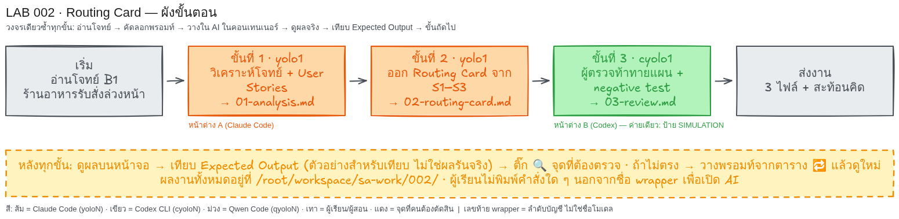

# LAB 002 · Routing Card

เวลาโดยประมาณ: 25 นาที
สิ่งที่จะได้: เลือกผู้ทำ/ผู้ตรวจจากหลักฐาน ออก Routing Card และทดสอบผู้ตรวจไร้สิทธิ์
บทเรียนที่เชื่อม: `ai-agent-routing.html` หัวข้อ 05 และ 7.4 Routing Card
วงจรคือ อ่านโจทย์ → คัดลอกพรอมท์ → วางใน AI → ดูผล → เทียบ Expected → ขั้นถัดไป



## ก่อนเริ่ม

| หน้าต่าง | wrapper | บทบาท |
|---|---|---|
| A | `yolo1` | วิเคราะห์และออกการ์ด ขั้น 1–2 |
| B | `cyolo1` | ตรวจ ขั้น 3 |

วางพรอมท์ในช่องสนทนา AI ภายในคอนเทนเนอร์ หากเห็น `$` หรือ `#` ท้ายบรรทัด แสดงว่าอยู่ใน shell ให้ผู้สอนเปิด wrapper; เปิดหน้าต่าง B หลังขั้น 2

เก็บงานที่ `/root/workspace/sa-work/002/` หากมี AI ค่ายเดียว ให้ใช้ตัวเดิมและติดป้าย `SIMULATION` ในผลส่งงาน

`Producer`=ผู้ทำ, `Reviewer`=ผู้ตรวจ, `CLI`=ช่อง AI และ `DOCS`=งานเอกสาร

## โจทย์ธุรกิจฉบับเต็ม

### กรณีศึกษาและกฎธุรกิจ B1

| รหัส | กฎที่ต้องยึด |
|---|---|
| B1 | ร้าน 1 สาขารับสั่งล่วงหน้า ลูกค้ารับเอง จ่ายที่ร้าน มีเมนู 3 รายการ ใช้รหัสอาหาร และไม่ใช้ข้อมูลบุคคลจริง |
| B1 | ลดการจดผิดและดูจำนวนรายวัน; ทำ 4–6 Stories รหัส `US-01` ต่อเนื่อง ครบ 3 บทบาท/เกณฑ์ |
| B1 | ไม่รวมจ่ายออนไลน์ ส่งอาหาร หลายสาขา สมาชิก ระบบภายนอก ยอดเงิน เมนูขายดี คิว หรือกฎอื่น |

### บทบาทและความต้องการ

| บทบาท | สิ่งที่ทำได้ |
|---|---|
| ลูกค้า | ดูเมนู สั่งรายการ/จำนวน เลือกเวลารับ และดูสถานะด้วยรหัสออเดอร์ |
| พนักงาน | ดูงานรอและเปลี่ยนสถานะ กำลังทำ → พร้อมรับ → รับแล้ว |
| เจ้าของ | ดูเฉพาะจำนวนออเดอร์รายวัน |

ผลจริงใช้ `US-01` ดูเมนู, `US-02` สั่ง, `US-03` ดูสถานะ, `US-04` ดูงานรอ, `US-05` เปลี่ยนสถานะ, `US-06` ดูจำนวนรายวัน; รวมเป็น 4–5 ข้อได้

| รหัส | คำถามค้างที่ห้ามเดาคำตอบ |
|---|---|
| Q1 | ลูกค้าสั่งล่วงหน้าได้กี่วัน |
| Q2 | ลูกค้ายกเลิกได้ถึงเมื่อไร และใครยกเลิก |

### หลักฐานจำลองสำหรับเลือกเส้นทาง

หลักฐาน 2026-09-01 เป็น `SIMULATED` คนละงาน ไม่ใช่ผลจริง อันดับ หรือราคาปัจจุบัน

| รหัส | เครื่องมือ / ผู้ให้บริการ / wrapper | บัญชี / โมเดลสมมติ | ผล |
|---|---|---|---|
| S1 | Claude Code / Anthropic / `yolo1` | `<TEAM_ACCOUNT_A>` / `<PRODUCER_MODEL>` | ร่าง Stories 5/5 |
| S2 | Codex CLI / OpenAI / `cyolo1` | `<TEAM_ACCOUNT_B>` / `<REVIEWER_MODEL>` | พบสิ่งเกินขอบเขต 3/3 |
| S3 | Qwen Code / Qwen / `qyolo1` | `<TEAM_ACCOUNT_C>` / `<ALTERNATE_MODEL>` | จัด Markdown 4/5 |

สมมติ S1-S3 พร้อมทำการ์ดจำลอง; สิทธิ์ โมเดล วันที่ ราคา เวลา และโควตาจริง=`NEED_MORE_DATA` จนยืนยัน เลขบัญชีไม่ใช่โมเดล

## ขั้นที่ 1 · วิเคราะห์ B1   (หน้าต่าง: `yolo1` | เวลา ~7 นาที)

### 🎯 เป้าหมายของขั้นนี้

ผู้เรียนจะได้แปลง B1 เป็น Stories ที่ตรวจได้ เพื่อเลือกผู้ทำ/ผู้ตรวจโดยไม่เดา

### 📥 ข้อมูลตั้งต้นที่ต้องใช้

- `B1`: 1 สาขา รับเอง จ่ายที่ร้าน เมนู 3 รายการ; มี `US-01` เป็นต้นไป 4–6 ข้อ ครบ 3 บทบาทและเกณฑ์
- `Q1`: รับล่วงหน้ากี่วัน; `Q2`: ยกเลิกเมื่อไร ห้ามเดา และไม่มีไฟล์จากขั้นก่อน
### 📋 พรอมท์สำหรับคัดลอก  (คัดลอกทั้งกรอบ วางในช่องสนทนา AI แล้ว Enter)

```text
โฟลเดอร์งานคือ /root/workspace/sa-work/002/ (สร้างถ้ายังไม่มี) เก็บทุกไฟล์ที่นี่ ห้ามแก้ไฟล์ใน /root/workspace/sa-labs/
ตอบภาษาไทย ห้ามอ่านหรือค้นหาไฟล์ README ของ LAB เพื่อหาเฉลย ห้ามสร้างระบบ

# B1 ร้านอาหารรับสั่งล่วงหน้า
ร้านเล็ก 1 สาขาให้ลูกค้าสั่งล่วงหน้า มารับเอง จ่ายที่ร้าน มีเมนูตัวอย่าง 3 รายการ เป้าหมายคือลดการจดผิดและดูยอดออเดอร์รายวัน ใช้รหัสอาหาร ไม่ใช้ข้อมูลบุคคลจริง
ลูกค้าดูเมนู สั่งรายการ/จำนวน เลือกเวลารับ ดูสถานะด้วยรหัสออเดอร์; พนักงานดูงานรอและเปลี่ยน กำลังทำ → พร้อมรับ → รับแล้ว; เจ้าของดูยอดรายวัน
ทำ 4–6 User Stories ไม่รวมชำระออนไลน์ ส่งอาหาร หลายสาขา สมาชิก หรือระบบภายนอก คำถามค้างคือรับล่วงหน้าได้กี่วันและยกเลิกได้ถึงเมื่อไร ห้ามเดา

สร้าง 01-analysis.md มีเป้าหมายธุรกิจ ประเภทงาน DOCS พร้อมเหตุผล ตาราง 3 บทบาท และ US-01 ต่อเนื่อง 4–6 ข้อ แต่ละข้อมีบทบาท ความต้องการ ประโยชน์ เกณฑ์ตรวจที่สังเกตได้ และครบทุกบทบาท
แยก In/Out of scope กับคำถามค้าง 2 ข้อ ประเมินความเสี่ยง ปริมาณงาน ความเร็ว งบประมาณ ความลับ ความยาวบริบท เป็น ต่ำ/กลาง/สูง หรือ NEED_MORE_DATA พร้อมเหตุผล โดยเวลาและงบที่ไม่ได้ให้ต้องเป็น NEED_MORE_DATA
เจ้าของเห็นเฉพาะจำนวนออเดอร์รายวัน ห้ามเพิ่มยอดเงิน เมนูขายดี การเรียงคิว หรือกฎธุรกิจอื่น
ทำเฉพาะขั้นนี้ เมื่อเสร็จให้แสดงเนื้อหาสำคัญของไฟล์ที่สร้าง (ไม่ใช่แค่ชื่อไฟล์) บนหน้าจอเป็นตาราง/รายการที่ฉันอ่านตรวจได้ แล้วหยุดรอ ห้ามทำขั้นถัดไปเอง
```
> ทางลัด: ถ้าผู้สอนวางโฟลเดอร์ LAB ไว้ใน container แล้ว วางข้อความสั้นนี้แทนได้
> ```text
> อ่านไฟล์ /root/workspace/sa-labs/002_LAB_Routing_Card/prompts/step-01.md แล้วทำตามคำสั่งในไฟล์นั้นทั้งหมด ทำเฉพาะขั้นนี้ แสดงผลบนหน้าจอ แล้วหยุดรอฉันตรวจ
> ```
### ✅ Expected Output (ตัวอย่างสำหรับเทียบ — ไม่ใช่ผลการรันจริง)

จากผลจริง `01-analysis.md`:

| รหัส | บทบาท | ผล |
|---|---|---|
| US-01–03 | ลูกค้า | เมนู 3 รายการ; สั่ง; ดูสถานะ |
| US-04–05 | พนักงาน | งานรอ; กำลังทำ → พร้อมรับ → รับแล้ว |
| US-06 | เจ้าของ | จำนวนรายวัน; วันว่าง=0 |
| Q1–Q2 | คำถาม | `NEED_MORE_DATA` |
| เวลา/งบ | ประเมิน | `NEED_MORE_DATA` |

- **ต้องตรง:** มี 4–6 รหัส ครบ 3 บทบาท/เกณฑ์ และไม่เดา Q1–Q2
- **ต้องตรง:** เจ้าของเห็นจำนวนเท่านั้น; เวลา/งบ=`NEED_MORE_DATA`
- **ต่างได้:** รวมเป็น 4–5 Stories และเปลี่ยนคำหรือลำดับได้
- **ต่างได้:** จำนวนเกณฑ์ย่อยต่างได้ แต่ต้องมีทุก Story
### 🔍 จุดที่ผู้เรียนต้องตรวจ

- [ ] เห็น `US-01`–`US-04` หรือมากกว่า พร้อมเกณฑ์และ 3 บทบาท
- [ ] เห็นสิ่งนอกขอบเขตครบ 5 เรื่อง
- [ ] Q1–Q2 เวลา/งบ=`NEED_MORE_DATA`; ยังไม่มี Routing Card
### 🔁 ถ้าผลไม่ตรง

| อาการ | วางข้อความนี้เพิ่ม (ภาษาไทยธรรมดา) |
|---|---|
| Stories ผิด B1 | ให้มี 4–6 ข้อ ครบ 3 บทบาท/เกณฑ์ ลบยอดเงิน เมนูขายดี คิว แก้เฉพาะขั้นนี้ แสดงผล แล้วหยุด |
| เดา Q1–Q2 | ให้ Q1–Q2 เป็นคำถามค้าง `NEED_MORE_DATA` แก้เฉพาะขั้นนี้ แสดงผล แล้วหยุด |
## ขั้นที่ 2 · ออก Routing Card   (หน้าต่าง: `yolo1` | เวลา ~8 นาที)

### 🎯 เป้าหมายของขั้นนี้

ผู้เรียนจะได้เลือกผู้ทำ/ผู้ตรวจจาก S1–S3 และแยกแผนจำลองจากข้อมูลจริง

### 📥 ข้อมูลตั้งต้นที่ต้องใช้

- ใช้ `/root/workspace/sa-work/002/01-analysis.md` จากขั้น 1 ซึ่งมี B1, US และ Q1–Q2
- `SIMULATED` 2026-09-01: S1=5/5, S2=3/3, S3=4/5; ของจริง=`NEED_MORE_DATA`
### 📋 พรอมท์สำหรับคัดลอก  (คัดลอกทั้งกรอบ วางในช่องสนทนา AI แล้ว Enter)

```text
โฟลเดอร์งานคือ /root/workspace/sa-work/002/ (สร้างถ้ายังไม่มี) เก็บทุกไฟล์ที่นี่ ห้ามแก้ไฟล์ใน /root/workspace/sa-labs/
ตอบภาษาไทย ห้ามอ่านหรือค้นหาไฟล์ README ของ LAB เพื่อหาเฉลย ห้ามสร้างระบบ
อ่านไฟล์ /root/workspace/sa-work/002/01-analysis.md ที่สร้างไว้ในขั้นก่อน ถ้าไม่มีให้บอกชื่อไฟล์ที่หายแล้วหยุด ห้ามแต่งขึ้นเอง

# B1 และหลักฐาน
B1: ร้าน 1 สาขารับสั่งล่วงหน้า รับเอง จ่ายที่ร้าน เพื่อลดการจดผิดและดูยอดรายวัน ลูกค้าดูเมนู/สั่ง/เลือกเวลา/ดูสถานะ พนักงานดูงานรอและเปลี่ยน กำลังทำ → พร้อมรับ → รับแล้ว เจ้าของดูยอดรายวัน ต้องมี 4–6 stories ครบ 3 บทบาท ไม่รวมชำระออนไลน์ ส่งอาหาร หลายสาขา สมาชิก ระบบภายนอก คำถามค้างคือรับล่วงหน้าได้กี่วันและยกเลิกได้ถึงเมื่อไร
หลักฐาน SIMULATED วันที่ 2026-09-01 ไม่ใช่ผลจริง อันดับรวม หรือราคาปัจจุบัน:
| ID | CLI / provider / wrapper | บัญชี / โมเดลสมมติ | ผลจำลอง |
|---|---|---|---|
| S1 | Claude Code / Anthropic / yolo1 | <TEAM_ACCOUNT_A> / <PRODUCER_MODEL> | ร่าง stories ครบ 5/5 |
| S2 | Codex CLI / OpenAI / cyolo1 | <TEAM_ACCOUNT_B> / <REVIEWER_MODEL> | พบสิ่งนอกขอบเขต 3/3 |
| S3 | Qwen Code / Qwen / qyolo1 | <TEAM_ACCOUNT_C> / <ALTERNATE_MODEL> | จัด Markdown ครบ 4/5 |
ทั้งสามพร้อมเฉพาะแบบฝึก สถานะจริงของ wrapper สิทธิ์บัญชี โมเดล วันที่หลักฐาน ราคา เวลา โควตาเป็น NEED_MORE_DATA จนผู้สอนยืนยัน

สร้าง 02-routing-card.md ประมาณ 1 หน้า แยก A การ์ด SIMULATED และ B ความพร้อมจริง
A: งาน DOCS ส่งมอบ stories/รายงานตรวจ เลือก Producer/Reviewer จาก S1–S3 แยกหน้าที่ CLI/provider/wrapper บัญชีและโมเดล placeholder อ้าง ID/วันที่ บอกว่าตัวอย่างคนละงานจัดอันดับรวมไม่ได้ เลขบัญชีไม่ใช่โมเดล
แชร์โจทย์ งานวิเคราะห์ การ์ด รายการตรวจ; ห้ามแชร์ข้อมูลเข้าสู่ระบบ/ค่าตั้งส่วนตัว และห้ามแจกแจงชนิดของข้อมูลลับ Reviewer ตรวจ 4–6 stories ครบ 3 บทบาท ตรงขอบเขต มีเกณฑ์ทุกข้อ ไม่รู้ราคา/เวลา/โควตาจริงจึงไม่อ้างว่าถูกที่สุด ใช้ ROUTE_SIMULATED เมื่อเงื่อนไขจำลองครบ
B: ใช้ NEED_MORE_DATA ขอผู้สอนยืนยัน wrapper สิทธิ์บัญชี โมเดล วันที่หลักฐาน และต้นทุน ขั้นนี้ใช้ yolo1 ให้บอกเพียงว่ายังไม่ได้เรียก Reviewer/บัญชีอื่น ห้ามอ้างว่ายังไม่ได้เรียก yolo1 การเปลี่ยนบทบาทในคำตอบเดียวไม่ใช่การตรวจต่างค่าย ห้ามเลือกบัญชีที่ยังไม่ยืนยัน
ทำเฉพาะขั้นนี้ เมื่อเสร็จให้แสดงเนื้อหาสำคัญของไฟล์ที่สร้าง (ไม่ใช่แค่ชื่อไฟล์) บนหน้าจอเป็นตาราง/รายการที่ฉันอ่านตรวจได้ แล้วหยุดรอ ห้ามทำขั้นถัดไปเอง
```
> ทางลัด: ถ้าผู้สอนวางโฟลเดอร์ LAB ไว้ใน container แล้ว วางข้อความสั้นนี้แทนได้
> ```text
> อ่านไฟล์ /root/workspace/sa-labs/002_LAB_Routing_Card/prompts/step-02.md แล้วทำตามคำสั่งในไฟล์นั้นทั้งหมด ทำเฉพาะขั้นนี้ แสดงผลบนหน้าจอ แล้วหยุดรอฉันตรวจ
> ```
### ✅ Expected Output (ตัวอย่างสำหรับเทียบ — ไม่ใช่ผลการรันจริง)

จากผลจริง `02-routing-card.md`:

| หัวข้อ | ผล |
|---|---|
| งาน/สถานะ | `DOCS`; `ROUTE_SIMULATED` / `NEED_MORE_DATA` |
| Producer | S1 / `yolo1` / `<TEAM_ACCOUNT_A>` / `<PRODUCER_MODEL>` |
| Reviewer | S2 / `cyolo1` / `<TEAM_ACCOUNT_B>` / `<REVIEWER_MODEL>` |
| หลักฐาน | S1=5/5, S2=3/3; 2026-09-01 |
| ข้อมูลขาด | สิทธิ์ โมเดล วันที่ ราคา เวลา โควตา |

- **ต้องตรง:** ผู้ทำ=S1/`yolo1`; ผู้ตรวจ=S2/`cyolo1`; แยกบัญชี/โมเดล
- **ต้องตรง:** จำลอง=`ROUTE_SIMULATED`; จริง=`NEED_MORE_DATA`; ไม่เดาต้นทุน
- **ต่างได้:** รูปแบบ ลำดับ คำอธิบาย และความยาวต่างได้
- **ต่างได้:** เหตุผลต่างได้ แต่ยังอ้าง S1–S3/วันที่
### 🔍 จุดที่ผู้เรียนต้องตรวจ

- [ ] เห็น `ROUTE_SIMULATED` แยกจาก `NEED_MORE_DATA`
- [ ] เห็น S1/`yolo1` ผู้ทำ และ S2/`cyolo1` ผู้ตรวจ โดยแยกบัญชี/โมเดล
- [ ] เห็น S1–S3 วันที่ 2026-09-01 พร้อมป้ายจำลอง; ยังไม่ทำขั้น 3
### 🔁 ถ้าผลไม่ตรง

| อาการ | วางข้อความนี้เพิ่ม (ภาษาไทยธรรมดา) |
|---|---|
| บอกว่ายังไม่ใช้ yolo1 | ระบุว่าใช้ yolo1 แล้ว แต่ยังไม่เรียกผู้ตรวจ แก้เฉพาะขั้นนี้ แสดงผล แล้วหยุด |
| เปิดข้อมูลลับหรือแต่งค่า | ลบรายละเอียดและใช้ `NEED_MORE_DATA` แก้เฉพาะขั้นนี้ แสดงผล แล้วหยุด |
## ขั้นที่ 3 · ท้าทายแผน   (หน้าต่าง: `cyolo1` | เวลา ~10 นาที)

### 🎯 เป้าหมายของขั้นนี้

ผู้เรียนจะได้ตรวจแผนและทดสอบผู้ตรวจไร้สิทธิ์ เพื่อให้หยุดแทนการย้ายบัญชีเอง

### 📥 ข้อมูลตั้งต้นที่ต้องใช้

- ใช้ `/root/workspace/sa-work/002/01-analysis.md` และ `/root/workspace/sa-work/002/02-routing-card.md`; ตรวจ B1, US, Q1–Q2, S1–S3 โดยห้ามแก้
- ทดสอบ `cyolo1` ไร้สิทธิ์และไม่มีผู้ตรวจที่ยืนยัน ผล=`NEED_MORE_DATA`
### 📋 พรอมท์สำหรับคัดลอก  (คัดลอกทั้งกรอบ วางในช่องสนทนา AI แล้ว Enter)

```text
โฟลเดอร์งานคือ /root/workspace/sa-work/002/ (สร้างถ้ายังไม่มี) เก็บทุกไฟล์ที่นี่ ห้ามแก้ไฟล์ใน /root/workspace/sa-labs/
ตอบภาษาไทย ห้ามอ่านหรือค้นหาไฟล์ README ของ LAB เพื่อหาเฉลย ห้ามสร้างระบบ
อ่านไฟล์ /root/workspace/sa-work/002/01-analysis.md และ /root/workspace/sa-work/002/02-routing-card.md ที่สร้างไว้ในขั้นก่อน ถ้าไม่มีให้บอกชื่อไฟล์ที่หายแล้วหยุด ห้ามแต่งขึ้นเอง ห้ามแก้สองไฟล์นี้
ถ้ามีเพียง CLI เดียว ให้ใช้ตัวเดิมและใส่ป้าย `SIMULATION` ในไฟล์ผล

# ข้อมูลตรวจ
B1: ร้าน 1 สาขา รับเอง จ่ายที่ร้าน มีลูกค้า/พนักงาน/เจ้าของ และ 4–6 stories พร้อมเกณฑ์ ไม่รวมชำระออนไลน์ ส่งอาหาร หลายสาขา สมาชิก ระบบภายนอก ข้อมูลบุคคลจริง คำถามค้างคือรับล่วงหน้าและยกเลิกได้เมื่อไร
หลักฐาน SIMULATED 2026-09-01: S1 yolo1/Claude Code/Anthropic/<TEAM_ACCOUNT_A>/<PRODUCER_MODEL>=5/5; S2 cyolo1/Codex CLI/OpenAI/<TEAM_ACCOUNT_B>/<REVIEWER_MODEL>=3/3; S3 qyolo1/Qwen Code/Qwen/<TEAM_ACCOUNT_C>/<ALTERNATE_MODEL>=4/5 จัดอันดับรวมไม่ได้ ข้อมูลจริงเป็น NEED_MORE_DATA

สร้าง 03-review.md ระบุวิธีตรวจ DISTINCT_SESSION เมื่อผู้สอนยืนยันหน้าต่างแยกจริง มิฉะนั้น ROLE_SIMULATION ค่าที่ไม่มีหลักฐานใช้ NEED_MORE_DATA
ทำตารางอย่างน้อย 6 ข้อ ใช้ PASS/FIX/NEED_MORE_DATA อ้างไฟล์/หัวข้อ ครอบคลุมจำนวน stories บทบาท ขอบเขต เกณฑ์ตรวจ บัญชีกับโมเดล หลักฐานจำลอง และสถานะจริง
Negative test: cyolo1 ไม่มีสิทธิ์และไม่มี Reviewer อื่นที่ยืนยัน ให้ออกการ์ด NEED_MORE_DATA บอกข้อมูลที่ขอ หยุดก่อนมอบหมาย ห้ามย้ายบัญชี เทียบเดิม ROUTE_SIMULATED กับหลังสิทธิ์หาย NEED_MORE_DATA; ความพร้อมจริงยัง NEED_MORE_DATA
ให้ข้อแก้ไม่เกิน 3 ข้อหรือบอกว่าไม่มี ระบุว่าการอ่านแผนยังไม่พิสูจน์คุณภาพผลโมเดลหรือการเรียกข้ามบัญชีจริง ห้ามสร้างขั้นที่ 4 และห้ามแก้ Routing Card เดิม
ทำเฉพาะขั้นนี้ เมื่อเสร็จให้แสดงเนื้อหาสำคัญของไฟล์ที่สร้าง (ไม่ใช่แค่ชื่อไฟล์) บนหน้าจอเป็นตาราง/รายการที่ฉันอ่านตรวจได้ แล้วหยุดรอ ห้ามทำขั้นถัดไปเอง
```
> ทางลัด: ถ้าผู้สอนวางโฟลเดอร์ LAB ไว้ใน container แล้ว วางข้อความสั้นนี้แทนได้
> ```text
> อ่านไฟล์ /root/workspace/sa-labs/002_LAB_Routing_Card/prompts/step-03.md แล้วทำตามคำสั่งในไฟล์นั้นทั้งหมด ทำเฉพาะขั้นนี้ แสดงผลบนหน้าจอ แล้วหยุดรอฉันตรวจ
> ```
### ✅ Expected Output (ตัวอย่างสำหรับเทียบ — ไม่ใช่ผลการรันจริง)

จากผลจริง `03-review.md`:

| เรื่อง | สถานะ | ผล |
|---|---|---|
| US-01–06 | PASS | 6 ข้อ ครบ 3 บทบาท |
| B1/เกณฑ์ | PASS | ตรงขอบเขต มีเกณฑ์ทุกข้อ |
| Q1–Q2 | NEED_MORE_DATA | ไม่มีคำตอบ |
| บัญชี/โมเดล | NEED_MORE_DATA | เป็น placeholder |
| วิธี | ROLE_SIMULATION | ไม่ยืนยันหน้าต่างแยก |
| Negative test | NEED_MORE_DATA | หยุด ไม่ย้าย |

- **ต้องตรง:** มี ≥6 แถวพร้อมหลักฐาน; Negative test=`NEED_MORE_DATA`
- **ต้องตรง:** ไม่ย้าย ไม่แก้ไฟล์ และไม่มีขั้น 4
- **ต่างได้:** จำนวน ลำดับ และคำอธิบายต่างได้
- **ต่างได้:** ใช้ `DISTINCT_SESSION` เมื่อผู้สอนยืนยันได้
### 🔍 จุดที่ผู้เรียนต้องตรวจ

- [ ] เห็นอย่างน้อย 6 แถวพร้อมสถานะ/หลักฐาน
- [ ] เห็น `cyolo1` ไร้สิทธิ์ → `NEED_MORE_DATA` และไม่ย้าย
- [ ] วิธีตรวจตรงหลักฐาน ไม่มีขั้น 4 และไม่แก้ไฟล์เดิม
### 🔁 ถ้าผลไม่ตรง

| อาการ | วางข้อความนี้เพิ่ม (ภาษาไทยธรรมดา) |
|---|---|
| ย้ายบัญชีเอง | ให้เป็น `NEED_MORE_DATA` และขอผู้ตรวจที่ยืนยัน แก้เฉพาะขั้นนี้ แสดงผล แล้วหยุด |
| ตรวจไม่ครบ/อ้างต่างหน้าต่าง | ให้ครบ 6 ข้อและใช้ `ROLE_SIMULATION` จนยืนยัน แก้เฉพาะขั้นนี้ แสดงผล แล้วหยุด |
## ส่งงาน

ส่งจาก `/root/workspace/sa-work/002/`: `01-analysis.md`, `02-routing-card.md` และ `03-review.md`

### Checklist ผ่าน LAB

- [ ] งานมี 4–6 Stories ต่อเนื่อง ครบ 3 บทบาท/เกณฑ์
- [ ] งานตรง B1 ไม่เดา Q1–Q2 หรือเพิ่มกฎ
- [ ] การ์ดแยกผู้ทำ ผู้ตรวจ บัญชี และโมเดล
- [ ] การ์ดอ้าง S1–S3 วันที่ 2026-09-01 พร้อม `SIMULATED`
- [ ] แผนเป็น `ROUTE_SIMULATED` แต่ของจริงเป็น `NEED_MORE_DATA`
- [ ] รายงานมีอย่างน้อย 6 ข้อและวิธีตรวจตรงหลักฐาน
- [ ] Negative test เป็น `NEED_MORE_DATA` หยุดและไม่ย้ายบัญชี
- [ ] ถ้าใช้ AI ค่ายเดียว ไฟล์ผลติดป้าย `SIMULATION`

### คำถามสะท้อนคิด

1. เหตุใดเลขบัญชีของ wrapper จึงไม่ใช่รุ่นโมเดล?
2. เมื่อ Reviewer ไม่มีสิทธิ์ เหตุใดต้องขอข้อมูลแทนการย้ายบัญชีเอง?
3. รอบนี้ตรวจต่างหน้าต่างจริงหรือเป็น `SIMULATION` และดูจากอะไร?

## หลักฐานผู้จัดทำ

ผู้จัดทำรันจริง 3 ขั้น: ขั้น 1–2 ใช้ `yolo1`, ขั้น 3 ใช้ `cyolo1` และตรวจ path ในคอนเทนเนอร์

`SKIP` การเปิดสองหน้าต่างโดยผู้เรียน และยืนยันตัวตน สิทธิ์ ราคา เวลา โควตาในชั้นจริง ดู [รายงาน LAB 002](../evidence/lab002/report.md)
