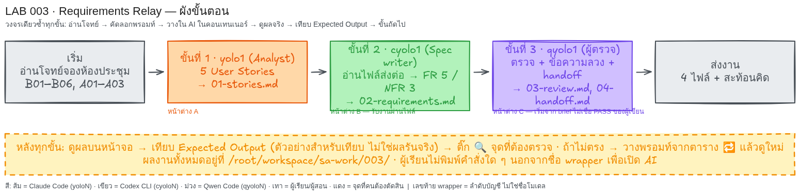

# LAB 003 · Requirements Relay


35–45 นาที · ได้ Story → FR/NFR → ผลตรวจ

## ก่อนเริ่ม
| หน้าต่าง | wrapper | บทบาท |
|---|---|---|
| A | `yolo1` | Analyst |
| B | `cyolo1` | Spec writer |
| C | `qyolo1` | Reviewer |

วางใน AI; งานอยู่ที่ `/root/workspace/sa-work/003/`

## โจทย์ธุรกิจฉบับเต็ม
`<ROOM_A>`, `<ROOM_B>` เปิด 09:00–17:00 วันทำการ; วัน `<BOOKING_DATE>`

| ID | กฎธุรกิจ |
|---|---|
| B01 | `<REQUESTER_A>` ดูห้อง/ช่วงว่างตามวัน |
| B02 | จองห้องเปิด; ห้อง/วัน/เริ่ม/จบ; เริ่ม < จบ; 09:00–17:00 |
| B03 | ห้อง/วันเดียวกันห้ามรายการไม่ยกทับ; เวลาติดได้; กดพร้อมกันช่วงทับสำเร็จหนึ่ง |
| B04 | เจ้าของยกก่อนเริ่ม; ยกแล้วว่าง; คนอื่นยกไม่ได้ |
| B05 | `<RECEPTION_A>` ดูรายวันทุกห้อง; แก้/ยกไม่ได้ |
| B06 | `<ADMIN_A>` เปิด/ปิดรับใหม่; รายการเดิมอยู่ |

ไม่มีจ่ายเงิน/อีเมล/อนุมัติ; ค้าง: วันหยุด/จองล่วงหน้า/A01–A03

| ID | สมมติฐาน NFR—ยังไม่ใช่ผลทดสอบ |
|---|---|
| A01 | p95 ≤2s; 20 คน; 1,000 รายการ; ค้น 100 ครั้ง/เครือข่ายห้องเรียน |
| A02 | ผู้ใช้ใหม่ 5 คน: อย่างน้อย 4 คนค้น/จองสำเร็จ ≤90s/คน ไม่รับคำแนะนำ |
| A03 | สำรอง/24h; กู้ ≤30m; สูญหาย ≤24h |

## ขั้นที่ 1 · เขียน 5 User Stories   (หน้าต่าง: `yolo1` | เวลา ~7 นาที)
### 🎯 เป้าหมายของขั้นนี้
เขียน Story จาก B
### 📥 ข้อมูลตั้งต้นที่ต้องใช้
- B01–B06 ในพรอมท์
### 📋 พรอมท์สำหรับคัดลอก  (คัดลอกทั้งกรอบ วางในช่องสนทนา AI แล้ว Enter)
```text
โฟลเดอร์งานคือ /root/workspace/sa-work/003/ (สร้างถ้ายังไม่มี) เก็บทุกไฟล์ที่นี่ ห้ามแก้ไฟล์ใน /root/workspace/sa-labs/
เป็น Analyst เขียนไทย ไม่เขียนโค้ด/เว็บ ห้ามอ่าน README ของ LAB
โจทย์: `<ROOM_A>`, `<ROOM_B>` เปิด 09:00–17:00 วันทำการ; วัน `<BOOKING_DATE>`; ใช้ชื่อ placeholder
| ID | กฎธุรกิจ |
|---|---|
| B01 | `<REQUESTER_A>` ดูห้อง/ช่วงว่างตามวัน |
| B02 | จองห้องเปิด; ระบุห้อง/วัน/เริ่ม/จบ; เริ่ม < จบ; 09:00–17:00 |
| B03 | ห้อง/วันเดียวกันห้ามรายการไม่ยกทับ; เวลาติดกันได้; กดพร้อมกันช่วงทับสำเร็จหนึ่ง |
| B04 | เจ้าของยกของตนก่อนเริ่ม; ยกแล้วว่าง; คนอื่นยกไม่ได้ |
| B05 | `<RECEPTION_A>` ดูรายวันทุกห้อง; แก้/ยกแทนไม่ได้ |
| B06 | `<ADMIN_A>` เปิด/ปิดรับใหม่; ปิดแล้วรายการเดิมอยู่ |
ไม่มีจ่ายเงิน อีเมล อนุมัติ ค้าง: วันหยุด ระยะจองล่วงหน้า NFR
สร้าง 01-stories.md: 5 ข้อ US-01–US-05 ตาราง ID | บทบาท | ฉันต้องการ…เพื่อ… | Source B | Acceptance criteria
แยกดูห้อง, จอง/กันทับ, ยก, รายวัน, เปิด/ปิด ให้ครบ 3 บทบาท
เกณฑ์จอง: เดิม 09:00–10:00; ขอ 09:30–10:30=ปฏิเสธ, 10:00–11:00=อนุญาต; กดช่วงทับพร้อมกันสำเร็จหนึ่งรายการ
เกณฑ์ยกมีเจ้าของ/คนอื่น/ยังไม่เริ่ม; ปิดห้องคงรายการเดิม; จบด้วยคำถามค้าง ≤3 ห้ามเพิ่มขอบเขต
CLI เดียว: ใส่ `SIMULATION` ในไฟล์
ทำเฉพาะขั้นนี้ เมื่อเสร็จให้แสดงเนื้อหาสำคัญของไฟล์ที่สร้าง (ไม่ใช่แค่ชื่อไฟล์) บนหน้าจอเป็นตาราง/รายการที่ฉันอ่านตรวจได้ แล้วหยุดรอ ห้ามทำขั้นถัดไปเอง

```
> ทางลัด
> ```text
> อ่านไฟล์ /root/workspace/sa-labs/003_LAB_Requirements_Relay/prompts/step-01.md แล้วทำตามคำสั่งในไฟล์นั้นทั้งหมด ทำเฉพาะขั้นนี้ แสดงผลบนหน้าจอ แล้วหยุดรอฉันตรวจ
> ```
### ✅ Expected Output (ตัวอย่างสำหรับเทียบ — ไม่ใช่ผลการรันจริง)
`01-stories.md`: US-01–US-05 แยก 5 เรื่อง
- **ต้องตรง:** 5 Stories/3 บทบาท; 09:30 ปฏิเสธ; 10:00 อนุญาต
- **ต่างได้:** ถ้อยคำและลำดับเกณฑ์
### 🔍 จุดที่ผู้เรียนต้องตรวจ
- [ ] 5 รหัสไม่ซ้ำ
- [ ] ครบ 3 บทบาท
- [ ] เกณฑ์ทับ/ยก/ปิดครบ
### 🔁 ถ้าผลไม่ตรง
| อาการ | วางข้อความนี้เพิ่ม |
|---|---|
| ขาด/ผิด | แก้ 01-stories.md ให้ครบ B01–B06 แสดงทั้งไฟล์ ทำเฉพาะขั้นนี้แล้วหยุดรอ |

## ขั้นที่ 2 · เขียน FR/NFR   (หน้าต่าง: `cyolo1` | เวลา ~8 นาที)
### 🎯 เป้าหมายของขั้นนี้
เขียน FR/NFR
### 📥 ข้อมูลตั้งต้นที่ต้องใช้
- `01-stories.md`; B/A ในพรอมท์
### 📋 พรอมท์สำหรับคัดลอก  (คัดลอกทั้งกรอบ วางในช่องสนทนา AI แล้ว Enter)
```text
โฟลเดอร์งานคือ /root/workspace/sa-work/003/ (สร้างถ้ายังไม่มี) เก็บทุกไฟล์ที่นี่ ห้ามแก้ไฟล์ใน /root/workspace/sa-labs/
เป็น Spec writer เขียนไทย ไม่เขียนโค้ด ห้ามอ่าน README ของ LAB
อ่าน /root/workspace/sa-work/003/01-stories.md ที่สร้างไว้ในขั้นก่อน ถ้าไม่มีให้บอกชื่อไฟล์ที่หายแล้วหยุด ห้ามแต่งขึ้นเอง
โจทย์: `<ROOM_A>`, `<ROOM_B>` เปิด 09:00–17:00 วันทำการ; `<BOOKING_DATE>`; 3 บทบาท placeholder
| ID | กฎธุรกิจ |
|---|---|
| B01 | พนักงานดูห้อง/ช่วงว่างตามวัน |
| B02 | จองห้องเปิด; ระบุห้อง/วัน/เริ่ม/จบ; เริ่ม < จบ; 09:00–17:00 |
| B03 | ห้อง/วันเดียวกันห้ามรายการไม่ยกทับกัน; เวลาติดกันได้; กดพร้อมกันช่วงทับให้สำเร็จหนึ่งรายการ |
| B04 | เจ้าของยกก่อนเริ่ม; ยกแล้วว่าง; คนอื่นยกไม่ได้ |
| B05 | ต้อนรับดูรายวันทุกห้อง; แก้/ยกไม่ได้ |
| B06 | ผู้ดูแลเปิด/ปิดรับจองใหม่; ปิดแล้วรายการเดิมอยู่ |
| ID | สมมติฐาน NFR—รอลูกค้ายืนยัน |
|---|---|
| A01 | p95 ≤2s; 20 คน; 1,000 รายการ; ค้น 100 ครั้ง/เครือข่ายห้องเรียน |
| A02 | ผู้ใช้ใหม่ 5 คน: อย่างน้อย 4 คนค้น/จองสำเร็จ ≤90s/คน ไม่รับคำแนะนำ |
| A03 | สำรอง/24h; กู้ชุดล่าสุด ≤30m; สูญหาย ≤24h |
ตรวจ US-01–US-05 ครบ 5/3 บทบาท/ไม่ขัด B; ถ้าผิดระบุ FIX กับ US แล้วหยุด ห้ามแก้เงียบๆ
ถ้าผ่านสร้าง 02-requirements.md: FR-01–FR-05 ตาราง ID | พฤติกรรม | Source US/B | วิธีตรวจ/ผลคาด; อ้าง US จริงครบ รวมกดพร้อมกัน
เพิ่ม NFR-01–NFR-03 ตาราง ID | ค่าวัด/เงื่อนไข | วิธีทดสอบ | Source A | สถานะ; ใช้ A01–A03 ใส่ `สมมติฐานชั้นเรียน — รอลูกค้ายืนยัน` ทุกแถว ห้ามอ้างว่าวัดผ่าน
ตารางเวลา: เดิม `<ROOM_A>` `<BOOKING_DATE>` 09:00–10:00; ขอ 09:30–10:30=ปฏิเสธ, 09:00–10:00=ปฏิเสธ, 10:00–11:00=อนุญาต, 10:00–10:00=ปฏิเสธ, 08:30–09:30=ปฏิเสธ, `<ROOM_B>` 09:00–10:00=อนุญาตถ้าเปิด/ว่าง
ระบุว่าตรวจทั้งช่วงและกดพร้อมกัน ไม่ใช่แค่เวลาเริ่ม
CLI เดียว: ใส่ `SIMULATION` ในไฟล์
ทำเฉพาะขั้นนี้ เมื่อเสร็จให้แสดงเนื้อหาสำคัญของไฟล์ที่สร้าง (ไม่ใช่แค่ชื่อไฟล์) บนหน้าจอเป็นตาราง/รายการที่ฉันอ่านตรวจได้ แล้วหยุดรอ ห้ามทำขั้นถัดไปเอง

```
> ทางลัด
> ```text
> อ่านไฟล์ /root/workspace/sa-labs/003_LAB_Requirements_Relay/prompts/step-02.md แล้วทำตามคำสั่งในไฟล์นั้นทั้งหมด ทำเฉพาะขั้นนี้ แสดงผลบนหน้าจอ แล้วหยุดรอฉันตรวจ
> ```
### ✅ Expected Output (ตัวอย่างสำหรับเทียบ — ไม่ใช่ผลการรันจริง)
`02-requirements.md`: FR-01–FR-05; NFR-01/A01–NFR-03/A03; ตารางเวลา 09:30=ปฏิเสธ, 10:00=อนุญาต
- **ต้องตรง:** FR 5, NFR 3, แหล่งอ้างอิง, ตัวเลข/ป้าย และเวลา 6 กรณี
- **ต่างได้:** ถ้อยคำ คอลัมน์ วิธีวัด
### 🔍 จุดที่ผู้เรียนต้องตรวจ
- [ ] FR อ้าง US จริงครบ
- [ ] NFR มีค่า/วิธีวัด/ป้าย
- [ ] ตรวจทั้งช่วงและกดพร้อมกัน
### 🔁 ถ้าผลไม่ตรง
| อาการ | วางข้อความนี้เพิ่ม |
|---|---|
| ไฟล์หาย | บอกไฟล์ที่หายและหยุด ห้ามแต่งงานก่อน ทำเฉพาะขั้นนี้แล้วหยุดรอ |
| เนื้อหาผิด | แก้ 02-requirements.md ตาม B02–B03/A01–A03 แสดงส่วนแก้ ทำเฉพาะขั้นนี้แล้วหยุดรอ |

## ขั้นที่ 3 · ตรวจและส่งมอบ   (หน้าต่าง: `qyolo1` | เวลา ~10 นาที)
### 🎯 เป้าหมายของขั้นนี้
ตรวจและ handoff
### 📥 ข้อมูลตั้งต้นที่ต้องใช้
- `01-stories.md`, `02-requirements.md`; B/A ในพรอมท์
### 📋 พรอมท์สำหรับคัดลอก  (คัดลอกทั้งกรอบ วางในช่องสนทนา AI แล้ว Enter)
```text
โฟลเดอร์งานคือ /root/workspace/sa-work/003/ (สร้างถ้ายังไม่มี) เก็บทุกไฟล์ที่นี่ ห้ามแก้ไฟล์ใน /root/workspace/sa-labs/
เป็นผู้ตรวจอิสระ ไม่เชื่อ PASS ไม่แก้ไฟล์ผู้เขียน/อ่าน README
อ่าน /root/workspace/sa-work/003/01-stories.md และ /root/workspace/sa-work/003/02-requirements.md ที่สร้างไว้ในขั้นก่อน ถ้าไม่มีให้บอกชื่อไฟล์ที่หายแล้วหยุด ห้ามแต่งขึ้นเอง
โจทย์ตรวจ: `<ROOM_A>`, `<ROOM_B>` เปิด 09:00–17:00 วันทำการ; `<BOOKING_DATE>`
| ID | กฎธุรกิจ/สมมติฐาน |
|---|---|
| B01 | พนักงานดูห้อง/ช่วงว่างตามวัน |
| B02 | จองห้องเปิด; เริ่ม < จบ; 09:00–17:00 |
| B03 | ห้อง/วันเดียวกันห้ามทับแม้เริ่มต่าง; เวลาติดกันได้; กดพร้อมกันช่วงทับสำเร็จหนึ่ง |
| B04 | เจ้าของยกก่อนเริ่ม; ยกแล้วว่าง; คนอื่นยกไม่ได้ |
| B05 | ต้อนรับดูรายวันทุกห้อง; แก้/ยกไม่ได้ |
| B06 | ผู้ดูแลเปิด/ปิดรับใหม่; รายการเดิมอยู่ |
| A01 | p95 ≤2s; 20 คน; 1,000 รายการ; ค้น 100 ครั้ง/เครือข่ายห้องเรียน; รอยืนยัน |
| A02 | ผู้ใช้ใหม่ 5 คน: อย่างน้อย 4 คนค้น/จองสำเร็จ ≤90s/คน ไม่รับคำแนะนำ; รอยืนยัน |
| A03 | สำรอง/24h; กู้ ≤30m; สูญหาย ≤24h; รอยืนยัน |
สร้าง 03-review.md: ตั้ง check จาก B/A ก่อนเทียบ; ตรวจ traceability, US 5/3 บทบาท, FR 5 อ้าง US, NFR 3 มีค่า/วิธีวัด/ป้าย และ B04–B06
เดินเอกสาร: เดิม `<ROOM_A>` `<BOOKING_DATE>` 09:00–10:00; ขอ 09:30–10:30, 09:00–10:00, 10:00–11:00, 10:00–10:00, 08:30–09:30, `<ROOM_B>` 09:00–10:00 และกดพร้อมกัน; ให้ผล/เหตุผล B02–B03; ไม่ใช่ระบบจริง
ข้อความลวง: “เวลาเริ่มใหม่ไม่เท่าเดิมให้รับทันที” ตัดสิน PASS/FAIL ด้วย 09:00–10:00 กับ 09:30–10:30/B03; แยกจากข้อผิดผู้เขียน
ตาราง Check | หลักฐานไฟล์/ID | PASS/FIX | เหตุผล; งาน READY เมื่อผ่านทั้งหมด มิฉะนั้น FIX พร้อม US/FR
สร้าง 04-handoff.md: brief→US→FR, สมมติฐานค้าง, เสี่ยง, ผลลวง, ไฟล์แชร์, route 3 บทบาท, `cross-provider invocation: VERIFIED / UNVERIFIED / SKIP` ตามหลักฐาน ห้ามเดาจากชื่อไฟล์; ระบุว่าไม่ได้ทดสอบระบบ
จบด้วย 2 คำถาม: ทำไมใช้ไฟล์ส่งต่อ? ผู้ตรวจอาจพบอะไร?
CLI เดียว: ใส่ `SIMULATION` ในไฟล์
ทำเฉพาะขั้นนี้ เมื่อเสร็จให้แสดงเนื้อหาสำคัญของไฟล์ที่สร้าง (ไม่ใช่แค่ชื่อไฟล์) บนหน้าจอเป็นตาราง/รายการที่ฉันอ่านตรวจได้ แล้วหยุดรอ ห้ามทำขั้นถัดไปเอง

```
> ทางลัด
> ```text
> อ่านไฟล์ /root/workspace/sa-labs/003_LAB_Requirements_Relay/prompts/step-03.md แล้วทำตามคำสั่งในไฟล์นั้นทั้งหมด ทำเฉพาะขั้นนี้ แสดงผลบนหน้าจอ แล้วหยุดรอฉันตรวจ
> ```
### ✅ Expected Output (ตัวอย่างสำหรับเทียบ — ไม่ใช่ผลการรันจริง)
`03-review.md`: READY/FIX; ข้อความลวง **FAIL** เพราะ 09:00–10:00 ทับ 09:30–10:30/B03. `04-handoff.md`: เส้นทาง/งานค้าง
- **ต้องตรง:** ลวง FAIL พร้อมตัวอย่าง/B03; ชื่อไฟล์; READY/FIX
- **ต่างได้:** ถ้อยคำ ลำดับ check จุดเสี่ยง
### 🔍 จุดที่ผู้เรียนต้องตรวจ
- [ ] Check มีหลักฐานและเหตุผล
- [ ] กรณีเวลาทุกแบบถูกกฎ
- [ ] ลวงแยกจากผลชิ้นงาน
- [ ] ไม่อ้างว่าทดสอบระบบจริง
### 🔁 ถ้าผลไม่ตรง
| อาการ | วางข้อความนี้เพิ่ม |
|---|---|
| ลวงไม่ FAIL | ตรวจ 09:00–10:00 กับ 09:30–10:30 ตาม B03 แก้เฉพาะขั้นนี้แล้วหยุดรอ |
| ไม่แสดงไฟล์ | แสดง 03-review.md และ 04-handoff.md ทำเฉพาะขั้นนี้แล้วหยุดรอ |

## ส่งงาน
ส่ง `01-stories.md`, `02-requirements.md`, `03-review.md`, `04-handoff.md` จากโฟลเดอร์งาน

- [ ] US 5/3 บทบาท; FR 5; NFR 3
- [ ] ทับ/ติด/ศูนย์/นอกเวลา/คนละห้องถูก
- [ ] B04–B06 ครบ
- [ ] ลวง FAIL; READY/FIX มีหลักฐาน
- [ ] ตรวจ NFR ไม่ใช่ทดสอบระบบ

สะท้อนคิด: อะไรตกหล่น? ข้อความลวงจับอะไร?

## หลักฐานผู้จัดทำ
[รายงาน](../evidence/lab003/report.md): live/ไฟล์หาย/ทางลัด; ชั้นเรียน SKIP
