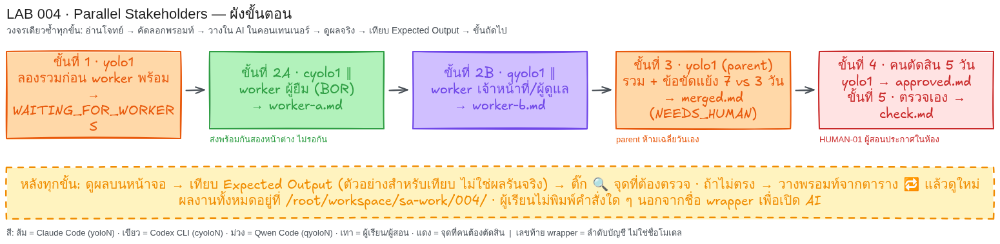

# LAB 004 · วิเคราะห์ผู้เกี่ยวข้องพร้อมกัน


เวลา 35–45 นาที · ฝึก Fan-out สองค่าย แล้วให้ parent รวมผล
สิ่งที่จะได้คือ User Stories ไม่เกิน 6 ข้อ หลักฐานเวลาทำงานขนาน และข้อขัดแย้งที่ส่งให้คนตัดสิน

## ก่อนเริ่ม

| หน้าต่าง | wrapper | บทบาท |
|---|---|---|
| A ขั้น 1 | `yolo1` | ลองรวมก่อน worker พร้อม |
| A ขั้น 2 | `cyolo1` | Worker A มุมผู้ยืม |
| B ขั้น 2 | `qyolo1` | Worker B มุมเจ้าหน้าที่/ผู้ดูแล |
| A ขั้น 3–5 | `yolo1` | Parent รวม อนุมัติ และตรวจ |

ให้ผู้สอนเปิด SSH สองหน้าต่างไปยัง container เดียวกัน และเปิด wrapper ที่ระบุ ผู้เรียนพิมพ์เพียงชื่อ wrapper เพื่อเข้า AI หากเห็นข้อความโต้ตอบของ AI แปลว่าอยู่ถูกที่ หากเห็นเครื่องหมายรอคำสั่งของ shell ให้หยุดและขอผู้สอนช่วย ผลงานอยู่ที่ `/root/workspace/sa-work/004/` และต้องว่างก่อนเริ่ม

## โจทย์ธุรกิจฉบับเต็ม

- BR-01: ระบบเล็กสำหรับขอยืมอุปกรณ์ ตรวจรายการที่ยังว่าง และคืนอุปกรณ์
- BR-02: มี 3 บทบาทเท่านั้น: ผู้ยืม เจ้าหน้าที่ห้องอุปกรณ์ ผู้ดูแลระบบ
- BR-03: ทำเอกสารความต้องการไม่เกิน 6 User Stories ยังไม่สร้างโปรแกรม ไม่มีชำระเงิน ค่าปรับ หรือส่งอีเมล
- BR-04: คำสัมภาษณ์ยังไม่ตกลงนโยบาย เมื่อคำขัดกัน AI ห้ามเลือกเอง ต้องถามผู้สอนที่เป็นเจ้าของนโยบาย
- BOR-01 ผู้ยืม `<BORROWER_NAME>`: “ฉันอยากดูว่าอุปกรณ์ชิ้นไหนว่างและส่งคำขอยืมจากรายการนั้นได้”
- BOR-02 ผู้ยืม: “งานกลุ่มใช้เวลาหลายวัน ฉันต้องการยืมได้สูงสุด 7 วัน”
- LIB-01 เจ้าหน้าที่ `<LIBRARIAN_NAME>`: “อุปกรณ์มีน้อย ฉันต้องการกำหนดยืมสูงสุด 3 วัน เพื่อให้หมุนเวียนได้”
- LIB-02 เจ้าหน้าที่: “ฉันต้องตรวจคำขอแล้วอนุมัติหรือปฏิเสธ พร้อมบันทึกตอนรับคืน”
- ADM-01 ผู้ดูแล `<ADMIN_NAME>`: “ฉันต้องเพิ่มและแก้ไขรายการอุปกรณ์ และปิดการให้ยืมชิ้นที่ชำรุดได้”

ข้อเสนอ 7 วันกับ 3 วันยังไม่ใช่นโยบายที่อนุมัติ AI ไม่มีสิทธิ์เลือกหรือเฉลี่ย

## ขั้นที่ 1 · ลองรวมก่อน Worker พร้อม   (หน้าต่าง: `yolo1` | เวลา ~3 นาที)

### 🎯 เป้าหมายของขั้นนี้
เห็นว่า parent ต้องรอข้อมูลให้ครบ และไม่รวมงานจากข้อมูลที่ยังไม่มี

### 📥 ข้อมูลตั้งต้นที่ต้องใช้
- ใช้ BR-01–04 และ BOR/LIB/ADM ข้างต้น
- โฟลเดอร์งานต้องว่าง จึงยังไม่มี `worker-a.md` และ `worker-b.md`

### 📋 พรอมท์สำหรับคัดลอก  (คัดลอกทั้งกรอบ วางในช่องสนทนา AI แล้ว Enter)
```text
โฟลเดอร์งานคือ /root/workspace/sa-work/004/ (สร้างถ้ายังไม่มี) เก็บทุกไฟล์ที่นี่ ห้ามแก้ไฟล์ใน /root/workspace/sa-labs/
ข้อมูลตั้งต้น:
BR-01: ยืม/ดูชิ้นว่าง/คืนอุปกรณ์
BR-02: 3 บทบาทเท่านั้น=ผู้ยืม|เจ้าหน้าที่ห้องอุปกรณ์|ผู้ดูแลระบบ
BR-03: ≤6 stories; ไม่สร้างโปรแกรม; ไม่มีชำระเงิน/ค่าปรับ/อีเมล
BR-04: ข้อเสนอขัดกัน→ถามผู้สอนเจ้าของนโยบาย; AI ห้ามเลือก
BOR-01 `<BORROWER_NAME>`: ดูชิ้นว่าง+ส่งคำขอ; BOR-02: ผู้ยืมเสนอ 7 วัน
LIB-01 `<LIBRARIAN_NAME>`: เสนอ 3 วันเพื่อหมุนเวียน; LIB-02: อนุมัติ/ปฏิเสธ+รับคืน
ADM-01 `<ADMIN_NAME>`: เพิ่ม/แก้รายการ+ปิดยืมชิ้นชำรุด
3 กับ 7 วันยังไม่สรุป; ห้ามเลือก/เฉลี่ย
ห้ามอ่านหรือค้นหาไฟล์ README ของ LAB เพื่อหาเฉลย
ห้ามเรียก AI หรือ CLI ลูกมาช่วย ทำงานนี้ด้วยตัวเองเท่านั้น
ตรวจ /root/workspace/sa-work/004/worker-a.md และ worker-b.md ว่ามี status COMPLETE หรือไม่
ถ้าหายหรือยังไม่ COMPLETE ให้แสดง `WAITING_FOR_WORKERS`+ชื่อไฟล์ ห้ามสร้างไฟล์; ถ้าครบให้แสดง `NEGATIVE_CASE_NOT_READY` แล้วหยุด ห้ามลบงานเก่า
ทำเฉพาะขั้นนี้ เมื่อเสร็จให้แสดงเนื้อหาสำคัญของไฟล์ที่สร้าง (ไม่ใช่แค่ชื่อไฟล์) บนหน้าจอเป็นตาราง/รายการที่ฉันอ่านตรวจได้ แล้วหยุดรอ ห้ามทำขั้นถัดไปเอง
```
> ทางลัด: ถ้าผู้สอนวางโฟลเดอร์ LAB ไว้ใน container แล้ว วางข้อความสั้นนี้แทนได้
> ```text
> อ่านไฟล์ /root/workspace/sa-labs/004_LAB_Parallel_Stakeholders/prompts/step-01.md แล้วทำตามคำสั่งในไฟล์นั้นทั้งหมด ทำเฉพาะขั้นนี้ แสดงผลบนหน้าจอ แล้วหยุดรอฉันตรวจ
> ```

### ✅ Expected Output (ตัวอย่างสำหรับเทียบ — ไม่ใช่ผลการรันจริง)
หน้าจอแสดง `WAITING_FOR_WORKERS: worker-a.md, worker-b.md` และไม่มี `merged.md`
- **ต้องตรง:** สถานะ `WAITING_FOR_WORKERS`, ชื่อสองไฟล์, ไม่สร้างไฟล์ผล
- **ต่างได้:** ถ้อยคำอธิบายและรูปแบบรายการ

### 🔍 จุดที่ผู้เรียนต้องตรวจ
- [ ] เห็นชื่อ worker ทั้งสองไฟล์
- [ ] AI หยุดหลังตรวจขั้นนี้
- [ ] ไม่มีข้อความว่าได้รวมงานแล้ว

### 🔁 ถ้าผลไม่ตรง
| อาการ | วางข้อความนี้เพิ่ม (ภาษาไทยธรรมดา) |
|---|---|
| AI สร้างไฟล์ | ลบไม่ได้ ให้หยุดรอบนี้และแจ้งผู้สอนเตรียมโฟลเดอร์ว่างใหม่ |
| AI ไม่หยุด | ตรวจเฉพาะขั้นที่ 1 แสดง WAITING_FOR_WORKERS แล้วหยุดรอ |

## ขั้นที่ 2 · แยกวิเคราะห์พร้อมกัน   (หน้าต่าง A: `cyolo1` · หน้าต่าง B: `qyolo1` | เวลา ~8 นาที)

### 🎯 เป้าหมายของขั้นนี้
ส่งงานสองมุมพร้อมกันจริงและเก็บเวลา UTC ในไฟล์แยก

### 📥 ข้อมูลตั้งต้นที่ต้องใช้
- A ใช้ BOR-01/02; B ใช้ LIB-01/02 และ ADM-01 ภายใต้ BR-01–04
- กดส่งทั้งสองหน้าต่างติดกันโดยไม่รออีกหน้าต่างเสร็จ

### 📋 พรอมท์สำหรับคัดลอก  (คัดลอกทั้งกรอบ วางในช่องสนทนา AI แล้ว Enter)

หน้าต่าง A:
```text
โฟลเดอร์งานคือ /root/workspace/sa-work/004/ (สร้างถ้ายังไม่มี) เก็บทุกไฟล์ที่นี่ ห้ามแก้ไฟล์ใน /root/workspace/sa-labs/
ข้อมูลตั้งต้น:
BR-01: ยืม/ดูชิ้นว่าง/คืนอุปกรณ์
BR-02: 3 บทบาทเท่านั้น=ผู้ยืม|เจ้าหน้าที่ห้องอุปกรณ์|ผู้ดูแลระบบ
BR-03: ≤6 stories; ไม่สร้างโปรแกรม; ไม่มีชำระเงิน/ค่าปรับ/อีเมล
BR-04: ข้อเสนอขัดกัน→ถามผู้สอนเจ้าของนโยบาย; AI ห้ามเลือก
BOR-01 `<BORROWER_NAME>`: ดูชิ้นว่าง+ส่งคำขอ; BOR-02: ผู้ยืมเสนอ 7 วัน
LIB-01 `<LIBRARIAN_NAME>`: เสนอ 3 วันเพื่อหมุนเวียน; LIB-02: อนุมัติ/ปฏิเสธ+รับคืน
ADM-01 `<ADMIN_NAME>`: เพิ่ม/แก้รายการ+ปิดยืมชิ้นชำรุด
3 กับ 7 วันยังไม่สรุป; ห้ามเลือก/เฉลี่ย
ห้ามอ่านหรือค้นหาไฟล์ README ของ LAB เพื่อหาเฉลย
ห้ามเรียก AI หรือ CLI ลูกมาช่วย ทำงานนี้ด้วยตัวเองเท่านั้น
ถ้ามีเพียง CLI เดียว ให้ใช้ตัวเดิมและใส่ป้าย `SIMULATION` ในไฟล์ผล; หมายถึง A/B ใช้ CLI ชื่อเดียวกันแทนเท่านั้น; ถ้า A=cyolo1 และ B=qyolo1 ให้ไม่ใส่ป้าย
ทำมุมผู้ยืมเท่านั้น; ห้ามอ่าน/แก้ worker-b.md และผล parent
อ่าน UTC จริง สร้าง /root/workspace/sa-work/004/worker-a.md ใส่ status RUNNING, started_at_utc, wrapper cyolo1; ถ้าอ่านเวลาไม่ได้ให้ใส่ UNAVAILABLE ห้ามแต่ง
เขียน A-01/A-02 จาก BOR-01/02 จำนวน 1–2 stories; ใส่บทบาท, ความต้องการ, เหตุผล, acceptance criterion, source ID, ข้อความอ้างสั้น; ระบุว่า 7 วันยังไม่อนุมัติ
เมื่อครบ อ่าน UTC จริงอีกครั้ง อัปเดตไฟล์เดิมเป็น status COMPLETE และ finished_at_utc
ทำเฉพาะขั้นนี้ เมื่อเสร็จให้แสดงเนื้อหาสำคัญของไฟล์ที่สร้าง (ไม่ใช่แค่ชื่อไฟล์) บนหน้าจอเป็นตาราง/รายการที่ฉันอ่านตรวจได้ แล้วหยุดรอ ห้ามทำขั้นถัดไปเอง
```
> ทางลัด A
> ```text
> อ่านไฟล์ /root/workspace/sa-labs/004_LAB_Parallel_Stakeholders/prompts/step-02a.md แล้วทำตามคำสั่งในไฟล์นั้นทั้งหมด ทำเฉพาะขั้นนี้ แสดงผลบนหน้าจอ แล้วหยุดรอฉันตรวจ
> ```

หน้าต่าง B:
```text
โฟลเดอร์งานคือ /root/workspace/sa-work/004/ (สร้างถ้ายังไม่มี) เก็บทุกไฟล์ที่นี่ ห้ามแก้ไฟล์ใน /root/workspace/sa-labs/
ข้อมูลตั้งต้น:
BR-01: ยืม/ดูชิ้นว่าง/คืนอุปกรณ์
BR-02: 3 บทบาทเท่านั้น=ผู้ยืม|เจ้าหน้าที่ห้องอุปกรณ์|ผู้ดูแลระบบ
BR-03: ≤6 stories; ไม่สร้างโปรแกรม; ไม่มีชำระเงิน/ค่าปรับ/อีเมล
BR-04: ข้อเสนอขัดกัน→ถามผู้สอนเจ้าของนโยบาย; AI ห้ามเลือก
BOR-01 `<BORROWER_NAME>`: ดูชิ้นว่าง+ส่งคำขอ; BOR-02: ผู้ยืมเสนอ 7 วัน
LIB-01 `<LIBRARIAN_NAME>`: เสนอ 3 วันเพื่อหมุนเวียน; LIB-02: อนุมัติ/ปฏิเสธ+รับคืน
ADM-01 `<ADMIN_NAME>`: เพิ่ม/แก้รายการ+ปิดยืมชิ้นชำรุด
3 กับ 7 วันยังไม่สรุป; ห้ามเลือก/เฉลี่ย
ห้ามอ่านหรือค้นหาไฟล์ README ของ LAB เพื่อหาเฉลย
ห้ามเรียก AI หรือ CLI ลูกมาช่วย ทำงานนี้ด้วยตัวเองเท่านั้น
ถ้ามีเพียง CLI เดียว ให้ใช้ตัวเดิมและใส่ป้าย `SIMULATION` ในไฟล์ผล; หมายถึง A/B ใช้ CLI ชื่อเดียวกันแทนเท่านั้น; ถ้า A=cyolo1 และ B=qyolo1 ให้ไม่ใส่ป้าย
ทำมุมเจ้าหน้าที่/ผู้ดูแลเท่านั้น; ห้ามอ่าน/แก้ worker-a.md และผล parent
อ่าน UTC จริง สร้าง /root/workspace/sa-work/004/worker-b.md ใส่ status RUNNING, started_at_utc, wrapper qyolo1; ถ้าอ่านเวลาไม่ได้ให้ใส่ UNAVAILABLE ห้ามแต่ง
เขียน B-01 ต่อไปจาก LIB-01/02, ADM-01 จำนวน 2–4 stories ให้ครบสองบทบาท; ใส่ความต้องการ, เหตุผล, acceptance criterion, source ID, ข้อความอ้างสั้น; ระบุว่า 3 วันยังไม่อนุมัติ; เกณฑ์ละ 1–2 ข้อ ห้ามเพิ่มสถานะ/ฟิลด์/นโยบายที่ source ไม่ได้ระบุ และเขียนไฟล์ไม่เกิน 80 บรรทัด
เมื่อครบ อ่าน UTC จริงอีกครั้ง อัปเดตไฟล์เดิมเป็น status COMPLETE และ finished_at_utc
ทำเฉพาะขั้นนี้ เมื่อเสร็จให้แสดงเนื้อหาสำคัญของไฟล์ที่สร้าง (ไม่ใช่แค่ชื่อไฟล์) บนหน้าจอเป็นตาราง/รายการที่ฉันอ่านตรวจได้ แล้วหยุดรอ ห้ามทำขั้นถัดไปเอง
```
> ทางลัด B
> ```text
> อ่านไฟล์ /root/workspace/sa-labs/004_LAB_Parallel_Stakeholders/prompts/step-02b.md แล้วทำตามคำสั่งในไฟล์นั้นทั้งหมด ทำเฉพาะขั้นนี้ แสดงผลบนหน้าจอ แล้วหยุดรอฉันตรวจ
> ```

### ✅ Expected Output (ตัวอย่างสำหรับเทียบ — ไม่ใช่ผลการรันจริง)
| ไฟล์ | status | wrapper | เนื้อหา |
|---|---|---|---|
| worker-a.md | COMPLETE | cyolo1 | A-01/A-02, BOR-01/02, 7 วันยังไม่อนุมัติ |
| worker-b.md | COMPLETE | qyolo1 | B-01 เป็นต้นไป, LIB-01/02, ADM-01, 3 วันยังไม่อนุมัติ |

ทั้งสองไฟล์มี `started_at_utc` และ `finished_at_utc`
- **ต้องตรง:** ชื่อไฟล์, COMPLETE, wrapper, source ID และสถานะข้อเสนอวัน
- **ต่างได้:** จำนวนเรื่องในช่วงที่กำหนด ถ้อยคำ และรูปแบบตาราง

### 🔍 จุดที่ผู้เรียนต้องตรวจ
- [ ] สองหน้าต่างทำงานในช่วงเดียวกันจริง
- [ ] A ไม่อ่าน/แก้ไฟล์ B และ B ไม่อ่าน/แก้ไฟล์ A
- [ ] หน้าจอแสดงเนื้อหาไฟล์ ไม่ใช่เพียงชื่อไฟล์

### 🔁 ถ้าผลไม่ตรง
| อาการ | วางข้อความนี้เพิ่ม (ภาษาไทยธรรมดา) |
|---|---|
| ขาดเวลา/status | แก้เฉพาะไฟล์ของหน้าต่างนี้ ใส่เวลา UTC จริงและ COMPLETE แล้วแสดงเนื้อหาและหยุด |
| เลือกจำนวนวันเอง | แก้เฉพาะขั้นนี้ให้ระบุว่าเป็นข้อเสนอที่ยังไม่อนุมัติ แล้วหยุด |

## ขั้นที่ 3 · Parent รวมและชี้ข้อขัดแย้ง   (หน้าต่าง: `yolo1` | เวลา ~7 นาที)

### 🎯 เป้าหมายของขั้นนี้
รวมผลโดยตรวจต้นทาง และส่ง C-01 ให้คนตัดสินแทนการเดา

### 📥 ข้อมูลตั้งต้นที่ต้องใช้
- ใช้ BR/BOR/LIB/ADM และไฟล์ `/root/workspace/sa-work/004/worker-a.md`, `worker-b.md`
- ทั้งสองไฟล์ต้องมี status COMPLETE

### 📋 พรอมท์สำหรับคัดลอก  (คัดลอกทั้งกรอบ วางในช่องสนทนา AI แล้ว Enter)
```text
โฟลเดอร์งานคือ /root/workspace/sa-work/004/ (สร้างถ้ายังไม่มี) เก็บทุกไฟล์ที่นี่ ห้ามแก้ไฟล์ใน /root/workspace/sa-labs/
ข้อมูลตั้งต้น:
BR-01: ยืม/ดูชิ้นว่าง/คืนอุปกรณ์
BR-02: 3 บทบาทเท่านั้น=ผู้ยืม|เจ้าหน้าที่ห้องอุปกรณ์|ผู้ดูแลระบบ
BR-03: ≤6 stories; ไม่สร้างโปรแกรม; ไม่มีชำระเงิน/ค่าปรับ/อีเมล
BR-04: ข้อเสนอขัดกัน→ถามผู้สอนเจ้าของนโยบาย; AI ห้ามเลือก
BOR-01 `<BORROWER_NAME>`: ดูชิ้นว่าง+ส่งคำขอ; BOR-02: ผู้ยืมเสนอ 7 วัน
LIB-01 `<LIBRARIAN_NAME>`: เสนอ 3 วันเพื่อหมุนเวียน; LIB-02: อนุมัติ/ปฏิเสธ+รับคืน
ADM-01 `<ADMIN_NAME>`: เพิ่ม/แก้รายการ+ปิดยืมชิ้นชำรุด
3 กับ 7 วันยังไม่สรุป; ห้ามเลือก/เฉลี่ย
ห้ามอ่านหรือค้นหาไฟล์ README ของ LAB เพื่อหาเฉลย
ห้ามเรียก AI หรือ CLI ลูกมาช่วย ทำงานนี้ด้วยตัวเองเท่านั้น
อ่าน /root/workspace/sa-work/004/worker-a.md และ worker-b.md; ถ้าหาย/ไม่ COMPLETE ให้ WAITING_FOR_WORKERS+ชื่อแล้วหยุด ห้ามแต่งขึ้นเอง; ตรวจ source/ข้อความอ้าง ถ้าผิดให้ NEEDS_FIX แล้วหยุด
สร้าง /root/workspace/sa-work/004/merged.md: 4–6 stories, ≤6, ครบ 3 บทบาท, มี acceptance criterion/source; ใช้เฉพาะข้อเท็จจริงที่ source ระบุ ห้ามอนุมานสิทธิ์เฉพาะบทบาท/สถานะ/ฟิลด์/ข้อยกเว้น; ใส่ C-01: BOR-02=7, LIB-01=3, status NEEDS_HUMAN, approved_days ว่าง, ถามเพียง “เจ้าของนโยบายอนุมัติให้ยืมสูงสุดกี่วัน?”; ห้ามเลือก/เฉลี่ย/เพิ่มนโยบาย
สร้าง /root/workspace/sa-work/004/parallel-evidence.md จาก wrapper/started_at_utc/finished_at_utc จริง: ทับซ้อน=`OBSERVED_OVERLAP_FROM_TIMESTAMPS`, ไม่ซ้อน=`NO_OVERLAP`, เวลาใช้ไม่ได้=`UNVERIFIED`; บอกว่าเวลาไม่ยืนยันตัวตนบัญชี; ใช้ SEQUENTIAL_SIMULATION เฉพาะเมื่อไฟล์ระบุว่าใช้ CLI ชื่อเดียวกันแทนจริง คำว่า “ไม่ใส่ป้าย SIMULATION” ไม่ใช่ป้าย
ทำเฉพาะขั้นนี้ เมื่อเสร็จให้แสดงเนื้อหาสำคัญของไฟล์ที่สร้าง (ไม่ใช่แค่ชื่อไฟล์) บนหน้าจอเป็นตาราง/รายการที่ฉันอ่านตรวจได้ แล้วหยุดรอ ห้ามทำขั้นถัดไปเอง
```
> ทางลัด: ถ้าผู้สอนวางโฟลเดอร์ LAB ไว้ใน container แล้ว วางข้อความสั้นนี้แทนได้
> ```text
> อ่านไฟล์ /root/workspace/sa-labs/004_LAB_Parallel_Stakeholders/prompts/step-03.md แล้วทำตามคำสั่งในไฟล์นั้นทั้งหมด ทำเฉพาะขั้นนี้ แสดงผลบนหน้าจอ แล้วหยุดรอฉันตรวจ
> ```

### ✅ Expected Output (ตัวอย่างสำหรับเทียบ — ไม่ใช่ผลการรันจริง)
| ไฟล์ | สิ่งสำคัญ |
|---|---|
| merged.md | 4–6 stories ครบ 3 บทบาทและ source จริง |
| merged.md | C-01: BOR-02=7, LIB-01=3, NEEDS_HUMAN, approved_days ว่าง |
| parallel-evidence.md | OBSERVED_OVERLAP_FROM_TIMESTAMPS เมื่อช่วงเวลาทับซ้อน |

- **ต้องตรง:** ไม่เกิน 6 stories, C-01, NEEDS_HUMAN, approved_days ว่าง และผลเวลาตามจริง
- **ต่างได้:** วิธีรวมเรื่องซ้ำ ชื่อ story และรูปแบบตาราง

### 🔍 จุดที่ผู้เรียนต้องตรวจ
- [ ] ครบ 3 บทบาทและแหล่งอ้างอิงไม่หาย
- [ ] Parent ไม่เลือก 3, 7 หรือ 5 วันเอง
- [ ] หลักฐานเวลาตรงไฟล์ worker และ AI หยุดรอคน

### 🔁 ถ้าผลไม่ตรง
| อาการ | วางข้อความนี้เพิ่ม (ภาษาไทยธรรมดา) |
|---|---|
| C-01 ไม่ครบ | แก้เฉพาะขั้นนี้ให้มี 7 กับ 3 วัน, NEEDS_HUMAN และ approved_days ว่าง แล้วหยุด |
| อ้างว่าขนานแต่เวลาไม่ซ้อน | แก้เฉพาะ parallel-evidence.md ให้รายงาน NO_OVERLAP ตามจริง แล้วหยุด |

## ขั้นที่ 4 · คนอนุมัติ 5 วัน   (หน้าต่าง: `yolo1` | เวลา ~5 นาที)

### 🎯 เป้าหมายของขั้นนี้
บันทึกการตัดสินของคนในไฟล์ใหม่ โดยรักษาร่องรอยก่อนตัดสินไว้

### 📥 ข้อมูลตั้งต้นที่ต้องใช้
- รอผู้สอนประกาศว่า “อนุมัติให้ยืมสูงสุด 5 วัน” ก่อนวางพรอมท์
- ใช้ `/root/workspace/sa-work/004/merged.md`; ถ้ายังไม่ประกาศ ให้ข้ามขั้นนี้

### 📋 พรอมท์สำหรับคัดลอก  (คัดลอกทั้งกรอบ วางในช่องสนทนา AI แล้ว Enter)
```text
โฟลเดอร์งานคือ /root/workspace/sa-work/004/ (สร้างถ้ายังไม่มี) เก็บทุกไฟล์ที่นี่ ห้ามแก้ไฟล์ใน /root/workspace/sa-labs/
ข้อมูลตั้งต้น:
BR-01: ยืม/ดูชิ้นว่าง/คืนอุปกรณ์
BR-02: 3 บทบาทเท่านั้น=ผู้ยืม|เจ้าหน้าที่ห้องอุปกรณ์|ผู้ดูแลระบบ
BR-03: ≤6 stories; ไม่สร้างโปรแกรม; ไม่มีชำระเงิน/ค่าปรับ/อีเมล
BR-04: ข้อเสนอขัดกัน→ถามผู้สอนเจ้าของนโยบาย; AI ห้ามเลือก
BOR-01 `<BORROWER_NAME>`: ดูชิ้นว่าง+ส่งคำขอ; BOR-02: ผู้ยืมเสนอ 7 วัน
LIB-01 `<LIBRARIAN_NAME>`: เสนอ 3 วันเพื่อหมุนเวียน; LIB-02: อนุมัติ/ปฏิเสธ+รับคืน
ADM-01 `<ADMIN_NAME>`: เพิ่ม/แก้รายการ+ปิดยืมชิ้นชำรุด
3 กับ 7 วันยังไม่สรุป; ห้ามเลือก/เฉลี่ย
ห้ามอ่านหรือค้นหาไฟล์ README ของ LAB เพื่อหาเฉลย
ห้ามเรียก AI หรือ CLI ลูกมาช่วย ทำงานนี้ด้วยตัวเองเท่านั้น
ข้อความล่าสุดนี้คือคำยืนยันจากผู้สอน: “อนุมัติให้ยืมสูงสุด 5 วัน”
อ่าน /root/workspace/sa-work/004/merged.md ที่ขั้นก่อนสร้าง; ถ้าหาย/ไม่มี C-01 NEEDS_HUMAN ให้ PRECONDITION_NOT_MET แล้วหยุด ห้ามแต่งขึ้นเอง
สร้าง /root/workspace/sa-work/004/approved.md แยกใหม่ ห้ามแก้ merged.md; ≤6 stories, ครบ 3 บทบาท, acceptance criterion ด้านวัน=ไม่เกิน 5 วัน
เพิ่ม HUMAN-01: “ผู้สอนอนุมัติยืมสูงสุด 5 วันในข้อความกิจกรรมนี้”, APPROVED, เชื่อม C-01/BOR-02/LIB-01; ห้ามใส่ชื่อ/เวลาที่ไม่ได้รับ; ระบุว่า 5 วันมาจาก HUMAN-01 ไม่ใช่ AI เฉลี่ย
ทำเฉพาะขั้นนี้ เมื่อเสร็จให้แสดงเนื้อหาสำคัญของไฟล์ที่สร้าง (ไม่ใช่แค่ชื่อไฟล์) บนหน้าจอเป็นตาราง/รายการที่ฉันอ่านตรวจได้ แล้วหยุดรอ ห้ามทำขั้นถัดไปเอง
```
> ทางลัด: ถ้าผู้สอนวางโฟลเดอร์ LAB ไว้ใน container แล้ว วางข้อความสั้นนี้แทนได้
> ```text
> อ่านไฟล์ /root/workspace/sa-labs/004_LAB_Parallel_Stakeholders/prompts/step-04.md แล้วทำตามคำสั่งในไฟล์นั้นทั้งหมด ทำเฉพาะขั้นนี้ แสดงผลบนหน้าจอ แล้วหยุดรอฉันตรวจ
> ```

### ✅ Expected Output (ตัวอย่างสำหรับเทียบ — ไม่ใช่ผลการรันจริง)
`approved.md` มีนโยบายสูงสุด 5 วัน และ Decision Log `HUMAN-01` สถานะ `APPROVED` เชื่อม C-01/BOR-02/LIB-01 ส่วน `merged.md` ยังเป็น NEEDS_HUMAN
- **ต้องตรง:** 5 วัน, HUMAN-01, APPROVED, ชื่อไฟล์ และไม่แก้ merged.md
- **ต่างได้:** ถ้อยคำ story และรูปแบบ Decision Log

### 🔍 จุดที่ผู้เรียนต้องตรวจ
- [ ] มีคำอนุมัติของผู้สอนก่อนรัน
- [ ] 5 วันอ้าง HUMAN-01 ไม่ใช่การเฉลี่ยของ AI
- [ ] หน้าจอแสดงเนื้อหา approved.md แล้วหยุด

### 🔁 ถ้าผลไม่ตรง
| อาการ | วางข้อความนี้เพิ่ม (ภาษาไทยธรรมดา) |
|---|---|
| AI แก้ merged.md | หยุดและแจ้งผู้สอน อย่าแก้ย้อนเอง ให้เก็บหลักฐานว่าขั้นนี้ไม่ผ่าน |
| ขาด HUMAN-01 | แก้เฉพาะ approved.md ให้อ้างคำอนุมัติล่าสุดเป็น HUMAN-01 แล้วหยุด |

## ขั้นที่ 5 · ตรวจงานทั้งหมด   (หน้าต่าง: `yolo1` | เวลา ~5 นาที)

### 🎯 เป้าหมายของขั้นนี้
ให้ AI ตรวจตามหลักฐาน แล้วผู้เรียนเป็นคนตัดสินผลสุดท้าย

### 📥 ข้อมูลตั้งต้นที่ต้องใช้
- ใช้ worker-a.md, worker-b.md, merged.md, parallel-evidence.md และ approved.md ถ้าทำขั้น 4
- Negative case ต้องตัดสินจากสิ่งที่เห็นบนหน้าจอในขั้น 1

### 📋 พรอมท์สำหรับคัดลอก  (คัดลอกทั้งกรอบ วางในช่องสนทนา AI แล้ว Enter)
```text
โฟลเดอร์งานคือ /root/workspace/sa-work/004/ (สร้างถ้ายังไม่มี) เก็บทุกไฟล์ที่นี่ ห้ามแก้ไฟล์ใน /root/workspace/sa-labs/
ข้อมูลตั้งต้น:
BR-01: ยืม/ดูชิ้นว่าง/คืนอุปกรณ์
BR-02: 3 บทบาทเท่านั้น=ผู้ยืม|เจ้าหน้าที่ห้องอุปกรณ์|ผู้ดูแลระบบ
BR-03: ≤6 stories; ไม่สร้างโปรแกรม; ไม่มีชำระเงิน/ค่าปรับ/อีเมล
BR-04: ข้อเสนอขัดกัน→ถามผู้สอนเจ้าของนโยบาย; AI ห้ามเลือก
BOR-01 `<BORROWER_NAME>`: ดูชิ้นว่าง+ส่งคำขอ; BOR-02: ผู้ยืมเสนอ 7 วัน
LIB-01 `<LIBRARIAN_NAME>`: เสนอ 3 วันเพื่อหมุนเวียน; LIB-02: อนุมัติ/ปฏิเสธ+รับคืน
ADM-01 `<ADMIN_NAME>`: เพิ่ม/แก้รายการ+ปิดยืมชิ้นชำรุด
3 กับ 7 วันยังไม่สรุป; ห้ามเลือก/เฉลี่ย
ห้ามอ่านหรือค้นหาไฟล์ README ของ LAB เพื่อหาเฉลย
ห้ามเรียก AI หรือ CLI ลูกมาช่วย ทำงานนี้ด้วยตัวเองเท่านั้น
อ่าน /root/workspace/sa-work/004/worker-a.md, worker-b.md, merged.md, parallel-evidence.md และ approved.md ถ้ามี; ถ้าสี่ไฟล์แรกหายให้บอกชื่อแล้วหยุด ห้ามแต่งขึ้นเอง
สร้าง /root/workspace/sa-work/004/check.md เป็นตาราง PASS/FAIL/SKIP+หลักฐานจริง: 3 บทบาท, ≤6 stories, source ตรง, C-01=3/7+NEEDS_HUMAN+approved_days ว่าง, AI ไม่เลือกวัน, worker แยก, เวลา overlap, ไม่มีข้อมูลบุคคล; มี approved ให้ตรวจ 5 วัน+HUMAN-01 และ merged ยัง NEEDS_HUMAN, ไม่มีให้ SKIP
เวลาไม่มีให้ SKIP parallel; NO_OVERLAP ให้ FAIL; ห้ามใช้แค่การมีสองไฟล์อ้างว่าขนาน; ห้ามแก้ไฟล์อื่น; แถว negative case ต้องชื่อ “ขั้น 1: WAITING_FOR_WORKERS และไม่สร้าง merged.md” พร้อมระบุว่าผู้เรียนตรวจเองจากหน้าจอขั้น 1 ห้ามเปลี่ยนเป็นกรณีอื่น
ทำเฉพาะขั้นนี้ เมื่อเสร็จให้แสดงเนื้อหาสำคัญของไฟล์ที่สร้าง (ไม่ใช่แค่ชื่อไฟล์) บนหน้าจอเป็นตาราง/รายการที่ฉันอ่านตรวจได้ แล้วหยุดรอ ห้ามทำขั้นถัดไปเอง
```
> ทางลัด: ถ้าผู้สอนวางโฟลเดอร์ LAB ไว้ใน container แล้ว วางข้อความสั้นนี้แทนได้
> ```text
> อ่านไฟล์ /root/workspace/sa-labs/004_LAB_Parallel_Stakeholders/prompts/step-05.md แล้วทำตามคำสั่งในไฟล์นั้นทั้งหมด ทำเฉพาะขั้นนี้ แสดงผลบนหน้าจอ แล้วหยุดรอฉันตรวจ
> ```

### ✅ Expected Output (ตัวอย่างสำหรับเทียบ — ไม่ใช่ผลการรันจริง)
`check.md` เป็นตาราง เช่น:
| เกณฑ์ | ผล |
|---|---|
| ครบ 3 บทบาท / ไม่เกิน 6 stories / source ตรง | PASS |
| C-01 ก่อนอนุมัติยัง NEEDS_HUMAN | PASS |
| เวลา worker ทับซ้อน | PASS เมื่อหลักฐานเป็น OBSERVED_OVERLAP_FROM_TIMESTAMPS |
| approved.md อ้าง HUMAN-01 | PASS เมื่อทำขั้น 4; ไม่ทำให้ SKIP |
| Negative case | ผู้เรียนตรวจเองจากขั้น 1 |

- **ต้องตรง:** ชื่อ check.md, PASS/FAIL/SKIP ตามหลักฐาน และไม่แก้ไฟล์ก่อนหน้า
- **ต่างได้:** จำนวนแถว ลำดับเกณฑ์ และถ้อยคำอธิบาย

### 🔍 จุดที่ผู้เรียนต้องตรวจ
- [ ] แต่ละผลมี path หรือข้อความหลักฐานจริง
- [ ] ไม่มีการอ้างว่าขนานเพียงเพราะมีสองไฟล์
- [ ] AI แสดงตารางบนหน้าจอและหยุดหลังขั้นนี้

### 🔁 ถ้าผลไม่ตรง
| อาการ | วางข้อความนี้เพิ่ม (ภาษาไทยธรรมดา) |
|---|---|
| ไม่มีหลักฐานแต่ให้ PASS | แก้เฉพาะ check.md ให้ใช้ SKIP หรือ FAIL ตามเกณฑ์ แล้วแสดงตารางและหยุด |
| AI แก้ไฟล์ก่อนหน้า | หยุดและแจ้งผู้สอน พร้อมระบุไฟล์ที่ถูกแก้ |

## ส่งงาน

ส่ง `worker-a.md`, `worker-b.md`, `merged.md`, `parallel-evidence.md`, `check.md` และ `approved.md` เมื่อทำขั้น 4 จาก `/root/workspace/sa-work/004/`

- [ ] ขั้น 1 แสดง WAITING_FOR_WORKERS และไม่สร้าง merged.md
- [ ] Worker แยกไฟล์ พร้อม status และเวลา UTC
- [ ] เวลา A/B ทับซ้อน และเห็นสองหน้าต่างทำงานพร้อมกัน
- [ ] merged.md มีไม่เกิน 6 stories ครบ 3 บทบาท
- [ ] C-01 เป็น NEEDS_HUMAN และ approved_days ว่างก่อนคนอนุมัติ
- [ ] approved.md อ้าง HUMAN-01; merged.md ไม่ถูกแก้
- [ ] check.md ตรวจจากไฟล์จริงและไม่มีข้อมูลบัญชี

คำถามสะท้อนคิด: ทำไม parent เลือก 5 วันเองไม่ได้? แชร์ข้อมูลอะไรระหว่าง worker ได้โดยไม่แชร์บัญชี? เวลา UTC พิสูจน์อะไรได้และไม่ได้?

## เฉลยอ้างอิง — อ่านหลังทำเสร็จ ห้ามป้อนให้ AI

Parent ไม่มีอำนาจกำหนดนโยบาย 5 วันอาจดูสมดุลแต่ไม่ใช่หลักฐานอนุมัติ แชร์ brief คำสัมภาษณ์ source ID และผลวิเคราะห์ได้ แต่ไม่แชร์ credential/config บัญชี ช่วงเวลาทับซ้อนสนับสนุนว่าทำพร้อมกัน แต่ไม่ยืนยันตัวตนบัญชี

## หลักฐานผู้จัดทำ

ดู [รายงานการทดสอบ LAB 004](../evidence/lab004/report.md) ผู้จัดทำรันพรอมท์ทุกขั้นจริงบน host และตรวจทางลัดใน container ส่วนการเปิดสองหน้าต่าง SSH โดยผู้เรียนจริงเป็น SKIP ภาพผังรอผู้ออกแบบเติมภายหลัง
