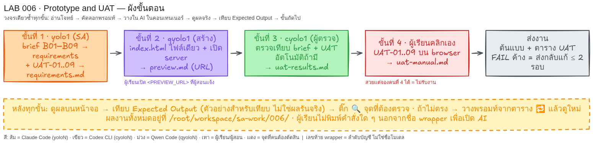

# LAB 006 · Prototype and UAT — จองเวิร์กช็อป 3 ที่นั่ง

เวลา 40 นาที: สร้างข้อกำหนด เว็บหน้าเดียว และผล UAT



## ก่อนเริ่ม

A `yolo1` → B `qyolo1` → C `cyolo1` → B หรือ A หากเห็น shell prompt ให้ขอผู้สอนช่วย งานอยู่ใน `/root/workspace/sa-work/006/`

## โจทย์ธุรกิจฉบับเต็ม

ต้นแบบจองเวิร์กช็อปภาษาไทยใน browser เดียว

| ID | กฎ |
|---|---|
| B01 | “ออกแบบบริการด้วย AI” มี 3 ที่นั่ง เริ่มไม่มีการจอง |
| B02 | รับ `<LEARNER_A>`–`<LEARNER_D>` ไม่ใช้ข้อมูลจริง |
| B03 | ว่าง/space และรหัสซ้ำไม่ผ่าน; จองแล้วรายการเพิ่ม ที่นั่งลด |
| B04 | ครบ 3 แล้วคนที่ 4 ไม่ผ่าน แจ้งเต็มและเหลือ 0 |
| B05 | ยกเลิกคืนที่นั่ง แล้วผู้ถูกปฏิเสธจองได้ |
| B06 | refresh คงข้อมูลใน browser เดิมด้วย localStorage |
| B07 | “เริ่มใหม่” ล้างข้อมูลจำลอง |
| B08 | 375px ไม่เลื่อนแนวนอน ใช้ keyboard ได้ focus ชัด |
| B09 | ผลจอง/ปฏิเสธ/ยกเลิกมีข้อความไทย ไม่ใช้แค่สี |

ไม่รวมหลาย browser, login, แจ้งเตือน, ชำระเงิน และ production

## ขั้นที่ 1 · เขียนข้อกำหนด (หน้าต่าง: `yolo1` | เวลา ~7 นาที)

### 🎯 เป้าหมายของขั้นนี้
ได้ `requirements.md` ที่มีกฎและ UAT-01–09

### 📥 ข้อมูลตั้งต้นที่ต้องใช้
Brief B01–B09 ในกรอบด้านล่าง

### 📋 พรอมท์สำหรับคัดลอก  (คัดลอกทั้งกรอบ วางในช่องสนทนา AI แล้ว Enter)

```text
โฟลเดอร์งานคือ /root/workspace/sa-work/006/ (สร้างถ้ายังไม่มี) เก็บทุกไฟล์ที่นี่ ห้ามแก้ไฟล์ใน /root/workspace/sa-labs/
บทบาท: System Analyst แปลง brief เป็นข้อกำหนดที่ตรวจได้
B01 ชื่อ “ออกแบบบริการด้วย AI” มี 3 ที่นั่ง เริ่มไม่มีการจอง
B02 รับรหัส `<LEARNER_A>`–`<LEARNER_D>` ไม่ใช้ข้อมูลจริง
B03 ช่องว่าง/space และรหัสซ้ำไม่ผ่าน; จองสำเร็จแล้วเพิ่มรายการ ลดที่นั่งทันที
B04 ครบ 3 รายการแล้วคนที่ 4 ไม่ผ่าน ต้องแจ้งว่าเต็มและเหลือ 0
B05 ยกเลิกได้ คืนที่นั่งทันที แล้วคนที่เคยถูกปฏิเสธจองได้
B06 refresh แล้วข้อมูลคงอยู่ใน browser เดิมด้วย localStorage
B07 “เริ่มใหม่” ล้างข้อมูลจำลองใน browser นี้
B08 ที่ 375px ไม่เลื่อนแนวนอน ใช้ keyboard ได้ มี focus ชัด
B09 ผลจอง/ปฏิเสธ/ยกเลิกมีข้อความไทย ไม่ใช้แค่สี
ขอบเขต: browser เดียว ไม่รวมหลาย browser, login, แจ้งเตือน, ชำระเงิน หรือ production

สร้าง /root/workspace/sa-work/006/requirements.md มีเป้าหมาย บทบาท กฎ B01–B09 และเกณฑ์ที่ตรวจด้วยตัวเลข/การคลิก
ห้ามย้ายกรณีข้ามรหัส: UAT-01 กดจองเมื่อช่องว่างและ space ล้วน, 02 จองคนแรก, 03 จองรหัสเดิมซ้ำ, 04 จองครบสาม, 05 คนที่ 4, 06 ยกเลิกแล้วจองใหม่, 07 refresh, 08 keyboard/focus, 09 375px/ไม่เลื่อนแนวนอน ทุกข้อมีสถานะเริ่ม ขั้นตอน ผลคาดหวัง
ห้ามเพิ่มกฎ ห้ามอ่านหรือค้นหา README ของ LAB เพื่อหาเฉลย
ถ้ามีเพียง CLI เดียว ให้ใช้ตัวเดิมและใส่ป้าย `SIMULATION` ในไฟล์ผล
ทำเฉพาะขั้นนี้ เมื่อเสร็จให้แสดงเนื้อหาสำคัญของไฟล์ที่สร้าง (ไม่ใช่แค่ชื่อไฟล์) บนหน้าจอเป็นตาราง/รายการที่ฉันอ่านตรวจได้ แล้วหยุดรอ ห้ามทำขั้นถัดไปเอง
```

> ทางลัด: ให้ AI ทำตาม `/root/workspace/sa-labs/006_LAB_Prototype_and_UAT/prompts/step-01.md`

### ✅ Expected Output (ตัวอย่างสำหรับเทียบ — ไม่ใช่ผลการรันจริง)
- **ต้องตรง:** `requirements.md` มี B01–B09, UAT-01–09, สถานะเริ่ม ขั้นตอน ผลคาดหวัง และเลข 3
- **ต่างได้:** ถ้อยคำ รูปแบบ

### 🔍 จุดที่ผู้เรียนต้องตรวจ
- [ ] รหัสครบ; AI แสดงเนื้อหาแล้วหยุด

### 🔁 ถ้าผลไม่ตรง
วาง `เติมรหัสที่หายตาม brief แสดงผล แล้วหยุด`

## ขั้นที่ 2 · สร้างเว็บ (หน้าต่าง: `qyolo1` | เวลา ~12 นาที)

### 🎯 เป้าหมายของขั้นนี้
ได้ `index.html`, `preview.md` และ URL

### 📥 ข้อมูลตั้งต้นที่ต้องใช้
`requirements.md` จากขั้นที่ 1 และ brief ในกรอบ

### 📋 พรอมท์สำหรับคัดลอก  (คัดลอกทั้งกรอบ วางในช่องสนทนา AI แล้ว Enter)

```text
โฟลเดอร์งานคือ /root/workspace/sa-work/006/ (สร้างถ้ายังไม่มี) เก็บทุกไฟล์ที่นี่ ห้ามแก้ไฟล์ใน /root/workspace/sa-labs/
อ่าน /root/workspace/sa-work/006/requirements.md จากขั้นก่อน ถ้าไม่มีให้แจ้งชื่อแล้วหยุด ห้ามแต่งเอง
B01 “ออกแบบบริการด้วย AI” 3 ที่/เริ่มว่าง; B02 รหัส `<LEARNER_A>`–`<LEARNER_D>`; B03 ว่าง/ซ้ำไม่รับ จองแล้วรายการเพิ่ม/ที่ลด; B04 ครบ 3 ไม่รับคนที่ 4/เหลือ 0; B05 ยกเลิกคืนที่/รับคนใหม่; B06 refresh คงข้อมูลด้วย localStorage; B07 เริ่มใหม่ล้าง; B08 375px ไม่ล้น ใช้ keyboard/focus; B09 สถานะไทย ไม่ใช้สีล้วน
ขอบเขต: browser เดียว ไม่มี backend/login/แจ้งเตือน/ชำระเงิน

สร้าง /root/workspace/sa-work/006/index.html ไฟล์เดียว รวม HTML/CSS/JavaScript ไม่พึ่ง CDN หรือบริการภายนอก
ห้ามพิมพ์โค้ดทั้งไฟล์ในคำตอบ ให้ใช้เครื่องมือเขียนไฟล์ แล้วแสดงเฉพาะรายการฟังก์ชันสำคัญ
มีชื่อ ที่นั่ง ช่องรหัส+label ปุ่มจอง รายการ+ยกเลิก เริ่มใหม่ live status; storage ใช้ไม่ได้ต้องแจ้ง; Enter จองได้; 375px ไม่ล้น
เปิด server แบบ background ที่ 0.0.0.0:8080 ถ้าไม่ได้ใช้พอร์ตว่างอื่น อย่ารอ process server ให้ตรวจหน้า แล้วสร้าง preview.md ระบุ URL/พอร์ต/ไฟล์/ขอบเขต/สถานะ
ขั้นนี้สร้างได้เฉพาะ index.html และ preview.md ห้ามสร้าง UAT script/ผล UAT/ภาพ และห้ามใส่คำสั่ง shell หรือ PID ใน preview.md หรือคำตอบ
ห้ามอ่านหรือค้นหาไฟล์ README ของ LAB เพื่อหาเฉลย
ถ้ามีเพียง CLI เดียว ให้ใช้ตัวเดิมและใส่ป้าย `SIMULATION` ในไฟล์ผล
ทำเฉพาะขั้นนี้ เมื่อเสร็จให้แสดงเนื้อหาสำคัญของไฟล์ที่สร้าง (ไม่ใช่แค่ชื่อไฟล์) บนหน้าจอเป็นตาราง/รายการที่ฉันอ่านตรวจได้ แล้วหยุดรอ ห้ามทำขั้นถัดไปเอง
```

> ทางลัด: ให้ AI ทำตาม `/root/workspace/sa-labs/006_LAB_Prototype_and_UAT/prompts/step-02.md`

### ✅ Expected Output (ตัวอย่างสำหรับเทียบ — ไม่ใช่ผลการรันจริง)
- **ต้องตรง:** `index.html`, `preview.md`, URL; ไฟล์เดียว ไม่พึ่ง CDN ครบ B01–B09
- **ต่างได้:** สี รูปแบบ ข้อความที่ความหมายเดิม

### 🔍 จุดที่ผู้เรียนต้องตรวจ
- [ ] URL เปิดได้; ช่อง ปุ่ม ที่นั่งครบ; AI หยุด

### 🔁 ถ้าผลไม่ตรง
วาง `ตรวจ server และ URL แสดงผล แล้วหยุด`

## ขั้นที่ 3 · ตรวจอิสระ (หน้าต่าง: `cyolo1` | เวลา ~10 นาที)

### 🎯 เป้าหมายของขั้นนี้
ได้ `uat-results.md` จากหลักฐานจริง

### 📥 ข้อมูลตั้งต้นที่ต้องใช้
`requirements.md`, `index.html` และ URL ของ container

### 📋 พรอมท์สำหรับคัดลอก  (คัดลอกทั้งกรอบ วางในช่องสนทนา AI แล้ว Enter)

```text
โฟลเดอร์งานคือ /root/workspace/sa-work/006/ (สร้างถ้ายังไม่มี) เก็บทุกไฟล์ที่นี่ ห้ามแก้ไฟล์ใน /root/workspace/sa-labs/
อ่าน /root/workspace/sa-work/006/requirements.md และ /root/workspace/sa-work/006/index.html จากขั้นก่อน ถ้าไม่มีให้แจ้งชื่อแล้วหยุด ห้ามแต่งเอง
B01 “ออกแบบบริการด้วย AI” 3 ที่/เริ่มว่าง; B02 รหัส `<LEARNER_A>`–`<LEARNER_D>`; B03 ว่าง/ซ้ำไม่รับ จองแล้วรายการเพิ่ม/ที่ลด; B04 ครบ 3 ไม่รับ D/เหลือ 0; B05 ยกเลิก B แล้วรับ D; B06 refresh คงข้อมูล; B07 เริ่มใหม่ล้าง; B08 375px ไม่ล้น ใช้ keyboard/focus; B09 สถานะไทย
ขอบเขต: browser เดียว ไม่มี backend หรือ production

ตรวจเอกสารว่า requirements.md และ index.html ครบ B01–B09 หรือไม่
ทดสอบ http://172.17.0.3:8080/ ของ container ถ้ามี Playwright ให้รัน UAT-01–09 และเก็บ console/page errors; ถ้าไม่มี/เข้าไม่ได้ให้ SKIP พร้อมเหตุผล ห้ามแต่งผล
ยืนยัน UAT-04=A/B/C, 3 รายการ, เหลือ 0; 05 ปฏิเสธ D; 06 ยกเลิก B แล้วได้ A/C/D; 07 refresh แล้วยัง A/C/D; 09 scrollWidth ≤ clientWidth ที่ 375px
สร้าง /root/workspace/sa-work/006/uat-results.md มี ID, ทำจริง, expected, actual, PASS/FAIL/SKIP, หลักฐาน แยกเอกสาร/browser
ห้ามแก้ index.html; ถ้าพบปัญหาให้ FAIL เพื่อส่งกลับผู้สร้าง ห้ามอ่านหรือค้นหาไฟล์ README ของ LAB เพื่อหาเฉลย
ถ้ามีเพียง CLI เดียว ให้ใช้ตัวเดิมและใส่ป้าย `SIMULATION` ในไฟล์ผล
ทำเฉพาะขั้นนี้ เมื่อเสร็จให้แสดงเนื้อหาสำคัญของไฟล์ที่สร้าง (ไม่ใช่แค่ชื่อไฟล์) บนหน้าจอเป็นตาราง/รายการที่ฉันอ่านตรวจได้ แล้วหยุดรอ ห้ามทำขั้นถัดไปเอง
```

> ทางลัด: ให้ AI ทำตาม `/root/workspace/sa-labs/006_LAB_Prototype_and_UAT/prompts/step-03.md`

### ✅ Expected Output (ตัวอย่างสำหรับเทียบ — ไม่ใช่ผลการรันจริง)
- **ต้องตรง:** `uat-results.md` แยกเอกสาร/browser; ไม่ได้รันเป็น SKIP; 05 ปฏิเสธ D, 06 ได้ A/C/D, 07 คงข้อมูล, 09 ไม่ล้น
- **ต่างได้:** ถ้อยคำ คอลัมน์

### 🔍 จุดที่ผู้เรียนต้องตรวจ
- [ ] ไม่เดา PASS; ผู้ตรวจไม่แก้เว็บและหยุด

### 🔁 ถ้าผลไม่ตรง
วาง `เปลี่ยนสิ่งที่ไม่ได้รันเป็น SKIP แล้วหยุด`

## ขั้นที่ 4 · คลิกและบันทึก (หน้าต่าง: `qyolo1` หรือ `yolo1` | เวลา ~11 นาที)

### 🎯 เป้าหมายของขั้นนี้
ได้ `uat-manual.md` จากสิ่งที่ผู้เรียนเห็น

### 📥 ข้อมูลตั้งต้นที่ต้องใช้
คลิก UAT-01–09 แล้วแทน `<...>` ทีละข้อ

### 📋 พรอมท์สำหรับคัดลอก  (คัดลอกทั้งกรอบ วางในช่องสนทนา AI แล้ว Enter)

```text
โฟลเดอร์งานคือ /root/workspace/sa-work/006/ (สร้างถ้ายังไม่มี) เก็บทุกไฟล์ที่นี่ ห้ามแก้ไฟล์ใน /root/workspace/sa-labs/
อ่าน /root/workspace/sa-work/006/requirements.md และ /root/workspace/sa-work/006/uat-results.md จากขั้นก่อน ถ้าไม่มีให้แจ้งชื่อแล้วหยุด ห้ามแต่งเอง
B01 มี 3 ที่; B02 รหัส `<LEARNER_A>`–`<LEARNER_D>`; B03 ว่าง/ซ้ำไม่รับ; B04 เต็มแล้วไม่รับคนที่ 4; B05 ยกเลิกคืนที่/จองใหม่ได้; B06 refresh คงข้อมูล; B07 เริ่มใหม่ล้าง; B08 375px ไม่ล้น ใช้ keyboard/focus; B09 สถานะไทย

เพิ่มต่อท้าย /root/workspace/sa-work/006/uat-manual.md ห้ามลบผลเดิม:
กรณี UAT: <UAT_ID>
ฉันทำ: <CLICK_STEPS>
คาดหวัง: <EXPECTED>
เห็นจริง: <ACTUAL>
หลักฐาน: <EVIDENCE>
ตัดสิน PASS/FAIL พร้อมเหตุผล; ถ้ายังไม่แทน placeholder ให้บันทึก SKIP และห้ามเดา
ถ้าเป็น FAIL ให้เก็บผลก่อนแก้ แก้เฉพาะ index.html ตรงข้อที่ผิด ทดสอบซ้ำ และบันทึกผลหลังแก้ รวมไม่เกิน 2 รอบ ห้ามลดเกณฑ์
ห้ามทำ UAT อื่นแทนผู้เรียน ห้ามอ่านหรือค้นหาไฟล์ README ของ LAB เพื่อหาเฉลย
ถ้ามีเพียง CLI เดียว ให้ใช้ตัวเดิมและใส่ป้าย `SIMULATION` ในไฟล์ผล
ทำเฉพาะขั้นนี้ เมื่อเสร็จให้แสดงเนื้อหาสำคัญของไฟล์ที่สร้าง (ไม่ใช่แค่ชื่อไฟล์) บนหน้าจอเป็นตาราง/รายการที่ฉันอ่านตรวจได้ แล้วหยุดรอ ห้ามทำขั้นถัดไปเอง
```

> ทางลัด: ให้ AI ทำตาม `/root/workspace/sa-labs/006_LAB_Prototype_and_UAT/prompts/step-04.md`

### ✅ Expected Output (ตัวอย่างสำหรับเทียบ — ไม่ใช่ผลการรันจริง)
- **ต้องตรง:** เพิ่มผลจริง เช่น `UAT-05 | จอง D ตอนเต็ม | เต็ม/0 | PASS`; ไม่คลิกเป็น SKIP; FAIL เก็บก่อน/หลัง แก้ไม่เกิน 2 รอบ
- **ต่างได้:** ถ้อยคำ รูปแบบ

### 🔍 จุดที่ผู้เรียนต้องตรวจ
- [ ] แทน placeholder; ไม่เดาผล; AI หยุด

### 🔁 ถ้าผลไม่ตรง
วาง `คืนผลเดิม เพิ่มเฉพาะผลที่บอก แล้วหยุด`

## ส่งงาน

ส่ง `requirements.md`, `index.html`, `preview.md`, `uat-results.md`, `uat-manual.md`

- [ ] กฎ/UAT ครบ; เว็บเปิดได้; เต็ม ยกเลิก refresh, 375px, keyboard ตรงกฎ
- [ ] แยกผลอัตโนมัติ/ผลคลิก; ไม่มี FAIL ค้าง; ไม่ทำเป็น SKIP

สะท้อนคิด: ถ้า AI กับหน้าจอต่างกัน ควรเชื่ออะไร?

## หลักฐานผู้จัดทำ

[รายงานจริง](../evidence/lab006/report.md) แยกสิ่งที่รันจริงกับ SKIP สถานะ: **ทดสอบแล้ว**
