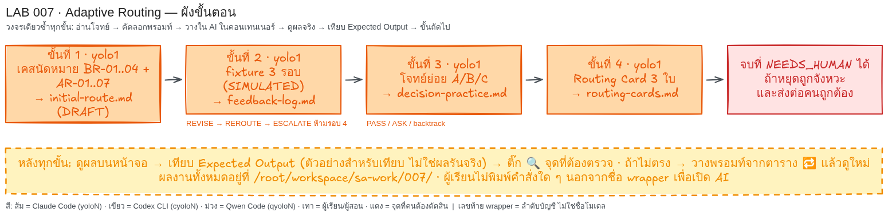

# LAB 007 — ปรับเส้นทาง AI จากผลตรวจจริง

เวลา 25–30 นาที
ได้ฝึก PASS/REVISE/REROUTE/ESCALATE/backtrack/ASK และ Routing Card 3 ใบ
เชื่อม `ai-agent-routing.html` หัวข้อ 7.2 Adaptive/Feedback และ 08
วงจร: อ่านโจทย์ → คัดลอกพรอมท์ → วางใน AI → ดูผล → เทียบ Expected → ขั้นถัดไป



## ก่อนเริ่ม

| หน้าต่าง | wrapper | บทบาท |
|---|---|---|
| 1 | `yolo1` | ทำงานทีละขั้น |

ช่อง AI รับภาษาปกติ; `$` หรือ `#` ท้ายบรรทัดคือ shell ให้ผู้สอนเปิด wrapper งานอยู่ที่ `/root/workspace/sa-work/007/` ถ้ามี CLI ค่ายเดียว ให้ใช้ตัวเดิมและติดป้าย `SIMULATION` ในผลส่งงาน

## โจทย์ธุรกิจฉบับเต็ม

วิเคราะห์เอกสารระบบนัดหมายจำลอง; เรื่องไม่ระบุให้ถาม

| บทบาท | สิทธิ์ |
|---|---|
| ผู้ขอรับบริการ | จอง/ยกเลิกและเห็นนัดตน |
| เจ้าหน้าที่ | ดูตาราง/เปลี่ยนสถานะ; จัดการบทบาทไม่ได้ |
| เจ้าของระบบ | กำหนดเวลา/จัดการบทบาทบัญชี |

| รหัส | กฎธุรกิจ |
|---|---|
| BR-01 | 1 ช่องเวลารับ 1 นัดที่ยังไม่ยกเลิก; ยกเลิกแล้วคืนช่องเวลา |
| BR-02 | ยกเลิกได้เมื่อเหลือ ≥24 ชั่วโมง; =24 อนุญาต, <24 ปฏิเสธ |
| BR-03 | เฉพาะเจ้าของระบบเปลี่ยนบทบาทบัญชีได้; เจ้าหน้าที่ทำไม่ได้ |
| BR-04 | ผู้ขอรับบริการเห็นเฉพาะนัดตน; เจ้าหน้าที่เห็นตารางงาน; สิทธิ์อื่นให้ถาม ห้ามเติมเอง |

| รหัส | กฎการปรับเส้นทาง |
|---|---|
| AR-01 | PASS เมื่อ checklist ผ่านและผู้ตรวจยืนยันว่าไม่มีข้อค้างขวางรับงาน |
| AR-02 | REVISE เมื่อข้อแก้ชัดและผู้ผลิตเดิมยังแก้ได้ |
| AR-03 | REROUTE เมื่อปัญหาร้ายแรงเดิมซ้ำหลังแก้ หรือต้องเปลี่ยนผู้ผลิต |
| AR-04 | ESCALATE เมื่อปัญหาร้ายแรงยังอยู่หลังยกระดับ; เสนอผู้เชี่ยวชาญ |
| AR-05 | backtrack เมื่อต้นเหตุอยู่ใน requirement/design; แก้ต้นเหตุและตรวจงานที่ได้รับผลใหม่ |
| AR-06 | สูงสุด 3 รอบ; รอบ 3 ยังร้ายแรงให้ NEEDS_HUMAN และห้ามรอบ 4 |
| AR-07 | ASK เมื่อข้อมูลไม่พอ ให้ถามก่อนและห้ามเดา |

| รหัส | User Story/หลักฐานจำลอง/สมมติฐาน |
|---|---|
| งานหลัก | จอง/ยกเลิกนัดตนตาม BR-01/02/04 |
| F1 | รอบ 1 ขาดขอบเขต 24 ชั่วโมง; รอบ 2 ปิดแล้ว |
| F2 | 3 รอบให้เจ้าหน้าที่เปลี่ยนบทบาท ขัด BR-03 ร้ายแรง |
| A | เอกสาร 4/4 และ Critic ยืนยัน PASS โดยไม่มีข้อค้าง |
| B | ไม่ทราบชั่วโมงก่อนนัด |
| C | UI ทำตาม requirement สิทธิ์ที่ผิด |

F1/F2/A/B/C=`SIMULATED`; รอบ 2 มี `<ALTERNATE_ACCOUNT>` สมมติแต่เรียกจริง=`SKIP`; รอบ 3 decision=ESCALATE/status=NEEDS_HUMAN

## ขั้นที่ 1 · วางเส้นทางเริ่มต้น   (หน้าต่าง: `yolo1` | เวลา ~5 นาที)

### 🎯 เป้าหมายของขั้นนี้

สร้างเส้นทาง DRAFT เพื่อไม่รับงานก่อนมีผลตรวจ

### 📥 ข้อมูลตั้งต้นที่ต้องใช้

- BR-01..04: 1 ช่องต่อนัด, ≥24 ชั่วโมง, สิทธิ์เจ้าของระบบ, การเห็นนัด
- AR-01..07: วิธีตัดสินและสูงสุด 3 รอบ; ไม่มีไฟล์ก่อนหน้า
### 📋 พรอมท์สำหรับคัดลอก

```text
โฟลเดอร์งานคือ /root/workspace/sa-work/007/ (สร้างถ้ายังไม่มี) เก็บทุกไฟล์ที่นี่ ห้ามแก้ไฟล์ใน /root/workspace/sa-labs/
ห้ามอ่านหรือค้นหา README ของ LAB เพื่อหาเฉลย
เคสสมมติ: ระบบนัดหมายบริการทั่วไป วิเคราะห์เอกสาร ไม่สร้างระบบ
บทบาท: ผู้ขอรับบริการจอง/ยกเลิกนัดของตน; เจ้าหน้าที่ดูตาราง/เปลี่ยนสถานะนัด; เจ้าของระบบกำหนดเวลา/จัดการบทบาทบัญชี
BR-01 1 ช่องเวลารับ 1 นัดที่ยังไม่ยกเลิก; ยกเลิกแล้วคืนช่องเวลา
BR-02 ผู้ขอรับบริการยกเลิกนัดตนได้เมื่อเหลือเวลา≥24 ชั่วโมง; เท่ากับ 24 อนุญาต, <24 ปฏิเสธ
BR-03 เฉพาะเจ้าของระบบเปลี่ยนบทบาทบัญชีได้; เจ้าหน้าที่ทำไม่ได้
BR-04 ผู้ขอรับบริการเห็นเฉพาะนัดตน; เจ้าหน้าที่เห็นตารางงาน; สิทธิ์อื่นให้ถาม ห้ามเติมเอง
AR-01 PASS: checklist ผ่าน+ผู้ตรวจยืนยันไม่มีข้อค้างขวางรับงาน; AR-02 REVISE: ข้อแก้ชัด,ผู้ผลิตเดิมแก้ได้
AR-03 REROUTE: ปัญหาร้ายแรงเดิมซ้ำหลังแก้/ต้องเปลี่ยนผู้ผลิต; AR-04 ESCALATE: ปัญหาร้ายแรงยังอยู่หลังยกระดับ; เสนอผู้เชี่ยวชาญ
AR-05 backtrack: ปัญหาปลายน้ำมาจาก requirement/design; ย้อนแก้ต้นเหตุ+ตรวจผลกระทบ; AR-06: สูงสุด 3 รอบ/ขั้น; รอบ 3 ยังร้ายแรง→NEEDS_HUMAN+หยุด ห้ามรอบ 4; AR-07 ASK: ข้อมูลไม่พอให้ถาม ห้ามเดา
สร้าง initial-route.md สถานะ DRAFT ≤1 หน้า: ทวนบทบาท/BR; เส้นทาง ผู้ผลิตเอกสาร→ผู้ตรวจ checklist→Critic→Controller พร้อมหน้าที่; เกณฑ์ 4 ข้อตรง BR; เพดาน 3 รอบ
ใช้ <PRIMARY_ACCOUNT>/<VERIFIER_ACCOUNT>; ระบุว่ายังไม่เรียกบัญชีที่สอง และยังห้าม PASS เพราะไม่มีผลตรวจ; ห้ามเดารุ่น/ราคา/อันดับ/สิทธิ์
ทำเฉพาะขั้นนี้ เมื่อเสร็จให้แสดงเนื้อหาสำคัญของไฟล์ที่สร้าง (ไม่ใช่แค่ชื่อไฟล์) บนหน้าจอเป็นตาราง/รายการที่ฉันอ่านตรวจได้ แล้วหยุดรอ ห้ามทำขั้นถัดไปเอง
```

ถ้าผู้สอนวางโฟลเดอร์ LAB ไว้ใน container แล้ว วางข้อความสั้นนี้แทนได้

```text
อ่านไฟล์ /root/workspace/sa-labs/007_LAB_Adaptive_Routing/prompts/step-01.md แล้วทำตามคำสั่งในไฟล์นั้นทั้งหมด ทำเฉพาะขั้นนี้ แสดงผลบนหน้าจอ แล้วหยุดรอฉันตรวจ
```
### ✅ Expected Output (ตัวอย่างสำหรับเทียบ — ไม่ใช่ผลการรันจริง)

| file | `initial-route.md` |
|---|---|
| status | DRAFT; round=0/3; no PASS |
| เส้นทาง | ผู้ผลิต→ผู้ตรวจ→Critic→Controller |
| rules | C1..C4=BR-01..04 |
- **ต้องตรง:** DRAFT; BR-01..04
- **ต้องตรง:** เส้นทาง 4 จุด; สูงสุด 3 รอบ
- **ต่างได้:** คำ C1..C4
- **ต่างได้:** ลำดับคอลัมน์

### 🔍 จุดที่ผู้เรียนต้องตรวจ

- [ ] หน้าจอมีชื่อไฟล์ DRAFT และ 0/3
- [ ] หน้าจอมีเส้นทาง 4 จุดและ BR-01..04
- [ ] หน้าจอระบุว่าเจ้าหน้าที่เปลี่ยนบทบาทไม่ได้

### 🔁 ถ้าผลไม่ตรง

| อาการ | ข้อความที่วางต่อ |
|---|---|
| PASS | ตั้ง DRAFT ก่อนตรวจ แก้เฉพาะขั้นนี้ แสดงผล แล้วหยุด |
| ขาด BR/เส้นทาง | เติม BR-01..04 และ 4 จุด แก้เฉพาะขั้นนี้ แสดงผล แล้วหยุด |

## ขั้นที่ 2 · ตัดสินจาก feedback 3 รอบ   (หน้าต่าง: `yolo1` | เวลา ~8 นาที)

### 🎯 เป้าหมายของขั้นนี้

ตัดสิน 3 รอบและหยุดเพื่อส่งต่อให้คน โดยไม่ PASS จาก 4/4 อย่างเดียว

### 📥 ข้อมูลตั้งต้นที่ต้องใช้

- BR-02: =24 ชั่วโมงอนุญาต, <24 ปฏิเสธ; BR-03: เจ้าหน้าที่เปลี่ยนบทบาทไม่ได้
- AR-02/03/04/06: แก้เดิม→เปลี่ยนผู้ผลิต→ยกระดับ→หยุด; F1=ขาด 24 ชั่วโมง, F2=สิทธิ์ผิด
- อ่าน `/root/workspace/sa-work/007/initial-route.md` จากขั้นที่ 1
### 📋 พรอมท์สำหรับคัดลอก

```text
โฟลเดอร์งานคือ /root/workspace/sa-work/007/ (สร้างถ้ายังไม่มี) เก็บทุกไฟล์ที่นี่ ห้ามแก้ไฟล์ใน /root/workspace/sa-labs/
อ่าน /root/workspace/sa-work/007/initial-route.md ที่ขั้น 1 สร้าง; ถ้าไม่มีให้บอกชื่อไฟล์ที่หายแล้วหยุด ห้ามแต่งเอง ห้ามอ่านหรือค้นหา README ของ LAB เพื่อหาเฉลย
เคสสมมติ: ระบบนัดหมายบริการทั่วไป; บทบาท: ผู้ขอรับบริการจอง/ยกเลิกนัดตน; เจ้าหน้าที่ดูตาราง/เปลี่ยนสถานะนัด; เจ้าของระบบกำหนดเวลา/จัดการบทบาทบัญชี
BR-01 1 ช่องเวลารับ 1 นัดที่ยังไม่ยกเลิก; ยกเลิกแล้วคืนช่องเวลา
BR-02 ผู้ขอรับบริการยกเลิกนัดตนได้เมื่อเหลือเวลา≥24 ชั่วโมง; เท่ากับ 24 อนุญาต, <24 ปฏิเสธ
BR-03 เฉพาะเจ้าของระบบเปลี่ยนบทบาทบัญชีได้; เจ้าหน้าที่ทำไม่ได้
BR-04 ผู้ขอรับบริการเห็นเฉพาะนัดตน; เจ้าหน้าที่เห็นตารางงาน; สิทธิ์อื่นให้ถาม ห้ามเติมเอง
AR-01 PASS: checklist ผ่าน+ผู้ตรวจยืนยันไม่มีข้อค้างขวางรับงาน; AR-02 REVISE: ข้อแก้ชัด,ผู้ผลิตเดิมแก้ได้
AR-03 REROUTE: ปัญหาร้ายแรงเดิมซ้ำหลังแก้/ต้องเปลี่ยนผู้ผลิต; AR-04 ESCALATE: ปัญหาร้ายแรงยังอยู่หลังยกระดับ; เสนอผู้เชี่ยวชาญ
AR-05 backtrack: ปัญหาปลายน้ำมาจาก requirement/design; ย้อนแก้ต้นเหตุ+ตรวจผลกระทบ; AR-06: สูงสุด 3 รอบ/ขั้น; รอบ 3 ยังร้ายแรง→NEEDS_HUMAN+หยุด ห้ามรอบ 4; AR-07 ASK: ข้อมูลไม่พอให้ถาม ห้ามเดา
FIXTURE: SIMULATED ทั้งหมด เป็น stage เขียนข้อกำหนดเดียวกัน ไม่ใช่ผลตรวจ initial-route.md
รอบ 1: checklist 4/4, Critic=FIX; F1 ขาดขอบเขต 24 ชั่วโมงของ BR-02; F2 ให้เจ้าหน้าที่เปลี่ยนบทบาทบัญชีได้ ขัด BR-03 และร้ายแรง; ผู้ผลิตเดิมยังไม่เคยได้รับคำแก้ชัดเจน
รอบ 2: หลังผู้ผลิตเดิมแก้ checklist 4/4, Critic=FIX; F1 ปิด; F2 ซ้ำและร้ายแรง; มีผู้ผลิตสำรองที่ได้รับอนุญาต <ALTERNATE_ACCOUNT>
รอบ 3: หลังเปลี่ยนผู้ผลิตตามแผน checklist 4/4, Critic=FIX; F2 ยังไม่ปิด; ครบ 3 รอบและไม่อนุญาตรอบใหม่
สร้าง feedback-log.md ติดป้าย SIMULATED และตาราง 3 แถว: รอบ|ข้อเท็จจริง|decision|AR|สิ่งที่จะทำต่อ|status; ช่อง decision ใส่ REVISE, REROUTE, ESCALATE เท่านั้น; NEEDS_HUMAN อยู่เฉพาะ status รอบ 3; ไม่มีรอบ 4
แยกข้อเสนอผู้เชี่ยวชาญด้านสิทธิ์ออกจากสิ่งที่ทำแล้ว; ห้ามอ้างว่าแก้สำเร็จ/เรียกผู้ผลิตสำรองจริง; บันทึก actual_provider_reroute=SKIP
ท้ายไฟล์ทำใบส่งต่อคน 4 บรรทัด: ปัญหาค้าง / BR ที่ขัด / งานที่หยุด / ผู้ตัดสินและคำถาม
ทำเฉพาะขั้นนี้ เมื่อเสร็จให้แสดงเนื้อหาสำคัญของไฟล์ที่สร้าง (ไม่ใช่แค่ชื่อไฟล์) บนหน้าจอเป็นตาราง/รายการที่ฉันอ่านตรวจได้ แล้วหยุดรอ ห้ามทำขั้นถัดไปเอง
```

ถ้าผู้สอนวางโฟลเดอร์ LAB ไว้ใน container แล้ว วางข้อความสั้นนี้แทนได้

```text
อ่านไฟล์ /root/workspace/sa-labs/007_LAB_Adaptive_Routing/prompts/step-02.md แล้วทำตามคำสั่งในไฟล์นั้นทั้งหมด ทำเฉพาะขั้นนี้ แสดงผลบนหน้าจอ แล้วหยุดรอฉันตรวจ
```
### ✅ Expected Output (ตัวอย่างสำหรับเทียบ — ไม่ใช่ผลการรันจริง)

| round | result | decision/status |
|---:|---|---|
| 1 | 4/4; F1/F2 | REVISE/OPEN |
| 2 | 4/4; F2 | REROUTE/OPEN |
| 3 | 4/4; F2 | ESCALATE/NEEDS_HUMAN |
- **ต้องตรง:** REVISE→REROUTE→ESCALATE
- **ต้องตรง:** รอบ 3=NEEDS_HUMAN; ไม่มีรอบ 4
- **ต่างได้:** คำ OPEN
- **ต่างได้:** ลำดับคอลัมน์

### 🔍 จุดที่ผู้เรียนต้องตรวจ

- [ ] หน้าจอมี decision ทั้ง 3 ตามลำดับ
- [ ] หน้าจอมี NEEDS_HUMAN และไม่มีรอบ 4
- [ ] หน้าจอมี 4/4+FIX, F2/BR-03 และ SIMULATED/SKIP

### 🔁 ถ้าผลไม่ตรง

| อาการ | ข้อความที่วางต่อ |
|---|---|
| decision ปน status | แยก ESCALATE/NEEDS_HUMAN แก้เฉพาะขั้นนี้ แสดงผล แล้วหยุด |
| มีรอบ 4/PASS | หยุดรอบ 3 และใส่ SIMULATED/SKIP แก้เฉพาะขั้นนี้ แสดงผล แล้วหยุด |

## ขั้นที่ 3 · ฝึก PASS, ASK และ backtrack   (หน้าต่าง: `yolo1` | เวลา ~5 นาที)

### 🎯 เป้าหมายของขั้นนี้

แยก PASS/ASK/backtrack เพื่อไม่เดาข้อมูลหรือแก้ปลายเหตุ

### 📥 ข้อมูลตั้งต้นที่ต้องใช้

- A/AR-01: 4/4+ไม่มีข้อค้างจึง PASS; B/AR-07: ไม่ทราบชั่วโมงจึง ASK
- C/AR-05+BR-03: requirement สิทธิ์ผิดจึง backtrack
- อ่าน `/root/workspace/sa-work/007/feedback-log.md` จากขั้นที่ 2; งานเดิมยัง NEEDS_HUMAN
### 📋 พรอมท์สำหรับคัดลอก

```text
โฟลเดอร์งานคือ /root/workspace/sa-work/007/ (สร้างถ้ายังไม่มี) เก็บทุกไฟล์ที่นี่ ห้ามแก้ไฟล์ใน /root/workspace/sa-labs/
อ่าน /root/workspace/sa-work/007/feedback-log.md ที่ขั้น 2 สร้าง; ถ้าไม่มีให้บอกชื่อไฟล์ที่หายแล้วหยุด ห้ามแต่งเอง ห้ามอ่านหรือค้นหา README ของ LAB เพื่อหาเฉลย
เคสสมมติ: ระบบนัดหมายบริการทั่วไป; บทบาท: ผู้ขอรับบริการจอง/ยกเลิกนัดตน; เจ้าหน้าที่ดูตาราง/เปลี่ยนสถานะนัด; เจ้าของระบบกำหนดเวลา/จัดการบทบาทบัญชี
BR-01 1 ช่องเวลารับ 1 นัดที่ยังไม่ยกเลิก; ยกเลิกแล้วคืนช่องเวลา
BR-02 ผู้ขอรับบริการยกเลิกนัดตนได้เมื่อเหลือเวลา≥24 ชั่วโมง; เท่ากับ 24 อนุญาต, <24 ปฏิเสธ
BR-03 เฉพาะเจ้าของระบบเปลี่ยนบทบาทบัญชีได้; เจ้าหน้าที่ทำไม่ได้
BR-04 ผู้ขอรับบริการเห็นเฉพาะนัดตน; เจ้าหน้าที่เห็นตารางงาน; สิทธิ์อื่นให้ถาม ห้ามเติมเอง
AR-01 PASS: checklist ผ่าน+ผู้ตรวจยืนยันไม่มีข้อค้างขวางรับงาน; AR-02 REVISE: ข้อแก้ชัด,ผู้ผลิตเดิมแก้ได้
AR-03 REROUTE: ปัญหาร้ายแรงเดิมซ้ำหลังแก้/ต้องเปลี่ยนผู้ผลิต; AR-04 ESCALATE: ปัญหาร้ายแรงยังอยู่หลังยกระดับ; เสนอผู้เชี่ยวชาญ
AR-05 backtrack: ปัญหาปลายน้ำมาจาก requirement/design; ย้อนแก้ต้นเหตุ+ตรวจผลกระทบ; AR-06: สูงสุด 3 รอบ/ขั้น; รอบ 3 ยังร้ายแรง→NEEDS_HUMAN+หยุด ห้ามรอบ 4; AR-07 ASK: ข้อมูลไม่พอให้ถาม ห้ามเดา
โจทย์ SIMULATED อิสระจากงานก่อน; feedback-log.md ยัง NEEDS_HUMAN และนี่ไม่ใช่รอบ 4
A: เอกสารใหม่ checklist 4/4 และ Critic ยืนยัน PASS ไม่มีข้อค้าง
B: ผู้ใช้ขอยกเลิกใกล้เวลานัด แต่ไม่บอกว่าเหลือกี่ชั่วโมง; ห้ามเดา และไม่ได้ขอเปลี่ยน BR-02
C: UI ให้เจ้าหน้าที่เปลี่ยนบทบาทได้เพราะ requirement มีตารางสิทธิ์ผิด; UI ทำตรงตารางที่ผิด ไม่ใช่วางปุ่มผิดที่
สร้าง decision-practice.md ตาราง A/B/C|decision|AR|เหตุผล|ขั้นต่อไป: A=PASS/AR-01; B=ASK/AR-07 ถามว่าเหลือกี่ชั่วโมงแล้วใช้ BR-02; C=backtrack/AR-05 ย้อนแก้ requirement/ตารางสิทธิ์ให้ตรง BR-03 แล้วตรวจ flow, UI, UAT ใหม่; ห้ามเปลี่ยน BR/สร้าง UI
ทำเฉพาะขั้นนี้ เมื่อเสร็จให้แสดงเนื้อหาสำคัญของไฟล์ที่สร้าง (ไม่ใช่แค่ชื่อไฟล์) บนหน้าจอเป็นตาราง/รายการที่ฉันอ่านตรวจได้ แล้วหยุดรอ ห้ามทำขั้นถัดไปเอง
```

ถ้าผู้สอนวางโฟลเดอร์ LAB ไว้ใน container แล้ว วางข้อความสั้นนี้แทนได้

```text
อ่านไฟล์ /root/workspace/sa-labs/007_LAB_Adaptive_Routing/prompts/step-03.md แล้วทำตามคำสั่งในไฟล์นั้นทั้งหมด ทำเฉพาะขั้นนี้ แสดงผลบนหน้าจอ แล้วหยุดรอฉันตรวจ
```
### ✅ Expected Output (ตัวอย่างสำหรับเทียบ — ไม่ใช่ผลการรันจริง)

| case | decision | AR | next |
|---|---|---|---|
| A: 4/4+PASS | PASS | AR-01 | รับงาน |
| B: ชั่วโมง=? | ASK | AR-07 | ถามแล้วใช้ BR-02 |
| C: requirement ผิด | backtrack | AR-05 | แก้ BR-03 และตรวจใหม่ |
- **ต้องตรง:** A=PASS; B=ASK; C=backtrack
- **ต้องตรง:** AR-01/07/05; งานเดิม=NEEDS_HUMAN
- **ต่างได้:** คำถาม/เหตุผล
- **ต่างได้:** ลำดับคอลัมน์

### 🔍 จุดที่ผู้เรียนต้องตรวจ

- [ ] หน้าจอมี A=PASS, B=ASK และ C=backtrack
- [ ] B ถามจำนวนชั่วโมงโดยไม่เดาคำว่า “ใกล้”
- [ ] C แก้ต้นเหตุและตรวจ flow/UI/UAT ใหม่; งานเดิมยังค้าง

### 🔁 ถ้าผลไม่ตรง

| อาการ | ข้อความที่วางต่อ |
|---|---|
| B ถูกตัดสิน | ให้ ASK จำนวนชั่วโมง แก้เฉพาะขั้นนี้ แสดงผล แล้วหยุด |
| C แก้ UI/งานเดิม PASS | แก้ต้นเหตุและคืน 3/3 แก้เฉพาะขั้นนี้ แสดงผล แล้วหยุด |

## ขั้นที่ 4 · ทำ Routing Card 3 ใบ   (หน้าต่าง: `yolo1` | เวลา ~7 นาที)

### 🎯 เป้าหมายของขั้นนี้

สร้าง Routing Card 3 ใบเพื่อแยกแผนจากผลที่พิสูจน์แล้ว

### 📥 ข้อมูลตั้งต้นที่ต้องใช้

- ใบ 1 ใช้ BR-01/02 เรื่องช่องเวลาและ 24 ชั่วโมง; ใบ 2 เพิ่ม BR-04 เรื่องการเห็นนัด; ใบ 3 ใช้ BR-03 เรื่องสิทธิ์
- ทุกใบใช้ AR-01..07 สำหรับผ่าน ปรับเส้นทาง ถาม ย้อนแก้ และหยุดรอบ 3
- อ่าน `/root/workspace/sa-work/007/initial-route.md`, `/root/workspace/sa-work/007/feedback-log.md`, `/root/workspace/sa-work/007/decision-practice.md`
### 📋 พรอมท์สำหรับคัดลอก

```text
โฟลเดอร์งานคือ /root/workspace/sa-work/007/ (สร้างถ้ายังไม่มี) เก็บทุกไฟล์ที่นี่ ห้ามแก้ไฟล์ใน /root/workspace/sa-labs/
อ่าน /root/workspace/sa-work/007/initial-route.md, /root/workspace/sa-work/007/feedback-log.md, /root/workspace/sa-work/007/decision-practice.md ที่ขั้นก่อนสร้าง; ถ้าขาดไฟล์ใดให้บอกชื่อที่หายทั้งหมดแล้วหยุด ห้ามแต่งเอง ห้ามอ่านหรือค้นหา README ของ LAB เพื่อหาเฉลย
เคสสมมติ: ระบบนัดหมายบริการทั่วไป; บทบาท: ผู้ขอรับบริการจอง/ยกเลิกนัดตน; เจ้าหน้าที่ดูตาราง/เปลี่ยนสถานะนัด; เจ้าของระบบกำหนดเวลา/จัดการบทบาทบัญชี
BR-01 1 ช่องเวลารับ 1 นัดที่ยังไม่ยกเลิก; ยกเลิกแล้วคืนช่องเวลา
BR-02 ผู้ขอรับบริการยกเลิกนัดตนได้เมื่อเหลือเวลา≥24 ชั่วโมง; เท่ากับ 24 อนุญาต, <24 ปฏิเสธ
BR-03 เฉพาะเจ้าของระบบเปลี่ยนบทบาทบัญชีได้; เจ้าหน้าที่ทำไม่ได้
BR-04 ผู้ขอรับบริการเห็นเฉพาะนัดตน; เจ้าหน้าที่เห็นตารางงาน; สิทธิ์อื่นให้ถาม ห้ามเติมเอง
AR-01 PASS: checklist ผ่าน+ผู้ตรวจยืนยันไม่มีข้อค้างขวางรับงาน; AR-02 REVISE: ข้อแก้ชัด,ผู้ผลิตเดิมแก้ได้
AR-03 REROUTE: ปัญหาร้ายแรงเดิมซ้ำหลังแก้/ต้องเปลี่ยนผู้ผลิต; AR-04 ESCALATE: ปัญหาร้ายแรงยังอยู่หลังยกระดับ; เสนอผู้เชี่ยวชาญ
AR-05 backtrack: ปัญหาปลายน้ำมาจาก requirement/design; ย้อนแก้ต้นเหตุ+ตรวจผลกระทบ; AR-06: สูงสุด 3 รอบ/ขั้น; รอบ 3 ยังร้ายแรง→NEEDS_HUMAN+หยุด ห้ามรอบ 4; AR-07 ASK: ข้อมูลไม่พอให้ถาม ห้ามเดา
สร้าง routing-cards.md เป็น Routing Card 3 ใบ ≤10 บรรทัด/ใบ: (1) ข้อกำหนดยกเลิกนัด (2) UI จอง/ยกเลิก (3) ตารางผู้มีสิทธิ์เปลี่ยนบทบาทบัญชี
ทุกใบมี: งาน; ความเสี่ยง/เหตุผล; Primary/Verifier คนละบทบาทด้วย <PRIMARY_ACCOUNT>/<VERIFIER_ACCOUNT>; หลักฐานและป้าย SIMULATED เมื่ออ้าง fixture; บัญชี/รุ่น/ราคา/โควตาที่ไม่ยืนยัน=UNKNOWN; สิ่งที่แชร์; สิ่งห้ามแชร์คือข้อมูลรับรอง/ค่าเข้าใช้งาน/ข้อมูลบุคคล; วิธีตรวจ/เกณฑ์ผ่าน; เงื่อนไข routing; เพดาน 3 รอบและ NEEDS_HUMAN ถ้ายังร้ายแรง
ใบ 1 ตรวจที่ 24 ชั่วโมงพอดีและ <24; ใบ 2 บอกว่าต้องตรวจหน้าจอจริงภายหลังและยังไม่ได้ทดสอบ; ใบ 3 ตรวจเจ้าหน้าที่ถูกปฏิเสธ/เจ้าของระบบได้รับอนุญาตตาม BR-03; การซ่อนปุ่มอย่างเดียวยังไม่ยืนยันสิทธิ์ระบบ; ห้ามปิด NEEDS_HUMAN เดิม
ท้ายไฟล์สรุป 3 ประโยค: checklist ครบ≠ผ่าน / เปลี่ยนบทบาทสนทนา≠เรียก provider จริง / เมื่อใดต้องหยุดให้คนตัดสิน
ทำเฉพาะขั้นนี้ เมื่อเสร็จให้แสดงเนื้อหาสำคัญของไฟล์ที่สร้าง (ไม่ใช่แค่ชื่อไฟล์) บนหน้าจอเป็นตาราง/รายการที่ฉันอ่านตรวจได้ แล้วหยุดรอ ห้ามทำขั้นถัดไปเอง
```

ถ้าผู้สอนวางโฟลเดอร์ LAB ไว้ใน container แล้ว วางข้อความสั้นนี้แทนได้

```text
อ่านไฟล์ /root/workspace/sa-labs/007_LAB_Adaptive_Routing/prompts/step-04.md แล้วทำตามคำสั่งในไฟล์นั้นทั้งหมด ทำเฉพาะขั้นนี้ แสดงผลบนหน้าจอ แล้วหยุดรอฉันตรวจ
```
### ✅ Expected Output (ตัวอย่างสำหรับเทียบ — ไม่ใช่ผลการรันจริง)

| card | check | status |
|---:|---|---|
| 1 | =24 allow; <24 deny | 0/3 |
| 2 | ต้องตรวจ UI จริง | NOT_TESTED |
| 3 | เจ้าหน้าที่ปฏิเสธ; เจ้าของระบบอนุญาต | 0/3 |
- **ต้องตรง:** 3 ใบ; Primary≠Verifier; สูงสุด 3 รอบ
- **ต้องตรง:** ใบ 2=NOT_TESTED; งานเดิม=NEEDS_HUMAN
- **ต่างได้:** คำบอกความเสี่ยง/routing
- **ต่างได้:** รูปแบบการ์ด

### 🔍 จุดที่ผู้เรียนต้องตรวจ

- [ ] หน้าจอมี 3 ใบและ Primary≠Verifier
- [ ] ใบ 1 มี =24/<24 และใบ 2=NOT_TESTED
- [ ] ใบ 3 ปฏิเสธเจ้าหน้าที่/อนุญาตเจ้าของระบบ; ซ่อนปุ่มอย่างเดียวไม่พอ

### 🔁 ถ้าผลไม่ตรง

| อาการ | ข้อความที่วางต่อ |
|---|---|
| หาไฟล์ไม่พบ | อ่าน path เต็มทั้ง 3 ไฟล์ แก้เฉพาะขั้นนี้ แสดงผล แล้วหยุด |
| Card 2 PASS/ปิดงานเดิม | ตั้ง NOT_TESTED/NEEDS_HUMAN แก้เฉพาะขั้นนี้ แสดงผล แล้วหยุด |

## ส่งงาน

ส่งจาก `/root/workspace/sa-work/007/`: `initial-route.md`, `feedback-log.md`, `decision-practice.md`, `routing-cards.md`

- [ ] DRAFT มี route และ BR ครบ
- [ ] รอบ 1–3 เป็น REVISE→REROUTE→ESCALATE
- [ ] จบ NEEDS_HUMAN โดยไม่มีรอบ 4
- [ ] A=PASS, B=ASK, C=backtrack พร้อม AR
- [ ] Card 3 ใบมีวิธีตรวจและ SIMULATED/SKIP

คำถามสะท้อนคิด:

1. ทำไม 4/4 ยังไม่พอให้ PASS เมื่อพบ F2?
2. เมื่อใดควร backtrack แทนแก้ UI?

## เฉลยอ้างอิง — อ่านหลังทำเสร็จ ห้ามป้อนให้ AI

เฉลย: AR-02→03→04+06; A=AR-01, B=AR-07, C=AR-05. NEEDS_HUMAN ผ่านกิจกรรมแต่ยังไม่ผ่านรับงาน

## หลักฐานผู้จัดทำ

รันจริงด้วย `yolo3` ครบ 4 ขั้นและตรวจทางลัดใน container. Provider/ผู้เชี่ยวชาญ/UI/ชั้นเรียน=`SKIP`; ดู [report](../evidence/lab007/report.md) ภาพ `img/flow.png` มีแล้ว
