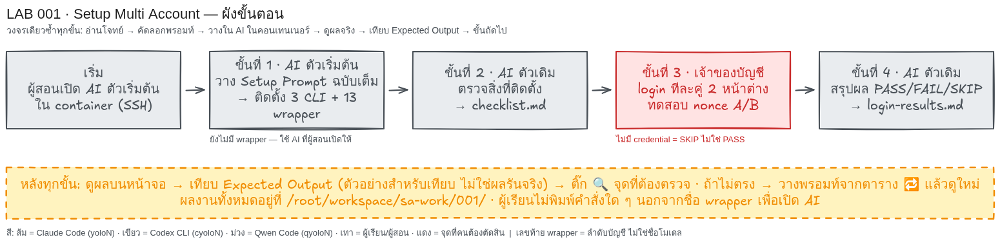

# LAB 001 · Setup Multi Account (Claude Code + Codex CLI)

เวลาโดยประมาณ: 60–75 นาที
สิ่งที่จะได้: ติดตั้ง Claude Code และ Codex CLI หลายบัญชี แยก “ติดตั้งครบ” “ล็อกอินและตอบได้” “ส่งต่องานข้ามค่ายได้จริง”
บทเรียนที่เชื่อมโยง: [AI Agent Routing](../ai-agent-routing.html) หัวข้อ 1.0 และ 4.0–4.3
ขอบเขตแลปนี้: เฉพาะ Claude Code (`yolo1`–`yolo5`) และ Codex CLI (`cyolo1`–`cyolo5`) **ไม่รวม Qwen Code**
วิธีทำ: อ่านโจทย์ → ทำตามป้าย 🖥️ Terminal / 💬 ช่องสนทนา AI → ดูผล → เทียบ Expected → ขั้นถัดไป



## ขั้นที่ 1 · เตรียมเครื่องมือ (🖥️ Terminal + 💬 AI | ~15 นาที)

### 🎯 เป้าหมายของขั้นนี้
มี Claude Code เป็น “AI ตัวช่วยตั้งค่า” บนเครื่อง Ubuntu โดยเริ่มจากติดตั้ง Claude Code เพียงตัวเดียว

### 1.1 ตรวจว่ามี Claude Code อยู่แล้วหรือไม่ (🖥️ Terminal)

```bash
claude --version
```

- ได้ตัวเลขเวอร์ชัน → ข้ามไป 1.4
- ได้ `command not found` → ทำ 1.2

### 1.2 ติดตั้ง Claude Code (🖥️ Terminal)

ตรวจกับเอกสารทางการแล้ว ([code.claude.com/docs/en/setup](https://code.claude.com/docs/en/setup)) วิธีที่แนะนำบน Ubuntu/WSL คือ

```bash
curl -fsSL https://claude.ai/install.sh | bash
claude --version
```

ทางเลือกผ่าน npm (ต้องมี Node.js 22 ขึ้นไป และห้ามใช้ `sudo`)

```bash
npm install -g @anthropic-ai/claude-code
```

Claude Code ต้องใช้บัญชี Pro / Max / Team / Enterprise หรือ Console แผนฟรีใช้ไม่ได้

### 1.4 เลือก “AI ตัวช่วยตั้งค่า” สำหรับขั้นที่ 2

| ทางเลือก | ที่ใช้ | วิธีเปิด | สิ่งที่ต้องทำเอง |
|---|---|---|---|
| A · Claude Code (แนะนำ) | 💬 ใน Terminal เครื่องเดียวกัน | พิมพ์ `claude` ในโฟลเดอร์งาน แล้วล็อกอินตามหน้าจอ | AI รันคำสั่งบน Ubuntu ให้เอง ผู้เรียนตรวจผล |
| B · Codex CLI | 💬 ใน Terminal เครื่องเดียวกัน | พิมพ์ `codex` ในโฟลเดอร์งาน เลือก **Sign in with ChatGPT** | เหมือน A |
| C · ChatGPT บนเว็บ | 💬 เบราว์เซอร์ | เปิด chatgpt.com | ChatGPT **ไม่ได้เชื่อมกับ Ubuntu** ผู้เรียนต้องคัดลอกทุกคำสั่งหรือสคริปต์ที่ได้ไปวางใน 🖥️ Terminal เอง แล้วนำผลกลับไปบอก AI |

ถ้าใช้ทางเลือก C ให้เติมประโยคนี้ต่อท้ายพรอมต์ขั้นที่ 2: “คุณไม่ได้อยู่บนเครื่องของฉัน ให้ส่งสคริปต์ติดตั้งเป็นไฟล์เดียว บอกคำสั่งรันทีละบรรทัด และบอกว่าฉันควรเห็นผลอะไร”

### ✅ Expected Output (ตัวอย่างสำหรับเทียบ — ไม่ใช่ผลการรันจริง)
| CHECK | ACTUAL EXAMPLE |
|---|---|
| `claude --version` | `2.1.258 (Claude Code)` |
| AI ตัวช่วยตั้งค่า | เปิดได้ 1 ตัว (A/B/C) |
- **ต้องตรง:** (1) มีเวอร์ชัน Claude Code (2) เปิด AI ตัวช่วยได้
- **ต่างได้:** (1) ตัวเลขเวอร์ชัน (2) ทางเลือก A/B/C

### 🔍 จุดที่ผู้เรียนต้องตรวจ
- [ ] `claude --version` ได้ตัวเลข ไม่ใช่ `command not found`
- [ ] รู้ว่าตัวเองอยู่ทางเลือก A, B หรือ C
- [ ] ยังไม่พิมพ์ `yolo1`/`cyolo1` (ตอนนี้ต้องยังไม่มี เป็นเรื่องปกติ ดูบทเรียน 4.0)

### 🔁 ถ้าผลไม่ตรง
| อาการ | ทำอย่างไร |
|---|---|
| `claude --version` ได้ `native binary not installed` | npm รุ่นใหม่บล็อก postinstall ให้ใช้ตัวติดตั้ง `curl … install.sh` แทน หรือ `npm install -g --allow-scripts=@anthropic-ai/claude-code @anthropic-ai/claude-code` |
| `npm install -g` ขึ้น permission denied | อย่าใช้ `sudo` ให้ตั้ง npm prefix เป็นโฟลเดอร์ในบ้านผู้ใช้ตามคู่มือ npm |
| ไม่มี Node.js | ใช้ตัวติดตั้ง native ในหัวข้อ 1.2 ได้โดยไม่ต้องติดตั้ง Node.js |

## ขั้นที่ 2 · คัดลอกพรอมต์ตั้งค่า CLI (💬 AI ตัวช่วยตั้งค่า | ~20 นาที)

### 🎯 เป้าหมายของขั้นนี้
ได้คำสั่ง `yolo1`–`yolo5` และ `cyolo1`–`cyolo5` รวม 10 ตัว แต่ละตัวชี้ config root คนละโฟลเดอร์ โดยยังไม่ล็อกอิน

### 📥 ข้อมูลตั้งต้นที่ต้องใช้
- ตัดสินใจ `BASE_PATH` ของตัวเอง (บรรทัดแรกของพรอมต์) ใช้โฟลเดอร์ที่ผู้ใช้ปัจจุบันเขียนได้ เช่น `$HOME/ai-accounts`
- หลักการเดียวกับบทเรียน 4.1: `<tool>/<account>/` ของใครของมัน · `<tool>/shared/` แก้ครั้งเดียวทุกบัญชีเห็น · ไม่เปลี่ยน `$HOME`
- ทางเลือก C ให้เติมประโยคจาก 1.4 ต่อท้าย

### 📋 พรอมต์สำหรับคัดลอก (คัดลอกทั้งกรอบ วางใน 💬 ช่องสนทนา AI แล้ว Enter)
```text
สร้าง CLI บน Ubuntu สำหรับรัน Claude Code และ Codex CLI หลายบัญชี
แยก credential/config กัน 100% ห้ามอ่านไฟล์ README ของ LAB เพื่อหาเฉลย

## ตัวแปรตั้งค่า (แก้ที่นี่ที่เดียว ที่อื่นต้องอ้างอิงตัวแปรนี้)
BASE_PATH="$HOME/ai-accounts"

## คำสั่งที่ต้องได้
- yolo1..yolo5   → Claude Code + บัญชี Anthropic คนละบัญชี
- cyolo1..cyolo5 → Codex CLI + บัญชี OpenAI/ChatGPT คนละบัญชี

## โครงสร้าง
$BASE_PATH/
├── .Claude/
│   ├── yolo1/ … yolo5/     # config root ต่อบัญชี (CLAUDE_CONFIG_DIR) credential/session/history/cache แยกกัน
│   └── shared/
│       ├── skills/         # skill ใช้ร่วมทุก yoloN
│       └── mcp/            # MCP config ใช้ร่วมทุก yoloN
└── .Codex/
    ├── cyolo1/ … cyolo5/   # config root ต่อบัญชี (CODEX_HOME)
    └── shared/
        ├── skills/
        └── mcp/

หลักการ: <tool>/<account>/ = ของใครของมัน, <tool>/shared/ = แก้ครั้งเดียวทุกบัญชีของ CLI นั้นเห็น

## Isolation
1. ทุกบัญชีแยก credential/config/session/history/cache สมบูรณ์ เปิดพร้อมกันได้ไม่ชน
2. ห้ามเปลี่ยน $HOME ใช้กลไก official ของแต่ละ CLI เท่านั้น
   (Claude Code: CLAUDE_CONFIG_DIR, Codex CLI: CODEX_HOME)
3. ห้ามแก้ .bashrc, Git config, SSH config หรือ environment เดิมโดยไม่จำเป็น
   ถ้าต้องเพิ่ม PATH ให้บอกบรรทัดที่เพิ่มและขอยืนยันก่อน

## Wrapper
4. ทุกคำสั่งส่งต่อ "$@" ครบ และรันแบบข้ามการขออนุญาตด้วย flag ล่าสุดของแต่ละ CLI
   - yoloN  → claude --dangerously-skip-permissions
   - cyoloN → codex --dangerously-bypass-approvals-and-sandbox
   ตรวจชื่อ flag จาก --help ของเวอร์ชันที่ติดตั้งจริงก่อนใช้
5. wrapper ต้องแสดงข้อความชัดเจนถ้าโฟลเดอร์บัญชียังไม่มี และต้องไม่พิมพ์ข้อมูลลับใด ๆ ออกหน้าจอ

## Shared
6. Skills/MCP ใน <tool>/shared เป็น source เดียว ถ้า CLI ใดไม่รองรับส่วนใด ให้ระบุชัดและทำเท่าที่รองรับ

## Installer
7. รันซ้ำได้โดยไม่ลบหรือเขียนทับ credential/config เดิม
8. วิธีติดตั้งและตำแหน่งวางไฟล์ให้เลือกเอง พร้อมอธิบายเหตุผลสั้น ๆ

## Docs
9. ตรวจ official docs และ --help ของเวอร์ชันจริงก่อน implement ห้ามเดา env/path/flag
   - https://code.claude.com/docs/
   - https://github.com/openai/codex

## หมายเหตุจากการทดลองจริง (ตรวจว่ายังจริงกับเวอร์ชันบนเครื่องนี้หรือไม่)
- ถ้ารันเป็น root ต้องตั้ง IS_SANDBOX=1 ไม่งั้น claude ปฏิเสธ --dangerously-skip-permissions
- CODEX_HOME ต้อง mkdir -p ก่อน codex ไม่สร้างโฟลเดอร์ให้เอง
- codex login status ไม่ตรวจว่า token ยังใช้ได้ ให้ยืนยันด้วย codex exec เท่านั้น

## ทดสอบ (รายงานตามจริง PASS / FAIL / SKIP)
- yolo1..yolo5 --version และ cyolo1..cyolo5 --version ทำงานครบ 10 ตัว
- แต่ละคำสั่งชี้ config root คนละโฟลเดอร์ ตรวจด้วย find <root>
- installer รอบ 2 ไม่ทำลายของเดิม
- Git/SSH ทำงานปกติ
- ทุกอย่างที่ต้องล็อกอินหรือใช้ credential จริง รอบนี้เป็น SKIP เจ้าของบัญชีจะทำเองภายหลัง

## รายงาน
เขียน 3 ไฟล์ในโฟลเดอร์ปัจจุบัน: setup-report.md (โครงสร้าง config root ตำแหน่ง credential ข้อจำกัด),
login-guide.md (ขั้นตอนล็อกอินทีละบัญชีที่ผู้ใช้ทำเองใน Terminal), checklist.md (ตาราง รายการ | หลักฐาน | PASS/FAIL/SKIP | เหตุผล)
ห้ามใส่ข้อมูลลับในไฟล์ใด ๆ

ทำเฉพาะขั้นนี้ เมื่อเสร็จให้แสดงเนื้อหาสำคัญของไฟล์ที่สร้าง (ไม่ใช่แค่ชื่อไฟล์) เป็นตารางที่ฉันอ่านตรวจได้ แล้วหยุดรอ ห้ามล็อกอินแทนฉัน ห้ามทำขั้นถัดไปเอง
```

### ✅ Expected Output (ตัวอย่างสำหรับเทียบ — ไม่ใช่ผลการรันจริง)
| CHECK | ACTUAL EXAMPLE |
|---|---|
| CLI | 2 PASS: `2.1.258 / 0.153.4` |
| yolo | 5/5 PASS (`--version` ผ่าน) |
| cyolo | 5/5 PASS (`--version` ผ่าน) |
| config root แยก | `.Claude/yolo1`…`yolo5`, `.Codex/cyolo1`…`cyolo5` คนละ path |
| reports | `setup-report.md`, `login-guide.md`, `checklist.md` |
| real login | SKIP |
- **ต้องตรง:** (1) CLI = 2 (2) wrapper = 10 (3) ไฟล์รายงาน 3 ไฟล์ และ login = `SKIP`
- **ต่างได้:** (1) เวอร์ชัน (2) `BASE_PATH` (3) ถ้อยคำ/ลำดับ

### 🔍 จุดที่ผู้เรียนต้องตรวจ (🖥️ Terminal เปิดหน้าต่างใหม่)
```bash
yolo1 --version; cyolo1 --version
yolo1 --version 2>&1 | head -1 ; yolo5 --version 2>&1 | head -1
```
- [ ] คำสั่ง `yolo1`–`yolo5` และ `cyolo1`–`cyolo5` ตอบเวอร์ชันครบ 10 ตัว
- [ ] มีไฟล์รายงาน 3 ไฟล์ในโฟลเดอร์งาน
- [ ] งานที่ใช้บัญชีจริงเป็น `SKIP` พร้อมเหตุผล
- [ ] ไม่มีข้อมูลลับในไฟล์และบนหน้าจอ

### 🔁 ถ้าผลไม่ตรง
| อาการ | ข้อความที่วางต่อใน 💬 AI |
|---|---|
| wrapper ไม่ครบ 10 | สร้าง wrapper ให้ครบ yolo1–5 และ cyolo1–5 แก้เฉพาะขั้นนี้ แสดงผล แล้วหยุด |
| `yolo1: command not found` ในหน้าต่างใหม่ | บอกฉันว่าติดตั้ง wrapper ไว้ที่ไหน และต้องเพิ่ม PATH บรรทัดใด ยังไม่ต้องแก้ไฟล์ |
| ไม่ล็อกอินแต่รายงาน PASS | เปลี่ยนเป็น SKIP แก้เฉพาะขั้นนี้ แสดงผล แล้วหยุด |
| ทางเลือก C: คำสั่งที่ให้มารันแล้ว error | วาง error ทั้งบรรทัด (ปิดชื่อผู้ใช้/อีเมล) กลับไปให้ ChatGPT แล้วขอคำสั่งแก้ |

## ขั้นที่ 3 · เปิดและล็อกอิน (🖥️ Terminal สองหน้าต่าง | ~15 นาที)

### 🎯 เป้าหมายของขั้นนี้
`yolo1` และ `cyolo1` ล็อกอินได้และตอบคำถามง่าย ๆ ได้ โดยข้อมูลลับไม่ผ่าน AI ตัวใดเลย

### 3.1 ล็อกอิน Claude Code ผ่าน `yolo1` (🖥️ Terminal หน้าต่าง A)

1. `cd ~/lab001` แล้วพิมพ์ `yolo1` → เข้าหน้า Claude Code ครั้งแรกจะเห็น `Not logged in · Please run /login`
2. พิมพ์ `/login` ในหน้า Claude Code → เปิดลิงก์ในเบราว์เซอร์ ล็อกอินด้วยบัญชีของตัวเอง แล้ววางรหัสยืนยันกลับตามที่หน้าจอบอก
3. ตรวจสถานะจาก shell (กด `Ctrl+C` สองครั้งเพื่อออกก่อน):
   ```bash
   yolo1 auth status
   yolo1 -p 'ตอบคำเดียว: pong'
   ```
   ควรได้สถานะล็อกอินแล้ว และคำตอบ `pong`

### 3.2 ล็อกอิน Codex CLI ผ่าน `cyolo1` (🖥️ Terminal หน้าต่าง B)

1. `cd ~/lab001` แล้วพิมพ์ `cyolo1` → เลือก **Sign in with ChatGPT** ทำตามเบราว์เซอร์
   ถ้าเครื่องไม่มีเบราว์เซอร์ (เช่น SSH) ให้ออกแล้วใช้ `cyolo1 login --device-auth` แล้วนำรหัสไปกรอกในเบราว์เซอร์เครื่องอื่น
2. ตรวจจาก shell:
   ```bash
   cyolo1 login status
   cyolo1 exec 'ตอบคำเดียว: pong'
   ```
   `login status` บอกแค่ว่ามี credential ส่วน `exec` คือหลักฐานว่าตอบได้จริง (บทเรียน 4.2 หมายเหตุ)

### 3.3 ยืนยันว่าเป็นคนละ config root (🖥️ Terminal)

```bash
yolo1 -p 'พิมพ์ค่า $CLAUDE_CONFIG_DIR บรรทัดเดียว'
cyolo1 exec 'รัน echo $CODEX_HOME แล้วตอบผลบรรทัดเดียว'
```

ควรเห็น `…/.Claude/yolo1` และ `…/.Codex/cyolo1` ตามลำดับ (บทเรียน 1.0 สไลด์ Terminal)

### 3.4 บันทึกผล (💬 วางใน yolo1)
```text
อ่าน login-guide.md และ checklist.md ในโฟลเดอร์นี้ ถ้าขาดให้บอกชื่อไฟล์แล้วหยุด ห้ามแต่ง
ฉันล็อกอินเองแล้ว ผลที่เห็น (ปิดข้อมูลลับแล้ว): <PASTE_REDACTED_OBSERVATIONS>
เขียน login-results.md ตาราง “คำสั่ง | login status | คำตอบ pong | config root ที่เห็น | PASS/FAIL/SKIP | เหตุผล”
มีแถว yolo1 และ cyolo1 บัญชีที่ยังไม่ล็อกอินให้ SKIP ห้ามขอหรือแสดงข้อมูล login
ทำเฉพาะขั้นนี้ แสดงเนื้อหาไฟล์บนหน้าจอ แล้วหยุด
```
แทน `<PASTE_REDACTED_OBSERVATIONS>` ด้วยผลจริงจาก 3.1–3.3 เช่น “yolo1 auth status = logged in, pong ตอบได้, path ลงท้าย .Claude/yolo1”

### ✅ Expected Output (ตัวอย่างสำหรับเทียบ — ไม่ใช่ผลการรันจริง)
| CHECK | ACTUAL EXAMPLE |
|---|---|
| `yolo1 auth status` | logged in (อีเมลปิดเป็น `<YOUR_EMAIL>`) |
| `yolo1 -p 'ตอบคำเดียว: pong'` | `pong` |
| `cyolo1 login status` | Logged in using ChatGPT |
| `cyolo1 exec 'ตอบคำเดียว: pong'` | `pong` |
| config root | `.Claude/yolo1` / `.Codex/cyolo1` |
| `yolo2`–`yolo5`, `cyolo2`–`cyolo5` | `SKIP` (ยังไม่มีบัญชี) |
- **ต้องตรง:** (1) `pong` ทั้งสองค่าย (2) path ลงท้ายคนละโฟลเดอร์ (3) ไม่มีบัญชี = `SKIP`
- **ต่างได้:** (1) ถ้อยคำสถานะ (2) โมเดลที่ตอบ

### 🔍 จุดที่ผู้เรียนต้องตรวจ
- [ ] `yolo1` และ `cyolo1` ตอบ `pong` ทั้งคู่
- [ ] `login status` ไม่ถูกนับเป็น “ตอบได้” ถ้ายังไม่มี `pong`
- [ ] `login-results.md` ไม่มีอีเมล token หรือลิงก์ล็อกอิน
- [ ] บัญชีที่ยังไม่ล็อกอินเป็น `SKIP` ไม่ใช่ `PASS`

### 🔁 ถ้าผลไม่ตรง
| อาการ | ทำอย่างไร |
|---|---|
| `yolo1` ขึ้น `cannot be used with root/sudo` | รันเป็น root ต้องให้ wrapper ตั้ง `IS_SANDBOX=1` กลับไปบอก AI ตัวช่วยตั้งค่าในขั้นที่ 2 |
| `cyolo1` ขึ้น `CODEX_HOME points to … does not exist` | โฟลเดอร์บัญชียังไม่ถูกสร้าง ให้ AI ตัวช่วยตั้งค่า `mkdir -p` ในขั้นที่ 2 |
| `cyolo1 exec` ได้ `401 Unauthorized` | ยังไม่ล็อกอินจริง ทำ 3.2 ข้อ 1 ใหม่ |
| ไม่มีบัญชีค่ายใดค่ายหนึ่ง | บันทึก `SKIP` แล้วทำขั้นที่ 4 ไม่ได้ ให้รายงาน `SKIP` ในขั้นที่ 4–5 ด้วย |

## ขั้นที่ 4 · ทดสอบส่งต่องานระหว่าง yolo1 กับ cyolo1 (🖥️ สองหน้าต่าง โฟลเดอร์เดียวกัน | ~20 นาที)

### 🎯 เป้าหมายของขั้นนี้
Claude Code สร้างงาน → Codex ตรวจและเขียนข้อเสนอแนะ → Claude Code แก้ → Codex ตรวจซ้ำ โดยส่งต่อกันผ่าน “ไฟล์” ในโฟลเดอร์เดียว

### กติกา
- หน้าต่าง A เปิด `yolo1` หน้าต่าง B เปิด `cyolo1` ทั้งคู่ `cd ~/lab001/handoff` ก่อน (สร้างโฟลเดอร์ก่อนด้วย `mkdir -p ~/lab001/handoff`)
- **รอให้รอบหนึ่งจบและเห็นไฟล์แล้วค่อยวางพรอมต์รอบถัดไป** ห้ามให้สองตัวแก้ไฟล์เดียวกันพร้อมกัน
- yolo1 แก้ได้เฉพาะ `wordcount.py`, `sample.txt`, `CRITERIA.md` ส่วน cyolo1 เขียนได้เฉพาะ `review-1.md`, `review-2.md`
- ตรวจผลด้วยตาตัวเองทุกรอบ ด้วย `ls` และ `cat` ใน 🖥️ Terminal หน้าต่างที่สาม หรือดูจากหน้าจอ AI

### รอบที่ 1 · yolo1 สร้างงานพร้อมเกณฑ์ (💬 วางในหน้าต่าง A · yolo1)
```text
ทำงานในโฟลเดอร์ปัจจุบันเท่านั้น
1) สร้าง wordcount.py (Python 3) รับชื่อไฟล์เป็น argument ตัวแรก แล้วพิมพ์จำนวนคำในไฟล์เป็นตัวเลขล้วนบรรทัดเดียว
   ถ้าไม่ส่ง argument ให้พิมพ์ "usage: wordcount.py <file>" และจบด้วย exit code 1
2) สร้าง sample.txt ที่มีคำภาษาอังกฤษ 5 คำ
3) สร้าง CRITERIA.md เป็นตาราง “ข้อ | คำสั่งที่ใช้ตรวจ | ผลที่ต้องได้” 3 ข้อ:
   C1 python3 wordcount.py sample.txt → 5
   C2 python3 wordcount.py (ไม่มี argument) → มีคำว่า usage และ exit code 1
   C3 ไฟล์ว่าง → 0
4) รันตรวจทั้ง 3 ข้อเองแล้วแสดงผลจริง
ทำเฉพาะรอบนี้ แสดงเนื้อหาไฟล์ทั้งสามและผลรันบนหน้าจอ แล้วหยุด ห้ามแก้ไฟล์อื่น
```
**ควรเห็น:** ไฟล์ `wordcount.py`, `sample.txt`, `CRITERIA.md` และผลรัน C1–C3 บนหน้าจอ

### รอบที่ 2 · cyolo1 ตรวจตามเกณฑ์และบันทึกข้อเสนอแนะ (💬 วางในหน้าต่าง B · cyolo1)
```text
อ่าน CRITERIA.md, wordcount.py และ sample.txt ในโฟลเดอร์ปัจจุบัน ถ้าขาดไฟล์ใดให้บอกชื่อแล้วหยุด
รันคำสั่งตรวจตาม CRITERIA.md ทุกข้อด้วยตัวเอง ห้ามเชื่อผลที่คนอื่นรายงาน
เขียน review-1.md ตาราง “ข้อ | คำสั่ง | ผลจริง | PASS/FAIL” ครบทุกข้อ
แล้วเพิ่มหัวข้อ “ข้อเสนอเพิ่ม” อย่างน้อย 1 ข้อที่ตรวจได้ด้วยคำสั่ง เช่น
C4 ไฟล์ที่ไม่มีอยู่ → พิมพ์ข้อความ error บรรทัดเดียวและ exit code 2 (ปัจจุบันเป็นอย่างไร ให้แสดงผลจริง)
ห้ามแก้ wordcount.py, sample.txt หรือ CRITERIA.md แสดงเนื้อหา review-1.md บนหน้าจอ แล้วหยุด
```
**ควรเห็น:** ไฟล์ `review-1.md` มีตาราง C1–C3 พร้อมผลจริง และ “ข้อเสนอเพิ่ม” อย่างน้อย 1 ข้อ

### รอบที่ 3 · yolo1 อ่านข้อเสนอแนะแล้วปรับงาน (💬 วางในหน้าต่าง A · yolo1)
```text
อ่าน review-1.md ในโฟลเดอร์ปัจจุบัน ถ้าไม่มีให้บอกแล้วหยุด ห้ามแต่งขึ้นเอง
แก้ wordcount.py ให้ผ่านทุกข้อที่ FAIL และทำตาม “ข้อเสนอเพิ่ม” ทุกข้อ
เพิ่มข้อเสนอเพิ่มเหล่านั้นลงใน CRITERIA.md เป็นข้อถัดไป (C4, C5, …) ในรูปแบบตารางเดิม
รันตรวจทุกข้อใน CRITERIA.md ใหม่ทั้งหมดแล้วแสดงผลจริง
ห้ามแก้ review-1.md แสดง diff หรือเนื้อหาไฟล์ที่เปลี่ยน แล้วหยุด
```
**ควรเห็น:** `wordcount.py` เปลี่ยน `CRITERIA.md` มีข้อเพิ่ม และผลรันทุกข้อบนหน้าจอ

### รอบที่ 4 · cyolo1 ตรวจซ้ำและสรุปผ่านหรือไม่ (💬 วางในหน้าต่าง B · cyolo1)
```text
อ่าน CRITERIA.md ฉบับล่าสุดและ review-1.md รันคำสั่งตรวจทุกข้อใหม่ด้วยตัวเอง
เขียน review-2.md ตาราง “ข้อ | คำสั่ง | ผลจริง | PASS/FAIL” และบรรทัดสรุปท้ายไฟล์เป็น
“VERDICT: PASS” เมื่อทุกข้อผ่าน หรือ “VERDICT: FAIL — <ข้อที่ไม่ผ่าน>”
ห้ามแก้ไฟล์อื่น แสดงเนื้อหา review-2.md บนหน้าจอ แล้วหยุด
```
**ควรเห็น:** `review-2.md` มีบรรทัด `VERDICT: PASS` หรือ `VERDICT: FAIL — …`

ถ้า `VERDICT: FAIL` ให้ทำรอบที่ 3–4 ซ้ำได้อีก 1 ครั้ง แล้วบันทึกผลตามจริง

### ✅ Expected Output (ตัวอย่างสำหรับเทียบ — ไม่ใช่ผลการรันจริง)
| ไฟล์ | ผู้เขียน | เนื้อหาที่ต้องมี |
|---|---|---|
| `wordcount.py`, `sample.txt`, `CRITERIA.md` | yolo1 | C1–C3 พร้อมคำสั่งตรวจ |
| `review-1.md` | cyolo1 | ตาราง C1–C3 ผลจริง + ข้อเสนอเพิ่ม ≥ 1 |
| `CRITERIA.md` (แก้), `wordcount.py` (แก้) | yolo1 | มี C4 ขึ้นไป |
| `review-2.md` | cyolo1 | ตารางครบทุกข้อ + `VERDICT: PASS` |
- **ต้องตรง:** (1) ครบ 5 ไฟล์ (2) ผู้เขียนตรงบทบาท (3) มี VERDICT
- **ต่างได้:** (1) จำนวนข้อเสนอเพิ่ม (2) VERDICT เป็น FAIL ได้ถ้าจริง

### 🔍 จุดที่ผู้เรียนต้องตรวจ (🖥️ Terminal หน้าต่างที่สาม)
```bash
ls -l ~/lab001/handoff
tail -n 3 ~/lab001/handoff/review-2.md
python3 ~/lab001/handoff/wordcount.py ~/lab001/handoff/sample.txt
```
- [ ] มีไฟล์ครบ 5 ไฟล์
- [ ] `review-1.md` มีผล FAIL หรือข้อเสนอเพิ่มอย่างน้อย 1 ข้อ (แสดงว่า Codex ตรวจจริงไม่ใช่แค่เปิดได้)
- [ ] `wordcount.py` เปลี่ยนหลัง review-1 และ `review-2.md` มี VERDICT
- [ ] รันเองแล้วได้ `5` ตรงกับที่ review-2 บอก

### 🔁 ถ้าผลไม่ตรง
| อาการ | ทำอย่างไร |
|---|---|
| cyolo1 บอกไม่พบไฟล์ | เช็คว่าทั้งสองหน้าต่าง `pwd` เป็นโฟลเดอร์เดียวกัน แล้ววางพรอมต์รอบเดิมใหม่ |
| cyolo1 แก้ `wordcount.py` เอง | วางต่อ: “ย้อนการแก้ไฟล์ที่ไม่ใช่ review-1.md แล้วบันทึกข้อเสนอในไฟล์แทน” |
| review-1 ผ่านหมดและไม่มีข้อเสนอเพิ่ม | วางต่อ: “เพิ่มข้อเสนอที่ตรวจได้ด้วยคำสั่งอย่างน้อย 1 ข้อ เช่น C4 ไฟล์ไม่มีอยู่” |
| ไม่มี python3 | เปลี่ยนโจทย์เป็นสคริปต์ bash ชื่อ `wordcount.sh` ใช้เกณฑ์เดียวกัน |

## ขั้นที่ 5 · สรุปผล (💬 วางใน yolo1 | ~5 นาที)

### 🎯 เป้าหมายของขั้นนี้
ตารางสรุปที่แยก 3 หลักฐานออกจากกัน ไม่ใช้ผลติดตั้งแทนผลล็อกอิน และไม่ใช้ “เปิดได้สองตัว” แทนผลส่งต่องาน

### 📋 พรอมต์สำหรับคัดลอก (คัดลอกทั้งกรอบ วางใน 💬 yolo1 ที่โฟลเดอร์ ~/lab001)
```text
อ่าน setup-report.md, checklist.md, login-results.md และไฟล์ทั้งหมดใน handoff/ ถ้าขาดให้บอกชื่อไฟล์แล้วหยุด ห้ามแต่ง
เขียน final-results.md เป็น 3 ส่วน แต่ละส่วนเป็นตาราง “รายการ | หลักฐาน (ชื่อไฟล์/คำสั่ง) | PASS/FAIL/SKIP | เหตุผล”
ส่วน 1 ติดตั้งและมีคำสั่งครบ: claude/codex --version, yolo1–5, cyolo1–5 (10 ตัว), config root แยก, installer รอบ 2
ส่วน 2 ล็อกอินและตอบได้: yolo1 และ cyolo1 ตอบ pong; บัญชีอื่นที่ยังไม่ล็อกอินเป็น SKIP
ส่วน 3 ส่งต่องานระหว่าง Claude Code กับ Codex: ต้องมี CRITERIA.md, review-1.md ที่มีข้อเสนอ, wordcount.py ที่แก้แล้ว, review-2.md ที่มี VERDICT
   ถ้าขาดไฟล์ใดหรือไม่มี VERDICT ให้เป็น FAIL ไม่ใช่ PASS แม้จะเปิดทั้งสองเครื่องมือได้
ยึดไฟล์จริง ห้ามใช้ตัวอย่าง Expected ห้ามเปลี่ยน SKIP เป็น PASS ห้ามใส่ข้อมูลลับ
ทำเฉพาะขั้นนี้ แสดงเนื้อหา final-results.md บนหน้าจอ แล้วหยุด
```

### ✅ Expected Output (ตัวอย่างสำหรับเทียบ — ไม่ใช่ผลการรันจริง)
| ส่วน | รายการ | หลักฐาน | STATUS |
|---|---|---|---|
| 1 ติดตั้ง | CLI 2 ตัว, wrapper 10 ตัว, config root แยก | `--version` × 12, `find` | PASS |
| 2 ล็อกอิน/ตอบได้ | yolo1, cyolo1 | `pong` × 2 ใน `login-results.md` | PASS |
| 2 ล็อกอิน/ตอบได้ | yolo2–5, cyolo2–5 | ไม่มีบัญชี | SKIP |
| 3 ส่งต่องาน | สร้าง → ตรวจ → แก้ → ตรวจซ้ำ | 5 ไฟล์ใน `handoff/` + `VERDICT: PASS` | PASS |
- **ต้องตรง:** (1) แยก 3 ส่วน (2) ทุกแถวอ้างไฟล์หรือคำสั่งจริง (3) ส่วน 3 อิงไฟล์ครบ
- **ต่างได้:** (1) สถานะตามผลจริง (2) จำนวนแถว

### 🔍 จุดที่ผู้เรียนต้องตรวจ
- [ ] หน้าจอมี 3 ส่วนแยกชัด
- [ ] ส่วน 1 ไม่นำ `--version` ไปนับเป็นล็อกอิน
- [ ] ส่วน 3 เป็น PASS ก็ต่อเมื่อครบทั้ง CRITERIA, review-1, ไฟล์ที่แก้, review-2 พร้อม VERDICT
- [ ] บัญชีที่ไม่มีเป็น `SKIP` พร้อมเหตุผล

### 🔁 ถ้าผลไม่ตรง
| อาการ | ข้อความที่วางต่อ |
|---|---|
| ส่วน 3 PASS แต่ไม่มี review-2 | เปลี่ยนส่วน 3 เป็น FAIL พร้อมบอกไฟล์ที่ขาด แก้เฉพาะขั้นนี้ แสดงผล แล้วหยุด |
| สถานะขัดกับไฟล์จริง | แก้ตามไฟล์จริง แก้เฉพาะขั้นนี้ แสดงผล แล้วหยุด |

## ส่งงาน

ส่งจากโฟลเดอร์งาน (เช่น `~/lab001/`):

- ขั้นที่ 2: `setup-report.md`, `login-guide.md`, `checklist.md`
- ขั้นที่ 3: `login-results.md`
- ขั้นที่ 4: `handoff/wordcount.py`, `handoff/sample.txt`, `handoff/CRITERIA.md`, `handoff/review-1.md`, `handoff/review-2.md`
- ขั้นที่ 5: `final-results.md`
- ภาพหน้าจอ `yolo1 auth status` และ `cyolo1 login status` ที่ปิดอีเมลแล้ว (ไม่บังคับถ้าอยู่ใน login-results.md)

เกณฑ์ผ่าน:

- [ ] **ติดตั้งและมีคำสั่งครบ:** `claude`, `codex` มีเวอร์ชัน และ `yolo1`–`yolo5`, `cyolo1`–`cyolo5` ตอบ `--version` ครบ 10 ตัว config root คนละโฟลเดอร์
- [ ] **ล็อกอินและตอบได้:** `yolo1` และ `cyolo1` ตอบ `pong` โดยผู้เรียนล็อกอินเองใน Terminal
- [ ] **ส่งต่องานได้จริง:** มี `CRITERIA.md`, `review-1.md` ที่มีข้อเสนอ, ไฟล์งานที่แก้หลัง review, และ `review-2.md` ที่มี `VERDICT` การเปิดสองเครื่องมือได้เพียงอย่างเดียวไม่นับ
- [ ] ทุกสถานะมีหลักฐานและเหตุผล ไม่มีบัญชี = `SKIP` ไม่ใช่ `PASS`
- [ ] ทุกไฟล์และภาพไม่มีอีเมล รหัสผ่าน token หรือลิงก์ล็อกอิน

คำถามสะท้อนคิด:

1. `yolo1 --version` ผ่าน แต่ `yolo1 -p 'pong'` ยังไม่ผ่านได้อย่างไร และสองอย่างนี้พิสูจน์อะไรต่างกัน?
2. ทำไมการส่งต่องานต้องผ่าน “ไฟล์” ในโฟลเดอร์เดียว แทนการคัดลอกข้อความข้ามหน้าต่างเอง?
3. ถ้า review-1 ผ่านทุกข้อและไม่มีข้อเสนอเพิ่ม เราจะรู้ได้อย่างไรว่า Codex ตรวจจริง?
