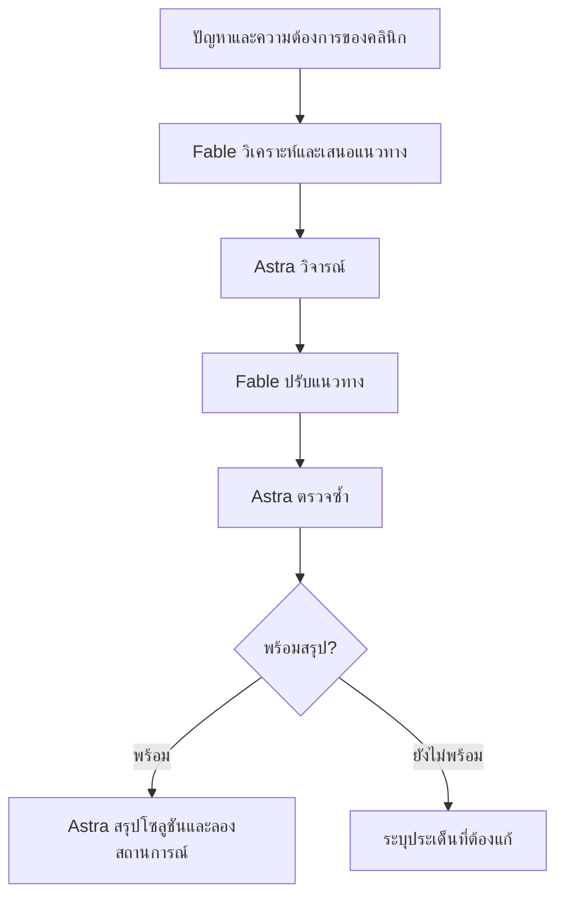
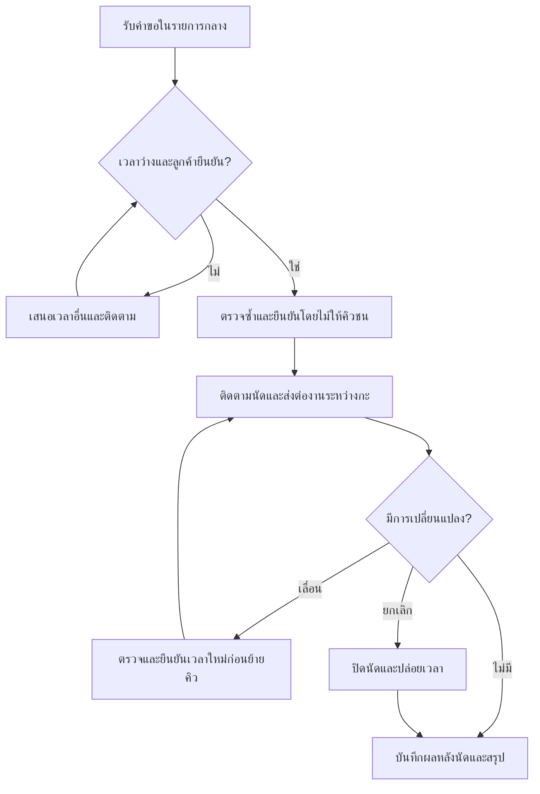

# LAB 001 · Setup Multi Account (Claude Code + Codex CLI)

เวลาโดยประมาณ: 60–75 นาที
สิ่งที่จะได้: ติดตั้ง Claude Code และ Codex CLI หลายบัญชี แยก “ติดตั้งครบ” “ล็อกอินและตอบได้” “ส่งต่องานข้ามค่ายได้จริง”
บทเรียนที่เชื่อมโยง: [AI Agent Routing](../ai-agent-routing.html) หัวข้อ 1.0 และ 4.0–4.3
ขอบเขตแลปนี้: เฉพาะ Claude Code (`yolo1`–`yolo5`) และ Codex CLI (`cyolo1`–`cyolo5`) **ไม่รวม Qwen Code**
วิธีทำ: อ่านโจทย์ → ทำตามป้าย 🖥️ Terminal / 💬 ช่องสนทนา AI → ดูผล → เทียบ Expected → ขั้นถัดไป

**ลำดับแลป:** ติดตั้ง Claude → ตั้งค่าหลายบัญชี → ล็อกอินและเลือกโมเดล → Claude เรียก Codex ตรวจ → เปลี่ยนโมเดลแล้วทำต่อ

## ขั้นที่ 1 · เตรียมเครื่องมือ (🖥️ Terminal + 💬 AI | ~15 นาที)

### 🎯 เป้าหมายของขั้นนี้
มี Claude Code เป็น “AI ตัวช่วยตั้งค่า” บนเครื่อง Ubuntu โดยเริ่มจากติดตั้ง Claude Code เพียงตัวเดียว

### 1.1 ตรวจว่ามี Claude Code อยู่แล้วหรือไม่ (🖥️ Terminal)

```bash
claude --version
```

- ได้ตัวเลขเวอร์ชัน → ข้ามไป 1.4
- ได้ `command not found` → ทำ 1.2

### 1.2 ติดตั้ง Claude Code (🖥️ Terminal)

**ติดตั้งก่อน** — คัดลอกคำสั่งนี้ไปวางใน Terminal แล้วกด Enter

```bash
curl -fsSL https://claude.ai/install.sh | bash
```

รอจนติดตั้งเสร็จและเห็นข้อความ `Claude Code successfully installed!`


**จากนั้นตรวจเวอร์ชัน** — พิมพ์คำสั่งนี้แล้วกด Enter

```bash
claude --version
```


เห็นเลขเวอร์ชันแล้วไปหัวข้อ 1.4 ได้เลย ตัวเลขอาจต่างจากภาพ

### 1.4 เปิดและล็อกอิน Claude Code เพื่อเตรียมทำขั้นที่ 2


1. เปิด 🖥️ Terminal ในโฟลเดอร์งาน แล้วพิมพ์:
   ```bash
   claude
   ```
2. ล็อกอินด้วยบัญชีของตัวเองตามคำแนะนำบนหน้าจอ หากยังไม่ได้ล็อกอิน ให้พิมพ์ `/login` ในช่องสนทนา Claude Code แล้วทำตามขั้นตอน
3. เมื่อพร้อมใช้งาน ให้เปิด Claude Code ค้างไว้ แล้วไปขั้นที่ 2 เพื่อคัดลอกพรอมต์ทั้งกรอบมาวางใน 💬 ช่องสนทนา Claude Code

ขั้นนี้ติดตั้งเฉพาะ Claude Code เพื่อใช้เป็น AI ตัวช่วยตั้งค่าก่อน ส่วนการติดตั้งเครื่องมือที่ยังขาดและตั้งค่าหลายบัญชีของทั้ง Claude Code และ Codex CLI จะให้ AI ดำเนินการในขั้นที่ 2

### ✅ Expected Output (ตัวอย่างสำหรับเทียบ — ไม่ใช่ผลการรันจริง)
| CHECK | ACTUAL EXAMPLE |
|---|---|
| `claude --version` | `2.1.258 (Claude Code)` |
| AI ตัวช่วยตั้งค่า | เปิด Claude Code และล็อกอินพร้อมใช้งานแล้ว |
- **ต้องตรง:** (1) มีเวอร์ชัน Claude Code (2) เปิด AI ตัวช่วยได้
- **ต่างได้:** ตัวเลขเวอร์ชัน

## ขั้นที่ 2 · ให้ Claude Code ตั้งค่าหลายบัญชี (~20 นาที)

ให้ Claude Code ติดตั้งเครื่องมือที่ยังขาดและสร้างคำสั่ง `yolo1`–`yolo5` กับ `cyolo1`–`cyolo5` สำหรับใช้งานหลายบัญชี โดยแยกข้อมูลแต่ละบัญชีและยังไม่ล็อกอินบัญชีเหล่านี้

คัดลอกพรอมต์ทั้งกรอบไปวางใน Claude Code ที่เปิดไว้จากขั้นที่ 1

### 📋 พรอมต์สำหรับคัดลอก (คัดลอกทั้งกรอบ วางใน 💬 ช่องสนทนา AI แล้ว Enter)
```text
สร้าง CLI บน Ubuntu สำหรับรัน Claude Code และ Codex CLI หลายบัญชี
ตรวจเครื่องมือที่มีอยู่ก่อน และติดตั้งเครื่องมือที่ยังขาด รวมถึง Codex CLI ก่อนตั้งค่าหลายบัญชี
แยก credential/config กัน 100% ห้ามอ่านไฟล์ README ของ LAB เพื่อหาเฉลย

## ตัวแปรตั้งค่า (แก้ที่นี่ที่เดียว ที่อื่นต้องอ้างอิงตัวแปรนี้)
BASE_PATH="$HOME/ai-accounts"

## คำสั่งที่ต้องได้
- yolo1..yolo5   → Claude Code + บัญชี Anthropic คนละบัญชี
- cyolo1..cyolo5 → Codex CLI + บัญชี OpenAI/ChatGPT คนละบัญชี

## โครงสร้าง
$BASE_PATH/
├── .Claude/
│   ├── yolo1/ … yolo5/     # config root ต่อบัญชี (CLAUDE_CONFIG_DIR) credential/session/history/cache แยกกัน
│   └── shared/
│       ├── skills/         # skill ใช้ร่วมทุก yoloN
│       └── mcp/            # MCP config ใช้ร่วมทุก yoloN
└── .Codex/
    ├── cyolo1/ … cyolo5/   # config root ต่อบัญชี (CODEX_HOME)
    └── shared/
        ├── skills/
        └── mcp/

หลักการ: <tool>/<account>/ = ของใครของมัน, <tool>/shared/ = แก้ครั้งเดียวทุกบัญชีของ CLI นั้นเห็น

## Isolation
1. ทุกบัญชีแยก credential/config/session/history/cache สมบูรณ์ เปิดพร้อมกันได้ไม่ชน
2. ห้ามเปลี่ยน $HOME ใช้กลไก official ของแต่ละ CLI เท่านั้น
   (Claude Code: CLAUDE_CONFIG_DIR, Codex CLI: CODEX_HOME)
3. ห้ามแก้ .bashrc, Git config, SSH config หรือ environment เดิมโดยไม่จำเป็น
   ถ้าต้องเพิ่ม PATH ให้บอกบรรทัดที่เพิ่มและขอยืนยันก่อน

## Wrapper
4. ทุกคำสั่งส่งต่อ "$@" ครบ และรันแบบข้ามการขออนุญาตด้วย flag ล่าสุดของแต่ละ CLI
   - yoloN  → claude --dangerously-skip-permissions
   - cyoloN → codex --dangerously-bypass-approvals-and-sandbox
   ตรวจชื่อ flag จาก --help ของเวอร์ชันที่ติดตั้งจริงก่อนใช้
5. wrapper ต้องแสดงข้อความชัดเจนถ้าโฟลเดอร์บัญชียังไม่มี และต้องไม่พิมพ์ข้อมูลลับใด ๆ ออกหน้าจอ

## Shared
6. Skills/MCP ใน <tool>/shared เป็น source เดียว ถ้า CLI ใดไม่รองรับส่วนใด ให้ระบุชัดและทำเท่าที่รองรับ

## Installer
7. รันซ้ำได้โดยไม่ลบหรือเขียนทับ credential/config เดิม
8. วิธีติดตั้งและตำแหน่งวางไฟล์ให้เลือกเอง พร้อมอธิบายเหตุผลสั้น ๆ

## Docs
9. ตรวจ official docs และ --help ของเวอร์ชันจริงก่อน implement ห้ามเดา env/path/flag
   - https://code.claude.com/docs/
   - https://github.com/openai/codex

## หมายเหตุจากการทดลองจริง (ตรวจว่ายังจริงกับเวอร์ชันบนเครื่องนี้หรือไม่)
- ถ้ารันเป็น root ต้องตั้ง IS_SANDBOX=1 ไม่งั้น claude ปฏิเสธ --dangerously-skip-permissions
- CODEX_HOME ต้อง mkdir -p ก่อน codex ไม่สร้างโฟลเดอร์ให้เอง
- codex login status ไม่ตรวจว่า token ยังใช้ได้ ให้ยืนยันด้วย codex exec เท่านั้น

## ทดสอบ (รายงานตามจริง PASS / FAIL / SKIP)
- yolo1..yolo5 --version และ cyolo1..cyolo5 --version ทำงานครบ 10 ตัว
- แต่ละคำสั่งชี้ config root คนละโฟลเดอร์ ตรวจด้วย find <root>
- installer รอบ 2 ไม่ทำลายของเดิม
- Git/SSH ทำงานปกติ
- ทุกอย่างที่ต้องล็อกอินหรือใช้ credential จริง รอบนี้เป็น SKIP เจ้าของบัญชีจะทำเองภายหลัง

## รายงาน
เขียน 3 ไฟล์ในโฟลเดอร์ปัจจุบัน: setup-report.md (โครงสร้าง config root ตำแหน่ง credential ข้อจำกัด),
login-guide.md (ขั้นตอนล็อกอินทีละบัญชีที่ผู้ใช้ทำเองใน Terminal), checklist.md (ตาราง รายการ | หลักฐาน | PASS/FAIL/SKIP | เหตุผล)
ห้ามใส่ข้อมูลลับในไฟล์ใด ๆ

ทำเฉพาะขั้นนี้ เมื่อเสร็จให้แสดงเนื้อหาสำคัญของไฟล์ที่สร้าง (ไม่ใช่แค่ชื่อไฟล์) เป็นตารางที่ฉันอ่านตรวจได้ แล้วหยุดรอ ห้ามล็อกอินแทนฉัน ห้ามทำขั้นถัดไปเอง
```


ข้อความ `[Pasted text …]` คือพรอมต์ที่วางแล้ว กด Enter เพื่อเริ่มทำงาน

### ✅ Expected Output (ตัวอย่างสำหรับเทียบ — ไม่ใช่ผลการรันจริง)
| CHECK | ACTUAL EXAMPLE |
|---|---|
| CLI | 2 PASS: `2.1.258 / 0.153.4` |
| yolo | 5/5 PASS (`--version` ผ่าน) |
| cyolo | 5/5 PASS (`--version` ผ่าน) |
| config root แยก | `.Claude/yolo1`…`yolo5`, `.Codex/cyolo1`…`cyolo5` คนละ path |
| reports | `setup-report.md`, `login-guide.md`, `checklist.md` |
| real login | SKIP |
- **ต้องตรง:** (1) CLI = 2 (2) wrapper = 10 (3) ไฟล์รายงาน 3 ไฟล์ และ login = `SKIP`
- **ต่างได้:** (1) เวอร์ชัน (2) `BASE_PATH` (3) ถ้อยคำ/ลำดับ

### 🔍 จุดที่ผู้เรียนต้องตรวจ (🖥️ Terminal เปิดหน้าต่างใหม่)
```bash
yolo1 --version; cyolo1 --version
yolo2 --version; cyolo2 --version
yolo3 --version; cyolo3 --version
```


- [ ] คำสั่งของบัญชี 1–3 ทั้งสอง CLI แสดงเวอร์ชันครบ 6 ตัว
- [ ] มีไฟล์รายงาน 3 ไฟล์ในโฟลเดอร์งาน
- [ ] งานที่ใช้บัญชีจริงเป็น `SKIP` พร้อมเหตุผล
- [ ] ไม่มีข้อมูลลับในไฟล์และบนหน้าจอ

## ขั้นที่ 3 · ล็อกอินและเลือกโมเดล (~10 นาที)

ใช้บัญชี `yolo1` และ `cyolo1` จากขั้นที่ 2 ทำงานในโฟลเดอร์เดียวกันตลอดแลป

### 3.1 ล็อกอินด้วยบัญชี subscription (🖥️ Terminal)

ทำทีละค่ายในโฟลเดอร์งานเดียวกัน จนเห็นช่องพร้อมพิมพ์พรอมต์ของทั้งสองโปรแกรม

#### A · Claude Code — yolo1

**1. เปิดโปรแกรมและเลือกบัญชี subscription**

```bash
yolo1
```

หากมีหน้าจอเลือกธีม ให้เลือกธีมก่อน จากนั้นเลือก **Claude account with subscription** แล้วกด Enter


**2. ยืนยันบัญชีในเบราว์เซอร์**

เปิดลิงก์ที่ Terminal แสดง ล็อกอินด้วยบัญชี Claude ที่มี subscription และยืนยันการเชื่อมต่อ หากหน้าจอให้คัดลอกรหัสกลับมา ให้ทำตามขั้นตอนนั้นด้วยตัวเอง

**3. ยืนยันโฟลเดอร์และโหมดของแลป**

กลับมาที่ Terminal หากเป็นโฟลเดอร์แลปที่เตรียมไว้ ให้เลือก **Yes, I trust this folder**


คำสั่ง yolo1 จากขั้นที่ 2 เปิดโหมด Bypass Permissions หากกำลังใช้คอนเทนเนอร์แลปที่เตรียมไว้ ให้เลือก **Yes, I accept** เพื่อทำต่อ


**4. พร้อมพิมพ์พรอมต์**

เห็นหน้า Claude Code และช่องพิมพ์ข้อความ แสดงว่ามาถึงหน้าสนทนาแล้ว


#### B · Codex CLI — cyolo1

**1. เปิดโปรแกรมและเลือก Sign in with ChatGPT**

```bash
cyolo1
```

เลือก **Sign in with ChatGPT** แล้วกด Enter เพื่อใช้บัญชี ChatGPT ที่มีสิทธิ์ใช้งาน Codex


**2. ยืนยันบัญชีในเบราว์เซอร์**

ล็อกอินด้วยบัญชี ChatGPT ที่ต้องการใช้และยืนยันการเชื่อมต่อ หากใช้ SSH แล้วเบราว์เซอร์กลับมาที่ CLI ไม่ได้ ให้เลือก **Sign in with Device Code** และทำตามขั้นตอนบนหน้าจอ

**3. ยืนยันโฟลเดอร์งาน**

กลับมาที่ Terminal หากเป็นโฟลเดอร์แลปที่เตรียมไว้ ให้เลือก **Yes, continue**


**4. พร้อมพิมพ์พรอมต์**

เห็นหน้า Codex พร้อมชื่อโมเดลและช่องพิมพ์ข้อความ แสดงว่ามาถึงหน้าสนทนาแล้ว


ผู้เรียนทำขั้นตอนยืนยันตัวตนเอง ไม่ส่งรหัสหรือข้อมูลบัญชีให้ AI เมื่อทั้งสองหน้าต่างพร้อมแล้ว ไปส่งโจทย์ในหัวข้อ 3.2

*ภาพ Terminal เป็นภาพจริง หน้าหลังล็อกอินถ่ายโดยใช้ข้อมูล subscription เดิมที่ได้รับอนุญาตในเครื่องทดสอบ ไม่ได้บันทึกขั้นยืนยันตัวตนในเบราว์เซอร์ ชื่อโมเดลเริ่มต้นอาจต่างจากภาพ โดยจะเลือกโมเดลในหัวข้อ 3.2*

### 3.2 ลองส่งคำถามเดียวกันสองวิธี

หลังล็อกอินในหัวข้อ 3.1 แล้ว ให้ลองส่งคำถามผ่านหน้าสนทนา AI ก่อน จากนั้นส่งคำถามเดิมด้วยคำสั่งจาก shell เพื่อดูความต่างของวิธีใช้งาน

ทั้งสองรอบใช้ **yolo1: Fable · medium** และ **cyolo1: Astra · medium** โดยไม่เปลี่ยนโจทย์

**คำถามที่ใช้ตลอดหัวข้อนี้**

```text
ร้านค้าลดราคา 10% เมื่อซื้อครบ 1000 บาท จงคำนวณยอดจ่ายสำหรับยอดซื้อ 999, 1000 และ 1500 บาท ตอบเป็นตารางยอดซื้อและยอดจ่ายทศนิยม 2 ตำแหน่ง ตามด้วยคำอธิบายสั้น ๆ และข้อควรระวัง 1 ข้อ ไม่ต้องสร้างไฟล์หรือรันคำสั่งอื่น
```

#### วิธีที่ 1 · พิมพ์ในหน้าสนทนา AI

เริ่มจากหน้าสนทนาที่เปิดค้างไว้ในหัวข้อ 3.1 เลือกโมเดลและระดับ effort ให้ตรงก่อนวางคำถาม

**A · Claude Code (yolo1)**

**1. เลือก Fable และปรับ effort**

พิมพ์ `/model` แล้วกด Enter เลื่อนมาที่ **Fable** ใช้ลูกศรซ้าย/ขวาปรับเป็น **Medium** แล้วกด Enter ยืนยัน


**2. วางคำถาม**

คัดลอกคำถามด้านบนมาวางในช่องสนทนา ตรวจว่าหน้าจอแสดง Fable และ medium


**3. ส่งและดูคำตอบ**

กด Enter แล้วรอจนตอบจบ จะเห็นตารางยอดจ่ายพร้อมคำอธิบาย และยังพิมพ์ถามต่อในหน้าเดิมได้


**B · Codex (cyolo1)**

**1. เลือก Astra**

ในหน้าสนทนา Codex พิมพ์ `/model` แล้วกด Enter เลือก **gpt-6-astra** และกด Enter อีกครั้ง


**2. ปรับ effort**

หน้าถัดไปให้เลือกระดับ reasoning เป็น **Medium** แล้วกด Enter ยืนยัน


**3. วางคำถามเดียวกัน**

คัดลอกคำถามด้านบนมาวางในช่องสนทนา ตรวจว่าหน้าจอแสดง `gpt-6-astra medium`


**4. ส่งและดูคำตอบ**

กด Enter แล้วรอจนตอบจบ เช่นเดียวกับ Claude หน้าสนทนาจะยังเปิดไว้ให้ถามต่อได้


#### วิธีที่ 2 · ส่งด้วยคำสั่งจาก shell

เมื่อดูคำตอบของวิธีแรกแล้ว ให้ออกจากหน้า AI กลับมาที่ shell ของแต่ละหน้าต่าง โดยกด Ctrl+C สองครั้ง จากนั้นรันคำสั่งด้านล่างในโฟลเดอร์งานเดิม

วิธีนี้ระบุโมเดล ระดับ effort และคำถามไว้ในคำสั่งเดียว เมื่อ AI ตอบจบจะกลับมาที่ shell

**A · ส่งให้ Fable ผ่าน yolo1**

```bash
yolo1 --model fable --effort medium -p 'ร้านค้าลดราคา 10% เมื่อซื้อครบ 1000 บาท จงคำนวณยอดจ่ายสำหรับยอดซื้อ 999, 1000 และ 1500 บาท ตอบเป็นตารางยอดซื้อและยอดจ่ายทศนิยม 2 ตำแหน่ง ตามด้วยคำอธิบายสั้น ๆ และข้อควรระวัง 1 ข้อ ไม่ต้องสร้างไฟล์หรือรันคำสั่งอื่น'
```


**B · ส่งให้ Astra ผ่าน cyolo1**

```bash
cyolo1 exec --skip-git-repo-check --model gpt-6-astra -c model_reasoning_effort=medium 'ร้านค้าลดราคา 10% เมื่อซื้อครบ 1000 บาท จงคำนวณยอดจ่ายสำหรับยอดซื้อ 999, 1000 และ 1500 บาท ตอบเป็นตารางยอดซื้อและยอดจ่ายทศนิยม 2 ตำแหน่ง ตามด้วยคำอธิบายสั้น ๆ และข้อควรระวัง 1 ข้อ ไม่ต้องสร้างไฟล์หรือรันคำสั่งอื่น'
```


ตอนนี้มีคำตอบจากทั้งสองค่ายครบทั้งสองวิธีแล้ว ให้เก็บภาพผลตอบและเปรียบเทียบตามหัวข้อ 3.3

### 3.3 เปรียบเทียบผลของ Fable และ Astra

ตารางนี้สรุปผลจากภาพการทดลองในหัวข้อ 3.2 แยกตามโมเดลและวิธีส่งคำถาม ทั้งสองโมเดลใช้ effort **medium**

| คำตอบที่ถูกต้อง | Fable: หน้าสนทนา | Fable: shell | Astra: หน้าสนทนา | Astra: shell |
|---|---|---|---|---|
| 999.00 | 999.00 | 999.00 | 999.00 | 999.00 |
| 900.00 | 900.00 | 900.00 | 900.00 | 900.00 |
| 1350.00 | 1350.00 | 1350.00 | 1350.00 | 1350.00 |

**ผล:** Fable และ Astra คำนวณถูกครบทั้งสองวิธี โดยลด 10% ตั้งแต่ยอดซื้อ 1000 บาทขึ้นไป ถ้อยคำอาจต่างกันได้ แต่ยอดจ่ายต้องตรงตาราง

เมื่อทดลองเอง ให้ตรวจชื่อโมเดลและ effort จากหน้าจอ แล้วเก็บภาพคำตอบไว้เทียบ หากรันไม่ได้ ให้บันทึกว่า **ยังไม่ได้ทดลอง**


## ขั้นที่ 4 · จากปัญหาคลินิกสู่แผนฟีเจอร์ (~15 นาที)

ขั้นนี้ให้นักศึกษาใช้ **Fable วิเคราะห์ปัญหาและเสนอฟีเจอร์** แล้วให้ **Astra วิจารณ์แผนนั้น** เพื่อดูว่าฟีเจอร์แก้ปัญหาได้ตรงจุดหรือยัง ทั้งสองโมเดลใช้ effort **medium**

ทำตามลำดับ: **อ่านโจทย์ → เปิด yolo1 → วางพรอมต์หนึ่งครั้ง → อ่านแผนและคำวิจารณ์** งานนี้เป็นการออกแบบแนวทาง ยังไม่สร้างเว็บหรือเขียนโปรแกรม

### 4.1 อ่านโจทย์: คลินิกต้องการแก้ปัญหาอะไร?

คลินิก “เพื่อนสัตว์” เป็นคลินิกขนาดเล็กหนึ่งสาขา เปิด 09:00–19:00 น. มีสัตวแพทย์ 2 คน แต่ตารางเข้าเวรไม่ตรงกันทุกวัน พนักงานต้อนรับ 4 คนแบ่งเป็นสองกะ และมีเจ้าของคลินิกคอยดูภาพรวม ชื่อ จำนวนคน เวลา และเหตุการณ์ทั้งหมดในโจทย์นี้เป็นข้อมูลสมมติสำหรับแล็บ

ปัจจุบันลูกค้านัดผ่านโทรศัพท์ แชต และหน้าร้าน พนักงานจดนัดในสมุดกับตารางออนไลน์คนละชุด บางครั้งพิมพ์ยืนยันในแชตก่อนอัปเดตตาราง กลุ่มลูกค้าหนึ่งคนอาจพาสัตว์เลี้ยงมาหลายตัว จึงต้องแยกให้ได้ว่านัดนี้เป็นของสัตว์ตัวไหน โดยไม่ต้องเก็บประวัติการรักษาในแล็บนี้

**ตัวอย่างวันทำงาน:** ตอนเช้าพนักงานรับนัดทางโทรศัพท์เวลา 14:00 น. แต่ยังไม่ได้บันทึก อีกคนเห็นช่องว่างจึงยืนยันนัดจากแชตในเวลาเดียวกัน ต่อมาลูกค้าคนแรกขอเลื่อนนัดใกล้เวลาเปลี่ยนกะ พนักงานจดไว้ในแชต แต่กะบ่ายยังโทรยืนยันเวลาเดิม ขณะเดียวกันสัตวแพทย์คนหนึ่งแจ้งเปลี่ยนเวลาเข้าเวร ทำให้ต้องไล่ตรวจนัดที่ได้รับผลกระทบทีละรายการ

#### ปัญหาห้าข้อที่ต้องนำไปออกแบบฟีเจอร์

**P1 · คิวชนจากหลายช่องทาง**

**ปัญหา:** พนักงานคนหนึ่งรับนัดทางโทรศัพท์แต่ยังไม่ลงตาราง อีกคนเห็นเวลาว่างจึงรับนัดจากแชตให้สัตวแพทย์คนเดียวกัน เมื่อถึงเวลาลูกค้าต้องรอ และพนักงานต้องติดต่อขอเปลี่ยนนัดภายหลัง

**สิ่งที่ต้องการ:** ทุกช่องทางต้องลงรายการนัดกลางที่ทั้งสองกะเห็นตรงกัน ก่อนยืนยันให้ตรวจเวลาของสัตวแพทย์ที่เลือก หากเวลาไม่ว่างต้องแจ้งให้พนักงานเสนอเวลาอื่น กรณีพนักงานสองคนยืนยันพร้อมกันต้องไม่เกิดนัดซ้ำ

**P2 · สถานะนัดและการติดต่อลูกค้าไม่ชัดเจน**

**ปัญหา:** ลูกค้าทักมาขอเวลา แต่ไม่แน่ใจว่าคลินิกรับนัดแล้วหรือยัง พนักงานอีกกะก็ไม่รู้ว่าใครตอบกลับหรือเตือนไปแล้ว จึงอาจติดต่อซ้ำหรือไม่มีใครติดตามเลย

**สิ่งที่ต้องการ:** แยกให้เห็นว่าเป็นคำขอ รอยืนยัน หรือยืนยันแล้ว ระบุผู้รับผิดชอบและบันทึกว่าติดต่อเรื่องอะไรเมื่อใด พร้อมรายการที่ต้องติดตาม การเตือนระยะแรกอาจให้พนักงานดำเนินการเอง ไม่จำเป็นต้องเชื่อมส่งข้อความอัตโนมัติ

**P3 · เลื่อนนัดแล้วข้อมูลไม่ถึงกะถัดไป**

**ปัญหา:** ลูกค้าขอเลื่อนหรือยกเลิกผ่านแชต กะเช้าจดไว้เฉพาะในข้อความ แต่กะบ่ายยังใช้รายการเดิม จึงโทรยืนยันเวลาที่ลูกค้ายกเลิกแล้ว หรือสร้างนัดใหม่จนเหลือรายการซ้ำ

**สิ่งที่ต้องการ:** เปลี่ยนข้อมูลในนัดเดิมและเห็นประวัติว่าใครแก้จากเวลาใดเป็นเวลาใด ปล่อยช่วงเวลาเดิมเมื่อเลื่อนสำเร็จหรือยกเลิก และระบุงานที่ยังต้องติดต่อลูกค้าให้กะถัดไปรับต่อ โดยไม่ต้องไล่อ่านทุกแชต

**P4 · เวลาสัตวแพทย์เปลี่ยนแต่คิวยังเหมือนเดิม**

**ปัญหา:** สัตวแพทย์แต่ละคนมีเวลาเข้าเวรต่างกัน เมื่อแจ้งเปลี่ยนเวลา พนักงานต้องไล่ดูทีละนัดว่าลูกค้ารายใดได้รับผลกระทบ หากพลาดอาจรับนัดช่วงที่ไม่มีผู้ให้บริการ

**สิ่งที่ต้องการ:** กำหนดเวลาเปิดรับของแต่ละคนและหยุดรับนัดในช่วงที่ไม่ว่าง เมื่อเปลี่ยนตารางให้แสดงนัดที่กระทบพร้อมผู้รับผิดชอบติดต่อลูกค้า เสนอเวลาทดแทนได้ แต่ต้องรอลูกค้ายืนยันก่อนเปลี่ยนเป็นนัดที่ยืนยันแล้ว

**P5 · เจ้าของไม่เห็นปัญหาภาพรวม**

**ปัญหา:** ข้อมูลกระจายในสมุดและแชต เจ้าของแยกไม่ได้ว่าวันหนึ่งมีนัดกี่รายการ ลูกค้ามาตามนัด ยกเลิก หรือไม่มาเท่าไร จึงไม่รู้ว่าควรปรับการยืนยันหรือการจัดคิวก่อน

**สิ่งที่ต้องการ:** สรุปจำนวนตามวันและสถานะจากรายการที่บันทึกไว้ พร้อมเปิดดูรายการต้นทางและงานค้างได้ ต้องตกลงว่าใครอัปเดตสถานะหลังเวลานัด หากยังไม่ได้บันทึกให้แสดงว่าไม่ทราบ ไม่สรุปเองว่าเป็นลูกค้าขาดนัด

#### ใครใช้ และออกแบบได้แค่ไหน?

- **พนักงานต้อนรับ:** รับคำขอ ตรวจคิว ยืนยัน/เลื่อน/ยกเลิก และส่งต่องานที่ยังไม่เสร็จ ใช้รายการเดียวกันทั้งสองกะ
- **สัตวแพทย์:** แจ้งเวลาที่เปิดรับและดูนัดของตน ไม่ต้องออกแบบงานวินิจฉัยหรือรักษา
- **เจ้าของคลินิก:** ดูภาพรวมและจุดที่ต้องปรับปรุง ไม่ควรต้องตามอ่านทุกแชต
- **ลูกค้า:** ขอและเปลี่ยนนัดผ่านช่องทางเดิมได้ ระยะแรกไม่บังคับให้ติดตั้งแอปหรือสมัครบัญชีใหม่

เริ่มจาก **ไม่เกิน 3 กลุ่มฟีเจอร์หลัก** โดยอธิบายว่าครอบคลุม P1–P5 อย่างไร ส่วนใดเลื่อนไปทำภายหลัง และระหว่างนั้นพนักงานจะทำอย่างไร ห้ามแก้ปัญหาด้วยการให้กรอกข้อมูลซ้ำหลายที่

ยังไม่กำหนดระยะเวลานัดแต่ละประเภท นโยบายมาสาย/ขาดนัด วิธีจัดการลูกค้าไม่ได้นัด และงบประมาณ ให้ระบุเป็นคำถามที่ต้องถามคลินิกหรือสมมติฐานที่ต้องตรวจ ห้ามสรุปว่าใช้กฎเดียวกับทุกกรณีโดยไม่มีเหตุผล

**ขอบเขตงาน:** ออกแบบฟีเจอร์และขั้นตอนใช้งานเท่านั้น ไม่สร้างเว็บ ไม่เขียนโค้ด ไม่เชื่อมบริการส่งข้อความจริง ไม่ใช้ข้อมูลส่วนตัวจริง และไม่รวมระบบรักษา คลังยา หรือชำระเงิน

**จบขั้นที่ 4:** ได้แผนฟีเจอร์ฉบับแรกและคำวิจารณ์รอบแรก ส่วนการปรับแผนและสรุปโซลูชันจะทำต่อในขั้นที่ 5–6

### 4.2 เข้าใจลำดับการทำงานของสองโมเดล

#### ภาพแรก: แนวคิดโดยรวม

ภาพทั้งสองครอบคลุม **ขั้นที่ 4–6** ในขั้นนี้ทำถึง Fable เสนอแผนและ Astra วิจารณ์รอบแรกเท่านั้น



#### ภาพที่สอง: ไฟล์เข้า–ไฟล์ออกในแต่ละขั้น

อ่านจากบนลงล่าง: **สีน้ำเงิน = Fable · สีม่วง = Astra · สีเขียว = output file** ภาพนี้อธิบายลำดับตามพรอมต์ของแล็บ ส่วนผลที่รันได้จริงแสดงแยกไว้ใต้แต่ละขั้น

```mermaid
flowchart TB
    subgraph S4["ขั้นที่ 4 · วิเคราะห์และวิจารณ์รอบแรก"]
        IN["INPUT: โจทย์ P1–P5 ในพรอมต์"]
        F1["Fable · yolo1<br/>วิเคราะห์และเสนอฟีเจอร์"]
        P1["OUTPUT<br/>plan-v1.md · review-task.txt"]
        A1["Astra · cyolo1<br/>วิจารณ์แผนรอบแรก"]
        R1["OUTPUT<br/>review-1.md"]
        IN --> F1
        F1 -->|"เขียนไฟล์"| P1
        P1 -->|"INPUT: แผนและคำสั่งส่งตรวจ"| A1
        A1 -->|"เขียนไฟล์"| R1
    end

    subgraph S5["ขั้นที่ 5 · ปรับแผนและตรวจรอบสอง"]
        F2["Fable · yolo1<br/>ตอบข้อทักท้วงและปรับแผน"]
        P2["OUTPUT<br/>response.md · plan-v2.md<br/>review-final-task.txt"]
        A2["Astra · cyolo1<br/>ตรวจแผนรอบสอง"]
        R2["OUTPUT<br/>review-final.md<br/>READY / NOT READY"]
        F3["Fable · yolo1<br/>สรุปการส่งงาน"]
        LOG["OUTPUT<br/>handoff.md"]
        F2 -->|"เขียนไฟล์"| P2
        P2 -->|"INPUT: แผนทั้งสองฉบับ + response.md<br/>review-1.md + review-final-task.txt"| A2
        A2 -->|"เขียนไฟล์"| R2
        R2 -->|"INPUT: ผลตรวจสุดท้าย + หลักฐานสองรอบ"| F3
        F3 -->|"เขียนไฟล์"| LOG
    end

    subgraph S6["ขั้นที่ 6 · สรุปโซลูชันและประเมินสถานการณ์"]
        CHECK{"ผลใน review-final.md"}
        A3["Astra · cyolo1<br/>สรุปฟีเจอร์และขั้นตอนใช้งาน"]
        SOL["OUTPUT<br/>solution.md"]
        A4["Astra · cyolo1<br/>ประเมินสามสถานการณ์สมมติ"]
        RESULTS["OUTPUT<br/>scenario-results.md"]
        STOP["หยุด: แสดงประเด็นที่ต้องแก้"]
        CHECK -->|"READY · INPUT: plan-v2.md<br/>response.md + review-final.md"| A3
        CHECK -->|"NOT READY"| STOP
        A3 -->|"เขียนไฟล์"| SOL
        SOL -->|"INPUT: ข้อเสนอที่สรุปแล้ว"| A4
        A4 -->|"เขียนไฟล์"| RESULTS
    end

    R1 -->|"INPUT: plan-v1.md + review-1.md"| F2
    LOG --> CHECK
    classDef fable fill:#e7f0ff,stroke:#2563eb,color:#142c52;
    classDef astra fill:#f1e8ff,stroke:#7c3aed,color:#382052;
    classDef output fill:#e6f6eb,stroke:#16803c,color:#124126,stroke-width:2px;
    class F1,F2,F3 fable;
    class A1,A2,A3,A4 astra;
    class P1,R1,P2,R2,LOG,SOL,RESULTS output;
```



### 4.3 ลงมือทำ: เปิด Fable แล้ววางพรอมต์

**1. เปิด Fable ในโฟลเดอร์งานที่ใช้จากขั้นที่ 3**

```bash
yolo1 --model fable --effort medium
```

**2. คัดลอกพรอมต์ทั้งกรอบไปวางในหน้าสนทนา yolo1 แล้วส่ง**

พรอมต์รวมโจทย์ครบแล้ว ไม่ต้องคัดลอกข้อความจากส่วนอื่นเพิ่ม Fable จะสร้างแผนแล้วเรียก Astra ผ่าน `cyolo1` ให้เอง ใช้ **medium ทั้งคู่**

```text
ออกแบบแนวทางแพลตฟอร์มจัดการนัดจากกรณีสมมตินี้ โดยยังไม่พัฒนาโปรแกรม

บริบท: คลินิกเพื่อนสัตว์ 1 สาขา เปิด 09:00–19:00 น. สัตวแพทย์ 2 คนเข้าเวรไม่ตรงกัน
พนักงานต้อนรับ 4 คนแบ่งสองกะ เจ้าของดูภาพรวม ลูกค้านัดผ่านโทรศัพท์ แชต และหน้าร้าน
ปัจจุบันใช้สมุดและตารางออนไลน์คนละชุด บางคนยืนยันในแชตก่อนลงตาราง
ลูกค้าหนึ่งคนอาจมีสัตว์เลี้ยงหลายตัว ต้องแยกว่านัดนี้เป็นของตัวไหน ไม่เก็บประวัติรักษา
ทุกชื่อ จำนวน เวลา และเหตุการณ์เป็นข้อมูลสมมติ ไม่ใช่ผลสำรวจจริง

เหตุการณ์: พนักงานรับนัดโทรศัพท์ 14:00 แต่ยังไม่ลงตาราง อีกคนยืนยันจากแชตเวลาเดียวกัน
ลูกค้าคนแรกขอเลื่อนช่วงเปลี่ยนกะ แต่กะบ่ายยังโทรยืนยันเวลาเดิม
สัตวแพทย์แจ้งเปลี่ยนเวลาเข้าเวร ทำให้ต้องไล่หานัดที่กระทบทีละรายการ

Pain point และ requirements:
P1 คิวชนจากหลายช่องทาง: โทรศัพท์รับนัดแล้วแต่ยังไม่ลงตาราง อีกคนรับจากแชตเวลาเดียวกัน
ลูกค้าต้องรอและคลินิกต้องขอเลื่อนภายหลัง ต้องใช้รายการนัดกลาง ตรวจเวลารายสัตวแพทย์
ก่อนยืนยัน เสนอเวลาอื่นเมื่อเต็ม และรองรับกรณีพนักงานสองคนยืนยันพร้อมกันโดยไม่เกิดนัดซ้ำ
P2 สถานะและการติดต่อไม่ชัด: ลูกค้าไม่รู้ว่าคำขอถูกยืนยันหรือยัง อีกกะไม่รู้ว่าใครติดต่อแล้ว
ต้องแยกคำขอ/รอยืนยัน/ยืนยันแล้ว มีผู้รับผิดชอบ ประวัติการติดต่อ และรายการต้องติดตาม
ระยะแรกให้พนักงานเตือนเองได้ ไม่จำเป็นต้องส่งข้อความอัตโนมัติ
P3 เลื่อนนัดไม่ถึงอีกกะ: จดการเลื่อนหรือยกเลิกในแชต แต่กะบ่ายยังโทรยืนยันเวลาเดิม
ต้องแก้นัดเดิม เห็นผู้แก้และเวลาเดิม/ใหม่ ปล่อยคิวเดิมเมื่อเลื่อนสำเร็จหรือยกเลิก
และส่งต่องานที่ยังต้องติดต่อลูกค้า โดยไม่สร้างรายการซ้ำหรือให้อ่านทุกแชต
P4 ตารางแพทย์เปลี่ยน: ต้องไล่หานัดกระทบทีละรายการและเสี่ยงรับนัดเวลาที่ไม่มีแพทย์
ต้องกำหนดเวลาเปิดรับรายคน หยุดรับช่วงไม่ว่าง แสดงนัดกระทบพร้อมผู้รับผิดชอบ
เสนอเวลาทดแทนได้ แต่รอลูกค้ายืนยันก่อนเปลี่ยนเป็นนัดยืนยันแล้ว
P5 ไม่เห็นภาพรวม: เจ้าของไม่รู้จำนวนมาตามนัด ยกเลิก หรือไม่มา เพราะข้อมูลกระจัดกระจาย
ต้องสรุปตามวันและสถานะ เปิดดูรายการต้นทางและงานค้างได้
กำหนดผู้บันทึกสถานะหลังนัด ถ้ายังไม่มีข้อมูลต้องแสดงไม่ทราบ ห้ามนับเป็นขาดนัดเอง

ผู้ใช้:
- ต้อนรับ: รับคำขอ ตรวจคิว ยืนยัน เลื่อน ยกเลิก ส่งต่องาน ใช้ข้อมูลชุดเดียว
- สัตวแพทย์: แจ้งเวลาเปิดรับและดูนัดของตน
- เจ้าของ: ดูภาพรวมโดยไม่ต้องอ่านทุกแชต
- ลูกค้า: ใช้ช่องทางเดิมได้ ไม่บังคับติดตั้งแอปหรือสมัครบัญชีในระยะแรก

ข้อจำกัด: เสนอไม่เกิน 3 กลุ่มฟีเจอร์เริ่มต้น เชื่อม P1–P5 ให้ครบ
ส่วนที่ยังไม่ทำต้องมีวิธีทำงานชั่วคราวและเหตุผล ห้ามเพิ่มการกรอกข้อมูลซ้ำ
ยังไม่รู้ระยะเวลานัดแต่ละประเภท นโยบายมาสาย/ขาดนัด การรับลูกค้าไม่ได้นัด และงบประมาณ
ให้ระบุคำถามหรือสมมติฐานที่ต้องตรวจ อย่าสร้างกฎตายตัวโดยไม่มีเหตุผล
ไม่สร้างเว็บ ไม่เขียนโค้ด ไม่ส่งข้อความจริง ไม่ใช้ข้อมูลส่วนตัวจริง
ไม่รวมการรักษา คลังยา และการชำระเงิน ไม่แต่งผลลดต้นทุนหรือยอดขาย

ใช้ Fable medium วิเคราะห์ก่อน แล้วเรียก Astra medium มาวิจารณ์จริง
ทำงานในโฟลเดอร์ย่อย clinic-lab ถ้ามีอยู่แล้วให้หยุดก่อนเขียนทับ
1. สร้าง plan-v1.md: สาเหตุของปัญหา ผู้ใช้ และตาราง
   Pain point | ฟีเจอร์ที่เสนอ | ขั้นตอนที่ช่วยแก้ | เกณฑ์ตรวจว่าทำได้
   จัดลำดับทำก่อน/ทำภายหลัง พร้อมเหตุผลและจุดอ่อนของแผนตัวเอง 2 ข้อ
   แยกสิ่งที่โจทย์ให้กับสมมติฐาน ห้ามแต่งผลสำรวจหรือผลลดต้นทุน
2. สร้าง review-task.txt ให้ Astra อ่าน plan-v1.md แล้ววิจารณ์ไม่เกิน 3 ประเด็น:
   ฟีเจอร์แก้ปัญหาตรงจุดไหม มีสิ่งที่ตกหล่นหรือเกินขอบเขตไหม
   ขั้นตอนใช้งานสองกะทำได้จริงหรือไม่ พร้อมทางเลือกและจุดอ่อนของทางเลือกนั้น
   ห้ามแก้ plan-v1.md
3. เรียกจากใน clinic-lab:
   cyolo1 exec --skip-git-repo-check --model gpt-6-astra -c model_reasoning_effort=medium -o review-1.md - < review-task.txt
   แสดงคำสั่งและ exit code รอให้จบ ห้ามเขียนผลตรวจแทน Astra
   ถ้าเรียกไม่ได้ให้หยุดและบอกสาเหตุ
4. แสดงแผนและคำวิจารณ์รอบแรก แล้วหยุดรอขั้นถัดไป
ไม่อ่านหรือแสดงข้อมูลล็อกอิน
```

**3. รอให้ตรวจรอบแรกจบ**

สังเกตว่า Fable เรียก `cyolo1 exec` จริงและได้รับคำตอบกลับจาก Astra จากนั้นอ่านแผนและข้อทักท้วงที่แสดง หากเรียกไม่สำเร็จให้เก็บข้อความผิดพลาดไว้ ยังไม่ข้ามไปขั้นที่ 5

### 4.4 เปิดไฟล์ผลลัพธ์และเปรียบเทียบ

เมื่อทำสำเร็จ จะมีสามไฟล์ใน `clinic-lab/` โดย `review-task.txt` เป็นข้อความส่งงานให้ผู้ตรวจ ส่วนอีกสองไฟล์เป็นแผนและคำวิจารณ์ที่นักศึกษาต้องอ่าน

**ไฟล์เข้า → ไฟล์ออก** (อยู่ใน `clinic-lab/`)

| ผู้ทำงาน | รับอะไรมาอ่าน | สร้างไฟล์อะไร |
|---|---|---|
| Fable | โจทย์ในพรอมต์นี้ | `plan-v1.md` — แผนฟีเจอร์ฉบับแรก และ `review-task.txt` — คำสั่งให้ Astra ตรวจ |
| Astra | `review-task.txt` และ `plan-v1.md` | `review-1.md` — คำวิจารณ์รอบแรก |

#### อ่านตัวอย่างเพื่อเทียบกับไฟล์ของตนเอง

ตัวอย่างต่อไปนี้เรียบเรียงเพื่อให้เห็นรูปแบบเอกสาร **ไม่ใช่ผลรันจริงของโมเดล** อ่านเนื้อหาเต็มได้ด้านล่าง หรือเปิดไฟล์จากลิงก์ ผลของนักศึกษาไม่ต้องเหมือนทุกคำ แต่ต้องเชื่อมปัญหากับฟีเจอร์และมีเหตุผลประกอบ

- [plan-v1.md](examples/clinic-sample/plan-v1.md) — แผนฟีเจอร์ฉบับแรก
- [review-task.txt](examples/clinic-sample/review-task.txt) — คำสั่งส่งตรวจ
- [review-1.md](examples/clinic-sample/review-1.md) — คำวิจารณ์รอบแรก

**ตัวอย่างใจความ:** P1 → ปฏิทินนัดกลาง → ตรวจเวลาว่างก่อนยืนยัน → ผู้ตรวจทักว่าต้องรองรับการยืนยันพร้อมกันด้วย


#### Output: plan-v1.md

> ตัวอย่างประกอบการเรียนที่เรียบเรียงขึ้น ไม่ใช่ผลจากการรัน Fable/Astra จริง ใช้เทียบโครงสร้างและความครบถ้วน ไม่ใช่เฉลยตายตัว

สาเหตุหลักคือข้อมูลนัดหลายชุด สถานะไม่ชัด และงานค้างไม่ถูกส่งต่อ ผู้ใช้หลักคือพนักงานต้อนรับสองกะ สัตวแพทย์ และเจ้าของคลินิก ลูกค้ายังติดต่อผ่านช่องทางเดิม

| Pain point | ฟีเจอร์ที่เสนอ | ขั้นตอนที่ช่วยแก้ | เกณฑ์ตรวจว่าทำได้ |
|---|---|---|---|
| P1 คิวชน | G1 ปฏิทินนัดกลางแยกสัตวแพทย์ | ตรวจเวลาว่างก่อนเพิ่มนัด | นัดที่ยืนยันไม่ซ้อนช่วงเวลาของสัตวแพทย์คนเดียวกัน |
| P2 ไม่รู้สถานะ | G2 สถานะและรายการติดต่อลูกค้า | ระบุผู้ยืนยันและบันทึกการติดต่อ | อีกกะเห็นว่ารายการใดยังรอยืนยัน |
| P3 เลื่อนนัดไม่ถึงอีกกะ | G2 ประวัติแก้ไขและงานส่งกะ | แก้นัดเดิมแล้วส่งต่องานค้าง | เห็นผู้แก้ เวลาเดิม และเวลาที่เสนอใหม่ |
| P4 แพทย์เปลี่ยนเวลา | G1 เวลาเปิดรับและนัดที่กระทบ | แสดงรายการต้องติดต่อ | นัดที่กระทบไม่หายจากรายการติดตาม |
| P5 ไม่เห็นภาพรวม | G3 สรุปนัดตามสถานะ | เจ้าของดูจำนวนและเปิดรายการต้นทาง | จำนวนสรุปตรงกับรายการที่บันทึก |

ทำก่อน: G1 คิวกลาง → G2 การติดตามและส่งกะ → G3 รายงานพื้นฐาน ทำภายหลัง: ส่งข้อความอัตโนมัติและแอปลูกค้า ระหว่างนั้นให้พนักงานติดต่อเองและบันทึกในนัดเดิม

สมมติฐานที่ต้องถาม: ระยะเวลานัดแต่ละประเภทและผู้รับผิดชอบบันทึกผลหลังนัด

จุดอ่อนของแผน: ยังไม่ได้ระบุวิธีรับมือเมื่อสองคนยืนยันพร้อมกัน และยังไม่ชัดว่าจะปล่อยเวลาเดิมของนัดที่รอเลื่อนเมื่อใด


#### Output: review-task.txt

```text
ตัวอย่างคำสั่งส่งตรวจ ไม่ใช่บันทึกการเรียกจริง
อ่าน plan-v1.md เทียบกับ P1–P5 ตรวจความครบถ้วน ขอบเขตสามกลุ่มฟีเจอร์ และการใช้งานสองกะ
เสนอข้อทักท้วงสำคัญไม่เกินสามข้อ พร้อมทางเลือกและจุดอ่อนของทางเลือกนั้น ห้ามแก้แผน
```


#### Output: review-1.md

> ตัวอย่างประกอบการเรียนที่เรียบเรียงขึ้น ไม่ใช่ผลจากการรัน Fable/Astra จริง ใช้เทียบโครงสร้างและความครบถ้วน ไม่ใช่เฉลยตายตัว

| ประเด็น | ข้อทักท้วง | ทางเลือก | จุดอ่อนของทางเลือก |
|---|---|---|---|
| R1 ยืนยันพร้อมกัน | ตรวจว่างก่อนกรอกยังไม่พอ เพราะอีกคนอาจยืนยันก่อน | ตรวจความว่างซ้ำและยืนยันเป็นขั้นตอนเดียว ผู้ที่ไม่สำเร็จเสนอเวลาอื่น | ต้องตกลงระยะเวลานัดก่อนตรวจการทับซ้อน และยังไม่ได้พิสูจน์ด้วยซอฟต์แวร์ |
| R2 รอเลื่อนนัด | หากปล่อยเวลาเดิมทันที ลูกค้าอาจเสียคิวก่อนยอมรับเวลาใหม่ | เก็บนัดเดิมจนลูกค้ายืนยัน แล้วตรวจเวลาใหม่อีกครั้งก่อนย้ายสำเร็จ | ช่วงรออาจทำให้คิวเดิมยังไม่เปิด ต้องกำหนดระยะเวลาติดตามกับคลินิก |
| R3 ขาดนัดกับข้อมูลที่ยังไม่บันทึก | รายงานอาจนับผิดถ้าใช้เวลาที่ผ่านไปเป็นตัวตัดสิน | แยกสถานะไม่ทราบ/ยังไม่บันทึก และให้ผู้รับผิดชอบอัปเดตหลังตรวจสอบ | ต้องมีคนรับผิดชอบงานนี้ มิฉะนั้นข้อมูลยังไม่ครบ |

สามกลุ่มฟีเจอร์ครอบคลุมปัญหาได้ในเชิงแนวคิด แต่ยังต้องกำหนดเงื่อนไขเปลี่ยนสถานะก่อนสรุปขั้นตอน

**ก่อนทำขั้นที่ 5:** เปิด `plan-v1.md` และ `review-1.md` ที่เกิดจากการรันของตนเอง เลือกข้อทักท้วงหนึ่งข้อแล้วอธิบายว่าควรปรับแผนอย่างไร ขั้นถัดไปจะให้ Fable พิจารณาข้อทักท้วงทั้งหมดและเขียนแผนฉบับปรับปรุง โดยอ่านไฟล์เดิมต่อได้เลย

## ขั้นที่ 5 · วิจารณ์กลับและตรวจรอบสอง (~10 นาที)

วางพรอมต์นี้ใน **yolo1 หน้าสนทนาเดิม** ทั้งสองโมเดลยังใช้ **medium**

### 📋 พรอมต์สำหรับคัดลอก

```text
ทำต่อใน clinic-lab อ่าน plan-v1.md และ review-1.md ถ้าไม่มีให้หยุด
1. ให้ Fable วิจารณ์ข้อเสนอของ Astra และเขียน response.md:
   ข้อทักท้วง | รับ/ไม่รับ/ต้องหาข้อมูลเพิ่ม | เหตุผล | สิ่งที่ปรับ
   ไม่ต้องเห็นด้วยทุกข้อ และห้ามถือว่าความเห็นของโมเดลเป็นผลวิจัยจากคลินิกจริง
2. สร้าง plan-v2.md พร้อมตารางเชื่อม P1–P5 กับฟีเจอร์
   เก็บไม่เกิน 3 กลุ่มฟีเจอร์เริ่มต้น ระบุสิ่งที่ทำภายหลังอย่างชัดเจน
3. สร้าง review-final-task.txt ให้ Astra อ่านแผนทั้งสองฉบับ response.md และ review-1.md
   ตรวจว่าข้อทักท้วงได้รับการจัดการหรือไม่ และความเห็นเดิมของ Astra ควรเปลี่ยนข้อใด
   สรุปประเด็นที่ยังไม่ตกลง ห้ามแก้แผนหรือบังคับให้เห็นตรงกัน
   ปิดท้ายด้วย READY หรือ NOT READY พร้อมเหตุผล
   READY หมายถึงพร้อมสรุปข้อเสนอ: เชื่อมปัญหาครบ มีขั้นตอนและเกณฑ์ตรวจ
   จัดลำดับขอบเขตชัด และไม่มีข้อขัดแย้งสำคัญค้าง ไม่ได้แปลว่าธุรกิจผ่านการพิสูจน์
4. เรียก Astra จริงจากใน clinic-lab:
   cyolo1 exec --skip-git-repo-check --model gpt-6-astra -c model_reasoning_effort=medium -o review-final.md - < review-final-task.txt
   แสดงคำสั่งและ exit code รอให้จบ ถ้าเรียกไม่ได้ให้หยุด ห้ามตอบแทน Astra
5. ให้ Fable อ่านผลสุดท้าย แล้วเขียน handoff.md สรุปสิ่งที่เปลี่ยน สิ่งที่ยังเห็นต่าง
   และข้อมูลที่ต้องถามคลินิก บันทึกคำสั่งและ exit code ทั้งสองรอบพร้อมไฟล์ผลตรวจ
   แยกโมเดลที่สั่งจากโมเดลที่ CLI แสดง ถ้าไม่เห็นชื่อจริงให้บอกว่าไม่ยืนยัน
แสดงผลแล้วหยุดที่สองรอบ ไม่วนเพื่อบังคับให้เห็นตรงกัน ไม่อ่านข้อมูลล็อกอิน
```

**ไฟล์เข้า → ไฟล์ออก** (อยู่ใน `clinic-lab/`)

| ผู้ทำงาน | รับอะไรมาอ่าน | สร้างไฟล์อะไร |
|---|---|---|
| Fable | `plan-v1.md`, `review-1.md` | `response.md` — ตอบข้อทักท้วง, `plan-v2.md` — แผนปรับปรุง และ `review-final-task.txt` — คำสั่งตรวจซ้ำ |
| Astra | `review-final-task.txt`, แผนทั้งสองฉบับ, `response.md`, `review-1.md` | `review-final.md` — ผลตรวจรอบสองและ READY / NOT READY |
| Fable | `review-final.md` และผลการทำงานทั้งสองรอบ | `handoff.md` — สรุปการส่งงานและประเด็นที่ยังค้าง |

**ส่งต่อขั้นที่ 6:** ใช้ `plan-v2.md`, `response.md` และ `review-final.md` ทำต่อเมื่อผลเป็น READY


### ตัวอย่าง output files สำหรับเทียบ

**ตัวอย่างที่เรียบเรียงขึ้น ไม่ใช่ผลรันจริงของโมเดล** ผลของนักศึกษาไม่ต้องเหมือนทุกคำ แต่ควรครบตามพรอมต์

- [response.md](examples/clinic-sample/response.md) — ตารางตอบข้อทักท้วง
- [plan-v2.md](examples/clinic-sample/plan-v2.md) — แผนที่แก้แล้ว
- [review-final-task.txt](examples/clinic-sample/review-final-task.txt) — คำสั่งตรวจซ้ำ
- [review-final.md](examples/clinic-sample/review-final.md) — ผลตรวจรอบสอง
- [handoff.md](examples/clinic-sample/handoff.md) — สรุปการส่งงานและช่องบันทึกหลักฐาน

**ตัวอย่างใจความ:** รับข้อทักท้วงเรื่องคิวชน → เพิ่มการตรวจขณะยืนยัน → ผู้ตรวจประเมินว่าพร้อมสรุปในระดับเอกสาร

**เนื้อหา output ตัวอย่าง** — แสดงข้อความเต็มด้านล่าง เป็นตัวอย่างที่เรียบเรียงขึ้น ไม่ใช่ผลรันจริง

#### Output: response.md

> ตัวอย่างประกอบการเรียนที่เรียบเรียงขึ้น ไม่ใช่ผลจากการรัน Fable/Astra จริง ใช้เทียบโครงสร้างและความครบถ้วน ไม่ใช่เฉลยตายตัว

| ข้อทักท้วง | การตัดสินใจ | เหตุผล | สิ่งที่ปรับ |
|---|---|---|---|
| R1 ตรวจซ้ำขณะยืนยัน | รับ | ลดช่องว่างระหว่างเห็นเวลาว่างกับยืนยัน | เพิ่มเงื่อนไขว่านัดที่ทับซ้อนยืนยันได้เพียงรายการเดียว |
| R2 เก็บคิวเดิมระหว่างรอเลื่อน | รับ | ลูกค้ายังไม่ได้ยินยอมเปลี่ยนเวลา | เพิ่มสถานะรอเลื่อนและย้ายเมื่อยืนยันเวลาใหม่สำเร็จ |
| R2 กำหนดเวลาติดตามตายตัว | ต้องหาข้อมูลเพิ่ม | ยังไม่มีนโยบายของคลินิก | ระบุเจ้าของงานและให้คลินิกกำหนดระยะเวลาติดตาม |
| R3 แยกข้อมูลไม่ทราบ | รับ | ไม่ควรสร้างข้อสรุปจากข้อมูลที่ขาด | รายงานแสดงไม่ทราบแยกจากขาดนัด |

ข้อควรระวังต่อคำแนะนำของผู้ตรวจ: การเก็บคิวเดิมช่วยป้องกันลูกค้าเสียคิว แต่ไม่ควรถือเวลาใหม่แบบไม่มีกำหนด จึงยังต้องถามนโยบายการจองชั่วคราว


#### Output: plan-v2.md

> ตัวอย่างประกอบการเรียนที่เรียบเรียงขึ้น ไม่ใช่ผลจากการรัน Fable/Astra จริง ใช้เทียบโครงสร้างและความครบถ้วน ไม่ใช่เฉลยตายตัว

| กลุ่ม | Pain point | ขอบเขตเริ่มต้น | เกณฑ์ตรวจแนวทาง |
|---|---|---|---|
| G1 คิวกลางและเวลาเปิดรับ | P1, P4 | แยกสัตวแพทย์ ตรวจการทับซ้อนตอนยืนยัน ระบุนัดกระทบเมื่อแพทย์เปลี่ยนเวลา | สองคำขอที่ทับซ้อนกันไม่จบเป็นนัดยืนยันสองรายการสำหรับสัตวแพทย์คนเดียวกัน |
| G2 สถานะ การติดต่อ และส่งกะ | P2, P3 | นัดเดิมมีประวัติ ผู้รับผิดชอบ และงานค้าง; รอเลื่อนยังคงคิวเดิม; ยืนยันเวลาใหม่แล้วจึงย้าย | อีกกะเห็นเวลาเดิม เวลาเสนอใหม่ และสิ่งที่ยังต้องทำ โดยไม่มีนัดซ้ำ |
| G3 รายงานพื้นฐาน | P5 | สรุปจากสถานะที่บันทึก เปิดรายการต้นทาง และแยกข้อมูลไม่ทราบ | จำนวนแต่ละสถานะตรวจย้อนกลับได้ ไม่เหมาข้อมูลว่างเป็นขาดนัด |

ลำดับ: ทำ G1 และ G2 เพื่อให้ข้อมูลนัดเชื่อถือได้ แล้วทำ G3 จากข้อมูลเดียวกัน ผู้รับผิดชอบหลังนัดต้องเป็นบทบาทที่คลินิกมอบหมาย ไม่เดาชื่อบุคคล

เลื่อนไปภายหลัง: ส่งข้อความอัตโนมัติ แอปลูกค้า และรายงานวิเคราะห์ขั้นสูง ระหว่างนั้นติดต่อผ่านช่องทางเดิมและบันทึกในนัดเดียว

สิ่งที่เปลี่ยนจากฉบับแรก: เพิ่มกติกายืนยันพร้อมกัน การรอเลื่อนและย้ายคิว และการแยกไม่ทราบออกจากขาดนัด

คำถามค้าง: ระยะเวลานัดแต่ละประเภท ระยะเวลาติดตาม/ถือคิว การรับลูกค้าไม่ได้นัด นโยบายมาสาย และงบประมาณ ต้องตกลงก่อนพัฒนาหรือใช้งานจริง


#### Output: review-final-task.txt

```text
ตัวอย่างคำสั่งส่งตรวจซ้ำ ไม่ใช่บันทึกการเรียกจริง
อ่าน plan-v1.md plan-v2.md response.md และ review-1.md
ตรวจว่า R1–R3 ได้รับการจัดการหรือไม่ พิจารณาเหตุผลที่ยังต้องหาข้อมูลและจุดอ่อนของคำแนะนำเดิม
สรุป READY หรือ NOT READY สำหรับสรุปข้อเสนอเท่านั้น พร้อมเหตุผล ไม่อ้างความสำเร็จของธุรกิจ
```


#### Output: review-final.md

> ตัวอย่างประกอบการเรียนที่เรียบเรียงขึ้น ไม่ใช่ผลจากการรัน Fable/Astra จริง ใช้เทียบโครงสร้างและความครบถ้วน ไม่ใช่เฉลยตายตัว

| ประเด็น | สิ่งที่เปลี่ยน | ผลประเมินตัวอย่าง |
|---|---|---|
| R1 ยืนยันพร้อมกัน | กำหนดผลลัพธ์ว่าคิวทับซ้อนไม่ยืนยันซ้ำ และตรวจตอนยืนยัน | ครบในระดับข้อกำหนด ยังไม่ใช่ผลทดสอบระบบ |
| R2 การเลื่อนนัด | เก็บคิวเดิมจนย้ายสำเร็จ และมีผู้รับผิดชอบติดตาม | ครบสำหรับอธิบายขั้นตอน นโยบายระยะเวลารอยังต้องถามคลินิก |
| R3 สถานะไม่ทราบ | แยกจากขาดนัดและกำหนดบทบาทผู้บันทึก | ครบในเชิงออกแบบ ต้องยืนยันบทบาทจริงกับคลินิก |

ทบทวนความเห็นเดิม: การเก็บคิวเดิมไม่ใช่คำตอบที่ไร้ต้นทุน ผู้ตรวจยอมรับว่าต้องมีนโยบายติดตาม ไม่ควรกำหนดเวลาโดยไม่มีข้อมูลคลินิก

**READY — เฉพาะในตัวอย่างนี้ สำหรับสรุปข้อเสนอ** เพราะเชื่อม P1–P5 ครบ มีเกณฑ์และขั้นตอนรองรับข้อทักท้วง ไม่มีข้อขัดแย้งสำคัญในขอบเขตการสรุปเอกสาร คำถามก่อนพัฒนาจริงยังต้องคงไว้

สถานะนี้ไม่ใช่ผลตรวจจาก Astra จริง และไม่ใช้แทนหลักฐาน READY ของการทดลองนักศึกษา


#### Output: handoff.md

> ตัวอย่างประกอบการเรียนที่เรียบเรียงขึ้น ไม่ใช่ผลจากการรัน Fable/Astra จริง ใช้เทียบโครงสร้างและความครบถ้วน ไม่ใช่เฉลยตายตัว

บทบาทตามแผน: ผู้วิเคราะห์ yolo1 / Fable / medium และผู้ตรวจ cyolo1 / Astra / medium ตัวอย่างชุดนี้ไม่ได้เรียกโมเดลจริง จึงไม่มีชื่อโมเดลที่ยืนยันจาก CLI หรือ exit code จริง

| รอบ | ไฟล์เข้า | ไฟล์ผลตรวจ | สถานะการรันของตัวอย่าง |
|---|---|---|---|
| 1 | plan-v1.md และ review-task.txt | review-1.md | NOT RUN; exit code: ไม่มี |
| 2 | แผนทั้งสองฉบับ response.md review-1.md และ review-final-task.txt | review-final.md | NOT RUN; exit code: ไม่มี |

คำสั่งที่ผู้เรียนต้องบันทึกจากการรันของตนเอง:

```bash
cyolo1 exec --skip-git-repo-check --model gpt-6-astra -c model_reasoning_effort=medium -o review-1.md - < review-task.txt
cyolo1 exec --skip-git-repo-check --model gpt-6-astra -c model_reasoning_effort=medium -o review-final.md - < review-final-task.txt
```

แผนปรับเรื่องคิวชนตอนยืนยัน การรักษาคิวเดิมขณะรอเลื่อน และข้อมูลไม่ทราบในรายงาน ยังต้องถามระยะเวลานัด นโยบายรอ การรับลูกค้าไม่ได้นัด และผู้รับผิดชอบหลังนัด

เมื่อทำแล็บจริง ให้แทนสถานะ NOT RUN ด้วยผลจริง เก็บคำสั่ง เวลา/รอบ และ exit code ของตนเอง ห้ามนำตัวอย่างนี้ไปใช้เป็นหลักฐานรันผ่าน


## ขั้นที่ 6 · ให้ Astra สรุปโซลูชันเป็นขั้นตอน (~10 นาที)

เมื่อผลตรวจเป็น **READY** ให้ Astra สรุปข้อเสนอ หากเป็น **NOT READY** ให้หยุดและแสดงสิ่งที่ต้องแก้

### เปิด Astra (🖥️ Terminal)

เปิด Terminal อีกหน้าต่างในโฟลเดอร์งานเดียวกัน

```bash
cyolo1 --model gpt-6-astra -c model_reasoning_effort=medium
```

### 📋 พรอมต์สำหรับคัดลอก (💬 วางใน cyolo1)

```text
ใช้ Astra medium อ่าน plan-v2.md response.md และ review-final.md ใน clinic-lab
ถ้าผลไม่ใช่ READY ให้หยุดและสรุปสิ่งที่ต้องแก้
ไม่เขียนโปรแกรมหรือสร้างเว็บ ให้สรุปการออกแบบเป็นเอกสารอ่านง่าย

1. สร้าง solution.md ประกอบด้วย:
   - ตาราง Pain point P1–P5 | ฟีเจอร์ | ทำก่อน/ภายหลัง | เหตุผลสั้น ๆ
   - ขั้นตอนใช้งานไม่เกิน 5 ขั้น ระบุใครทำอะไร จุดตัดสินใจ และผลที่ได้
   - Mermaid ง่าย ๆ แสดงรับคำขอนัด ตรวจเวลา ยืนยันหรือเสนอเวลาอื่น
     และการอัปเดตเมื่อเลื่อนหรือยกเลิกนัด
   - ข้อจำกัดและคำถามที่ต้องถามเจ้าของคลินิกก่อนทำจริง
2. สร้าง scenario-results.md ประเมินตามแนวทางสามกรณี:
   เวลาว่าง / สองช่องทางขอเวลาเดียวกัน / เลื่อนนัดช่วงเปลี่ยนกะ
   แสดงตาราง สถานการณ์ | ขั้นตอนและฟีเจอร์ที่ใช้ | ผลที่ควรเกิด | PASS/FAIL | เหตุผล
   PASS คือแนวทางมีขั้นตอนรองรับอย่างสอดคล้อง ไม่ใช่ผลทดสอบซอฟต์แวร์
   หากพบช่องโหว่ให้บันทึกตามจริงและแสดงสิ่งที่ต้องปรับ
3. แสดงข้อเสนอและตารางผลให้ผู้เรียนอ่าน แล้วหยุด
ระบุว่าเป็นโจทย์และการประเมินสถานการณ์สมมติ ไม่ใช่ผลใช้งานในคลินิกจริง
ห้ามแต่งผลลดต้นทุนหรืออัตราขาดนัด ไม่อ่านหรือแสดงข้อมูลล็อกอิน
```

**ไฟล์เข้า → ไฟล์ออก** (อยู่ใน `clinic-lab/`)

| ผู้ทำงาน | รับอะไรมาอ่าน | สร้างไฟล์อะไร |
|---|---|---|
| Astra | `plan-v2.md`, `response.md`, `review-final.md` | `solution.md` — ฟีเจอร์ ขั้นตอน และไดอะแกรม; `scenario-results.md` — ผลประเมินสามสถานการณ์สมมติ |

**ผลส่งงาน:** ข้อเสนอสุดท้ายและผลประเมินอยู่ในสองไฟล์นี้ เก็บแผนกับคำวิจารณ์จากขั้นก่อนด้วยเพื่อดูว่าแนวคิดเปลี่ยนอย่างไร


### ตัวอย่าง output files สำหรับเทียบ

**ตัวอย่างที่เรียบเรียงขึ้น ไม่ใช่ผลรันจริงของโมเดล** ผลของนักศึกษาไม่ต้องเหมือนทุกคำ แต่ควรครบตามพรอมต์

- [solution.md](examples/clinic-sample/solution.md) — ข้อเสนอ ฟีเจอร์ ขั้นตอน และไดอะแกรม
- [scenario-results.md](examples/clinic-sample/scenario-results.md) — ตารางประเมินสามสถานการณ์

**ตัวอย่างใจความ:** สองช่องทางขอเวลาทับซ้อน → ยืนยันหนึ่งราย อีกฝ่ายเสนอเวลาอื่น → มีขั้นตอนรองรับ แต่ยังไม่ใช่ผลทดสอบระบบ

**เนื้อหา output ตัวอย่าง** — แสดงข้อความเต็มด้านล่าง เป็นตัวอย่างที่เรียบเรียงขึ้น ไม่ใช่ผลรันจริง

#### Output: solution.md

> ตัวอย่างประกอบการเรียนที่เรียบเรียงขึ้น ไม่ใช่ผลจากการรัน Fable/Astra จริง ใช้เทียบโครงสร้างและความครบถ้วน ไม่ใช่เฉลยตายตัว

เลือกสามกลุ่มฟีเจอร์โดยใช้รายการนัดกลางชุดเดียว ลูกค้ายังติดต่อผ่านช่องทางเดิม

| Pain point | ฟีเจอร์ | ทำก่อน/ภายหลัง | เหตุผล |
|---|---|---|---|
| P1 | G1 ตรวจคิวและยืนยันรายสัตวแพทย์ | ก่อน | ลดการรับคิวทับซ้อนจากข้อมูลหลายชุด |
| P2 | G2 สถานะและรายการติดต่อลูกค้า | ก่อน | ให้รู้ว่าใครต้องยืนยันหรือเตือน; ส่งอัตโนมัติทำภายหลัง |
| P3 | G2 ประวัติแก้ไขและงานส่งกะ | ก่อน | อีกกะทำต่อจากนัดเดิมได้ |
| P4 | G1 เวลาเปิดรับและรายการนัดกระทบ | ก่อน | ปิดเวลาที่ไม่ว่างและติดตามลูกค้าที่ต้องเปลี่ยนนัด |
| P5 | G3 สรุปตามสถานะและรายการต้นทาง | หลัง G1–G2 | ใช้ข้อมูลชุดเดียวกัน; รายงานขั้นสูงทำภายหลัง |

##### ขั้นตอนใช้งาน

1. พนักงานรับคำขอจากช่องทางเดิม ระบุสัตว์เลี้ยงและบันทึกในรายการกลางเป็นคำขอ
2. ตรวจเวลาและสัตวแพทย์ หากไม่ว่างเสนอเวลาอื่น เมื่อได้ความยินยอมให้ตรวจอีกครั้งและยืนยันโดยไม่สร้างคิวซ้ำ
3. บันทึกผู้ติดต่อและสถานะยืนยัน/เตือน หากยังติดต่อไม่สำเร็จให้ระบุงานค้างและผู้รับผิดชอบ
4. เมื่อขอเลื่อนให้เก็บนัดเดิมจนเวลาใหม่ได้รับการยืนยันและย้ายสำเร็จ จากนั้นปล่อยคิวเดิม บันทึกประวัติและส่งต่องานค้างให้กะถัดไป; หากยกเลิกให้ปิดนัดและปล่อยเวลา
5. ผู้รับผิดชอบที่คลินิกกำหนดบันทึกผลหลังนัด เจ้าของดูสรุปจากข้อมูลนั้น รายการยังไม่บันทึกคงเป็นไม่ทราบ



ยังต้องถามคลินิกเรื่องระยะเวลานัด นโยบายรอ/มาสาย ลูกค้าไม่ได้นัด และงบประมาณ ข้อเสนอนี้ยังไม่ได้พิสูจน์ผลกับคลินิกหรือซอฟต์แวร์จริง


#### Output: scenario-results.md

> ตัวอย่างประกอบการเรียนที่เรียบเรียงขึ้น ไม่ใช่ผลจากการรัน Fable/Astra จริง ใช้เทียบโครงสร้างและความครบถ้วน ไม่ใช่เฉลยตายตัว

ประเมินจากขั้นตอนใน solution.md ด้วยข้อมูลสมมติ PASS ด้านล่างหมายถึงมีขั้นตอนรองรับในเอกสาร ไม่ใช่ผลรันระบบหรือผลจากโมเดลจริง

| สถานการณ์ | ขั้นตอนและฟีเจอร์ที่ใช้ | ผลที่ควรเกิด | ผลประเมินตัวอย่าง | เหตุผล |
|---|---|---|---|---|
| เวลาว่าง | ขั้น 1–3 / G1–G2: รับคำขอ ตรวจเวลา ขอการยืนยัน และตรวจซ้ำก่อนบันทึก | มีนัดยืนยันหนึ่งรายการพร้อมผู้รับผิดชอบ | PASS | ระบุทั้งเงื่อนไขเวลาและความยินยอม ไม่เปลี่ยนคำขอเป็นยืนยันเอง |
| สองช่องทางขอช่วงทับซ้อนสำหรับแพทย์คนเดียวกัน | ขั้น 2 / G1: ตรวจและยืนยันเป็นขั้นตอนเดียว | ยืนยันได้เพียงหนึ่งราย อีกรายได้รับข้อเสนอเวลาอื่น | PASS | ข้อกำหนดห้ามยืนยันซ้ำครอบคลุมกรณีพร้อมกัน แต่ยังต้องทดสอบเมื่อพัฒนาจริง |
| ขอเลื่อนช่วงเปลี่ยนกะ | ขั้น 3–4 / G2: บันทึกรอเลื่อนและผู้รับผิดชอบ เก็บคิวเดิม ตรวจเวลาใหม่เมื่อยืนยัน | กะใหม่เห็นงานค้าง; ย้ายสำเร็จจึงปล่อยเวลาเดิม; ไม่มีนัดซ้ำ | PASS | ขั้นตอนระบุจุดย้ายคิวและการส่งต่องานไว้แล้ว |

ช่องโหว่ที่ยังต้องตรวจ: ระยะเวลารอคำตอบ การถือเวลาใหม่ชั่วคราว วิธีรับมือนัดต่างระยะเวลา และข้อยกเว้นของลูกค้าไม่ได้นัด ยังสรุปว่าใช้งานจริงได้ทุกกรณีไม่ได้


## ส่งงาน

ส่งโฟลเดอร์ `clinic-lab/` รวมแผน คำวิจารณ์สองรอบ `solution.md` และ `scenario-results.md` เมื่อผ่าน READY พร้อมหลักฐานคำสั่งข้ามค่าย โดยไม่ให้ข้อมูลบัญชีติดภาพ

**เกณฑ์ผ่าน:** Fable เสนอแผน → Astra วิจารณ์ → Fable ตอบและปรับ → Astra ตรวจซ้ำจริง และข้อเสนอสุดท้ายเชื่อม pain point กับฟีเจอร์และขั้นตอนชัดเจน ไม่วัดจากการที่โมเดลเห็นตรงกันเพียงอย่างเดียว

### สถานะผลทดลองขั้นที่ 4–6

**ยังทดลองไม่สำเร็จ:** คำขอเต็มของ Fable ผ่านการตรวจสภาพแวดล้อมเริ่มต้น แต่ยังไม่สร้างแผนหลังรอและลองซ้ำ จึงหยุดคำขอ ขั้นที่ 5–6 ยังไม่ได้รันและยังไม่มีตัวอย่างคำตอบจริงให้แสดง ตารางไฟล์ด้านบนคือผลลัพธ์ที่ควรเกิดตามพรอมต์ ส่วนลิงก์ตัวอย่างในแต่ละขั้นเป็นไฟล์ที่เรียบเรียงขึ้นเพื่อเทียบรูปแบบ ไม่ใช่หลักฐานการทดลอง

ดู [รายละเอียดผลทดลอง](examples/clinic-experiment-status.md) คอนเทนเนอร์และสำเนาล็อกอินชั่วคราวลบแล้ว ส่วนภาพผลทดลองขั้นที่ 3 ยังคงเป็นหลักฐานจากรอบก่อน

อ้างอิงคำสั่ง: [Claude Code: โมเดลและ effort](https://code.claude.com/docs/en/model-config) · [Codex CLI reference](https://developers.openai.com/codex/cli/reference/) · [การเลือกโมเดล Codex](https://developers.openai.com/codex/models/)
