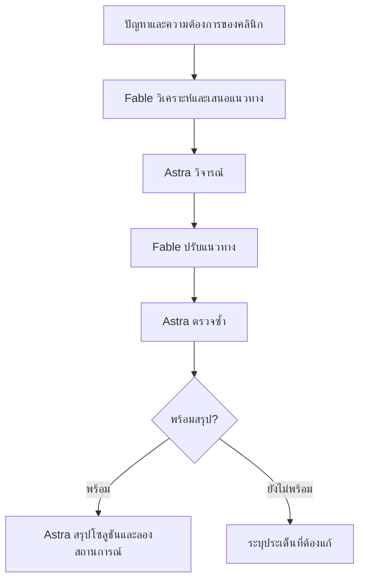

# LAB 001 · Setup Multi Account (Claude Code + Codex CLI)

เวลาโดยประมาณ: 60–75 นาที
สิ่งที่จะได้: ติดตั้ง Claude Code และ Codex CLI หลายบัญชี แยก “ติดตั้งครบ” “ล็อกอินและตอบได้” “ส่งต่องานข้ามค่ายได้จริง”
บทเรียนที่เชื่อมโยง: [AI Agent Routing](../ai-agent-routing.html) หัวข้อ 1.0 และ 4.0–4.3
ขอบเขตแลปนี้: เฉพาะ Claude Code (`yolo1`–`yolo5`) และ Codex CLI (`cyolo1`–`cyolo5`) **ไม่รวม Qwen Code**
วิธีทำ: อ่านโจทย์ → ทำตามป้าย 🖥️ Terminal / 💬 ช่องสนทนา AI → ดูผล → เทียบ Expected → ขั้นถัดไป

**ลำดับแลป:** ติดตั้ง Claude → ตั้งค่าหลายบัญชี → ล็อกอินและเลือกโมเดล → Claude เรียก Codex ตรวจ → เปลี่ยนโมเดลแล้วทำต่อ

## ขั้นที่ 1 · เตรียมเครื่องมือ (🖥️ Terminal + 💬 AI | ~15 นาที)

### 🎯 เป้าหมายของขั้นนี้
มี Claude Code เป็น “AI ตัวช่วยตั้งค่า” บนเครื่อง Ubuntu โดยเริ่มจากติดตั้ง Claude Code เพียงตัวเดียว

### 1.1 ตรวจว่ามี Claude Code อยู่แล้วหรือไม่ (🖥️ Terminal)

```bash
claude --version
```

- ได้ตัวเลขเวอร์ชัน → ข้ามไป 1.4
- ได้ `command not found` → ทำ 1.2

### 1.2 ติดตั้ง Claude Code (🖥️ Terminal)

**ติดตั้งก่อน** — คัดลอกคำสั่งนี้ไปวางใน Terminal แล้วกด Enter

```bash
curl -fsSL https://claude.ai/install.sh | bash
```

รอจนติดตั้งเสร็จและเห็นข้อความ `Claude Code successfully installed!`


**จากนั้นตรวจเวอร์ชัน** — พิมพ์คำสั่งนี้แล้วกด Enter

```bash
claude --version
```


เห็นเลขเวอร์ชันแล้วไปหัวข้อ 1.4 ได้เลย ตัวเลขอาจต่างจากภาพ

### 1.4 เปิดและล็อกอิน Claude Code เพื่อเตรียมทำขั้นที่ 2


1. เปิด 🖥️ Terminal ในโฟลเดอร์งาน แล้วพิมพ์:
   ```bash
   claude
   ```
2. ล็อกอินด้วยบัญชีของตัวเองตามคำแนะนำบนหน้าจอ หากยังไม่ได้ล็อกอิน ให้พิมพ์ `/login` ในช่องสนทนา Claude Code แล้วทำตามขั้นตอน
3. เมื่อพร้อมใช้งาน ให้เปิด Claude Code ค้างไว้ แล้วไปขั้นที่ 2 เพื่อคัดลอกพรอมต์ทั้งกรอบมาวางใน 💬 ช่องสนทนา Claude Code

ขั้นนี้ติดตั้งเฉพาะ Claude Code เพื่อใช้เป็น AI ตัวช่วยตั้งค่าก่อน ส่วนการติดตั้งเครื่องมือที่ยังขาดและตั้งค่าหลายบัญชีของทั้ง Claude Code และ Codex CLI จะให้ AI ดำเนินการในขั้นที่ 2

### ✅ Expected Output (ตัวอย่างสำหรับเทียบ — ไม่ใช่ผลการรันจริง)
| CHECK | ACTUAL EXAMPLE |
|---|---|
| `claude --version` | `2.1.258 (Claude Code)` |
| AI ตัวช่วยตั้งค่า | เปิด Claude Code และล็อกอินพร้อมใช้งานแล้ว |
- **ต้องตรง:** (1) มีเวอร์ชัน Claude Code (2) เปิด AI ตัวช่วยได้
- **ต่างได้:** ตัวเลขเวอร์ชัน

## ขั้นที่ 2 · ให้ Claude Code ตั้งค่าหลายบัญชี (~20 นาที)

ให้ Claude Code ติดตั้งเครื่องมือที่ยังขาดและสร้างคำสั่ง `yolo1`–`yolo5` กับ `cyolo1`–`cyolo5` สำหรับใช้งานหลายบัญชี โดยแยกข้อมูลแต่ละบัญชีและยังไม่ล็อกอินบัญชีเหล่านี้

คัดลอกพรอมต์ทั้งกรอบไปวางใน Claude Code ที่เปิดไว้จากขั้นที่ 1

### 📋 พรอมต์สำหรับคัดลอก (คัดลอกทั้งกรอบ วางใน 💬 ช่องสนทนา AI แล้ว Enter)
```text
สร้าง CLI บน Ubuntu สำหรับรัน Claude Code และ Codex CLI หลายบัญชี
ตรวจเครื่องมือที่มีอยู่ก่อน และติดตั้งเครื่องมือที่ยังขาด รวมถึง Codex CLI ก่อนตั้งค่าหลายบัญชี
แยก credential/config กัน 100% ห้ามอ่านไฟล์ README ของ LAB เพื่อหาเฉลย

## ตัวแปรตั้งค่า (แก้ที่นี่ที่เดียว ที่อื่นต้องอ้างอิงตัวแปรนี้)
BASE_PATH="$HOME/ai-accounts"

## คำสั่งที่ต้องได้
- yolo1..yolo5   → Claude Code + บัญชี Anthropic คนละบัญชี
- cyolo1..cyolo5 → Codex CLI + บัญชี OpenAI/ChatGPT คนละบัญชี

## โครงสร้าง
$BASE_PATH/
├── .Claude/
│   ├── yolo1/ … yolo5/     # config root ต่อบัญชี (CLAUDE_CONFIG_DIR) credential/session/history/cache แยกกัน
│   └── shared/
│       ├── skills/         # skill ใช้ร่วมทุก yoloN
│       └── mcp/            # MCP config ใช้ร่วมทุก yoloN
└── .Codex/
    ├── cyolo1/ … cyolo5/   # config root ต่อบัญชี (CODEX_HOME)
    └── shared/
        ├── skills/
        └── mcp/

หลักการ: <tool>/<account>/ = ของใครของมัน, <tool>/shared/ = แก้ครั้งเดียวทุกบัญชีของ CLI นั้นเห็น

## Isolation
1. ทุกบัญชีแยก credential/config/session/history/cache สมบูรณ์ เปิดพร้อมกันได้ไม่ชน
2. ห้ามเปลี่ยน $HOME ใช้กลไก official ของแต่ละ CLI เท่านั้น
   (Claude Code: CLAUDE_CONFIG_DIR, Codex CLI: CODEX_HOME)
3. ห้ามแก้ .bashrc, Git config, SSH config หรือ environment เดิมโดยไม่จำเป็น
   ถ้าต้องเพิ่ม PATH ให้บอกบรรทัดที่เพิ่มและขอยืนยันก่อน

## Wrapper
4. ทุกคำสั่งส่งต่อ "$@" ครบ และรันแบบข้ามการขออนุญาตด้วย flag ล่าสุดของแต่ละ CLI
   - yoloN  → claude --dangerously-skip-permissions
   - cyoloN → codex --dangerously-bypass-approvals-and-sandbox
   ตรวจชื่อ flag จาก --help ของเวอร์ชันที่ติดตั้งจริงก่อนใช้
5. wrapper ต้องแสดงข้อความชัดเจนถ้าโฟลเดอร์บัญชียังไม่มี และต้องไม่พิมพ์ข้อมูลลับใด ๆ ออกหน้าจอ

## Shared
6. Skills/MCP ใน <tool>/shared เป็น source เดียว ถ้า CLI ใดไม่รองรับส่วนใด ให้ระบุชัดและทำเท่าที่รองรับ

## Installer
7. รันซ้ำได้โดยไม่ลบหรือเขียนทับ credential/config เดิม
8. วิธีติดตั้งและตำแหน่งวางไฟล์ให้เลือกเอง พร้อมอธิบายเหตุผลสั้น ๆ

## Docs
9. ตรวจ official docs และ --help ของเวอร์ชันจริงก่อน implement ห้ามเดา env/path/flag
   - https://code.claude.com/docs/
   - https://github.com/openai/codex

## หมายเหตุจากการทดลองจริง (ตรวจว่ายังจริงกับเวอร์ชันบนเครื่องนี้หรือไม่)
- ถ้ารันเป็น root ต้องตั้ง IS_SANDBOX=1 ไม่งั้น claude ปฏิเสธ --dangerously-skip-permissions
- CODEX_HOME ต้อง mkdir -p ก่อน codex ไม่สร้างโฟลเดอร์ให้เอง
- codex login status ไม่ตรวจว่า token ยังใช้ได้ ให้ยืนยันด้วย codex exec เท่านั้น

## ทดสอบ (รายงานตามจริง PASS / FAIL / SKIP)
- yolo1..yolo5 --version และ cyolo1..cyolo5 --version ทำงานครบ 10 ตัว
- แต่ละคำสั่งชี้ config root คนละโฟลเดอร์ ตรวจด้วย find <root>
- installer รอบ 2 ไม่ทำลายของเดิม
- Git/SSH ทำงานปกติ
- ทุกอย่างที่ต้องล็อกอินหรือใช้ credential จริง รอบนี้เป็น SKIP เจ้าของบัญชีจะทำเองภายหลัง

## รายงาน
เขียน 3 ไฟล์ในโฟลเดอร์ปัจจุบัน: setup-report.md (โครงสร้าง config root ตำแหน่ง credential ข้อจำกัด),
login-guide.md (ขั้นตอนล็อกอินทีละบัญชีที่ผู้ใช้ทำเองใน Terminal), checklist.md (ตาราง รายการ | หลักฐาน | PASS/FAIL/SKIP | เหตุผล)
ห้ามใส่ข้อมูลลับในไฟล์ใด ๆ

ทำเฉพาะขั้นนี้ เมื่อเสร็จให้แสดงเนื้อหาสำคัญของไฟล์ที่สร้าง (ไม่ใช่แค่ชื่อไฟล์) เป็นตารางที่ฉันอ่านตรวจได้ แล้วหยุดรอ ห้ามล็อกอินแทนฉัน ห้ามทำขั้นถัดไปเอง
```


ข้อความ `[Pasted text …]` คือพรอมต์ที่วางแล้ว กด Enter เพื่อเริ่มทำงาน

### ✅ Expected Output (ตัวอย่างสำหรับเทียบ — ไม่ใช่ผลการรันจริง)
| CHECK | ACTUAL EXAMPLE |
|---|---|
| CLI | 2 PASS: `2.1.258 / 0.153.4` |
| yolo | 5/5 PASS (`--version` ผ่าน) |
| cyolo | 5/5 PASS (`--version` ผ่าน) |
| config root แยก | `.Claude/yolo1`…`yolo5`, `.Codex/cyolo1`…`cyolo5` คนละ path |
| reports | `setup-report.md`, `login-guide.md`, `checklist.md` |
| real login | SKIP |
- **ต้องตรง:** (1) CLI = 2 (2) wrapper = 10 (3) ไฟล์รายงาน 3 ไฟล์ และ login = `SKIP`
- **ต่างได้:** (1) เวอร์ชัน (2) `BASE_PATH` (3) ถ้อยคำ/ลำดับ

### 🔍 จุดที่ผู้เรียนต้องตรวจ (🖥️ Terminal เปิดหน้าต่างใหม่)
```bash
yolo1 --version; cyolo1 --version
yolo2 --version; cyolo2 --version
yolo3 --version; cyolo3 --version
```


- [ ] คำสั่งของบัญชี 1–3 ทั้งสอง CLI แสดงเวอร์ชันครบ 6 ตัว
- [ ] มีไฟล์รายงาน 3 ไฟล์ในโฟลเดอร์งาน
- [ ] งานที่ใช้บัญชีจริงเป็น `SKIP` พร้อมเหตุผล
- [ ] ไม่มีข้อมูลลับในไฟล์และบนหน้าจอ

## ขั้นที่ 3 · ล็อกอินและเลือกโมเดล (~10 นาที)

ใช้บัญชี `yolo1` และ `cyolo1` จากขั้นที่ 2 ทำงานในโฟลเดอร์เดียวกันตลอดแลป

### 3.1 ล็อกอินด้วยบัญชี subscription (🖥️ Terminal)

ทำทีละค่ายในโฟลเดอร์งานเดียวกัน จนเห็นช่องพร้อมพิมพ์พรอมต์ของทั้งสองโปรแกรม

#### A · Claude Code — yolo1

**1. เปิดโปรแกรมและเลือกบัญชี subscription**

```bash
yolo1
```

หากมีหน้าจอเลือกธีม ให้เลือกธีมก่อน จากนั้นเลือก **Claude account with subscription** แล้วกด Enter


**2. ยืนยันบัญชีในเบราว์เซอร์**

เปิดลิงก์ที่ Terminal แสดง ล็อกอินด้วยบัญชี Claude ที่มี subscription และยืนยันการเชื่อมต่อ หากหน้าจอให้คัดลอกรหัสกลับมา ให้ทำตามขั้นตอนนั้นด้วยตัวเอง

**3. ยืนยันโฟลเดอร์และโหมดของแลป**

กลับมาที่ Terminal หากเป็นโฟลเดอร์แลปที่เตรียมไว้ ให้เลือก **Yes, I trust this folder**


คำสั่ง yolo1 จากขั้นที่ 2 เปิดโหมด Bypass Permissions หากกำลังใช้คอนเทนเนอร์แลปที่เตรียมไว้ ให้เลือก **Yes, I accept** เพื่อทำต่อ


**4. พร้อมพิมพ์พรอมต์**

เห็นหน้า Claude Code และช่องพิมพ์ข้อความ แสดงว่ามาถึงหน้าสนทนาแล้ว


#### B · Codex CLI — cyolo1

**1. เปิดโปรแกรมและเลือก Sign in with ChatGPT**

```bash
cyolo1
```

เลือก **Sign in with ChatGPT** แล้วกด Enter เพื่อใช้บัญชี ChatGPT ที่มีสิทธิ์ใช้งาน Codex


**2. ยืนยันบัญชีในเบราว์เซอร์**

ล็อกอินด้วยบัญชี ChatGPT ที่ต้องการใช้และยืนยันการเชื่อมต่อ หากใช้ SSH แล้วเบราว์เซอร์กลับมาที่ CLI ไม่ได้ ให้เลือก **Sign in with Device Code** และทำตามขั้นตอนบนหน้าจอ

**3. ยืนยันโฟลเดอร์งาน**

กลับมาที่ Terminal หากเป็นโฟลเดอร์แลปที่เตรียมไว้ ให้เลือก **Yes, continue**


**4. พร้อมพิมพ์พรอมต์**

เห็นหน้า Codex พร้อมชื่อโมเดลและช่องพิมพ์ข้อความ แสดงว่ามาถึงหน้าสนทนาแล้ว


ผู้เรียนทำขั้นตอนยืนยันตัวตนเอง ไม่ส่งรหัสหรือข้อมูลบัญชีให้ AI เมื่อทั้งสองหน้าต่างพร้อมแล้ว ไปส่งโจทย์ในหัวข้อ 3.2

*ภาพ Terminal เป็นภาพจริง หน้าหลังล็อกอินถ่ายโดยใช้ข้อมูล subscription เดิมที่ได้รับอนุญาตในเครื่องทดสอบ ไม่ได้บันทึกขั้นยืนยันตัวตนในเบราว์เซอร์ ชื่อโมเดลเริ่มต้นอาจต่างจากภาพ โดยจะเลือกโมเดลในหัวข้อ 3.2*

### 3.2 ลองส่งคำถามเดียวกันสองวิธี

หลังล็อกอินในหัวข้อ 3.1 แล้ว ให้ลองส่งคำถามผ่านหน้าสนทนา AI ก่อน จากนั้นส่งคำถามเดิมด้วยคำสั่งจาก shell เพื่อดูความต่างของวิธีใช้งาน

ทั้งสองรอบใช้ **yolo1: Fable · medium** และ **cyolo1: Astra · medium** โดยไม่เปลี่ยนโจทย์

**คำถามที่ใช้ตลอดหัวข้อนี้**

```text
ร้านค้าลดราคา 10% เมื่อซื้อครบ 1000 บาท จงคำนวณยอดจ่ายสำหรับยอดซื้อ 999, 1000 และ 1500 บาท ตอบเป็นตารางยอดซื้อและยอดจ่ายทศนิยม 2 ตำแหน่ง ตามด้วยคำอธิบายสั้น ๆ และข้อควรระวัง 1 ข้อ ไม่ต้องสร้างไฟล์หรือรันคำสั่งอื่น
```

#### วิธีที่ 1 · พิมพ์ในหน้าสนทนา AI

เริ่มจากหน้าสนทนาที่เปิดค้างไว้ในหัวข้อ 3.1 เลือกโมเดลและระดับ effort ให้ตรงก่อนวางคำถาม

**A · Claude Code (yolo1)**

**1. เลือก Fable และปรับ effort**

พิมพ์ `/model` แล้วกด Enter เลื่อนมาที่ **Fable** ใช้ลูกศรซ้าย/ขวาปรับเป็น **Medium** แล้วกด Enter ยืนยัน


**2. วางคำถาม**

คัดลอกคำถามด้านบนมาวางในช่องสนทนา ตรวจว่าหน้าจอแสดง Fable และ medium


**3. ส่งและดูคำตอบ**

กด Enter แล้วรอจนตอบจบ จะเห็นตารางยอดจ่ายพร้อมคำอธิบาย และยังพิมพ์ถามต่อในหน้าเดิมได้


**B · Codex (cyolo1)**

**1. เลือก Astra**

ในหน้าสนทนา Codex พิมพ์ `/model` แล้วกด Enter เลือก **gpt-6-astra** และกด Enter อีกครั้ง


**2. ปรับ effort**

หน้าถัดไปให้เลือกระดับ reasoning เป็น **Medium** แล้วกด Enter ยืนยัน


**3. วางคำถามเดียวกัน**

คัดลอกคำถามด้านบนมาวางในช่องสนทนา ตรวจว่าหน้าจอแสดง `gpt-6-astra medium`


**4. ส่งและดูคำตอบ**

กด Enter แล้วรอจนตอบจบ เช่นเดียวกับ Claude หน้าสนทนาจะยังเปิดไว้ให้ถามต่อได้


#### วิธีที่ 2 · ส่งด้วยคำสั่งจาก shell

เมื่อดูคำตอบของวิธีแรกแล้ว ให้ออกจากหน้า AI กลับมาที่ shell ของแต่ละหน้าต่าง โดยกด Ctrl+C สองครั้ง จากนั้นรันคำสั่งด้านล่างในโฟลเดอร์งานเดิม

วิธีนี้ระบุโมเดล ระดับ effort และคำถามไว้ในคำสั่งเดียว เมื่อ AI ตอบจบจะกลับมาที่ shell

**A · ส่งให้ Fable ผ่าน yolo1**

```bash
yolo1 --model fable --effort medium -p 'ร้านค้าลดราคา 10% เมื่อซื้อครบ 1000 บาท จงคำนวณยอดจ่ายสำหรับยอดซื้อ 999, 1000 และ 1500 บาท ตอบเป็นตารางยอดซื้อและยอดจ่ายทศนิยม 2 ตำแหน่ง ตามด้วยคำอธิบายสั้น ๆ และข้อควรระวัง 1 ข้อ ไม่ต้องสร้างไฟล์หรือรันคำสั่งอื่น'
```


**B · ส่งให้ Astra ผ่าน cyolo1**

```bash
cyolo1 exec --skip-git-repo-check --model gpt-6-astra -c model_reasoning_effort=medium 'ร้านค้าลดราคา 10% เมื่อซื้อครบ 1000 บาท จงคำนวณยอดจ่ายสำหรับยอดซื้อ 999, 1000 และ 1500 บาท ตอบเป็นตารางยอดซื้อและยอดจ่ายทศนิยม 2 ตำแหน่ง ตามด้วยคำอธิบายสั้น ๆ และข้อควรระวัง 1 ข้อ ไม่ต้องสร้างไฟล์หรือรันคำสั่งอื่น'
```


ตอนนี้มีคำตอบจากทั้งสองค่ายครบทั้งสองวิธีแล้ว ให้เก็บภาพผลตอบและเปรียบเทียบตามหัวข้อ 3.3

### 3.3 เปรียบเทียบผลของ Fable และ Astra

ตารางนี้สรุปผลจากภาพการทดลองในหัวข้อ 3.2 แยกตามโมเดลและวิธีส่งคำถาม ทั้งสองโมเดลใช้ effort **medium**

| คำตอบที่ถูกต้อง | Fable: หน้าสนทนา | Fable: shell | Astra: หน้าสนทนา | Astra: shell |
|---|---|---|---|---|
| 999.00 | 999.00 | 999.00 | 999.00 | 999.00 |
| 900.00 | 900.00 | 900.00 | 900.00 | 900.00 |
| 1350.00 | 1350.00 | 1350.00 | 1350.00 | 1350.00 |

**ผล:** Fable และ Astra คำนวณถูกครบทั้งสองวิธี โดยลด 10% ตั้งแต่ยอดซื้อ 1000 บาทขึ้นไป ถ้อยคำอาจต่างกันได้ แต่ยอดจ่ายต้องตรงตาราง

เมื่อทดลองเอง ให้ตรวจชื่อโมเดลและ effort จากหน้าจอ แล้วเก็บภาพคำตอบไว้เทียบ หากรันไม่ได้ ให้บันทึกว่า **ยังไม่ได้ทดลอง**


## ขั้นที่ 4 · จากปัญหาคลินิกสู่แผนฟีเจอร์ (~15 นาที)

ขั้นนี้ให้นักศึกษาใช้ **Fable วิเคราะห์ปัญหาและเสนอฟีเจอร์** แล้วให้ **Astra วิจารณ์แผนนั้น** เพื่อดูว่าฟีเจอร์แก้ปัญหาได้ตรงจุดหรือยัง ทั้งสองโมเดลใช้ effort **medium**

ทำตามลำดับ: **อ่านโจทย์ → เปิด yolo1 → วางพรอมต์หนึ่งครั้ง → อ่านแผนและคำวิจารณ์** งานนี้เป็นการออกแบบแนวทาง ยังไม่สร้างเว็บหรือเขียนโปรแกรม

### 4.1 อ่านโจทย์: คลินิกต้องการแก้ปัญหาอะไร?

#### 🐾 CASE STUDY · คลินิกเพื่อนสัตว์

> **คลินิกเดียวกัน แต่พนักงานเห็นคนละคิว**
>
> ลูกค้าจองผ่านโทรศัพท์ แชต และหน้าร้าน เมื่อข้อมูลไม่ถึงกัน การนัดครั้งเดียวจึงกลายเป็นทั้งคิวชน การโทรซ้ำ และงานที่ตกหล่นระหว่างกะ

**ภารกิจของคุณ:** ออกแบบฟีเจอร์ที่ช่วยให้ทุกคนทำงานกับข้อมูลนัดชุดเดียวกัน โดยเริ่มจากสิ่งที่จำเป็นที่สุด

| 🏥 ขนาดคลินิก | 🩺 สัตวแพทย์ | 👥 ทีมต้อนรับ | 🕘 เวลาเปิด |
|:---:|:---:|:---:|:---:|
| 1 สาขา | 2 คน · เวรไม่ตรงกันทุกวัน | 4 คน · แบ่ง 2 กะ | 09:00–19:00 น. |

*ชื่อ จำนวนคน เวลา และเหตุการณ์ทั้งหมดเป็นข้อมูลสมมติสำหรับแล็บ*

ปัจจุบันพนักงานจดนัดใน **สมุดและตารางออนไลน์คนละชุด** บางครั้งยืนยันในแชตก่อนอัปเดตตาราง เจ้าของคลินิกจึงต้องตามข้อมูลจากหลายที่เพื่อดูภาพรวม และเพราะลูกค้าหนึ่งคนอาจมีสัตว์เลี้ยงหลายตัว แต่ละนัดต้องระบุให้ได้ว่าเป็นของสัตว์ตัวไหน โดยยังไม่ต้องเก็บประวัติการรักษา

---

#### 🎬 ลองมองหนึ่งวันผ่านเหตุการณ์นี้

| จังหวะ | สิ่งที่เกิดขึ้น | สิ่งที่ตามมา |
|---|---|---|
| **① รับนัด** | กะเช้ารับนัดทางโทรศัพท์สำหรับเวลา **14:00 น.** แต่ยังไม่ลงตาราง | คนอื่นยังเห็นว่าเวลานี้ว่าง |
| **② ยืนยันซ้ำ** | พนักงานอีกคนรับนัดจากแชตในเวลาเดียวกัน | ลูกค้าสองรายเข้าใจว่าตนมีคิวแล้ว |
| **③ เปลี่ยนกะ** | ลูกค้าคนแรกขอเลื่อน พนักงานจดไว้ในแชต | กะบ่ายยังโทรยืนยันเวลาเดิม |
| **④ เวรเปลี่ยน** | สัตวแพทย์แจ้งเปลี่ยนเวลาเข้าเวร | พนักงานต้องไล่หานัดที่ได้รับผลกระทบทีละรายการ |

> **คำถามตั้งต้น:** ฟีเจอร์ใดจะช่วยป้องกันเหตุการณ์เหล่านี้ และใครต้องทำอะไรในแต่ละจุด?

---

#### 🔎 ปัญหา 5 ข้อที่ต้องแปลงเป็นฟีเจอร์

อ่านแต่ละข้อเป็นคู่: **เกิดอะไรขึ้น → แพลตฟอร์มต้องช่วยอะไร** ใช้รหัส **P1–P5** อ้างอิงในแผนและคำวิจารณ์ เพื่อให้ตามได้ว่าฟีเจอร์แก้ปัญหาข้อใด

##### 📅 P1 · คิวชนจากหลายช่องทาง

**จุดที่ติดขัด**

พนักงานคนหนึ่งรับนัดทางโทรศัพท์แต่ยังไม่ลงตาราง อีกคนเห็นเวลาว่างจึงรับนัดจากแชตให้สัตวแพทย์คนเดียวกัน เมื่อถึงเวลาลูกค้าต้องรอ และพนักงานต้องติดต่อขอเปลี่ยนนัดภายหลัง

> **สิ่งที่แพลตฟอร์มต้องช่วย**
>
> ทุกช่องทางต้องลงรายการนัดกลางที่ทั้งสองกะเห็นตรงกัน ก่อนยืนยันให้ตรวจเวลาของสัตวแพทย์ที่เลือก หากเวลาไม่ว่างต้องแจ้งให้พนักงานเสนอเวลาอื่น กรณีพนักงานสองคนยืนยันพร้อมกันต้องไม่เกิดนัดซ้ำ

---

##### 💬 P2 · สถานะนัดและการติดต่อลูกค้าไม่ชัดเจน

**จุดที่ติดขัด**

ลูกค้าทักมาขอเวลา แต่ไม่แน่ใจว่าคลินิกรับนัดแล้วหรือยัง พนักงานอีกกะก็ไม่รู้ว่าใครตอบกลับหรือเตือนไปแล้ว จึงอาจติดต่อซ้ำหรือไม่มีใครติดตามเลย

> **สิ่งที่แพลตฟอร์มต้องช่วย**
>
> แยกให้เห็นว่าเป็นคำขอ รอยืนยัน หรือยืนยันแล้ว ระบุผู้รับผิดชอบและบันทึกว่าติดต่อเรื่องอะไรเมื่อใด พร้อมรายการที่ต้องติดตาม การเตือนระยะแรกอาจให้พนักงานดำเนินการเอง ไม่จำเป็นต้องเชื่อมส่งข้อความอัตโนมัติ

---

##### 🔄 P3 · เลื่อนนัดแล้วข้อมูลไม่ถึงกะถัดไป

**จุดที่ติดขัด**

ลูกค้าขอเลื่อนหรือยกเลิกผ่านแชต กะเช้าจดไว้เฉพาะในข้อความ แต่กะบ่ายยังใช้รายการเดิม จึงโทรยืนยันเวลาที่ลูกค้ายกเลิกแล้ว หรือสร้างนัดใหม่จนเหลือรายการซ้ำ

> **สิ่งที่แพลตฟอร์มต้องช่วย**
>
> เปลี่ยนข้อมูลในนัดเดิมและเห็นประวัติว่าใครแก้จากเวลาใดเป็นเวลาใด ปล่อยช่วงเวลาเดิมเมื่อเลื่อนสำเร็จหรือยกเลิก และระบุงานที่ยังต้องติดต่อลูกค้าให้กะถัดไปรับต่อ โดยไม่ต้องไล่อ่านทุกแชต

---

##### 🩺 P4 · เวลาสัตวแพทย์เปลี่ยนแต่คิวยังเหมือนเดิม

**จุดที่ติดขัด**

สัตวแพทย์แต่ละคนมีเวลาเข้าเวรต่างกัน เมื่อแจ้งเปลี่ยนเวลา พนักงานต้องไล่ดูทีละนัดว่าลูกค้ารายใดได้รับผลกระทบ หากพลาดอาจรับนัดช่วงที่ไม่มีผู้ให้บริการ

> **สิ่งที่แพลตฟอร์มต้องช่วย**
>
> กำหนดเวลาเปิดรับของแต่ละคนและหยุดรับนัดในช่วงที่ไม่ว่าง เมื่อเปลี่ยนตารางให้แสดงนัดที่กระทบพร้อมผู้รับผิดชอบติดต่อลูกค้า เสนอเวลาทดแทนได้ แต่ต้องรอลูกค้ายืนยันก่อนเปลี่ยนเป็นนัดที่ยืนยันแล้ว

---

##### 📊 P5 · เจ้าของไม่เห็นปัญหาภาพรวม

**จุดที่ติดขัด**

ข้อมูลกระจายในสมุดและแชต เจ้าของแยกไม่ได้ว่าวันหนึ่งมีนัดกี่รายการ ลูกค้ามาตามนัด ยกเลิก หรือไม่มาเท่าไร จึงไม่รู้ว่าควรปรับการยืนยันหรือการจัดคิวก่อน

> **สิ่งที่แพลตฟอร์มต้องช่วย**
>
> สรุปจำนวนตามวันและสถานะจากรายการที่บันทึกไว้ พร้อมเปิดดูรายการต้นทางและงานค้างได้ ต้องตกลงว่าใครอัปเดตสถานะหลังเวลานัด หากยังไม่ได้บันทึกให้แสดงว่าไม่ทราบ ไม่สรุปเองว่าเป็นลูกค้าขาดนัด

---

#### 👥 ออกแบบให้ใครใช้งาน?

| ผู้ใช้ | งานที่ต้องทำได้ |
|---|---|
| **พนักงานต้อนรับ** | รับคำขอ ตรวจคิว ยืนยัน เลื่อน ยกเลิก และส่งต่องานค้าง โดยใช้รายการเดียวกันทั้งสองกะ |
| **สัตวแพทย์** | แจ้งเวลาที่เปิดรับและดูนัดของตน |
| **เจ้าของคลินิก** | ดูภาพรวมและจุดที่ควรปรับปรุง โดยไม่ต้องตามอ่านทุกแชต |
| **ลูกค้า** | ขอหรือเปลี่ยนนัดผ่านช่องทางเดิมได้ ระยะแรกไม่ต้องติดตั้งแอปหรือสมัครบัญชีใหม่ |

#### 🎯 ขอบเขตการออกแบบ

> [!IMPORTANT]
> **เริ่มจากไม่เกิน 3 กลุ่มฟีเจอร์หลัก**
>
> เชื่อมให้ครบว่าแต่ละกลุ่มช่วย P1–P5 อย่างไร อะไรทำก่อน อะไรทำภายหลัง และระหว่างรอพนักงานจะทำอย่างไร โดยไม่เพิ่มการกรอกข้อมูลซ้ำหลายที่

| ✅ งานของแล็บนี้ | ⏸️ อยู่นอกขอบเขต |
|---|---|
| วิเคราะห์ปัญหา ออกแบบฟีเจอร์และขั้นตอนใช้งานด้วยข้อมูลสมมติ | สร้างเว็บ เขียนโค้ด หรือเชื่อมบริการส่งข้อความจริง |
| อธิบายเหตุผลและข้อจำกัดของข้อเสนอ | ใช้ข้อมูลส่วนตัวจริง ออกแบบระบบวินิจฉัย/รักษา คลังยา หรือชำระเงิน |

**ข้อมูลที่ยังต้องถามคลินิก**

- นัดแต่ละประเภทใช้เวลานานเท่าไร?
- มีนโยบายมาสายหรือขาดนัดอย่างไร?
- รับลูกค้าที่ไม่ได้นัดล่วงหน้าอย่างไร?
- มีงบประมาณเท่าไร?

ระบุเรื่องเหล่านี้เป็น **คำถามหรือสมมติฐานที่ต้องตรวจสอบ** อย่ากำหนดกฎเดียวให้ทุกกรณีโดยไม่มีเหตุผล

---

> **🏁 จบขั้นที่ 4 คุณควรได้อะไร?**
>
> **แผนฟีเจอร์ฉบับแรก + คำวิจารณ์รอบแรก** เพื่อเห็นทั้งแนวทางและจุดที่ยังต้องปรับ จากนั้นจึงปรับแผนในขั้นที่ 5 และสรุปโซลูชันในขั้นที่ 6 เมื่อผ่านเกณฑ์

### 4.2 เข้าใจลำดับการทำงานของสองโมเดล

#### ภาพแรก: แนวคิดโดยรวม

ภาพทั้งสองครอบคลุม **ขั้นที่ 4–6** ในขั้นนี้ทำถึง Fable เสนอแผนและ Astra วิจารณ์รอบแรกเท่านั้น



#### ภาพที่สอง: ไฟล์เข้า–ไฟล์ออกในแต่ละขั้น

อ่านจากบนลงล่าง: **สีน้ำเงิน = Fable · สีม่วง = Astra · สีเขียว = output file** ภาพนี้อธิบายลำดับตามพรอมต์ของแล็บ ส่วนผลที่รันได้จริงแสดงแยกไว้ใต้แต่ละขั้น

```mermaid
flowchart TB
    subgraph S4["ขั้นที่ 4 · วิเคราะห์และวิจารณ์รอบแรก"]
        IN["INPUT: โจทย์ P1–P5 ในพรอมต์"]
        F1["Fable · yolo1<br/>วิเคราะห์และเสนอฟีเจอร์"]
        P1["OUTPUT<br/>plan-v1.md · review-task.txt"]
        A1["Astra · cyolo1<br/>วิจารณ์แผนรอบแรก"]
        R1["OUTPUT<br/>review-1.md"]
        IN --> F1
        F1 -->|"เขียนไฟล์"| P1
        P1 -->|"INPUT: แผนและคำสั่งส่งตรวจ"| A1
        A1 -->|"เขียนไฟล์"| R1
    end

    subgraph S5["ขั้นที่ 5 · ปรับแผนและตรวจรอบสอง"]
        F2["Fable · yolo1<br/>ตอบข้อทักท้วงและปรับแผน"]
        P2["OUTPUT<br/>response.md · plan-v2.md<br/>review-final-task.txt"]
        A2["Astra · cyolo1<br/>ตรวจแผนรอบสอง"]
        R2["OUTPUT<br/>review-final.md<br/>READY / NOT READY"]
        F3["Fable · yolo1<br/>สรุปการส่งงาน"]
        LOG["OUTPUT<br/>handoff.md"]
        F2 -->|"เขียนไฟล์"| P2
        P2 -->|"INPUT: แผนทั้งสองฉบับ + response.md<br/>review-1.md + review-final-task.txt"| A2
        A2 -->|"เขียนไฟล์"| R2
        R2 -->|"INPUT: ผลตรวจสุดท้าย + หลักฐานสองรอบ"| F3
        F3 -->|"เขียนไฟล์"| LOG
    end

    subgraph S6["ขั้นที่ 6 · สรุปโซลูชันและประเมินสถานการณ์"]
        CHECK{"ผลใน review-final.md"}
        A3["Astra · cyolo1<br/>สรุปฟีเจอร์และขั้นตอนใช้งาน"]
        SOL["OUTPUT<br/>solution.md"]
        A4["Astra · cyolo1<br/>ประเมินสามสถานการณ์สมมติ"]
        RESULTS["OUTPUT<br/>scenario-results.md"]
        STOP["หยุด: แสดงประเด็นที่ต้องแก้<br/>ผลจริงรอบนี้: NOT READY"]
        CHECK -->|"READY · INPUT: plan-v2.md<br/>response.md + review-final.md"| A3
        CHECK -->|"NOT READY"| STOP
        A3 -->|"เขียนไฟล์"| SOL
        SOL -->|"INPUT: ข้อเสนอที่สรุปแล้ว"| A4
        A4 -->|"เขียนไฟล์"| RESULTS
    end

    R1 -->|"INPUT: plan-v1.md + review-1.md"| F2
    LOG --> CHECK
    classDef fable fill:#e7f0ff,stroke:#2563eb,color:#142c52;
    classDef astra fill:#f1e8ff,stroke:#7c3aed,color:#382052;
    classDef output fill:#e6f6eb,stroke:#16803c,color:#124126,stroke-width:2px;
    classDef stopped fill:#fff0dc,stroke:#c56b00,color:#653500,stroke-width:2px;
    class F1,F2,F3 fable;
    class A1,A2,A3,A4 astra;
    class P1,R1,P2,R2,LOG,SOL,RESULTS output;
    class STOP stopped;
```



### 4.3 ลงมือทำ: เปิด Fable แล้ววางพรอมต์

**1. เปิด Fable ในโฟลเดอร์งานที่ใช้จากขั้นที่ 3**

```bash
yolo1 --model fable --effort medium
```

**2. คัดลอกพรอมต์ทั้งกรอบไปวางในหน้าสนทนา yolo1 แล้วส่ง**

พรอมต์รวมโจทย์ครบแล้ว ไม่ต้องคัดลอกข้อความจากส่วนอื่นเพิ่ม Fable จะสร้างแผนแล้วเรียก Astra ผ่าน `cyolo1` ให้เอง ใช้ **medium ทั้งคู่**

```text
ออกแบบแนวทางแพลตฟอร์มจัดการนัดจากกรณีสมมตินี้ โดยยังไม่พัฒนาโปรแกรม

บริบท: คลินิกเพื่อนสัตว์ 1 สาขา เปิด 09:00–19:00 น. สัตวแพทย์ 2 คนเข้าเวรไม่ตรงกัน
พนักงานต้อนรับ 4 คนแบ่งสองกะ เจ้าของดูภาพรวม ลูกค้านัดผ่านโทรศัพท์ แชต และหน้าร้าน
ปัจจุบันใช้สมุดและตารางออนไลน์คนละชุด บางคนยืนยันในแชตก่อนลงตาราง
ลูกค้าหนึ่งคนอาจมีสัตว์เลี้ยงหลายตัว ต้องแยกว่านัดนี้เป็นของตัวไหน ไม่เก็บประวัติรักษา
ทุกชื่อ จำนวน เวลา และเหตุการณ์เป็นข้อมูลสมมติ ไม่ใช่ผลสำรวจจริง

เหตุการณ์: พนักงานรับนัดโทรศัพท์ 14:00 แต่ยังไม่ลงตาราง อีกคนยืนยันจากแชตเวลาเดียวกัน
ลูกค้าคนแรกขอเลื่อนช่วงเปลี่ยนกะ แต่กะบ่ายยังโทรยืนยันเวลาเดิม
สัตวแพทย์แจ้งเปลี่ยนเวลาเข้าเวร ทำให้ต้องไล่หานัดที่กระทบทีละรายการ

Pain point และ requirements:
P1 คิวชนจากหลายช่องทาง: โทรศัพท์รับนัดแล้วแต่ยังไม่ลงตาราง อีกคนรับจากแชตเวลาเดียวกัน
ลูกค้าต้องรอและคลินิกต้องขอเลื่อนภายหลัง ต้องใช้รายการนัดกลาง ตรวจเวลารายสัตวแพทย์
ก่อนยืนยัน เสนอเวลาอื่นเมื่อเต็ม และรองรับกรณีพนักงานสองคนยืนยันพร้อมกันโดยไม่เกิดนัดซ้ำ
P2 สถานะและการติดต่อไม่ชัด: ลูกค้าไม่รู้ว่าคำขอถูกยืนยันหรือยัง อีกกะไม่รู้ว่าใครติดต่อแล้ว
ต้องแยกคำขอ/รอยืนยัน/ยืนยันแล้ว มีผู้รับผิดชอบ ประวัติการติดต่อ และรายการต้องติดตาม
ระยะแรกให้พนักงานเตือนเองได้ ไม่จำเป็นต้องส่งข้อความอัตโนมัติ
P3 เลื่อนนัดไม่ถึงอีกกะ: จดการเลื่อนหรือยกเลิกในแชต แต่กะบ่ายยังโทรยืนยันเวลาเดิม
ต้องแก้นัดเดิม เห็นผู้แก้และเวลาเดิม/ใหม่ ปล่อยคิวเดิมเมื่อเลื่อนสำเร็จหรือยกเลิก
และส่งต่องานที่ยังต้องติดต่อลูกค้า โดยไม่สร้างรายการซ้ำหรือให้อ่านทุกแชต
P4 ตารางแพทย์เปลี่ยน: ต้องไล่หานัดกระทบทีละรายการและเสี่ยงรับนัดเวลาที่ไม่มีแพทย์
ต้องกำหนดเวลาเปิดรับรายคน หยุดรับช่วงไม่ว่าง แสดงนัดกระทบพร้อมผู้รับผิดชอบ
เสนอเวลาทดแทนได้ แต่รอลูกค้ายืนยันก่อนเปลี่ยนเป็นนัดยืนยันแล้ว
P5 ไม่เห็นภาพรวม: เจ้าของไม่รู้จำนวนมาตามนัด ยกเลิก หรือไม่มา เพราะข้อมูลกระจัดกระจาย
ต้องสรุปตามวันและสถานะ เปิดดูรายการต้นทางและงานค้างได้
กำหนดผู้บันทึกสถานะหลังนัด ถ้ายังไม่มีข้อมูลต้องแสดงไม่ทราบ ห้ามนับเป็นขาดนัดเอง

ผู้ใช้:
- ต้อนรับ: รับคำขอ ตรวจคิว ยืนยัน เลื่อน ยกเลิก ส่งต่องาน ใช้ข้อมูลชุดเดียว
- สัตวแพทย์: แจ้งเวลาเปิดรับและดูนัดของตน
- เจ้าของ: ดูภาพรวมโดยไม่ต้องอ่านทุกแชต
- ลูกค้า: ใช้ช่องทางเดิมได้ ไม่บังคับติดตั้งแอปหรือสมัครบัญชีในระยะแรก

ข้อจำกัด: เสนอไม่เกิน 3 กลุ่มฟีเจอร์เริ่มต้น เชื่อม P1–P5 ให้ครบ
ส่วนที่ยังไม่ทำต้องมีวิธีทำงานชั่วคราวและเหตุผล ห้ามเพิ่มการกรอกข้อมูลซ้ำ
ยังไม่รู้ระยะเวลานัดแต่ละประเภท นโยบายมาสาย/ขาดนัด การรับลูกค้าไม่ได้นัด และงบประมาณ
ให้ระบุคำถามหรือสมมติฐานที่ต้องตรวจ อย่าสร้างกฎตายตัวโดยไม่มีเหตุผล
ไม่สร้างเว็บ ไม่เขียนโค้ด ไม่ส่งข้อความจริง ไม่ใช้ข้อมูลส่วนตัวจริง
ไม่รวมการรักษา คลังยา และการชำระเงิน ไม่แต่งผลลดต้นทุนหรือยอดขาย

ใช้ Fable medium วิเคราะห์ก่อน แล้วเรียก Astra medium มาวิจารณ์จริง
ทำงานในโฟลเดอร์ย่อย clinic-lab ถ้ามีอยู่แล้วให้หยุดก่อนเขียนทับ
1. สร้าง plan-v1.md: สาเหตุของปัญหา ผู้ใช้ และตาราง
   Pain point | ฟีเจอร์ที่เสนอ | ขั้นตอนที่ช่วยแก้ | เกณฑ์ตรวจว่าทำได้
   จัดลำดับทำก่อน/ทำภายหลัง พร้อมเหตุผลและจุดอ่อนของแผนตัวเอง 2 ข้อ
   แยกสิ่งที่โจทย์ให้กับสมมติฐาน ห้ามแต่งผลสำรวจหรือผลลดต้นทุน
2. สร้าง review-task.txt ให้ Astra อ่าน plan-v1.md แล้ววิจารณ์ไม่เกิน 3 ประเด็น:
   ฟีเจอร์แก้ปัญหาตรงจุดไหม มีสิ่งที่ตกหล่นหรือเกินขอบเขตไหม
   ขั้นตอนใช้งานสองกะทำได้จริงหรือไม่ พร้อมทางเลือกและจุดอ่อนของทางเลือกนั้น
   ห้ามแก้ plan-v1.md
3. เรียกจากใน clinic-lab:
   cyolo1 exec --skip-git-repo-check --model gpt-6-astra -c model_reasoning_effort=medium -o review-1.md - < review-task.txt
   แสดงคำสั่งและ exit code รอให้จบ ห้ามเขียนผลตรวจแทน Astra
   ถ้าเรียกไม่ได้ให้หยุดและบอกสาเหตุ
4. แสดงแผนและคำวิจารณ์รอบแรก แล้วหยุดรอขั้นถัดไป
ไม่อ่านหรือแสดงข้อมูลล็อกอิน
```

**3. รอให้ตรวจรอบแรกจบ**

สังเกตว่า Fable เรียก `cyolo1 exec` จริงและได้รับคำตอบกลับจาก Astra จากนั้นอ่านแผนและข้อทักท้วงที่แสดง หากเรียกไม่สำเร็จให้เก็บข้อความผิดพลาดไว้ ยังไม่ข้ามไปขั้นที่ 5

### 4.4 เปิดไฟล์ผลลัพธ์และเปรียบเทียบ

เมื่อทำสำเร็จ จะมีสามไฟล์ใน `clinic-lab/` โดย `review-task.txt` เป็นข้อความส่งงานให้ผู้ตรวจ ส่วนอีกสองไฟล์เป็นแผนและคำวิจารณ์ที่นักศึกษาต้องอ่าน

**ไฟล์เข้า → ไฟล์ออก** (อยู่ใน `clinic-lab/`)

| ผู้ทำงาน | รับอะไรมาอ่าน | สร้างไฟล์อะไร |
|---|---|---|
| Fable | โจทย์ในพรอมต์นี้ | `plan-v1.md` — แผนฟีเจอร์ฉบับแรก และ `review-task.txt` — คำสั่งให้ Astra ตรวจ |
| Astra | `review-task.txt` และ `plan-v1.md` | `review-1.md` — คำวิจารณ์รอบแรก |

### 🟩 ผลลัพธ์จากการรันจริง

ชุดนี้ใช้การรัน CLI แยกคำสั่งเพื่อเก็บ output ทีละไฟล์ อ่านวิธีรันและข้อจำกัดได้ใน [บันทึกการรัน](examples/clinic-real/execution-report.md) จึงไม่ใช้ชุดนี้ยืนยันการเรียกข้ามค่ายอัตโนมัติตามพรอมต์หลัก

---

#### 🟩 OUTPUT จริง: plan-v1.md

> **ผู้สร้างคำตอบ: Fable · effort medium · คำสั่งจบด้วย exit code 0**
> รันแยกคำสั่งโดยส่งเนื้อหาไฟล์ก่อนหน้าเป็น input ข้อความในกรอบคือคำตอบที่ได้รับจริง

[เปิดไฟล์ output](examples/clinic-real/plan-v1.md) · [ดู input ที่ส่งจริง](examples/clinic-real/plan-v1-input.txt)

````markdown
# plan-v1: แนวทางแพลตฟอร์มจัดการนัด คลินิกเพื่อนสัตว์ (กรณีสมมติ)

## 1. สาเหตุร่วมของปัญหา
ทุกเหตุการณ์ในโจทย์เกิดจากสาเหตุเดียวกัน คือไม่มี "รายการนัดชุดเดียว" ที่ทุกคนต้องบันทึกก่อนตอบลูกค้า จึงเกิดผลตาม 3 ทาง
- **ข้อมูลกระจาย**: สมุด ตารางออนไลน์ และแชต ต่างคนต่างถือ การตอบลูกค้าเกิดก่อนการลงตาราง (P1, P3)
- **สถานะอยู่ในความจำคน**: ไม่มีที่บันทึกว่าคำขอนี้ยืนยันแล้วหรือยัง ใครติดต่อแล้ว ทำให้กะถัดไปทำงานซ้ำ (P2, P3, P5)
- **ตารางแพทย์ไม่ผูกกับตารางนัด**: เมื่อเวรเปลี่ยน ต้องหานัดกระทบด้วยตา (P4)

## 2. ผู้ใช้
| ผู้ใช้ | สิ่งที่ต้องทำได้ในระยะแรก |
|---|---|
| ต้อนรับ (4 คน 2 กะ) | รับคำขอ ตรวจคิวรายแพทย์ ยืนยัน/เลื่อน/ยกเลิก ส่งต่องานข้ามกะ ในข้อมูลชุดเดียว |
| สัตวแพทย์ (2 คน) | แจ้งช่วงเปิดรับของตน ดูนัดของตน |
| เจ้าของ | ดูสรุปตามวันและสถานะ เปิดดูรายการต้นทางได้ |
| ลูกค้า | ใช้โทรศัพท์ แชต หน้าร้านเหมือนเดิม ไม่ต้องสมัครบัญชี |

## 3. กลุ่มฟีเจอร์เริ่มต้น (3 กลุ่ม)
- **A. รายการนัดกลางและช่วงเปิดรับรายแพทย์** (P1, P4)
- **B. สถานะ ผู้รับผิดชอบ ประวัติติดต่อ และงานส่งต่อ** (P2, P3)
- **C. บันทึกผลหลังนัดและสรุปภาพรวม** (P5)

## 4. ตารางเชื่อม Pain point กับฟีเจอร์
| Pain point | ฟีเจอร์ | ขั้นตอนที่ช่วยแก้ | เกณฑ์ตรวจ |
|---|---|---|---|
| P1 คิวชนจากหลายช่องทาง | A: รายการนัดกลาง ตรวจเวลารายแพทย์ก่อนยืนยัน กันการยืนยันซ้ำช่องเดียวกัน | ต้อนรับพิมพ์คำขอเป็น "รอยืนยัน" ก่อนตอบลูกค้า ระบบตรวจว่าช่องเวลาของแพทย์นั้นว่าง ถ้าเต็มแสดงช่องว่างใกล้เคียง | สองคนกดยืนยันช่องเดียวกันพร้อมกัน ต้องมีเพียงรายการเดียวเป็น "ยืนยันแล้ว" อีกรายการได้แจ้งเตือนพร้อมเวลาอื่น |
| P2 สถานะและการติดต่อไม่ชัด | B: สถานะ คำขอ/รอยืนยัน/ยืนยันแล้ว ผู้รับผิดชอบ ประวัติติดต่อ รายการต้องติดตาม | ทุกครั้งที่ติดต่อลูกค้า บันทึกช่องทาง เวลา ผลลัพธ์ ในนัดนั้น รายการ "รอยืนยัน" รวมอยู่ในหน้าเดียว | พนักงานกะใหม่เปิดดูนัดใดก็ตอบได้ว่าสถานะอะไร ใครติดต่อล่าสุด โดยไม่ต้องเปิดแชต |
| P3 เลื่อนนัดไม่ถึงอีกกะ | B: แก้นัดเดิม เก็บผู้แก้ เวลาเดิม/ใหม่ ปล่อยคิวเดิมอัตโนมัติ งานส่งต่อข้ามกะ | เลื่อนหรือยกเลิกทำที่นัดเดิมเสมอ ไม่สร้างรายการใหม่ ถ้ายังต้องโทรกลับ สร้าง "งานติดตาม" ผูกกับนัดนั้น | ทดสอบเลื่อนนัดตอน 15:00 กะบ่ายเห็นเวลาใหม่และประวัติการแก้ในรายการเดียว ช่องเวลาเดิมว่างให้จองได้ |
| P4 ตารางแพทย์เปลี่ยน | A: ช่วงเปิดรับรายแพทย์ หยุดรับช่วงไม่ว่าง แสดงนัดกระทบพร้อมผู้รับผิดชอบ เสนอเวลาทดแทน | แพทย์หรือต้อนรับแก้ช่วงเวร ระบบแสดงรายการนัดที่ตกนอกช่วง ต้อนรับติดต่อลูกค้า นัดคงเป็น "รอยืนยัน" จนลูกค้าตอบ | เปลี่ยนเวรแล้วเห็นนัดกระทบทั้งหมดในหน้าเดียว จองเวลาที่ไม่มีแพทย์ไม่ได้ ไม่มีนัดเปลี่ยนเป็นยืนยันเองโดยลูกค้าไม่ตอบ |
| P5 ไม่เห็นภาพรวม | C: สถานะหลังนัด มา/ยกเลิก/ไม่มา/ไม่ทราบ สรุปตามวันและสถานะ กดดูรายการต้นทาง | ต้อนรับกะที่ปิดร้านบันทึกผลนัดของวันนั้น เจ้าของดูสรุปโดยรายการที่ยังไม่บันทึกแสดง "ไม่ทราบ" | ตัวเลขในสรุปกดย้อนไปรายการได้ทุกช่อง ไม่มีรายการใดถูกนับเป็น "ไม่มา" โดยไม่มีผู้บันทึก |

## 5. ทำก่อน / ภายหลัง
**ทำก่อน**: A และ B ทั้งหมด และ C เฉพาะการบันทึกผลกับสรุปพื้นฐาน เพราะเป็นทางแก้สาเหตุร่วมโดยตรง และเกณฑ์ตรวจในตารางทดสอบได้ด้วยข้อมูลสมมติ

**ทำภายหลัง พร้อมวิธีชั่วคราว**
| ส่วนที่เลื่อน | เหตุผล | วิธีทำงานชั่วคราว |
|---|---|---|
| ส่งข้อความยืนยัน/เตือนอัตโนมัติ | โจทย์ระบุให้พนักงานเตือนเองได้ และยังไม่รู้ช่องทางที่ลูกค้าต้องการ | รายการต้องติดตามแสดงนัดพรุ่งนี้ที่ยังไม่โทรยืนยัน พนักงานโทรเองแล้วบันทึก |
| ลูกค้าจองเอง/บัญชีลูกค้า | ห้ามบังคับติดตั้งแอปในระยะแรก | ลูกค้าติดต่อช่องทางเดิม ต้อนรับเป็นผู้บันทึก |
| ระยะเวลานัดตามประเภท | ยังไม่รู้ข้อมูล การกำหนดเองจะเป็นกฎที่ไม่มีเหตุผล | ใช้ช่องเวลาเดียวทุกประเภท ให้ต้อนรับเลือกความยาวเองได้ แล้วเก็บข้อมูลมาตัดสิน |
| กฎมาสาย/ขาดนัด และ walk-in | ยังไม่มีนโยบาย | บันทึกเป็นสถานะและหมายเหตุอย่างเดียว ไม่ตัดสิทธิ์อัตโนมัติ |

## 6. สมมติฐานและคำถามที่ต้องตรวจ
1. ต้อนรับยอมพิมพ์คำขอลงระบบก่อนตอบลูกค้าทางโทรศัพท์ ไม่ใช่จดแล้วลงทีหลัง ต้องสังเกตจริงว่าใช้เวลานานเกินไปหรือไม่
2. หนึ่งนัดผูกกับสัตว์เลี้ยงหนึ่งตัวและแพทย์หนึ่งคน คำถาม: มีกรณีพาสัตว์หลายตัวมาคราวเดียวหรือไม่ ควรเป็นหลายนัดหรือนัดเดียว
3. แพทย์ยอมบันทึกช่วงเปิดรับเองหรือให้ต้อนรับบันทึกแทน ใครเป็นผู้แจ้งเมื่อเปลี่ยนกะทันหัน
4. ใครรับผิดชอบบันทึกผลหลังนัดของนัดช่วงเปลี่ยนกะ 14:00 ถ้าไม่กำหนดจะเกิด "ไม่ทราบ" จำนวนมาก
5. ยังไม่มีข้อมูลงบประมาณ จึงยังไม่ระบุว่าซื้อ ปรับ หรือสร้างเครื่องมือ

## 7. จุดอ่อนของแผน
1. **ขึ้นกับวินัยการบันทึก**: การกันคิวชนทำงานได้ต่อเมื่อทุกคำขอเข้าระบบทันที ถ้าช่วงเร่งด่วนหน้าร้านพนักงานข้ามขั้นตอน ปัญหา P1 และ P3 จะกลับมา และแผนยังไม่มีมาตรการรองรับนอกจากการตรวจสอบย้อนหลัง
2. **สรุปภาพรวมอาจใช้ไม่ได้ในระยะแรก**: การแสดง "ไม่ทราบ" ถูกต้องตามโจทย์ แต่ถ้าผู้บันทึกผลหลังนัดยังไม่ชัด สัดส่วนไม่ทราบจะสูงจนเจ้าของตัดสินใจไม่ได้ ต้องยอมรับว่า P5 จะได้ผลช้ากว่าข้ออื่น
````

---

#### 🟩 OUTPUT จริง: review-1.md

> **ผู้สร้างคำตอบ: Astra · effort medium · คำสั่งจบด้วย exit code 0**
> รันแยกคำสั่งโดยส่งเนื้อหาไฟล์ก่อนหน้าเป็น input ข้อความในกรอบคือคำตอบที่ได้รับจริง

[เปิดไฟล์ output](examples/clinic-real/review-1.md) · [ดู input ที่ส่งจริง](examples/clinic-real/review-1-input.txt)

````markdown
# วิจารณ์ plan-v1 เทียบโจทย์

## 1. คิวชนพร้อมกัน: เกณฑ์ตรวจยังจำกัดแค่ช่องเดียวกัน
- **เหตุผล:** P1 ต้องป้องกันนัดซ้ำรายแพทย์ แต่แผนทดสอบเฉพาะการยืนยัน “ช่องเดียวกัน” ขณะที่อนุญาตให้เลือกความยาวนัดเอง จึงยังไม่ครอบคลุมนัดเริ่มต่างเวลาแต่ทับซ้อนกัน และไม่ระบุว่าการตรวจคิวกับยืนยันต้องสำเร็จเป็นขั้นตอนเดียว
- **ทางเลือก:** กำหนดเกณฑ์ให้ตรวจช่วงเวลาทั้งนัดกับเวรล่าสุดและบันทึกยืนยันพร้อมกัน หากสองรายการทับซ้อนกัน ต้องสำเร็จเพียงรายการเดียว อีกคำขอยังคงอยู่เพื่อเสนอเวลาอื่น ทดสอบทั้งเวลาเริ่มตรงกันและช่วงเวลาทับซ้อนกัน
- **จุดอ่อนของทางเลือก:** ต้องทราบความยาวนัดก่อนตรวจได้ ระยะแรกจึงต้องให้ผู้รับนัดระบุระยะเวลาประมาณที่ตรวจสอบกับคลินิก และยังป้องกันการให้บริการเกินเวลาจริงไม่ได้

## 2. เลื่อนนัดระหว่างกะ: ยังไม่ครอบคลุมช่วงรอยืนยันและงานเก่า
- **เหตุผล:** P3 กำหนดให้ปล่อยคิวเดิมเมื่อเลื่อนสำเร็จ แต่แผนทดสอบเฉพาะเมื่อเห็นเวลาใหม่แล้ว ไม่ครอบคลุมกรณีเวลาใหม่ถูกจองแทรก หรือกะบ่ายเปิดงานโทรยืนยันเวลาเดิมค้างไว้ ส่วน P4 ยังไม่ชัดว่าเก็บนัดเดิมอย่างไรระหว่างรอลูกค้าตอบ
- **ทางเลือก:** แยกคำขอเลื่อนออกจากเวลานัดที่มีผลในนัดเดิม เปลี่ยนเวลาและปล่อยคิวเก่าพร้อมกันเมื่อยืนยันสำเร็จ หากล้มเหลวให้คงข้อมูลเดิม พร้อมระบุกรณีเวรเปลี่ยนว่านัดเดิมได้รับผลกระทบ งานติดตามต้องอ้างอิงข้อมูลล่าสุดและตรวจซ้ำก่อนติดต่อ
- **จุดอ่อนของทางเลือก:** การคงคิวเดิมระหว่างรออาจกีดกันผู้จองรายอื่น ต้องตกลงผู้รับผิดชอบและระยะติดตาม โดยยังไม่กำหนดเส้นตายเอง

## 3. ข้อมูลสถานะ: ความหมายและผู้บันทึกยังไม่สอดคล้องกัน
- **เหตุผล:** แผนมี “คำขอ” แต่ขั้นตอนเริ่มที่ “รอยืนยัน” และใช้รอยืนยันทั้งนัดใหม่กับนัดกระทบจากเวรเปลี่ยน จึงแยกเหตุที่ต้องติดตามไม่ได้ชัด อีกทั้งส่วน P5 กำหนดกะปิดร้านบันทึกผล แต่ส่วนคำถามยังระบุว่าผู้รับผิดชอบไม่ชัด
- **ทางเลือก:** ระบุความหมายและเงื่อนไขเปลี่ยนสถานะ แยกสถานะนัด ผลการติดต่อ และผลหลังนัดในรายการเดียว กำหนดผู้บันทึกผลกับผู้รับช่วงงานค้าง สรุปต้องแสดง “ไม่ทราบ” เมื่อไม่มีข้อมูล และไม่อนุมานว่าไม่มาจากการติดต่อไม่ได้
- **จุดอ่อนของทางเลือก:** ข้อมูลหลายมิติอาจเพิ่มภาระ ต้องใช้ข้อมูลเดิมร่วมกันและแสดงเฉพาะช่องที่จำเป็น รวมถึงรอนโยบายคลินิกก่อนกำหนดเกณฑ์ขาดนัด
````

**อ่านก่อนทำขั้นที่ 5:** เปรียบเทียบแผนกับข้อทักท้วงใน `review-1.md` ของรอบจริง แล้วดูว่าผู้วิเคราะห์จะรับหรือโต้แย้งประเด็นใด

## ขั้นที่ 5 · วิจารณ์กลับและตรวจรอบสอง (~10 นาที)

วางพรอมต์นี้ใน **yolo1 หน้าสนทนาเดิม** ทั้งสองโมเดลยังใช้ **medium**

### 📋 พรอมต์สำหรับคัดลอก

```text
ทำต่อใน clinic-lab อ่าน plan-v1.md และ review-1.md ถ้าไม่มีให้หยุด
1. ให้ Fable วิจารณ์ข้อเสนอของ Astra และเขียน response.md:
   ข้อทักท้วง | รับ/ไม่รับ/ต้องหาข้อมูลเพิ่ม | เหตุผล | สิ่งที่ปรับ
   ไม่ต้องเห็นด้วยทุกข้อ และห้ามถือว่าความเห็นของโมเดลเป็นผลวิจัยจากคลินิกจริง
2. สร้าง plan-v2.md พร้อมตารางเชื่อม P1–P5 กับฟีเจอร์
   เก็บไม่เกิน 3 กลุ่มฟีเจอร์เริ่มต้น ระบุสิ่งที่ทำภายหลังอย่างชัดเจน
3. สร้าง review-final-task.txt ให้ Astra อ่านแผนทั้งสองฉบับ response.md และ review-1.md
   ตรวจว่าข้อทักท้วงได้รับการจัดการหรือไม่ และความเห็นเดิมของ Astra ควรเปลี่ยนข้อใด
   สรุปประเด็นที่ยังไม่ตกลง ห้ามแก้แผนหรือบังคับให้เห็นตรงกัน
   ปิดท้ายด้วย READY หรือ NOT READY พร้อมเหตุผล
   READY หมายถึงพร้อมสรุปข้อเสนอ: เชื่อมปัญหาครบ มีขั้นตอนและเกณฑ์ตรวจ
   จัดลำดับขอบเขตชัด และไม่มีข้อขัดแย้งสำคัญค้าง ไม่ได้แปลว่าธุรกิจผ่านการพิสูจน์
4. เรียก Astra จริงจากใน clinic-lab:
   cyolo1 exec --skip-git-repo-check --model gpt-6-astra -c model_reasoning_effort=medium -o review-final.md - < review-final-task.txt
   แสดงคำสั่งและ exit code รอให้จบ ถ้าเรียกไม่ได้ให้หยุด ห้ามตอบแทน Astra
5. ให้ Fable อ่านผลสุดท้าย แล้วเขียน handoff.md สรุปสิ่งที่เปลี่ยน สิ่งที่ยังเห็นต่าง
   และข้อมูลที่ต้องถามคลินิก บันทึกคำสั่งและ exit code ทั้งสองรอบพร้อมไฟล์ผลตรวจ
   แยกโมเดลที่สั่งจากโมเดลที่ CLI แสดง ถ้าไม่เห็นชื่อจริงให้บอกว่าไม่ยืนยัน
แสดงผลแล้วหยุดที่สองรอบ ไม่วนเพื่อบังคับให้เห็นตรงกัน ไม่อ่านข้อมูลล็อกอิน
```

**ไฟล์เข้า → ไฟล์ออก** (อยู่ใน `clinic-lab/`)

| ผู้ทำงาน | รับอะไรมาอ่าน | สร้างไฟล์อะไร |
|---|---|---|
| Fable | `plan-v1.md`, `review-1.md` | `response.md` — ตอบข้อทักท้วง, `plan-v2.md` — แผนปรับปรุง และ `review-final-task.txt` — คำสั่งตรวจซ้ำ |
| Astra | `review-final-task.txt`, แผนทั้งสองฉบับ, `response.md`, `review-1.md` | `review-final.md` — ผลตรวจรอบสองและ READY / NOT READY |
| Fable | `review-final.md` และผลการทำงานทั้งสองรอบ | `handoff.md` — สรุปการส่งงานและประเด็นที่ยังค้าง |

**ส่งต่อขั้นที่ 6:** ใช้ `plan-v2.md`, `response.md` และ `review-final.md` ทำต่อเมื่อผลเป็น READY

### 🟩 ผลลัพธ์จากการรันจริง

ชุดนี้ใช้การรัน CLI แยกคำสั่งเพื่อเก็บ output ทีละไฟล์ อ่านวิธีรันและข้อจำกัดได้ใน [บันทึกการรัน](examples/clinic-real/execution-report.md) จึงไม่ใช้ชุดนี้ยืนยันการเรียกข้ามค่ายอัตโนมัติตามพรอมต์หลัก

---

#### 🟩 OUTPUT จริง: response.md

> **ผู้สร้างคำตอบ: Fable · effort medium · คำสั่งจบด้วย exit code 0**
> รันแยกคำสั่งโดยส่งเนื้อหาไฟล์ก่อนหน้าเป็น input ข้อความในกรอบคือคำตอบที่ได้รับจริง

[เปิดไฟล์ output](examples/clinic-real/response.md) · [ดู input ที่ส่งจริง](examples/clinic-real/response-input.txt)

````markdown
# response.md: ตอบ review-1 ต่อ plan-v1

| ข้อทักท้วง | รับ/ไม่รับ/ต้องหาข้อมูลเพิ่ม | เหตุผล | สิ่งที่จะปรับ |
|---|---|---|---|
| 1. เกณฑ์คิวชนตรวจแค่ "ช่องเดียวกัน" ไม่ครอบคลุมช่วงทับซ้อน และไม่ระบุว่าตรวจกับยืนยันต้องเป็นขั้นตอนเดียว | รับบางส่วน | ข้อ 5 ของแผนอนุญาตให้เลือกความยาวนัดเอง แต่ข้อ 4 ทดสอบเฉพาะช่องเดียวกัน ขัดกันจริง ส่วนที่ไม่รับคือข้อเสนอให้ "ระบุระยะเวลาประมาณที่ตรวจสอบกับคลินิก" ก่อนตรวจ เพราะข้อ 5 ตั้งใจเก็บข้อมูลก่อนกำหนดกฎ การบังคับให้กำหนดล่วงหน้าคือสร้างกฎที่ไม่มีเหตุผลอยู่ดี | เกณฑ์ P1 เปลี่ยนเป็น "ตรวจช่วงเวลาทั้งนัดกับเวรล่าสุดและบันทึกยืนยันในขั้นตอนเดียว" เพิ่มกรณีทดสอบเริ่มต่างเวลาแต่ทับซ้อน ความยาวนัดใช้ค่าตั้งต้นเดียวและแก้ได้ ไม่บังคับกำหนดต่อประเภท |
| 2. เลื่อนนัดยังไม่ครอบคลุมเวลาใหม่ถูกจองแทรก งานติดตามค้าง และ P4 ไม่ชัดว่าคงนัดเดิมอย่างไร | รับ | เกณฑ์ P3 ทดสอบเฉพาะทางที่สำเร็จ ไม่มีทางที่ล้มเหลว และแผนไม่ได้เขียนว่านัดกระทบจาก P4 ยังถือคิวเดิมหรือไม่ ผู้ตรวจชี้ช่องโหว่ถูก | เพิ่มกฎ "เปลี่ยนเวลาและปล่อยคิวเก่าพร้อมกัน ล้มเหลวให้คงเดิม" เพิ่มกรณีทดสอบเวลาใหม่ถูกจองแทรก งานติดตามแสดงข้อมูลล่าสุดเสมอ นัดกระทบจาก P4 คงคิวเดิมไว้จนลูกค้าตอบ และเพิ่มคำถามข้อ 6: ควรมีเส้นตายปล่อยคิวหรือไม่ |
| 3. สถานะ "คำขอ" กับ "รอยืนยัน" ปนกัน และผู้บันทึกผลหลังนัดขัดกันระหว่างข้อ 4 กับข้อ 6 | รับส่วนความขัดแย้ง ต้องหาข้อมูลเพิ่มส่วนผู้บันทึก | ข้อ 4 ระบุ "กะปิดร้านบันทึก" แต่ข้อ 6 บอกยังไม่ชัด เป็นความไม่สอดคล้องในเอกสารเอง ส่วนผู้ตรวจเสนอให้ "กำหนดผู้บันทึก" เลย ไม่รับ เพราะเป็นนโยบายคลินิก แผนกำหนดแทนไม่ได้ ข้อ 6 ข้อ 4 ตั้งใจถามเรื่องนี้อยู่แล้ว | แยกสามมิติชัด: สถานะนัด (คำขอ/รอยืนยัน/ยืนยันแล้ว/ยกเลิก) ผลติดต่อ และผลหลังนัด เพิ่มสถานะ "รอลูกค้าตอบเพราะเวรเปลี่ยน" แยกจากรอยืนยันปกติ แก้ข้อ 4 ให้เป็นสมมติฐานที่รอยืนยันกับคลินิกแทนการระบุแน่นอน |

## ข้อสังเกตต่อผู้ตรวจ
- ข้อ 1 ผู้ตรวจยอมรับเองว่าทางเลือก "ป้องกันบริการเกินเวลาจริงไม่ได้" ซึ่งหมายความว่าการบังคับระบุระยะเวลาก่อนได้ประโยชน์น้อยกว่าภาระ จึงเลือกใช้ค่าตั้งต้นแทน
- ข้อ 2 การให้งานติดตาม "ตรวจซ้ำก่อนติดต่อ" เป็นภาระวินัยเพิ่มอีกชั้น ขัดกับจุดอ่อนข้อ 7.1 ของแผนที่ระบุอยู่แล้วว่าแผนพึ่งวินัยมากเกินไป จึงเปลี่ยนเป็นให้ระบบแสดงข้อมูลล่าสุดเอง ไม่พึ่งคนตรวจ
- ทั้งสามข้อเป็นการชี้ช่องโหว่ในเกณฑ์ตรวจและความไม่สอดคล้องของเอกสาร ไม่ได้ทักท้วงสาเหตุร่วมหรือการแบ่งทำก่อน/หลัง จึงถือว่าโครงของแผนยังใช้ได้
````

---

#### 🟩 OUTPUT จริง: plan-v2.md

> **ผู้สร้างคำตอบ: Fable · effort medium · คำสั่งจบด้วย exit code 0**
> รันแยกคำสั่งโดยส่งเนื้อหาไฟล์ก่อนหน้าเป็น input ข้อความในกรอบคือคำตอบที่ได้รับจริง

[เปิดไฟล์ output](examples/clinic-real/plan-v2.md) · [ดู input ที่ส่งจริง](examples/clinic-real/plan-v2-input.txt)

````markdown
# plan-v2: แนวทางแพลตฟอร์มจัดการนัด คลินิกเพื่อนสัตว์ (กรณีสมมติ)

## 1. สาเหตุร่วมและสิ่งที่ปรับจาก v1
ปัญหาทั้งหมดมาจากการไม่มีรายการนัดชุดเดียวที่ต้องบันทึกก่อนตอบลูกค้า โครงของ v1 คงเดิม ปรับตาม response.md สามจุด: เกณฑ์คิวชนครอบคลุมช่วงทับซ้อน, กฎเลื่อนนัดมีทางล้มเหลว, แยกมิติสถานะให้ชัดและไม่กำหนดผู้บันทึกแทนคลินิก

## 2. กลุ่มฟีเจอร์เริ่มต้น (3 กลุ่ม)
- **A. รายการนัดกลาง + ช่วงเปิดรับรายแพทย์** (P1, P4)
- **B. สถานะ ผู้รับผิดชอบ ประวัติติดต่อ งานส่งต่อ** (P2, P3)
- **C. ผลหลังนัดและสรุปภาพรวม** (P5)

## 3. นิยามสถานะ (สามมิติในรายการเดียว)
| มิติ | ค่า | เงื่อนไขเปลี่ยน |
|---|---|---|
| สถานะนัด | คำขอ → รอยืนยัน → ยืนยันแล้ว / ยกเลิก | คำขอ = รับเรื่องแต่ยังไม่ตรวจคิว; รอยืนยัน = ตรวจคิวแล้วรอลูกค้าตอบ; ยืนยันแล้ว = ตรวจช่วงเวลากับเวรล่าสุดและบันทึกสำเร็จในขั้นตอนเดียว |
| เหตุรอ (เฉพาะรอยืนยัน) | ปกติ / เวรเปลี่ยน | นัดกระทบจาก P4 คงคิวเดิมไว้จนลูกค้าตอบ |
| ผลหลังนัด | มา / ยกเลิก / ไม่มา / ไม่ทราบ | ต้องมีผู้บันทึก ไม่อนุมานจากติดต่อไม่ได้ |
| ผลติดต่อ | ช่องทาง เวลา ผู้ติดต่อ ผลลัพธ์ | บันทึกทุกครั้งที่ติดต่อ |

ความยาวนัดใช้ค่าตั้งต้นเดียว แก้ได้รายนัด ไม่บังคับกำหนดต่อประเภท (เหตุผล: ยังไม่มีข้อมูล เก็บก่อนตัดสิน)

## 4. เชื่อม Pain point กับฟีเจอร์
| Pain point | ขั้นตอน | เกณฑ์ตรวจ |
|---|---|---|
| P1 คิวชน | ต้อนรับบันทึก "คำขอ" ก่อนตอบลูกค้า ระบบตรวจช่วงเวลาทั้งนัดกับเวรล่าสุดของแพทย์นั้น ถ้าเต็มเสนอช่วงว่างใกล้เคียง | ทดสอบ 2 กรณี: เริ่มเวลาเดียวกัน และเริ่มต่างเวลาแต่ทับซ้อน สองคนยืนยันพร้อมกันต้องสำเร็จเพียงรายการเดียว อีกคำขอคงอยู่พร้อมเวลาทางเลือก |
| P2 สถานะไม่ชัด | ทุกนัดมีผู้รับผิดชอบและประวัติติดต่อ รายการต้องติดตามรวมนัดที่ยังรอยืนยันและนัดพรุ่งนี้ที่ยังไม่โทร | พนักงานกะใหม่เปิดนัดใดก็ตอบได้ว่าสถานะอะไร ใครติดต่อล่าสุด โดยไม่เปิดแชต |
| P3 เลื่อนไม่ถึงกะ | เลื่อน/ยกเลิกที่นัดเดิมเสมอ เปลี่ยนเวลาและปล่อยคิวเก่าพร้อมกันเมื่อสำเร็จ ล้มเหลวคงข้อมูลเดิม งานติดตามผูกกับนัดและแสดงข้อมูลล่าสุดเสมอ | ทดสอบ 2 กรณี: เลื่อนสำเร็จ กะบ่ายเห็นเวลาใหม่และผู้แก้ คิวเดิมว่าง; เวลาใหม่ถูกจองแทรก นัดเดิมคงอยู่ งานติดตามแสดงว่ายังไม่สำเร็จ ไม่มีรายการซ้ำ |
| P4 ตารางแพทย์เปลี่ยน | แก้ช่วงเวรแล้วระบบแสดงนัดที่ตกนอกช่วงพร้อมผู้รับผิดชอบ นัดเปลี่ยนเป็น "รอยืนยัน-เวรเปลี่ยน" และคงคิวเดิม ต้อนรับเสนอเวลาทดแทน | จองเวลาที่ไม่มีแพทย์ไม่ได้ นัดกระทบทั้งหมดอยู่หน้าเดียว ไม่มีนัดใดกลับเป็นยืนยันแล้วโดยลูกค้าไม่ตอบ |
| P5 ไม่เห็นภาพรวม | ผู้บันทึกผลหลังนัด (รอคลินิกกำหนด ดูข้อ 6) บันทึกรายวัน เจ้าของดูสรุปตามวันและสถานะ | ทุกตัวเลขกดย้อนไปรายการได้ รายการไม่มีผู้บันทึกแสดง "ไม่ทราบ" ไม่ถูกนับเป็นไม่มา |

## 5. ทำก่อน / ภายหลัง
**ทำก่อน:** A, B ทั้งหมด และ C เฉพาะบันทึกผลกับสรุปพื้นฐาน

| ทำภายหลัง | เหตุผล | วิธีชั่วคราว |
|---|---|---|
| ส่งข้อความอัตโนมัติ | โจทย์ให้พนักงานเตือนเองได้ | รายการต้องติดตาม พนักงานโทรแล้วบันทึก |
| ลูกค้าจองเอง | ห้ามบังคับแอป/บัญชี | ช่องทางเดิม ต้อนรับบันทึก |
| ระยะเวลาต่อประเภท | ยังไม่มีข้อมูล | ค่าตั้งต้นเดียว แก้ได้ เก็บข้อมูลจริง |
| กฎมาสาย/ขาดนัด/walk-in | ยังไม่มีนโยบาย | บันทึกสถานะและหมายเหตุ ไม่ตัดสิทธิ์อัตโนมัติ |
| เส้นตายปล่อยคิวที่รอยืนยัน | ต้องรอคลินิกตัดสิน | คงคิวไว้ แสดงอายุการรอในรายการติดตาม |

## 6. คำถามที่ต้องถามคลินิก
1. ต้อนรับบันทึกคำขอก่อนตอบโทรศัพท์ได้จริงหรือไม่ ช่วงเร่งด่วนหน้าร้านใช้เวลาเท่าไร
2. ใครบันทึกผลหลังนัด สมมติฐาน: กะปิดร้าน แต่นัดช่วงเปลี่ยนกะ 14:00 ตกเป็นของใคร
3. คิวที่รอลูกค้าตอบควรคงไว้นานเท่าไรก่อนปล่อย มีเหตุผลใดสนับสนุน
4. ลูกค้าพาสัตว์หลายตัวมาคราวเดียว ควรเป็นหลายนัดหรือนัดเดียว
5. แพทย์บันทึกช่วงเปิดรับเองหรือให้ต้อนรับบันทึกแทน ใครแจ้งเมื่อเปลี่ยนกะทันหัน
6. ค่าตั้งต้นความยาวนัดควรเป็นเท่าไรจากประสบการณ์ปัจจุบัน
7. งบประมาณและเครื่องมือที่ใช้อยู่ เพื่อตัดสินว่าซื้อ ปรับ หรือสร้าง

## 7. จุดอ่อนที่ยังคงอยู่
- ทุกกลไกพึ่งการบันทึกทันที ช่วงเร่งด่วนถ้าข้ามขั้นตอน P1 และ P3 จะกลับมา
- การคงคิวระหว่างรออาจกีดกันผู้จองอื่น จนกว่าคำถามข้อ 3 จะได้คำตอบ
- สรุปภาพรวมจะมี "ไม่ทราบ" สูงจนกว่าคำถามข้อ 2 จะชัด
````

---

#### 🟩 OUTPUT จริง: review-final.md

> **ผู้สร้างคำตอบ: Astra · effort medium · คำสั่งจบด้วย exit code 0**
> รันแยกคำสั่งโดยส่งเนื้อหาไฟล์ก่อนหน้าเป็น input ข้อความในกรอบคือคำตอบที่ได้รับจริง

[เปิดไฟล์ output](examples/clinic-real/review-final.md) · [ดู input ที่ส่งจริง](examples/clinic-real/review-final-input.txt)

````markdown
# review-final

ประเมินความพร้อมเพื่อสรุปข้อเสนอเท่านั้น จาก plan-v2 และ response.md: โครงฟีเจอร์ 3 กลุ่มเชื่อม P1–P5 ครบ แต่ข้อทักท้วงยังได้รับการจัดการไม่ครบ และมีความกำกวมสำคัญในขั้นตอน

1. **คิวชน: จัดการแล้วเป็นส่วนใหญ่**  
   v2 กำหนดตรวจช่วงเวลาทั้งนัดกับเวรล่าสุดและยืนยันในขั้นตอนเดียว พร้อมทดสอบเวลาเริ่มตรงกันและต่างกันแต่ทับซ้อน ยอมปรับความเห็นเดิมว่าไม่จำเป็นต้องกำหนดระยะเวลาต่อประเภทก่อนสรุปข้อเสนอ ใช้ค่าประมาณรายนัดจากค่าตั้งต้นที่รอตรวจสอบได้ อย่างไรก็ตาม เหตุผลว่าป้องกันบริการเกินเวลาจริงไม่ได้จึงไม่ต้องประมาณเวลาไม่สมเหตุผล เพราะการตรวจช่วงทับซ้อนยังต้องอาศัยระยะเวลาที่ระบุ

2. **เลื่อนนัดและเวรเปลี่ยน: จัดการบางส่วน**  
   เพิ่มทางสำเร็จและล้มเหลว รวมถึงคงนัดเดิมเมื่อเวลาใหม่ถูกจองแทรกแล้ว แต่ยังไม่แยกเวลาที่เสนอออกจากเวลาที่มีผลระหว่างรอตอบอย่างชัดเจน และไม่ระบุครบเรื่องประวัติเวลาเดิม/ใหม่ เวลาที่แก้ และการปล่อยคิวเมื่อยกเลิก ควรเติมขั้นตอนและเกณฑ์ตรวจเหล่านี้  
   ยอมรับการแสดงข้อมูลล่าสุดอัตโนมัติแทนการบังคับคนตรวจซ้ำ แต่ต้องเพิ่มกรณีงานโทรเวลาเดิมเปิดค้างขณะอีกกะเลื่อนหรือยกเลิก ว่างานนั้นปรับหรือหยุดอย่างไร

3. **สถานะและผู้บันทึก: จัดการบางส่วน**  
   นิยามคำขอและรอยืนยันดีขึ้น และแยกผลติดต่อกับผลหลังนัดแล้ว แต่ “รอยืนยัน = ตรวจคิวแล้วรอลูกค้าตอบ” ไม่ครอบคลุมนัดเวรเปลี่ยนที่เวลาเดิมใช้ไม่ได้ ต้องระบุข้อยกเว้นให้ชัด รวมถึงแยกการถือคิวเดิมของนัดกระทบจากการถือคิวคำขอใหม่ ซึ่งข้อ 5 ยังเขียนรวมกัน  
   ปรับความเห็นเดิมว่าไม่ต้องให้คลินิกตัดสินผู้บันทึกจริงก่อนสรุปเอกสาร แต่ควรระบุสมมติฐานผู้บันทึกและผู้รับช่วงงานค้างให้เป็นขั้นตอนเดียวที่ตรวจได้ โดยคง “ไม่ทราบ” เมื่อยังไม่มีผล

4. **ความครบถ้วนจากโจทย์**  
   คำถามเรื่องสัตว์หลายตัวยังไม่ทดแทนข้อกำหนดว่านัดต้องระบุสัตว์ที่เกี่ยวข้องได้ ควรเพิ่มขั้นตอนและเกณฑ์ตรวจกรณีเจ้าของเดียวมีหลายตัว พร้อมยืนยันขอบเขตไม่เก็บประวัติรักษา และปรับ “เก็บข้อมูลจริง” ให้เป็นคำถามสำหรับอนาคต โดยการตรวจข้อเสนอนี้ใช้ข้อมูลสมมติเท่านั้น

**NOT READY** — สำหรับสรุปข้อเสนอ จนกว่าจะเติมขั้นตอนและเกณฑ์ตรวจข้างต้น ไม่จำเป็นต้องตัดสินนโยบายจริงหรือออกแบบรายละเอียดการพัฒนาก่อน
````

> **ผลตรวจจริง: NOT READY** — คำสั่งจบสำเร็จ แต่แผนยังไม่ผ่านเกณฑ์สำหรับสรุปโซลูชัน อ่านเหตุผลจาก output ด้านบน

## ขั้นที่ 6 · ให้ Astra สรุปโซลูชันเป็นขั้นตอน (~10 นาที)

เมื่อผลตรวจเป็น **READY** ให้ Astra สรุปข้อเสนอ หากเป็น **NOT READY** ให้หยุดและแสดงสิ่งที่ต้องแก้

### เปิด Astra (🖥️ Terminal)

เปิด Terminal อีกหน้าต่างในโฟลเดอร์งานเดียวกัน

```bash
cyolo1 --model gpt-6-astra -c model_reasoning_effort=medium
```

### 📋 พรอมต์สำหรับคัดลอก (💬 วางใน cyolo1)

```text
ใช้ Astra medium อ่าน plan-v2.md response.md และ review-final.md ใน clinic-lab
ถ้าผลไม่ใช่ READY ให้หยุดและสรุปสิ่งที่ต้องแก้
ไม่เขียนโปรแกรมหรือสร้างเว็บ ให้สรุปการออกแบบเป็นเอกสารอ่านง่าย

1. สร้าง solution.md ประกอบด้วย:
   - ตาราง Pain point P1–P5 | ฟีเจอร์ | ทำก่อน/ภายหลัง | เหตุผลสั้น ๆ
   - ขั้นตอนใช้งานไม่เกิน 5 ขั้น ระบุใครทำอะไร จุดตัดสินใจ และผลที่ได้
   - Mermaid ง่าย ๆ แสดงรับคำขอนัด ตรวจเวลา ยืนยันหรือเสนอเวลาอื่น
     และการอัปเดตเมื่อเลื่อนหรือยกเลิกนัด
   - ข้อจำกัดและคำถามที่ต้องถามเจ้าของคลินิกก่อนทำจริง
2. สร้าง scenario-results.md ประเมินตามแนวทางสามกรณี:
   เวลาว่าง / สองช่องทางขอเวลาเดียวกัน / เลื่อนนัดช่วงเปลี่ยนกะ
   แสดงตาราง สถานการณ์ | ขั้นตอนและฟีเจอร์ที่ใช้ | ผลที่ควรเกิด | PASS/FAIL | เหตุผล
   PASS คือแนวทางมีขั้นตอนรองรับอย่างสอดคล้อง ไม่ใช่ผลทดสอบซอฟต์แวร์
   หากพบช่องโหว่ให้บันทึกตามจริงและแสดงสิ่งที่ต้องปรับ
3. แสดงข้อเสนอและตารางผลให้ผู้เรียนอ่าน แล้วหยุด
ระบุว่าเป็นโจทย์และการประเมินสถานการณ์สมมติ ไม่ใช่ผลใช้งานในคลินิกจริง
ห้ามแต่งผลลดต้นทุนหรืออัตราขาดนัด ไม่อ่านหรือแสดงข้อมูลล็อกอิน
```

**ไฟล์เข้า → ไฟล์ออก** (อยู่ใน `clinic-lab/`)

| ผู้ทำงาน | รับอะไรมาอ่าน | สร้างไฟล์อะไร |
|---|---|---|
| Astra | `plan-v2.md`, `response.md`, `review-final.md` | `solution.md` — ฟีเจอร์ ขั้นตอน และไดอะแกรม; `scenario-results.md` — ผลประเมินสามสถานการณ์สมมติ |

**ผลส่งงาน:** ข้อเสนอสุดท้ายและผลประเมินอยู่ในสองไฟล์นี้ เก็บแผนกับคำวิจารณ์จากขั้นก่อนด้วยเพื่อดูว่าแนวคิดเปลี่ยนอย่างไร

### 🟧 ผลรันจริงของขั้นที่ 6: ยังไม่ได้รัน

> **ไม่มี output ของขั้นนี้** เพราะผลตรวจรอบสองเป็น **NOT READY** จึงหยุดตามเงื่อนไข ไม่มีไฟล์ `solution.md` หรือ `scenario-results.md` จากการทดลองรอบนี้

การเห็นว่าแผนยังไม่ผ่านเป็นผลการทดลองที่ต้องรายงานตามจริง ไม่สร้างคำตอบขึ้นมาแทนขั้นที่ไม่ได้รัน

## ส่งงาน

ส่งโฟลเดอร์ `clinic-lab/` รวมแผน คำวิจารณ์สองรอบ `solution.md` และ `scenario-results.md` เมื่อผ่าน READY พร้อมหลักฐานคำสั่งข้ามค่าย โดยไม่ให้ข้อมูลบัญชีติดภาพ

**เกณฑ์ผ่าน:** Fable เสนอแผน → Astra วิจารณ์ → Fable ตอบและปรับ → Astra ตรวจซ้ำจริง และข้อเสนอสุดท้ายเชื่อม pain point กับฟีเจอร์และขั้นตอนชัดเจน ไม่วัดจากการที่โมเดลเห็นตรงกันเพียงอย่างเดียว

### สถานะผลทดลองขั้นที่ 4–6

**รอบล่าสุดได้ output จริง 5 ไฟล์จากการรันแยกคำสั่ง** ได้แก่ แผนฉบับแรก คำวิจารณ์รอบแรก การตอบข้อทักท้วง แผนปรับปรุง และผลตรวจรอบสอง ทุกคำสั่งจบด้วย exit code 0 แต่ผลตรวจแผนเป็น **NOT READY** จึงยังไม่ได้รันขั้นที่ 6

ดู [บันทึกการรันและไฟล์จริง](examples/clinic-real/execution-report.md) และ [สถานะรอบก่อนที่ยังไม่ได้ไฟล์](examples/clinic-experiment-status.md) คอนเทนเนอร์และสำเนาล็อกอินของรอบล่าสุดลบแล้ว

อ้างอิงคำสั่ง: [Claude Code: โมเดลและ effort](https://code.claude.com/docs/en/model-config) · [Codex CLI reference](https://developers.openai.com/codex/cli/reference/) · [การเลือกโมเดล Codex](https://developers.openai.com/codex/models/)
