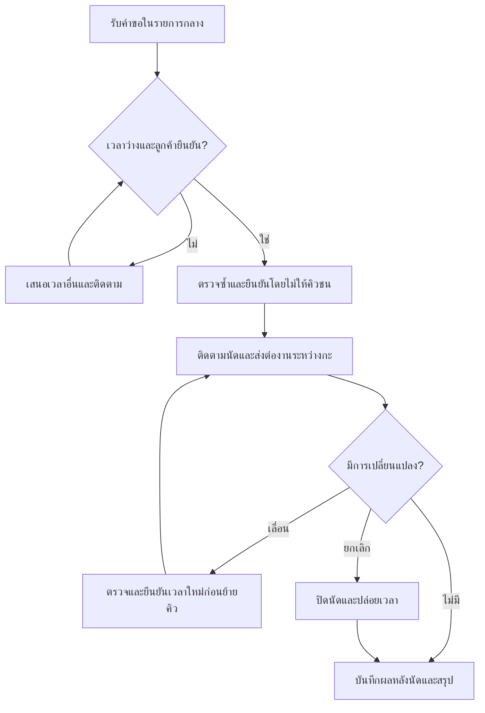

# ตัวอย่างข้อเสนอสุดท้าย

> ตัวอย่างประกอบการเรียนที่เรียบเรียงขึ้น ไม่ใช่ผลจากการรัน Fable/Astra จริง ใช้เทียบโครงสร้างและความครบถ้วน ไม่ใช่เฉลยตายตัว

เลือกสามกลุ่มฟีเจอร์โดยใช้รายการนัดกลางชุดเดียว ลูกค้ายังติดต่อผ่านช่องทางเดิม

| Pain point | ฟีเจอร์ | ทำก่อน/ภายหลัง | เหตุผล |
|---|---|---|---|
| P1 | G1 ตรวจคิวและยืนยันรายสัตวแพทย์ | ก่อน | ลดการรับคิวทับซ้อนจากข้อมูลหลายชุด |
| P2 | G2 สถานะและรายการติดต่อลูกค้า | ก่อน | ให้รู้ว่าใครต้องยืนยันหรือเตือน; ส่งอัตโนมัติทำภายหลัง |
| P3 | G2 ประวัติแก้ไขและงานส่งกะ | ก่อน | อีกกะทำต่อจากนัดเดิมได้ |
| P4 | G1 เวลาเปิดรับและรายการนัดกระทบ | ก่อน | ปิดเวลาที่ไม่ว่างและติดตามลูกค้าที่ต้องเปลี่ยนนัด |
| P5 | G3 สรุปตามสถานะและรายการต้นทาง | หลัง G1–G2 | ใช้ข้อมูลชุดเดียวกัน; รายงานขั้นสูงทำภายหลัง |

## ขั้นตอนใช้งาน

1. พนักงานรับคำขอจากช่องทางเดิม ระบุสัตว์เลี้ยงและบันทึกในรายการกลางเป็นคำขอ
2. ตรวจเวลาและสัตวแพทย์ หากไม่ว่างเสนอเวลาอื่น เมื่อได้ความยินยอมให้ตรวจอีกครั้งและยืนยันโดยไม่สร้างคิวซ้ำ
3. บันทึกผู้ติดต่อและสถานะยืนยัน/เตือน หากยังติดต่อไม่สำเร็จให้ระบุงานค้างและผู้รับผิดชอบ
4. เมื่อขอเลื่อนให้เก็บนัดเดิมจนเวลาใหม่ได้รับการยืนยันและย้ายสำเร็จ จากนั้นปล่อยคิวเดิม บันทึกประวัติและส่งต่องานค้างให้กะถัดไป; หากยกเลิกให้ปิดนัดและปล่อยเวลา
5. ผู้รับผิดชอบที่คลินิกกำหนดบันทึกผลหลังนัด เจ้าของดูสรุปจากข้อมูลนั้น รายการยังไม่บันทึกคงเป็นไม่ทราบ

ยังต้องถามคลินิกเรื่องระยะเวลานัด นโยบายรอ/มาสาย ลูกค้าไม่ได้นัด และงบประมาณ ข้อเสนอนี้ยังไม่ได้พิสูจน์ผลกับคลินิกหรือซอฟต์แวร์จริง
