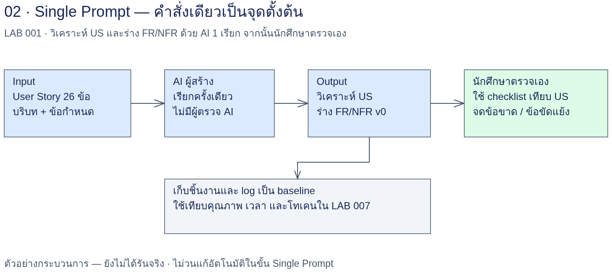

# LAB 001 — Single Prompt Baseline

## โจทย์

คุณเป็น System Analyst (SA) ในบริษัท Tech รับงานระบบสั่งอาหาร “ครัวคุณยาย” เปลี่ยน User Story ต้นฉบับเป็นร่าง Functional Requirements (FR) และ Non-functional Requirements (NFR) ที่ตรวจย้อนกลับและนำไปทดสอบได้ เก็บร่างแรกเป็น baseline เพื่อเปรียบเทียบกับวิธีสร้าง–ตรวจ–แก้ใน LAB 002

Single Prompt ใน LAB นี้หมายถึง **การร่าง FR/NFR ด้วยคำสั่งเดียวในขั้น 02** ไม่ได้หมายความว่ากิจกรรมทั้ง LAB ใช้เพียงคำสั่งเดียว ขั้น 01 เตรียมการวิเคราะห์ และขั้น 03 ให้ AI ตรวจงานของตัวเองจากไฟล์ ไม่มีผู้ตรวจอิสระหรือวงรอบแก้ร่างอัตโนมัติ นักศึกษาตรวจด้วย checklist อีกครั้งและเก็บข้อบกพร่องตามจริง

## เป้าหมาย

- วิเคราะห์ครบ 26 US แยก 3 บทบาท โดยรักษากฎธุรกิจ ตัวเลข dependency และข้อมูลคลุมเครือ
- ร่าง FR ที่อ้าง US พร้อมเกณฑ์รับและวิธีตรวจ และแยก NFR เป็นหมวดที่วัดได้
- ตรวจความครบถ้วนจากต้นฉบับ อธิบายสิ่งที่ self-check พลาดได้ และส่งร่างแรกไปพัฒนาใน LAB 002

## ความรู้ก่อนเรียน

อ่านตาราง User Story และ Acceptance Criteria (AC) ได้ แยกพฤติกรรมระบบ (FR) ออกจากคุณภาพ/ข้อจำกัดระบบ (NFR) ได้เบื้องต้น ใช้ Terminal เปลี่ยนโฟลเดอร์และเปิดไฟล์ Markdown ได้ เตรียม Codex CLI หรือ Claude Code ที่ใช้งานได้ตามการเตรียมเครื่องของรายวิชา เลือกเครื่องมือเดียวสำหรับ baseline ของตนเองและบันทึกเครื่องมือที่ใช้

## เวลาโดยประมาณ

จัดเวลาเรียนประมาณ 60–90 นาที: อ่านโจทย์และ Input 10–15 นาที, ขั้น 01 15–20 นาที, ขั้น 02 15–25 นาที, ขั้น 03 และอภิปราย 20–30 นาที **ทั้งหมดเป็นประมาณการจัดการเรียน ไม่ใช่เวลาจากผลรัน** เวลาเรียก AI จริง จำนวนเรียก รอบและโทเคนของผลอ้างอิงอยู่ในหัวข้อ “ผลรันล่วงหน้า” ด้านล่าง ค่าใช้จ่ายไม่มีข้อมูลใน log

## US ที่ใช้ (ครบ 26)

| กลุ่มบทบาทตามต้นฉบับ | รหัส US |
|---|---|
| ลูกค้า | US-01, US-02, US-03, US-04, US-05, US-06, US-07, US-08, US-09 |
| พนักงานครัว/หน้าร้าน | US-10, US-11, US-12, US-13, US-14, US-15, US-16, US-17, US-18 |
| ผู้จัดการร้าน | US-19, US-20, US-21, US-22, US-23, US-24, US-25, US-26 |

ใช้ [ตาราง US ที่คัดตรงตัว](input/user-stories.md), [บริบทระบบ](input/context.md) และ [ปัญหาข้อมูลต้นฉบับ](../docs/data-issues.md) ต้นทางคือ [case-study-source.md](../docs/case-study-source.md) ห้ามเติมนิยามหมายเหตุ ก./ค./ช. หรือแก้รหัสอ้างอิงที่สงสัยโดยไม่เปิดเผย

## แผนภาพ Workflow



คำอธิบายทดแทนภาพ: `input/ → ขั้น 01 → work/us-analysis.md → ขั้น 02 → work/fr-nfr-v0.md → ขั้น 03 → work/self-check.md → นักศึกษาตรวจ → LAB 002` ไม่มีลูกศรวนจาก self-check กลับไปแก้ร่างใน baseline ใช้ลำดับข้อความนี้อ่านประกอบภาพ

## สิ่งส่งมอบ

| ไฟล์ที่นักศึกษาจะสร้าง | เนื้อหา | ใช้ต่อ |
|---|---|---|
| `work/us-analysis.md` | วิเคราะห์ครบ 26 US ตาม 3 บทบาท พร้อมกฎ ตัวเลข dependency และข้อสงสัย | Input ขั้น 02 และ 03 |
| `work/fr-nfr-v0.md` | ร่าง FR/NFR ครั้งแรกพร้อม traceability | Input ขั้น 03 และไฟล์ส่งต่อไป LAB 002 |
| `work/self-check.md` | ผล AI ตรวจเทียบ checklist รายการตกหล่น และผลนักศึกษาตรวจเอง | ประกอบการแก้ใน LAB 002 |

ไฟล์ใน `work/` เป็นผลที่จะเกิดเมื่อผู้เรียนรัน จึงแสดงเป็น path โดยยังไม่ทำลิงก์ไปไฟล์ที่ไม่มีอยู่ เก็บ Input และ prompt เดิมไว้ ผลรันล่วงหน้าและหลักฐานอยู่ใน `reference/` แยกจากพื้นที่นักศึกษา

ก่อนเริ่ม เปิด Terminal จากรากโครงการแล้วรัน:

```bash
cd AI_Workflow_Engineering_for_SA/001_LAB_Single_Prompt_Baseline
mkdir -p work
pwd
```

ทุกขั้นใช้ working directory นี้และ **session ใหม่ทุกขั้น** คำสั่งแบบ `exec` หรือ `-p` ด้านล่างเป็นการเรียกแยกครั้ง ห้ามใช้ resume/continue หรือพึ่งประวัติสนทนา เลือกคำสั่ง Codex หรือ Claude เพียงหนึ่งชุดต่อขั้น ไม่ต้องรันทั้งสองเครื่องมือ

ถ้าจะรันซ้ำ ให้เก็บ `work/` ชุดเดิมพร้อม prompt, Input และ log เป็นโฟลเดอร์รอบใหม่ เช่น `work/archive-round-01/` ก่อนเริ่ม แล้วเก็บไฟล์ผลที่มีอยู่เข้าที่เก็บนั้นโดยไม่เขียนทับสำเนาเดิม คัดลอกไฟล์ส่งต่อที่จำเป็นกลับมาใน `work/` และบันทึกว่ารันซ้ำเพราะอะไร การซ่อมเพิ่มเติมต้องแยกจาก baseline และไม่นับเป็นร่างครั้งแรก

## ขั้น 01 — วิเคราะห์ User Story

### เป้าหมายและ Input

รหัสขั้น: **001-01** เป้าหมาย: แยกพฤติกรรมและกฎของ 26 US ตาม 3 บทบาท เตรียมข้อมูลให้ร่างข้อกำหนดโดยไม่ทำข้อมูลขาดหาย

Input: [user-stories.md](input/user-stories.md), [context.md](input/context.md) และ [data-issues.md](../docs/data-issues.md)

Working directory = `AI_Workflow_Engineering_for_SA/001_LAB_Single_Prompt_Baseline/` ใช้ **session ใหม่ทุกขั้น** path ใน prompt เริ่มจากโฟลเดอร์ LAB; `../docs/data-issues.md` ใน prompt จึงชี้ไฟล์เดียวกับ `../../docs/data-issues.md` เมื่อเปิดลิงก์จากไฟล์ใน `input/`

### Prompt พร้อมคัดลอก

ไฟล์ฉบับเต็ม: [step-01-us-analysis.md](prompts/step-01-us-analysis.md) ข้อความด้านล่างตรงกับเนื้อหาไฟล์ทุกตัวอักษร คัดลอกส่วนนี้ให้ AI ได้ หรือใช้ Terminal อ่านจากไฟล์ตามหัวข้อถัดไป

```text
# ขั้น 01 — วิเคราะห์ User Story

## บริบท
คุณเป็น System Analyst ของระบบครัวคุณยาย รับสั่งผ่าน QR ที่โต๊ะและสั่งกลับบ้าน มีลูกค้า พนักงานครัว/หน้าร้าน และผู้จัดการร้าน ใช้ Ubuntu เครื่องเดียวบน LAN/Wi-Fi ร้านและมีงบต่ำ
Working directory คือโฟลเดอร์ LAB 001 ปัจจุบัน เริ่ม session ใหม่ ใช้ไฟล์เป็นข้อมูลส่งต่อ ไม่อาศัยประวัติสนทนา

## งาน
อ่าน Input แล้ววิเคราะห์ US-01 ถึง US-26 ครบ 26 รายการ แยกเป็น 3 กลุ่มบทบาทตามตารางต้นฉบับ
สำหรับแต่ละ US ระบุพฤติกรรม กฎธุรกิจ ตัวเลขและหน่วยทั้งหมด เกณฑ์รับ เงื่อนไขก่อนหน้า dependency และจุดคลุมเครือ ไม่ตัดกฎย่อยออกเพราะมีหลายข้อใน US เดียว
แยก dependency ที่ต้นฉบับระบุชัดจากความเชื่อมโยงที่เสนอ พร้อมทิศทาง US ต้นทาง → US ที่พึ่งพาและเหตุผล; ไม่มี dependency ระบุชัดให้บอกว่าข้อมูลขาด
รวบรวมปัญหาข้อมูลและคำถามรอยืนยัน อ้างรหัส DI ที่เกี่ยวข้อง โดยยังไม่ตัดสินแทนเจ้าของระบบ

## ข้อจำกัด
ถ้าไม่พบข้อมูลในต้นฉบับให้เขียน 'ไม่มีข้อมูลในต้นฉบับ' ห้ามเดา
รักษารหัส US ตัวเลข หน่วย สูตร เงื่อนไขและเกณฑ์รับตามต้นฉบับ ไม่แต่งหมายเหตุ ก./ค./ช. ไม่ใช้เว็บหรือข้อมูลนอก Input เติมข้อกำหนด
แยกข้อเท็จจริง ข้อมูลขาด ข้อขัดแย้ง และข้อเสนอที่ยังไม่ยืนยัน สมมติฐานใน data-issues.md ไม่ใช่ข้อกำหนดที่ยืนยันแล้ว
คงการอ้าง US-14 ในข้อความ US-20 และบันทึก DI-04; หากเสนอ US-12/US-13 ให้ติดสถานะยังไม่ยืนยัน แยกช่วงเร่งด่วนและสถานะตาม DI-06/DI-07
ไม่สร้างผลทดสอบหรือสถิติการรัน ไม่แก้ Input และไม่เขียนทับหลักฐานเดิม ถ้าไฟล์เป้าหมายมีอยู่แล้วให้หยุดและรายงานเพื่อให้ผู้เรียนเก็บสำเนาก่อน

## Input
ทุก path ต่อไปนี้ relative จากโฟลเดอร์ LAB ไม่ใช่จาก prompts/
- input/user-stories.md
- input/context.md
- ../docs/data-issues.md

## รูปแบบ Output
Markdown ภาษาไทย มีสรุปขอบเขต แล้วตารางวิเคราะห์แยกหัวข้อ 3 บทบาท โดยมีแถวหลักหนึ่งแถวต่อ US รวม 26 แถว
คอลัมน์: US | พฤติกรรม | กฎธุรกิจและตัวเลข | เกณฑ์รับ | dependency และหลักฐาน | จุดคลุมเครือ
ตามด้วยตารางปัญหา: ประเด็น | US/DI | ข้อความหลักฐาน | ผลกระทบ | คำถามรอยืนยัน
ท้ายเอกสารแจกแจงรหัส US ที่วิเคราะห์ตามบทบาท และรายการข้อมูลที่ยังไม่มี ไม่ร่าง FR/NFR ในขั้นนี้

## ตำแหน่งบันทึก
สร้างโฟลเดอร์ work/ หากยังไม่มี แล้วบันทึก Markdown ฉบับเต็มที่ work/us-analysis.md
หลังบันทึกให้แจ้ง path และข้อมูลขาดที่สำคัญ ห้ามอ้างว่าการวิเคราะห์เป็นผลทดสอบระบบจริง
```

### วิธีรันและเปิดผล

คำสั่งต่อไปนี้สำหรับ **Terminal** ในโฟลเดอร์ LAB เลือกเครื่องมือที่เตรียมไว้หนึ่งตัว:

Codex:

```bash
codex exec "$(cat prompts/step-01-us-analysis.md)"
```

Claude Code:

```bash
claude -p "$(cat prompts/step-01-us-analysis.md)"
```

เมื่อคำสั่งจบ ให้ตรวจว่าไฟล์ถูกบันทึกจริง แล้วเปิดอ่านใน Terminal:

```bash
test -s work/us-analysis.md
less work/us-analysis.md
```

กด `q` เพื่อออกจาก `less` หรือเปิด `work/us-analysis.md` ใน editor แล้วเลือก Markdown Preview ตรวจว่ามีตาราง 3 บทบาทรวม 26 แถวหลัก มีตัวเลข หน่วย dependency และประเด็นรอยืนยัน เปิดเทียบตาราง US ข้างกัน อย่านับเฉพาะจำนวนแถว หากเครื่องมือแสดงข้อความแต่ไม่มีไฟล์ ให้ตรวจสิทธิ์เขียน/path และบันทึกสถานะว่าไฟล์ยังไม่พร้อม ไม่ถือว่ารันสำเร็จจากข้อความตอบเพียงอย่างเดียว

### ตัวอย่างผลรันล่วงหน้า

**ผลรันจริง — สำเร็จ**: 2026-09-14 10:22:44 UTC → 2026-09-14 10:28:10 UTC; รอบ `round-1`, เวลา wall 326 วินาที ใช้ Codex CLI 0.154.0, โมเดล `gpt-6-astra` และ effort `high` ตาม flag (CLI ไม่ยืนยันโมเดล/effort กลับ)

หลักฐาน: [ผลฉบับเต็ม us-analysis.md](reference/step-01/round-1/us-analysis.md) · [ข้อความตอบท้าย CLI: output.md](reference/step-01/round-1/output.md) · [log.jsonl](reference/step-01/round-1/log.jsonl) · [run-meta.md](reference/step-01/round-1/run-meta.md) · [run-meta.json](reference/step-01/round-1/run-meta.json)

**ผลตรวจ:** ตรวจแถวหลักครบ 26 US แบ่งบทบาท 9/9/8 ตรงต้นฉบับ ไม่พบรหัสขาดหรือผิดบทบาท และ AC ทั้ง 26 แถวตรงตัวกับต้นฉบับ — [รายงานตรวจพร้อมหลักฐาน](reference/check-report.md)

ข้อความสำคัญจากคำตอบท้าย CLI (คัดตรงจาก output.md):

```text
ข้อมูลขาดสำคัญ: หมายเหตุ ก./ค./ช., คำยืนยันการอ้าง US-14 ใน US-20, ความสัมพันธ์ช่วงเร่งด่วนและชื่อสถานะ, รายละเอียดคืนเงิน และสเปกเครื่อง/งบประมาณ
เอกสารนี้เป็นการวิเคราะห์ ไม่ใช่ผลทดสอบระบบจริงครับ
```

ข้อความคัดตรงจากไฟล์ผลที่ AI เขียน `us-analysis.md` ด้านล่าง คัดเฉพาะส่วนสำคัญตามลำดับเดิม; ตรวจข้อความต้นทางใน [ไฟล์ผลฉบับเต็ม](reference/step-01/round-1/us-analysis.md) คำตอบท้าย CLI สั้น จึงแสดงเนื้อหาไฟล์ผลจริงเพิ่มเติมโดยไม่เติมข้อความลงผลดิบ

```markdown
## รหัส US ที่วิเคราะห์ตามบทบาท

- **ลูกค้า — 9 รายการ:** US-01, US-02, US-03, US-04, US-05, US-06, US-07, US-08, US-09
- **พนักงานครัว/หน้าร้าน — 9 รายการ:** US-10, US-11, US-12, US-13, US-14, US-15, US-16, US-17, US-18
- **ผู้จัดการร้าน — 8 รายการ:** US-19, US-20, US-21, US-22, US-23, US-24, US-25, US-26

## รายการข้อมูลที่ยังไม่มี

รายการต่อไปนี้หมายถึง **ไม่มีข้อมูลในต้นฉบับ** ตามรายละเอียดใน Q-01–Q-26 ไม่ใช่ข้อกำหนดเพิ่มเติมที่ตัดสินแล้ว

- นิยามหมายเหตุ ก. ของ US-08 (DI-01), ค. ของ US-12/US-20 (DI-02) และ ช. ของ US-07 (DI-03)
- คำยืนยันรหัสอ้างอิงใน US-20 (DI-04) และรายการ dependency ที่อ้างรหัสชัดครบทุก US นอกเหนือจากที่แจกแจงไว้
- ความสัมพันธ์ช่วงเวลาของ US-07/US-21 และช่วงของ US-18 (DI-06); การแมป “เสร็จแล้ว”/“พร้อมเสิร์ฟ”/“รอลูกค้าตัดสินใจ” พร้อมลำดับเปลี่ยนสถานะและผลต่อคิว/ETA (DI-07)
- รายละเอียดค่าเฉลี่ยต่อเมนู การรับมือประวัติไม่พอ วิธีคำนวณ X และการบังคับเพดาน N รวมถึงวิธีนับช่องทาง (Q-07/Q-21)
- กติกา QR ผิดหรือเปลี่ยน, จำนวนโต๊ะจริง, เวลาสั่งและช่วงรับที่เลือกได้, ความจุช่วงรับ และข้อจำกัดการเลือกตัวเลือกต่อจาน (Q-02–Q-04)
- กติกาส่งสั่งพร้อมกดหมด การกดหมดซ้ำ หลายวัตถุดิบที่ยังหมด และการแก้แมประหว่างปิด; วงจรข้อมูลวัตถุดิบ (Q-06/Q-12/Q-13/Q-20)
- จุดเริ่ม 10 นาทีของสลิป วิธีรับ/ตรวจสลิป รายละเอียดตั้งปิด PromptPay และการเลือกจ่ายเมื่อปิด; ส่วนต่างเปลี่ยนเมนู การคืนเงินจริงหลังชำระ และกรณีลูกค้าไม่ตอบ (Q-08/Q-09/Q-14)
- ความสัมพันธ์เลขออเดอร์กับเลขรับกลับบ้าน ขอบเขตข้ามวัน/รีสตาร์ต เขตเวลา และการส่งคำสั่งซ้ำ; วงจรเปิด/ปิดโต๊ะ session หน้าเดิมและบิลหลายรอบ/จ่ายบางส่วน (Q-10/Q-15–Q-17)
- เกณฑ์ติดตามลูกค้ากลับบ้าน นิยามค้างและวิธีแสดงค้างนานสุด ผลต่อหน้า/ตะกร้าเดิมเมื่อปิดรับกลับบ้าน และเวลาเปิดรับกลับ (Q-05/Q-18/Q-22)
- ข้อจำกัดข้อมูลเมนู/ราคา ผลการลบต่อออเดอร์เดิม นิยามวันขาย/ช่วงรายงาน CSV การคืนเงินในรายงาน นิยามสัปดาห์ รายละเอียดประวัติเมนูและอายุเก็บข้อมูล (Q-19/Q-23/Q-24)
- ตารางสิทธิ์ครบทุกหน้า/การกระทำ การตั้งผู้จัดการแรก กู้บัญชี/รีเซ็ต PIN ชุดอักขระชื่อผู้ใช้ ขอบเขตล็อก และ session พนักงาน (Q-25)
- รุ่น Ubuntu สเปกฮาร์ดแวร์ งบเป็นจำนวนเงิน ภาระผู้ใช้พร้อมกัน สภาพ LAN/Wi-Fi และอุปกรณ์ตรวจ เงื่อนไขก่อนติดตั้ง สำรอง/กู้คืน ขอบเขตไฟดับ/LAN ล่ม และหลักฐานทดสอบระบบจริง (Q-01/Q-10/Q-25/Q-26; DI-08/DI-09)
- คำตอบเจ้าของระบบและหลักฐานยืนยัน A-01–A-06; เอกสารนี้ยังไม่ตัดสินแทนเจ้าของระบบ
```

### เปรียบเทียบและตรวจผ่าน

- ต้องตรง: รหัส/บทบาทครบ 26 US, สูตรและช่วงเร่งด่วนของ US-07, ลำดับคิว US-10, dependency เมนู US-19 ก่อนแมป US-20 และข้อขัดแย้ง DI-04
- ยืดหยุ่นได้: ถ้อยคำสรุป ลำดับหัวข้อ และวิธีจัดกลุ่มกฎย่อย โดยต้องย้อนถึงข้อความ US ได้
- Checklist: เปิดต้นฉบับตรวจทีละรหัสว่ามีกฎย่อยครบ แยกข้อเท็จจริงออกจากข้อเสนอ และเขียน “ไม่มีข้อมูลในต้นฉบับ” สำหรับนิยามหมายเหตุที่หาย ใช้ C-02/C-03/C-10/C-11/C-12 จาก [checklist](input/checklist-fr-nfr.md) เป็นแนวสังเกต ยังไม่ตัดสินข้อ FR/NFR ที่ยังไม่ได้ร่าง

ใช้เกณฑ์เหล่านี้ตรวจผลของตนเทียบต้นฉบับและ [รายงานผลอ้างอิง](reference/check-report.md) บันทึกทั้งข้อที่ตรงและข้อที่ยังขาด แยกผลตรวจเอกสารจากผลทดสอบระบบจริง

### แก้ไขและส่งต่อ

Prompt แก้ปัญหาต่อไปนี้มีไว้ใช้เมื่อจำเป็น **หลังเก็บผล baseline ของขั้นไว้แล้ว** บันทึกผลเสริมคนละไฟล์และเปิด session ใหม่ในโฟลเดอร์ LAB ถ้าไฟล์ repair ชื่อนี้มีอยู่แล้ว ให้เปลี่ยนเลขท้ายเป็นรอบถัดไปก่อนใช้ ไม่เขียนทับหลักฐานเดิม และบันทึกการเรียกเพิ่มแยกจากการรันครั้งแรก

1. วิเคราะห์ไม่ครบหรือรวมสองบทบาทผิด

```text
อ่าน input/user-stories.md และ work/us-analysis.md ทำรายการ US ที่ขาดหรือจัดบทบาทผิดเทียบต้นฉบับ แล้วเสนอเฉพาะแถวที่ต้องแก้พร้อมหลักฐาน บันทึกที่ work/us-analysis-repair-01.md โดยไม่แก้ไฟล์เดิม ถ้าไม่พบข้อมูลในต้นฉบับให้เขียน 'ไม่มีข้อมูลในต้นฉบับ' ห้ามเดา
```

2. AI แต่ง dependency หรือหมายเหตุ

```text
อ่าน input/user-stories.md, ../docs/data-issues.md และ work/us-analysis.md ตรวจ dependency กับนิยามหมายเหตุ ก./ค./ช. แยกข้อความที่ต้นฉบับยืนยันออกจากข้อเสนอที่ยังไม่ยืนยัน คง US-20 ที่อ้าง US-14 พร้อมอธิบาย DI-04 บันทึกข้อเสนอแก้ที่ work/us-analysis-repair-02.md โดยไม่แก้ไฟล์เดิม ถ้าไม่พบข้อมูลในต้นฉบับให้เขียน 'ไม่มีข้อมูลในต้นฉบับ' ห้ามเดา
```

หลังใช้ prompt เสริม ให้เปิดไฟล์ repair เทียบต้นฉบับและ checklist ข้อที่เกี่ยวข้อง บันทึกว่าแก้ข้อใดได้หรือยังขาดอะไร โดยเก็บผลเดิมไว้

เงื่อนไขหยุด: หยุดเมื่อไฟล์อ่านได้และตรวจรายการครบ 26 รหัสแล้ว หากตกหล่นให้บันทึกไว้เพื่อดูผลกระทบในขั้น 02 ไม่วนปรับจนสวยก่อนวัด baseline หากไม่มีไฟล์หรืออ่านไม่ได้ ให้หยุดการส่งต่อและแก้ปัญหา path/การบันทึกก่อน

ส่ง `work/us-analysis.md` ไปขั้น 02 โดยเปิด session ใหม่ ไฟล์ส่งต่อไป LAB 002 หลังจบกิจกรรมคือ `work/fr-nfr-v0.md`

## ขั้น 02 — ร่าง FR/NFR ในคำสั่งเดียว

### เป้าหมายและ Input

รหัสขั้น: **001-02** เป้าหมาย: ร่าง FR/NFR ครั้งแรกจาก Input ในคำสั่งเดียวเพื่อเก็บ baseline ที่ตรวจย้อนกลับได้ ยังไม่มีวงรอบแก้ตาม feedback

Input: `work/us-analysis.md`, [user-stories.md](input/user-stories.md), [context.md](input/context.md) และ [data-issues.md](../docs/data-issues.md)

Working directory = `AI_Workflow_Engineering_for_SA/001_LAB_Single_Prompt_Baseline/` ใช้ **session ใหม่ทุกขั้น** path ใน prompt เริ่มจากโฟลเดอร์ LAB; `../docs/data-issues.md` ใน prompt จึงชี้ไฟล์เดียวกับ `../../docs/data-issues.md` เมื่อเปิดลิงก์จากไฟล์ใน `input/`

### Prompt พร้อมคัดลอก

ไฟล์ฉบับเต็ม: [step-02-fr-nfr-draft.md](prompts/step-02-fr-nfr-draft.md) ข้อความด้านล่างตรงกับเนื้อหาไฟล์ทุกตัวอักษร คัดลอกส่วนนี้ให้ AI ได้ หรือใช้ Terminal อ่านจากไฟล์ตามหัวข้อถัดไป

```text
# ขั้น 02 — ร่าง FR/NFR ด้วย Single Prompt

## บริบท
คุณเป็น System Analyst คนเดิมในเชิงบทบาทงานของระบบครัวคุณยาย มีข้อมูลวิเคราะห์จากขั้น 01 แต่ session นี้เริ่มใหม่ในโฟลเดอร์ LAB 001 อ่านไฟล์ใหม่ทั้งหมด
ระบบรับสั่งผ่าน QR และสั่งกลับบ้าน มี 3 บทบาท ใช้ Ubuntu เครื่องเดียวบน LAN/Wi-Fi ร้านและมีงบต่ำ

## งาน
ร่าง Functional Requirements (FR) และ Non-functional Requirements (NFR) พร้อมกันในคำสั่งเดียวจาก Input เป็น baseline รุ่น v0 ไม่มีผู้ตรวจอิสระ ไม่มีการเรียก agent อื่นและไม่มีรอบสร้าง–ตรวจ–แก้ซ้ำ
ครอบคลุม US-01 ถึง US-26 ทุก US ต้องมี FR อย่างน้อย 1 ข้อที่อ้างรหัส US และบอกพฤติกรรมจริง รวมถึงส่วนการจัดการบัญชีและการติดตั้ง ไม่ย้าย US ทั้งข้อไปอยู่เฉพาะ NFR
ให้ FR มีกฎธุรกิจ เกณฑ์รับที่วัดได้ และวิธีตรวจที่ทำตามได้ รักษาทุกกฎย่อย ตัวเลข หน่วย สูตร เกณฑ์สัดส่วนผ่าน และบริบททดสอบเดิม แยก FR เพิ่มได้เมื่อ US มีหลายพฤติกรรม
แยก NFR เป็นหมวดประสิทธิภาพ ความพร้อมใช้งาน/ออฟไลน์ ความปลอดภัย PIN และสิทธิ์ และการติดตั้ง 30 นาที อ้าง US ต้นทางและเกณฑ์ที่เกี่ยวข้องให้ครบ พร้อมวิธีตรวจและสิ่งที่ต้องพิสูจน์บนระบบจริง
บันทึก dependency ข้อขัดแย้งและข้อมูลขาดจากต้นฉบับ หากผลวิเคราะห์ต่างจาก US ให้ยึดตาราง US และเปิดเผยความต่าง ไม่เปลี่ยนต้นฉบับ

## ข้อจำกัด
ถ้าไม่พบข้อมูลในต้นฉบับให้เขียน 'ไม่มีข้อมูลในต้นฉบับ' ห้ามเดา
รักษารหัส US ตัวเลข หน่วย สูตร เงื่อนไขและเกณฑ์รับตามต้นฉบับ ไม่แต่งหมายเหตุ ก./ค./ช. ไม่ใช้เว็บหรือข้อมูลนอก Input เติมข้อกำหนด
แยกข้อเท็จจริง ข้อมูลขาด ข้อขัดแย้ง และข้อเสนอที่ยังไม่ยืนยัน สมมติฐานใน data-issues.md ไม่ใช่ข้อกำหนดที่ยืนยันแล้ว
คงการอ้าง US-14 ในข้อความ US-20 และบันทึก DI-04; หากเสนอ US-12/US-13 ให้ติดสถานะยังไม่ยืนยัน แยกช่วงเร่งด่วนและสถานะตาม DI-06/DI-07
ไม่สร้างผลทดสอบหรือสถิติการรัน ไม่แก้ Input และไม่เขียนทับหลักฐานเดิม ถ้าไฟล์เป้าหมายมีอยู่แล้วให้หยุดและรายงานเพื่อให้ผู้เรียนเก็บสำเนาก่อน

## Input
ทุก path ต่อไปนี้ relative จากโฟลเดอร์ LAB ไม่ใช่จาก prompts/
- input/user-stories.md
- input/context.md
- work/us-analysis.md
- ../docs/data-issues.md
ถ้า work/us-analysis.md ไม่มีหรืออ่านไม่ได้ ให้หยุดและรายงาน Input ที่ขาด ไม่สร้างข้อมูลวิเคราะห์ทดแทน

## รูปแบบ Output
Markdown ภาษาไทย เริ่มด้วยขอบเขต 3 บทบาทและคำอธิบายว่าเป็นร่าง v0 ที่ยังไม่ได้ทดสอบระบบจริง
ตาราง FR ใช้หัวคอลัมน์: FR-xx | US | กฎธุรกิจ | เกณฑ์รับ | วิธีตรวจ
ใช้รหัส FR-01, FR-02 ต่อเนื่องไม่ซ้ำ ใส่พฤติกรรมที่ระบบต้องทำในคอลัมน์กฎธุรกิจ และอ้าง US ทุกแถว
ตาราง NFR แยกหัวข้อทั้ง 4 หมวด ใช้คอลัมน์: NFR-xx | US | ข้อกำหนดคุณภาพ | เกณฑ์รับ | วิธีตรวจ | ข้อจำกัดการพิสูจน์
ตามด้วยตาราง traceability: US | FR ที่รองรับ | NFR ที่เกี่ยวข้อง | dependency/ประเด็นรอยืนยัน โดยแจกแจงครบ 26 US
ท้ายเอกสารมีรายการข้อมูลขาดและข้อขัดแย้ง พร้อมหลักฐานและสถานะยังไม่ยืนยัน ห้ามรายงานว่าผ่าน checklist โดยไม่มีการตรวจ

## ตำแหน่งบันทึก
สร้างโฟลเดอร์ work/ หากยังไม่มี แล้วบันทึก Markdown ฉบับเต็มที่ work/fr-nfr-v0.md
รักษา work/us-analysis.md ไว้ตามเดิม แจ้ง path ที่บันทึก ไฟล์นี้เป็น baseline ที่จะส่งต่อ LAB 002 แม้ยังมีข้อบกพร่อง
```

### วิธีรันและเปิดผล

คำสั่งต่อไปนี้สำหรับ **Terminal** ในโฟลเดอร์ LAB เลือกเครื่องมือที่เตรียมไว้หนึ่งตัว:

Codex:

```bash
codex exec "$(cat prompts/step-02-fr-nfr-draft.md)"
```

Claude Code:

```bash
claude -p "$(cat prompts/step-02-fr-nfr-draft.md)"
```

เมื่อคำสั่งจบ ให้ตรวจว่าไฟล์ถูกบันทึกจริง แล้วเปิดอ่านใน Terminal:

```bash
test -s work/fr-nfr-v0.md
less work/fr-nfr-v0.md
```

กด `q` เพื่อออกจาก `less` หรือเปิด `work/fr-nfr-v0.md` ใน editor แล้วเลือก Markdown Preview เปิดดูตาราง FR, NFR แยก 4 หมวด และตาราง US → FR/NFR ครบ 26 US ตรวจเนื้อหาที่ FR รองรับจริง โดยเฉพาะ US-25/US-26 ที่ต้องมี FR ด้วย แล้วคงร่างนี้ไว้ หากเครื่องมือแสดงข้อความแต่ไม่มีไฟล์ ให้ตรวจสิทธิ์เขียน/path และบันทึกสถานะว่าไฟล์ยังไม่พร้อม ไม่ถือว่ารันสำเร็จจากข้อความตอบเพียงอย่างเดียว

### ตัวอย่างผลรันล่วงหน้า

**ผลรันจริง — สำเร็จ**: 2026-09-14 10:28:10 UTC → 2026-09-14 10:31:52 UTC; รอบ `round-1`, เวลา wall 222 วินาที ใช้ Codex CLI 0.154.0, โมเดล `gpt-6-astra` และ effort `high` ตาม flag (CLI ไม่ยืนยันโมเดล/effort กลับ)

หลักฐาน: [ผลฉบับเต็ม fr-nfr-v0.md](reference/step-02/round-1/fr-nfr-v0.md) · [ข้อความตอบท้าย CLI: output.md](reference/step-02/round-1/output.md) · [log.jsonl](reference/step-02/round-1/log.jsonl) · [run-meta.md](reference/step-02/round-1/run-meta.md) · [run-meta.json](reference/step-02/round-1/run-meta.json)

**ผลตรวจ:** นับได้ 26 FR และ 22 NFR ครบ 26 US; AC คงต้นฉบับ แต่ยังมีนิยามรอยืนยัน และพบตาราง Q/DI จำนวนช่องไม่ตรงหัวตารางรวม 35 แถว ร่างจึงยังมีข้อบกพร่อง — [รายงานตรวจพร้อมหลักฐาน](reference/check-report.md)

ข้อความสำคัญจากคำตอบท้าย CLI (คัดตรงจาก output.md):

```text
เป็น baseline v0 สำหรับส่งต่อ LAB 002 ยังไม่ได้ทดสอบระบบจริง ไม่มีรอบตรวจ–แก้ซ้ำ และคง Input รวมถึง `work/us-analysis.md` ตามเดิมครับ
```

ข้อความคัดตรงจากไฟล์ผลที่ AI เขียน `fr-nfr-v0.md` ด้านล่าง คัดเฉพาะส่วนสำคัญตามลำดับเดิม; ตรวจข้อความต้นทางใน [ไฟล์ผลฉบับเต็ม](reference/step-02/round-1/fr-nfr-v0.md) คำตอบท้าย CLI สั้น จึงแสดงเนื้อหาไฟล์ผลจริงเพิ่มเติมโดยไม่เติมข้อความลงผลดิบ

```markdown
# ร่าง FR/NFR v0 — ระบบครัวคุณยาย
ขอบเขตมี 3 บทบาท: **ลูกค้า (US-01–US-09)** สั่งผ่าน QR ที่โต๊ะ/สั่งกลับบ้าน ติดตามและชำระเงิน; **พนักงานครัว/หน้าร้าน (US-10–US-18)** จัดคิว สถานะ วัตถุดิบ โต๊ะ บิลและรับเงิน; **ผู้จัดการร้าน (US-19–US-26)** จัดการเมนู แมป ตั้งค่า รายงาน บัญชีและการติดตั้ง ครัวและหน้าร้านเป็นกลุ่มบทบาทเดียวในตาราง US แต่แยกสิทธิ์ตาม US-25
เอกสารนี้เป็น **ร่าง v0 จาก Single Prompt ยังไม่ได้ทดสอบระบบจริง** ไม่มีผู้ตรวจอิสระ ไม่มีการเรียก agent อื่น และไม่มีรอบสร้าง–ตรวจ–แก้ซ้ำ เก็บเป็น baseline ส่งต่อ LAB 002 แม้ยังมีข้อบกพร่อง ตัวเลขการทดสอบในตารางเป็นเกณฑ์และวิธีตรวจที่ต้องทำในอนาคต ไม่ใช่ผลการรัน ไม่ใช่รายงานว่าผ่าน checklist
ข้อเท็จจริงด้านสภาพแวดล้อม: Ubuntu เครื่องเดียว เก็บข้อมูลในร้าน ใช้ LAN/Wi-Fi ร้าน งบต่ำและต้องการหลีกเลี่ยงค่าคลาวด์รายเดือน จำนวนเงินงบประมาณ **ไม่มีข้อมูลในต้นฉบับ** ออฟไลน์หมายถึงอินเทอร์เน็ตภายนอกขาดขณะที่ Ubuntu และเครือข่ายภายในยังทำงาน
## Functional Requirements
คอลัมน์เกณฑ์รับคัดจากแถว US ตรงตัวเพื่อคงทุกกฎย่อย ตัวเลข หน่วย สูตร เงื่อนไข สัดส่วนผ่านและบริบททดสอบ คอลัมน์กฎธุรกิจระบุพฤติกรรมระบบ; วิธีตรวจเป็นวิธีที่ร่างให้ทำตามได้ ไม่เพิ่มเกณฑ์รับที่ต้นฉบับไม่ได้กำหนด การทดลองค่าขอบเขตเป็นวิธีตรวจขอบเขตเดิม ไม่ใช่ข้อกำหนดใหม่ กรณีที่ข้อมูลไม่พอให้เก็บประเด็นรอยืนยันก่อนสรุปผลส่วนนั้น
| FR-xx | US | กฎธุรกิจ | เกณฑ์รับ | วิธีตรวจ |
|---|---|---|---|---|
| FR-07 | US-07 | ระบบต้องแสดงเวลารอโดยประมาณบนหน้ายืนยันทุกออเดอร์ก่อนยืนยัน โดยใช้สูตรเต็มและข้อมูล 7 วันล่าสุดตามเกณฑ์รับ; คิวที่ยังไม่ “พร้อมเสิร์ฟ” และจุดจบ “ครัวกดสถานะพร้อมเสิร์ฟ” คงตาม US-07; ช่วงเร่งด่วน 11:30–13:00 และ 17:30–19:30 แยกจากค่าตั้ง US-21 (DI-03/DI-06/DI-07) | หน้ายืนยันสั่งแสดงเวลารอโดยประมาณทุกออเดอร์ คำนวณจากสูตร: (จำนวนออเดอร์ค้างในคิวครัวที่ยังไม่ “พร้อมเสิร์ฟ” × เวลาเฉลี่ยต่อออเดอร์ 7 วันล่าสุด) + เวลาเฉลี่ยต่อเมนูของเมนูที่นานที่สุดในตะกร้า · เวลาจริงวัดจากจุดเริ่ม “ลูกค้ากดยืนยันสั่ง” ถึงจุดจบ “ครัวกดสถานะพร้อมเสิร์ฟ” (log ฝั่งเซิร์ฟเวอร์) · ช่วงเร่งด่วนนิยามเป็น 11:30–13:00 และ 17:30–19:30 · ในออเดอร์ช่วงเร่งด่วนของ 1 วันทดสอบ ค่าประมาณคลาดเคลื่อนจากเวลาจริงไม่เกิน 10 นาทีในอย่างน้อย 80% ของออเดอร์ (ดูหมายเหตุ ช.) | บันทึกค่าคิว ค่าเฉลี่ยต่อออเดอร์ 7 วันล่าสุด ค่าเฉลี่ยต่อเมนู และตะกร้าขณะหน้ายืนยันแสดง ETA คำนวณสูตรเทียบค่าแสดงทุกออเดอร์; ใช้ log เซิร์ฟเวอร์จับเวลาจริงจากลูกค้ายืนยันถึงครัวกด “พร้อมเสิร์ฟ”; เก็บออเดอร์ช่วง 11:30–13:00 และ 17:30–19:30 ของ 1 วันทดสอบ นับออเดอร์ที่คลาดเคลื่อนไม่เกิน 10 นาทีเทียบจำนวนออเดอร์ในช่วงเหล่านี้ทั้งหมด ต้องอย่างน้อย 80%; รอยืนยันค่าเฉลี่ยต่อเมนู/สถานะก่อนพิสูจน์ครบ ห้ามแต่งข้อมูลย้อนหลัง |
| FR-25 | US-25 | ระบบต้องให้ผู้จัดการสร้างบัญชีและจัดการสิทธิ์ครัว/หน้าร้าน/ผู้จัดการโดยไม่ใช้อีเมล; ใช้ชื่อผู้ใช้ตัวอักษร/ตัวเลข 3–20 ตัวและ PIN ตัวเลข 4–6 หลักเข้าสู่ระบบ; ผิด 5 ครั้งติดต้องล็อก 5 นาที; ปฏิเสธบัญชีครัว/หน้าร้านที่เปิด URL รายงานและจัดการเมนูโดยตรง; ขั้นตอนแก้/ลบบัญชีและตารางสิทธิ์ส่วนที่เหลือ ไม่มีข้อมูลในต้นฉบับ | สร้างบัญชีด้วยชื่อผู้ใช้ (ตัวอักษร/ตัวเลข 3–20 ตัว) และ PIN ตัวเลข 4–6 หลัก เข้าสู่ระบบด้วยชื่อผู้ใช้+PIN ใส่ PIN ผิด 5 ครั้งติดถูกล็อก 5 นาที และบัญชีสิทธิ์ครัว/หน้าร้านเปิด URL หน้ารายงานและหน้าจัดการเมนูแล้วถูกปฏิเสธ ทดสอบ 3 บัญชี × 2 หน้า ผ่าน 6 จาก 6 | สร้างบัญชีชื่อผู้ใช้ตัวอักษร/ตัวเลข 3–20 ตัวและ PIN ตัวเลข 4–6 หลักโดยไม่ใช้อีเมล ตรวจขอบเขตข้อมูลและล็อกอินด้วยชื่อผู้ใช้+PIN; ใส่ผิดติดกัน 5 ครั้ง บันทึกเวลาล็อก ทดลองระหว่าง 5 นาทีและหลังครบเวลา; ใช้ 3 บัญชีที่อยู่ในสิทธิ์ครัว/หน้าร้าน เปิด URL รายงานและจัดการเมนูตรง ๆ รวม 3 บัญชี × 2 หน้า ต้องถูกปฏิเสธ 6 จาก 6 ตรวจผลตอบจากระบบจริง ไม่ใช้เพียงการซ่อนปุ่ม; สัดส่วนบัญชีครัว/หน้าร้านและขอบเขตล็อก ไม่มีข้อมูลในต้นฉบับ |
| FR-26 | US-26 | ระบบต้องมีสคริปต์เดียวติดตั้งบน Ubuntu เครื่องเดียวในร้านจนมือถือบน Wi-Fi ร้านเปิดเมนูได้ เก็บข้อมูลบนเครื่องในร้าน และให้สั่งอาหาร เปลี่ยนสถานะ ปิดโต๊ะได้แม้ถอดอินเทอร์เน็ตภายนอก โดย Ubuntu และ LAN/Wi-Fi ยังทำงาน; ยกเว้นตรวจยอดโอน PromptPay ซึ่งพนักงานยืนยันด้วยตา; คงเป้าหมายหลีกเลี่ยงค่าคลาวด์รายเดือนตามบริบท | ติดตั้งบน Ubuntu ด้วยสคริปต์เดียว เสร็จภายใน 30 นาที (นับจากรันสคริปต์จนเปิดหน้าเมนูจากมือถือในร้านได้) เก็บข้อมูลบนเครื่องในร้าน และเมื่อถอดสายอินเทอร์เน็ตภายนอก ยังสั่ง/เปลี่ยนสถานะ/ปิดโต๊ะได้ครบ 20 ใบของชุดทดสอบ (ยกเว้นการตรวจสอบยอดโอน PromptPay ซึ่งพนักงานยืนยันด้วยตา) | บน Ubuntu เครื่องเดียวในร้าน บันทึกสภาพเริ่มต้นและเวลารันสคริปต์เดียวจนมือถือ Wi‑Fi ร้านเปิดหน้าเมนูได้ เทียบไม่เกิน 30 นาที; ตรวจที่เก็บข้อมูลว่าอยู่บนเครื่องในร้าน; ถอดสายอินเทอร์เน็ตภายนอกโดยคง Ubuntu และ LAN/Wi‑Fi ทำงาน สั่ง/เปลี่ยนสถานะ/ปิดโต๊ะชุด 20 ใบให้ได้ครบทุกใบ ยกเว้นตรวจยอดโอน PromptPay ใช้พนักงานยืนยันด้วยตา; เก็บ log และหลักฐานหลายอุปกรณ์เมื่อทดสอบจริง |
## Non-functional Requirements
### 1. ประสิทธิภาพ
### 2. ความพร้อมใช้งาน/ออฟไลน์
### 3. ความปลอดภัย PIN และสิทธิ์
### 4. การติดตั้ง 30 นาที
ความต่างที่ต้องเปิดเผยเพิ่มเติมตามขั้น 01: US-06 ข้อความความต้องการใช้ “ถูกปิดหรือติดป้าย” แต่เกณฑ์รับให้ทั้งป้ายและปิดปุ่ม ร่างยึดเกณฑ์รับทั้งสอง; US-08 ให้เลือกจ่าย 2 แบบทุกออเดอร์พร้อมเงื่อนไขปิด PromptPay จึงยังไม่ตัดสินว่าจะซ่อนหรือปิดตัวเลือก; US-18 ต้องการเห็นออเดอร์ค้างนานสุดแต่เกณฑ์เฉพาะมีตัวนับและสีแดงเกิน 15 นาที จึงไม่แต่งเกณฑ์รูปแบบนานสุด; US-24 กล่าวถึงประวัติวัตถุดิบ/เมนูแต่เกณฑ์บันทึกระบุชื่อวัตถุดิบ จึงรอยืนยันรายละเอียดประวัติเมนู ทั้งหมดคงพฤติกรรมตาม US ไว้ใน FR
เลขออเดอร์ monotonic ของ US-10 เพิ่มขึ้นทีละ 1 ไม่ซ้ำ ไม่ย้อนกลับ ส่วนเลขรับกลับบ้าน US-15 รีเซ็ต T-001 เวลา 00:00 หลักฐานว่าเป็นเลขชุดเดียวกัน **ไม่มีข้อมูลในต้นฉบับ** จึงไม่รวมให้เป็นกติกาเดียว
### ข้อเสนอและสมมติฐานที่ยังไม่ยืนยัน
ตารางนี้คงสมมติฐานจาก Input เพื่อส่งต่อ ไม่ใช้เติมข้อกำหนดที่ยืนยันแล้ว และไม่ลดขอบเขตขั้นนี้ซึ่งต้องมีครบ 26 US ผู้ยืนยันและหลักฐานอนุมัติแต่ละสมมติฐาน **ไม่มีข้อมูลในต้นฉบับ**
การเสนอเชื่อม US-20 กับ US-12/US-13 ตาม A-03 **ยังไม่ยืนยัน** และไม่แทนการอ้าง “กฎปิด/เปิดเมนูอัตโนมัติ (US-14)” ที่คงไว้ใน FR-20 การเสนอให้ “เสร็จแล้ว” กับ “พร้อมเสิร์ฟ” เป็นจุดจบเดียวกันตาม A-05 **ยังไม่ยืนยัน** จึงยังไม่ใช้คำนวณหรืออ้างผล ETA แทนชื่อสถานะต้นฉบับ
เอกสารนี้มีเฉพาะร่างข้อกำหนด วิธีตรวจ และข้อจำกัดหลักฐาน ไม่มีผลทดสอบระบบจริงหรือสถิติการรันใหม่ตาม DI-08/DI-09 เก็บร่างแรกนี้ส่งต่อ LAB 002 พร้อมประเด็นที่ยังไม่ยืนยัน โดยรักษา Input และ work/us-analysis.md ตามเดิม
```

### เปรียบเทียบและตรวจผ่าน

- ต้องตรง: ทุก US มี FR อย่างน้อย 1 ข้อที่อ้าง US; ตาราง `FR-xx | US | กฎธุรกิจ | เกณฑ์รับ | วิธีตรวจ`; ตัวเลข สูตร หน่วย เกณฑ์รับ และข้อยกเว้นตามต้นฉบับ
- ต้องแยก NFR: ประสิทธิภาพ, ความพร้อมใช้งาน/ออฟไลน์, ความปลอดภัย PIN และสิทธิ์, การติดตั้ง 30 นาที ห้ามเหมารวมเป็น “เร็ว ปลอดภัย ใช้ง่าย” หรืออ้างว่าได้ทดสอบแล้ว
- ยืดหยุ่นได้: จำนวน FR ที่แยกจากหนึ่ง US ถ้อยคำ และวิธีออกแบบการตรวจ ตราบใดที่รักษาเกณฑ์และอ้างต้นทางได้ ไม่จำเป็นต้องมี FR เท่ากับจำนวน US พอดี
- Checklist: ใช้ [C-01 ถึง C-12 และ C-14](input/checklist-fr-nfr.md) จดข้อสงสัยไว้ส่งขั้น 03 การมีหัวตารางครบยังไม่ถือว่าร่างผ่าน

ใช้เกณฑ์เหล่านี้ตรวจผลของตนเทียบต้นฉบับและ [รายงานผลอ้างอิง](reference/check-report.md) บันทึกทั้งข้อที่ตรงและข้อที่ยังขาด แยกผลตรวจเอกสารจากผลทดสอบระบบจริง

### แก้ไขและส่งต่อ

Prompt แก้ปัญหาต่อไปนี้มีไว้ใช้เมื่อจำเป็น **หลังเก็บผล baseline ของขั้นไว้แล้ว** บันทึกผลเสริมคนละไฟล์และเปิด session ใหม่ในโฟลเดอร์ LAB ถ้าไฟล์ repair ชื่อนี้มีอยู่แล้ว ให้เปลี่ยนเลขท้ายเป็นรอบถัดไปก่อนใช้ ไม่เขียนทับหลักฐานเดิม และบันทึกการเรียกเพิ่มแยกจากการรันครั้งแรก

1. FR มีรหัส US แต่กฎย่อยตกหล่น

```text
อ่าน input/user-stories.md, input/checklist-fr-nfr.md และ work/fr-nfr-v0.md ระบุ US ที่ไม่มี FR กับ US ที่มี FR แต่ตกกฎย่อย แล้วเสนอแถว FR ที่ต้องเพิ่มหรือแก้พร้อมข้อความอ้างอิง บันทึกที่ work/fr-nfr-repair-01.md โดยห้ามเปลี่ยน work/fr-nfr-v0.md ถ้าไม่พบข้อมูลในต้นฉบับให้เขียน 'ไม่มีข้อมูลในต้นฉบับ' ห้ามเดา
```

2. NFR กว้างเกินไปหรือเพิ่มเกณฑ์เอง

```text
เทียบ work/fr-nfr-v0.md กับ input/user-stories.md และ input/checklist-fr-nfr.md เสนอการแก้ NFR แยกประสิทธิภาพ ออฟไลน์ ความปลอดภัย PIN และติดตั้ง 30 นาที ระบุจุดวัด หน่วย เงื่อนไข และเกณฑ์จาก US พร้อมสิ่งที่ต้องทดสอบระบบจริง บันทึกที่ work/fr-nfr-repair-02.md โดยไม่แก้ร่าง baseline ถ้าไม่พบข้อมูลในต้นฉบับให้เขียน 'ไม่มีข้อมูลในต้นฉบับ' ห้ามเดา
```

หลังใช้ prompt เสริม ให้เปิดไฟล์ repair เทียบต้นฉบับและ checklist ข้อที่เกี่ยวข้อง บันทึกว่าแก้ข้อใดได้หรือยังขาดอะไร โดยเก็บผลเดิมไว้

เงื่อนไขหยุด: หยุดหลังได้ร่างแรกที่บันทึกและอ่านได้ แม้ยังพบข้อบกพร่อง ให้นำไปตรวจขั้น 03 แทนการแก้เงียบ ๆ ถ้า Input หรือผลลัพธ์ขาด ให้หยุดและแก้ปัญหาไฟล์ก่อน การมีร่างไม่ใช่การผ่านเกณฑ์คุณภาพ

ส่ง `work/fr-nfr-v0.md` พร้อม Input เดิมไปขั้น 03 และรักษาไฟล์นี้เป็นไฟล์ส่งต่อไป LAB 002

## ขั้น 03 — Self-check และนักศึกษาตรวจเอง

### เป้าหมายและ Input

รหัสขั้น: **001-03** เป้าหมาย: ให้ AI ตรวจงานตัวเองเทียบ checklist แล้วนักศึกษาตรวจหลักฐานอีกครั้ง รายงาน US ที่ตกหล่นและแผนแก้โดยคงร่าง v0

Input: `work/us-analysis.md`, `work/fr-nfr-v0.md`, [checklist-fr-nfr.md](input/checklist-fr-nfr.md), [user-stories.md](input/user-stories.md), [context.md](input/context.md) และ [data-issues.md](../docs/data-issues.md)

Working directory = `AI_Workflow_Engineering_for_SA/001_LAB_Single_Prompt_Baseline/` ใช้ **session ใหม่ทุกขั้น** path ใน prompt เริ่มจากโฟลเดอร์ LAB; `../docs/data-issues.md` ใน prompt จึงชี้ไฟล์เดียวกับ `../../docs/data-issues.md` เมื่อเปิดลิงก์จากไฟล์ใน `input/`

### Prompt พร้อมคัดลอก

ไฟล์ฉบับเต็ม: [step-03-self-check.md](prompts/step-03-self-check.md) ข้อความด้านล่างตรงกับเนื้อหาไฟล์ทุกตัวอักษร คัดลอกส่วนนี้ให้ AI ได้ หรือใช้ Terminal อ่านจากไฟล์ตามหัวข้อถัดไป

```text
# ขั้น 03 — ให้ AI ตรวจงานของตัวเอง

## บริบท
คุณรับบท System Analyst ผู้ร่าง FR/NFR ของครัวคุณยายและกำลังตรวจงานของตัวเองจากไฟล์ แม้เริ่ม session ใหม่ในโฟลเดอร์ LAB 001 การตรวจนี้ยังไม่ใช่ผู้ตรวจอิสระ
ผลขั้นนี้ใช้ให้นักศึกษาเทียบกับ checklist และเก็บข้อบกพร่องก่อนส่ง baseline ไป LAB 002

## งาน
อ่านต้นฉบับและร่าง FR/NFR แล้วตรวจทุกรายการ C-01 ถึง C-14 ใน checklist ตรวจเนื้อหาแต่ละ FR จริง ไม่เชื่อตาราง traceability หรือคำกล่าวว่าครบโดยไม่มีหลักฐาน
ทำรายการ US-01 ถึง US-26 ครบ 26 รหัส แยกตาม 3 บทบาท ระบุ FR ที่อ้างและพฤติกรรมที่รองรับ หากไม่มี FR ให้ระบุ US นั้นว่าตกหล่น แม้จะมี NFR หรือมีชื่อ US ในบทนำก็ตาม
ตรวจทุกกฎย่อย ตัวเลข สูตร หน่วย ช่วงเวลา dependency และ Acceptance Criteria ที่วัดได้ รวมถึง NFR ทั้งหมวดประสิทธิภาพ ออฟไลน์ ความปลอดภัย PIN และติดตั้ง 30 นาที
รายงาน US ที่ตกหล่นอย่างชัดเจน และแยก US ที่มี FR แต่ยังตกกฎย่อย ตรวจข้อมูลที่ขัดกับต้นฉบับและหมายเหตุที่ถูกแต่ง พร้อมข้อเสนอแก้ที่เจาะจง
ตรวจอย่างเดียวในคำสั่งนี้ ไม่แก้ร่าง ไม่เรียกผู้ตรวจหรือ agent อื่น ไม่วนแก้จนผ่าน และไม่สรุปว่าระบบจริงผ่านการทดสอบ

## ข้อจำกัด
ถ้าไม่พบข้อมูลในต้นฉบับให้เขียน 'ไม่มีข้อมูลในต้นฉบับ' ห้ามเดา
รักษารหัส US ตัวเลข หน่วย สูตร เงื่อนไขและเกณฑ์รับตามต้นฉบับ ไม่แต่งหมายเหตุ ก./ค./ช. ไม่ใช้เว็บหรือข้อมูลนอก Input เติมข้อกำหนด
แยกข้อเท็จจริง ข้อมูลขาด ข้อขัดแย้ง และข้อเสนอที่ยังไม่ยืนยัน สมมติฐานใน data-issues.md ไม่ใช่ข้อกำหนดที่ยืนยันแล้ว
คงการอ้าง US-14 ในข้อความ US-20 และบันทึก DI-04; หากเสนอ US-12/US-13 ให้ติดสถานะยังไม่ยืนยัน แยกช่วงเร่งด่วนและสถานะตาม DI-06/DI-07
ไม่สร้างผลทดสอบหรือสถิติการรัน ไม่แก้ Input และไม่เขียนทับหลักฐานเดิม ถ้าไฟล์เป้าหมายมีอยู่แล้วให้หยุดและรายงานเพื่อให้ผู้เรียนเก็บสำเนาก่อน

## Input
ทุก path ต่อไปนี้ relative จากโฟลเดอร์ LAB ไม่ใช่จาก prompts/
- input/user-stories.md
- input/context.md
- input/checklist-fr-nfr.md
- work/us-analysis.md
- work/fr-nfr-v0.md
- ../docs/data-issues.md
ถ้าไฟล์งานขั้นก่อนหน้าขาดหรืออ่านไม่ได้ ให้หยุดและรายงานชื่อไฟล์ ไม่สร้างร่างใหม่เพื่อให้ตรวจผ่าน

## รูปแบบ Output
Markdown ภาษาไทย เริ่มด้วยขอบเขตเอกสารที่ตรวจและข้อจำกัดของ self-check
ตาราง checklist: รหัส C-xx | ผ่าน/ไม่ผ่าน/ตรวจไม่ได้ | US/FR/NFR | หลักฐานจากร่างเทียบต้นฉบับ | ข้อบกพร่อง | ข้อเสนอแก้
ตารางความครอบคลุมแยก 3 บทบาท รวม 26 แถว: US | FR ที่พบจริง | พฤติกรรม/กฎย่อยที่รองรับ | ครบ/ตกหล่น/ยังไม่ครบ | หลักฐาน
หัวข้อ US ที่ตกหล่น: แจกแจงรหัสที่ไม่มี FR; ถ้าไม่พบให้เขียน 'ไม่พบ US ตกหล่นจากการตรวจครั้งนี้' และอ้างตาราง ไม่อ้างว่าไม่มีข้อผิดพลาดทั้งหมด
หัวข้อกฎย่อยและ NFR ที่ยังขาด กับตารางข้อมูลคลุมเครือ/ข้อขัดแย้ง/หมายเหตุที่ไม่มีนิยาม ระบุผลกระทบและลำดับข้อเสนอแก้สำหรับ LAB 002
ท้ายเอกสารมีข้อสรุปคุณภาพร่างตามหลักฐาน และตารางว่างสำหรับนักศึกษาตรวจเองครบ C-01 ถึง C-14 ห้ามกรอกผลแทนนักศึกษา

## ตำแหน่งบันทึก
สร้างโฟลเดอร์ work/ หากยังไม่มี แล้วบันทึก Markdown ฉบับเต็มที่ work/self-check.md
ห้ามเปลี่ยน work/us-analysis.md และ work/fr-nfr-v0.md แจ้งให้ส่ง work/fr-nfr-v0.md ไป LAB 002 พร้อมใช้รายงานนี้เป็นข้อมูลข้อบกพร่องประกอบ
```

### วิธีรันและเปิดผล

คำสั่งต่อไปนี้สำหรับ **Terminal** ในโฟลเดอร์ LAB เลือกเครื่องมือที่เตรียมไว้หนึ่งตัว:

Codex:

```bash
codex exec "$(cat prompts/step-03-self-check.md)"
```

Claude Code:

```bash
claude -p "$(cat prompts/step-03-self-check.md)"
```

เมื่อคำสั่งจบ ให้ตรวจว่าไฟล์ถูกบันทึกจริง แล้วเปิดอ่านใน Terminal:

```bash
test -s work/self-check.md
less work/self-check.md
```

กด `q` เพื่อออกจาก `less` หรือเปิด `work/self-check.md` ใน editor แล้วเลือก Markdown Preview ตรวจตาราง C-01 ถึง C-14 และตารางความครอบคลุม 26 US อ่านรายการ US ที่ไม่มี FR แยกจากกฎย่อยที่ขาด จากนั้นนักศึกษาเปิด checklist เทียบต้นฉบับเองและกรอกตารางท้ายไฟล์ รวมทั้งความเห็นที่ไม่ตรงกับ AI หากเครื่องมือแสดงข้อความแต่ไม่มีไฟล์ ให้ตรวจสิทธิ์เขียน/path และบันทึกสถานะว่าไฟล์ยังไม่พร้อม ไม่ถือว่ารันสำเร็จจากข้อความตอบเพียงอย่างเดียว

### ตัวอย่างผลรันล่วงหน้า

**ผลรันจริง — สำเร็จ**: 2026-09-14 10:31:52 UTC → 2026-09-14 10:37:19 UTC; รอบ `round-1`, เวลา wall 327 วินาที ใช้ Codex CLI 0.154.0, โมเดล `gpt-6-astra` และ effort `high` ตาม flag (CLI ไม่ยืนยันโมเดล/effort กลับ)

หลักฐาน: [ผลฉบับเต็ม self-check.md](reference/step-03/round-1/self-check.md) · [ข้อความตอบท้าย CLI: output.md](reference/step-03/round-1/output.md) · [log.jsonl](reference/step-03/round-1/log.jsonl) · [run-meta.md](reference/step-03/round-1/run-meta.md) · [run-meta.json](reference/step-03/round-1/run-meta.json)

**ผลตรวจ:** ตรวจครบ C-01–C-14 และครบ 26 US; ไม่พบ US ที่ไม่มี FR แต่ยังมีประเด็นที่ตรวจความพร้อมวัดได้ไม่ครบ และพบข้อบกพร่องคอลัมน์ตาราง Q/DI ดูสถานะแต่ละข้อและข้อสังเกตจากการตรวจซ้ำในรายงาน — [รายงานตรวจพร้อมหลักฐาน](reference/check-report.md)

ข้อความสำคัญจากคำตอบท้าย CLI (คัดตรงจาก output.md):

```text
- ไม่พบ US หรือกฎย่อยที่ต้นฉบับระบุชัดตกหล่น
- C-04 ยังตรวจไม่ได้ครบ เพราะข้อมูลสำหรับ AC บางส่วนขาด
- พบข้อบกพร่องช่องสถานะในตาราง Q/DI พร้อมข้อเสนอแก้
- ตารางนักศึกษาว่างครบ 14 ข้อ และไฟล์เดิมไม่ถูกเปลี่ยน
ส่ง `work/fr-nfr-v0.md` เดิมไป LAB 002 พร้อมรายงานนี้ประกอบ ผลนี้เป็น self-check ของเอกสาร ไม่ใช่ผลทดสอบระบบจริงครับ
```

ข้อความคัดตรงจากไฟล์ผลที่ AI เขียน `self-check.md` ด้านล่าง คัดเฉพาะส่วนสำคัญตามลำดับเดิม; ตรวจข้อความต้นทางใน [ไฟล์ผลฉบับเต็ม](reference/step-03/round-1/self-check.md) คำตอบท้าย CLI สั้น จึงแสดงเนื้อหาไฟล์ผลจริงเพิ่มเติมโดยไม่เติมข้อความลงผลดิบ

```markdown
# ขอบเขตเอกสารที่ตรวจและข้อจำกัดของ self-check
ผู้ตรวจในขั้นนี้ยังเป็น AI ในบทบาท System Analyst ผู้ร่าง แม้ตรวจจากไฟล์ใน session ใหม่ก็เป็น **self-check ไม่ใช่ผู้ตรวจอิสระ** ไม่เรียกผู้ตรวจหรือ agent อื่น ไม่แก้ร่าง ไม่วนสร้าง–ตรวจ–แก้จนผ่าน และไม่แก้ Input ผลนี้มีไว้ให้นักศึกษาเทียบ checklist และส่งข้อบกพร่องประกอบ baseline ไป LAB 002
ตรวจคอลัมน์กฎธุรกิจ เกณฑ์รับ และวิธีตรวจของ FR-01–FR-26 จริงทีละข้อ รวมถึง NFR-01–NFR-22 และส่วน Q/DI/A ไม่ใช้คำกล่าวว่า “ครบ” ในบทนำหรือ traceability เป็นหลักฐานแทนเนื้อหา การเทียบข้อความเพิ่มเติมพบว่าเกณฑ์รับของ FR ทั้ง 26 แถวและ NFR ทั้ง 22 แถวตรงกับ US ต้นทาง ส่วนเกณฑ์รับใน us-analysis.md ทั้ง 26 แถวตรงกับต้นทางเช่นกัน ข้อนี้เป็นหลักฐานความตรงของเอกสารเท่านั้น ไม่พิสูจน์ว่ากฎธุรกิจหรือระบบถูกต้องครบทุกด้าน
เลขบรรทัดด้านล่างอ้างไฟล์ baseline ที่ตรวจในครั้งนี้: US-n อยู่ input/user-stories.md บรรทัด n+8; FR-n อยู่ work/fr-nfr-v0.md บรรทัด n+16 ตารางความครอบคลุมชี้ทั้งแถวต้นฉบับและแถว FR โดยตรง
**ความหมายผล:** “ผ่าน” คือผ่านเกณฑ์ตรวจเอกสารในขอบเขตที่ระบุ; “ไม่ผ่าน” คือมีหลักฐานว่าไม่เป็นไปตาม checklist; “ตรวจไม่ได้” คือข้อมูลยังไม่พอให้ตัดสินครบข้อนั้น ไม่เท่ากับระบบผ่านหรือไม่ผ่านการทดสอบ ตัวเลขชุดทดสอบในรายงานเป็นเกณฑ์เดิม ไม่ใช่ผลทดสอบหรือสถิติการรันครั้งนี้
## ตาราง checklist ของ AI
| รหัส C-xx | ผ่าน/ไม่ผ่าน/ตรวจไม่ได้ | US/FR/NFR | หลักฐานจากร่างเทียบต้นฉบับ | ข้อบกพร่อง | ข้อเสนอแก้ |
|---|---|---|---|---|---|
| C-01 | ผ่าน | US-01–US-26 / FR-01–FR-26 | แถว FR บรรทัด 17–42 อ้าง US ของตนเองและบอกพฤติกรรมจริงครบ; ดูตารางแยก 3 บทบาทด้านล่าง | ไม่พบ US ที่ไม่มี FR; ไม่ได้นับ NFR หรือบทนำแทน FR | คงรหัสและหลักฐาน 26 แถวไป LAB 002 |
| C-04 | ตรวจไม่ได้ | FR-03/07/08/18/21/23/24/25/26; NFR-04/10/13/15/16/17/18/20/22 | ส่วนที่กำหนดชัดวัดได้ เช่น FR-01 จากอ่าน QR สำเร็จถึงรายการแรกบน Wi-Fi ร้าน และ FR-23 จากกดดูรายงานถึงตารางบน Ubuntu; แต่ Q-03 ไม่รู้เหตุการณ์ “เวลาสั่ง”, Q-08 ไม่รู้จุดเริ่ม 10 นาที, Q-18/Q-24 ยังไม่มีเกณฑ์เฉพาะนานสุด/ประวัติเมนู | ยังยืนยันว่า AC ทุกส่วนวัดได้อย่างมีความหมายเดียวกันไม่ได้ เนื่องจากข้อมูลต้นฉบับขาด แม้ร่างคัดเกณฑ์เดิมครบ ไม่ใช่ผลทดสอบล้มเหลว | ลำดับ 1: ยืนยันเวลา/สูตร/สถานะ; ลำดับ 2: ยืนยันเกณฑ์ส่วนพฤติกรรมและสภาพชุดตรวจ แล้วเติม AC ในฉบับ LAB 002 โดยคง baseline |
| C-13 | ผ่าน | รายงานนี้ / ตาราง US / D-01 และทะเบียนประเด็น | รายงานแจกแจง 26 US โดยชี้แถว FR จริง แยกไม่พบ US ตกหล่นจากข้อมูลขาด พร้อมต้นฉบับ/ร่าง/ผลกระทบ/ข้อเสนอ | รายงานนี้ตรวจย้อนกลับได้; ข้อบกพร่องรูปแบบตารางในร่าง D-01 ยังไม่แก้ และข้อมูลขาดยังไม่คลี่คลาย | ให้นักศึกษาเทียบหลักฐานเองและใช้รายการลำดับแก้ใน LAB 002 |
| C-14 | ผ่าน | work/us-analysis.md, work/fr-nfr-v0.md, work/self-check.md / DI-08/09 | ขั้นนี้สร้างเฉพาะ self-check เก็บไฟล์งานก่อนหน้าและ Input เดิม; ไม่มีการทดสอบระบบหรือสถิติเวลา/โทเคน/ต้นทุนที่สร้างขึ้น | การครบเอกสารไม่ใช่การผ่านระบบจริงหรือการตรวจอิสระ | ส่ง fr-nfr-v0.md เดิมไป LAB 002 พร้อมรายงานนี้เป็นข้อมูลข้อบกพร่องประกอบ |
## US ที่ตกหล่น
**ไม่พบ US ตกหล่นจากการตรวจครั้งนี้** อ้างตารางความครอบคลุมข้างต้น: ลูกค้า US-01–US-09 มี FR-01–FR-09, พนักงานครัว/หน้าร้าน US-10–US-18 มี FR-10–FR-18, ผู้จัดการ US-19–US-26 มี FR-19–FR-26 รวม 26 รหัส โดยอ้างเนื้อหา FR จริง ไม่ใช่การมีชื่อใน NFR หรือบทนำ
**US ที่มี FR แต่ตกกฎย่อยที่ต้นฉบับระบุชัด:** ไม่พบจากการตรวจครั้งนี้ จึงไม่มีแถวที่ตัดสิน “ยังไม่ครบ” ด้วยเหตุว่าร่างละกฎที่มีหลักฐานอยู่แล้ว อย่างไรก็ตาม FR-03/07/08/18/21/23/24/25/26 และประเด็นอื่นใน Q ยังมีข้อมูลที่ต้องยืนยันเพื่อออกแบบ/วัดผลครบ กรณีเหล่านี้แยกจากการตกหล่น ไม่ใช่ข้อสรุปว่าไม่มีข้อผิดพลาดทั้งหมด
## กฎย่อยและ NFR ที่ยังขาด
ไม่พบกฎย่อยหรือหมวด NFR ที่ต้นฉบับกำหนดชัดแล้วร่างละออก ทั้งประสิทธิภาพ ออฟไลน์ ความปลอดภัย PIN/สิทธิ์ และติดตั้ง 30 นาทีมีอยู่จริง สิ่งที่ยังขาดคือ **นิยามและคำยืนยันบางส่วนสำหรับนำเกณฑ์ไปใช้** ไม่ใช่เหตุให้สร้างตัวเลขหรือกติกาใหม่ ขอบเขตการวัดที่ไม่ระบุ เช่น เครือข่ายเฉพาะ US-19/20/23 ห้ามเติมเป็นเกณฑ์ LAN เฉพาะข้อเอง แม้บริบทระบบจะอยู่ในร้าน
### ข้อบกพร่องของตัวร่างที่ยืนยันได้
| รหัสข้อพบ | ประเภท | หลักฐานต้นฉบับเทียบร่าง | ผลกระทบ | ข้อเสนอแก้เฉพาะจุดสำหรับ LAB 002 |
|---|---|---|---|---|
| D-01 | รูปแบบตารางสถานะในร่าง | data-issues.md แยกสถานะสมมติฐานเป็นคอลัมน์และกำหนดว่ายังไม่ยืนยัน; ร่างบรรทัด 131–158 มีหัวตาราง Q 6 ช่อง แต่แถว Q-01–Q-26 มี 5 ช่อง โดยคำ “ยังไม่ยืนยัน” ต่ออยู่ในช่องคำถาม; บรรทัด 164–174 หัวตาราง DI มี 6 ช่อง แต่แถว DI-01–DI-09 มี 5 ช่อง โดยสถานะต่ออยู่ในวิธีรับมือ | คอลัมน์ “สถานะคำตอบ” และ “สถานะการคลี่คลาย” ว่างเมื่อแสดงผลหรืออ่านตามคอลัมน์ แม้ยังมีข้อความสถานะในช่องก่อนหน้า ทำให้ตรวจหาประเด็นค้างจากคอลัมน์ไม่ได้ เป็นข้อบกพร่องเอกสาร ไม่ใช่การหายของ FR | ลำดับ 2: ในฉบับ LAB 002 แยกตัวคั่นก่อนสถานะให้แต่ละแถวครบ 6 ช่อง แยกข้อเท็จจริงของ DI ออกจากสถานะคำตอบ/วิธีรับมือ โดยไม่แก้ความหมายและไม่ยืนยันสมมติฐานแทนเจ้าของระบบ |
ไม่พบข้อมูลในกฎธุรกิจหรือ AC ของร่างที่ขัดต้นฉบับจากการเทียบครั้งนี้ และไม่พบนิยามหมายเหตุ ก./ค./ช. ที่ถูกแต่งขึ้น ข้อขัดแย้งที่ยังเห็นใน FR-20 เป็นการคงข้อขัดแย้งต้นฉบับพร้อม DI-04 ไม่ใช่การแต่งรหัสใหม่ ข้อเสนอใน A และ traceability ยังคงติด “ยังไม่ยืนยัน” การเปิดประเด็นเพิ่ม เช่น คืนเงินจริงหรือทน LAN ล่ม ไม่ใช่ข้อกำหนดที่ได้รับอนุมัติ
## ข้อสรุปคุณภาพร่างตามหลักฐาน
ร่าง v0 ครอบคลุม US ทั้ง 26 รหัสและกฎย่อยที่ Input ระบุชัด มี FR ที่อ้างและรองรับจริงทุกข้อ รวม NFR 22 ข้อใน 4 หมวด โดยรักษาตัวเลข สูตร หน่วย เงื่อนไข และชุดเกณฑ์รับเดิม ไม่พบ US ตกหล่นหรือหมายเหตุ ก./ค./ช. ที่แต่งขึ้นจากการตรวจครั้งนี้
ยังไม่อาจยืนยันว่า AC ทุกส่วนพร้อมวัดผลได้ครบ เพราะต้นฉบับยังขาดนิยามบางอย่างและมี DI-04/DI-06/DI-07 ที่ต้องยืนยัน จึงให้ C-04 “ตรวจไม่ได้” ตามขอบเขตนั้น ไม่ใช้สถานะผ่านข้ออื่นมาลบข้อจำกัดนี้ พบข้อบกพร่องเอกสาร D-01 เรื่องช่องสถานะของตาราง Q/DI ซึ่งต้องเก็บไว้แก้ในฉบับถัดไป การไม่พบ FR ตกหล่นไม่ได้หมายความว่าร่างไม่มีข้อผิดพลาดทั้งหมด
ให้ส่ง **work/fr-nfr-v0.md เดิมไป LAB 002** พร้อมใช้ **work/self-check.md ฉบับนี้เป็นข้อมูลข้อบกพร่องประกอบ** คง work/us-analysis.md และ Input ตามเดิม รายงานนี้ไม่ได้ติดตั้งระบบ ไม่ได้ทดสอบธุรกรรม เครือข่าย สิทธิ์ หรือประสิทธิภาพจริง และไม่สรุปว่าระบบจริงผ่านการทดสอบ
```

### เปรียบเทียบและตรวจผ่าน

- ต้องตรง: รายงานตรวจครบ C-01 ถึง C-14 อ้างข้อความจากร่างและต้นฉบับ มี 26 US ให้ตรวจย้อนกลับ และแจกแจงรหัส US ที่ตกหล่นจริง ไม่ใช้จำนวน FR รวมแทนหลักฐานความครอบคลุม
- ต้องตรวจ: ตัวเลข/สูตร/หน่วย AC ที่วัดได้ NFR ทั้ง 4 หมวด dependency และการไม่แต่งหมายเหตุ ก./ค./ช. หากตรวจไม่ได้ต้องระบุข้อมูลที่ขาด ไม่กรอก “ผ่าน” แทน
- ยืดหยุ่นได้: การจัดลำดับข้อบกพร่องและถ้อยคำข้อเสนอแก้ แต่หลักฐานต้องรองรับข้อสรุปทุกข้อ
- Checklist: นักศึกษากรอก [C-01 ถึง C-14](input/checklist-fr-nfr.md) แยกผลของตนจากผล AI พร้อมหลักฐาน หาก AI ระบุว่าไม่ตกหล่นให้ตรวจทีละ US อีกครั้ง ผลตรวจเอกสารไม่ยืนยันการทำงานระบบจริง

ใช้เกณฑ์เหล่านี้ตรวจผลของตนเทียบต้นฉบับและ [รายงานผลอ้างอิง](reference/check-report.md) บันทึกทั้งข้อที่ตรงและข้อที่ยังขาด แยกผลตรวจเอกสารจากผลทดสอบระบบจริง

### แก้ไขและส่งต่อ

Prompt แก้ปัญหาต่อไปนี้มีไว้ใช้เมื่อจำเป็น **หลังเก็บผล baseline ของขั้นไว้แล้ว** บันทึกผลเสริมคนละไฟล์และเปิด session ใหม่ในโฟลเดอร์ LAB ถ้าไฟล์ repair ชื่อนี้มีอยู่แล้ว ให้เปลี่ยนเลขท้ายเป็นรอบถัดไปก่อนใช้ ไม่เขียนทับหลักฐานเดิม และบันทึกการเรียกเพิ่มแยกจากการรันครั้งแรก

1. AI บอกว่าครบโดยไม่แสดงหลักฐาน

```text
อ่าน input/user-stories.md, input/checklist-fr-nfr.md, work/fr-nfr-v0.md และ work/self-check.md ทำรายงานตรวจเสริมทีละ US ครบ 26 รหัส ระบุ FR ที่อ้าง US และข้อความพฤติกรรมจริง แยกไม่มี FR ออกจากมีกฎย่อยไม่ครบ บันทึกที่ work/self-check-repair-01.md ไม่แก้ร่างหรือรายงานเดิม ถ้าไม่พบข้อมูลในต้นฉบับให้เขียน 'ไม่มีข้อมูลในต้นฉบับ' ห้ามเดา
```

2. ผลตรวจสับสนข้อมูลขาดกับผ่าน หรืออ้างว่าแก้ร่างแล้ว

```text
เทียบ input/checklist-fr-nfr.md, input/user-stories.md, ../docs/data-issues.md, work/fr-nfr-v0.md และ work/self-check.md ตรวจข้อสรุปที่ไม่มีหลักฐาน ระบุผลเป็นผ่าน/ไม่ผ่าน/ตรวจไม่ได้ตามข้อมูล แยกข้อเสนอแก้จากสิ่งที่แก้จริงและผลตรวจเอกสารจากผลระบบ บันทึกที่ work/self-check-repair-02.md ห้ามแก้ไฟล์เดิม ถ้าไม่พบข้อมูลในต้นฉบับให้เขียน 'ไม่มีข้อมูลในต้นฉบับ' ห้ามเดา
```

หลังใช้ prompt เสริม ให้เปิดไฟล์ repair เทียบต้นฉบับและ checklist ข้อที่เกี่ยวข้อง บันทึกว่าแก้ข้อใดได้หรือยังขาดอะไร โดยเก็บผลเดิมไว้

เงื่อนไขหยุด: หยุดเมื่อรายงานตรวจอ่านได้ ครบ checklist ทุกข้อ ครบ 26 US และนักศึกษาบันทึกผลตรวจเองแล้ว บันทึกข้อที่ไม่ผ่าน/ตรวจไม่ได้ไว้ ไม่วนแก้จนผ่านใน LAB นี้ หากรายงานไม่ครบให้บันทึกข้อขาดและทำรายงานเสริมแยกไฟล์ก่อนสรุป

ไฟล์ส่งต่อไป LAB 002 คือ `work/fr-nfr-v0.md` ฉบับ baseline ใช้ `work/self-check.md` ประกอบรายการข้อบกพร่อง ส่วนไฟล์ repair เป็นงานเสริม ห้ามนำไปสวมแทน baseline โดยไม่ระบุที่มา

## ตัวอย่างผลลัพธ์ที่รันไว้แล้ว

### เกณฑ์ที่คาดหวัง

| ขั้น | สิ่งที่คาดว่าจะเปิดตรวจได้ | เกณฑ์ประเมิน |
|---|---|---|
| 01 | ตารางวิเคราะห์ 3 บทบาทและ 26 US | เก็บกฎย่อย/ตัวเลข/หน่วย/เงื่อนไขครบ dependency มีหลักฐาน และไม่แต่งหมายเหตุ |
| 02 | ร่าง FR/NFR และ traceability | ทุก US มี FR ที่รองรับจริงอย่างน้อย 1 ข้อ AC วัดได้ วิธีตรวจทำตามได้ NFR แยกครบ 4 หมวด |
| 03 | ตาราง checklist กับรายงาน US ตกหล่น | อ้างหลักฐานทุกข้อ ตรวจครบ 26 US และ C-01 ถึง C-14 แยกผลนักศึกษาจาก AI และเก็บร่าง v0 เดิม |

การกรอกตารางครบเป็นเกณฑ์ความครบถ้วนของรายงาน ส่วนการผ่านคุณภาพต้องดูเนื้อหาหลักฐานด้วย หากร่างมีข้อบกพร่อง การรายงานว่าไม่ผ่านอย่างถูกต้องมีประโยชน์กว่าการยืนยันว่าครบโดยไม่มีหลักฐาน

### ผลรันล่วงหน้า

ผลรันวันที่ **2026-09-14 UTC** ด้วย **Codex CLI 0.154.0** โมเดล **gpt-6-astra** และ effort **high** ตาม flag ที่สั่ง (CLI ไม่ยืนยันกลับ) แต่ละขั้นเริ่ม session ใหม่และใช้ไฟล์ส่งต่อจากขั้นก่อน รันสำเร็จขั้นละหนึ่งรอบ ไม่มี retry ไม่มี turn.failed

| ขั้น | เวลา UTC เริ่ม → จบ | wall (วินาที) | input tokens | cached input tokens | output tokens | reasoning output tokens | สถานะรันและตรวจ |
|---|---|---:|---:|---:|---:|---:|---|
| 01 | 2026-09-14 10:22:44 UTC → 2026-09-14 10:28:10 UTC | 326 | 321508 | 284800 | 17758 | 1268 | รันสำเร็จ; ตรวจแถวหลักครบ 26 US แบ่งบทบาท 9/9/8 ตรงต้นฉบับ ไม่พบรหัสขาดหรือผิดบทบาท และ AC ทั้ง 26 แถวตรงตัวกับต้นฉบับ — [run-meta](reference/step-01/round-1/run-meta.md) / [log](reference/step-01/round-1/log.jsonl) |
| 02 | 2026-09-14 10:28:10 UTC → 2026-09-14 10:31:52 UTC | 222 | 386796 | 331776 | 12187 | 498 | รันสำเร็จ; นับได้ 26 FR และ 22 NFR ครบ 26 US; AC คงต้นฉบับ แต่ยังมีนิยามรอยืนยัน และพบตาราง Q/DI จำนวนช่องไม่ตรงหัวตารางรวม 35 แถว ร่างจึงยังมีข้อบกพร่อง — [run-meta](reference/step-02/round-1/run-meta.md) / [log](reference/step-02/round-1/log.jsonl) |
| 03 | 2026-09-14 10:31:52 UTC → 2026-09-14 10:37:19 UTC | 327 | 804599 | 726144 | 17218 | 1191 | รันสำเร็จ; ตรวจครบ C-01–C-14 และครบ 26 US; ไม่พบ US ที่ไม่มี FR แต่ยังมีประเด็นที่ตรวจความพร้อมวัดได้ไม่ครบ และพบข้อบกพร่องคอลัมน์ตาราง Q/DI ดูสถานะแต่ละข้อและข้อสังเกตจากการตรวจซ้ำในรายงาน — [run-meta](reference/step-03/round-1/run-meta.md) / [log](reference/step-03/round-1/log.jsonl) |

รวมเวลา wall ของคำสั่ง 875 วินาที; input 1512903, cached input 1342720, output 47163, reasoning output 2957 โทเคน รวมค่าแต่ละช่องจาก `turn.completed.usage` ตรง ๆ ไม่บวก cached ซ้ำเข้า input หรือ reasoning ซ้ำเข้า output ค่าใช้จ่าย: **ไม่มีข้อมูลใน log**

**สถานะตรวจ:** หลักฐานการรันครบทั้งสามขั้น แต่ร่างยังมีข้อบกพร่องรูปแบบและข้อมูลรอยืนยัน ไม่ใช่การรับรองระบบจริงผ่านทดสอบ ดู [check-report.md](reference/check-report.md) และ [ผลนับจากไฟล์](reference/count-evidence.json)

เก็บผลดิบและสำเนาไฟล์จาก `work/` ไว้ใน `reference/` แล้ว พื้นที่ `work/` เหลือ `.gitkeep` สำหรับนักศึกษา หากใช้ตัวอย่างนี้เรียนต่อให้คัดลอกไฟล์ที่ต้องใช้และระบุว่าใช้ผลอ้างอิง ไม่บันทึกว่าเป็นผลรันของตนเอง

### ผลของนักศึกษา

กรอกหลังรันจริง ใช้ค่าจาก log เท่านั้น ถ้าไม่มีให้เขียน “ไม่มีข้อมูล” อย่าใส่เวลาเรียนโดยประมาณแทนเวลารัน หากใช้ไฟล์อ้างอิงเพื่อเรียนต่อ ให้บันทึกว่า “ใช้ผลอ้างอิง” และอย่านับเป็นผลรันของตนเอง

| ขั้น | วันที่ UTC | เครื่องมือ/โมเดลตามหลักฐาน | รุ่นผล/ไฟล์ log | เวลา wall | จำนวนเรียก/รอบ | โทเคน/ต้นทุน | ข้อสังเกต |
|---|---|---|---|---|---|---|---|
| 01 | | | | | | | |
| 02 | | | | | | | |
| 03 | | | | | | | |

ตารางส่งต่องาน: ช่องผลตรวจ ข้อบกพร่อง และการแก้ไขเว้นให้นักศึกษากรอก หากไม่มีผลอ้างอิงให้บันทึกตามจริง

| ขั้น | Prompt | ผลนักศึกษา | ตัวอย่างอ้างอิง | ผลตรวจ | ข้อบกพร่อง | การแก้ไข | ขั้นถัดไป |
|---|---|---|---|---|---|---|---|
| 01 | [step-01-us-analysis.md](prompts/step-01-us-analysis.md) | `work/us-analysis.md` | [us-analysis.md](reference/step-01/round-1/us-analysis.md) | | | | 02 |
| 02 | [step-02-fr-nfr-draft.md](prompts/step-02-fr-nfr-draft.md) | `work/fr-nfr-v0.md` | [fr-nfr-v0.md](reference/step-02/round-1/fr-nfr-v0.md) | | | | 03 |
| 03 | [step-03-self-check.md](prompts/step-03-self-check.md) | `work/self-check.md` | [self-check.md](reference/step-03/round-1/self-check.md) | | | | LAB 002 ใช้ `work/fr-nfr-v0.md` |

## สรุป

ชิ้นงานของ LAB คือการวิเคราะห์ ร่างแรก และรายงานตรวจที่มีหลักฐาน นักศึกษาต้องอธิบายได้ว่า FR/NFR ข้อใดมาจาก US ใด และอะไรยังไม่มีข้อมูล ไม่จำเป็นต้องได้ข้อความตรงกับตัวอย่างทุกคำ แต่ต้องตรวจตามเกณฑ์เดียวกัน ผลประเมินให้บันทึกแยก “ทำกิจกรรมครบ” กับ “ร่างผ่าน checklist” และยกข้อบกพร่องที่ต้องแก้ต่อจากรายงานของตน

สมมติฐานในการจัด LAB: ใช้คำว่า Single Prompt กับการร่างในขั้น 02 ส่วนขั้น 01 และ 03 เป็นการเตรียม/ตรวจประกอบ ไม่มีผู้ตรวจอิสระและไม่มีวงรอบแก้ baseline การทำ prompt repair เป็นกิจกรรมเสริมที่ต้องเก็บแยกเวลาและรุ่นผล สมมติฐานเกี่ยวกับระบบที่ยังไม่ยืนยันคงตาม [data-issues.md](../docs/data-issues.md)

สถานะเอกสาร: มีผลรันล่วงหน้าจริงครบสามขั้น พร้อมข้อความคัด ไฟล์ฉบับเต็ม log และข้อมูลการรัน ใช้ร่าง baseline ที่ยังมีข้อบกพร่องเป็นตัวอย่างให้นักศึกษาตรวจ ไม่ใช่หลักฐานติดตั้งหรือทดสอบระบบร้าน

## คำถามอภิปราย

1. หากทุก US มีรหัส FR อ้างถึงแล้ว ยังตกกฎธุรกิจย่อยได้อย่างไร? ยกตัวอย่างจากร่างของตนและชี้หลักฐานต้นฉบับ
2. self-check ของ AI ต่างจากผลตรวจของนักศึกษาตรงไหน และเหตุใดการเริ่ม session ใหม่จึงยังไม่รับประกันว่ามีผู้ตรวจอิสระ?
3. ก่อนส่งร่างให้ Developer/QA จะจัดการหมายเหตุที่ไม่มีนิยามและข้อขัดแย้ง US-20 อย่างไรโดยไม่แต่งข้อกำหนด และต้องเก็บหลักฐานอะไรเพื่อเทียบกับ LAB 002?

## ข้อจำกัดของ Single Prompt ที่จะแก้ใน LAB 002

- **ไม่มีผู้ตรวจอิสระ:** ผู้ร่างตรวจงานของตัวเองอาจใช้การตีความเดิมซ้ำ LAB 002 จะแยกบทบาทผู้สร้างและผู้ตรวจพร้อมเกณฑ์และหลักฐาน
- **ไม่มีรอบแก้ใน baseline:** ขั้น 03 รายงานข้อบกพร่องแล้วหยุด LAB 002 จะใช้ feedback สร้างรุ่นแก้ ตรวจซ้ำ และกำหนดเงื่อนไขหยุด
- **ตกหล่นแล้วไม่รู้ได้:** คำตอบที่ดูครบและคำยืนยันของ AI อาจกลบกฎย่อยที่หาย LAB 002 จะตรวจความครอบคลุมและผลกระทบต่อข้อที่เคยถูกต้องอย่างเป็นระบบ โดยยังต้องยืนยันด้วยหลักฐานว่า workflow ใหม่นั้นช่วยจริง

ส่งต่อ `work/fr-nfr-v0.md` เดิมพร้อมรายงานข้อบกพร่องเพื่อให้การเปรียบเทียบมีจุดเริ่มเดียวกัน
