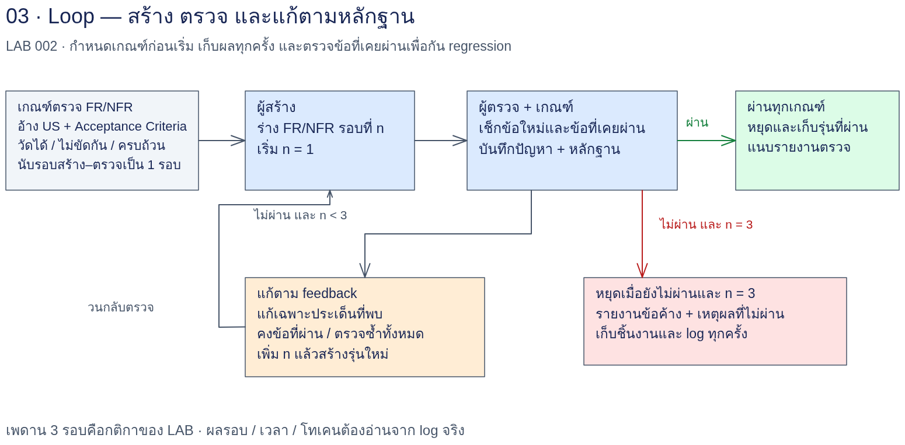

# LAB 002 — Loop Engineering: FR/NFR

## โจทย์

คุณเป็น System Analyst ของระบบสั่งอาหาร “ครัวคุณยาย” รับร่าง FR/NFR v0 จาก LAB 001 มาพัฒนาให้ครบและตรวจย้อนถึง User Story ได้ ใช้ Loop สร้าง–ตรวจ–แก้–ตรวจซ้ำ แยกผู้สร้างและผู้ตรวจคนละ session แล้วเก็บหลักฐานว่าข้อบกพร่องลดลงหรือเกิด regression

## เป้าหมาย

- ร่าง FR/NFR ครบ 18 US รักษากฎธุรกิจ ตัวเลข AC และวิธีตรวจตามต้นฉบับ
- ใช้เกณฑ์วัดได้ตรวจราย US พร้อม Feedback ที่แก้ตามได้ และตรวจข้อที่เคยผ่านซ้ำ
- ควบคุมจำนวนรอบ เวลา และงบ เก็บเหตุหยุดกับหลักฐานจริงเพื่อเปรียบเทียบวิธีทำงาน

## ความรู้ก่อนเรียน

ผ่าน [LAB 001](../001_LAB_Single_Prompt_Baseline/README.md) แล้ว มี `fr-nfr-v0.md` อ่าน FR/NFR และ AC ได้ ใช้ Bash/Python 3 เปิด Markdown และเรียก CLI ที่เตรียมไว้ได้ อ่านวิธีนำ baseline ใน [input/README.md](input/README.md) ถ้าใช้ไฟล์สำรองต้องบันทึกว่า **ใช้ผลอ้างอิง**

## เวลา

วางแผนเวลาเรียน 90–120 นาที: ทฤษฎี/เตรียม Input 15 นาที, ขั้น 01–03 30–45 นาที, ขั้น 04 30 นาที, ขั้น 05/สรุป 15–30 นาที เป็นประมาณการจัดการเรียน ไม่ใช่ผลรันจริง กำหนด Loop ไม่เกิน 3 รอบและเพดานเวลา/งบก่อนเริ่ม

## US ที่ใช้

| บทบาท | ขอบเขต |
|---|---|
| ลูกค้า | US-01, US-02, US-03, US-04, US-05, US-06, US-07, US-08 |
| พนักงานครัว/หน้าร้าน | US-10, US-11, US-12, US-13, US-15, US-16 |
| ผู้จัดการร้าน | US-19, US-20, US-25, US-26 |

รวม 18 US อ่าน [ข้อความที่คัดตรงตัว](input/user-stories-lab002.md) เทียบ [ต้นฉบับ](../docs/case-study-source.md) ขอบเขตนับจากคอลัมน์รหัสแถว การอ้างเรื่องอื่นในเซลล์เป็นข้อมูล dependency ไม่เพิ่มงาน
**US ที่เหลือจะเปิดเผยเพิ่มใน LAB 005**

## แผนภาพ Workflow



คำอธิบายทดแทนภาพ: `v0 + 18 US → generator → v1 → checker → ผลตรวจ → fixer → v2 → checker → … → หยุดตามเงื่อนไข → loop-log.json` หากภาพไม่ปรากฏให้ใช้ลำดับข้อความนี้

## สิ่งส่งมอบ

| ไฟล์นักศึกษา | เนื้อหา |
|---|---|
| `work/fr-nfr-v0.md`, `work/baseline-source.txt` | สำเนา baseline และที่มา ระบุใช้ผลอ้างอิงเมื่อใช้ไฟล์สำรอง |
| `work/fr-nfr-v1.md` ถึงรุ่นที่ตรวจจริง | ร่าง FR/NFR พร้อม traceability และตารางแก้ไข/regression เมื่อผ่าน fixer |
| `work/check-round-N.md` | ตารางผลราย US/เกณฑ์ หลักฐาน Feedback และสองบรรทัดท้าย RESULT/SCORE |
| `work/loop-log.json` | เวลา/โทเคนจาก log จริง ผลแต่ละรอบ และเหตุหยุด |
| `work/logs/` | prompt ที่เรียกจริง JSONL และ stderr ของแต่ละ call |
| `work/report.md` | การเทียบ baseline ข้อบกพร่อง/การแก้ ข้อจำกัด งบ และกิจกรรมเพิ่มเกณฑ์ |

path ใน work เป็นผลที่ผู้เรียนจะสร้าง ไม่ใช่หลักฐานที่มีแล้ว เก็บทุกเวอร์ชัน ห้ามเขียนทับผลเก่า

## Loop Engineering

Loop Engineering คือการออกแบบวงรอบ **สร้าง–ตรวจ–แก้–ตรวจซ้ำ** ให้มีเกณฑ์และทางออกชัดเจน ผู้สร้างใช้ Input สร้างร่าง ผู้ตรวจอ่านต้นฉบับและร่างอย่างอิสระ แล้วผู้แก้ใช้ Feedback เปลี่ยนเฉพาะข้อบกพร่อง ผู้ตรวจรอบใหม่ต้องตรวจทั้งเอกสารอีกครั้ง ไม่ใช่เชื่อว่าผู้แก้บอกว่าแก้แล้ว

### จาก Single Prompt มาเป็น Loop

LAB 001 ร่าง FR/NFR ด้วย Single Prompt แล้วเก็บ self-check เป็น baseline หากคำตอบดูดีแต่ลืมสัดส่วนทดสอบหรือกฎย่อย จะยังไม่มีวงรอบที่บังคับให้ซ่อมและยืนยันผล LAB 002 เพิ่มเกณฑ์ราย US ที่ตรวจตามได้และการส่ง Feedback กลับไปแก้ จึงเห็นเหตุผลของการเปลี่ยนแต่ละรุ่นและรู้ว่าเมื่อใดควรหยุด การวนหลายครั้งไม่ได้รับประกันคุณภาพถ้าเกณฑ์หรือ Input ผิด

### บทบาทและ session

Generator/ผู้สร้าง, checker/ผู้ตรวจ, fixer/ผู้แก้เป็นบทบาทในงานเดียว แต่เรียก **คนละ session ทุกขั้นและทุกรอบ** ส่งข้อมูลผ่านไฟล์ ไม่พึ่งความจำสนทนา และไม่ใช้ resume/continue ใช้โมเดลเดียวกันได้ แต่ความผิดพลาดอาจสัมพันธ์กัน นักศึกษาจึงต้องตรวจหลักฐานเทียบ US เองด้วย งานยังดำเนินในสายเดียวเป็นลำดับ ไม่ใช่แบ่งทีมย่อยทำพร้อมกัน

### เกณฑ์ประเมินที่วัดได้

ใช้ [checker-criteria.md](prompts/checker-criteria.md): ทุก US มี F = FR อ้าง US/ครบพฤติกรรม, B = กฎและตัวเลขครบ, A = AC วัดได้, V = วิธีตรวจทำตามได้, N = NFR หมวดที่เกี่ยวข้อง/เหตุผลที่ไม่เกี่ยวข้อง รวม 5 เกณฑ์ต่อ US คะแนนเต็ม 90 เป็นนิยาม rubric ไม่ใช่คะแนนผลรัน เกณฑ์ใดขาดส่วนย่อยให้ FAIL ทั้งเกณฑ์พร้อมหลักฐาน

NFR ต้องครอบคลุมประสิทธิภาพ ความพร้อมใช้งาน/ออฟไลน์ ความปลอดภัย PIN และสิทธิ์ และการติดตั้ง 30 นาทีตาม US ที่เกี่ยวข้อง ข้อมูลหมายเหตุที่ไม่มีให้เปิดเผยว่าไม่ทราบ ไม่แต่งเพื่อให้คะแนนผ่าน การตรวจเอกสาร PASS ไม่ได้แปลว่าระบบจริงผ่าน AC

### Retry กับการแก้ตาม Feedback

**Retry** คือรัน prompt เดิมกับ Input เดิมอีกครั้ง เช่น การเรียกขาดตอนแล้วเริ่มใหม่ อาจได้คำตอบต่างกัน แต่ไม่มีรายการข้อบกพร่องเป็นตัวนำ ต้องเก็บเหตุผลและนับค่าใช้จ่ายที่เพิ่ม
**แก้ตาม Feedback** คือส่งผลตรวจที่ระบุคู่ US/เกณฑ์ หลักฐานและข้อเสนอแก้ พร้อมร่างเดิมให้ fixer ได้ร่างรุ่นใหม่ แล้วตรวจซ้ำด้วยเกณฑ์เดิม ไม่ใช่บอกเพียง “ทำให้ดีขึ้น”

ตัวอย่าง Input/Output สั้น — **ตัวอย่างประกอบ — ยังไม่ได้รันจริง**: Input ร่าง US-01 เขียน “เปิดเมนูได้รวดเร็ว”; Output ที่คาดจาก checker คือ `US-01 / A / FAIL: ขาดเวลา จุดวัด และสัดส่วนผ่าน` พร้อม Feedback “คงจุดเริ่มกล้องอ่าน QR สำเร็จจนเมนูรายการแรกแสดง ภายใน 3 วินาทีบน Wi-Fi ร้าน อย่างน้อย 18 จาก 20 ครั้ง” fixer เติม AC และวิธีจับเวลาตามข้อความนั้น แล้วให้ checker ยืนยันอีกครั้ง ตัวเลขนี้มาจาก US ไม่ใช่ผลทดสอบใหม่

### เงื่อนไขหยุดและเพดาน

1. ผ่านทุกข้อ: RESULT: PASS และคะแนนเต็ม พร้อมไม่มี regression จบด้วยร่างที่ตรวจแล้ว
2. ครบเพดาน **3 รอบ**: หนึ่งรอบคือ checker ตรวจเอกสารหนึ่งรุ่นเสร็จ ถ้ายัง FAIL ให้ส่งข้อบกพร่องคงเหลือ ไม่สร้าง v4 ที่ยังไม่มีงบตรวจ
3. คะแนนไม่เพิ่ม **2 รอบติด = วนไม่คืบ**: เทียบคะแนนรอบถัดไปกับรอบก่อนหน้า รวมคะแนนลดลงด้วย หากมีการเพิ่มให้เริ่มนับใหม่ สคริปต์ใช้ตัวหารเดิมตลอดชุด
4. ถึงเพดานเวลา/งบ หรือเครื่องมือ/รายงานผิดรูปแบบ: หยุดพร้อมบันทึกเหตุ ไม่ retry ไม่จำกัดเพื่อให้ได้ PASS

ตั้ง `MAX_ROUNDS=3`, `MAX_SECONDS=1800` เป็นเพดานฝึกที่เปลี่ยนได้ภายในข้อกำหนด กำหนดงบโทเคนด้วย `MAX_TOKENS` จำนวนเต็มบวก; ค่า 0 ปิดการจำกัดโทเคน วัดเวลาจาก `date` และอ่านโทเคนจาก JSONL ไม่ได้ให้ null งบโทเคนตรวจระหว่าง call จึงอาจเกินเพดานใน call สุดท้าย และจะหยุดหากอ่าน usage ไม่ได้ขณะเปิดเพดาน งบเงินจริงต้องกำหนดและตรวจยอดของเครื่องมือเอง สคริปต์ไม่ได้คำนวณเงินจากราคาเดา

### ตรวจ regression

ข้อที่เคย PASS ต้องไม่กลับเป็น FAIL ใช้คีย์ US/เกณฑ์เดิมตลอด เช่น US-01/A เก็บผล PASS จากทุก round ไว้เทียบ รุ่นใหม่อาจเพิ่มคะแนนรวมแต่ทำกฎเดิมหายได้ จึงต้องตรวจทั้งเอกสารและตารางก่อน–หลัง ไม่ยอมให้คะแนนรวมกลบ regression ตารางที่ fixer ทำเป็นคำอธิบายผลกระทบ ยังต้องรอ checker ยืนยัน

## เตรียมก่อนขั้น 01

```bash
cd AI_Workflow_Engineering_for_SA/002_LAB_Loop_FR_NFR
mkdir -p work/logs
```

นำ baseline ตาม [input/README.md](input/README.md) มาเป็น `work/fr-nfr-v0.md` พร้อมที่มา ทุกคำสั่งต่อไปนี้รันจากโฟลเดอร์ LAB นี้ คำตอบ CLI เป็น Markdown ที่ตัวเรียกบันทึก เริ่ม session ใหม่ทุกคำสั่ง
ขั้น 01–03 ฝึกด้วยตนเองก่อน ขั้น 04 เริ่มชุดอัตโนมัติจาก v0 เดิมหลัง archive ผล manual แล้ว หากจะรันซ้ำให้เก็บผล/prompt/JSONL เดิมทั้งชุดก่อนเสมอ

## ขั้น 01 — Generator: สร้าง v1

### เป้าหมายและ Input

สร้าง work/fr-nfr-v1.md จาก work/fr-nfr-v0.md, work/baseline-source.txt, ตาราง 18 US และเกณฑ์ checker ให้ baseline มี FR/NFR ที่ตามรอยได้ ใช้ [ตาราง US](input/user-stories-lab002.md) และ [เกณฑ์ตรวจ](prompts/checker-criteria.md) เป็นหลัก

### Prompt พร้อมคัดลอก

ไฟล์ [step-01-generator.md](prompts/step-01-generator.md) ข้อความในบล็อกนี้แทรกจากไฟล์ด้วย Python ตรงทุกตัวอักษร

```text
# ขั้น 01 — Generator

## บริบท
คุณเป็นผู้สร้างร่าง FR/NFR ระบบครัวคุณยาย เริ่ม session ใหม่ในโฟลเดอร์ LAB 002 ใช้ผล LAB 001 เป็น baseline แต่ยึดตาราง US ต้นฉบับเมื่อข้อมูลต่างกัน

## งาน
สร้าง v1 สำหรับ 18 แถว US ใน input/user-stories-lab002.md เท่านั้น จาก v0 ของ LAB 001 พร้อมแก้ความไม่ครบที่พบโดยอิง checker-criteria.md
ทุก US มี FR อย่างน้อยหนึ่งข้อ อ้าง US ชัด มีกฎธุรกิจ AC ที่วัดได้ และวิธีตรวจ แยก NFR ครบหมวดที่เกณฑ์กำหนดและทำ traceability 18 แถว
รักษา FR ID ที่ยังใช้ได้ แยกกฎย่อยได้แต่ห้ามทำหาย ระบุที่มาของ baseline ว่าเป็นผลนักศึกษาหรือ “ใช้ผลอ้างอิง” ตาม baseline-source.txt

## ข้อจำกัด
ห้ามเดาเนื้อหาหมายเหตุ ก./ค./ช.
หากข้อมูลขาดให้เขียน “ไม่มีข้อมูลในต้นฉบับ” พร้อมคำถามรอยืนยัน แยกข้อเสนอออกจากข้อเท็จจริง ไม่แก้รหัส dependency ในต้นฉบับเงียบ ๆ และไม่ขยายขอบเขตจากรหัสอ้างในเซลล์
รักษาตัวเลข หน่วย สูตร สัดส่วนผ่าน จุดเริ่ม/จบเวลา สภาพเครือข่าย และกฎย่อยทุกข้อ ไม่ใช้เว็บเติมข้อกำหนด ไม่อ้างว่าการตรวจเอกสารคือผลทดสอบระบบจริง
ไม่เรียก agent เพิ่ม ไม่ใช้ resume/continue ไม่แก้ Input หรือผลเก่า หากไฟล์เป้าหมายมีแล้วให้หยุดเพื่อเก็บเป็นชุดใหม่ก่อน

## Input
path ทั้งหมดเริ่มจากโฟลเดอร์ LAB 002
- work/fr-nfr-v0.md (สำเนา baseline ตาม input/README.md)
- work/baseline-source.txt
- input/user-stories-lab002.md
- prompts/checker-criteria.md
เมื่อใช้ run-loop.sh เนื้อหา Input จะถูกแนบท้าย prompt โดยตัวเรียก ถ้า Input ขาดให้หยุด ไม่ร่างจากความจำ

## รูปแบบ Output
Markdown ภาษาไทย เริ่มด้วยขอบเขต รุ่น ที่มา baseline และสถานะ “ร่างเอกสาร ยังไม่ได้ทดสอบระบบจริง”
ตาราง FR: FR ID | US | พฤติกรรมและกฎธุรกิจ | AC | วิธีตรวจ
ตาราง NFR แยกหมวด: NFR ID | หมวด | US | ข้อกำหนดคุณภาพ | AC | วิธีตรวจ | ข้อจำกัดการพิสูจน์
ตาราง traceability 18 แถว: US | FR ID | NFR ID/เหตุผลที่ไม่เกี่ยวข้อง | ข้อมูลขาด/ข้อขัดแย้ง
ปิดท้ายด้วยรายการเปลี่ยนจาก v0 และคำถามรอยืนยัน ห้ามกรอกผล PASS หรือสถิติการรันเอง

## ตำแหน่งบันทึก
work/fr-nfr-v1.md
เมื่อเรียก CLI ส่งเอกสารฉบับเต็มเป็นคำตอบสุดท้ายให้ตัวเรียกบันทึก ไม่เขียนไฟล์เอง; เมื่อใช้ UI ให้ผู้เรียนบันทึกคำตอบที่ path นี้
```

### วิธีรันและเปิดผล

```bash
test ! -e work/fr-nfr-v1.md || exit 1
codex exec --json -o work/fr-nfr-v1.md "$(< prompts/step-01-generator.md)" < /dev/null > work/logs/generator-manual.jsonl 2> work/logs/generator-manual.stderr.txt
less work/fr-nfr-v1.md
```

กด `q` ออกจาก less หรือเปิด Markdown Preview ตรวจ exit code และ JSONL ว่าไม่มี turn.failed ก่อนนับเป็นผลสำเร็จ เก็บสำเนา prompt ที่ใช้คู่กับ log หากใช้ UI ให้บันทึกคำตอบฉบับเต็มตามตำแหน่งและเริ่มสนทนาใหม่ทุกบทบาท

### ตัวอย่างผลรันล่วงหน้า

**ผลรันจริง — Generator round-1:** สร้าง v1 สำเร็จ ใช้ 297 วินาที, input 320575 / output 16797 โทเคน และ checker ตรวจ PASS 90/90

[ฉบับเต็ม](reference/step-01/round-1/fr-nfr-v1.md) · [คำตอบ CLI](reference/step-01/round-1/output.md) · [log](reference/step-01/round-1/log.jsonl) · [run-meta](reference/step-01/round-1/run-meta.md)

ข้อความสำคัญต่อไปนี้คัดจากไฟล์จริง โดย … หมายถึงตัดตอน; ตัวเลขใน AC เป็นเกณฑ์ของระบบ ไม่ใช่ผลทดสอบระบบจริง:

- FR-01 / US-01: นับจากกล้องมือถืออ่าน QR สำเร็จ จนถึงหน้าเมนูแสดงรายการแรก ภายใน 3 วินาทีบน Wi-Fi ร้าน ในอย่างน้อย 18 จาก 20 ครั้งของชุดทดสอบ
- FR-02 / US-02: QR แต่ละโต๊ะมี URL ที่มี table_id และออเดอร์จาก QR โต๊ะทดสอบ 20 โต๊ะ มี table_id ตรงกับป้ายโต๊ะอย่างน้อย 19 จาก 20 ใบ ตรวจจากหน้าจอหน้าร้าน
- FR-03 / US-03: 1) รายการช่วงรับยาวช่วงละ 15 นาที เช่น 12:00–12:15, 12:15–12:30 และเริ่มอย่างน้อย 20 นาทีหลังเวลาสั่ง 2) ออเดอร์สั่งกลับบ้านทดสอบ 10 ใบ แสดงป้าย “สั่งกลับบ้าน” พร้อมช่วงเวลารับบนจอครัวครบทั้ง 10 ใบ
- FR-04 / US-04: 1) เมนูที่ตั้งตัวเลือกไว้แสดงตัวเลือกครบตามที่ตั้ง 2) ราคาเพิ่มรวมในยอดก่อนกดยืนยัน 3) ตัวเลือกที่เลือกปรากฏในใบครัวอย่างน้อย 19 จาก 20 ใบของชุดทดสอบ
- FR-05 / US-05: นับจากพนักงานครัวกดปุ่มเปลี่ยนสถานะ จนถึงหน้าจอลูกค้าที่โต๊ะแสดงสถานะใหม่โดยไม่รีเฟรช ภายใน 5 วินาทีบน LAN ในร้าน ในอย่างน้อย 18 จาก 20 ครั้งของชุดทดสอบ
- FR-06 / US-06: 1) นับจากครัวกด “วัตถุดิบหมด” จนถึงหน้าลูกค้าแสดงป้าย “หมด” และปุ่มสั่งถูกปิด ภายใน 10 วินาทีบน LAN ในร้าน ในอย่างน้อย 9 จาก 10 ครั้ง 2) เมื่อพยายามสั่งเมนูที่ปิดแล้ว ระบบปฏิเสธพร้อมข้อความแจ้ง
- FR-07 / US-07: 1) แสดงเวลารอทุกออเดอร์ คำนวณจากสูตร: (จำนวนออเดอร์ค้างในคิวครัวที่ยังไม่ “พร้อมเสิร์ฟ” × เวลาเฉลี่ยต่อออเดอร์ 7 วันล่าสุด) + เวลาเฉลี่ยต่อเมนูของเมนูที่นานที่สุดในตะกร้า 2) เวลาจริงวัดจาก “ลูกค้ากดยืนยันสั่ง” ถึง “ครัวกดสถานะพร้อมเสิร์ฟ” จ …
- FR-08 / US-08: 1) ยอดรวมหน้าสรุปลูกค้าตรงกับจอหน้าร้านอย่างน้อย 19 จาก 20 ใบ และเลือกวิธีจ่ายได้ 2 แบบทุกออเดอร์ 2) เลือก PromptPay แล้วคง “ค้างจ่าย” จนหน้าร้านยืนยันสลิป 3) เมื่อไม่ยืนยันสลิปภายใน 10 นาที หรือปิด PromptPay หน้าลูกค้าแจ้งให้ชำระเงินสดที่ห …
- FR-10 / US-10: 1) จากลูกค้ากดยืนยันสั่งถึงจอครัวแสดงออเดอร์ใหม่ ภายใน 3 วินาทีบน LAN ในร้าน อย่างน้อย 18 จาก 20 ใบ 2) เรียงตาม timestamp ฝั่งเซิร์ฟเวอร์ที่รับคำสั่ง ความละเอียดวินาที จากน้อยไปมาก เมื่อ timestamp เท่ากันหรือออเดอร์เข้าพร้อมกัน เรียงตามเลขอ …
- FR-11 / US-11: เปลี่ยนสถานะได้ใน 1 แตะ นับจากกดปุ่มบนจอครัว จนถึงจอหน้าร้านแสดงสถานะใหม่ ภายใน 5 วินาทีบน LAN ในร้าน ในอย่างน้อย 18 จาก 20 ครั้ง
- FR-12 / US-12: เตรียมแมปไว้ล่วงหน้าตามข้อความอ้างหมายเหตุ ค. เมื่อกดหมด 1 ครั้ง ผลปิดทั้งเมนูหรือเฉพาะตัวเลือกเป็นไปตามแมป และเมนูหลักของกรณีเฉพาะตัวเลือกยังสั่งได้ ทดสอบวัตถุดิบ 5 ชนิด ผลตรงกติกาอย่างน้อย 5 จาก 5
- FR-13 / US-13: 1) จากกด “กลับมามี” ถึงหน้าลูกค้าเปิดปุ่มสั่งคืน ภายใน 10 วินาทีบน LAN ในร้าน อย่างน้อย 9 จาก 10 ครั้ง 2) เมนู/ตัวเลือกที่กลับมาตรงกับชุดที่ถูกปิดจากวัตถุดิบนั้น
- FR-15 / US-15: 1) แสดงหมายเลขโต๊ะจาก table_id และเลขรับกลับบ้านรูปแบบ T-001, T-002, … ต่อเนื่องอัตโนมัติ รีเซ็ตเป็น T-001 เมื่อเริ่มวันใหม่ 00:00 ครบทุกออเดอร์ 20 จาก 20 ใบ 2) ออเดอร์ใหม่ = “ยังไม่จ่าย”; เลือก PromptPay = “ค้างจ่าย”; กด “รับเงินสด” หรือ “ …
- FR-25 / US-25: 1) ชื่อผู้ใช้เป็นตัวอักษร/ตัวเลข 3–20 ตัว และ PIN ตัวเลข 4–6 หลัก 2) เข้าสู่ระบบด้วยชื่อผู้ใช้+PIN โดยไม่ต้องใช้อีเมล 3) PIN ผิด 5 ครั้งติดถูกล็อก 5 นาที 4) บัญชีสิทธิ์ครัว/หน้าร้านเปิด URL หน้ารายงานและหน้าจัดการเมนูถูกปฏิเสธ ทดสอบ 3 บัญชี …
- FR-26 / US-26: 1) ติดตั้งบน Ubuntu ด้วยสคริปต์เดียว ภายใน 30 นาที นับจากรันสคริปต์จนเปิดหน้าเมนูจากมือถือในร้านได้ 2) เก็บข้อมูลบนเครื่องในร้าน 3) เมื่อถอดสายอินเทอร์เน็ตภายนอก ยังสั่ง/เปลี่ยนสถานะ/ปิดโต๊ะได้ครบ 20 ใบของชุดทดสอบ ยกเว้นการตรวจสอบยอดโอน Pro …

### เปรียบเทียบและตรวจผ่าน

ตรวจว่า 18 US มี FR จริงไม่ใช่มีชื่ออย่างเดียว NFR ครบหมวด กฎย่อยไม่หายจาก v0 และที่มา baseline ถูกต้อง ถ้อยคำหรือลำดับต่างได้ แต่ตัวเลข/หน่วย/สูตรต้องตรง เปิดเทียบ US ทีละแถว เปิดผลอ้างอิงจริงในส่วนข้างต้นเทียบกับต้นฉบับและเกณฑ์ ผลเอกสาร PASS ไม่ใช่ผลทดสอบระบบจริง

### แก้ไขและส่งต่อ

ส่ง v1 ไป checker แม้ยังมีข้อสงสัย อย่าแก้ทับ v0 หรืออ้างว่าผ่านจากผู้สร้าง หาก Input ขาดหรือไฟล์ว่างให้แก้ทางเข้าและเก็บเหตุขัดข้องก่อนเริ่มชุดใหม่

## ขั้น 02 — Checker: ให้คะแนนราย US

### เป้าหมายและ Input

ตรวจ v1 ใน session ใหม่ด้วยตาราง US และ checker-criteria.md เขียน work/check-round-1.md รอบถัดไปใช้เลข N ที่ตรงกับรุ่นร่าง ใช้ [ตาราง US](input/user-stories-lab002.md) และ [เกณฑ์ตรวจ](prompts/checker-criteria.md) เป็นหลัก

### Prompt พร้อมคัดลอก

ไฟล์ [step-02-checker.md](prompts/step-02-checker.md) ข้อความในบล็อกนี้แทรกจากไฟล์ด้วย Python ตรงทุกตัวอักษร

```text
# ขั้น 02 — Checker

## บริบท
คุณเป็นผู้ตรวจอิสระจากผู้สร้าง เริ่ม session ใหม่ในโฟลเดอร์ LAB 002 อ่านหลักฐานจากไฟล์เท่านั้น อย่าเชื่อข้อความว่าครบหรือผ่านในร่างโดยไม่ตรวจเนื้อหา

## งาน
ตรวจ work/fr-nfr-vN.md ของรอบ N ตาม prompts/checker-criteria.md ให้คะแนนรายคู่ US × เกณฑ์ทุกคู่ เกณฑ์ละ 1 เมื่อ PASS หรือ 0 เมื่อ FAIL ห้ามให้คะแนนบางส่วน
ตรวจทุก US ทุกกฎย่อย และ NFR ที่เกี่ยวข้อง เทียบผลตรวจรอบก่อนทั้งหมดเพื่อหา regression ของคู่ที่เคย PASS แม้คะแนนรวมเพิ่มก็ต้องรายงาน
ระบุ FR/NFR ID และข้อความหลักฐานเทียบต้นฉบับ ข้อ FAIL ต้องมี Feedback ที่ผู้แก้ทำตามได้ ตรวจอย่างเดียว ห้ามแก้ร่างหรือเปลี่ยนเกณฑ์เพื่อให้ผ่าน

## ข้อจำกัด
ห้ามเดาเนื้อหาหมายเหตุ ก./ค./ช.
หากข้อมูลขาดให้เขียน “ไม่มีข้อมูลในต้นฉบับ” พร้อมคำถามรอยืนยัน แยกข้อเสนอออกจากข้อเท็จจริง ไม่แก้รหัส dependency ในต้นฉบับเงียบ ๆ และไม่ขยายขอบเขตจากรหัสอ้างในเซลล์
รักษาตัวเลข หน่วย สูตร สัดส่วนผ่าน จุดเริ่ม/จบเวลา สภาพเครือข่าย และกฎย่อยทุกข้อ ไม่ใช้เว็บเติมข้อกำหนด ไม่อ้างว่าการตรวจเอกสารคือผลทดสอบระบบจริง
ไม่เรียก agent เพิ่ม ไม่ใช้ resume/continue ไม่แก้ Input หรือผลเก่า หากไฟล์เป้าหมายมีแล้วให้หยุดเพื่อเก็บเป็นชุดใหม่ก่อน

## Input
- input/user-stories-lab002.md
- prompts/checker-criteria.md
- work/fr-nfr-vN.md
- work/check-round-1.md ถึง work/check-round-(N-1).md (รอบแรกไม่มีผลก่อนหน้า)
N เป็นเลขรอบตรวจ: ถ้าไม่ได้ระบุให้ใช้ N=1; run-loop.sh จะแนบเลขรอบ ร่างปัจจุบัน และผลก่อนหน้าทั้งหมด ไม่เดาเลือกไฟล์รุ่นล่าสุดเอง

## รูปแบบ Output
ห้ามใช้เครื่องหมาย '|' ภายในเซลล์หลักฐาน ข้อบกพร่อง หรือ Feedback รวมถึงเซลล์อื่นของตาราง แม้อยู่ใน code span หรือใส่ backslash ให้ใช้คำว่า “หรือ” หรือเครื่องหมาย / แทน และใช้ '|' เฉพาะแบ่งคอลัมน์ เพื่อให้สคริปต์อ่านตารางได้ตรงกัน
Markdown ตาม checker-criteria.md มีตารางรายคู่ US × เกณฑ์ ตามด้วยตาราง regression และข้อเสนอแก้
สองบรรทัดสุดท้ายต้องเป็นข้อความล้วนตามลำดับนี้ (แทน x/y ด้วยจำนวนเต็มจริง):
RESULT: PASS หรือ RESULT: FAIL (เลือกเพียงค่าเดียว ห้ามคัดคำว่า “หรือ” ไปในผล)
SCORE: x/y
RESULT: PASS ได้ต่อเมื่อทุกคู่ PASS และไม่มี regression; กรณีอื่น RESULT: FAIL ผลที่ตรวจไม่ได้ให้ FAIL พร้อมเหตุผล ไม่ละแถว
ห้ามมี code fence หรือข้อความใดหลัง SCORE และห้ามใช้ RESULT:/SCORE: ที่อื่นในรายงาน

## ตำแหน่งบันทึก
work/check-round-N.md (รอบแรก work/check-round-1.md)
เมื่อเรียก CLI ส่งรายงานฉบับเต็มเป็นคำตอบสุดท้ายให้ตัวเรียกบันทึก ไม่เขียนไฟล์เอง; เมื่อใช้ UI ให้ผู้เรียนบันทึกคำตอบที่ path นี้
```

### วิธีรันและเปิดผล

```bash
test ! -e work/check-round-1.md || exit 1
codex exec --json -o work/check-round-1.md "$(< prompts/step-02-checker.md)" < /dev/null > work/logs/checker-manual.jsonl 2> work/logs/checker-manual.stderr.txt
less work/check-round-1.md
tail -n 2 work/check-round-1.md
```

กด `q` ออกจาก less หรือเปิด Markdown Preview ตรวจ exit code และ JSONL ว่าไม่มี turn.failed ก่อนนับเป็นผลสำเร็จ เก็บสำเนา prompt ที่ใช้คู่กับ log หากใช้ UI ให้บันทึกคำตอบฉบับเต็มตามตำแหน่งและเริ่มสนทนาใหม่ทุกบทบาท

### ตัวอย่างผลรันล่วงหน้า

**ผลรันจริง — Checker round-1: PASS 90/90; FAIL 0 คู่** ใช้ 173 วินาที, input 377083 / output 9111 โทเคน

[รายงานฉบับเต็ม](reference/step-02/round-1/feedback.md) · [log](reference/step-02/round-1/log.jsonl) · [run-meta](reference/step-02/round-1/run-meta.md)

ตัวอย่างหลักฐาน 15 คู่จากรายงานจริง (ตัดตอนด้วย …):

- US-01/F — PASS: FR-01 อ้าง US-01 ระบุ “สแกน QR ที่โต๊ะแล้วเปิดเมนูได้โดยไม่ต้องล็อกอิน” ตรงพฤติกรรมต้นฉบับ
- US-01/B — PASS: FR-01 คงการไม่ล็อกอินและกฎจากกล้องอ่าน QR สำเร็จถึงรายการแรกแสดง ภายใน 3 วินาที บน Wi-Fi ร้าน อย่างน้อย 18 จาก 20 ครั้ง
- US-01/A — PASS: AC ของ FR-01 ระบุจุดเริ่มกล้องอ่านสำเร็จ จุดจบรายการแรกแสดง เครือข่าย เวลา และสัดส่วน 18 จาก 20 ตรงต้นฉบับ
- US-01/V — PASS: FR-01 เตรียม QR กับมือถือบน Wi-Fi โดยไม่ล็อกอิน สแกน 20 ครั้ง บันทึกสองเหตุการณ์ คำนวณเวลาและนับครั้งที่ไม่เกิน 3 วินาที
- US-01/N — PASS: NFR-01 อ้าง US-01 หมวดประสิทธิภาพ/เวลาตอบสนอง มีเกณฑ์ 3 วินาที อย่างน้อย 18 จาก 20 และวิธีวัดตาม FR-01
- US-15/F — PASS: FR-15 อ้าง US-15 แยกออเดอร์โต๊ะกับกลับบ้าน แสดงเลขที่เกี่ยวข้อง คำนวณสถานะจ่ายจากเหตุการณ์ และบันทึกผู้ใช้กับเวลาการกดยืนยัน
- US-15/B — PASS: FR-15 คง table_id จาก QR เลขรับ T-001, T-002 ต่อเนื่องอัตโนมัติ รีเซ็ต T-001 เวลา 00:00 รวมสามสถานะตามเหตุการณ์และ log ผู้ใช้/เวลาทุกครั้ง
- US-15/A — PASS: FR-15 AC 1–3 กำหนดเลขโต๊ะ/เลขรับครบ 20 จาก 20; ออเดอร์ใหม่=ยังไม่จ่าย เลือก PromptPay=ค้างจ่าย รับเงินสดหรือยืนยันสลิป=จ่ายแล้ว ตรง log 20 จาก 20; log การกดมีผู้ใช้และเวลาทุกครั้ง 20 จาก 20
- US-15/V — PASS: FR-15 เตรียม 20 ใบครอบคลุมโต๊ะ/กลับบ้านและสองปุ่มรับเงิน ตรวจเลขก่อนและหลัง 00:00 เทียบสถานะกับ log เหตุการณ์ และเทียบผู้ใช้กับเวลาทุกการกดแยกกัน
- US-15/N — PASS: NFR-19 อ้าง US-15 หมวดความปลอดภัย/ตรวจสอบย้อนกลับ กำหนด log ชื่อผู้ใช้และเวลาทุกการกด 20 จาก 20 พร้อมวิธีเทียบเหตุการณ์กับ FR-15
- US-26/F — PASS: FR-26 อ้าง US-26 ติดตั้งสคริปต์เดียวบน Ubuntu เครื่องเดียว เก็บข้อมูลในร้าน ใช้ Wi-Fi ร้านและทำงานหลักได้เมื่ออินเทอร์เน็ตภายนอกหลุด
- US-26/B — PASS: FR-26 คงติดตั้ง 30 นาทีจากรันสคริปต์ถึงมือถือเปิดเมนูได้ เก็บข้อมูลในร้าน และถอดสายภายนอกยังสั่ง/เปลี่ยนสถานะ/ปิดโต๊ะครบ 20 ใบ ยกเว้นตรวจยอดโอน PromptPay ที่พนักงานยืนยันด้วยตา
- US-26/A — PASS: FR-26 AC 1–3 ครบสคริปต์เดียว Ubuntu จุดเริ่ม/จบ 30 นาที ที่เก็บข้อมูล และทั้งสามงานครบ 20 ใบเมื่อถอดสายภายนอก พร้อมข้อยกเว้น PromptPay ตรงต้นฉบับ
- US-26/V — PASS: FR-26 เตรียม Ubuntu กับมือถือบน Wi-Fi บันทึกสภาพเริ่ม จับเวลารันสคริปต์ถึงเปิดเมนู ตรวจที่เก็บข้อมูล ถอดสายภายนอกโดย LAN/Wi-Fi ยังทำงาน แล้วทำสามขั้นตอนครบ 20 ใบและเก็บจอ/ข้อมูล/log
- US-26/N — PASS: NFR-16 อ้าง US-26 หมวดความพร้อมใช้งาน/ออฟไลน์ ครบ 20 ใบพร้อมข้อยกเว้น; NFR-22 แยกหมวดติดตั้ง 30 นาที มีจุดวัดและวิธีตรวจบน Ubuntu กับมือถือครบ

สองบรรทัดสุดท้ายในไฟล์จริง:
```text
RESULT: PASS
SCORE: 90/90
```

### เปรียบเทียบและตรวจผ่าน

ตรวจตารางหลักครบ 18 × 5 คู่ ทุก FAIL มีหลักฐาน/Feedback คะแนนเท่าจำนวน PASS และ RESULT สอดคล้องกัน สองบรรทัดท้ายต้องเป็นข้อความล้วน SCORE เป็นบรรทัดสุดท้าย รอบแรกระบุไม่มีผลก่อนหน้า; รอบถัดไปมี regression เปิดผลอ้างอิงจริงในส่วนข้างต้นเทียบกับต้นฉบับและเกณฑ์ ผลเอกสาร PASS ไม่ใช่ผลทดสอบระบบจริง

### แก้ไขและส่งต่อ

หาก PASS ให้นักศึกษาตรวจหลักฐานซ้ำแล้วจบชุดนี้ หาก FAIL และยังมีงบส่งรายงานพร้อมร่างให้ fixer หากรูปแบบผิดไม่แก้คะแนนด้วยมือ ให้บันทึกปัญหาและเริ่มชุดที่แก้ prompt แล้วโดยเก็บชุดเดิม

## ขั้น 03 — Fixer: แก้เฉพาะ FAIL

### เป้าหมายและ Input

รับ work/fr-nfr-vN.md, ผลตรวจรอบ N และรอบก่อนทั้งหมด พร้อม US/เกณฑ์เดิม เขียน work/fr-nfr-v(N+1).md ใช้ขั้นนี้เฉพาะเมื่อ FAIL และยังมีรอบตรวจเหลือ ใช้ [ตาราง US](input/user-stories-lab002.md) และ [เกณฑ์ตรวจ](prompts/checker-criteria.md) เป็นหลัก

### Prompt พร้อมคัดลอก

ไฟล์ [step-03-fixer.md](prompts/step-03-fixer.md) ข้อความในบล็อกนี้แทรกจากไฟล์ด้วย Python ตรงทุกตัวอักษร

```text
# ขั้น 03 — Fixer

## บริบท
คุณเป็นผู้แก้ร่าง FR/NFR ระบบครัวคุณยาย เริ่ม session ใหม่ในโฟลเดอร์ LAB 002 ใช้ Feedback จากผู้ตรวจเป็นรายการงาน โดยยังยึด US ต้นฉบับเป็นหลัก

## งาน
แก้เฉพาะข้อ FAIL ใน work/check-round-N.md เขียนร่างฉบับเต็มรุ่น v(N+1) ที่นำไปตรวจต่อได้ ไม่ส่งเพียง diff
รักษาข้อที่ PASS และ FR/NFR ID เดิม หากแก้ส่วนร่วมที่กระทบข้อผ่านให้ระบุเหตุผลและตรวจผลกระทบทุกคู่ ห้ามลบกฎเดิมเพื่อทำให้คะแนนสูงขึ้น
เพิ่มตารางแก้ไข: คู่ US/เกณฑ์ FAIL | Feedback | สิ่งที่แก้ | FR/NFR ID | ผลกระทบ
เพิ่มตาราง regression ของทุกคู่ที่เคย PASS ในผลตรวจรอบใดก็ตาม อ้างตำแหน่งก่อน–หลังและหลักฐานว่ายังคงกฎเดิม ระบุ “รอ checker ยืนยัน” ไม่สรุปผ่านแทนผู้ตรวจ
ถ้า Feedback ขัด US ให้คงต้นฉบับและอธิบายข้อขัดแย้ง ถ้าข้อมูลขาดให้ตั้งคำถาม ไม่เติมคำตอบเพื่อให้ผ่าน

## ข้อจำกัด
ห้ามเดาเนื้อหาหมายเหตุ ก./ค./ช.
หากข้อมูลขาดให้เขียน “ไม่มีข้อมูลในต้นฉบับ” พร้อมคำถามรอยืนยัน แยกข้อเสนอออกจากข้อเท็จจริง ไม่แก้รหัส dependency ในต้นฉบับเงียบ ๆ และไม่ขยายขอบเขตจากรหัสอ้างในเซลล์
รักษาตัวเลข หน่วย สูตร สัดส่วนผ่าน จุดเริ่ม/จบเวลา สภาพเครือข่าย และกฎย่อยทุกข้อ ไม่ใช้เว็บเติมข้อกำหนด ไม่อ้างว่าการตรวจเอกสารคือผลทดสอบระบบจริง
ไม่เรียก agent เพิ่ม ไม่ใช้ resume/continue ไม่แก้ Input หรือผลเก่า หากไฟล์เป้าหมายมีแล้วให้หยุดเพื่อเก็บเป็นชุดใหม่ก่อน

## Input
- input/user-stories-lab002.md
- prompts/checker-criteria.md
- work/fr-nfr-vN.md
- work/check-round-N.md และผลตรวจรอบก่อนหน้าทั้งหมด
N เป็นเลขรอบตรวจที่ FAIL: ถ้าไม่ได้ระบุให้ใช้ N=1; run-loop.sh จะแนบร่างและผลตรวจที่ตรงรุ่น

## รูปแบบ Output
Markdown ฉบับเต็มรูปแบบเดียวกับ generator: ขอบเขตและที่มา baseline, ตาราง FR, NFR แยกหมวด, traceability 18 แถว, ข้อมูลขาดและข้อขัดแย้ง
ตามด้วยตารางแก้ไขและตาราง regression: US | เกณฑ์ | รอบที่เคย PASS | หลักฐานเดิม | หลักฐานในรุ่นใหม่ | สถานะรอ checker ยืนยัน
ห้ามเปลี่ยนเกณฑ์ ห้ามอ้างผลทดสอบระบบจริง และไม่สร้างบรรทัด RESULT:/SCORE: ของผู้ตรวจ

## ตำแหน่งบันทึก
work/fr-nfr-v(N+1).md (แก้รอบแรกเป็น work/fr-nfr-v2.md)
เมื่อเรียก CLI ส่งเอกสารฉบับเต็มเป็นคำตอบสุดท้ายให้ตัวเรียกบันทึก ไม่เขียนไฟล์เอง; เมื่อใช้ UI ให้ผู้เรียนบันทึกคำตอบที่ path นี้
```

### วิธีรันและเปิดผล

```bash
test ! -e work/fr-nfr-v2.md || exit 1
codex exec --json -o work/fr-nfr-v2.md "$(< prompts/step-03-fixer.md)" < /dev/null > work/logs/fixer-manual.jsonl 2> work/logs/fixer-manual.stderr.txt
less work/fr-nfr-v2.md
diff -u work/fr-nfr-v1.md work/fr-nfr-v2.md
```

กด `q` ออกจาก less หรือเปิด Markdown Preview ตรวจ exit code และ JSONL ว่าไม่มี turn.failed ก่อนนับเป็นผลสำเร็จ เก็บสำเนา prompt ที่ใช้คู่กับ log หากใช้ UI ให้บันทึกคำตอบฉบับเต็มตามตำแหน่งและเริ่มสนทนาใหม่ทุกบทบาท

### ตัวอย่างผลรันล่วงหน้า

**ผลลูปหลัก:** ขั้น Fixer ไม่ถูกเรียก เพราะ checker round-1 ผ่าน 90/90 รายการด้านล่างอธิบายลูปหลัก ส่วนหลักฐานการแก้ตาม Feedback และตรวจซ้ำที่รันจริงอยู่ในชุดสาธิต E1 แยกตามลิงก์ด้านล่าง

- Prompt สำหรับเรียนรู้ขั้นนี้: [step-03-fixer.md](prompts/step-03-fixer.md)
- ร่างที่ตรวจจริงคือ [v1](reference/step-01/round-1/fr-nfr-v1.md)
- [รายงาน checker](reference/step-02/round-1/feedback.md) ตรวจครบ 18 US
- เกณฑ์ F/B/A/V/N มีรวม 90 คู่
- ผลที่อ่านจากท้ายรายงานคือ PASS
- คะแนนจากรายงานคือ 90/90
- จำนวนข้อ FAIL ที่จะส่งให้ fixer ในลูปหลักคือ 0
- [loop-log.json](reference/loop-log.json) ระบุ stop_reason เป็น pass
- ชุดสาธิต E1 แยกเรียก fixer 1 ครั้ง: checker รอบแรก FAIL 92/108 → แก้เป็น v2-e1 → checker รอบ 2 PASS 108/108; regression 0 คู่ ดู [ผลจริงและหลักฐานการแก้–ตรวจซ้ำ](reference/e1-set/summary-e1.md) โดยไฟล์ส่งต่อของลูปหลักยังเป็น v1
- ระยะเวลา/โทเคนของ fixer: ไม่มีข้อมูล เพราะไม่ได้เรียกในลูปหลัก
- ไม่มีไฟล์ output/log/run-meta ของ fixer ในลูปหลักที่จะอ้างเป็นผลจริงในลูปหลัก
- ผลรุ่นสุดท้ายยังเป็น v1
- ยังวัดการลดข้อบกพร่องจากการแก้หลายรอบไม่ได้
- regression ระหว่างรุ่นหลังแก้ยังประเมินไม่ได้ เพราะไม่มีรุ่นหลังแก้ในลูปหลัก
- ผู้เรียนที่ checker ให้ FAIL ต้องส่ง Feedback และร่างที่ตรงรุ่นให้ fixer ใน session ใหม่
- ส่งต่อ [ไฟล์อ้างอิงที่ผ่านแล้ว](reference/final/fr-nfr-input.md) พร้อมผลตรวจของชุดนี้ได้


### เปรียบเทียบและตรวจผ่าน

ใช้ diff ตรวจว่าเปลี่ยนเฉพาะข้อบกพร่องหรือส่วนร่วมที่อธิบายผลกระทบไว้ ข้อ PASS เดิมต้องยังครบ ตัวเลขไม่เปลี่ยน FR ID คงเดิมหรือมี mapping และตาราง regression ครบคู่ที่เคยผ่าน diff exit code 1 แปลว่าไฟล์ต่างกัน ไม่ใช่ CLI ล้มเหลว เปิดผลอ้างอิงจริงในส่วนข้างต้นเทียบกับต้นฉบับและเกณฑ์ ผลเอกสาร PASS ไม่ใช่ผลทดสอบระบบจริง

### แก้ไขและส่งต่อ

ส่งรุ่นใหม่ให้ checker session ใหม่โดยระบุ N=2 และตำแหน่ง check-round-2.md ชัดเจน ห้ามใช้ prompt ค่าเริ่มต้น N=1 ตรวจผิดรุ่น ขั้น 04 จะจัดการเลขรอบและแนบผลเก่าให้อัตโนมัติ

## ขั้น 04 — วนรอบด้วย run-loop.sh

### เป้าหมายและ Input

ทำวงรอบครบด้วย [run-loop.sh](input/run-loop.sh) และ [loop-support.py](input/loop-support.py) จาก v0/ที่มา baseline พร้อม US และ prompt ทั้งสามฉบับ ใช้ [schema](input/loop-log.schema.json) กำกับ log ทุก call เป็น session ใหม่
ก่อนรันเก็บชุด manual รวม v1/v2/ผลตรวจ/log ไว้ตามวิธี archive ใน [input/README.md](input/README.md) สคริปต์ตั้งใจปฏิเสธ work ที่มีผลเดิมเพื่อไม่เขียนทับหลักฐาน

### Prompt พร้อมคัดลอก

ขั้นนี้ใช้คำสั่งควบคุมด้านล่างเป็นคำสั่งที่คัดลอกรันได้ สคริปต์อ่าน prompt ขั้น 01–03 จากไฟล์โดยตรง แล้วแนบ Input เลขรอบ N และผลตรวจก่อนหน้าทั้งหมด ไม่ต้องสร้าง prompt ให้ AI ควบคุม Loop อีกชั้น

```bash
MAX_ROUNDS=3 MAX_SECONDS=1800 MAX_TOKENS=0 AI_CMD='codex exec' bash input/run-loop.sh
```

หากเลือกอีกเครื่องมือ ให้รันในชุดใหม่ที่ archive แล้วด้วย `AI_CMD='claude -p' bash input/run-loop.sh` ไม่รันสองคำสั่งทับชุดเดียวกัน ค่าเวลาข้างต้นคือเพดานฝึก ไม่ใช่ผลรัน

### วิธีรันและเปิดผล

รันคำสั่งด้านบนแล้วจด exit code ทันที จากนั้นเปิดผล:

```bash
python3 -m json.tool work/loop-log.json
less work/check-round-1.md
```

เลือกเปิด check และร่างรุ่นสุดท้ายตาม `rounds` ใน loop-log ไม่เดาจากชื่อไฟล์ เวลา started/finished/wall มาจาก date โทเคนมาจาก log JSONL ไม่พบให้ null ดู `stop_reason` แยก pass, max_rounds, no_improvement, time_limit, token_limit, token_usage_unknown และข้อผิดพลาด
Exit 0 คือ PASS; exit 1 คือยัง FAIL เมื่อครบเพดานรอบหรือวนไม่คืบ; exit 2 คือถึงเพดานงบ/เวลา หรือมีข้อผิดพลาด; 130 คือขัดจังหวะ รายละเอียดอยู่ใน input/README.md

### ตัวอย่างผลรันล่วงหน้า

**ผลรันจริง — ลูปหยุดที่ checker round-1 เพราะ PASS** รันมือเรียงตาม run-loop.sh และใช้ loop-support.py ตรวจผล ไม่มีการเรียก fixer ต่อหลังผ่าน

[ทุก call และ usage](reference/loop-log.json) · [รูปแบบ schema เดิม](reference/loop-log.schema-compatible.json) · [run-meta ทั้งชุด](reference/run-meta.md) · [สรุปและ before/after](reference/loop-summary.md)

ค่าต่อไปนี้มาจากหลักฐานจริง:

```json
{
  "started_at": "2026-09-14T11:01:00Z",
  "finished_at": "2026-09-14T11:08:59Z",
  "wall_seconds": 479,
  "duration_s": 470,
  "total_tokens": 723566,
  "rounds": [
    {
      "step": "step-01",
      "round": 1,
      "log": "reference/step-01/round-1/log.jsonl",
      "duration_s": 297,
      "input_tokens": 320575,
      "output_tokens": 16797,
      "cached_input_tokens": 279296,
      "reasoning_output_tokens": 564,
      "result": "n/a",
      "score": null,
      "score_possible": null,
      "output": "reference/step-01/round-1/fr-nfr-v1.md"
    },
    {
      "step": "step-02",
      "round": 1,
      "log": "reference/step-02/round-1/log.jsonl",
      "duration_s": 173,
      "input_tokens": 377083,
      "output_tokens": 9111,
      "cached_input_tokens": 333056,
      "reasoning_output_tokens": 257,
      "result": "PASS",
      "score": 90,
      "score_possible": 90,
      "output": "reference/step-02/round-1/feedback.md"
    }
  ],
  "stop_reason": "pass",
  "checker_rounds": 1,
  "final_document": "reference/final/fr-nfr-input.md",
  "schema_compatible_log": "reference/loop-log.schema-compatible.json"
}
```

รวมเวลาการเรียก 470 วินาที; wall ทั้งชุด 479 วินาทีรวมช่วงส่งต่อ 9 วินาที ไม่รวมการจัดทำสรุป ไม่มีหลักฐานค่าใช้จ่ายเงินจริง


### เปรียบเทียบและตรวจผ่าน

ตรวจ RESULT/SCORE ท้ายไฟล์ตรงตารางและ log, จำนวนรอบไม่เกิน MAX_ROUNDS, ไม่มี fixer หลัง PASS/รอบสุดท้าย, แต่ละ call มี JSONL/stderr และเวลา, ค่าไม่ทราบเป็น null ไม่ใช่ศูนย์ ตรวจทุก regression แม้คะแนนรวมเพิ่ม
สคริปต์อ่าน RESULT ด้วย grep หลังตรวจรูปแบบตารางและคะแนนด้วย Python แล้ว และทบทวนคู่ที่เคย PASS จากทุก round แต่ความถูกต้องของหลักฐานเชิงเนื้อหายังต้องให้นักศึกษาตรวจ

### แก้ไขและส่งต่อ

PASS แล้วส่งร่างรุ่นสุดท้ายพร้อมผลตรวจและ log หากหยุดทั้งที่ FAIL ให้ส่งข้อบกพร่องคงเหลือกับเหตุหยุด เช่น Input คลุมเครือ เกณฑ์ไม่ชัด หรือวนไม่คืบ ไม่เพิ่มเพดานเกิน 3 รอบเพื่อไล่คะแนน เมื่อแก้ prompt หรือ Input ให้เริ่มชุดใหม่เก็บชุดเดิมไว้ รายงานค่าใช้จ่ายที่ไม่มีหลักฐานว่า “ไม่มีข้อมูล”

## ขั้น 05 — กิจกรรมปรับ prompt เอง

ทำหลังขั้นหลักครบแล้ว แม้หยุดด้วย FAIL ก็ต้องบันทึกเหตุหยุดก่อน เก็บ Input, prompt, เกณฑ์ และผลชุดเดิม จากนั้นเริ่มชุดใหม่จาก v0 เดียวกันและเลือกเครื่องมือ/เพดานเหมือนเดิม
เพิ่มเกณฑ์ที่วัดได้หนึ่งข้อใน checker-criteria.md เป็นบรรทัดเดี่ยวตามรูปแบบ:

```text
เกณฑ์เพิ่ม: E1 | AC แต่ละข้อมีรหัสไม่ซ้ำและวิธีตรวจอ้างรหัสนั้นตรงกันทุกข้อ
```

ปรับถ้อยคำของเงื่อนไขนี้เองให้ตรวจได้และอธิบายเหตุผล เพิ่มเกณฑ์นี้กับทุก US ตัวเรียกจะตรวจตาราง E1 เพิ่มด้วย คะแนนเต็มเปลี่ยนตามเกณฑ์ในชุดใหม่ ห้ามเปลี่ยนกลาง Loop
รันขั้น 04 อีกชุด แล้วเทียบจำนวนรอบจนหยุด/เหตุหยุด เวลา โทเคน และสัดส่วนคะแนนตามตัวหารของแต่ละชุด หากทั้งคู่ครบเพดานแล้วยัง FAIL ให้เขียนว่า “ยังสรุปจำนวนรอบจนผ่านไม่ได้” ไม่สรุปว่าเกณฑ์ใหม่ไม่มีผลเพียงเพราะชนเพดานเดียวกัน
บันทึกใน work/report.md ว่าเกณฑ์ที่เพิ่มทำให้รอบเพิ่ม ลด หรือไม่เปลี่ยน พร้อมหลักฐาน; ถ้ายังไม่รันให้ใส่ “ไม่มีข้อมูล” ความต่างหนึ่งชุดยังไม่พิสูจน์เหตุ–ผลเพราะคำตอบ AI อาจแปรผัน

### ตัวอย่างผลรันล่วงหน้า — ชุดสาธิต E1 ที่รันจริง

ชุดนี้เป็นการสาธิตแยก ไม่ใช่ผลของลูปหลัก และไฟล์ส่งต่อไป LAB 003 ยังคงเป็น final/fr-nfr-input.md (v1) หรือ [ไฟล์อ้างอิงใน reference/final](reference/final/fr-nfr-input.md)

ใช้ [v1 เดิม](reference/step-01/round-1/fr-nfr-v1.md) เป็นจุดเริ่มของการตรวจ E1 โดยไม่เรียก generator ใหม่ เพิ่มเกณฑ์ผ่าน prompt-used.md ของแต่ละรอบและคงไว้ตลอดชุด ไม่แก้ prompts/ หรือ input/ การตีความ E1 ครอบคลุม AC ใน FR/NFR ที่เกี่ยวข้อง รหัสประกอบ FR/NFR ID ใช้ได้ถ้าตามรอยชัดเจน ทำให้คะแนนเต็มเป็น 108 คู่

ผลจริง: checker รอบแรก **FAIL 92/108** (F/B/A/V/N ผ่าน 90 คู่; E1 ผ่าน 2 และไม่ผ่าน 16 คู่) → fixer เพิ่มรหัส AC และการอ้างกลับใน v2-e1 → checker รอบ 2 **PASS 108/108**; ตรวจซ้ำ 92 คู่ที่เคยผ่าน พบ regression **0 คู่** หยุดด้วย **pass**

ข้อความคัดตรงจาก Feedback รอบแรกด้านล่างเป็นแถว E1 ทั้ง 18 US พร้อมหัวตารางและผลท้ายรายงาน (verbatim):

```text
| US | เกณฑ์ | ผล | หลักฐาน | ข้อบกพร่อง | Feedback |
|---|---|---|---|---|---|
| US-01 | E1 | FAIL | FR-01 และ NFR-01 มีข้อความ AC แต่ไม่กำหนดรหัส AC วิธีตรวจ NFR-01 อ้าง “ตาม FR-01” เท่านั้น | ไม่มีรหัส AC และการอ้างรหัสนั้นในวิธีตรวจครบทั้ง FR/NFR | กำหนดรหัส AC ใน FR-01 และ NFR-01 แล้วระบุรหัสที่ตรวจในแต่ละขั้นตอน รวมการเปิดโดยไม่ล็อกอินและการวัดเวลา |
| US-02 | E1 | FAIL | FR-02 AC รวมเรื่อง URL และความตรงโต๊ะโดยไม่มีเลขข้อหรือรหัส AC วิธีตรวจไม่อ้างรหัส AC | ตามรอยแต่ละ AC ด้วยรหัสไม่ได้ | กำหนดรหัส AC ให้กฎ URL และกฎผูกโต๊ะ แล้วอ้างรหัสตรงกันในวิธีตรวจแต่ละส่วน |
| US-03 | E1 | PASS | FR-03 มี AC 1) และ 2) วิธีตรวจอ้าง 1) และ 2) ตรงกัน ข้อความนำตารางกำหนดการจับคู่ภายใน FR จึงตามรอยด้วย FR-03/1 และ FR-03/2 ได้ | ไม่พบ และไม่มี NFR ที่เกี่ยวข้องให้ตรวจเพิ่ม | — |
| US-04 | E1 | PASS | FR-04 มี AC 1), 2), 3) วิธีตรวจอ้างเลขทั้งสามตรงกัน ภายใต้กติกาจับคู่ภายใน FR จึงมีรหัสประกอบที่ไม่ซ้ำ | ไม่พบ และไม่มี NFR ที่เกี่ยวข้องให้ตรวจเพิ่ม | — |
| US-05 | E1 | FAIL | FR-05 และ NFR-02 ไม่มีรหัส AC วิธีตรวจ NFR-02 อ้างเพียง FR-05 | ขาดรหัส AC และการอ้างกลับอย่างชัดเจนทั้งสองข้อกำหนด | เพิ่มรหัส AC ของ FR-05 และ NFR-02 แล้วให้วิธีตรวจอ้างรหัสนั้น โดยคงชื่อสถานะและเงื่อนไขไม่รีเฟรช |
| US-06 | E1 | FAIL | FR-06 มี AC/วิธีตรวจ 1–2 ตรงกัน แต่ NFR-03 AC ไม่มีรหัส วิธีตรวจอ้าง “ตาม FR-06” โดยไม่เจาะจง AC | NFR ที่เกี่ยวข้องไม่มีรหัส AC และการอ้างรหัสครบ | เพิ่มรหัสให้ AC ทุกข้อใน NFR-03 และอ้างในวิธีตรวจ รวมการอ้าง AC เฉพาะของ FR-06 เมื่อใช้วิธีตรวจร่วม |
| US-07 | E1 | FAIL | FR-07 AC/วิธีตรวจ 1–3 จับคู่ได้ แต่ NFR-04 รวมสูตร จุดวัด และความแม่นยำใน AC ที่ไม่มีรหัส วิธีตรวจอ้าง FR-07 รวม | AC ใน NFR-04 ยังไม่มีรหัสแยกและการอ้างกลับรายข้อ | กำหนดรหัส AC สำหรับสูตร จุดวัด และความแม่นยำใน NFR-04 แล้วอ้างตรงกันในวิธีตรวจ โดยคงสูตรและประชากรเดิม |
| US-08 | E1 | FAIL | FR-08 มี AC 1–4 และวิธีตรวจ 1 กับ 2–4 แต่ NFR-17 ไม่มีรหัส AC และอ้างเพียง FR-08 | NFR-17 อยู่ในขอบเขต E1 แม้ไม่มีหมวด NFR บังคับ และยังตามรอย AC ด้วยรหัสไม่ได้ | เพิ่มรหัส AC ทุกข้อใน NFR-17 แล้วอ้างในวิธีตรวจให้ครบยอด ตัวเลือก สถานะ fallback และทั้งสามกรณี |
| US-10 | E1 | FAIL | FR-10 มี AC 1–3 และวิธีตรวจ 1 กับ 2–3 แต่ NFR-06 ไม่มีรหัส AC วิธีตรวจระบุ “ตาม FR-10” | ไม่ระบุรหัส AC ของ NFR และ AC ที่ใช้ตรวจเรียงคิวอย่างเจาะจง | เพิ่มรหัส AC ใน NFR-06 และอ้างรหัสการวัดเวลา/กฎเรียง/ชุดทดสอบพร้อมกันให้ครบ โดยคงรหัสประกอบ FR-10 เดิม |
| US-11 | E1 | FAIL | FR-11 และ NFR-07 รวมกฎ 1 แตะและเวลาไว้ใน AC ไม่มีรหัส วิธีตรวจ NFR-07 อ้าง FR-11 รวม | ไม่มีรหัส AC และการอ้างกลับรายข้อทั้ง FR/NFR | กำหนดรหัส AC ให้จำนวนแตะและการส่งสถานะตามเวลาในข้อกำหนดทั้งสอง แล้วให้วิธีตรวจอ้างรหัสตรงกัน |
| US-12 | E1 | FAIL | FR-12 มี AC เป็นข้อความรวมโดยไม่มีรหัส วิธีตรวจบรรยายการตรวจแมปและผลปิดโดยไม่อ้างรหัส AC | ไม่สามารถตามรอย AC แต่ละข้อด้วยรหัส | เพิ่มรหัส AC สำหรับเงื่อนไขแมป การปิดทั้งจาน การปิดเฉพาะตัวเลือก และเกณฑ์ชุดตรวจ แล้วอ้างในวิธีตรวจให้ครบ |
| US-13 | E1 | FAIL | FR-13 มี AC/วิธีตรวจ 1–2 ตรงกัน แต่ NFR-08 ไม่มีรหัส AC และวิธีตรวจอ้าง FR-13 รวม | AC ของ NFR-08 ยังไม่มีรหัสและการอ้างตรงกันรายข้อ | เพิ่มรหัส AC สำหรับเวลาและความตรงชุดใน NFR-08 แล้วอ้างรหัสในวิธีตรวจทั้งสองส่วน |
| US-15 | E1 | FAIL | FR-15 มี AC/วิธีตรวจ 1–3 แต่ NFR-19 รวมสถานะและ log ใน AC ที่ไม่มีรหัส วิธีตรวจอ้าง “ตาม FR-15” | AC ใน NFR-19 ไม่มีรหัสแยกพร้อมการอ้างกลับ | เพิ่มรหัส AC ของสถานะตามเหตุการณ์และ log ผู้ใช้/เวลาใน NFR-19 แล้วอ้างรหัสในวิธีตรวจแต่ละส่วน |
| US-16 | E1 | FAIL | FR-16 และ NFR-21 ไม่มีรหัส AC วิธีตรวจ NFR-21 อ้าง FR-16 โดยไม่ระบุ AC | ทั้ง FR และ NFR ที่เกี่ยวข้องยังไม่มีรหัส AC พร้อมการอ้างกลับ | กำหนดรหัส AC ให้ผลหลังปิดโต๊ะใน FR-16 และ NFR-21 แล้วให้วิธีตรวจ session รายการ และคำสั่งรอบเดิมอ้างรหัสครบ |
| US-19 | E1 | FAIL | FR-19 มี AC/วิธีตรวจ 1–6 ตรงกัน แต่ NFR-11 ไม่มีรหัส AC วิธีตรวจอ้าง FR-19 รวม | NFR-11 ยังไม่กำหนดรหัส AC และการอ้างรหัสนั้น | เพิ่มรหัส AC ใน NFR-11 แล้วอ้างในขั้นจับเวลา หากใช้การตรวจข้อจำกัดจาก FR-19 ให้ระบุรหัส AC ที่เกี่ยวข้องชัดเจน |
| US-20 | E1 | FAIL | FR-20 มี AC 1–4 และวิธีตรวจ 1–2, 3, 4 แต่ NFR-12 ไม่มีรหัส AC และอ้างเพียงวิธี FR-20 | NFR-12 ขาดรหัส AC และการอ้างกลับรายข้อ | เพิ่มรหัส AC ใน NFR-12 และอ้างให้ตรงกับขั้นตรวจผลแมป/เวลา/5 เมนู โดยคง dependency และข้อความ US-14 เดิม |
| US-25 | E1 | FAIL | FR-25 มี AC/วิธีตรวจ 1–4 แต่ NFR-18 รวมข้อมูลบัญชี เข้าระบบ ล็อก และสิทธิ์ใน AC ไม่มีรหัส วิธีตรวจอ้าง FR-25 รวม | AC ของ NFR-18 ไม่มีรหัสแยกและการอ้างตรงกันครบ | กำหนดรหัส AC แต่ละข้อใน NFR-18 แล้วอ้างรหัสในขั้นตรวจข้อมูล เข้าระบบ ล็อก และ URL ให้ครบ |
| US-26 | E1 | FAIL | FR-26 มี AC/วิธีตรวจ 1–3 แต่ NFR-16 และ NFR-22 ไม่มีรหัส AC วิธีตรวจอ้าง FR-26 รวม | NFR ที่เกี่ยวข้องทั้งสองข้อไม่มีรหัส AC และการอ้างกลับครบ | เพิ่มรหัส AC ใน NFR-16 และ NFR-22 แล้วอ้างตรงกันในขั้นตรวจออฟไลน์ ที่เก็บข้อมูล และเวลาติดตั้ง รวมรหัส FR-26 ที่ใช้ร่วม |
RESULT: FAIL
SCORE: 92/108
```

| ขั้น/รอบ | ผล | wall วินาที | Prompt ที่ใช้จริง | ผลฉบับเต็ม | log | run-meta |
|---|---|---:|---|---|---|---|
| step-02 / 1 | FAIL 92/108 | 200.935 | [Prompt](reference/e1-set/step-02/round-1/prompt-used.md) | [เปิดผล](reference/e1-set/step-02/round-1/feedback-e1.md) | [JSONL](reference/e1-set/step-02/round-1/log.jsonl) | [Markdown](reference/e1-set/step-02/round-1/run-meta.md) / [JSON](reference/e1-set/step-02/round-1/run-meta.json) |
| step-03 / 1 | v2-e1; รอ checker ยืนยัน | 504.050 | [Prompt](reference/e1-set/step-03/round-1/prompt-used.md) | [เปิดผล](reference/e1-set/step-03/round-1/fr-nfr-v2-e1.md) | [JSONL](reference/e1-set/step-03/round-1/log.jsonl) | [Markdown](reference/e1-set/step-03/round-1/run-meta.md) / [JSON](reference/e1-set/step-03/round-1/run-meta.json) |
| step-02 / 2 | PASS 108/108 | 313.925 | [Prompt](reference/e1-set/step-02/round-2/prompt-used.md) | [เปิดผล](reference/e1-set/step-02/round-2/feedback-e1-round2.md) | [JSONL](reference/e1-set/step-02/round-2/log.jsonl) | [Markdown](reference/e1-set/step-02/round-2/run-meta.md) / [JSON](reference/e1-set/step-02/round-2/run-meta.json) |

รวมเวลา CLI 1018.910 วินาที ใช้โทเคน input + output รวม 1,701,068 จาก turn.completed.usage ทุก call มี turn.completed และไม่มี turn.failed ใช้ Codex CLI 0.154.0, gpt-6-astra (ตาม flag ที่สั่ง CLI ไม่ยืนยันกลับ), effort high วันที่ UTC และ usage รายรอบอยู่ใน run-meta

ดู [สรุปการส่งต่อและตาราง v1 เทียบ v2-e1](reference/e1-set/summary-e1.md), [loop-log-e1.json](reference/e1-set/loop-log-e1.json) และ [ผลตรวจ regression รอบ 2](reference/e1-set/step-02/round-2/check-report.json) การผ่านนี้เป็นผลตรวจเอกสาร ไม่ใช่ผลทดสอบระบบจริง และการทดลองนี้ไม่รวมเวลา generator เดิม ความต่างหนึ่งชุดยังไม่พิสูจน์เหตุ–ผลของเกณฑ์เพิ่ม

## ตัวอย่างผลลัพธ์ที่รันไว้แล้ว

ชุดอ้างอิงจริงวันที่ 14 กันยายน 2026 ใช้ผล LAB 001 เป็น baseline แล้วรัน generator และ checker คนละ session พบ PASS 90/90 ตั้งแต่ round-1 จึงหยุดโดยไม่เรียก fixer

### ส่วนที่ 1 — ร่างจาก generator

**ผลรันจริง — Generator round-1:** สร้าง v1 สำเร็จ ใช้ 297 วินาที, input 320575 / output 16797 โทเคน และ checker ตรวจ PASS 90/90

[ฉบับเต็ม](reference/step-01/round-1/fr-nfr-v1.md) · [คำตอบ CLI](reference/step-01/round-1/output.md) · [log](reference/step-01/round-1/log.jsonl) · [run-meta](reference/step-01/round-1/run-meta.md)

ข้อความสำคัญต่อไปนี้คัดจากไฟล์จริง โดย … หมายถึงตัดตอน; ตัวเลขใน AC เป็นเกณฑ์ของระบบ ไม่ใช่ผลทดสอบระบบจริง:

- FR-01 / US-01: เตรียม QR โต๊ะและมือถือที่เชื่อม Wi-Fi ร้านโดยไม่มีการล็อกอิน สแกน 20 ครั้ง บันทึกเหตุการณ์กล้องอ่านสำเร็จและรายการแรกแสดง คำนวณเวลาของแต่ละครั้ง นับครั้งที่ไม่เกิน 3 วินาที ต้องอย่างน้อย 18 จาก 20 และตรวจว่าเปิดเมนูได้โดยไม่ต้องล็อกอิน สเป …
- FR-02 / US-02: เตรียมป้ายและ QR ของโต๊ะทดสอบ 20 โต๊ะ จด table_id ใน URL สร้างออเดอร์จากแต่ละโต๊ะโดยไม่กรอกเลขโต๊ะเอง เปิดจอหน้าร้านเทียบ table_id ของออเดอร์กับป้ายโต๊ะ เกณฑ์คือ URL มี table_id และออเดอร์ตรงอย่างน้อย 19 จาก 20 ใบ
- FR-03 / US-03: 1) เตรียมเวลาสั่งที่บันทึกได้ตามนิยามที่รอยืนยัน Q-03 เปิดโหมดกลับบ้าน ตรวจความยาวและเวลาเริ่มของช่วงที่เลือกได้ รวมกรณีห่างเวลาสั่งต่ำกว่า เท่ากับ และมากกว่า 20 นาที 2) สั่งกลับบ้าน 10 ใบ บันทึกช่วงที่เลือก เทียบป้ายและช่วงรับบนจอครัวให้คร …
- FR-04 / US-04: เตรียมเมนูพร้อมรายชื่อตัวเลือกและราคาเพิ่มที่บันทึกไว้ 1) เทียบตัวเลือกหน้าลูกค้ากับข้อมูลตั้งค่า 2) เลือกตัวเลือก คำนวณยอดเมนูรวมราคาเพิ่มและเทียบยอดก่อนยืนยัน 3) สร้างชุด 20 ใบ เก็บตัวเลือกที่เลือกและใบครัว นับใบที่แสดงตรงอย่างน้อย 19 จาก …
- FR-05 / US-05: เตรียมออเดอร์และเปิดจอลูกค้าที่โต๊ะค้างไว้บน LAN ร้าน ตรวจชื่อสถานะที่แสดง ให้ครัวเปลี่ยนสถานะ 20 ครั้ง บันทึกเวลากดและเวลาจอลูกค้าแสดงสถานะใหม่โดยไม่รีเฟรช ต้องไม่เกิน 5 วินาทีอย่างน้อย 18 จาก 20 ครั้ง ความสัมพันธ์ชื่อสถานะรอ Q-05
- FR-06 / US-06: เตรียมเมนูที่สั่งได้และแมปวัตถุดิบ พร้อมจอครัวและจอลูกค้าบน LAN ร้าน 1) กดหมด 10 ครั้งโดยเตรียมสถานะเริ่มต้นใหม่แต่ละกรณี จับเวลาถึงมีทั้งป้ายและปุ่มปิด ต้องไม่เกิน 10 วินาทีอย่างน้อย 9 จาก 10 2) ส่งคำสั่งซื้อเมนูหลังถูกปิดแล้ว ตรวจคำตอบจาก …
- FR-07 / US-07: เตรียมข้อมูลค่าเฉลี่ยต่อออเดอร์ 7 วันล่าสุด ค่าเฉลี่ยต่อเมนู คิวและตะกร้า พร้อม log เซิร์ฟเวอร์ 1) เก็บค่าปัจจัยขณะแสดงประมาณการ คำนวณสูตรแยกแล้วเทียบค่าแสดงทุกออเดอร์ 2) จับคู่ log ยืนยันสั่งกับ log ครัวกด “พร้อมเสิร์ฟ” ของออเดอร์เดียวกัน  …
- FR-08 / US-08: 1) เตรียม 20 ออเดอร์ เทียบรายการและยอดบนหน้าลูกค้ากับหน้าร้าน นับยอดตรงอย่างน้อย 19 จาก 20 ตรวจตัวเลือกทั้งสองแบบทุกใบ 2–4) เตรียมสถานการณ์ปกติ ปิดใช้งาน และปล่อยสลิปไม่ยืนยันเกิน 10 นาที เก็บหน้าจอ สถานะและเวลาเหตุการณ์ ตรวจค้างจ่ายก่อนยืน …
- FR-10 / US-10: เตรียมมือถือ 2 เครื่อง จอครัวและเซิร์ฟเวอร์บน LAN ร้าน 1) วัดจากกดยืนยันถึงแสดงออเดอร์ 20 ใบ ต้องไม่เกิน 3 วินาทีอย่างน้อย 18 จาก 20 2–3) ยิงชุด 30 ออเดอร์จากสองเครื่องพร้อมกัน ให้ครอบคลุม timestamp เท่ากัน เก็บเวลารับระดับวินาที เลขออเดอร์ …
- FR-11 / US-11: เตรียมออเดอร์ จอครัวและจอหน้าร้านบน LAN ร้าน ทดสอบการเปลี่ยนสถานะทั้ง “กำลังทำ” และ “เสร็จแล้ว” รวม 20 ครั้ง นับการแตะต่อการเปลี่ยนต้องเป็น 1 แตะ บันทึกจากกดปุ่มถึงจอหน้าร้านแสดงสถานะตรงกัน ต้องไม่เกิน 5 วินาทีอย่างน้อย 18 จาก 20 ครั้ง ลำดั …
- FR-12 / US-12: เตรียมวัตถุดิบ 5 ชนิดและแมปที่บันทึกไว้ให้ครอบคลุมทั้งจานและเฉพาะตัวเลือก เก็บเมนู/ตัวเลือกและสถานะก่อนกด ครัวกดหมด 1 ครั้งต่อกรณี เทียบชุดที่ถูกปิดกับแมปบนหน้าลูกค้า ลองสั่งเมนูหลักในกรณีปิดเฉพาะตัวเลือกเพื่อยืนยันว่ายังสั่งได้ แต่ละชนิดต้ …
- FR-13 / US-13: เตรียมแมปและบันทึกชุดเมนู/ตัวเลือกที่ปิดจากวัตถุดิบแต่ละกรณี เปิดจอลูกค้าบน LAN ร้าน กด “กลับมามี” 10 ครั้งโดยเตรียมข้อมูลเริ่มต้นแต่ละครั้ง 1) จับจากกดถึงปุ่มสั่งเปิดคืน ต้องไม่เกิน 10 วินาทีอย่างน้อย 9 จาก 10 2) เทียบชุดที่เปิดคืนกับชุดเด …
- FR-15 / US-15: เตรียมชุด 20 ใบครอบคลุมหน้าร้าน/กลับบ้านและทั้งวิธีรับเงินสด/ยืนยันสลิป พร้อมบัญชีผู้กดที่ทราบชื่อ 1) จัดให้มีออเดอร์กลับบ้านต่อเนื่องก่อนและหลัง 00:00 ตามเขตเวลาที่รอยืนยัน ตรวจเลขอัตโนมัติ การรีเซ็ต และ table_id จากจอหน้าร้านให้ครบ 20 จาก …
- FR-25 / US-25: เตรียมผู้จัดการและบัญชีทดสอบ 3 บัญชีที่ครอบคลุมสิทธิ์ครัว/หน้าร้าน 1) ทดลองชื่อผู้ใช้ที่ขอบ 3 และ 20 ตัว รวมค่าหลุดขอบ และ PIN ตัวเลข 4 กับ 6 หลัก รวมค่าหลุดขอบ/ไม่ใช่ตัวเลข ตรวจการรับข้อมูลตามกฎ 2) เข้าระบบด้วยข้อมูลถูกต้องโดยไม่กรอกอีเมล  …
- FR-26 / US-26: 1) เตรียม Ubuntu เครื่องเดียวและมือถือบน Wi-Fi ร้าน บันทึกสเปกและสภาพเริ่มต้น รันสคริปต์เดียว จับเวลาจนมือถือเปิดหน้าเมนูได้ ต้องไม่เกิน 30 นาที 2) ตรวจการตั้งค่าจัดเก็บและข้อมูลที่สร้างว่าอยู่บนเครื่องในร้าน 3) ถอดสายอินเทอร์เน็ตภายนอกโดยค …

### ส่วนที่ 2 — ผล checker และการแก้ของ fixer

**ผลรันจริง — Checker round-1: PASS 90/90; FAIL 0 คู่** ใช้ 173 วินาที, input 377083 / output 9111 โทเคน

[รายงานฉบับเต็ม](reference/step-02/round-1/feedback.md) · [log](reference/step-02/round-1/log.jsonl) · [run-meta](reference/step-02/round-1/run-meta.md)

ตัวอย่างหลักฐาน 15 คู่จากรายงานจริง (ตัดตอนด้วย …):

- US-01/F — PASS: FR-01 อ้าง US-01 ระบุ “สแกน QR ที่โต๊ะแล้วเปิดเมนูได้โดยไม่ต้องล็อกอิน” ตรงพฤติกรรมต้นฉบับ
- US-01/B — PASS: FR-01 คงการไม่ล็อกอินและกฎจากกล้องอ่าน QR สำเร็จถึงรายการแรกแสดง ภายใน 3 วินาที บน Wi-Fi ร้าน อย่างน้อย 18 จาก 20 ครั้ง
- US-01/A — PASS: AC ของ FR-01 ระบุจุดเริ่มกล้องอ่านสำเร็จ จุดจบรายการแรกแสดง เครือข่าย เวลา และสัดส่วน 18 จาก 20 ตรงต้นฉบับ
- US-01/V — PASS: FR-01 เตรียม QR กับมือถือบน Wi-Fi โดยไม่ล็อกอิน สแกน 20 ครั้ง บันทึกสองเหตุการณ์ คำนวณเวลาและนับครั้งที่ไม่เกิน 3 วินาที
- US-01/N — PASS: NFR-01 อ้าง US-01 หมวดประสิทธิภาพ/เวลาตอบสนอง มีเกณฑ์ 3 วินาที อย่างน้อย 18 จาก 20 และวิธีวัดตาม FR-01
- US-15/F — PASS: FR-15 อ้าง US-15 แยกออเดอร์โต๊ะกับกลับบ้าน แสดงเลขที่เกี่ยวข้อง คำนวณสถานะจ่ายจากเหตุการณ์ และบันทึกผู้ใช้กับเวลาการกดยืนยัน
- US-15/B — PASS: FR-15 คง table_id จาก QR เลขรับ T-001, T-002 ต่อเนื่องอัตโนมัติ รีเซ็ต T-001 เวลา 00:00 รวมสามสถานะตามเหตุการณ์และ log ผู้ใช้/เวลาทุกครั้ง
- US-15/A — PASS: FR-15 AC 1–3 กำหนดเลขโต๊ะ/เลขรับครบ 20 จาก 20; ออเดอร์ใหม่=ยังไม่จ่าย เลือก PromptPay=ค้างจ่าย รับเงินสดหรือยืนยันสลิป=จ่ายแล้ว ตรง log 20 จาก 20; log การกดมีผู้ใช้และเวลาทุกครั้ง 20 จาก 20
- US-15/V — PASS: FR-15 เตรียม 20 ใบครอบคลุมโต๊ะ/กลับบ้านและสองปุ่มรับเงิน ตรวจเลขก่อนและหลัง 00:00 เทียบสถานะกับ log เหตุการณ์ และเทียบผู้ใช้กับเวลาทุกการกดแยกกัน
- US-15/N — PASS: NFR-19 อ้าง US-15 หมวดความปลอดภัย/ตรวจสอบย้อนกลับ กำหนด log ชื่อผู้ใช้และเวลาทุกการกด 20 จาก 20 พร้อมวิธีเทียบเหตุการณ์กับ FR-15
- US-26/F — PASS: FR-26 อ้าง US-26 ติดตั้งสคริปต์เดียวบน Ubuntu เครื่องเดียว เก็บข้อมูลในร้าน ใช้ Wi-Fi ร้านและทำงานหลักได้เมื่ออินเทอร์เน็ตภายนอกหลุด
- US-26/B — PASS: FR-26 คงติดตั้ง 30 นาทีจากรันสคริปต์ถึงมือถือเปิดเมนูได้ เก็บข้อมูลในร้าน และถอดสายภายนอกยังสั่ง/เปลี่ยนสถานะ/ปิดโต๊ะครบ 20 ใบ ยกเว้นตรวจยอดโอน PromptPay ที่พนักงานยืนยันด้วยตา
- US-26/A — PASS: FR-26 AC 1–3 ครบสคริปต์เดียว Ubuntu จุดเริ่ม/จบ 30 นาที ที่เก็บข้อมูล และทั้งสามงานครบ 20 ใบเมื่อถอดสายภายนอก พร้อมข้อยกเว้น PromptPay ตรงต้นฉบับ
- US-26/V — PASS: FR-26 เตรียม Ubuntu กับมือถือบน Wi-Fi บันทึกสภาพเริ่ม จับเวลารันสคริปต์ถึงเปิดเมนู ตรวจที่เก็บข้อมูล ถอดสายภายนอกโดย LAN/Wi-Fi ยังทำงาน แล้วทำสามขั้นตอนครบ 20 ใบและเก็บจอ/ข้อมูล/log
- US-26/N — PASS: NFR-16 อ้าง US-26 หมวดความพร้อมใช้งาน/ออฟไลน์ ครบ 20 ใบพร้อมข้อยกเว้น; NFR-22 แยกหมวดติดตั้ง 30 นาที มีจุดวัดและวิธีตรวจบน Ubuntu กับมือถือครบ

สองบรรทัดสุดท้ายในไฟล์จริง:
```text
RESULT: PASS
SCORE: 90/90
```

**ตัวอย่างประกอบ — ยังไม่ได้รันจริง**: ขั้น Fixer ไม่ถูกเรียก เพราะ checker round-1 ผ่านแล้ว จึงไม่มีผลแก้ v2 หรือหลักฐานการเรียก fixer ให้แสดง

- Prompt สำหรับเรียนรู้ขั้นนี้: [step-03-fixer.md](prompts/step-03-fixer.md)
- ร่างที่ตรวจจริงคือ [v1](reference/step-01/round-1/fr-nfr-v1.md)
- [รายงาน checker](reference/step-02/round-1/feedback.md) ตรวจครบ 18 US
- เกณฑ์ F/B/A/V/N มีรวม 90 คู่
- ผลที่อ่านจากท้ายรายงานคือ PASS
- คะแนนจากรายงานคือ 90/90
- จำนวนข้อ FAIL ที่จะส่งให้ fixer ในลูปหลักคือ 0
- [loop-log.json](reference/loop-log.json) ระบุ stop_reason เป็น pass
- จำนวนครั้งที่เรียก fixer ในลูปหลักชุดนี้คือ 0
- ระยะเวลา/โทเคนของ fixer: ไม่มีข้อมูล เพราะไม่ได้เรียก
- ไม่มีไฟล์ output/log/run-meta ของ fixer ในลูปหลักที่จะอ้างเป็นผลจริง
- ผลรุ่นสุดท้ายยังเป็น v1
- ยังวัดการลดข้อบกพร่องจากการแก้หลายรอบไม่ได้
- regression ระหว่างรุ่นหลังแก้ยังประเมินไม่ได้ เพราะไม่มีรุ่นหลังแก้
- ผู้เรียนที่ checker ให้ FAIL ต้องส่ง Feedback และร่างที่ตรงรุ่นให้ fixer ใน session ใหม่
- ส่งต่อ [ไฟล์อ้างอิงที่ผ่านแล้ว](reference/final/fr-nfr-input.md) พร้อมผลตรวจของชุดนี้ได้


### ส่วนที่ 3 — Loop ครบชุดและเหตุหยุด

**ผลรันจริง — ลูปหยุดที่ checker round-1 เพราะ PASS** รันมือเรียงตาม run-loop.sh และใช้ loop-support.py ตรวจผล ไม่มีการเรียก fixer ต่อหลังผ่าน

[ทุก call และ usage](reference/loop-log.json) · [รูปแบบ schema เดิม](reference/loop-log.schema-compatible.json) · [run-meta ทั้งชุด](reference/run-meta.md) · [สรุปและ before/after](reference/loop-summary.md)

ค่าต่อไปนี้มาจากหลักฐานจริง:

```json
{
  "started_at": "2026-09-14T11:01:00Z",
  "finished_at": "2026-09-14T11:08:59Z",
  "wall_seconds": 479,
  "duration_s": 470,
  "total_tokens": 723566,
  "rounds": [
    {
      "step": "step-01",
      "round": 1,
      "log": "reference/step-01/round-1/log.jsonl",
      "duration_s": 297,
      "input_tokens": 320575,
      "output_tokens": 16797,
      "cached_input_tokens": 279296,
      "reasoning_output_tokens": 564,
      "result": "n/a",
      "score": null,
      "score_possible": null,
      "output": "reference/step-01/round-1/fr-nfr-v1.md"
    },
    {
      "step": "step-02",
      "round": 1,
      "log": "reference/step-02/round-1/log.jsonl",
      "duration_s": 173,
      "input_tokens": 377083,
      "output_tokens": 9111,
      "cached_input_tokens": 333056,
      "reasoning_output_tokens": 257,
      "result": "PASS",
      "score": 90,
      "score_possible": 90,
      "output": "reference/step-02/round-1/feedback.md"
    }
  ],
  "stop_reason": "pass",
  "checker_rounds": 1,
  "final_document": "reference/final/fr-nfr-input.md",
  "schema_compatible_log": "reference/loop-log.schema-compatible.json"
}
```

รวมเวลาการเรียก 470 วินาที; wall ทั้งชุด 479 วินาทีรวมช่วงส่งต่อ 9 วินาที ไม่รวมการจัดทำสรุป ไม่มีหลักฐานค่าใช้จ่ายเงินจริง


## ตารางส่งต่องานและผลตรวจ

| ขั้น | Prompt | ผลนักศึกษา | ตัวอย่างอ้างอิง | ผลตรวจ | ข้อบกพร่อง | การแก้ไข | ขั้นถัดไป |
|---|---|---|---|---|---|---|---|
| 01 generator round-1 | [Generator](prompts/step-01-generator.md) | | [v1 ฉบับเต็ม](reference/step-01/round-1/fr-nfr-v1.md) | checker round-1: PASS 90/90 | ไม่พบข้อ FAIL จาก checker | ปรับวิธีตรวจและ traceability จาก v0 ในการสร้าง v1 | 02 checker round-1 |
| 02 checker round-1 | [Checker](prompts/step-02-checker.md) + [เกณฑ์](prompts/checker-criteria.md) | | [feedback ฉบับเต็ม](reference/step-02/round-1/feedback.md) | PASS 90/90; FAIL 0 คู่ | ไม่พบข้อที่ต้องแก้ตาม rubric; ยังมีคำถามรอยืนยัน | ไม่เรียก fixer เพราะผ่านแล้ว | หยุด: pass; ส่งต่อ v1 |

ขั้น 03 ไม่ถูกเรียกในลูปหลักเพราะ PASS; ขั้น 04 มีหลักฐานลูปชุดเดียวข้างต้น; กิจกรรมขั้น 05 มีชุดสาธิต E1 ที่รันจริงแยกจากลูปหลัก (checker รอบ 1 FAIL 92/108 → fixer → checker รอบ 2 PASS 108/108) ดู [สรุปและหลักฐานชุดสาธิต E1](reference/e1-set/summary-e1.md) โดยไฟล์ส่งต่อไป LAB 003 ยังคงเป็น [reference/final/fr-nfr-input.md](reference/final/fr-nfr-input.md) (v1) และยังไม่มีผลเปรียบเทียบแบบรันจาก v0 ครบชุด

## ก่อน–หลังเทียบ LAB 001

เปรียบเทียบโครงสร้างเฉพาะ 18 US ร่วม และแยกขอบเขตเต็มให้เห็นการลดจาก 26 US ตามบทเรียน ไม่นำคะแนน self-check คนละ rubric มาเทียบตรง ๆ

| สิ่งที่เปรียบเทียบ | LAB 001: v0 | LAB 002: v1 / รอบสุดท้าย | หลักฐานและขอบเขต |
|---|---|---|---|
| จำนวน FR ในขอบเขตร่วม 18 US | 18 | 18 | นับแถว FR จริงและ ID ไม่ซ้ำ |
| จำนวน US ที่มี FR ในขอบเขตร่วม | 18 | 18 | อ่านคอลัมน์ US ของ FR ไม่ใช้ traceability แทน |
| จำนวน AC ที่มีตัวเลขในขอบเขตร่วม | 18 | 18 | หน่วยนับคือช่อง AC ต่อแถว FR; ไม่นับเลขในรหัสอ้าง |
| จำนวน FR / US ที่มี FR / ช่อง AC มีตัวเลข ทั้งไฟล์ | 26 / 26 / 26 | 18 / 18 / 18 | ขอบเขต LAB 002 ตัด 8 US ตาม Input; ไม่ใช่ regression |
| คะแนนเอกสารตามเกณฑ์ LAB 002 | ไม่ได้ตรวจ v0 ด้วย rubric นี้ | 90/90; PASS | LAB 001 มี self-check คนละเกณฑ์ จึงไม่แปลงคะแนน |
| ข้อ FAIL ของ LAB 002 รอบ 1 → รอบสุดท้าย | ไม่ใช้ผล LAB 001 เป็นรอบ 1 ของลูป | 0 → 0 คู่; round-1 คือรอบสุดท้าย | [รายงาน 90 คู่](reference/step-02/round-1/feedback.md) |
| ผล self-check ตามเกณฑ์เดิม LAB 001 | ผ่าน 13 / ตรวจไม่ได้ 1 / ไม่ผ่าน 0 จาก 14 รายการ | ไม่ได้ใช้ self-check ชุดเดิมตรวจ v1 | [self-check LAB 001](../001_LAB_Single_Prompt_Baseline/reference/step-03/round-1/self-check.md) |
| จำนวน CLI calls / รอบ checker ของลูป | 3 calls / ไม่มีรอบ checker แบบ LAB 002 | 2 calls / 1 รอบ | LAB 001 รวมวิเคราะห์ US ร่าง FR/NFR และ self-check |
| โทเคนรวม input + output ของแต่ละ LAB | 1,560,066 | 723,566 | LAB 001: 3 logs; LAB 002: loop-log.json; ไม่บวก cache ซ้ำ |
| เวลารวมการเรียก CLI (วินาที) | 875 | 470 | ผลรวม end_epoch − start_epoch ของ calls |
| wall ตั้งแต่เริ่ม call แรกถึงจบ call สุดท้าย (วินาที) | 875 | 479 | LAB 002 รวมช่วงส่งต่อ 9 วินาที; ไม่รวมการจัดเอกสารสรุป |
| ค่าใช้จ่ายเงินจริง | ไม่มีข้อมูล | ไม่มีข้อมูล | ไม่มีหลักฐานยอดเงินจริง ไม่คำนวณจากราคาเดา |

นับ AC เป็นช่อง AC ต่อแถว FR ที่มีตัวเลขหลังตัดรหัสอ้างออก ไม่ใช่จำนวนทุกเงื่อนไขย่อย ดู [วิธีนับและผลนับ](reference/document-counts.json) และรันซ้ำด้วย `python3 reference/count-evidence.py` ยอด LAB 001 รวม 3 calls คนละขอบเขตกับ LAB 002 จึงยังสรุปความคุ้มค่าต่อคุณภาพโดยตรงไม่ได้ รายละเอียดอยู่ใน [loop-summary.md](reference/loop-summary.md)

## ภาระที่เพิ่ม

ต้องดูแลไฟล์หลายรุ่น เกณฑ์ ผลตรวจ และ log ใช้เวลา/โทเคนเพิ่มจาก checker และ fixer ต้องรักษาตัวหารคะแนนและคีย์ regression รวมถึงตรวจว่าผู้ตรวจตีความถูก คุ้มค่าหรือไม่ขึ้นกับข้อบกพร่องที่ลดลงและงบจริง ชุดนี้มี 2 calls รวม 723566 โทเคนและ 470 วินาที แต่ไม่ได้ใช้ fixer จึงยังวัดภาระของการแก้หลายรอบไม่ได้

## สรุป

ผู้เรียนต้องอธิบายได้ว่าร่างเปลี่ยนเพราะ Feedback ข้อใด ข้อที่เคยผ่านยังอยู่หรือไม่ และหยุดเพราะอะไร ผลส่งงานที่ดีมีเส้นทางหลักฐานจาก US → FR/NFR → checker → fixer → ผลตรวจซ้ำ แม้ยังมี FAIL ก็ต้องรายงานตรงไปตรงมา

## คำถามอภิปราย

1. Retry prompt เดิมต่างจากแก้ตาม Feedback อย่างไร และแต่ละอย่างเหมาะกับปัญหาแบบใด?
2. คะแนนรวมสูงขึ้นแต่มี regression ควรส่งงานหรือไม่ เพราะอะไร?
3. หากข้อมูลหมายเหตุไม่มีในต้นฉบับ ผู้ตรวจควรให้ FAIL กับอะไร และอะไรไม่ควรบังคับให้เดา?
4. คะแนนไม่เพิ่มเกิดจาก prompt, เกณฑ์, Input หรือโมเดล จะหาหลักฐานแยกอย่างไร?
5. เกณฑ์ที่เพิ่มทำให้รอบเพิ่มจริงหรือเพียงชนเพดาน และงบที่จ่ายเพิ่มได้คุณภาพใดกลับมา?

## ข้อจำกัดที่ LAB 003 จะแก้

Loop นี้ยังให้งานใหญ่ทำในสายเดียว ไม่แยกบทบาทย่อยรับผิดชอบส่วนงาน ทุกขั้นต้องอ่านบริบทก้อนใหญ่และรอขั้นก่อนหน้า จึงมีทั้งภาระ context และโอกาสพลาดซ้ำ LAB 003 จะฝึกแยกงานและบทบาทให้มีขอบเขตส่งมอบชัดเจน โดยยังต้องตรวจการรวมผลและ regression

## สมมติฐานและข้อจำกัดของ LAB นี้

หนึ่งรอบหมายถึงผลตรวจหนึ่งรุ่นที่ผ่านการตรวจรูปแบบ ชุดอ้างอิงนี้รันจริง 2 calls และ checker 1 รอบ ผ่าน 90/90 จึงไม่เกิดการแก้ซ้ำ ตัวอย่าง Fixer และกิจกรรมเพิ่มเกณฑ์ที่ยังไม่ได้รันมีป้ายแยกชัด ข้อมูลค่าใช้จ่ายเงินจริงยังไม่มีหลักฐาน
คงแถว US ตรงตัวตามต้นฉบับ รวมรหัสอ้างในเซลล์ ขอบเขตงานยึดรหัสในคอลัมน์แรก หากพบรหัสอ้างที่คลุมเครือให้บันทึกคำถามรอยืนยันและใช้กติกาใน checker-criteria.md โดยไม่ขยายขอบเขตงาน

## ผลรันล่วงหน้า

รันจริง 14 กันยายน 2026 เวลา 11:01:00–11:08:59 UTC ด้วย Codex CLI 0.154.0 โมเดล gpt-6-astra และ effort high ตาม flag (CLI ไม่ยืนยันค่ากลับ) ใช้ผลอ้างอิงจาก LAB 001 วันที่เดียวกัน [ที่มาและ metadata](reference/run-meta.md)

ผล: generator round-1 → checker round-1 **PASS 90/90** → หยุด `pass` รวม 2 calls, checker 1 รอบ, เวลาการเรียก 470 วินาที, wall 479 วินาที และ 723566 โทเคนจาก input + output ของ turn.completed.usage ไม่มี turn.failed

[loop-log.json](reference/loop-log.json) เก็บ rounds ตามแต่ละ call เพื่ออ่าน usage ข้ามไฟล์ ส่วน [loop-log.schema-compatible.json](reference/loop-log.schema-compatible.json) ตรง schema เดิมซึ่ง rounds หมายถึง checker เท่านั้น ใช้หลักฐานชุดเดียวกันและไม่ได้แก้ input/loop-log.schema.json ดูข้อจำกัดใน [loop-summary.md](reference/loop-summary.md)

ไฟล์ส่งต่อ LAB 003/005 คือ [reference/final/fr-nfr-input.md](reference/final/fr-nfr-input.md) ซึ่งเป็นสำเนาตรงกับ v1 ที่ผ่าน [ผลตรวจ round-1](reference/step-02/round-1/feedback.md) ให้เลือก path นี้เป็น SOURCE_FR และบันทึก “ใช้ผลอ้างอิง” ที่ปลายทาง ไม่ใช้ log หรือ README แทน FR/NFR

รันลูปชุดนี้แบบมือทีละขั้นตามลำดับของ run-loop.sh เพราะต้องกำหนด model/effort และรูปแบบ CLI ตามการทดลอง ใช้ loop-support.py ตรวจ 90 คู่ คะแนนและเหตุหยุดจริง ไม่ได้เรียก run-loop.sh ทั้งไฟล์ ผลไม่ใช่การทดสอบระบบร้านจริง และไม่ใช่ผลกิจกรรมเพิ่มเกณฑ์ E1
