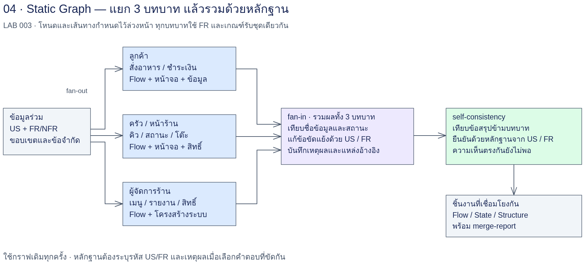

# LAB 003 — Static Graph: Flow และ Structure

รอบที่ใช้ผลเพิ่ม developer_instructions ตาม [execution-context.txt](reference/execution-context.txt); ใช้บริบทนี้ประกอบการทำซ้ำ

## โจทย์

รับ FR/NFR ที่ตรวจแล้วจาก LAB 002 ของระบบสั่งอาหาร “ครัวคุณยาย” มาออกแบบ Flow ของลูกค้า ครัว/หน้าร้าน และผู้จัดการร้าน
แยกวิเคราะห์บทบาทขนานกัน แล้วสร้างสถานะออเดอร์/ชำระเงิน/โต๊ะ และโครงสร้างโมดูล/ข้อมูล/หน้าจอ/สิทธิ์ ก่อนรวมเป็นฐานสำหรับ LAB 004
ผู้เรียนรับผิดชอบตรวจหลักฐานและแก้ข้อขัดแย้ง ไม่ใช้คำว่า “ครบ” ของโมเดลแทนการตรวจรับ

## เป้าหมาย

- ออกแบบ Static Graph ที่ระบุ Node, Edge, Dependency และ State ได้ชัดเจน
- ทำ Fan-out สามบทบาทด้วย Input รุ่นเดียวกันและ session ใหม่ต่อ node
- ส่งต่อทั้ง Markdown กับ JSON envelope ที่ตรวจรูปแบบและแหล่งที่มาได้
- ทำ Fan-in โดยรักษาเส้นทางหลัก ทางเลือก และผิดพลาด พร้อม traceability FR/US
- ตัดสิน Self-consistency ด้วยหลักฐาน FR พร้อมเปิดเผยส่วนที่ยังไม่ทราบ
- ส่ง Flow/State/Structure/สิทธิ์และข้อค้างให้ LAB 004 โดยเก็บหลักฐานแต่ละรุ่น

## ความรู้ก่อนเรียน

ผ่าน [LAB 002](../002_LAB_Loop_FR_NFR/README.md) และอ่าน FR/NFR, User Story, AC ได้
ใช้ Bash, JSON และ Python 3 พื้นฐานได้ พร้อม CLI ที่ลงชื่อเข้าใช้ด้วยบัญชีฝึก `<ACCOUNT>` แล้ว
ชื่อบัญชีในแบบบันทึกใช้ `<ACCOUNT>` เท่านั้น ไม่ใส่อีเมล รหัสผ่าน หรือ token
ต้องมีแพ็กเกจ `jsonschema` ในสภาพแวดล้อมเรียนเพื่อใช้ตัวตรวจ Output
อ่าน [แหล่งกรณีศึกษา](../docs/case-study-source.md) และ [ข้อมูลขาด/สมมติฐาน](../docs/data-issues.md) ก่อนเริ่ม

## เวลาโดยประมาณ

ยังไม่มีข้อมูลเวลาเรียนที่ได้จากการทดลอง LAB นี้ จึงไม่ระบุจำนวนนาทีที่แต่งขึ้น
ผู้สอนจัดเวลาเป็นช่วงเตรียม Input → ทำสามบทบาท → State/Structure → รวมงาน → ปรับ Prompt และอภิปราย
ก่อนเริ่มให้กำหนดเพดานเวลาและงบของชุดทดลองใน `work/session-plan.md` ตามคาบจริง
เวลาเรียก CLI, จำนวนรอบ, โทเคน และต้นทุนจะเติมจาก log จริงเมื่อมีการทดลอง; ขณะนี้ **ไม่มีข้อมูล**

## US ที่ใช้: 18 แถว

| Node บทบาท | US ในขอบเขต |
|---|---|
| customer | US-01, US-02, US-03, US-04, US-05, US-06, US-07, US-08 |
| kitchen-front | US-10, US-11, US-12, US-13, US-15, US-16 |
| manager | US-19, US-20, US-25, US-26 |

อ่าน [US แยกบทบาทที่คัดตรงตัว](input/us-by-role.md) ทั้งเกณฑ์รับ ไม่อ่านเฉพาะหัวเรื่อง
นับขอบเขตจากคอลัมน์รหัสแถว การอ้าง US อื่นในเซลล์ไม่เพิ่มขอบเขต
หมายเหตุ ก./ค./ช. **ไม่พบนิยามในต้นฉบับ** ใช้เฉพาะข้อความในตารางตาม A-02 ซึ่งยังไม่ยืนยัน
คงข้อสงสัย DI-04/A-03 เรื่อง US-20; ข้อเสนอเชื่อม US-12/US-13 ต้องติดสถานะยังไม่ยืนยัน
คง DI-07/A-05 เรื่องชื่อสถานะต่างกัน โดยไม่เอาสถานะรายการไปปนกับออเดอร์หรือการชำระเงิน

## แผนภาพ workflow



ภาพ `img/workflow-003.png` จัดทำแยกจากคู่มือ ใช้ประกอบการอ่าน dependency ในกราฟ
คำอธิบายแทนภาพ: Input → {customer, kitchen-front, manager} → {state-machine, structure} → merge
merge อ่านผลสามบทบาทโดยตรงด้วย จึงมี dependency ครบห้า node ตาม [graph.json](input/graph.json)
ขั้นเตรียม Input และกิจกรรมปรับ Prompt เป็นงานนอกกราฟ ไม่ใช่ node เพิ่มใน DAG

## สิ่งส่งมอบของนักศึกษา

| ไฟล์ใน work/ | หน้าที่ |
|---|---|
| `input-source.md`, `input-audit.md`, `review-record.md`, `session-plan.md` | ที่มา/รุ่น/ผลตรวจ/งบและเวลาเรียนที่กำหนดก่อนรัน |
| `flow-customer.md`, `flow-customer.json` | Flow ลูกค้าและ envelope |
| `flow-kitchen-front.md`, `flow-kitchen-front.json` | Flow ครัว/หน้าร้านและ envelope |
| `flow-manager.md`, `flow-manager.json` | Flow ผู้จัดการและ envelope |
| `flow-state-machine.md`, `flow-state-machine.json`, `state-machine.md` | State แยก entity และ traceability |
| `flow-structure.md`, `flow-structure.json`, `structure.md` | โมดูล ข้อมูล/ความสัมพันธ์ หน้าจอ และสิทธิ์ |
| `flow-merge.md`, `flow-merge.json`, `merge-report.md` | ผลรวมฉบับใช้ต่อ ตาราง conflict และการตรวจรับ |
| `lab004-handoff.md` | Manifest พร้อม hash ข้อค้างและขอบเขต UI สำหรับ LAB 004 |
| `logs/`, `repairs/`, `prompt-variant.md`, `prompt-experiment-plan.md`, `report.md` | หลักฐานการเรียก การซ่อม การทดลอง Prompt และบันทึกเรียน |

รายการนี้เป็นไฟล์ที่นักศึกษาจะสร้างระหว่างทำ LAB; ผลอ้างอิงจากผู้จัดทำจะเติมภายหลัง

## ทฤษฎี: Node, Edge, Dependency และ State

### Node

Node คือหน่วยงานที่รับ Input ชัดเจน ทำหน้าที่เดียว และส่ง Output ตามสัญญา
ใน LAB นี้แต่ละ node เป็นการเรียก CLI ด้วย session ใหม่ ใช้โมเดลเดียวกันได้แต่ต้องไม่ใช้ความจำสนทนาร่วมกัน
การแยกบทบาทช่วยให้ตรวจว่าใครเสนอ event, field หรือสิทธิ์ที่ไม่ตรงกัน และซ่อมเฉพาะจุดได้
ชื่อ node เป็นรหัสทางเทคนิค ส่วนบทบาทลูกค้าหรือครัวคือมุมมองวิเคราะห์ ไม่ใช่บัญชี CLI

### Edge และ Dependency

Edge เป็นลูกศรส่งข้อมูลจาก node ต้นทางไปปลายทาง; `depends_on` บอกว่าต้องรอใครบ้าง
การเสร็จของ process อย่างเดียวไม่พอ ต้องมี Output ครบ ผ่าน schema และได้รับการตรวจรับก่อนส่งต่อ
สาม root ไม่มี dependency ต่อกัน จึงอ่านผลกันเองไม่ได้ แม้ไฟล์อีกบทบาทจะปรากฏก่อนแล้ว
state-machine และ structure ต่างรอสาม root แต่ไม่มี edge ระหว่างสอง node นี้
merge รอทั้งห้า node และต้องอ่านหลักฐานทุกต้นทาง ไม่อ่านเพียง summary ของ CLI

### State

State ของ workflow คือข้อมูลที่ส่งผ่านระหว่าง node เช่น ผล Flow, SHA-256 ของ Input และข้อค้าง
แยกจาก state ของระบบร้านซึ่งอธิบายออเดอร์ การชำระเงิน และรอบโต๊ะ
ข้อมูลส่งต่อเป็น snapshot ที่ตรวจได้ ไม่ใช่ความทรงจำของผู้ช่วย และไม่ใช่ global file ที่หลาย process เขียนทับ
เมื่อ Input หรือ upstream เปลี่ยน ผล downstream ที่อ้างรุ่นเดิมถือว่าหมดอายุ ต้องตรวจใหม่ตาม dependency

### Sequential เทียบ Fan-out/Fan-in

| รูปแบบ | การเดินงาน | ผลต่อการตรวจ |
|---|---|---|
| Sequential | A จบแล้วจึง B แล้ว C | เรียบง่ายแต่แต่ละงานรอทุกงานก่อนหน้า |
| Fan-out | แจก Input เดียวไปสามบทบาท | ได้มุมมองแยกกัน แต่ต้องแยกไฟล์และตรวจความไม่ตรงกัน |
| Fan-in | รอผลที่รับรองแล้วนำมารวม | รักษาหลักฐานทุกต้นทางและตัดสิน conflict ก่อนส่งต่อ |

งานขนานไม่ได้รับประกันว่าเร็วหรือถูกกว่า: เวลาและโทเคนต้องวัดจริง รวมเวลาตรวจและซ่อมด้วย
ห้ามใช้ `wait` แล้วถือว่าทุก process ผ่านโดยไม่ตรวจ exit status ของแต่ละ PID

### Static เทียบ Conditional

Static Graph กำหนด node และ edge ก่อนเริ่ม ทั้งชุดเดิน dependency แบบเดิม
เกณฑ์รับ Output เป็นประตูให้ผู้เรียนหยุดตรวจ ไม่ใช่ edge ที่เลือกเส้นทางใหม่อัตโนมัติ
Conditional Graph ของ LAB 004 จะใช้ผลตรวจเลือกไปต่อ แก้เฉพาะส่วน หรือหยุดตามเงื่อนไข
การเพิ่ม if เพื่อป้องกันไฟล์หายไม่ได้เปลี่ยนกราฟทางธุรกิจให้เป็น conditional workflow

### DAG เทียบกราฟที่มี Loop

DAG คือ directed acyclic graph: ตามลูกศรแล้วกลับมาที่ node เดิมไม่ได้ จึงเรียงแบบ topological sort ได้
Dependency ของ LAB นี้มีลำดับที่ถูกต้องหลายแบบ เพราะสาม root และคู่ State/Structure แลกตำแหน่งกันได้
กราฟมี Loop อาจส่งผลตรวจย้อนให้ผู้แก้และกลับมาตรวจอีก ต้องกำหนดเงื่อนไขจบและงบ
LAB 003 ไม่เพิ่มลูกศรจาก merge กลับ root; หากพบข้อเสีย ผู้เรียนเก็บรุ่นเดิมแล้วเริ่มชุดซ่อม/รันใหม่อย่างเปิดเผย
จึงต้องแยก “กราฟเป็น DAG” ออกจาก “ผู้เรียนอาจทำหลายชุดทดลอง”

### JSON envelope และสัญญาการส่งข้อมูล

อ่าน [schema ฉบับเต็ม](input/node-output.schema.json) ก่อนเขียนผล

| Key | ความหมายและเกณฑ์ |
|---|---|
| `node_id`, `role` | ตรง node ที่เรียก และห้ามปลอมเป็นบทบาทอื่น |
| `sources` | path และ SHA-256 ของ Input ทุกไฟล์ที่ใช้ คำนวณจริง |
| `flows` | Flow ID, ชนิด main/alternative/error, actor, trigger, ก่อนเริ่ม, ขั้นตอน, หลังจบ, เกณฑ์รับ, FR/US, หลักฐาน |
| `assumptions` | id, statement, status, impact; ไม่ใช้ assumption ปลอมเป็น FR |
| `conflicts_found` | id, topic, positions, fr_refs, evidence, decision, status, affected_nodes |
| `artifacts` | รายละเอียด State/Structure/ผลรวมเพิ่มเติม ต้องตรวจเนื้อหาใน Markdown ด้วย |

ทุก flow อ้าง FR ID จริงที่อยู่ใน `input/fr-nfr-input.md` และ US ที่อยู่ในขอบเขต
`evidence` ของ flow เก็บ fr_id, source_path, locator และ quote ตรงตัวจาก FR
`evidence` ของ conflict เป็นรายการข้อความ FR ที่คัดตรงตัว; locator และเหตุผลลงตาราง Markdown
หาก conflict ยังไม่มี FR ตัดสิน เก็บหลักฐานที่มีและสถานะ unresolved; ห้าม resolved โดย evidence ว่าง
ตัวตรวจ schema ตรวจรูปแบบ ส่วนการตรวจความหมายว่า quote รองรับคำตัดสินจริงยังเป็นหน้าที่ผู้เรียน
Markdown ต้องมี Flow ID และการตัดสินตรงกับ JSON; ห้ามส่งแต่ summary แล้วถือว่าได้ artifact แล้ว

### เกณฑ์รับงานต่อ node

- Input ไม่ใช่ไฟล์ชี้ทาง และที่มา/รุ่น/hash ถูกต้องพร้อม audit ที่ตรวจแล้ว
- Output ที่ประกาศมีครบ JSON parse ได้และผ่าน schema
- FR/US มีจริงและตรวจข้อความหลักฐานได้ ไม่สร้างเลข FR ตามเลข US เอง
- ครบบทบาทที่รับผิดชอบ พร้อม main/alternative/error ที่มีหลักฐานหรือแยกข้อเสนอรอยืนยัน
- เกณฑ์และตัวเลขจาก FR/US คงเดิม ไม่มีการเพิ่มสิทธิ์หรือเงื่อนไขธุรกิจเงียบ ๆ
- Markdown และ JSON ให้ความหมายตรงกัน; ไม่มีข้อค้างที่ขวางงานถัดไป

### เกณฑ์รวมงาน

- ครบ 18 แถว US พร้อม mapping จาก Flow เดิมไป Flow รวม
- Event ที่บทบาทหนึ่งส่งต้องมีผู้รับและผลต่อ entity ที่ตรงกัน
- State, fields, relation, screen/action และสิทธิ์ไม่ขัดกัน
- ข้อขัดแย้งแต่ละข้อมีคำตัดสินและ FR รองรับ หรือ unresolved พร้อมเหตุหยุด
- ข้อเสนอ A-02/A-03/A-05 ยังเปิดเผยตามสถานะจริง ไม่เปลี่ยนเป็นยืนยันเพราะทุก node เห็นตรงกัน
- Manifest บอก artifact รุ่นที่จะใช้กับ LAB 004 ชัด ไม่ปล่อยให้ผู้รับเดาว่าไฟล์ใดใหม่กว่า

### จัดการ node ล้มเหลวและข้อขัดแย้ง

หาก CLI exit ไม่สำเร็จ ขาดไฟล์ JSON ผิด หรือ hash ไม่ตรง ให้หยุดเฉพาะเส้นทางที่พึ่ง node นั้นและเก็บ log/stderr
`run-node.sh` จะไม่รันซ้ำทับ log เดิม ต้องเก็บชุดเดิมก่อนเริ่มใหม่
แยก failure เชิงเครื่องมือจากความขัดแย้งเชิงข้อกำหนด: อย่างแรกอาจ retry หลังแก้สภาพแวดล้อม อย่างหลังต้องมีหลักฐาน/Feedback
เมื่อซ่อม root ต้องประเมินทั้ง state-machine, structure และ merge ใหม่; เมื่อซ่อม State หรือ Structure ต้องประเมิน merge ใหม่
ไม่รับผล downstream ที่ยังอ้าง SHA-256 รุ่นเก่า และไม่ใช้การเรียกซ้ำไม่จำกัดเพื่อรอคำตอบถูกใจ

### Self-consistency ที่ใช้หลักฐาน

เปรียบเทียบข้อเสนอหลาย node ด้วย FR และ US ต้นทาง ความเห็นตรงกันช่วยชี้ตำแหน่งตรวจ แต่ไม่ใช่เกณฑ์ตัดสิน
ถ้าสองบทบาทเสนอให้หมดเวลาสลิปแล้วจ่ายแล้ว แต่อีกบทบาทคงค้างจ่าย ผู้รวมต้องอ่าน FR เรื่องเหตุการณ์ยืนยันเงินก่อนเลือก
กรณี FR รองรับฝ่ายเดียวให้เลือกฝ่ายนั้นแม้เป็นเสียงส่วนน้อย พร้อมบันทึกข้อความและตำแหน่ง FR ที่ใช้
ถ้า FR ขัด US หรือไม่มีคำตอบ ให้เปิดข้อค้างและหยุดส่วนที่เกี่ยวข้อง ไม่โหวต ไม่เฉลี่ยกฎ และไม่เติมข้อมูลหมายเหตุเอง

## ข้อจำกัดของ Loop จาก LAB 002 และเหตุผลที่เปลี่ยนเป็นกราฟ

LAB 002 เหมาะกับการสร้าง–ตรวจ–แก้เอกสารชุดเดียว โดยรักษาเกณฑ์และตรวจ regression
แต่เมื่อเอกสารต้องแตกเป็น Flow หลายบทบาท การแก้ก้อนเดียวทำให้ยากต่อการเห็นผู้รับผิดชอบและ dependency ข้ามส่วน
Loop ไม่ได้แก้ปัญหาการจัดรูป Output ของหลายผู้สร้างให้ตรงกันโดยอัตโนมัติ และการวนซ้ำอาจยังใช้ข้อสมมติผิดชุดเดิม
LAB 003 จึงคงหลักฐาน FR ที่ผ่าน Loop แล้วแบ่งงานตามบทบาท ใช้ schema คุมขอบเขตส่งต่อ และมีจุดรวมตรวจ conflict
ข้อเสียคือมีงานประสานผลและเกณฑ์รับหลายจุด; DAG ยังไม่เลือกเส้นทางซ่อมตามผลตรวจเอง ซึ่งจะฝึกใน LAB 004

## วิธีใช้คำสั่งร่วมกันทุกขั้น

รันจากรากโครงการครั้งแรก:

```bash
cd AI_Workflow_Engineering_for_SA/003_LAB_Static_Graph_Flow_Structure
mkdir -p work/logs
python3 -c 'import jsonschema'
python3 input/validate.py --graph --source
source input/run-node.sh
```

ทุกขั้นด้านล่าง working directory = `AI_Workflow_Engineering_for_SA/003_LAB_Static_Graph_Flow_Structure/`
ทุก `codex exec` หรือ `claude -p` เป็น session ใหม่ ไม่ใช้ resume/continue
เลือกเครื่องมือใดเครื่องมือหนึ่งต่อชุด อย่ารันสองเครื่องมือเขียน work ชุดเดียวกัน
Prompt เป็นข้อความในไฟล์ .md; คำสั่ง terminal อ่านไฟล์นั้นส่งเป็น argument ไม่คัดคำสั่ง shell ลงในเนื้อหา Prompt
ตัวอย่างการเรียกจริงภายใน [run-node.sh](input/run-node.sh) มีรูปแบบดังนี้ โดยแทนตัวแปรด้วย node และ prompt ของขั้น:

```bash
codex exec --sandbox workspace-write --json   -o "work/logs/$id.summary.md" "$(cat "$prompt_file")"   < /dev/null > "work/logs/$id.jsonl" 2> "work/logs/$id.stderr.txt"
```

```bash
claude -p --permission-mode acceptEdits "$(cat "$prompt_file")"   < /dev/null > "work/logs/$id.summary.md" 2> "work/logs/$id.stderr.txt"
```

`-o` ของ Codex บันทึกคำตอบสุดท้ายที่เป็นสรุปไป logs; node ต้องเขียนทั้ง .md/.json ด้วยเครื่องมือไฟล์ตาม Prompt
อย่าใช้ `-o work/flow-<role>.md` ในชุดนี้ เพราะจะทับ Markdown ที่ node เขียนด้วยข้อความสรุปท้ายการเรียก
ถ้า CLI ไม่ได้รับสิทธิ์เขียนไฟล์หรือไม่มีในเครื่อง ให้หยุดและบันทึกเหตุ ไม่อ้างว่าได้ Output แล้ว
คำสั่งนี้เป็นตัวอย่างสำหรับผู้เรียน ยังไม่มีการรัน Prompt เพื่อสร้างผลอ้างอิง

บันทึกการรับรองด้วยมือใน `work/review-record.md` หลังตรวจทั้ง schema และความหมายแล้ว เช่น `ACCEPTED: input` หรือ `ACCEPTED: customer`
แต่ละบรรทัดต้องมีตารางหลักฐานประกอบ: node | ไฟล์/รุ่น | เกณฑ์ | ผลตรวจ | ผู้ตรวจ | หลักฐาน FR/US | ข้อค้าง
ตัวตรวจอ่านบรรทัดรับรองเพื่อกั้นขั้นถัดไป; ไม่มีคำสั่งใดเพิ่ม ACCEPTED ให้อัตโนมัติ

## ขั้น 3.0 — เตรียม Input

### 1. เป้าหมาย + Input

รหัสขั้น 3.0; working directory = โฟลเดอร์ LAB 003 ข้างต้น; เริ่ม session ใหม่สำหรับ prepare
ใช้ `input/fr-nfr-input.md`, `input/us-by-role.md`, `work/input-source.md` และผลตรวจรุ่นเดียวกันจาก LAB 002
ทำตาม [คู่มือ Input](input/README.md) เลือกรุ่นจริงและคัดลอกก่อนเรียก Prompt; ถ้าไม่มี FR ให้หยุดที่ขั้นนี้
Input audit ต้องบอกขอบเขตและข้อค้างก่อนแจกให้สาม root

### 2. Prompt ฉบับเต็ม

ไฟล์ [00-prepare-input.md](prompts/00-prepare-input.md) — บล็อกนี้แทรกจากไฟล์ด้วยสคริปต์โดยไม่แก้ข้อความ

<!-- PROMPT:00-prepare-input.md -->
```text
# ขั้น 3.0 — ตรวจความพร้อม Input

## บริบท
คุณเป็น System Analyst ของระบบครัวคุณยาย ใช้เอกสาร FR/NFR ที่ส่งต่อจาก LAB 002 เป็นหลักฐาน
working directory = AI_Workflow_Engineering_for_SA/003_LAB_Static_Graph_Flow_Structure/
เริ่ม session ใหม่ต่อ node ไม่ใช้ resume/continue ไม่เรียก agent เพิ่ม และไม่พึ่งบทสนทนาก่อนหน้า
ใช้เฉพาะ 18 แถว US ใน input/us-by-role.md; รหัสที่อ้างในเซลล์ไม่เพิ่มขอบเขต

## งาน
อ่าน FR/NFR ที่คัดจาก LAB 002 แล้วทำตาราง 18 แถว US | FR จริง | NFR ที่เกี่ยวข้อง | หลักฐาน | ข้อค้าง
ตรวจที่มา รุ่น ผล checker และ SHA-256 ว่าเป็นชุดเดียวกับ Input ที่อ่าน
ถ้าใช้ reference ต้องระบุ “ใช้ผลอ้างอิง” ตาม work/input-source.md
ตรวจ FR ที่ขัด US ตัวเลข/สูตรที่หล่น และข้อมูลที่ไม่มีนิยามก่อน fan-out
ระบุว่ารับทำ graph ได้หรือ BLOCKED พร้อมเหตุ ไม่สร้าง FR ทดแทน
ตรวจ graph ว่าสามบทบาทอิสระ state-machine/structure รอสามบทบาท merge รอทั้งห้า node

## ข้อจำกัด
ห้ามแต่ง FR ID, เกณฑ์ ตัวเลข หน่วย สูตร สัดส่วนทดสอบ หรือผลรัน; อ้าง FR ID ที่มีจริงจาก Input เท่านั้น
หมายเหตุ ก./ค./ช. ไม่พบนิยามในต้นฉบับ; ใช้เฉพาะข้อความในตารางตาม A-02 สถานะยังไม่ยืนยัน
คงถ้อยคำ US-20 ตรงตัวและ DI-04/A-03; การเสนอเชื่อม US-12/US-13 ต้องเปิดเผยว่ายังไม่ยืนยัน
แยกระดับออเดอร์/รายการ/ชำระเงิน/โต๊ะตาม DI-07; A-05 เป็นข้อเสนอแมปชื่อที่ยังไม่ยืนยัน
A-01 เป็นการจำลองสำหรับ Mock-up ไม่อ้างว่าพิสูจน์ระบบจริง; คง A-06 เรื่องขอบเขต
ถ้า FR ขัด US ให้รายงานข้อขัดแย้งพร้อมข้อความทั้งสองแหล่ง ห้ามแก้ FR ต้นทางเงียบ ๆ
ไม่ใช้เว็บเติมกฎ ไม่เปลี่ยน Input ไม่เขียนนอก work/ ไม่เขียน reference/ หรือ img/
ถ้า Input หาย มี INPUT_STATUS: MISSING หรือข้อขัดแย้งที่ทำให้ทำงานไม่ได้ ให้หยุดและตอบ BLOCKED พร้อมเหตุ
ถ้าผลปลายทางมีอยู่แล้ว ให้หยุดเพื่อให้นักศึกษาเก็บชุดเดิมก่อน ไม่เขียนทับหลักฐาน

## Input
- input/fr-nfr-input.md
- input/us-by-role.md
- work/input-source.md
- input/graph.json
- input/node-output.schema.json
- ../docs/case-study-source.md
- ../docs/data-issues.md
อ่าน path ผลตรวจ LAB 002 ที่ระบุใน work/input-source.md เท่านั้น ไม่เดารุ่นเอง

## รูปแบบ Output
Markdown ภาษาไทย มีตาราง traceability 18 แถว ตามด้วยที่มาและรายการข้อมูลขาด
ระบุ DI-01–DI-04, DI-07 และ A-02/A-03/A-05 ที่เกี่ยวข้องพร้อมสถานะยังไม่ยืนยัน
มี checklist Input จริง, รุ่นตรง, หลักฐานครบ, ขอบเขตตรง, DAG ถูกต้อง และรายการรอผู้เรียนตรวจ
PASS ของ audit หมายถึงเอกสารพร้อมให้ผู้เรียนตรวจรับ ไม่ได้พิสูจน์ระบบจริง
ถ้ายังขาด FR ให้ตอบ BLOCKED และห้ามสร้าง audit ที่ดูเหมือนผ่าน
ขั้นนี้อยู่นอกหก node ของ graph จึงไม่มี flow envelope

## ตำแหน่งบันทึก
เขียน work/input-audit.md ด้วยเครื่องมือไฟล์
ตอบสรุป path กับข้อค้างเป็นคำตอบสุดท้าย แล้วให้ผู้เรียนบันทึกการรับรองใน work/review-record.md
```
<!-- /PROMPT -->

### 3. วิธีรัน + เปิดผล

ทำคำสั่งคัดลอกและเติมที่มาจาก input/README.md ก่อน แล้วเลือกหนึ่งแบบ:

```bash
CLI_KIND=codex run_node prepare prompts/00-prepare-input.md
```

```bash
CLI_KIND=claude run_node prepare prompts/00-prepare-input.md
```

ทั้งสองแบบใช้คำสั่ง terminal ร่วมด้านบน เริ่ม session ใหม่และอ่าน Prompt ฉบับเดียวกัน

```bash
python3 input/validate.py --input
less work/input-source.md work/input-audit.md
```

### 4. ตัวอย่างผลรันล่วงหน้า

<!-- ผลอ้างอิง -->
**ตัวอย่างประกอบ — ยังไม่ได้รันจริง**

รูปแบบที่คาด: ตาราง `US | FR จริงใน Input | NFR | หลักฐาน | ข้อค้าง` ครบ 18 แถว
สำหรับไฟล์ชี้ทางที่แนบมากับ LAB นี้ ผลที่ควรได้คือ **BLOCKED: ไม่มี FR/NFR จริง** ไม่ใช่ audit ที่อ้างว่าพร้อม
ยังไม่มีตาราง FR ตัวอย่างเพราะไม่สามารถระบุรหัสจริงได้ก่อนรับ Input

เหตุผล: ไม่ได้เรียก Prompt 00 ในชุดนี้; ผู้ช่วยตรวจและเตรียมสำเนา FR/NFR final จาก LAB 002 สำหรับ pre-run ตาม [ที่มา Input](reference/step-00-input/provenance.md) และ [Input audit](reference/step-00-input/input-audit.md) จึงไม่อ้างว่า audit นี้เป็นผลจาก Prompt 00
เวลา/รอบ/โทเคน/ต้นทุน: **ไม่มีข้อมูล**
<!-- ผลอ้างอิง -->

### 5. เปรียบเทียบ + ตรวจผ่าน

- [ ] ต้องตรง: US ครบ 18 แถว ที่มาตรวจย้อนกลับได้ และ FR ID อยู่ใน Input จริง
- [ ] ต้องตรง: ไม่ใช้ไฟล์ชี้ทางเป็นข้อกำหนด และไม่เติมนิยามหมายเหตุที่หายไป
- [ ] ต้องตรง: อ่านผลตรวจ LAB 002 ที่ตรงรุ่น ไม่ตีความชื่อไฟล์ล่าสุดเป็น PASS
- [ ] ยืดหยุ่น: รูปแบบตารางและสำนวน audit เปลี่ยนได้เมื่อข้อมูลครบ
- [ ] ผู้เรียนตรวจข้อค้างแล้วจึงบันทึก `ACCEPTED: input` ใน work/review-record.md

### 6. แก้ไข + ส่งต่อ

ถ้า FR ขาดหรือข้อกำหนดขัดกัน ให้กลับไปเลือกรุ่น/แก้ต้นทาง LAB 002 ไม่สั่ง role node แต่งใหม่
หาก audit จับคู่ FR/US ผิด ให้บันทึกข้อผิดและหลักฐานในที่มา Input แล้วเรียก Prompt 00 ในชุดใหม่; audit ไม่ใช่ flow envelope จึงไม่ใช้ Prompt ซ่อม 07
หยุดเมื่อไม่ทราบรุ่นหรือไม่มีหลักฐานพร้อม; ส่ง `input/fr-nfr-input.md`, `work/input-source.md`, `work/input-audit.md` ให้ขั้น 3.1
ไฟล์ที่มานี้ต้องติด manifest ที่จะส่ง LAB 004 เพื่อให้รู้ฐาน FR/NFR ของ Flow

## ขั้น 3.1 — Fan-out สาม node บทบาทขนาน

### 1. เป้าหมาย + Input

รหัสขั้น 3.1; working directory = โฟลเดอร์ LAB 003; customer, kitchen-front, manager ใช้ session ใหม่แยกกัน
ทั้งสาม node อ่าน Input ร่วมและ audit ชุดเดียวกัน แต่ไม่อ่านผลกันเอง
ขอบเขตตามตาราง US ด้านบน; ทุกบทบาทต้องมี main/alternative/error พร้อมหลักฐาน FR/US

### 2. Prompt ฉบับเต็ม

ไฟล์ [01-node-customer.md](prompts/01-node-customer.md) — บล็อกนี้แทรกจากไฟล์ด้วยสคริปต์โดยไม่แก้ข้อความ

<!-- PROMPT:01-node-customer.md -->
```text
# ขั้น 3.1 — Node customer

## บริบท
คุณเป็น System Analyst ของระบบครัวคุณยาย ใช้เอกสาร FR/NFR ที่ส่งต่อจาก LAB 002 เป็นหลักฐาน
working directory = AI_Workflow_Engineering_for_SA/003_LAB_Static_Graph_Flow_Structure/
เริ่ม session ใหม่ต่อ node ไม่ใช้ resume/continue ไม่เรียก agent เพิ่ม และไม่พึ่งบทสนทนาก่อนหน้า
ใช้เฉพาะ 18 แถว US ใน input/us-by-role.md; รหัสที่อ้างในเซลล์ไม่เพิ่มขอบเขต

## งาน
แปลง US-01, US-02, US-03, US-04, US-05, US-06, US-07, US-08 เป็น flow ลูกค้า
ครอบคลุมเส้นทางหลักตั้งแต่ QR/เมนู เลือกอาหาร/ตัวเลือก ตรวจยอดและ ETA ยืนยัน ดูสถานะ และชำระเงิน
แยกทางเลือกหน้าร้านกับสั่งกลับบ้าน และเงินสดกับ PromptPay ตามกฎ FR จริง
ครอบคลุมข้อผิดพลาดสั่งเมนูที่ปิดแล้ว และทางออก PromptPay ปิดหรือสลิปไม่ยืนยันตามต้นฉบับ
คง table_id รอบโต๊ะ ช่วงเวลารับ สูตร ETA และกติกายืนยันสลิป; ระบุ event ที่ส่งให้ครัวและหน้าร้าน
ทุก flow อ้าง FR/US พร้อมหลักฐาน แยก main/alternative/error ให้ตรวจครบระดับบทบาท ไม่บังคับแต่งทุกชนิดต่อทุก US
ห้ามอ่านผล node บทบาทอื่นเพื่อให้ fan-out อิสระ ใช้ Input ร่วมชุดเดียวกันเท่านั้น

## ข้อจำกัด
ห้ามแต่ง FR ID, เกณฑ์ ตัวเลข หน่วย สูตร สัดส่วนทดสอบ หรือผลรัน; อ้าง FR ID ที่มีจริงจาก Input เท่านั้น
หมายเหตุ ก./ค./ช. ไม่พบนิยามในต้นฉบับ; ใช้เฉพาะข้อความในตารางตาม A-02 สถานะยังไม่ยืนยัน
คงถ้อยคำ US-20 ตรงตัวและ DI-04/A-03; การเสนอเชื่อม US-12/US-13 ต้องเปิดเผยว่ายังไม่ยืนยัน
แยกระดับออเดอร์/รายการ/ชำระเงิน/โต๊ะตาม DI-07; A-05 เป็นข้อเสนอแมปชื่อที่ยังไม่ยืนยัน
A-01 เป็นการจำลองสำหรับ Mock-up ไม่อ้างว่าพิสูจน์ระบบจริง; คง A-06 เรื่องขอบเขต
ถ้า FR ขัด US ให้รายงานข้อขัดแย้งพร้อมข้อความทั้งสองแหล่ง ห้ามแก้ FR ต้นทางเงียบ ๆ
ไม่ใช้เว็บเติมกฎ ไม่เปลี่ยน Input ไม่เขียนนอก work/ ไม่เขียน reference/ หรือ img/
ถ้า Input หาย มี INPUT_STATUS: MISSING หรือข้อขัดแย้งที่ทำให้ทำงานไม่ได้ ให้หยุดและตอบ BLOCKED พร้อมเหตุ
ถ้าผลปลายทางมีอยู่แล้ว ให้หยุดเพื่อให้นักศึกษาเก็บชุดเดิมก่อน ไม่เขียนทับหลักฐาน

## Input
- input/fr-nfr-input.md
- input/us-by-role.md
- work/input-source.md
- work/input-audit.md
- input/node-output.schema.json
- ../docs/case-study-source.md
- ../docs/data-issues.md
อ่าน input/graph.json เพื่อยืนยัน node_id และ dependency; ถ้า upstream ยังไม่รับรองใน work/review-record.md ให้หยุด
สำหรับสาม root ใช้ work/input-audit.md ที่ผู้เรียนตรวจและรับรองแล้ว ไม่ต้องรอ root อื่น

## รูปแบบ Output
เขียน JSON object จริงไม่ครอบ code fence ตาม input/node-output.schema.json และ Markdown ภาษาไทยที่มีข้อมูลตรงกัน
envelope ต้องมี node_id, role, sources, flows[], assumptions[], conflicts_found[]; artifacts ใช้เพิ่มรายละเอียดของ node ได้
sources เป็นรายการ path และ sha256 ที่คำนวณจากไฟล์จริง รวม FR/NFR, US, audit, provenance และผล upstream ที่อ่าน
ทุก flow มี flow_id, title, path_type (main/alternative/error), actors, us_refs, fr_refs, trigger, preconditions, steps, postconditions, completion_criteria, evidence
evidence แต่ละรายการมี fr_id, source_path = input/fr-nfr-input.md, locator หัวข้อ/บรรทัด และ quote ที่คัดจาก FR จริง
FR ทุกตัวที่ flow อ้างต้องมีหลักฐาน; ทุก US ต้องอยู่ในขอบเขตของ node หรือเป็นจุดส่งต่อที่ระบุชัด
Markdown มีตาราง Flow ID | เส้นทาง | ผู้ทำ | Trigger | ก่อนเริ่ม | ขั้นตอน | ผลหลังจบ | เกณฑ์รับ | FR/US | หลักฐาน
แยกทางเลือกที่ต้นฉบับไม่ระบุเป็น assumption สถานะยังไม่ยืนยัน ห้ามแต่ง error flow เป็นกฎที่อนุมัติแล้ว
assumptions ระบุ id, statement, status, impact; conflicts_found ระบุ id, topic, positions, fr_refs, evidence, decision, status, affected_nodes
evidence ของ conflict เป็น array ของข้อความ FR ที่คัดตรงตัวเท่านั้น; ใส่ locator และคำอธิบายในตาราง Markdown ไม่ผสมลงใน quote
ถ้าไม่พบข้อขัดแย้งให้ใช้ [] ไม่แต่งข้อขัดแย้งหรือหลักฐาน; ถ้าหลักฐานไม่พอให้ unresolved และอธิบายผลกระทบ
Markdown กับ JSON ต้องอ้างรหัสและการตัดสินตรงกัน; คำตอบสุดท้ายเป็นสรุป path และข้อค้าง ไม่ใช่เนื้อหาทดแทนไฟล์

## ตำแหน่งบันทึก
node_id = customer; role = customer
- work/flow-customer.md
- work/flow-customer.json
เขียนทุกไฟล์ปลายทางข้างต้นด้วยเครื่องมือไฟล์ แล้วแจ้งสิ่งที่สร้างและข้อค้างในคำตอบสุดท้าย
```
<!-- /PROMPT -->

ไฟล์ [02-node-kitchen-front.md](prompts/02-node-kitchen-front.md) — บล็อกนี้แทรกจากไฟล์ด้วยสคริปต์โดยไม่แก้ข้อความ

<!-- PROMPT:02-node-kitchen-front.md -->
```text
# ขั้น 3.1 — Node kitchen-front

## บริบท
คุณเป็น System Analyst ของระบบครัวคุณยาย ใช้เอกสาร FR/NFR ที่ส่งต่อจาก LAB 002 เป็นหลักฐาน
working directory = AI_Workflow_Engineering_for_SA/003_LAB_Static_Graph_Flow_Structure/
เริ่ม session ใหม่ต่อ node ไม่ใช้ resume/continue ไม่เรียก agent เพิ่ม และไม่พึ่งบทสนทนาก่อนหน้า
ใช้เฉพาะ 18 แถว US ใน input/us-by-role.md; รหัสที่อ้างในเซลล์ไม่เพิ่มขอบเขต

## งาน
แปลง US-10, US-11, US-12, US-13, US-15, US-16 เป็น flow ครัวและหน้าร้าน
ครอบคลุมเส้นทางหลักรับออเดอร์ เรียงคิว เปลี่ยนสถานะ เสิร์ฟ/ส่งกลับบ้าน รับเงิน เปิดและปิดโต๊ะ
คง timestamp ฝั่งเซิร์ฟเวอร์และ monotonic order number สำหรับแก้เวลารับที่เท่ากันตาม FR
ครอบคลุมทางเลือกหน้าร้าน/กลับบ้าน รับเงินสด/ยืนยันสลิป และการกดหมด/กลับมามีที่เมนูทั้งจานหรือเฉพาะตัวเลือก
ครอบคลุมทางผิดพลาด เช่น QR รอบที่ปิดแล้วไม่ใช้บิลเดิม; พฤติกรรมซ้ำ/ข้อมูลเสียที่ไม่มีใน FR ให้เป็นข้อเสนอรอยืนยัน
แยก order status จาก payment status; บันทึกผู้ใช้และเวลาที่ยืนยันเงินตาม FR และรอบโต๊ะไม่ปนกัน
ทุก flow อ้าง FR/US พร้อมหลักฐาน แยก main/alternative/error ให้ตรวจครบระดับบทบาท ไม่บังคับแต่งทุกชนิดต่อทุก US
ห้ามอ่านผล node บทบาทอื่นเพื่อให้ fan-out อิสระ ใช้ Input ร่วมชุดเดียวกันเท่านั้น

## ข้อจำกัด
ห้ามแต่ง FR ID, เกณฑ์ ตัวเลข หน่วย สูตร สัดส่วนทดสอบ หรือผลรัน; อ้าง FR ID ที่มีจริงจาก Input เท่านั้น
หมายเหตุ ก./ค./ช. ไม่พบนิยามในต้นฉบับ; ใช้เฉพาะข้อความในตารางตาม A-02 สถานะยังไม่ยืนยัน
คงถ้อยคำ US-20 ตรงตัวและ DI-04/A-03; การเสนอเชื่อม US-12/US-13 ต้องเปิดเผยว่ายังไม่ยืนยัน
แยกระดับออเดอร์/รายการ/ชำระเงิน/โต๊ะตาม DI-07; A-05 เป็นข้อเสนอแมปชื่อที่ยังไม่ยืนยัน
A-01 เป็นการจำลองสำหรับ Mock-up ไม่อ้างว่าพิสูจน์ระบบจริง; คง A-06 เรื่องขอบเขต
ถ้า FR ขัด US ให้รายงานข้อขัดแย้งพร้อมข้อความทั้งสองแหล่ง ห้ามแก้ FR ต้นทางเงียบ ๆ
ไม่ใช้เว็บเติมกฎ ไม่เปลี่ยน Input ไม่เขียนนอก work/ ไม่เขียน reference/ หรือ img/
ถ้า Input หาย มี INPUT_STATUS: MISSING หรือข้อขัดแย้งที่ทำให้ทำงานไม่ได้ ให้หยุดและตอบ BLOCKED พร้อมเหตุ
ถ้าผลปลายทางมีอยู่แล้ว ให้หยุดเพื่อให้นักศึกษาเก็บชุดเดิมก่อน ไม่เขียนทับหลักฐาน

## Input
- input/fr-nfr-input.md
- input/us-by-role.md
- work/input-source.md
- work/input-audit.md
- input/node-output.schema.json
- ../docs/case-study-source.md
- ../docs/data-issues.md
อ่าน input/graph.json เพื่อยืนยัน node_id และ dependency; ถ้า upstream ยังไม่รับรองใน work/review-record.md ให้หยุด
สำหรับสาม root ใช้ work/input-audit.md ที่ผู้เรียนตรวจและรับรองแล้ว ไม่ต้องรอ root อื่น

## รูปแบบ Output
เขียน JSON object จริงไม่ครอบ code fence ตาม input/node-output.schema.json และ Markdown ภาษาไทยที่มีข้อมูลตรงกัน
envelope ต้องมี node_id, role, sources, flows[], assumptions[], conflicts_found[]; artifacts ใช้เพิ่มรายละเอียดของ node ได้
sources เป็นรายการ path และ sha256 ที่คำนวณจากไฟล์จริง รวม FR/NFR, US, audit, provenance และผล upstream ที่อ่าน
ทุก flow มี flow_id, title, path_type (main/alternative/error), actors, us_refs, fr_refs, trigger, preconditions, steps, postconditions, completion_criteria, evidence
evidence แต่ละรายการมี fr_id, source_path = input/fr-nfr-input.md, locator หัวข้อ/บรรทัด และ quote ที่คัดจาก FR จริง
FR ทุกตัวที่ flow อ้างต้องมีหลักฐาน; ทุก US ต้องอยู่ในขอบเขตของ node หรือเป็นจุดส่งต่อที่ระบุชัด
Markdown มีตาราง Flow ID | เส้นทาง | ผู้ทำ | Trigger | ก่อนเริ่ม | ขั้นตอน | ผลหลังจบ | เกณฑ์รับ | FR/US | หลักฐาน
แยกทางเลือกที่ต้นฉบับไม่ระบุเป็น assumption สถานะยังไม่ยืนยัน ห้ามแต่ง error flow เป็นกฎที่อนุมัติแล้ว
assumptions ระบุ id, statement, status, impact; conflicts_found ระบุ id, topic, positions, fr_refs, evidence, decision, status, affected_nodes
evidence ของ conflict เป็น array ของข้อความ FR ที่คัดตรงตัวเท่านั้น; ใส่ locator และคำอธิบายในตาราง Markdown ไม่ผสมลงใน quote
ถ้าไม่พบข้อขัดแย้งให้ใช้ [] ไม่แต่งข้อขัดแย้งหรือหลักฐาน; ถ้าหลักฐานไม่พอให้ unresolved และอธิบายผลกระทบ
Markdown กับ JSON ต้องอ้างรหัสและการตัดสินตรงกัน; คำตอบสุดท้ายเป็นสรุป path และข้อค้าง ไม่ใช่เนื้อหาทดแทนไฟล์

## ตำแหน่งบันทึก
node_id = kitchen-front; role = kitchen-front
- work/flow-kitchen-front.md
- work/flow-kitchen-front.json
เขียนทุกไฟล์ปลายทางข้างต้นด้วยเครื่องมือไฟล์ แล้วแจ้งสิ่งที่สร้างและข้อค้างในคำตอบสุดท้าย
```
<!-- /PROMPT -->

ไฟล์ [03-node-manager.md](prompts/03-node-manager.md) — บล็อกนี้แทรกจากไฟล์ด้วยสคริปต์โดยไม่แก้ข้อความ

<!-- PROMPT:03-node-manager.md -->
```text
# ขั้น 3.1 — Node manager

## บริบท
คุณเป็น System Analyst ของระบบครัวคุณยาย ใช้เอกสาร FR/NFR ที่ส่งต่อจาก LAB 002 เป็นหลักฐาน
working directory = AI_Workflow_Engineering_for_SA/003_LAB_Static_Graph_Flow_Structure/
เริ่ม session ใหม่ต่อ node ไม่ใช้ resume/continue ไม่เรียก agent เพิ่ม และไม่พึ่งบทสนทนาก่อนหน้า
ใช้เฉพาะ 18 แถว US ใน input/us-by-role.md; รหัสที่อ้างในเซลล์ไม่เพิ่มขอบเขต

## งาน
แปลง US-19, US-20, US-25, US-26 เป็น flow ผู้จัดการร้าน
ครอบคลุมเส้นทางหลักจัดการเมนู ราคา รูปและตัวเลือก แมปวัตถุดิบ จัดการบัญชี/สิทธิ์ และติดตั้งใช้ในร้าน
คง dependency ต้องมีเมนูและตัวเลือกก่อนแมป; หน้าเมนูกับหน้าแมปมีหน้าที่แยกกัน
ครอบคลุมทางเลือกแก้ราคาโดยออเดอร์เดิมไม่เปลี่ยนยอด และลบเมนูที่มีแมปพร้อมคำเตือนและลบแมปตาม FR
ครอบคลุมข้อผิดพลาดไฟล์รูปไม่ตรงเกณฑ์ PIN ผิดถึงเกณฑ์ล็อก และบทบาทครัว/หน้าร้านเปิด URL ที่ถูกห้าม
แยกเครือข่ายร้านยังทำงานเมื่ออินเทอร์เน็ตภายนอกหลุด กับกรณีเครื่องหรือ LAN เสียซึ่งไม่มีหลักฐานข้อกำหนด
ทุก flow อ้าง FR/US พร้อมหลักฐาน แยก main/alternative/error ให้ตรวจครบระดับบทบาท ไม่บังคับแต่งทุกชนิดต่อทุก US
ห้ามขยายระบบรายงานยอดขายจากการมีข้อทดสอบสิทธิ์ URL; ห้ามอ่านผล node บทบาทอื่น

## ข้อจำกัด
ห้ามแต่ง FR ID, เกณฑ์ ตัวเลข หน่วย สูตร สัดส่วนทดสอบ หรือผลรัน; อ้าง FR ID ที่มีจริงจาก Input เท่านั้น
หมายเหตุ ก./ค./ช. ไม่พบนิยามในต้นฉบับ; ใช้เฉพาะข้อความในตารางตาม A-02 สถานะยังไม่ยืนยัน
คงถ้อยคำ US-20 ตรงตัวและ DI-04/A-03; การเสนอเชื่อม US-12/US-13 ต้องเปิดเผยว่ายังไม่ยืนยัน
แยกระดับออเดอร์/รายการ/ชำระเงิน/โต๊ะตาม DI-07; A-05 เป็นข้อเสนอแมปชื่อที่ยังไม่ยืนยัน
A-01 เป็นการจำลองสำหรับ Mock-up ไม่อ้างว่าพิสูจน์ระบบจริง; คง A-06 เรื่องขอบเขต
ถ้า FR ขัด US ให้รายงานข้อขัดแย้งพร้อมข้อความทั้งสองแหล่ง ห้ามแก้ FR ต้นทางเงียบ ๆ
ไม่ใช้เว็บเติมกฎ ไม่เปลี่ยน Input ไม่เขียนนอก work/ ไม่เขียน reference/ หรือ img/
ถ้า Input หาย มี INPUT_STATUS: MISSING หรือข้อขัดแย้งที่ทำให้ทำงานไม่ได้ ให้หยุดและตอบ BLOCKED พร้อมเหตุ
ถ้าผลปลายทางมีอยู่แล้ว ให้หยุดเพื่อให้นักศึกษาเก็บชุดเดิมก่อน ไม่เขียนทับหลักฐาน

## Input
- input/fr-nfr-input.md
- input/us-by-role.md
- work/input-source.md
- work/input-audit.md
- input/node-output.schema.json
- ../docs/case-study-source.md
- ../docs/data-issues.md
อ่าน input/graph.json เพื่อยืนยัน node_id และ dependency; ถ้า upstream ยังไม่รับรองใน work/review-record.md ให้หยุด
สำหรับสาม root ใช้ work/input-audit.md ที่ผู้เรียนตรวจและรับรองแล้ว ไม่ต้องรอ root อื่น

## รูปแบบ Output
เขียน JSON object จริงไม่ครอบ code fence ตาม input/node-output.schema.json และ Markdown ภาษาไทยที่มีข้อมูลตรงกัน
envelope ต้องมี node_id, role, sources, flows[], assumptions[], conflicts_found[]; artifacts ใช้เพิ่มรายละเอียดของ node ได้
sources เป็นรายการ path และ sha256 ที่คำนวณจากไฟล์จริง รวม FR/NFR, US, audit, provenance และผล upstream ที่อ่าน
ทุก flow มี flow_id, title, path_type (main/alternative/error), actors, us_refs, fr_refs, trigger, preconditions, steps, postconditions, completion_criteria, evidence
evidence แต่ละรายการมี fr_id, source_path = input/fr-nfr-input.md, locator หัวข้อ/บรรทัด และ quote ที่คัดจาก FR จริง
FR ทุกตัวที่ flow อ้างต้องมีหลักฐาน; ทุก US ต้องอยู่ในขอบเขตของ node หรือเป็นจุดส่งต่อที่ระบุชัด
Markdown มีตาราง Flow ID | เส้นทาง | ผู้ทำ | Trigger | ก่อนเริ่ม | ขั้นตอน | ผลหลังจบ | เกณฑ์รับ | FR/US | หลักฐาน
แยกทางเลือกที่ต้นฉบับไม่ระบุเป็น assumption สถานะยังไม่ยืนยัน ห้ามแต่ง error flow เป็นกฎที่อนุมัติแล้ว
assumptions ระบุ id, statement, status, impact; conflicts_found ระบุ id, topic, positions, fr_refs, evidence, decision, status, affected_nodes
evidence ของ conflict เป็น array ของข้อความ FR ที่คัดตรงตัวเท่านั้น; ใส่ locator และคำอธิบายในตาราง Markdown ไม่ผสมลงใน quote
ถ้าไม่พบข้อขัดแย้งให้ใช้ [] ไม่แต่งข้อขัดแย้งหรือหลักฐาน; ถ้าหลักฐานไม่พอให้ unresolved และอธิบายผลกระทบ
Markdown กับ JSON ต้องอ้างรหัสและการตัดสินตรงกัน; คำตอบสุดท้ายเป็นสรุป path และข้อค้าง ไม่ใช่เนื้อหาทดแทนไฟล์

## ตำแหน่งบันทึก
node_id = manager; role = manager
- work/flow-manager.md
- work/flow-manager.json
เขียนทุกไฟล์ปลายทางข้างต้นด้วยเครื่องมือไฟล์ แล้วแจ้งสิ่งที่สร้างและข้อค้างในคำตอบสุดท้าย
```
<!-- /PROMPT -->

### 3. วิธีรัน + เปิดผล

คำสั่ง Codex ด้านล่างเรียก `codex exec` ผ่าน run_node พร้อมจับ exit status ของทุก PID
ใช้ case แปลงชื่อบทบาทเป็นเลข Prompt จริง ไม่มีชื่อไฟล์ `0N` ที่ยังไม่ได้แทนค่า

```bash
CLI_KIND=codex
pids=()
for r in customer kitchen-front manager; do
  case "$r" in
    customer) p=prompts/01-node-customer.md ;;
    kitchen-front) p=prompts/02-node-kitchen-front.md ;;
    manager) p=prompts/03-node-manager.md ;;
  esac
  run_node "$r" "$p" &
  pids+=("$!")
done
failed=0
for pid in "${pids[@]}"; do
  wait "$pid" || failed=1
done
if [ "$failed" -ne 0 ]; then
  echo 'หยุดก่อน fan-in: ตรวจ log และ Output ของทุก node'
fi
```

ทางเลือก Claude เรียก `claude -p` ในแต่ละ run_node แบบ session ใหม่:

```bash
CLI_KIND=claude
run_node customer prompts/01-node-customer.md &
p_customer=$!
run_node kitchen-front prompts/02-node-kitchen-front.md &
p_kitchen=$!
run_node manager prompts/03-node-manager.md &
p_manager=$!
failed=0
for pid in "$p_customer" "$p_kitchen" "$p_manager"; do
  wait "$pid" || failed=1
done
if [ "$failed" -ne 0 ]; then
  echo 'หยุดก่อน fan-in: ตรวจ log และ Output ของทุก node'
fi
```

อย่าเริ่มขั้นถัดไปเมื่อ failed ไม่เป็นศูนย์; หลังทั้งสาม process จบให้เปิดผลและตรวจรับราย node

```bash
for r in customer kitchen-front manager; do
  python3 input/validate.py --node "$r" || break
done
less work/flow-customer.md work/flow-kitchen-front.md work/flow-manager.md
python3 -m json.tool work/flow-customer.json
```

### 4. ตัวอย่างผลรันล่วงหน้า

<!-- ผลอ้างอิง -->
**ผลรันจริง — 2026-09-14 UTC**

Codex CLI 0.154.0 / `gpt-6-astra` / effort `high` ตาม flag; prompt เดิมทุกตัวอักษร สามบทบาทที่ได้ผลทำงานทับช่วงเวลากันจริง ดู [วิธีรันและประวัติรอบที่หยุด](reference/README.md)

customer 12 flows, kitchen-front 14 flows, manager 10 flows; ผ่านการตรวจ schema, SHA-256, FR evidence และ US coverage แต่ข้อค้างทางธุรกิจยังไม่ยืนยัน


**customer — ตัดตอนบรรทัด 63–70 โดยคงข้อความเดิม**

[ผลเต็ม](reference/step-01-fanout/customer/flow-customer.md) · [JSON](reference/step-01-fanout/customer/flow-customer.json) · [log](reference/step-01-fanout/customer/log.jsonl) · [run-meta](reference/step-01-fanout/customer/run-meta.json)

```text
| Flow ID | เส้นทาง | ผู้ทำ | Trigger | ก่อนเริ่ม | ขั้นตอน | ผลหลังจบ | เกณฑ์รับ | FR/US | หลักฐาน |
|---|---|---|---|---|---|---|---|---|---|
| CUS-01 | main — หน้าร้าน: สแกน QR เปิดเมนูและผูกโต๊ะ | 1. ลูกค้า<br>2. ระบบ | ลูกค้าที่นั่งในร้านสแกน QR ที่โต๊ะ | 1. มี QR โต๊ะที่ URL มี table_id เช่น /t/07 และมือถือเชื่อม Wi-Fi ร้าน<br>2. กรณี table_id ผิดหรือไม่มีอยู่ยังไม่มีทางออกที่ยืนยัน รอ Q-02 | 1. กล้องมือถืออ่าน QR สำเร็จ ระบบเปิดหน้าเมนูโดยไม่ต้องล็อกอิน<br>2. ระบบใช้ table_id จาก URL ผูกกับออเดอร์จาก QR โดยลูกค้าไม่พิมพ์เลขโต๊ะ<br>3. ไปเลือกอาหารใน CUS-03; การสร้างออเดอร์และแสดงโต๊ะบนจอหน้าร้านตรวจเมื่อยืนยันใน CUS-04; การสแกนหลังปิดโต๊ะใช้ CUS-12 | 1. ลูกค้าเห็นรายการเมนูแรกและมีบริบท table_id สำหรับการสั่งหน้าร้าน | 1. FR-01 — เกณฑ์ต้นฉบับสำหรับตรวจในอนาคต: นับจากกล้องมือถืออ่าน QR สำเร็จ จนถึงหน้าเมนูแสดงรายการแรก ภายใน 3 วินาทีบน Wi-Fi ร้าน ในอย่างน้อย 18 จาก 20 ครั้งของชุดทดสอบ<br>2. FR-02 — เกณฑ์ต้นฉบับสำหรับตรวจในอนาคต: QR แต่ละโต๊ะมี URL ที่มี table_id และออเดอร์จาก QR โต๊ะทดสอบ 20 โต๊ะ มี table_id ตรงกับป้ายโต๊ะอย่างน้อย 19 จาก 20 ใบ ตรวจจากหน้าจอหน้าร้าน | FR-01, FR-02 / US-01, US-02 | 1. FR-01 — input/fr-nfr-input.md / ตาราง FR / FR-01 / บรรทัด 20 — “ลูกค้าที่นั่งในร้านสแกน QR ที่โต๊ะแล้วเปิดเมนูได้โดยไม่ต้องล็อกอิน &#124; นับจากกล้องมือถืออ่าน QR สำเร็จ จนถึงหน้าเมนูแสดงรายการแรก ภายใน 3 วินาทีบน Wi-Fi ร้าน ในอย่างน้อย 18 จาก 20 ครั้งของชุดทดสอบ”<br>2. FR-02 — input/fr-nfr-input.md / ตาราง FR / FR-02 / บรรทัด 21 — “ผูกออเดอร์ที่สั่งผ่าน QR กับหมายเลขโต๊ะอัตโนมัติ ลูกค้าไม่ต้องพิมพ์เลขโต๊ะ โดย QR แต่ละโต๊ะมี URL ที่มี table_id เช่น `/t/07` &#124; QR แต่ละโต๊ะมี URL ที่มี table_id และออเดอร์จาก QR โต๊ะทดสอบ 20 โต๊ะ มี table_id ตรงกับป้ายโต๊ะอย่างน้อย 19 จาก 20 ใบ ตรวจจากหน้าจอหน้าร้าน” |
| CUS-02 | alternative — สั่งกลับบ้าน: เลือกโหมดและช่วงรับ | 1. ลูกค้า<br>2. ระบบ<br>3. พนักงานครัว (จุดส่งต่อ) | ลูกค้าเลือกโหมด “สั่งกลับบ้าน” | 1. เปิดหน้าสั่งอาหารและมีรายการช่วงเวลารับ<br>2. นิยามเวลาสั่งและการสร้างช่วงแรกยังรอ Q-03 ไม่สมมติว่าเท่ากับเวลายืนยัน | 1. ระบบแสดงช่วงรับช่วงละ 15 นาที เช่น 12:00–12:15, 12:15–12:30 โดยช่วงที่เลือกได้เริ่มอย่างน้อย 20 นาทีหลังเวลาสั่ง<br>2. ลูกค้าเลือกช่วงรับแล้วไป CUS-03 และ CUS-04<br>3. เมื่อยืนยัน ส่งประเภท “สั่งกลับบ้าน” และช่วงเวลารับที่เลือกไปจอครัว; การแสดงเลขรับที่หน้าร้านอยู่ในจุดส่งต่อของ CUS-04 | 1. คำสั่งกลับบ้านมีช่วงรับและเมื่อยืนยันแล้วจอครัวแสดงป้ายกับช่วงรับ | 1. FR-03 — เกณฑ์ต้นฉบับสำหรับตรวจในอนาคต: 1) รายการช่วงรับยาวช่วงละ 15 นาที เช่น 12:00–12:15, 12:15–12:30 และเริ่มอย่างน้อย 20 นาทีหลังเวลาสั่ง 2) ออเดอร์สั่งกลับบ้านทดสอบ 10 ใบ แสดงป้าย “สั่งกลับบ้าน” พร้อมช่วงเวลารับบนจอครัวครบทั้ง 10 ใบ | FR-03 / US-03 | 1. FR-03 — input/fr-nfr-input.md / ตาราง FR / FR-03 / บรรทัด 22 — “ลูกค้าเลือกโหมด “สั่งกลับบ้าน” และช่วงเวลารับจากรายการช่วงละ 15 นาที โดยช่วงที่เลือกได้เริ่มอย่างน้อย 20 นาทีหลังเวลาสั่ง จอครัวแสดงประเภทและช่วงรับ &#124; 1) รายการช่วงรับยาวช่วงละ 15 นาที เช่น 12:00–12:15, 12:15–12:30 และเริ่มอย่างน้อย 20 นาทีหลังเวลาสั่ง 2) ออเดอร์สั่งกลับบ้านทดสอบ 10 ใบ แสดงป้าย “สั่งกลับบ้าน” พร้อมช่วงเวลารับบนจอครัวครบทั้ง 10 ใบ” |
| CUS-03 | main — เลือกอาหารและตัวเลือก ตรวจยอดและ ETA ก่อนยืนยัน | 1. ลูกค้า<br>2. ระบบ | ลูกค้าเข้าสู่เมนูจาก CUS-01 หรือ CUS-02 | 1. มีข้อมูลเมนู ตัวเลือกและราคาเพิ่มที่ผู้จัดการตั้งไว้<br>2. มีข้อมูลคิวและค่าเฉลี่ยสำหรับสูตร ETA; กรณีไม่มีประวัติหรือคำนวณไม่ได้ยังรอ Q-07 ไม่แทนค่าด้วยตัวเลขสมมติ | 1. ลูกค้าเลือกอาหาร ระบบแสดงตัวเลือกต่อจานครบตามที่ผู้จัดการตั้ง เช่น ระดับเผ็ด ไม่ใส่ผักชี เพิ่มไข่ดาว<br>2. ลูกค้าเลือกตัวเลือก ระบบรวมราคาเพิ่มในยอดก่อนยืนยันและแสดงสรุปรายการกับยอดรวม<br>3. หน้าก่อนยืนยันแสดงเวลารอทุกออเดอร์ด้วยสูตร: (จำนวนออเดอร์ค้างในคิวครัวที่ยังไม่ “พร้อมเสิร์ฟ” × เวลาเฉลี่ยต่อออเดอร์ 7 วันล่าสุด) + เวลาเฉลี่ยต่อเมนูของเมนูที่นานที่สุดในตะกร้า<br>4. ลูกค้าตรวจรายการ ยอด และ ETA ก่อนกดยืนยันไป CUS-04; การจัดปุ่มย้อนแก้เมนูและคำนวณใหม่เป็นข้อเสนอที่ยังไม่ยืนยันตาม CUS-A04 | 1. ก่อนยืนยัน ลูกค้าเห็นรายการ ตัวเลือก ยอดรวมราคาเพิ่ม และ ETA ตามสูตรเดิม<br>2. ยังไม่ถือว่าการดูสรุปหรือ ETA เป็นการชำระเงินสำเร็จ | 1. FR-04 — เกณฑ์ต้นฉบับสำหรับตรวจในอนาคต: 1) เมนูที่ตั้งตัวเลือกไว้แสดงตัวเลือกครบตามที่ตั้ง 2) ราคาเพิ่มรวมในยอดก่อนกดยืนยัน 3) ตัวเลือกที่เลือกปรากฏในใบครัวอย่างน้อย 19 จาก 20 ใบของชุดทดสอบ<br>2. FR-07 — เกณฑ์ต้นฉบับสำหรับตรวจในอนาคต: 1) แสดงเวลารอทุกออเดอร์ คำนวณจากสูตร: (จำนวนออเดอร์ค้างในคิวครัวที่ยังไม่ “พร้อมเสิร์ฟ” × เวลาเฉลี่ยต่อออเดอร์ 7 วันล่าสุด) + เวลาเฉลี่ยต่อเมนูของเมนูที่นานที่สุดในตะกร้า 2) เวลาจริงวัดจาก “ลูกค้ากดยืนยันสั่ง” ถึง “ครัวกดสถานะพร้อมเสิร์ฟ” จาก log ฝั่งเซิร์ฟเวอร์ 3) ช่วงเร่งด่วนคือ 11:30–13:00 และ 17:30–19:30 ในออเดอร์ช่วงเร่งด่วนของ 1 วันทดสอบ ค่าประมาณคลาดเคลื่อนจากเวลาจริงไม่เกิน 10 นาทีในอย่างน้อย 80% ของออเดอร์ ตามข้อความอ้างหมายเหตุ ช.<br>3. FR-08 — เกณฑ์ต้นฉบับสำหรับตรวจในอนาคต: 1) ยอดรวมหน้าสรุปลูกค้าตรงกับจอหน้าร้านอย่างน้อย 19 จาก 20 ใบ และเลือกวิธีจ่ายได้ 2 แบบทุกออเดอร์ 2) เลือก PromptPay แล้วคง “ค้างจ่าย” จนหน้าร้านยืนยันสลิป 3) เมื่อไม่ยืนยันสลิปภายใน 10 นาที หรือปิด PromptPay หน้าลูกค้าแจ้งให้ชำระเงินสดที่หน้าร้าน และการกดรับเงินสดหรือยืนยันสลิปเปลี่ยนเป็น “จ่ายแล้ว” ได้ 4) ทดสอบ PromptPay ปกติ / ปิดใช้งาน / สลิปไม่ยืนยันเกิน 10 นาที ต้องเป็นไปตามเกณฑ์ 3 จาก 3 กรณี ตามข้อความอ้างหมายเหตุ ก. | FR-04, FR-07, FR-08 / US-04, US-07, US-08 | 1. FR-04 — input/fr-nfr-input.md / ตาราง FR / FR-04 / บรรทัด 23 — “แสดงตัวเลือกเพิ่มต่อจานตามที่ผู้จัดการตั้ง เช่น ระดับเผ็ด ไม่ใส่ผักชี เพิ่มไข่ดาว ให้ลูกค้าเลือก รวมราคาเพิ่มก่อนยืนยัน และส่งตัวเลือกที่เลือกไปใบครัว &#124; 1) เมนูที่ตั้งตัวเลือกไว้แสดงตัวเลือกครบตามที่ตั้ง 2) ราคาเพิ่มรวมในยอดก่อนกดยืนยัน 3) ตัวเลือกที่เลือกปรากฏในใบครัวอย่างน้อย 19 จาก 20 ใบของชุดทดสอบ”<br>2. FR-07 — input/fr-nfr-input.md / ตาราง FR / FR-07 / บรรทัด 26 — “หน้ายืนยันสั่งแสดงเวลารอโดยประมาณทุกออเดอร์ก่อนยืนยัน ใช้จำนวนออเดอร์ค้างที่ยังไม่ “พร้อมเสิร์ฟ” และค่าเฉลี่ยตามสูตรต้นฉบับ คงชื่อสถานะ จุดวัด และช่วงเร่งด่วนเดิม หมายเหตุ ช. **ไม่มีข้อมูลในต้นฉบับ** &#124; 1) แสดงเวลารอทุกออเดอร์ คำนวณจากสูตร: (จำนวนออเดอร์ค้างในคิวครัวที่ยังไม่ “พร้อมเสิร์ฟ” × เวลาเฉลี่ยต่อออเดอร์ 7 วันล่าสุด) + เวลาเฉลี่ยต่อเมนูของเมนูที่นานที่สุดในตะกร้า 2) เวลาจริงวัดจาก “ลูกค้ากดยืนยันสั่ง” ถึง “ครัวกดสถานะพร้อมเสิร์ฟ” จาก log ฝั่งเซิร์ฟเวอร์ 3) ช่วงเร่งด่วนคือ 11:30–13:00 และ 17:30–19:30 ในออเดอร์ช่วงเร่งด่วนของ 1 วันทดสอบ ค่าประมาณคลาดเคลื่อนจากเวลาจริงไม่เกิน 10 นาทีในอย่างน้อย 80% ของออเดอร์ ตามข้อความอ้างหมายเหตุ ช.”<br>3. FR-08 — input/fr-nfr-input.md / ตาราง FR / FR-08 / บรรทัด 27 — “ลูกค้าเห็นสรุปรายการและยอดรวม เลือกเงินสดหรือ QR PromptPay ได้ เลือก PromptPay แล้วเป็น “ค้างจ่าย” จนหน้าร้านยืนยันสลิป หากสลิปยังไม่ยืนยันภายใน 10 นาที หรือผู้จัดการตั้ง “PromptPay ปิดใช้งาน” ให้แจ้งชำระเงินสดที่หน้าร้าน พนักงานกด “รับเงินสด” หรือ “ยืนยันสลิป” เพื่อเปลี่ยนเป็น “จ่ายแล้ว” ได้ หมายเหตุ ก. **ไม่มีข้อมูลในต้นฉบับ** &#124; 1) ยอดรวมหน้าสรุปลูกค้าตรงกับจอหน้าร้านอย่างน้อย 19 จาก 20 ใบ และเลือกวิธีจ่ายได้ 2 แบบทุกออเดอร์ 2) เลือก PromptPay แล้วคง “ค้างจ่าย” จนหน้าร้านยืนยันสลิป 3) เมื่อไม่ยืนยันสลิปภายใน 10 นาที หรือปิด PromptPay หน้าลูกค้าแจ้งให้ชำระเงินสดที่หน้าร้าน และการกดรับเงินสดหรือยืนยันสลิปเปลี่ยนเป็น “จ่ายแล้ว” ได้ 4) ทดสอบ PromptPay ปกติ / ปิดใช้งาน / สลิปไม่ยืนยันเกิน 10 นาที ต้องเป็นไปตามเกณฑ์ 3 จาก 3 กรณี ตามข้อความอ้างหมายเหตุ ก.” |
| CUS-04 | main — ยืนยันออเดอร์และส่งต่อครัวกับหน้าร้าน | 1. ลูกค้า<br>2. ระบบ<br>3. พนักงานครัว (จุดส่งต่อ)<br>4. พนักงานหน้าร้าน (จุดส่งต่อ) | ลูกค้ากด “ยืนยันสั่ง” หลังตรวจรายการ ยอด และ ETA | 1. ผ่านเส้นทางหน้าร้าน CUS-01 หรือกลับบ้าน CUS-02 และตรวจสรุป CUS-03 แล้ว<br>2. เมนูที่ปิดแล้วใช้ CUS-08; คำสั่งชนกับการกดหมดและการส่งซ้ำยังรอ Q-06/Q-10 | 1. บันทึกเหตุการณ์ลูกค้ากดยืนยันสั่งเป็นจุดเริ่มเวลาจริงของ ETA ตาม FR-07 และเวลารับคำสั่งฝั่งเซิร์ฟเวอร์สำหรับเรียงคิวตาม FR-10 โดยไม่สมมติว่าสองเหตุการณ์เป็นเวลาเดียวกัน<br>2. ส่งเหตุการณ์ออเดอร์ใหม่ให้ครัวพร้อมรายการและตัวเลือกที่เลือก; กรณีกลับบ้านส่งประเภทและช่วงรับด้วย<br>3. จุดส่งต่อ US-10: จอครัวแสดงออเดอร์และเรียงตาม timestamp ฝั่งเซิร์ฟเวอร์ที่รับคำสั่ง ความละเอียดวินาทีจากน้อยไปมาก; เมื่อเท่ากันหรือเข้าพร้อมกันใช้เลขออเดอร์ monotonic เพิ่มทีละ 1 ไม่ซ้ำ ไม่ย้อนกลับ<br>4. ส่งเหตุการณ์ออเดอร์ใหม่ให้หน้าร้าน; จุดส่งต่อ US-15 แสดงโต๊ะจาก table_id สำหรับหน้าร้าน หรือเลขรับกลับบ้าน T-001, T-002, … อัตโนมัติต่อเนื่องและรีเซ็ตเป็น T-001 เวลา 00:00 ของวันใหม่; ไม่รวมเลขรับกับเลข monotonic เอง<br>5. จุดส่งต่อ US-15 คำนวณสถานะการชำระของออเดอร์ใหม่เป็น “ยังไม่จ่าย”; ลูกค้าดูสถานะใน CUS-05 หรือเข้าสรุปชำระ CUS-06/CUS-07; ลำดับการจ่ายเทียบการทำอาหารยังรอ CUS-A04 | 1. ครัวมีออเดอร์พร้อมข้อมูลทำอาหารและแยกกลับบ้านได้<br>2. หน้าร้านมีออเดอร์แยกโต๊ะ/เลขรับและสถานะชำระเงินจากเหตุการณ์<br>3. มีจุดเริ่มยืนยันสั่งสำหรับนำไปจับคู่ log “ครัวกดสถานะพร้อมเสิร์ฟ” ภายหลัง; ยังไม่แมปกับ “เสร็จแล้ว” | 1. FR-02 — เกณฑ์ต้นฉบับสำหรับตรวจในอนาคต: QR แต่ละโต๊ะมี URL ที่มี table_id และออเดอร์จาก QR โต๊ะทดสอบ 20 โต๊ะ มี table_id ตรงกับป้ายโต๊ะอย่างน้อย 19 จาก 20 ใบ ตรวจจากหน้าจอหน้าร้าน<br>2. FR-03 — เกณฑ์ต้นฉบับสำหรับตรวจในอนาคต: 1) รายการช่วงรับยาวช่วงละ 15 นาที เช่น 12:00–12:15, 12:15–12:30 และเริ่มอย่างน้อย 20 นาทีหลังเวลาสั่ง 2) ออเดอร์สั่งกลับบ้านทดสอบ 10 ใบ แสดงป้าย “สั่งกลับบ้าน” พร้อมช่วงเวลารับบนจอครัวครบทั้ง 10 ใบ<br>3. FR-04 — เกณฑ์ต้นฉบับสำหรับตรวจในอนาคต: 1) เมนูที่ตั้งตัวเลือกไว้แสดงตัวเลือกครบตามที่ตั้ง 2) ราคาเพิ่มรวมในยอดก่อนกดยืนยัน 3) ตัวเลือกที่เลือกปรากฏในใบครัวอย่างน้อย 19 จาก 20 ใบของชุดทดสอบ<br>4. FR-10 — เกณฑ์ต้นฉบับสำหรับตรวจในอนาคต: 1) จากลูกค้ากดยืนยันสั่งถึงจอครัวแสดงออเดอร์ใหม่ ภายใน 3 วินาทีบน LAN ในร้าน อย่างน้อย 18 จาก 20 ใบ 2) เรียงตาม timestamp ฝั่งเซิร์ฟเวอร์ที่รับคำสั่ง ความละเอียดวินาที จากน้อยไปมาก เมื่อ timestamp เท่ากันหรือออเดอร์เข้าพร้อมกัน เรียงตามเลขออเดอร์ monotonic เพิ่มทีละ 1 ไม่ซ้ำ ไม่ย้อนกลับ 3) ยิง 30 ออเดอร์ต่อเนื่องจากมือถือ 2 เครื่องพร้อมกัน ลำดับบนจอครัวตรงลำดับเลขออเดอร์ 30 จาก 30 ใบ และรันซ้ำ 3 รอบต้องได้ผลเดิมทุกรอบ ไม่ยอมรับการสลับคู่<br>5. FR-15 — เกณฑ์ต้นฉบับสำหรับตรวจในอนาคต: 1) แสดงหมายเลขโต๊ะจาก table_id และเลขรับกลับบ้านรูปแบบ T-001, T-002, … ต่อเนื่องอัตโนมัติ รีเซ็ตเป็น T-001 เมื่อเริ่มวันใหม่ 00:00 ครบทุกออเดอร์ 20 จาก 20 ใบ 2) ออเดอร์ใหม่ = “ยังไม่จ่าย”; เลือก PromptPay = “ค้างจ่าย”; กด “รับเงินสด” หรือ “ยืนยันสลิป” = “จ่ายแล้ว” สถานะบนจอถูกต้อง 20 จาก 20 ใบเมื่อเทียบ log เหตุการณ์ 3) การกดของพนักงานหน้าร้านระบุชื่อผู้ใช้และเวลาใน log ทุกครั้ง 20 จาก 20 ใบ<br>6. เก็บจุดเริ่มเวลาจริงตาม FR-07; ตรวจสูตรและความแม่นยำตามเกณฑ์เต็มใน CUS-03 ไม่รายงานผลระบบจริง | FR-02, FR-03, FR-04, FR-07, FR-08, FR-10, FR-15 / US-02, US-03, US-04, US-07, US-08, US-10, US-15 | 1. FR-02 — input/fr-nfr-input.md / ตาราง FR / FR-02 / บรรทัด 21 — “ผูกออเดอร์ที่สั่งผ่าน QR กับหมายเลขโต๊ะอัตโนมัติ ลูกค้าไม่ต้องพิมพ์เลขโต๊ะ โดย QR แต่ละโต๊ะมี URL ที่มี table_id เช่น `/t/07` &#124; QR แต่ละโต๊ะมี URL ที่มี table_id และออเดอร์จาก QR โต๊ะทดสอบ 20 โต๊ะ มี table_id ตรงกับป้ายโต๊ะอย่างน้อย 19 จาก 20 ใบ ตรวจจากหน้าจอหน้าร้าน”<br>2. FR-03 — input/fr-nfr-input.md / ตาราง FR / FR-03 / บรรทัด 22 — “ลูกค้าเลือกโหมด “สั่งกลับบ้าน” และช่วงเวลารับจากรายการช่วงละ 15 นาที โดยช่วงที่เลือกได้เริ่มอย่างน้อย 20 นาทีหลังเวลาสั่ง จอครัวแสดงประเภทและช่วงรับ &#124; 1) รายการช่วงรับยาวช่วงละ 15 นาที เช่น 12:00–12:15, 12:15–12:30 และเริ่มอย่างน้อย 20 นาทีหลังเวลาสั่ง 2) ออเดอร์สั่งกลับบ้านทดสอบ 10 ใบ แสดงป้าย “สั่งกลับบ้าน” พร้อมช่วงเวลารับบนจอครัวครบทั้ง 10 ใบ”<br>3. FR-04 — input/fr-nfr-input.md / ตาราง FR / FR-04 / บรรทัด 23 — “แสดงตัวเลือกเพิ่มต่อจานตามที่ผู้จัดการตั้ง เช่น ระดับเผ็ด ไม่ใส่ผักชี เพิ่มไข่ดาว ให้ลูกค้าเลือก รวมราคาเพิ่มก่อนยืนยัน และส่งตัวเลือกที่เลือกไปใบครัว &#124; 1) เมนูที่ตั้งตัวเลือกไว้แสดงตัวเลือกครบตามที่ตั้ง 2) ราคาเพิ่มรวมในยอดก่อนกดยืนยัน 3) ตัวเลือกที่เลือกปรากฏในใบครัวอย่างน้อย 19 จาก 20 ใบของชุดทดสอบ”<br>4. FR-07 — input/fr-nfr-input.md / ตาราง FR / FR-07 / บรรทัด 26 — “หน้ายืนยันสั่งแสดงเวลารอโดยประมาณทุกออเดอร์ก่อนยืนยัน ใช้จำนวนออเดอร์ค้างที่ยังไม่ “พร้อมเสิร์ฟ” และค่าเฉลี่ยตามสูตรต้นฉบับ คงชื่อสถานะ จุดวัด และช่วงเร่งด่วนเดิม หมายเหตุ ช. **ไม่มีข้อมูลในต้นฉบับ** &#124; 1) แสดงเวลารอทุกออเดอร์ คำนวณจากสูตร: (จำนวนออเดอร์ค้างในคิวครัวที่ยังไม่ “พร้อมเสิร์ฟ” × เวลาเฉลี่ยต่อออเดอร์ 7 วันล่าสุด) + เวลาเฉลี่ยต่อเมนูของเมนูที่นานที่สุดในตะกร้า 2) เวลาจริงวัดจาก “ลูกค้ากดยืนยันสั่ง” ถึง “ครัวกดสถานะพร้อมเสิร์ฟ” จาก log ฝั่งเซิร์ฟเวอร์ 3) ช่วงเร่งด่วนคือ 11:30–13:00 และ 17:30–19:30 ในออเดอร์ช่วงเร่งด่วนของ 1 วันทดสอบ ค่าประมาณคลาดเคลื่อนจากเวลาจริงไม่เกิน 10 นาทีในอย่างน้อย 80% ของออเดอร์ ตามข้อความอ้างหมายเหตุ ช.”<br>5. FR-08 — input/fr-nfr-input.md / ตาราง FR / FR-08 / บรรทัด 27 — “ลูกค้าเห็นสรุปรายการและยอดรวม เลือกเงินสดหรือ QR PromptPay ได้ เลือก PromptPay แล้วเป็น “ค้างจ่าย” จนหน้าร้านยืนยันสลิป หากสลิปยังไม่ยืนยันภายใน 10 นาที หรือผู้จัดการตั้ง “PromptPay ปิดใช้งาน” ให้แจ้งชำระเงินสดที่หน้าร้าน พนักงานกด “รับเงินสด” หรือ “ยืนยันสลิป” เพื่อเปลี่ยนเป็น “จ่ายแล้ว” ได้ หมายเหตุ ก. **ไม่มีข้อมูลในต้นฉบับ** &#124; 1) ยอดรวมหน้าสรุปลูกค้าตรงกับจอหน้าร้านอย่างน้อย 19 จาก 20 ใบ และเลือกวิธีจ่ายได้ 2 แบบทุกออเดอร์ 2) เลือก PromptPay แล้วคง “ค้างจ่าย” จนหน้าร้านยืนยันสลิป 3) เมื่อไม่ยืนยันสลิปภายใน 10 นาที หรือปิด PromptPay หน้าลูกค้าแจ้งให้ชำระเงินสดที่หน้าร้าน และการกดรับเงินสดหรือยืนยันสลิปเปลี่ยนเป็น “จ่ายแล้ว” ได้ 4) ทดสอบ PromptPay ปกติ / ปิดใช้งาน / สลิปไม่ยืนยันเกิน 10 นาที ต้องเป็นไปตามเกณฑ์ 3 จาก 3 กรณี ตามข้อความอ้างหมายเหตุ ก.”<br>6. FR-10 — input/fr-nfr-input.md / ตาราง FR / FR-10 / บรรทัด 28 — “จอครัวแสดงออเดอร์ใหม่เรียงอย่างคงที่ตาม timestamp ฝั่งเซิร์ฟเวอร์ที่รับคำสั่ง ความละเอียดวินาที จากน้อยไปมาก เมื่อ timestamp เท่ากันหรือเข้าพร้อมกันให้เรียงเลขออเดอร์แบบ monotonic เพิ่มขึ้นทีละ 1 ไม่ซ้ำ ไม่ย้อนกลับ &#124; 1) จากลูกค้ากดยืนยันสั่งถึงจอครัวแสดงออเดอร์ใหม่ ภายใน 3 วินาทีบน LAN ในร้าน อย่างน้อย 18 จาก 20 ใบ 2) เรียงตาม timestamp ฝั่งเซิร์ฟเวอร์ที่รับคำสั่ง ความละเอียดวินาที จากน้อยไปมาก เมื่อ timestamp เท่ากันหรือออเดอร์เข้าพร้อมกัน เรียงตามเลขออเดอร์ monotonic เพิ่มทีละ 1 ไม่ซ้ำ ไม่ย้อนกลับ 3) ยิง 30 ออเดอร์ต่อเนื่องจากมือถือ 2 เครื่องพร้อมกัน ลำดับบนจอครัวตรงลำดับเลขออเดอร์ 30 จาก 30 ใบ และรันซ้ำ 3 รอบต้องได้ผลเดิมทุกรอบ ไม่ยอมรับการสลับคู่”<br>7. FR-15 — input/fr-nfr-input.md / ตาราง FR / FR-15 / บรรทัด 32 — “หน้าร้านเห็นออเดอร์แยกตามโต๊ะและสั่งกลับบ้าน ใช้ table_id จาก QR สำหรับหน้าร้าน และเลขรับกลับบ้าน T-001, T-002, … ที่สร้างอัตโนมัติต่อเนื่อง รีเซ็ต T-001 เวลา 00:00 ของวันใหม่ สถานะจ่ายเงินคำนวณจากเหตุการณ์ และบันทึกชื่อผู้ใช้กับเวลาการกดยืนยันด้วยมือทุกครั้ง &#124; 1) แสดงหมายเลขโต๊ะจาก table_id และเลขรับกลับบ้านรูปแบบ T-001, T-002, … ต่อเนื่องอัตโนมัติ รีเซ็ตเป็น T-001 เมื่อเริ่มวันใหม่ 00:00 ครบทุกออเดอร์ 20 จาก 20 ใบ 2) ออเดอร์ใหม่ = “ยังไม่จ่าย”; เลือก PromptPay = “ค้างจ่าย”; กด “รับเงินสด” หรือ “ยืนยันสลิป” = “จ่ายแล้ว” สถานะบนจอถูกต้อง 20 จาก 20 ใบเมื่อเทียบ log เหตุการณ์ 3) การกดของพนักงานหน้าร้านระบุชื่อผู้ใช้และเวลาใน log ทุกครั้ง 20 จาก 20 ใบ” |
| CUS-05 | main — ดูสถานะออเดอร์ที่โต๊ะโดยไม่รีเฟรช | 1. ลูกค้า<br>2. ระบบ<br>3. พนักงานครัว (จุดส่งต่อ)<br>4. พนักงานหน้าร้าน (จุดส่งต่อ) | ครัวเปลี่ยนสถานะของออเดอร์ที่ลูกค้าสั่งแล้ว | 1. มีออเดอร์และเปิดหน้าจอลูกค้าที่โต๊ะบน LAN ร้าน<br>2. ชื่อสถานะไม่ใช่ตาราง transition ที่รับรองแล้ว; A-05/Q-05/Q-11 ยังไม่ยืนยัน | 1. ลูกค้าเห็นสถานะออเดอร์ “รับออเดอร์ / กำลังทำ / เสร็จแล้ว” ตาม FR-05<br>2. รับเหตุการณ์ครัวกดเปลี่ยน “กำลังทำ / เสร็จแล้ว” ด้วยปุ่มเดียวใน 1 แตะ ณ จุดส่งต่อ US-11<br>3. ระบบแสดงสถานะใหม่แก่ลูกค้าที่โต๊ะโดยไม่รีเฟรช และส่งเหตุการณ์สถานะใหม่ไปจอหน้าร้านตาม US-11<br>4. คง “เสร็จแล้ว” แยกจาก “พร้อมเสิร์ฟ” ของ ETA และคงสถานะจ่ายเงินแยกจากสถานะออเดอร์; การดูสถานะกลับบ้านยังมีข้อจำกัด CUS-A05 | 1. ลูกค้าที่โต๊ะและหน้าร้านเห็นสถานะใหม่ของออเดอร์<br>2. ไม่ใช้สถานะอาหารเป็นหลักฐานว่าจ่ายเงินแล้วหรือปิดโต๊ะแล้ว | 1. FR-05 — เกณฑ์ต้นฉบับสำหรับตรวจในอนาคต: นับจากพนักงานครัวกดปุ่มเปลี่ยนสถานะ จนถึงหน้าจอลูกค้าที่โต๊ะแสดงสถานะใหม่โดยไม่รีเฟรช ภายใน 5 วินาทีบน LAN ในร้าน ในอย่างน้อย 18 จาก 20 ครั้งของชุดทดสอบ<br>2. FR-11 — เกณฑ์ต้นฉบับสำหรับตรวจในอนาคต: เปลี่ยนสถานะได้ใน 1 แตะ นับจากกดปุ่มบนจอครัว จนถึงจอหน้าร้านแสดงสถานะใหม่ ภายใน 5 วินาทีบน LAN ในร้าน ในอย่างน้อย 18 จาก 20 ครั้ง | FR-05, FR-11 / US-05, US-11 | 1. FR-05 — input/fr-nfr-input.md / ตาราง FR / FR-05 / บรรทัด 24 — “ลูกค้าที่โต๊ะเห็นสถานะ “รับออเดอร์ / กำลังทำ / เสร็จแล้ว” และได้รับสถานะใหม่เมื่อครัวเปลี่ยนโดยไม่รีเฟรช ไม่ถือว่า “เสร็จแล้ว” เท่ากับ “พร้อมเสิร์ฟ” โดยอัตโนมัติ &#124; นับจากพนักงานครัวกดปุ่มเปลี่ยนสถานะ จนถึงหน้าจอลูกค้าที่โต๊ะแสดงสถานะใหม่โดยไม่รีเฟรช ภายใน 5 วินาทีบน LAN ในร้าน ในอย่างน้อย 18 จาก 20 ครั้งของชุดทดสอบ”<br>2. FR-11 — input/fr-nfr-input.md / ตาราง FR / FR-11 / บรรทัด 29 — “พนักงานครัวกดเปลี่ยนสถานะ “กำลังทำ / เสร็จแล้ว” ด้วยปุ่มเดียวใน 1 แตะ และจอหน้าร้านเห็นสถานะใหม่ &#124; เปลี่ยนสถานะได้ใน 1 แตะ นับจากกดปุ่มบนจอครัว จนถึงจอหน้าร้านแสดงสถานะใหม่ ภายใน 5 วินาทีบน LAN ในร้าน ในอย่างน้อย 18 จาก 20 ครั้ง” |
| CUS-06 | main — ชำระด้วยเงินสดที่หน้าร้าน | 1. ลูกค้า<br>2. ระบบ<br>3. พนักงานหน้าร้าน (จุดส่งต่อ) | ลูกค้าเลือกเงินสดจากหน้าสรุปการชำระ | 1. มีออเดอร์และหน้าสรุปรายการกับยอดรวม<br>2. ยังไม่ยืนยันกฎว่าจ่ายก่อนหรือหลังทำอาหาร และการปิดโต๊ะหลังจ่ายยังรอ Q-16 | 1. ลูกค้าตรวจรายการและยอดรวมซึ่งต้องตรงกับจอหน้าร้านตามเกณฑ์ FR-08 แล้วเลือกเงินสด<br>2. ลูกค้าชำระเงินสดที่หน้าร้าน; การเลือกเงินสดอย่างเดียวยังไม่ใช่เหตุการณ์ “จ่ายแล้ว”<br>3. พนักงานหน้าร้านกด “รับเงินสด”; ระบบใช้เหตุการณ์นี้เปลี่ยนสถานะการชำระเป็น “จ่ายแล้ว” และแสดงที่จอหน้าร้าน<br>4. จุดส่งต่อ US-15 บันทึกชื่อผู้ใช้พนักงานและเวลาใน log ทุกการกด; ไม่เพิ่มเงื่อนไขส่งเข้าครัวหรือปิดโต๊ะอัตโนมัติ | 1. สถานะการชำระเป็น “จ่ายแล้ว” จากการกดรับเงินสดและมีชื่อผู้ใช้/เวลาใน log | 1. FR-08 — เกณฑ์ต้นฉบับสำหรับตรวจในอนาคต: 1) ยอดรวมหน้าสรุปลูกค้าตรงกับจอหน้าร้านอย่างน้อย 19 จาก 20 ใบ และเลือกวิธีจ่ายได้ 2 แบบทุกออเดอร์ 2) เลือก PromptPay แล้วคง “ค้างจ่าย” จนหน้าร้านยืนยันสลิป 3) เมื่อไม่ยืนยันสลิปภายใน 10 นาที หรือปิด PromptPay หน้าลูกค้าแจ้งให้ชำระเงินสดที่หน้าร้าน และการกดรับเงินสดหรือยืนยันสลิปเปลี่ยนเป็น “จ่ายแล้ว” ได้ 4) ทดสอบ PromptPay ปกติ / ปิดใช้งาน / สลิปไม่ยืนยันเกิน 10 นาที ต้องเป็นไปตามเกณฑ์ 3 จาก 3 กรณี ตามข้อความอ้างหมายเหตุ ก.<br>2. FR-15 — เกณฑ์ต้นฉบับสำหรับตรวจในอนาคต: 1) แสดงหมายเลขโต๊ะจาก table_id และเลขรับกลับบ้านรูปแบบ T-001, T-002, … ต่อเนื่องอัตโนมัติ รีเซ็ตเป็น T-001 เมื่อเริ่มวันใหม่ 00:00 ครบทุกออเดอร์ 20 จาก 20 ใบ 2) ออเดอร์ใหม่ = “ยังไม่จ่าย”; เลือก PromptPay = “ค้างจ่าย”; กด “รับเงินสด” หรือ “ยืนยันสลิป” = “จ่ายแล้ว” สถานะบนจอถูกต้อง 20 จาก 20 ใบเมื่อเทียบ log เหตุการณ์ 3) การกดของพนักงานหน้าร้านระบุชื่อผู้ใช้และเวลาใน log ทุกครั้ง 20 จาก 20 ใบ | FR-08, FR-15 / US-08, US-15 | 1. FR-08 — input/fr-nfr-input.md / ตาราง FR / FR-08 / บรรทัด 27 — “ลูกค้าเห็นสรุปรายการและยอดรวม เลือกเงินสดหรือ QR PromptPay ได้ เลือก PromptPay แล้วเป็น “ค้างจ่าย” จนหน้าร้านยืนยันสลิป หากสลิปยังไม่ยืนยันภายใน 10 นาที หรือผู้จัดการตั้ง “PromptPay ปิดใช้งาน” ให้แจ้งชำระเงินสดที่หน้าร้าน พนักงานกด “รับเงินสด” หรือ “ยืนยันสลิป” เพื่อเปลี่ยนเป็น “จ่ายแล้ว” ได้ หมายเหตุ ก. **ไม่มีข้อมูลในต้นฉบับ** &#124; 1) ยอดรวมหน้าสรุปลูกค้าตรงกับจอหน้าร้านอย่างน้อย 19 จาก 20 ใบ และเลือกวิธีจ่ายได้ 2 แบบทุกออเดอร์ 2) เลือก PromptPay แล้วคง “ค้างจ่าย” จนหน้าร้านยืนยันสลิป 3) เมื่อไม่ยืนยันสลิปภายใน 10 นาที หรือปิด PromptPay หน้าลูกค้าแจ้งให้ชำระเงินสดที่หน้าร้าน และการกดรับเงินสดหรือยืนยันสลิปเปลี่ยนเป็น “จ่ายแล้ว” ได้ 4) ทดสอบ PromptPay ปกติ / ปิดใช้งาน / สลิปไม่ยืนยันเกิน 10 นาที ต้องเป็นไปตามเกณฑ์ 3 จาก 3 กรณี ตามข้อความอ้างหมายเหตุ ก.”<br>2. FR-15 — input/fr-nfr-input.md / ตาราง FR / FR-15 / บรรทัด 32 — “หน้าร้านเห็นออเดอร์แยกตามโต๊ะและสั่งกลับบ้าน ใช้ table_id จาก QR สำหรับหน้าร้าน และเลขรับกลับบ้าน T-001, T-002, … ที่สร้างอัตโนมัติต่อเนื่อง รีเซ็ต T-001 เวลา 00:00 ของวันใหม่ สถานะจ่ายเงินคำนวณจากเหตุการณ์ และบันทึกชื่อผู้ใช้กับเวลาการกดยืนยันด้วยมือทุกครั้ง &#124; 1) แสดงหมายเลขโต๊ะจาก table_id และเลขรับกลับบ้านรูปแบบ T-001, T-002, … ต่อเนื่องอัตโนมัติ รีเซ็ตเป็น T-001 เมื่อเริ่มวันใหม่ 00:00 ครบทุกออเดอร์ 20 จาก 20 ใบ 2) ออเดอร์ใหม่ = “ยังไม่จ่าย”; เลือก PromptPay = “ค้างจ่าย”; กด “รับเงินสด” หรือ “ยืนยันสลิป” = “จ่ายแล้ว” สถานะบนจอถูกต้อง 20 จาก 20 ใบเมื่อเทียบ log เหตุการณ์ 3) การกดของพนักงานหน้าร้านระบุชื่อผู้ใช้และเวลาใน log ทุกครั้ง 20 จาก 20 ใบ” |
```


**kitchen-front — ตัดตอนบรรทัด 49–56 โดยคงข้อความเดิม**

[ผลเต็ม](reference/step-01-fanout/kitchen-front/flow-kitchen-front.md) · [JSON](reference/step-01-fanout/kitchen-front/flow-kitchen-front.json) · [log](reference/step-01-fanout/kitchen-front/log.jsonl) · [run-meta](reference/step-01-fanout/kitchen-front/run-meta.json)

```text
| Flow ID | เส้นทาง | ผู้ทำ | Trigger | ก่อนเริ่ม | ขั้นตอน | ผลหลังจบ | เกณฑ์รับ | FR/US | หลักฐาน |
|---|---|---|---|---|---|---|---|---|---|
| KF-01 | main — รับออเดอร์และเรียงคิวครัว | ระบบ<br>พนักงานครัว | รับจุดส่งต่อจากการยืนยันสั่งของลูกค้า | มีคำสั่งที่ลูกค้ายืนยันแล้ว; รับ table_id สำหรับหน้าร้านหรือประเภทกลับบ้านและช่วงรับจากจุดส่งต่อ<br>รายละเอียดตัวเลือกที่ลูกค้าเลือกส่งมากับรายการ | 1. ระบบคง timestamp ฝั่งเซิร์ฟเวอร์ที่รับคำสั่ง ความละเอียดวินาที และออกเลขออเดอร์ monotonic เพิ่มขึ้นทีละ 1 ไม่ซ้ำ ไม่ย้อนกลับ<br>2. เรียงคิวตาม timestamp จากน้อยไปมาก; เมื่อเวลาเท่ากันหรือเข้าพร้อมกันใช้เลขออเดอร์ monotonic ตัดสิน<br>3. จอครัวแสดงออเดอร์และตัวเลือกในใบครัว; กลับบ้านแสดงป้าย “สั่งกลับบ้าน” พร้อมช่วงเวลารับ<br>4. ส่งข้อมูลให้จอหน้าร้านแยกตามโต๊ะหรือกลับบ้าน; payment status ของออเดอร์ใหม่เป็น “ยังไม่จ่าย” | ครัวเห็นออเดอร์ในคิวที่เรียงคงที่; ข้อมูลช่องทางและตัวเลือกคงจากจุดส่งต่อ<br>เลขออเดอร์ monotonic แยกจากเลขรับกลับบ้าน T-001; ขอบเขตเลขข้ามวัน/รีสตาร์ตรอ A-KF-01 | 1) จากลูกค้ากดยืนยันสั่งถึงจอครัวแสดงออเดอร์ใหม่ ภายใน 3 วินาทีบน LAN ในร้าน อย่างน้อย 18 จาก 20 ใบ 2) เรียงตาม timestamp ฝั่งเซิร์ฟเวอร์ที่รับคำสั่ง ความละเอียดวินาที จากน้อยไปมาก เมื่อ timestamp เท่ากันหรือออเดอร์เข้าพร้อมกัน เรียงตามเลขออเดอร์ monotonic เพิ่มทีละ 1 ไม่ซ้ำ ไม่ย้อนกลับ 3) ยิง 30 ออเดอร์ต่อเนื่องจากมือถือ 2 เครื่องพร้อมกัน ลำดับบนจอครัวตรงลำดับเลขออเดอร์ 30 จาก 30 ใบ และรันซ้ำ 3 รอบต้องได้ผลเดิมทุกรอบ ไม่ยอมรับการสลับคู่<br>ตัวเลือกที่เลือกปรากฏในใบครัวอย่างน้อย 19 จาก 20 ใบ; ออเดอร์กลับบ้านแสดงป้ายและช่วงรับครบ 10 จาก 10 ใบตาม FR-04/FR-03<br>สถานะออเดอร์ใหม่ “ยังไม่จ่าย” เป็นส่วนหนึ่งของชุดตรวจเหตุการณ์ FR-15 ครบ 20 จาก 20 ใบ | FR-10<br>FR-15<br>FR-02<br>FR-03<br>FR-04<br>US-10<br>US-15<br>US-02<br>US-03<br>US-04 | FR-10 — input/fr-nfr-input.md — ตาราง FR / FR-10 / บรรทัด 28 / คอลัมน์ พฤติกรรมและกฎธุรกิจ — ข้อความตรง: จอครัวแสดงออเดอร์ใหม่เรียงอย่างคงที่ตาม timestamp ฝั่งเซิร์ฟเวอร์ที่รับคำสั่ง ความละเอียดวินาที จากน้อยไปมาก เมื่อ timestamp เท่ากันหรือเข้าพร้อมกันให้เรียงเลขออเดอร์แบบ monotonic เพิ่มขึ้นทีละ 1 ไม่ซ้ำ ไม่ย้อนกลับ<br>FR-10 — input/fr-nfr-input.md — ตาราง FR / FR-10 / บรรทัด 28 / คอลัมน์ AC — ข้อความตรง: 1) จากลูกค้ากดยืนยันสั่งถึงจอครัวแสดงออเดอร์ใหม่ ภายใน 3 วินาทีบน LAN ในร้าน อย่างน้อย 18 จาก 20 ใบ 2) เรียงตาม timestamp ฝั่งเซิร์ฟเวอร์ที่รับคำสั่ง ความละเอียดวินาที จากน้อยไปมาก เมื่อ timestamp เท่ากันหรือออเดอร์เข้าพร้อมกัน เรียงตามเลขออเดอร์ monotonic เพิ่มทีละ 1 ไม่ซ้ำ ไม่ย้อนกลับ 3) ยิง 30 ออเดอร์ต่อเนื่องจากมือถือ 2 เครื่องพร้อมกัน ลำดับบนจอครัวตรงลำดับเลขออเดอร์ 30 จาก 30 ใบ และรันซ้ำ 3 รอบต้องได้ผลเดิมทุกรอบ ไม่ยอมรับการสลับคู่<br>FR-15 — input/fr-nfr-input.md — ตาราง FR / FR-15 / บรรทัด 32 / คอลัมน์ พฤติกรรมและกฎธุรกิจ — ข้อความตรง: หน้าร้านเห็นออเดอร์แยกตามโต๊ะและสั่งกลับบ้าน ใช้ table_id จาก QR สำหรับหน้าร้าน และเลขรับกลับบ้าน T-001, T-002, … ที่สร้างอัตโนมัติต่อเนื่อง รีเซ็ต T-001 เวลา 00:00 ของวันใหม่ สถานะจ่ายเงินคำนวณจากเหตุการณ์ และบันทึกชื่อผู้ใช้กับเวลาการกดยืนยันด้วยมือทุกครั้ง<br>FR-15 — input/fr-nfr-input.md — ตาราง FR / FR-15 / บรรทัด 32 / คอลัมน์ AC — ข้อความตรง: 1) แสดงหมายเลขโต๊ะจาก table_id และเลขรับกลับบ้านรูปแบบ T-001, T-002, … ต่อเนื่องอัตโนมัติ รีเซ็ตเป็น T-001 เมื่อเริ่มวันใหม่ 00:00 ครบทุกออเดอร์ 20 จาก 20 ใบ 2) ออเดอร์ใหม่ = “ยังไม่จ่าย”; เลือก PromptPay = “ค้างจ่าย”; กด “รับเงินสด” หรือ “ยืนยันสลิป” = “จ่ายแล้ว” สถานะบนจอถูกต้อง 20 จาก 20 ใบเมื่อเทียบ log เหตุการณ์ 3) การกดของพนักงานหน้าร้านระบุชื่อผู้ใช้และเวลาใน log ทุกครั้ง 20 จาก 20 ใบ<br>FR-02 — input/fr-nfr-input.md — ตาราง FR / FR-02 / บรรทัด 21 / คอลัมน์ พฤติกรรมและกฎธุรกิจ — ข้อความตรง: ผูกออเดอร์ที่สั่งผ่าน QR กับหมายเลขโต๊ะอัตโนมัติ ลูกค้าไม่ต้องพิมพ์เลขโต๊ะ โดย QR แต่ละโต๊ะมี URL ที่มี table_id เช่น `/t/07`<br>FR-02 — input/fr-nfr-input.md — ตาราง FR / FR-02 / บรรทัด 21 / คอลัมน์ AC — ข้อความตรง: QR แต่ละโต๊ะมี URL ที่มี table_id และออเดอร์จาก QR โต๊ะทดสอบ 20 โต๊ะ มี table_id ตรงกับป้ายโต๊ะอย่างน้อย 19 จาก 20 ใบ ตรวจจากหน้าจอหน้าร้าน<br>FR-03 — input/fr-nfr-input.md — ตาราง FR / FR-03 / บรรทัด 22 / คอลัมน์ พฤติกรรมและกฎธุรกิจ — ข้อความตรง: ลูกค้าเลือกโหมด “สั่งกลับบ้าน” และช่วงเวลารับจากรายการช่วงละ 15 นาที โดยช่วงที่เลือกได้เริ่มอย่างน้อย 20 นาทีหลังเวลาสั่ง จอครัวแสดงประเภทและช่วงรับ<br>FR-03 — input/fr-nfr-input.md — ตาราง FR / FR-03 / บรรทัด 22 / คอลัมน์ AC — ข้อความตรง: 1) รายการช่วงรับยาวช่วงละ 15 นาที เช่น 12:00–12:15, 12:15–12:30 และเริ่มอย่างน้อย 20 นาทีหลังเวลาสั่ง 2) ออเดอร์สั่งกลับบ้านทดสอบ 10 ใบ แสดงป้าย “สั่งกลับบ้าน” พร้อมช่วงเวลารับบนจอครัวครบทั้ง 10 ใบ<br>FR-04 — input/fr-nfr-input.md — ตาราง FR / FR-04 / บรรทัด 23 / คอลัมน์ พฤติกรรมและกฎธุรกิจ — ข้อความตรง: แสดงตัวเลือกเพิ่มต่อจานตามที่ผู้จัดการตั้ง เช่น ระดับเผ็ด ไม่ใส่ผักชี เพิ่มไข่ดาว ให้ลูกค้าเลือก รวมราคาเพิ่มก่อนยืนยัน และส่งตัวเลือกที่เลือกไปใบครัว<br>FR-04 — input/fr-nfr-input.md — ตาราง FR / FR-04 / บรรทัด 23 / คอลัมน์ AC — ข้อความตรง: 1) เมนูที่ตั้งตัวเลือกไว้แสดงตัวเลือกครบตามที่ตั้ง 2) ราคาเพิ่มรวมในยอดก่อนกดยืนยัน 3) ตัวเลือกที่เลือกปรากฏในใบครัวอย่างน้อย 19 จาก 20 ใบของชุดทดสอบ |
| KF-02 | main — ครัวเปลี่ยนสถานะและส่งต่อหน้าร้าน/ลูกค้า | พนักงานครัว<br>ระบบ<br>พนักงานหน้าร้าน<br>ลูกค้า (จุดส่งต่อ) | ครัวกดปุ่มเปลี่ยนสถานะออเดอร์ | มีออเดอร์บนจอครัวและเปิดจอหน้าร้าน/ลูกค้าที่โต๊ะ<br>เลือกกรณีเปลี่ยนเป็น “กำลังทำ” หรือ “เสร็จแล้ว”; ตาราง transition ทั้งหมดและผลกดซ้ำยังรอ Q-11 | 1. ครัวกดเปลี่ยนเป็น “กำลังทำ” หรือ “เสร็จแล้ว” ด้วยปุ่มเดียวใน 1 แตะต่อการเปลี่ยน<br>2. ระบบแสดงสถานะใหม่ของออเดอร์เดียวกันบนหน้าร้าน<br>3. ส่งสถานะให้ลูกค้าที่โต๊ะเห็นโดยไม่รีเฟรช; คงชื่อ “รับออเดอร์ / กำลังทำ / เสร็จแล้ว” ตาม FR-05 | จอหน้าร้านและลูกค้าได้รับสถานะใหม่; เป็นสถานะระดับออเดอร์ตาม DI-07<br>ไม่ใช้การเปลี่ยนสถานะนี้เป็นการยืนยันเงินหรือปิดโต๊ะ; การแมป “เสร็จแล้ว” กับ “พร้อมเสิร์ฟ” ยัง unresolved ตาม C-KF-02/A-05 | เปลี่ยนสถานะได้ใน 1 แตะ นับจากกดปุ่มบนจอครัว จนถึงจอหน้าร้านแสดงสถานะใหม่ ภายใน 5 วินาทีบน LAN ในร้าน ในอย่างน้อย 18 จาก 20 ครั้ง<br>นับจากพนักงานครัวกดปุ่มเปลี่ยนสถานะ จนถึงหน้าจอลูกค้าที่โต๊ะแสดงสถานะใหม่โดยไม่รีเฟรช ภายใน 5 วินาทีบน LAN ในร้าน ในอย่างน้อย 18 จาก 20 ครั้งของชุดทดสอบ | FR-11<br>FR-05<br>US-11<br>US-05 | FR-11 — input/fr-nfr-input.md — ตาราง FR / FR-11 / บรรทัด 29 / คอลัมน์ พฤติกรรมและกฎธุรกิจ — ข้อความตรง: พนักงานครัวกดเปลี่ยนสถานะ “กำลังทำ / เสร็จแล้ว” ด้วยปุ่มเดียวใน 1 แตะ และจอหน้าร้านเห็นสถานะใหม่<br>FR-11 — input/fr-nfr-input.md — ตาราง FR / FR-11 / บรรทัด 29 / คอลัมน์ AC — ข้อความตรง: เปลี่ยนสถานะได้ใน 1 แตะ นับจากกดปุ่มบนจอครัว จนถึงจอหน้าร้านแสดงสถานะใหม่ ภายใน 5 วินาทีบน LAN ในร้าน ในอย่างน้อย 18 จาก 20 ครั้ง<br>FR-05 — input/fr-nfr-input.md — ตาราง FR / FR-05 / บรรทัด 24 / คอลัมน์ พฤติกรรมและกฎธุรกิจ — ข้อความตรง: ลูกค้าที่โต๊ะเห็นสถานะ “รับออเดอร์ / กำลังทำ / เสร็จแล้ว” และได้รับสถานะใหม่เมื่อครัวเปลี่ยนโดยไม่รีเฟรช ไม่ถือว่า “เสร็จแล้ว” เท่ากับ “พร้อมเสิร์ฟ” โดยอัตโนมัติ<br>FR-05 — input/fr-nfr-input.md — ตาราง FR / FR-05 / บรรทัด 24 / คอลัมน์ AC — ข้อความตรง: นับจากพนักงานครัวกดปุ่มเปลี่ยนสถานะ จนถึงหน้าจอลูกค้าที่โต๊ะแสดงสถานะใหม่โดยไม่รีเฟรช ภายใน 5 วินาทีบน LAN ในร้าน ในอย่างน้อย 18 จาก 20 ครั้งของชุดทดสอบ |
| KF-03 | main — หน้าร้านดูออเดอร์และนำอาหารไปโต๊ะ | พนักงานหน้าร้าน<br>ระบบ | หน้าร้านต้องนำอาหารของออเดอร์หน้าร้านไปยังโต๊ะ | มีออเดอร์หน้าร้านที่ผูก table_id จาก QR และรอบโต๊ะของออเดอร์<br>การกำหนดว่าต้องจ่ายก่อนเสิร์ฟหรือเพิ่มสถานะ “เสิร์ฟแล้ว” ไม่มีใน FR; ไม่ใช้เป็นเงื่อนไขของ flow | 1. หน้าร้านดูออเดอร์แยกตามหมายเลขโต๊ะจาก table_id และสถานะชำระเงินที่ระบบคำนวณ<br>2. ใช้ออเดอร์และรอบโต๊ะนั้นระบุปลายทางนำอาหารไปโต๊ะตามเป้าหมาย US-15<br>3. คงการแยกรอบโต๊ะ ไม่ใช้รายการจากรอบที่ปิดแล้วเป็นรายการของรอบใหม่ | หน้าร้านมีข้อมูลโต๊ะและรอบสำหรับเสิร์ฟถูกโต๊ะ; การนำอาหารไปโต๊ะเป็นกิจกรรมของพนักงาน<br>ไม่ได้กำหนด event หรือสถานะ “เสิร์ฟแล้ว” เพิ่ม; วิธีบันทึกการส่งมอบรอ A-KF-07 | จอหน้าร้านแสดงหมายเลขโต๊ะจาก table_id ตามส่วนช่องทางของ FR-15 ในชุด 20 จาก 20 ใบ<br>table_id ตรงป้ายโต๊ะอย่างน้อย 19 จาก 20 ใบตาม FR-02; รอบใหม่ไม่แสดงรายการเดิมตาม FR-16 | FR-15<br>FR-02<br>FR-16<br>US-15<br>US-02<br>US-16 | FR-15 — input/fr-nfr-input.md — ตาราง FR / FR-15 / บรรทัด 32 / คอลัมน์ พฤติกรรมและกฎธุรกิจ — ข้อความตรง: หน้าร้านเห็นออเดอร์แยกตามโต๊ะและสั่งกลับบ้าน ใช้ table_id จาก QR สำหรับหน้าร้าน และเลขรับกลับบ้าน T-001, T-002, … ที่สร้างอัตโนมัติต่อเนื่อง รีเซ็ต T-001 เวลา 00:00 ของวันใหม่ สถานะจ่ายเงินคำนวณจากเหตุการณ์ และบันทึกชื่อผู้ใช้กับเวลาการกดยืนยันด้วยมือทุกครั้ง<br>FR-15 — input/fr-nfr-input.md — ตาราง FR / FR-15 / บรรทัด 32 / คอลัมน์ AC — ข้อความตรง: 1) แสดงหมายเลขโต๊ะจาก table_id และเลขรับกลับบ้านรูปแบบ T-001, T-002, … ต่อเนื่องอัตโนมัติ รีเซ็ตเป็น T-001 เมื่อเริ่มวันใหม่ 00:00 ครบทุกออเดอร์ 20 จาก 20 ใบ 2) ออเดอร์ใหม่ = “ยังไม่จ่าย”; เลือก PromptPay = “ค้างจ่าย”; กด “รับเงินสด” หรือ “ยืนยันสลิป” = “จ่ายแล้ว” สถานะบนจอถูกต้อง 20 จาก 20 ใบเมื่อเทียบ log เหตุการณ์ 3) การกดของพนักงานหน้าร้านระบุชื่อผู้ใช้และเวลาใน log ทุกครั้ง 20 จาก 20 ใบ<br>FR-02 — input/fr-nfr-input.md — ตาราง FR / FR-02 / บรรทัด 21 / คอลัมน์ พฤติกรรมและกฎธุรกิจ — ข้อความตรง: ผูกออเดอร์ที่สั่งผ่าน QR กับหมายเลขโต๊ะอัตโนมัติ ลูกค้าไม่ต้องพิมพ์เลขโต๊ะ โดย QR แต่ละโต๊ะมี URL ที่มี table_id เช่น `/t/07`<br>FR-02 — input/fr-nfr-input.md — ตาราง FR / FR-02 / บรรทัด 21 / คอลัมน์ AC — ข้อความตรง: QR แต่ละโต๊ะมี URL ที่มี table_id และออเดอร์จาก QR โต๊ะทดสอบ 20 โต๊ะ มี table_id ตรงกับป้ายโต๊ะอย่างน้อย 19 จาก 20 ใบ ตรวจจากหน้าจอหน้าร้าน<br>FR-16 — input/fr-nfr-input.md — ตาราง FR / FR-16 / บรรทัด 33 / คอลัมน์ พฤติกรรมและกฎธุรกิจ — ข้อความตรง: หน้าร้านเปิดและปิดโต๊ะได้ เมื่อปิดแล้ว QR โต๊ะนั้นสั่งต่อจากรอบเดิมไม่ได้ การสแกน QR เดิมเริ่ม session ใหม่โดยไม่มีรายการรอบเดิม<br>FR-16 — input/fr-nfr-input.md — ตาราง FR / FR-16 / บรรทัด 33 / คอลัมน์ AC — ข้อความตรง: เมื่อกดปิดโต๊ะ สแกน QR โต๊ะเดิมแล้วเริ่มรอบสั่งใหม่และรายการรอบเดิมไม่ปรากฏ ทดสอบ 5 โต๊ะ ต้องเป็นไปตามเกณฑ์อย่างน้อย 5 จาก 5 พร้อมตรวจว่าสั่งต่อจากรอบเดิมไม่ได้ |
| KF-04 | alternative — หน้าร้านแยกออเดอร์และส่งถุงกลับบ้าน | พนักงานหน้าร้าน<br>ระบบ | ออเดอร์เป็นประเภทกลับบ้านและหน้าร้านต้องระบุถุงที่จะส่งให้ผู้รับ | มีออเดอร์กลับบ้านและช่วงรับที่ส่งต่อจากลูกค้า<br>ช่วงรับมาจากรายการช่วงละ 15 นาที ที่เริ่มอย่างน้อย 20 นาทีหลังเวลาสั่งตาม FR-03; นิยามเวลาสั่งรอ Q-03 | 1. ระบบแสดงออเดอร์กลับบ้านแยกจากออเดอร์โต๊ะ<br>2. ระบบสร้างเลขรับ T-001, T-002, … ต่อเนื่องและรีเซ็ตเป็น T-001 เมื่อวันใหม่เวลา 00:00; เขตเวลาและการแยกเลขซ้ำข้ามวันรอ Q-15<br>3. ครัวเห็นป้าย “สั่งกลับบ้าน” และช่วงรับ; หน้าร้านใช้หมายเลขรับและออเดอร์ระบุถุงที่จะส่งให้ผู้รับตามเป้าหมาย US-15<br>4. หน้าร้านดู payment status ที่คำนวณจากเหตุการณ์; ไม่ตีความการส่งถุงเป็นการยืนยันเงิน | หน้าร้านมีเลขรับสำหรับส่งถุงกลับบ้าน; เลขนี้แยกจากเลข monotonic ที่ใช้เรียงคิว<br>วิธียืนยันตัวผู้รับและ event ส่งมอบยังไม่ระบุใน FR ตาม A-KF-07 | แสดงหมายเลขโต๊ะหรือเลขรับกลับบ้านครบ 20 จาก 20 ใบ พร้อมรูปแบบ ลำดับ และการรีเซ็ตตาม FR-15<br>จอครัวแสดงป้ายกลับบ้านพร้อมช่วงรับครบ 10 จาก 10 ใบตาม FR-03 | FR-15<br>FR-03<br>US-15<br>US-03 | FR-15 — input/fr-nfr-input.md — ตาราง FR / FR-15 / บรรทัด 32 / คอลัมน์ พฤติกรรมและกฎธุรกิจ — ข้อความตรง: หน้าร้านเห็นออเดอร์แยกตามโต๊ะและสั่งกลับบ้าน ใช้ table_id จาก QR สำหรับหน้าร้าน และเลขรับกลับบ้าน T-001, T-002, … ที่สร้างอัตโนมัติต่อเนื่อง รีเซ็ต T-001 เวลา 00:00 ของวันใหม่ สถานะจ่ายเงินคำนวณจากเหตุการณ์ และบันทึกชื่อผู้ใช้กับเวลาการกดยืนยันด้วยมือทุกครั้ง<br>FR-15 — input/fr-nfr-input.md — ตาราง FR / FR-15 / บรรทัด 32 / คอลัมน์ AC — ข้อความตรง: 1) แสดงหมายเลขโต๊ะจาก table_id และเลขรับกลับบ้านรูปแบบ T-001, T-002, … ต่อเนื่องอัตโนมัติ รีเซ็ตเป็น T-001 เมื่อเริ่มวันใหม่ 00:00 ครบทุกออเดอร์ 20 จาก 20 ใบ 2) ออเดอร์ใหม่ = “ยังไม่จ่าย”; เลือก PromptPay = “ค้างจ่าย”; กด “รับเงินสด” หรือ “ยืนยันสลิป” = “จ่ายแล้ว” สถานะบนจอถูกต้อง 20 จาก 20 ใบเมื่อเทียบ log เหตุการณ์ 3) การกดของพนักงานหน้าร้านระบุชื่อผู้ใช้และเวลาใน log ทุกครั้ง 20 จาก 20 ใบ<br>FR-03 — input/fr-nfr-input.md — ตาราง FR / FR-03 / บรรทัด 22 / คอลัมน์ พฤติกรรมและกฎธุรกิจ — ข้อความตรง: ลูกค้าเลือกโหมด “สั่งกลับบ้าน” และช่วงเวลารับจากรายการช่วงละ 15 นาที โดยช่วงที่เลือกได้เริ่มอย่างน้อย 20 นาทีหลังเวลาสั่ง จอครัวแสดงประเภทและช่วงรับ<br>FR-03 — input/fr-nfr-input.md — ตาราง FR / FR-03 / บรรทัด 22 / คอลัมน์ AC — ข้อความตรง: 1) รายการช่วงรับยาวช่วงละ 15 นาที เช่น 12:00–12:15, 12:15–12:30 และเริ่มอย่างน้อย 20 นาทีหลังเวลาสั่ง 2) ออเดอร์สั่งกลับบ้านทดสอบ 10 ใบ แสดงป้าย “สั่งกลับบ้าน” พร้อมช่วงเวลารับบนจอครัวครบทั้ง 10 ใบ |
| KF-05 | main — หน้าร้านรับเงินสด | พนักงานหน้าร้าน<br>ระบบ<br>ลูกค้า (จุดส่งต่อ) | ลูกค้าชำระเงินสดที่หน้าร้าน | มีออเดอร์และยอดสรุปที่จอหน้าร้านอ้างถึงตรงออเดอร์ของลูกค้า<br>ทราบชื่อผู้ใช้พนักงานที่กดยืนยัน; วิธีตรวจเงินไม่ขยายเกิน FR | 1. หน้าร้านดูยอดสรุปของออเดอร์ที่รับเงิน<br>2. พนักงานกด “รับเงินสด”<br>3. ระบบเปลี่ยน payment status เป็น “จ่ายแล้ว” ตามเหตุการณ์และบันทึกชื่อผู้ใช้กับเวลาการกดยืนยันใน log ทุกครั้ง | สถานะชำระเงินของออเดอร์เป็น “จ่ายแล้ว” พร้อมชื่อผู้ใช้และเวลายืนยัน<br>order status และรอบโต๊ะยังแยกจาก payment status; การรับเงินไม่ใช่เหตุการณ์ปิดโต๊ะตาม FR ที่มี | ยอดรวมลูกค้าตรงหน้าร้านอย่างน้อย 19 จาก 20 ใบตาม FR-08<br>สถานะตามเหตุการณ์และ log ชื่อผู้ใช้/เวลายืนยันครบ 20 จาก 20 ใบตาม FR-15; ตรวจทั้งสถานะและ log แยกกัน | FR-15<br>FR-08<br>US-15<br>US-08 | FR-15 — input/fr-nfr-input.md — ตาราง FR / FR-15 / บรรทัด 32 / คอลัมน์ พฤติกรรมและกฎธุรกิจ — ข้อความตรง: หน้าร้านเห็นออเดอร์แยกตามโต๊ะและสั่งกลับบ้าน ใช้ table_id จาก QR สำหรับหน้าร้าน และเลขรับกลับบ้าน T-001, T-002, … ที่สร้างอัตโนมัติต่อเนื่อง รีเซ็ต T-001 เวลา 00:00 ของวันใหม่ สถานะจ่ายเงินคำนวณจากเหตุการณ์ และบันทึกชื่อผู้ใช้กับเวลาการกดยืนยันด้วยมือทุกครั้ง<br>FR-15 — input/fr-nfr-input.md — ตาราง FR / FR-15 / บรรทัด 32 / คอลัมน์ AC — ข้อความตรง: 1) แสดงหมายเลขโต๊ะจาก table_id และเลขรับกลับบ้านรูปแบบ T-001, T-002, … ต่อเนื่องอัตโนมัติ รีเซ็ตเป็น T-001 เมื่อเริ่มวันใหม่ 00:00 ครบทุกออเดอร์ 20 จาก 20 ใบ 2) ออเดอร์ใหม่ = “ยังไม่จ่าย”; เลือก PromptPay = “ค้างจ่าย”; กด “รับเงินสด” หรือ “ยืนยันสลิป” = “จ่ายแล้ว” สถานะบนจอถูกต้อง 20 จาก 20 ใบเมื่อเทียบ log เหตุการณ์ 3) การกดของพนักงานหน้าร้านระบุชื่อผู้ใช้และเวลาใน log ทุกครั้ง 20 จาก 20 ใบ<br>FR-08 — input/fr-nfr-input.md — ตาราง FR / FR-08 / บรรทัด 27 / คอลัมน์ พฤติกรรมและกฎธุรกิจ — ข้อความตรง: ลูกค้าเห็นสรุปรายการและยอดรวม เลือกเงินสดหรือ QR PromptPay ได้ เลือก PromptPay แล้วเป็น “ค้างจ่าย” จนหน้าร้านยืนยันสลิป หากสลิปยังไม่ยืนยันภายใน 10 นาที หรือผู้จัดการตั้ง “PromptPay ปิดใช้งาน” ให้แจ้งชำระเงินสดที่หน้าร้าน พนักงานกด “รับเงินสด” หรือ “ยืนยันสลิป” เพื่อเปลี่ยนเป็น “จ่ายแล้ว” ได้ หมายเหตุ ก. **ไม่มีข้อมูลในต้นฉบับ**<br>FR-08 — input/fr-nfr-input.md — ตาราง FR / FR-08 / บรรทัด 27 / คอลัมน์ AC — ข้อความตรง: 1) ยอดรวมหน้าสรุปลูกค้าตรงกับจอหน้าร้านอย่างน้อย 19 จาก 20 ใบ และเลือกวิธีจ่ายได้ 2 แบบทุกออเดอร์ 2) เลือก PromptPay แล้วคง “ค้างจ่าย” จนหน้าร้านยืนยันสลิป 3) เมื่อไม่ยืนยันสลิปภายใน 10 นาที หรือปิด PromptPay หน้าลูกค้าแจ้งให้ชำระเงินสดที่หน้าร้าน และการกดรับเงินสดหรือยืนยันสลิปเปลี่ยนเป็น “จ่ายแล้ว” ได้ 4) ทดสอบ PromptPay ปกติ / ปิดใช้งาน / สลิปไม่ยืนยันเกิน 10 นาที ต้องเป็นไปตามเกณฑ์ 3 จาก 3 กรณี ตามข้อความอ้างหมายเหตุ ก. |
| KF-06 | alternative — หน้าร้านยืนยันสลิป PromptPay | พนักงานหน้าร้าน<br>ระบบ<br>ลูกค้า (จุดส่งต่อ) | ลูกค้าเลือก PromptPay และส่งต่อการยืนยันสลิปให้หน้าร้าน | มีออเดอร์และยอดสรุป; วิธีส่ง/ตรวจสลิปโดยละเอียดไม่มีข้อมูลตาม Q-08<br>การจำลอง PromptPay ใน Mock-up อยู่ภายใต้ A-01 ไม่พิสูจน์ยอดโอนจริง | 1. เมื่อเลือก PromptPay ระบบให้ payment status เป็น “ค้างจ่าย”<br>2. คงค้างจ่ายจนหน้าร้านยืนยันสลิปในเส้นทางปกติ<br>3. หน้าร้านกด “ยืนยันสลิป”; ระบบเปลี่ยน payment status เป็น “จ่ายแล้ว” และบันทึกชื่อผู้ใช้กับเวลาการกดใน log ทุกครั้ง | การเป็น “จ่ายแล้ว” มีเหตุการณ์ยืนยันสลิปพร้อม log; ไม่เกิดจากครัวกดเสร็จแล้ว<br>การตรวจยอดโอนจริงและผลกดยืนยันซ้ำไม่ได้ถูกยืนยันด้วยเอกสาร flow นี้ | เลือก PromptPay แล้วค้างจ่ายจนยืนยันสลิปตาม FR-08<br>สถานะตามเหตุการณ์และชื่อผู้ใช้/เวลาใน log ทุกการยืนยัน ถูกต้อง 20 จาก 20 ใบตาม FR-15 | FR-15<br>FR-08<br>US-15<br>US-08 | FR-15 — input/fr-nfr-input.md — ตาราง FR / FR-15 / บรรทัด 32 / คอลัมน์ พฤติกรรมและกฎธุรกิจ — ข้อความตรง: หน้าร้านเห็นออเดอร์แยกตามโต๊ะและสั่งกลับบ้าน ใช้ table_id จาก QR สำหรับหน้าร้าน และเลขรับกลับบ้าน T-001, T-002, … ที่สร้างอัตโนมัติต่อเนื่อง รีเซ็ต T-001 เวลา 00:00 ของวันใหม่ สถานะจ่ายเงินคำนวณจากเหตุการณ์ และบันทึกชื่อผู้ใช้กับเวลาการกดยืนยันด้วยมือทุกครั้ง<br>FR-15 — input/fr-nfr-input.md — ตาราง FR / FR-15 / บรรทัด 32 / คอลัมน์ AC — ข้อความตรง: 1) แสดงหมายเลขโต๊ะจาก table_id และเลขรับกลับบ้านรูปแบบ T-001, T-002, … ต่อเนื่องอัตโนมัติ รีเซ็ตเป็น T-001 เมื่อเริ่มวันใหม่ 00:00 ครบทุกออเดอร์ 20 จาก 20 ใบ 2) ออเดอร์ใหม่ = “ยังไม่จ่าย”; เลือก PromptPay = “ค้างจ่าย”; กด “รับเงินสด” หรือ “ยืนยันสลิป” = “จ่ายแล้ว” สถานะบนจอถูกต้อง 20 จาก 20 ใบเมื่อเทียบ log เหตุการณ์ 3) การกดของพนักงานหน้าร้านระบุชื่อผู้ใช้และเวลาใน log ทุกครั้ง 20 จาก 20 ใบ<br>FR-08 — input/fr-nfr-input.md — ตาราง FR / FR-08 / บรรทัด 27 / คอลัมน์ พฤติกรรมและกฎธุรกิจ — ข้อความตรง: ลูกค้าเห็นสรุปรายการและยอดรวม เลือกเงินสดหรือ QR PromptPay ได้ เลือก PromptPay แล้วเป็น “ค้างจ่าย” จนหน้าร้านยืนยันสลิป หากสลิปยังไม่ยืนยันภายใน 10 นาที หรือผู้จัดการตั้ง “PromptPay ปิดใช้งาน” ให้แจ้งชำระเงินสดที่หน้าร้าน พนักงานกด “รับเงินสด” หรือ “ยืนยันสลิป” เพื่อเปลี่ยนเป็น “จ่ายแล้ว” ได้ หมายเหตุ ก. **ไม่มีข้อมูลในต้นฉบับ**<br>FR-08 — input/fr-nfr-input.md — ตาราง FR / FR-08 / บรรทัด 27 / คอลัมน์ AC — ข้อความตรง: 1) ยอดรวมหน้าสรุปลูกค้าตรงกับจอหน้าร้านอย่างน้อย 19 จาก 20 ใบ และเลือกวิธีจ่ายได้ 2 แบบทุกออเดอร์ 2) เลือก PromptPay แล้วคง “ค้างจ่าย” จนหน้าร้านยืนยันสลิป 3) เมื่อไม่ยืนยันสลิปภายใน 10 นาที หรือปิด PromptPay หน้าลูกค้าแจ้งให้ชำระเงินสดที่หน้าร้าน และการกดรับเงินสดหรือยืนยันสลิปเปลี่ยนเป็น “จ่ายแล้ว” ได้ 4) ทดสอบ PromptPay ปกติ / ปิดใช้งาน / สลิปไม่ยืนยันเกิน 10 นาที ต้องเป็นไปตามเกณฑ์ 3 จาก 3 กรณี ตามข้อความอ้างหมายเหตุ ก. |
```


**manager — ตัดตอนบรรทัด 33–40 โดยคงข้อความเดิม**

[ผลเต็ม](reference/step-01-fanout/manager/flow-manager.md) · [JSON](reference/step-01-fanout/manager/flow-manager.json) · [log](reference/step-01-fanout/manager/log.jsonl) · [run-meta](reference/step-01-fanout/manager/run-meta.json)

```text
| Flow ID | เส้นทาง | ผู้ทำ | Trigger | ก่อนเริ่ม | ขั้นตอน | ผลหลังจบ | เกณฑ์รับ | FR/US | หลักฐาน |
|---|---|---|---|---|---|---|---|---|---|
| MGR-M01 | main — จัดการเมนู ราคา รูป และตัวเลือกเพิ่ม | ผู้จัดการร้าน<br>ระบบ<br>ลูกค้า (ตรวจผลเมื่อรีเฟรช) | ผู้จัดการต้องการเพิ่มหรือแก้ข้อมูลในหน้า “จัดการเมนู” | มีบัญชีผู้จัดการสำหรับเข้าหน้าจัดการเมนู<br>กรณีแก้ไขมีเมนูหรือตัวเลือกนั้นอยู่แล้ว | 1. เปิดหน้า “จัดการเมนู” ซึ่งแยกจากหน้า “แมปวัตถุดิบ”<br>2. เพิ่มหรือแก้เมนู ราคา และรูป jpg/png ขนาดไม่เกิน 2 MB ต่อรูป; นิยาม MB รอ Q-19<br>3. กำหนดหรือแก้ตัวเลือกเพิ่มต่อเมนู โดยระบุชื่อและราคาเพิ่ม จำนวน 0–10 ตัวเลือก; การนำตัวเลือกออกที่กระทบออเดอร์ค้างยังรอ Q-19<br>4. บันทึกข้อมูล แล้วรีเฟรชหน้าลูกค้าเพื่อตรวจเมนูและตัวเลือกเพิ่มใหม่<br>5. การแก้ราคาที่มีออเดอร์เดิมไป MGR-A01; ลบเมนูมีแมปไป MGR-A02; รูปไม่ตรงเกณฑ์ไป MGR-E01 | เมนู ราคา รูป และตัวเลือกเพิ่มถูกบันทึกตามข้อมูลที่จัดการ<br>งานแมปวัตถุดิบทำต่อที่ MGR-M02 | หน้าจัดการเมนูไม่มีการแมปวัตถุดิบ<br>รับรูป jpg/png ไม่เกิน 2 MB ต่อรูป และตัวเลือกมีชื่อ/ราคาเพิ่ม 0–10 ตัวเลือกต่อเมนู ไม่รับเกิน 10<br>จากกดบันทึกจนเมนูและตัวเลือกเพิ่มใหม่ปรากฏบนหน้าลูกค้าเมื่อรีเฟรช ภายใน 1 นาที; ไม่เพิ่มสัดส่วนผ่านหรือเครือข่ายเฉพาะที่ไม่ได้ระบุ | FR-19<br>US-19 | MGR-M01-EV1: FR-19 — ตาราง FR / FR-19 / พฤติกรรมและกฎธุรกิจ / บรรทัด 34<br>MGR-M01-EV2: FR-19 — ตาราง FR / FR-19 / AC / บรรทัด 34<br>MGR-M01-EV3: FR-19 — ตาราง FR / FR-19 / วิธีตรวจ / บรรทัด 34 |
| MGR-A01 | alternative — แก้ราคาโดยยอดออเดอร์เดิมคงเดิม | ผู้จัดการร้าน<br>ระบบ | เลือกแก้ราคาเมนูที่มีออเดอร์สั่งไปแล้วจาก MGR-M01 | มีเมนูและออเดอร์เดิมพร้อมยอดก่อนแก้สำหรับเปรียบเทียบ | 1. เปิดเมนูในหน้า “จัดการเมนู” และแก้ราคา<br>2. บันทึกราคาใหม่<br>3. ตรวจยอดออเดอร์ที่สั่งไปแล้วเทียบยอดก่อนแก้ราคา | ราคาเมนูถูกแก้ แต่ยอดออเดอร์ที่สั่งไปแล้วไม่เปลี่ยน | ตรวจ 5 ออเดอร์เดิมก่อนและหลังแก้ราคา ยอดต้องคงเดิม 5 จาก 5<br>ไม่สรุปนโยบายราคาในตะกร้าที่ยังไม่ยืนยันสั่ง หรือวิธีเก็บราคาในฐานข้อมูล; รอ A-M19 | FR-19<br>US-19 | MGR-A01-EV1: FR-19 — ตาราง FR / FR-19 / พฤติกรรมและกฎธุรกิจ / บรรทัด 34<br>MGR-A01-EV2: FR-19 — ตาราง FR / FR-19 / AC / บรรทัด 34<br>MGR-A01-EV3: FR-19 — ตาราง FR / FR-19 / วิธีตรวจ / บรรทัด 34 |
| MGR-A02 | alternative — ลบเมนูที่มีแมปพร้อมคำเตือนและลบแมปตาม | ผู้จัดการร้าน<br>ระบบ | ผู้จัดการเลือกลบเมนูที่มีการแมปวัตถุดิบ | เมนูมีอยู่และมีแมปวัตถุดิบผูกไว้ | 1. เลือกเมนูและสั่งลบจากหน้า “จัดการเมนู”<br>2. ระบบเตือนเมื่อเมนูมีแมปวัตถุดิบ; รูปแบบคำเตือนและขั้นตอนยืนยัน/ยกเลิกยังไม่ระบุตาม A-MUX<br>3. ระบบลบเมนูและลบการแมปของเมนูนั้นด้วย<br>4. ตรวจข้อมูลแมปหลังลบ และตรวจหน้าแมปว่าเมนูที่ไม่มีแล้วไม่ปรากฏให้เลือก | เมนูถูกลบและการแมปนั้นถูกลบตาม | มีหลักฐานคำเตือนและข้อมูลแมปหลังลบยืนยันว่าแมปนั้นถูกลบด้วย<br>หน้าแมปเลือกได้เฉพาะเมนูที่มีอยู่; ผลต่อออเดอร์ค้างและการกู้คืนข้อมูลรอ Q-19 ไม่แต่งเป็นกฎ | FR-19<br>FR-20<br>US-19<br>US-20 | MGR-A02-EV1: FR-19 — ตาราง FR / FR-19 / พฤติกรรมและกฎธุรกิจ / บรรทัด 34<br>MGR-A02-EV2: FR-19 — ตาราง FR / FR-19 / AC / บรรทัด 34<br>MGR-A02-EV3: FR-19 — ตาราง FR / FR-19 / วิธีตรวจ / บรรทัด 34<br>MGR-A02-EV4: FR-20 — ตาราง FR / FR-20 / พฤติกรรมและกฎธุรกิจ / บรรทัด 35<br>MGR-A02-EV5: FR-20 — ตาราง FR / FR-20 / AC / บรรทัด 35<br>MGR-A02-EV6: FR-20 — ตาราง FR / FR-20 / วิธีตรวจ / บรรทัด 35 |
| MGR-E01 | error — ไฟล์รูปไม่ตรงชนิดหรือขนาดที่รับ | ผู้จัดการร้าน<br>ระบบ | ผู้จัดการส่งรูปชนิดอื่นนอกจาก jpg/png หรือขนาดเกิน 2 MB | อยู่ในขั้นจัดการรูปของหน้า “จัดการเมนู”<br>ใช้เกณฑ์ jpg/png และ 2 MB ตามต้นฉบับ โดยไม่แปลง MB เป็นจำนวนไบต์เอง | 1. ผู้จัดการเลือกไฟล์รูป<br>2. ระบบตรวจการรับไฟล์ตามชนิดและขนาดของ FR-19<br>3. ไม่รับไฟล์ที่อยู่นอกเกณฑ์; ข้อความแจ้งและวิธีเลือกใหม่เป็นข้อเสนอรอยืนยัน A-MUX | ไฟล์รูปที่ไม่ตรงเกณฑ์ไม่ถูกรับเป็นรูปเมนู; ผลต่อข้อมูลส่วนอื่นในฟอร์มยังไม่ระบุ | ตรวจการรับ jpg/png ต่ำกว่าและเท่ากับ 2 MB เทียบกับไฟล์เกินขนาดและชนิดอื่นตามวิธีตรวจ FR-19<br>กรณีค่าขอบขนาดยังตัดสินในระดับไบต์ไม่ได้จนยืนยันนิยาม MB ตาม Q-19; ไม่เพิ่มข้อความหรือรหัสข้อผิดพลาด | FR-19<br>US-19 | MGR-E01-EV1: FR-19 — ตาราง FR / FR-19 / พฤติกรรมและกฎธุรกิจ / บรรทัด 34<br>MGR-E01-EV2: FR-19 — ตาราง FR / FR-19 / AC / บรรทัด 34<br>MGR-E01-EV3: FR-19 — ตาราง FR / FR-19 / วิธีตรวจ / บรรทัด 34 |
| MGR-M02 | main — แมปวัตถุดิบกับเมนูและตัวเลือกที่สร้างแล้ว | ผู้จัดการร้าน<br>ระบบ<br>ลูกค้า (ตรวจผลเมื่อรีเฟรช) | ผู้จัดการต้องการกำหนดแมปวัตถุดิบ | ต้องมีเมนูและตัวเลือกที่จะแมปจาก US-19 ก่อน; dependency นี้เป็น dependency ทางงานภายใน manager<br>รายละเอียดการจัดการรายการวัตถุดิบและข้อจำกัดแมปยังรอ Q-20 | 1. เปิดหน้า “แมปวัตถุดิบ” ซึ่งไม่มีการเพิ่ม/แก้เมนูหรือราคา<br>2. เลือกเฉพาะเมนูและตัวเลือกที่สร้างแล้ว; เมนูที่ยังไม่มีไม่ปรากฏให้เลือก หากยังไม่มีให้ทำ US-19 ก่อน โดยไม่ได้กำหนดข้อความเตือนหรือการนำทางอัตโนมัติ<br>3. ระบุวัตถุดิบ “ทั้งจาน” ต่อเมนู และ “เฉพาะตัวเลือก” ต่อตัวเลือกเพิ่ม<br>4. บันทึกแมปและอ่านกลับเทียบประเภท/เป้าหมายที่เลือก<br>5. คงผลบันทึกต่อ “กฎปิด/เปิดเมนูอัตโนมัติ (US-14)” ตามต้นฉบับ; การเชื่อม US-12/US-13 เพื่อสังเกตผลเป็นจุดส่งต่อที่เสนอ ยังไม่ยืนยันตาม DI-04/A-03<br>6. รีเฟรชหน้าลูกค้าเพื่อตรวจผลแมปตามเกณฑ์ FR-20 โดยไม่ใช้ผลสังเกตเป็นการอนุมัติแก้รหัสอ้าง | แมปทั้งจานและเฉพาะตัวเลือกถูกบันทึกกับรายการที่มีอยู่<br>ข้อสงสัยรหัสอ้าง US-14 คง unresolved ตาม DI-04 | หน้าแมปไม่มีการเพิ่ม/แก้เมนูหรือราคา และเมนูที่ยังไม่มีไม่ปรากฏให้เลือก<br>บันทึกประเภทแมปตรงระดับเมนู/ตัวเลือกและอ่านกลับตรงข้อมูล<br>บันทึกแล้วมีผลกับกฎปิด/เปิดเมนูอัตโนมัติ (US-14) และแสดงบนหน้าลูกค้าเมื่อรีเฟรชภายใน 1 นาที ทดสอบ 5 เมนู ต้องเป็นไปตามเกณฑ์ 5 จาก 5<br>คงหมายเหตุ ค. เป็นข้อมูลขาดตาม A-02; เกณฑ์ข้างต้นไม่ใช่ผลรันและไม่คลี่คลาย Q-20 | FR-19<br>FR-20<br>US-19<br>US-20 | MGR-M02-EV1: FR-19 — ตาราง FR / FR-19 / พฤติกรรมและกฎธุรกิจ / บรรทัด 34<br>MGR-M02-EV2: FR-19 — ตาราง FR / FR-19 / AC / บรรทัด 34<br>MGR-M02-EV3: FR-19 — ตาราง FR / FR-19 / วิธีตรวจ / บรรทัด 34<br>MGR-M02-EV4: FR-20 — ตาราง FR / FR-20 / พฤติกรรมและกฎธุรกิจ / บรรทัด 35<br>MGR-M02-EV5: FR-20 — ตาราง FR / FR-20 / AC / บรรทัด 35<br>MGR-M02-EV6: FR-20 — ตาราง FR / FR-20 / วิธีตรวจ / บรรทัด 35 |
| MGR-M03 | main — สร้างบัญชี กำหนดสิทธิ์ และเข้าสู่ระบบด้วย PIN | ผู้จัดการร้าน<br>พนักงาน<br>ระบบ | ผู้จัดการต้องการจัดการบัญชีพนักงานและสิทธิ์ | มีบัญชีผู้จัดการสำหรับจัดการบัญชี; วิธีสร้างผู้จัดการเริ่มต้นยังไม่ระบุ ตาม A-M25 | 1. สร้างบัญชีด้วยชื่อผู้ใช้ตัวอักษร/ตัวเลข 3–20 ตัว และ PIN ตัวเลข 4–6 หลัก โดยไม่ต้องใช้อีเมล<br>2. กำหนดบทบาทครัว/หน้าร้าน/ผู้จัดการให้บัญชีตามงาน<br>3. ผู้ใช้เข้าสู่ระบบด้วยชื่อผู้ใช้และ PIN ที่ถูกต้อง<br>4. ใช้สิทธิ์ตามบทบาท; PIN ผิดถึงเกณฑ์ไป MGR-E02 และการเปิด URL ต้องห้ามไป MGR-E03 | มีบัญชีพร้อมบทบาท และเข้าสู่ระบบด้วยชื่อผู้ใช้+PIN ได้โดยไม่ใช้อีเมล | ชื่อผู้ใช้เป็นตัวอักษร/ตัวเลข 3–20 ตัว และ PIN ตัวเลข 4–6 หลัก<br>รับข้อมูลและเข้าสู่ระบบตาม FR-25 โดยไม่ต้องใช้อีเมล<br>การแก้/ลบบัญชี ชื่อซ้ำ การเก็บ/รีเซ็ต PIN และตารางสิทธิ์หน้าอื่นยังรอ Q-25 ไม่อนุมานสิทธิ์เพิ่ม | FR-25<br>US-25 | MGR-M03-EV1: FR-25 — ตาราง FR / FR-25 / พฤติกรรมและกฎธุรกิจ / บรรทัด 36<br>MGR-M03-EV2: FR-25 — ตาราง FR / FR-25 / AC / บรรทัด 36<br>MGR-M03-EV3: FR-25 — ตาราง FR / FR-25 / วิธีตรวจ / บรรทัด 36 |
```

<!-- ผลอ้างอิง -->

### 5. เปรียบเทียบ + ตรวจผ่าน

- [ ] ต้องตรง: ทั้งสาม role มี .md/.json ครบ และ sources เป็น Input snapshot เดียวกัน
- [ ] ต้องตรง: ทุก flow อ้าง FR/US พร้อมหลักฐาน ไม่ใช้เพียงชื่อ US เป็นหลักฐานแทน FR
- [ ] ต้องตรง: มีทางหลัก ทางเลือก และผิดพลาดในแต่ละบทบาท โดยแยกเรื่องที่ไม่ยืนยัน
- [ ] ต้องตรง: queue tie-break, table session, payment event และสิทธิ์คงกฎต้นฉบับ
- [ ] ยืดหยุ่น: จำนวน Flow และการแบ่ง subflow ต่างได้ ถ้าทุกกฎและจุดส่งต่อยังครบ
- [ ] ตรวจแล้วจึงลง `ACCEPTED: customer`, `ACCEPTED: kitchen-front`, `ACCEPTED: manager` ทีละ node

### 6. แก้ไข + ส่งต่อ

ใช้ prompts/07-fix-common.md กับ work/fix-request.md ระบุบทบาท ข้อ FAIL และ FR ที่รองรับ ไม่บอกเพียง “เขียนให้ดีขึ้น”
เมื่อ node ใดล้มเหลว เก็บ log และผลบางส่วนไว้ ห้ามสร้างไฟล์เปล่าเพื่อให้ครบจำนวน
หยุดถ้าทางออกผิดพลาดไม่มีหลักฐานและจำเป็นต่อการออกแบบ; ถ้าเป็นข้อเสนอที่ไม่บังคับให้บันทึก assumption ชัดเจน
ส่งผลทั้งสามคู่ให้ขั้น 3.2 และ 3.3; เก็บเป็นหลักฐานต้นทางใน manifest สำหรับ LAB 004

## ขั้น 3.2 — State-machine: ออเดอร์/ชำระเงิน/โต๊ะ

### 1. เป้าหมาย + Input

รหัสขั้น 3.2; working directory = โฟลเดอร์ LAB 003; state-machine เริ่ม session ใหม่
อ่าน Input ร่วมและ Flow สามบทบาทที่ตรวจรับแล้ว ไม่มี dependency ต่อ structure
แยก machine ตาม entity และเชื่อมด้วย event/guard ที่ FR รองรับ

### 2. Prompt ฉบับเต็ม

ไฟล์ [04-state-machine.md](prompts/04-state-machine.md) — บล็อกนี้แทรกจากไฟล์ด้วยสคริปต์โดยไม่แก้ข้อความ

<!-- PROMPT:04-state-machine.md -->
```text
# ขั้น 3.2 — Node state-machine

## บริบท
คุณเป็น System Analyst ของระบบครัวคุณยาย ใช้เอกสาร FR/NFR ที่ส่งต่อจาก LAB 002 เป็นหลักฐาน
working directory = AI_Workflow_Engineering_for_SA/003_LAB_Static_Graph_Flow_Structure/
เริ่ม session ใหม่ต่อ node ไม่ใช้ resume/continue ไม่เรียก agent เพิ่ม และไม่พึ่งบทสนทนาก่อนหน้า
ใช้เฉพาะ 18 แถว US ใน input/us-by-role.md; รหัสที่อ้างในเซลล์ไม่เพิ่มขอบเขต

## งาน
อ่านผลทั้งสามบทบาทที่ผ่านเกณฑ์รับแล้ว สร้าง state-machine แยกออเดอร์ ชำระเงิน และโต๊ะ
ตารางแต่ละ machine: Entity | Current state | Event | Actor | Guard | Next state | Side effect | FR/US | หลักฐาน
ระบุ initial state และ terminal state เมื่อ FR รองรับ; ถ้ายังไม่ระบุให้เป็น assumption ไม่ตั้งชื่อโดยอ้างว่ามาจาก FR
เชื่อมสถานะที่ลูกค้าเห็นกับสถานะครัว เสนอ mapping เสร็จแล้ว/พร้อมเสิร์ฟตาม A-05 โดยไม่ยืนยันเอง
การเลือก PromptPay ทำให้ค้างจ่าย การยืนยันสลิปหรือรับเงินสดจึงทำให้จ่ายแล้วตาม FR ที่อ่านจริง
การหมดเวลารอสลิปไม่ใช่เหตุให้จ่ายแล้ว; ห้ามนำ order state ไปใช้เป็น payment state
โต๊ะต้องแยก table_id จาก table session การปิดและเปิดรอบไม่ดึงรายการเก่ามาปน
ระบุ transition ที่อนุญาต/ห้าม และ event ซ้ำ/ผิดลำดับ; เรื่องที่ FR ไม่ระบุให้เปิดเป็น unresolved หรือ assumption ตามผลกระทบ
เก็บ flows ของ upstream พร้อม namespace ไม่ทำ FR/US หล่น แล้วเพิ่ม transition mapping ใน artifacts
ทำตาราง invariant ข้าม machine เช่น สถานะเงินผูกเหตุการณ์ยืนยัน; ห้ามเพิ่มเงื่อนไขปิดโต๊ะว่าต้องจ่ายครบถ้า FR ไม่ระบุ

## ข้อจำกัด
ห้ามแต่ง FR ID, เกณฑ์ ตัวเลข หน่วย สูตร สัดส่วนทดสอบ หรือผลรัน; อ้าง FR ID ที่มีจริงจาก Input เท่านั้น
หมายเหตุ ก./ค./ช. ไม่พบนิยามในต้นฉบับ; ใช้เฉพาะข้อความในตารางตาม A-02 สถานะยังไม่ยืนยัน
คงถ้อยคำ US-20 ตรงตัวและ DI-04/A-03; การเสนอเชื่อม US-12/US-13 ต้องเปิดเผยว่ายังไม่ยืนยัน
แยกระดับออเดอร์/รายการ/ชำระเงิน/โต๊ะตาม DI-07; A-05 เป็นข้อเสนอแมปชื่อที่ยังไม่ยืนยัน
A-01 เป็นการจำลองสำหรับ Mock-up ไม่อ้างว่าพิสูจน์ระบบจริง; คง A-06 เรื่องขอบเขต
ถ้า FR ขัด US ให้รายงานข้อขัดแย้งพร้อมข้อความทั้งสองแหล่ง ห้ามแก้ FR ต้นทางเงียบ ๆ
ไม่ใช้เว็บเติมกฎ ไม่เปลี่ยน Input ไม่เขียนนอก work/ ไม่เขียน reference/ หรือ img/
ถ้า Input หาย มี INPUT_STATUS: MISSING หรือข้อขัดแย้งที่ทำให้ทำงานไม่ได้ ให้หยุดและตอบ BLOCKED พร้อมเหตุ
ถ้าผลปลายทางมีอยู่แล้ว ให้หยุดเพื่อให้นักศึกษาเก็บชุดเดิมก่อน ไม่เขียนทับหลักฐาน

## Input
- input/fr-nfr-input.md
- input/us-by-role.md
- work/input-source.md
- work/input-audit.md
- input/node-output.schema.json
- ../docs/case-study-source.md
- ../docs/data-issues.md
- work/flow-customer.md
- work/flow-customer.json
- work/flow-kitchen-front.md
- work/flow-kitchen-front.json
- work/flow-manager.md
- work/flow-manager.json
อ่าน input/graph.json เพื่อยืนยัน node_id และ dependency; ถ้า upstream ยังไม่รับรองใน work/review-record.md ให้หยุด
สำหรับสาม root ใช้ work/input-audit.md ที่ผู้เรียนตรวจและรับรองแล้ว ไม่ต้องรอ root อื่น

## รูปแบบ Output
เขียน JSON object จริงไม่ครอบ code fence ตาม input/node-output.schema.json และ Markdown ภาษาไทยที่มีข้อมูลตรงกัน
envelope ต้องมี node_id, role, sources, flows[], assumptions[], conflicts_found[]; artifacts ใช้เพิ่มรายละเอียดของ node ได้
sources เป็นรายการ path และ sha256 ที่คำนวณจากไฟล์จริง รวม FR/NFR, US, audit, provenance และผล upstream ที่อ่าน
ทุก flow มี flow_id, title, path_type (main/alternative/error), actors, us_refs, fr_refs, trigger, preconditions, steps, postconditions, completion_criteria, evidence
evidence แต่ละรายการมี fr_id, source_path = input/fr-nfr-input.md, locator หัวข้อ/บรรทัด และ quote ที่คัดจาก FR จริง
FR ทุกตัวที่ flow อ้างต้องมีหลักฐาน; ทุก US ต้องอยู่ในขอบเขตของ node หรือเป็นจุดส่งต่อที่ระบุชัด
Markdown มีตาราง Flow ID | เส้นทาง | ผู้ทำ | Trigger | ก่อนเริ่ม | ขั้นตอน | ผลหลังจบ | เกณฑ์รับ | FR/US | หลักฐาน
แยกทางเลือกที่ต้นฉบับไม่ระบุเป็น assumption สถานะยังไม่ยืนยัน ห้ามแต่ง error flow เป็นกฎที่อนุมัติแล้ว
assumptions ระบุ id, statement, status, impact; conflicts_found ระบุ id, topic, positions, fr_refs, evidence, decision, status, affected_nodes
evidence ของ conflict เป็น array ของข้อความ FR ที่คัดตรงตัวเท่านั้น; ใส่ locator และคำอธิบายในตาราง Markdown ไม่ผสมลงใน quote
ถ้าไม่พบข้อขัดแย้งให้ใช้ [] ไม่แต่งข้อขัดแย้งหรือหลักฐาน; ถ้าหลักฐานไม่พอให้ unresolved และอธิบายผลกระทบ
Markdown กับ JSON ต้องอ้างรหัสและการตัดสินตรงกัน; คำตอบสุดท้ายเป็นสรุป path และข้อค้าง ไม่ใช่เนื้อหาทดแทนไฟล์

## ตำแหน่งบันทึก
node_id = state-machine; role = state-machine
- work/flow-state-machine.md
- work/flow-state-machine.json
- work/state-machine.md
เขียนทุกไฟล์ปลายทางข้างต้นด้วยเครื่องมือไฟล์ แล้วแจ้งสิ่งที่สร้างและข้อค้างในคำตอบสุดท้าย
```
<!-- /PROMPT -->

### 3. วิธีรัน + เปิดผล

เลือกคำสั่งหนึ่งแบบ ใช้ Prompt จากไฟล์เท่านั้น:

```bash
CLI_KIND=codex run_node state-machine prompts/04-state-machine.md
```

```bash
CLI_KIND=claude run_node state-machine prompts/04-state-machine.md
```

```bash
python3 input/validate.py --node state-machine
less work/state-machine.md work/flow-state-machine.md
python3 -m json.tool work/flow-state-machine.json
```

ขั้นนี้ทำขนานกับ 3.3 ได้หลังสาม root ผ่าน โดยใช้ `&` แล้ว `wait` พร้อมตรวจแต่ละ PID ตามวิธี 3.1
อย่ารอผล structure แล้วให้ state-machine อ่านเพิ่ม เพราะจะเปลี่ยน dependency ที่กำหนดไว้

### 4. ตัวอย่างผลรันล่วงหน้า

<!-- ผลอ้างอิง -->
**ผลรันจริง — 2026-09-14 UTC**

เก็บ upstream 36 flows พร้อม namespace และแยก machine ออเดอร์/การชำระเงิน/โต๊ะ ผ่านการตรวจ schema, hash และหลักฐาน FR; ข้อค้างยังคงเป็น unresolved

[State-machine ฉบับเต็ม](reference/step-02-state-machine/state-machine.md) · [Flow envelope](reference/step-02-state-machine/flow-state-machine.json) · [log](reference/step-02-state-machine/log.jsonl) · [run-meta](reference/step-02-state-machine/run-meta.json)

ตัดตอนบรรทัด 64–86 ของผลจริง โดยคงข้อความเดิม:

```text
## ตาราง ชำระเงิน

| Entity | Current state | Event | Actor | Guard | Next state | Side effect | FR/US | หลักฐาน |
| --- | --- | --- | --- | --- | --- | --- | --- | --- |
| P-01 · ชำระเงินของออเดอร์ | ยังไม่มีสถานะเงินของออเดอร์ใหม่ | เกิดออเดอร์ใหม่ | ระบบ | เป็นออเดอร์ใหม่; การส่งซ้ำว่าใหม่หรือเดิมยังรอ Q-10 | ยังไม่จ่าย | แสดงสถานะหน้าร้านตามเหตุการณ์ ไม่ใช้ “รับออเดอร์” เป็น payment state | FR-15<br>US-15 | FR-15 — input/fr-nfr-input.md / ตาราง FR / FR-15 / บรรทัด 32<br>ข้อความ: หน้าร้านเห็นออเดอร์แยกตามโต๊ะและสั่งกลับบ้าน ใช้ table_id จาก QR สำหรับหน้าร้าน และเลขรับกลับบ้าน T-001, T-002, … ที่สร้างอัตโนมัติต่อเนื่อง รีเซ็ต T-001 เวลา 00:00 ของวันใหม่ สถานะจ่ายเงินคำนวณจากเหตุการณ์ และบันทึกชื่อผู้ใช้กับเวลาการกดยืนยันด้วยมือทุกครั้ง &#124; 1) แสดงหมายเลขโต๊ะจาก table_id และเลขรับกลับบ้านรูปแบบ T-001, T-002, … ต่อเนื่องอัตโนมัติ รีเซ็ตเป็น T-001 เมื่อเริ่มวันใหม่ 00:00 ครบทุกออเดอร์ 20 จาก 20 ใบ 2) ออเดอร์ใหม่ = “ยังไม่จ่าย”; เลือก PromptPay = “ค้างจ่าย”; กด “รับเงินสด” หรือ “ยืนยันสลิป” = “จ่ายแล้ว” สถานะบนจอถูกต้อง 20 จาก 20 ใบเมื่อเทียบ log เหตุการณ์ 3) การกดของพนักงานหน้าร้านระบุชื่อผู้ใช้และเวลาใน log ทุกครั้ง 20 จาก 20 ใบ |
| P-02 · ชำระเงินของออเดอร์ | ยังไม่จ่าย | ลูกค้าเลือก QR PromptPay | ลูกค้า / ระบบ | เลือก PromptPay ของออเดอร์นี้; การทำงานของสองวิธีขณะปิดยังรอ Q-08 | ค้างจ่าย | แสดงสถานะค้างจ่ายจนยืนยัน ไม่กำหนดวิธีอัปโหลดสลิปหรือธนาคารอัตโนมัติ | FR-08<br>FR-15<br>US-08<br>US-15 | FR-08 — input/fr-nfr-input.md / ตาราง FR / FR-08 / บรรทัด 27<br>ข้อความ: ลูกค้าเห็นสรุปรายการและยอดรวม เลือกเงินสดหรือ QR PromptPay ได้ เลือก PromptPay แล้วเป็น “ค้างจ่าย” จนหน้าร้านยืนยันสลิป หากสลิปยังไม่ยืนยันภายใน 10 นาที หรือผู้จัดการตั้ง “PromptPay ปิดใช้งาน” ให้แจ้งชำระเงินสดที่หน้าร้าน พนักงานกด “รับเงินสด” หรือ “ยืนยันสลิป” เพื่อเปลี่ยนเป็น “จ่ายแล้ว” ได้ หมายเหตุ ก. **ไม่มีข้อมูลในต้นฉบับ** &#124; 1) ยอดรวมหน้าสรุปลูกค้าตรงกับจอหน้าร้านอย่างน้อย 19 จาก 20 ใบ และเลือกวิธีจ่ายได้ 2 แบบทุกออเดอร์ 2) เลือก PromptPay แล้วคง “ค้างจ่าย” จนหน้าร้านยืนยันสลิป 3) เมื่อไม่ยืนยันสลิปภายใน 10 นาที หรือปิด PromptPay หน้าลูกค้าแจ้งให้ชำระเงินสดที่หน้าร้าน และการกดรับเงินสดหรือยืนยันสลิปเปลี่ยนเป็น “จ่ายแล้ว” ได้ 4) ทดสอบ PromptPay ปกติ / ปิดใช้งาน / สลิปไม่ยืนยันเกิน 10 นาที ต้องเป็นไปตามเกณฑ์ 3 จาก 3 กรณี ตามข้อความอ้างหมายเหตุ ก.<br>FR-15 — input/fr-nfr-input.md / ตาราง FR / FR-15 / บรรทัด 32<br>ข้อความ: หน้าร้านเห็นออเดอร์แยกตามโต๊ะและสั่งกลับบ้าน ใช้ table_id จาก QR สำหรับหน้าร้าน และเลขรับกลับบ้าน T-001, T-002, … ที่สร้างอัตโนมัติต่อเนื่อง รีเซ็ต T-001 เวลา 00:00 ของวันใหม่ สถานะจ่ายเงินคำนวณจากเหตุการณ์ และบันทึกชื่อผู้ใช้กับเวลาการกดยืนยันด้วยมือทุกครั้ง &#124; 1) แสดงหมายเลขโต๊ะจาก table_id และเลขรับกลับบ้านรูปแบบ T-001, T-002, … ต่อเนื่องอัตโนมัติ รีเซ็ตเป็น T-001 เมื่อเริ่มวันใหม่ 00:00 ครบทุกออเดอร์ 20 จาก 20 ใบ 2) ออเดอร์ใหม่ = “ยังไม่จ่าย”; เลือก PromptPay = “ค้างจ่าย”; กด “รับเงินสด” หรือ “ยืนยันสลิป” = “จ่ายแล้ว” สถานะบนจอถูกต้อง 20 จาก 20 ใบเมื่อเทียบ log เหตุการณ์ 3) การกดของพนักงานหน้าร้านระบุชื่อผู้ใช้และเวลาใน log ทุกครั้ง 20 จาก 20 ใบ |
| P-03 · ชำระเงินของออเดอร์ | ยังไม่จ่าย | ลูกค้าเลือกเงินสด | ลูกค้า / ระบบ | ยังไม่มีการกดรับเงินสด | ยังไม่จ่าย | แสดงวิธีชำระ/ยอด; การเลือกวิธีไม่ใช่เหตุการณ์ยืนยัน | FR-08<br>FR-15<br>US-08<br>US-15 | FR-08 — input/fr-nfr-input.md / ตาราง FR / FR-08 / บรรทัด 27<br>ข้อความ: ลูกค้าเห็นสรุปรายการและยอดรวม เลือกเงินสดหรือ QR PromptPay ได้ เลือก PromptPay แล้วเป็น “ค้างจ่าย” จนหน้าร้านยืนยันสลิป หากสลิปยังไม่ยืนยันภายใน 10 นาที หรือผู้จัดการตั้ง “PromptPay ปิดใช้งาน” ให้แจ้งชำระเงินสดที่หน้าร้าน พนักงานกด “รับเงินสด” หรือ “ยืนยันสลิป” เพื่อเปลี่ยนเป็น “จ่ายแล้ว” ได้ หมายเหตุ ก. **ไม่มีข้อมูลในต้นฉบับ** &#124; 1) ยอดรวมหน้าสรุปลูกค้าตรงกับจอหน้าร้านอย่างน้อย 19 จาก 20 ใบ และเลือกวิธีจ่ายได้ 2 แบบทุกออเดอร์ 2) เลือก PromptPay แล้วคง “ค้างจ่าย” จนหน้าร้านยืนยันสลิป 3) เมื่อไม่ยืนยันสลิปภายใน 10 นาที หรือปิด PromptPay หน้าลูกค้าแจ้งให้ชำระเงินสดที่หน้าร้าน และการกดรับเงินสดหรือยืนยันสลิปเปลี่ยนเป็น “จ่ายแล้ว” ได้ 4) ทดสอบ PromptPay ปกติ / ปิดใช้งาน / สลิปไม่ยืนยันเกิน 10 นาที ต้องเป็นไปตามเกณฑ์ 3 จาก 3 กรณี ตามข้อความอ้างหมายเหตุ ก.<br>FR-15 — input/fr-nfr-input.md / ตาราง FR / FR-15 / บรรทัด 32<br>ข้อความ: หน้าร้านเห็นออเดอร์แยกตามโต๊ะและสั่งกลับบ้าน ใช้ table_id จาก QR สำหรับหน้าร้าน และเลขรับกลับบ้าน T-001, T-002, … ที่สร้างอัตโนมัติต่อเนื่อง รีเซ็ต T-001 เวลา 00:00 ของวันใหม่ สถานะจ่ายเงินคำนวณจากเหตุการณ์ และบันทึกชื่อผู้ใช้กับเวลาการกดยืนยันด้วยมือทุกครั้ง &#124; 1) แสดงหมายเลขโต๊ะจาก table_id และเลขรับกลับบ้านรูปแบบ T-001, T-002, … ต่อเนื่องอัตโนมัติ รีเซ็ตเป็น T-001 เมื่อเริ่มวันใหม่ 00:00 ครบทุกออเดอร์ 20 จาก 20 ใบ 2) ออเดอร์ใหม่ = “ยังไม่จ่าย”; เลือก PromptPay = “ค้างจ่าย”; กด “รับเงินสด” หรือ “ยืนยันสลิป” = “จ่ายแล้ว” สถานะบนจอถูกต้อง 20 จาก 20 ใบเมื่อเทียบ log เหตุการณ์ 3) การกดของพนักงานหน้าร้านระบุชื่อผู้ใช้และเวลาใน log ทุกครั้ง 20 จาก 20 ใบ |
| P-04 · ชำระเงินของออเดอร์ | ยังไม่จ่าย หรือ ค้างจ่าย | กด “รับเงินสด” | พนักงานหน้าร้าน | ยืนยันรับเงินของออเดอร์เป้าหมาย; ไม่กำหนดว่าอาหารต้องเสร็จ | จ่ายแล้ว | บันทึกชื่อผู้ใช้และเวลาการกดทุกครั้งใน log และแสดงสถานะหน้าร้าน; ไม่ปิดโต๊ะอัตโนมัติ | FR-08<br>FR-15<br>US-08<br>US-15 | FR-08 — input/fr-nfr-input.md / ตาราง FR / FR-08 / บรรทัด 27<br>ข้อความ: ลูกค้าเห็นสรุปรายการและยอดรวม เลือกเงินสดหรือ QR PromptPay ได้ เลือก PromptPay แล้วเป็น “ค้างจ่าย” จนหน้าร้านยืนยันสลิป หากสลิปยังไม่ยืนยันภายใน 10 นาที หรือผู้จัดการตั้ง “PromptPay ปิดใช้งาน” ให้แจ้งชำระเงินสดที่หน้าร้าน พนักงานกด “รับเงินสด” หรือ “ยืนยันสลิป” เพื่อเปลี่ยนเป็น “จ่ายแล้ว” ได้ หมายเหตุ ก. **ไม่มีข้อมูลในต้นฉบับ** &#124; 1) ยอดรวมหน้าสรุปลูกค้าตรงกับจอหน้าร้านอย่างน้อย 19 จาก 20 ใบ และเลือกวิธีจ่ายได้ 2 แบบทุกออเดอร์ 2) เลือก PromptPay แล้วคง “ค้างจ่าย” จนหน้าร้านยืนยันสลิป 3) เมื่อไม่ยืนยันสลิปภายใน 10 นาที หรือปิด PromptPay หน้าลูกค้าแจ้งให้ชำระเงินสดที่หน้าร้าน และการกดรับเงินสดหรือยืนยันสลิปเปลี่ยนเป็น “จ่ายแล้ว” ได้ 4) ทดสอบ PromptPay ปกติ / ปิดใช้งาน / สลิปไม่ยืนยันเกิน 10 นาที ต้องเป็นไปตามเกณฑ์ 3 จาก 3 กรณี ตามข้อความอ้างหมายเหตุ ก.<br>FR-15 — input/fr-nfr-input.md / ตาราง FR / FR-15 / บรรทัด 32<br>ข้อความ: หน้าร้านเห็นออเดอร์แยกตามโต๊ะและสั่งกลับบ้าน ใช้ table_id จาก QR สำหรับหน้าร้าน และเลขรับกลับบ้าน T-001, T-002, … ที่สร้างอัตโนมัติต่อเนื่อง รีเซ็ต T-001 เวลา 00:00 ของวันใหม่ สถานะจ่ายเงินคำนวณจากเหตุการณ์ และบันทึกชื่อผู้ใช้กับเวลาการกดยืนยันด้วยมือทุกครั้ง &#124; 1) แสดงหมายเลขโต๊ะจาก table_id และเลขรับกลับบ้านรูปแบบ T-001, T-002, … ต่อเนื่องอัตโนมัติ รีเซ็ตเป็น T-001 เมื่อเริ่มวันใหม่ 00:00 ครบทุกออเดอร์ 20 จาก 20 ใบ 2) ออเดอร์ใหม่ = “ยังไม่จ่าย”; เลือก PromptPay = “ค้างจ่าย”; กด “รับเงินสด” หรือ “ยืนยันสลิป” = “จ่ายแล้ว” สถานะบนจอถูกต้อง 20 จาก 20 ใบเมื่อเทียบ log เหตุการณ์ 3) การกดของพนักงานหน้าร้านระบุชื่อผู้ใช้และเวลาใน log ทุกครั้ง 20 จาก 20 ใบ |
| P-05 · ชำระเงินของออเดอร์ | ค้างจ่าย | กด “ยืนยันสลิป” | พนักงานหน้าร้าน | หน้าร้านยืนยันสลิปของออเดอร์นี้; วิธีตรวจสลิปยังรอ Q-08; fallback ไม่ตัดสิทธิ์ยืนยันสลิปตาม FR-08 | จ่ายแล้ว | บันทึกชื่อผู้ใช้และเวลาทุกการกดใน log; คง order/session แยกจาก payment | FR-08<br>FR-15<br>US-08<br>US-15 | FR-08 — input/fr-nfr-input.md / ตาราง FR / FR-08 / บรรทัด 27<br>ข้อความ: ลูกค้าเห็นสรุปรายการและยอดรวม เลือกเงินสดหรือ QR PromptPay ได้ เลือก PromptPay แล้วเป็น “ค้างจ่าย” จนหน้าร้านยืนยันสลิป หากสลิปยังไม่ยืนยันภายใน 10 นาที หรือผู้จัดการตั้ง “PromptPay ปิดใช้งาน” ให้แจ้งชำระเงินสดที่หน้าร้าน พนักงานกด “รับเงินสด” หรือ “ยืนยันสลิป” เพื่อเปลี่ยนเป็น “จ่ายแล้ว” ได้ หมายเหตุ ก. **ไม่มีข้อมูลในต้นฉบับ** &#124; 1) ยอดรวมหน้าสรุปลูกค้าตรงกับจอหน้าร้านอย่างน้อย 19 จาก 20 ใบ และเลือกวิธีจ่ายได้ 2 แบบทุกออเดอร์ 2) เลือก PromptPay แล้วคง “ค้างจ่าย” จนหน้าร้านยืนยันสลิป 3) เมื่อไม่ยืนยันสลิปภายใน 10 นาที หรือปิด PromptPay หน้าลูกค้าแจ้งให้ชำระเงินสดที่หน้าร้าน และการกดรับเงินสดหรือยืนยันสลิปเปลี่ยนเป็น “จ่ายแล้ว” ได้ 4) ทดสอบ PromptPay ปกติ / ปิดใช้งาน / สลิปไม่ยืนยันเกิน 10 นาที ต้องเป็นไปตามเกณฑ์ 3 จาก 3 กรณี ตามข้อความอ้างหมายเหตุ ก.<br>FR-15 — input/fr-nfr-input.md / ตาราง FR / FR-15 / บรรทัด 32<br>ข้อความ: หน้าร้านเห็นออเดอร์แยกตามโต๊ะและสั่งกลับบ้าน ใช้ table_id จาก QR สำหรับหน้าร้าน และเลขรับกลับบ้าน T-001, T-002, … ที่สร้างอัตโนมัติต่อเนื่อง รีเซ็ต T-001 เวลา 00:00 ของวันใหม่ สถานะจ่ายเงินคำนวณจากเหตุการณ์ และบันทึกชื่อผู้ใช้กับเวลาการกดยืนยันด้วยมือทุกครั้ง &#124; 1) แสดงหมายเลขโต๊ะจาก table_id และเลขรับกลับบ้านรูปแบบ T-001, T-002, … ต่อเนื่องอัตโนมัติ รีเซ็ตเป็น T-001 เมื่อเริ่มวันใหม่ 00:00 ครบทุกออเดอร์ 20 จาก 20 ใบ 2) ออเดอร์ใหม่ = “ยังไม่จ่าย”; เลือก PromptPay = “ค้างจ่าย”; กด “รับเงินสด” หรือ “ยืนยันสลิป” = “จ่ายแล้ว” สถานะบนจอถูกต้อง 20 จาก 20 ใบเมื่อเทียบ log เหตุการณ์ 3) การกดของพนักงานหน้าร้านระบุชื่อผู้ใช้และเวลาใน log ทุกครั้ง 20 จาก 20 ใบ |
| P-06 · ชำระเงินของออเดอร์ | ค้างจ่าย | สลิปยังไม่ยืนยันภายใน 10 นาที | ระบบ | เงื่อนไขเวลา FR-08; จุดเริ่มนับยัง unresolved Q-08 ไม่กำหนดเอง | ค้างจ่าย | แจ้งชำระเงินสดที่หน้าร้าน; จ่ายแล้วได้เมื่อ P-04 หรือ P-05 เท่านั้น ไม่ใช่เพราะหมดเวลา | FR-08<br>FR-15<br>US-08<br>US-15 | FR-08 — input/fr-nfr-input.md / ตาราง FR / FR-08 / บรรทัด 27<br>ข้อความ: ลูกค้าเห็นสรุปรายการและยอดรวม เลือกเงินสดหรือ QR PromptPay ได้ เลือก PromptPay แล้วเป็น “ค้างจ่าย” จนหน้าร้านยืนยันสลิป หากสลิปยังไม่ยืนยันภายใน 10 นาที หรือผู้จัดการตั้ง “PromptPay ปิดใช้งาน” ให้แจ้งชำระเงินสดที่หน้าร้าน พนักงานกด “รับเงินสด” หรือ “ยืนยันสลิป” เพื่อเปลี่ยนเป็น “จ่ายแล้ว” ได้ หมายเหตุ ก. **ไม่มีข้อมูลในต้นฉบับ** &#124; 1) ยอดรวมหน้าสรุปลูกค้าตรงกับจอหน้าร้านอย่างน้อย 19 จาก 20 ใบ และเลือกวิธีจ่ายได้ 2 แบบทุกออเดอร์ 2) เลือก PromptPay แล้วคง “ค้างจ่าย” จนหน้าร้านยืนยันสลิป 3) เมื่อไม่ยืนยันสลิปภายใน 10 นาที หรือปิด PromptPay หน้าลูกค้าแจ้งให้ชำระเงินสดที่หน้าร้าน และการกดรับเงินสดหรือยืนยันสลิปเปลี่ยนเป็น “จ่ายแล้ว” ได้ 4) ทดสอบ PromptPay ปกติ / ปิดใช้งาน / สลิปไม่ยืนยันเกิน 10 นาที ต้องเป็นไปตามเกณฑ์ 3 จาก 3 กรณี ตามข้อความอ้างหมายเหตุ ก.<br>FR-15 — input/fr-nfr-input.md / ตาราง FR / FR-15 / บรรทัด 32<br>ข้อความ: หน้าร้านเห็นออเดอร์แยกตามโต๊ะและสั่งกลับบ้าน ใช้ table_id จาก QR สำหรับหน้าร้าน และเลขรับกลับบ้าน T-001, T-002, … ที่สร้างอัตโนมัติต่อเนื่อง รีเซ็ต T-001 เวลา 00:00 ของวันใหม่ สถานะจ่ายเงินคำนวณจากเหตุการณ์ และบันทึกชื่อผู้ใช้กับเวลาการกดยืนยันด้วยมือทุกครั้ง &#124; 1) แสดงหมายเลขโต๊ะจาก table_id และเลขรับกลับบ้านรูปแบบ T-001, T-002, … ต่อเนื่องอัตโนมัติ รีเซ็ตเป็น T-001 เมื่อเริ่มวันใหม่ 00:00 ครบทุกออเดอร์ 20 จาก 20 ใบ 2) ออเดอร์ใหม่ = “ยังไม่จ่าย”; เลือก PromptPay = “ค้างจ่าย”; กด “รับเงินสด” หรือ “ยืนยันสลิป” = “จ่ายแล้ว” สถานะบนจอถูกต้อง 20 จาก 20 ใบเมื่อเทียบ log เหตุการณ์ 3) การกดของพนักงานหน้าร้านระบุชื่อผู้ใช้และเวลาใน log ทุกครั้ง 20 จาก 20 ใบ |
| P-07 · ชำระเงินของออเดอร์ | ยังไม่จ่าย หรือ ค้างจ่าย | ผู้จัดการตั้ง “PromptPay ปิดใช้งาน” | ผู้จัดการ / ระบบ | เป็นกรณี FR-08; การแสดงสองตัวเลือกทุกออเดอร์ยังรอ Q-08 | คงสถานะเงินเดิม | แจ้งจ่ายเงินสด; FR ยังคงให้กดรับเงินสดหรือยืนยันสลิปเปลี่ยนเป็นจ่ายแล้วได้ ไม่กำหนดว่าต้องซ่อน PromptPay | FR-08<br>FR-15<br>US-08<br>US-15 | FR-08 — input/fr-nfr-input.md / ตาราง FR / FR-08 / บรรทัด 27<br>ข้อความ: ลูกค้าเห็นสรุปรายการและยอดรวม เลือกเงินสดหรือ QR PromptPay ได้ เลือก PromptPay แล้วเป็น “ค้างจ่าย” จนหน้าร้านยืนยันสลิป หากสลิปยังไม่ยืนยันภายใน 10 นาที หรือผู้จัดการตั้ง “PromptPay ปิดใช้งาน” ให้แจ้งชำระเงินสดที่หน้าร้าน พนักงานกด “รับเงินสด” หรือ “ยืนยันสลิป” เพื่อเปลี่ยนเป็น “จ่ายแล้ว” ได้ หมายเหตุ ก. **ไม่มีข้อมูลในต้นฉบับ** &#124; 1) ยอดรวมหน้าสรุปลูกค้าตรงกับจอหน้าร้านอย่างน้อย 19 จาก 20 ใบ และเลือกวิธีจ่ายได้ 2 แบบทุกออเดอร์ 2) เลือก PromptPay แล้วคง “ค้างจ่าย” จนหน้าร้านยืนยันสลิป 3) เมื่อไม่ยืนยันสลิปภายใน 10 นาที หรือปิด PromptPay หน้าลูกค้าแจ้งให้ชำระเงินสดที่หน้าร้าน และการกดรับเงินสดหรือยืนยันสลิปเปลี่ยนเป็น “จ่ายแล้ว” ได้ 4) ทดสอบ PromptPay ปกติ / ปิดใช้งาน / สลิปไม่ยืนยันเกิน 10 นาที ต้องเป็นไปตามเกณฑ์ 3 จาก 3 กรณี ตามข้อความอ้างหมายเหตุ ก.<br>FR-15 — input/fr-nfr-input.md / ตาราง FR / FR-15 / บรรทัด 32<br>ข้อความ: หน้าร้านเห็นออเดอร์แยกตามโต๊ะและสั่งกลับบ้าน ใช้ table_id จาก QR สำหรับหน้าร้าน และเลขรับกลับบ้าน T-001, T-002, … ที่สร้างอัตโนมัติต่อเนื่อง รีเซ็ต T-001 เวลา 00:00 ของวันใหม่ สถานะจ่ายเงินคำนวณจากเหตุการณ์ และบันทึกชื่อผู้ใช้กับเวลาการกดยืนยันด้วยมือทุกครั้ง &#124; 1) แสดงหมายเลขโต๊ะจาก table_id และเลขรับกลับบ้านรูปแบบ T-001, T-002, … ต่อเนื่องอัตโนมัติ รีเซ็ตเป็น T-001 เมื่อเริ่มวันใหม่ 00:00 ครบทุกออเดอร์ 20 จาก 20 ใบ 2) ออเดอร์ใหม่ = “ยังไม่จ่าย”; เลือก PromptPay = “ค้างจ่าย”; กด “รับเงินสด” หรือ “ยืนยันสลิป” = “จ่ายแล้ว” สถานะบนจอถูกต้อง 20 จาก 20 ใบเมื่อเทียบ log เหตุการณ์ 3) การกดของพนักงานหน้าร้านระบุชื่อผู้ใช้และเวลาใน log ทุกครั้ง 20 จาก 20 ใบ |
| P-08 · ชำระเงินของออเดอร์ | ค้างจ่าย | โอนหรือแสดงสลิป แต่หน้าร้านยังไม่กดยืนยัน | ลูกค้า / ระบบ | ไม่มี event รับเงินสดหรือยืนยันสลิปของหน้าร้าน | ค้างจ่าย | คงรอยืนยันตาม FR-08; A-01 จำกัดการจำลอง ไม่อ้างผลโอนจริง | FR-08<br>FR-15<br>US-08<br>US-15 | FR-08 — input/fr-nfr-input.md / ตาราง FR / FR-08 / บรรทัด 27<br>ข้อความ: ลูกค้าเห็นสรุปรายการและยอดรวม เลือกเงินสดหรือ QR PromptPay ได้ เลือก PromptPay แล้วเป็น “ค้างจ่าย” จนหน้าร้านยืนยันสลิป หากสลิปยังไม่ยืนยันภายใน 10 นาที หรือผู้จัดการตั้ง “PromptPay ปิดใช้งาน” ให้แจ้งชำระเงินสดที่หน้าร้าน พนักงานกด “รับเงินสด” หรือ “ยืนยันสลิป” เพื่อเปลี่ยนเป็น “จ่ายแล้ว” ได้ หมายเหตุ ก. **ไม่มีข้อมูลในต้นฉบับ** &#124; 1) ยอดรวมหน้าสรุปลูกค้าตรงกับจอหน้าร้านอย่างน้อย 19 จาก 20 ใบ และเลือกวิธีจ่ายได้ 2 แบบทุกออเดอร์ 2) เลือก PromptPay แล้วคง “ค้างจ่าย” จนหน้าร้านยืนยันสลิป 3) เมื่อไม่ยืนยันสลิปภายใน 10 นาที หรือปิด PromptPay หน้าลูกค้าแจ้งให้ชำระเงินสดที่หน้าร้าน และการกดรับเงินสดหรือยืนยันสลิปเปลี่ยนเป็น “จ่ายแล้ว” ได้ 4) ทดสอบ PromptPay ปกติ / ปิดใช้งาน / สลิปไม่ยืนยันเกิน 10 นาที ต้องเป็นไปตามเกณฑ์ 3 จาก 3 กรณี ตามข้อความอ้างหมายเหตุ ก.<br>FR-15 — input/fr-nfr-input.md / ตาราง FR / FR-15 / บรรทัด 32<br>ข้อความ: หน้าร้านเห็นออเดอร์แยกตามโต๊ะและสั่งกลับบ้าน ใช้ table_id จาก QR สำหรับหน้าร้าน และเลขรับกลับบ้าน T-001, T-002, … ที่สร้างอัตโนมัติต่อเนื่อง รีเซ็ต T-001 เวลา 00:00 ของวันใหม่ สถานะจ่ายเงินคำนวณจากเหตุการณ์ และบันทึกชื่อผู้ใช้กับเวลาการกดยืนยันด้วยมือทุกครั้ง &#124; 1) แสดงหมายเลขโต๊ะจาก table_id และเลขรับกลับบ้านรูปแบบ T-001, T-002, … ต่อเนื่องอัตโนมัติ รีเซ็ตเป็น T-001 เมื่อเริ่มวันใหม่ 00:00 ครบทุกออเดอร์ 20 จาก 20 ใบ 2) ออเดอร์ใหม่ = “ยังไม่จ่าย”; เลือก PromptPay = “ค้างจ่าย”; กด “รับเงินสด” หรือ “ยืนยันสลิป” = “จ่ายแล้ว” สถานะบนจอถูกต้อง 20 จาก 20 ใบเมื่อเทียบ log เหตุการณ์ 3) การกดของพนักงานหน้าร้านระบุชื่อผู้ใช้และเวลาใน log ทุกครั้ง 20 จาก 20 ใบ |

| Transition | ระดับหลักฐาน | Assumption |
| --- | --- | --- |
| P-01 | initial ที่ FR ระบุชัด |  |
| P-02 | อนุญาตตาม FR; กรณีหลังจ่ายแล้วไม่รวมในแถวนี้ |  |
| P-03 | ไม่มี transition เป็นจ่ายแล้วจากการเลือกเงินสด |  |
| P-04 | อนุญาตตาม FR รวมทางออกเงินสดหลัง PromptPay | SM-A02<br>SM-A06 |
| P-05 | อนุญาตตาม FR ทั้งปกติและหลัง fallback | SM-A02 |
| P-06 | ห้าม timeout → จ่ายแล้ว; แจ้ง fallback ตาม FR |  |
| P-07 | ปิดช่องทางไม่ใช่การยืนยันเงิน; รายละเอียด UI unresolved |  |
| P-08 | ห้ามการมีสลิปอย่างเดียว → จ่ายแล้ว | A-01 |
```

<!-- ผลอ้างอิง -->

### 5. เปรียบเทียบ + ตรวจผ่าน

- [ ] ต้องตรง: มี machine แยกออเดอร์/ชำระเงิน/โต๊ะ พร้อม current/event/guard/next/side effect
- [ ] ต้องตรง: ทุก transition มี FR/US หรือถูกแยกเป็นข้อเสนอรอยืนยันอย่างเห็นได้ชัด
- [ ] ต้องตรง: ไม่ใช้ timeout ของสลิปเปลี่ยนเป็นจ่ายแล้ว และไม่ใช้ state ออเดอร์แทนเงิน
- [ ] ต้องตรง: table_id กับรอบโต๊ะคนละความหมาย; mapping A-05 ไม่ถูกยืนยันเอง
- [ ] ยืดหยุ่น: ชื่อรหัสภายในและวิธีแสดง state เปลี่ยนได้เมื่อมี mapping สู่ต้นฉบับ
- [ ] ตรวจแล้วจึงลง `ACCEPTED: state-machine` พร้อมหลักฐาน

### 6. แก้ไข + ส่งต่อ

ใช้ Prompt ซ่อม 07 ระบุ transition ที่ผิด ข้อความ FR และผลกระทบต่อบทบาทผู้ส่ง/ผู้รับ event
หยุดเมื่อไม่มีหลักฐานตอบ guard ที่จำเป็น หรือ state machine รวมคนละ entity แล้วทำให้กฎคลาดเคลื่อน
ส่งทั้ง state-machine.md กับ flow-state-machine.md/.json ให้ merge; manifest ของ LAB 004 ต้องชี้ฉบับที่รวมแล้ว

## ขั้น 3.3 — Structure: โมดูล/ข้อมูล/หน้าจอ/สิทธิ์

### 1. เป้าหมาย + Input

รหัสขั้น 3.3; working directory = โฟลเดอร์ LAB 003; structure เริ่ม session ใหม่
อ่าน Input ร่วมกับ Flow ทั้งสามบทบาทที่รับรองแล้ว ไม่อ่านผล state-machine
สร้างตารางโครงสร้างที่ตรวจกลับถึง Flow/FR/US และเปิดส่วนที่ต้องให้ merge ตรวจความสอดคล้องภายหลัง

### 2. Prompt ฉบับเต็ม

ไฟล์ [05-structure.md](prompts/05-structure.md) — บล็อกนี้แทรกจากไฟล์ด้วยสคริปต์โดยไม่แก้ข้อความ

<!-- PROMPT:05-structure.md -->
```text
# ขั้น 3.3 — Node structure

## บริบท
คุณเป็น System Analyst ของระบบครัวคุณยาย ใช้เอกสาร FR/NFR ที่ส่งต่อจาก LAB 002 เป็นหลักฐาน
working directory = AI_Workflow_Engineering_for_SA/003_LAB_Static_Graph_Flow_Structure/
เริ่ม session ใหม่ต่อ node ไม่ใช้ resume/continue ไม่เรียก agent เพิ่ม และไม่พึ่งบทสนทนาก่อนหน้า
ใช้เฉพาะ 18 แถว US ใน input/us-by-role.md; รหัสที่อ้างในเซลล์ไม่เพิ่มขอบเขต

## งาน
อ่านผลทั้งสามบทบาทที่ผ่านเกณฑ์รับแล้ว สร้างโครงสร้างระบบเพื่อส่งให้ผู้ทำ UI
แยกตารางโมดูล: Module ID | หน้าที่ | Flow ID | FR/US | ขอบเขตและสิ่งที่ไม่ทราบ
แยกตารางข้อมูลและความสัมพันธ์: Entity | Key | Attributes | Relation | Cardinality | ข้อบังคับ | FR/US
แยกโต๊ะกับรอบโต๊ะ ออเดอร์กับรายการออเดอร์ ตัวเลือกและราคา ณ เวลาสั่ง วัตถุดิบและแมป เงินและ event ยืนยัน
cardinality หรือ field ที่ FR ไม่กำหนดเป็นข้อเสนอพร้อม assumption ไม่อ้างว่าเป็นข้อกำหนดต้นฉบับ
แยกตารางหน้าจอ: Screen ID | บทบาท | Actions | Flow ID | ข้อมูล/State ที่ใช้ | FR/US
แยกตารางสิทธิ์: Role | Resource/Action | Allow/Deny/Unknown | เหตุผล FR/US | วิธีตรวจ
รักษาการแยกจัดการเมนูกับแมปวัตถุดิบ และข้อห้ามเปิด URL ตาม US-25; Unknown ไม่เปลี่ยนเป็น Allow เอง
ไม่อ่าน work/state-machine.md เพราะ node นี้ขนานกับ state-machine; แสดงจุดที่ต้องให้ merge เทียบภายหลัง
เก็บ flows upstream พร้อม namespace และรายละเอียดโครงสร้างใน artifacts; ห้ามเพิ่มหน้ารายงานเต็มระบบจากเพียงข้อห้ามสิทธิ์

## ข้อจำกัด
ห้ามแต่ง FR ID, เกณฑ์ ตัวเลข หน่วย สูตร สัดส่วนทดสอบ หรือผลรัน; อ้าง FR ID ที่มีจริงจาก Input เท่านั้น
หมายเหตุ ก./ค./ช. ไม่พบนิยามในต้นฉบับ; ใช้เฉพาะข้อความในตารางตาม A-02 สถานะยังไม่ยืนยัน
คงถ้อยคำ US-20 ตรงตัวและ DI-04/A-03; การเสนอเชื่อม US-12/US-13 ต้องเปิดเผยว่ายังไม่ยืนยัน
แยกระดับออเดอร์/รายการ/ชำระเงิน/โต๊ะตาม DI-07; A-05 เป็นข้อเสนอแมปชื่อที่ยังไม่ยืนยัน
A-01 เป็นการจำลองสำหรับ Mock-up ไม่อ้างว่าพิสูจน์ระบบจริง; คง A-06 เรื่องขอบเขต
ถ้า FR ขัด US ให้รายงานข้อขัดแย้งพร้อมข้อความทั้งสองแหล่ง ห้ามแก้ FR ต้นทางเงียบ ๆ
ไม่ใช้เว็บเติมกฎ ไม่เปลี่ยน Input ไม่เขียนนอก work/ ไม่เขียน reference/ หรือ img/
ถ้า Input หาย มี INPUT_STATUS: MISSING หรือข้อขัดแย้งที่ทำให้ทำงานไม่ได้ ให้หยุดและตอบ BLOCKED พร้อมเหตุ
ถ้าผลปลายทางมีอยู่แล้ว ให้หยุดเพื่อให้นักศึกษาเก็บชุดเดิมก่อน ไม่เขียนทับหลักฐาน

## Input
- input/fr-nfr-input.md
- input/us-by-role.md
- work/input-source.md
- work/input-audit.md
- input/node-output.schema.json
- ../docs/case-study-source.md
- ../docs/data-issues.md
- work/flow-customer.md
- work/flow-customer.json
- work/flow-kitchen-front.md
- work/flow-kitchen-front.json
- work/flow-manager.md
- work/flow-manager.json
อ่าน input/graph.json เพื่อยืนยัน node_id และ dependency; ถ้า upstream ยังไม่รับรองใน work/review-record.md ให้หยุด
สำหรับสาม root ใช้ work/input-audit.md ที่ผู้เรียนตรวจและรับรองแล้ว ไม่ต้องรอ root อื่น

## รูปแบบ Output
เขียน JSON object จริงไม่ครอบ code fence ตาม input/node-output.schema.json และ Markdown ภาษาไทยที่มีข้อมูลตรงกัน
envelope ต้องมี node_id, role, sources, flows[], assumptions[], conflicts_found[]; artifacts ใช้เพิ่มรายละเอียดของ node ได้
sources เป็นรายการ path และ sha256 ที่คำนวณจากไฟล์จริง รวม FR/NFR, US, audit, provenance และผล upstream ที่อ่าน
ทุก flow มี flow_id, title, path_type (main/alternative/error), actors, us_refs, fr_refs, trigger, preconditions, steps, postconditions, completion_criteria, evidence
evidence แต่ละรายการมี fr_id, source_path = input/fr-nfr-input.md, locator หัวข้อ/บรรทัด และ quote ที่คัดจาก FR จริง
FR ทุกตัวที่ flow อ้างต้องมีหลักฐาน; ทุก US ต้องอยู่ในขอบเขตของ node หรือเป็นจุดส่งต่อที่ระบุชัด
Markdown มีตาราง Flow ID | เส้นทาง | ผู้ทำ | Trigger | ก่อนเริ่ม | ขั้นตอน | ผลหลังจบ | เกณฑ์รับ | FR/US | หลักฐาน
แยกทางเลือกที่ต้นฉบับไม่ระบุเป็น assumption สถานะยังไม่ยืนยัน ห้ามแต่ง error flow เป็นกฎที่อนุมัติแล้ว
assumptions ระบุ id, statement, status, impact; conflicts_found ระบุ id, topic, positions, fr_refs, evidence, decision, status, affected_nodes
evidence ของ conflict เป็น array ของข้อความ FR ที่คัดตรงตัวเท่านั้น; ใส่ locator และคำอธิบายในตาราง Markdown ไม่ผสมลงใน quote
ถ้าไม่พบข้อขัดแย้งให้ใช้ [] ไม่แต่งข้อขัดแย้งหรือหลักฐาน; ถ้าหลักฐานไม่พอให้ unresolved และอธิบายผลกระทบ
Markdown กับ JSON ต้องอ้างรหัสและการตัดสินตรงกัน; คำตอบสุดท้ายเป็นสรุป path และข้อค้าง ไม่ใช่เนื้อหาทดแทนไฟล์

## ตำแหน่งบันทึก
node_id = structure; role = structure
- work/flow-structure.md
- work/flow-structure.json
- work/structure.md
เขียนทุกไฟล์ปลายทางข้างต้นด้วยเครื่องมือไฟล์ แล้วแจ้งสิ่งที่สร้างและข้อค้างในคำตอบสุดท้าย
```
<!-- /PROMPT -->

### 3. วิธีรัน + เปิดผล

```bash
CLI_KIND=codex run_node structure prompts/05-structure.md
```

หรือเลือก:

```bash
CLI_KIND=claude run_node structure prompts/05-structure.md
```

```bash
python3 input/validate.py --node structure
less work/structure.md work/flow-structure.md
python3 -m json.tool work/flow-structure.json
```

### 4. ตัวอย่างผลรันล่วงหน้า

<!-- ผลอ้างอิง -->
**ผลรันจริง — 2026-09-14 UTC**

Structure เก็บ upstream 36 flows ครบ 18 US และแยกโมดูล/ข้อมูล/หน้าจอ/สิทธิ์ ผ่านการตรวจ schema, SHA-256 และ FR evidence ส่วน field/cardinality ที่เป็นข้อเสนอและสิทธิ์ Unknown ยังคงรอยืนยัน

[Structure ฉบับเต็ม](reference/step-03-structure/structure.md) · [Flow envelope](reference/step-03-structure/flow-structure.json) · [log](reference/step-03-structure/log.jsonl) · [run-meta](reference/step-03-structure/run-meta.json)

ตัดตอนบรรทัด 30–52 โดยคงข้อความเดิม:

```text
## ข้อมูลและความสัมพันธ์

A-ST01/A-ST02/A-ST03/A-ST04/A-ST06/A-ST07 ทุกข้อยังไม่ยืนยัน; ตัวเลข cardinality ที่ระบุว่าเสนอเป็นสมมติฐานแบบจำลอง ไม่ใช่เกณฑ์รับต้นฉบับ จำนวนตัวเลือก 0–10 ที่ตั้งต่อเมนูมีหลักฐาน FR-19 และไม่กำหนดจำนวนที่ลูกค้าเลือกแทน FR-04

| Entity | Key | Attributes | Relation | Cardinality | ข้อบังคับ | FR/US |
| --- | --- | --- | --- | --- | --- | --- |
| DiningTable | เสนอ PK table_id; ความหมาย table_id มีจริงใน FR-02 | เสนอ display_label, qr_url (FR ระบุ URL ที่มี table_id) | DiningTable → TableSession | เสนอ 1 : 0..* ตลอดอายุโต๊ะ; ไม่กำหนดจำนวน session เปิดพร้อมกัน (A-ST01/A-ST06) | ผูกเลขโต๊ะอัตโนมัติไม่ให้ลูกค้าพิมพ์; จำนวนโต๊ะใน AC เป็นชุดตรวจไม่ใช่จำนวนโต๊ะร้าน; ผู้สร้าง QR รอ Q-02 | FR-01, FR-02, FR-16 / US-01, US-02, US-16 |
| TableSession | เสนอ PK session_id, FK table_id | เสนอ opened_at, closed_at, session_state; ไม่กำหนดชุด transition | TableSession → DiningTable; TableSession → Order | เสนอ session ผูก 1 โต๊ะ; 1 session : 0..* Order (A-ST06) | ปิดแล้วสั่งต่อรอบเดิมไม่ได้ สแกนเดิมเริ่ม session ใหม่และไม่เห็นรายการเก่า; ไม่อนุมานลบข้อมูลเก่าหรือจ่ายครบก่อนปิด; Q-16 | FR-02, FR-16 / US-02, US-16 |
| Order | เสนอ PK order_id; แยก kitchen_sequence จาก takeout_number | เสนอ channel, table_session_id, confirmed_at, server_received_at, order_state, order_total_at_order; timestamp รับคำสั่งระดับวินาทีและเลข monotonic มีใน FR | Order → TableSession / PickupSelection / OrderItem / PaymentSummary | เสนอ Order หน้าร้านผูก 1 session; กลับบ้านไม่ผูกโต๊ะ; Order : OrderItem = 1 : 1..* (A-ST01/A-ST06) | เลข monotonic เพิ่มทีละ 1 ไม่ซ้ำไม่ย้อนกลับสำหรับเรียงเมื่อเวลาเท่ากัน; ไม่รวมกับ T-001; ไม่ใช้ order_state เป็น payment_state; Q-10/Q-15 | FR-02, FR-03, FR-04, FR-05, FR-07, FR-10, FR-11, FR-15, FR-19 / US-02, US-03, US-04, US-05, US-07, US-10, US-11, US-15, US-19 |
| OrderItem | เสนอ PK order_item_id, FK order_id; menu_ref แยกจากข้อมูลขณะสั่ง | เสนอ menu_name_at_order, base_price_at_order, quantity, item_total_at_order; quantity/สูตรยอด/หน่วยยังไม่ยืนยัน | OrderItem → Order; OrderItem → SelectedOption; menu_ref → Menu | เสนอแต่ละรายการอยู่ 1 ออเดอร์และอ้างเมนูขณะสั่ง 1 รายการ; รายการ : ตัวเลือกที่เลือก = 1 : 0..* (A-ST01/A-ST02) | ยอดเดิมไม่เปลี่ยนหลังแก้ราคา; การลบเมนูไม่ให้สรุปว่าต้องลบรายการออเดอร์; ไม่สร้าง state รอลูกค้าตัดสินใจเป็นงานในขอบเขต; Q-04/Q-19 | FR-04, FR-19 / US-04, US-19 |
| SelectedOption | เสนอ PK selection_id, FK order_item_id; option_ref | เสนอ option_name_at_order, extra_price_at_order; ไม่กำหนดจำนวนซ้ำที่เลือกได้ | SelectedOption → OrderItem; option_ref → MenuOption | เสนอ selection อยู่ 1 รายการและอ้าง 1 ตัวเลือกขณะสั่ง; จำนวนเลือกต่อจานยัง Unknown (A-ST01/A-ST02) | รวมราคาเพิ่มก่อนยืนยันและส่งตัวเลือกไปใบครัว; 0–10 เป็นจำนวนตัวเลือกที่ตั้งต่อเมนู ไม่ใช่จำนวนที่ลูกค้าเลือก; Q-04/Q-19 | FR-04, FR-19 / US-04, US-19 |
| Menu | เสนอ PK menu_id | เสนอ name, current_price, image_ref; สถานะพร้อมขายแยกผลจากวัตถุดิบ | Menu → MenuOption; Menu → WholeDishMap; OrderItem อ้างเมนูขณะสั่ง | Menu : MenuOption = 1 : 0..10 ตาม FR-19; โครง FK และจำนวนรูปต่อเมนูเป็นข้อเสนอ/ยังไม่ระบุ (A-ST01) | หน้าเมนูไม่มีแมป; รูป jpg/png ไม่เกิน 2 MB ต่อรูป; การแก้ราคาไม่เปลี่ยนยอดเดิม; ลบเมนูมีแมปต้องเตือนและลบแมปด้วย; นิยาม MB/ราคายัง Q-19 | FR-04, FR-19, FR-20 / US-04, US-19, US-20 |
| MenuOption | เสนอ PK option_id, FK menu_id | เสนอ name, current_extra_price | MenuOption → Menu; MenuOption → OptionIngredientMap | เสนอแต่ละตัวเลือกอยู่ 1 เมนู; การใช้ตัวเลือกร่วมหลายเมนูไม่ระบุ (A-ST01) | มีชื่อและราคาเพิ่ม; สร้างในจัดการเมนูก่อนปรากฏในหน้าแมป; ข้อจำกัดการเลือกต่อจานรอ Q-04 | FR-04, FR-19, FR-20 / US-04, US-19, US-20 |
| Ingredient | เสนอ PK ingredient_id | เสนอ name, availability_flag | Ingredient → WholeDishMap / OptionIngredientMap / AvailabilityEffect | เสนอ Ingredient : Menu และ Ingredient : MenuOption เป็น M:N ผ่านแมป (A-ST01/A-ST04) | มีงานกดหมด/กลับมามี; ไม่เพิ่มระบบสต็อก ปริมาณ หน่วย สูตรตัดสต็อก หรือหน้าประวัติ; การสร้าง/แก้ทะเบียนวัตถุดิบรอ Q-20 | FR-12, FR-13, FR-20 / US-12, US-13, US-20 |
| WholeDishMap | เสนอ PK mapping_id; FK ingredient_id, menu_id | เสนอ mapping_scope = ทั้งจาน | WholeDishMap → Ingredient และ Menu ที่มีแล้ว | เสนอแต่ละแมปผูก 1 วัตถุดิบและ 1 เมนู; ข้อจำกัดแมปซ้ำยัง Unknown (A-ST01/A-ST04) | ประเภททั้งจานปิดทั้งเมนู; ไม่มีแก้เมนู/ราคาในหน้าแมป; ลบเมนูมีแมปต้องลบแมปนั้น; US-20 อ้าง US-14 ตามเดิม DI-04/A-03 | FR-12, FR-19, FR-20 / US-12, US-19, US-20 |
| OptionIngredientMap | เสนอ PK mapping_id; FK ingredient_id, option_id | เสนอ mapping_scope = เฉพาะตัวเลือก | OptionIngredientMap → Ingredient และ MenuOption ที่มีแล้ว | เสนอแต่ละแมปผูก 1 วัตถุดิบและ 1 ตัวเลือก; จำนวนแมปต่อเป้าหมายยังไม่ระบุ (A-ST01/A-ST04) | วัตถุดิบเฉพาะตัวเลือกปิดเฉพาะตัวเลือก เมนูหลักยังสั่งได้; ผลลบตัวเลือก/แมปซ้อนรอ Q-19/Q-20; ไม่รวมข้อมูลราคาในแมป | FR-12, FR-19, FR-20 / US-12, US-19, US-20 |
| AvailabilityEffect | เสนอ PK effect_id, FK ingredient_id พร้อม target_ref | เสนอ target_type, mapping_ref, closed_set_ref, restore_marker; ไม่กำหนดรุ่นแมปที่ต้องใช้ | AvailabilityEffect → Ingredient และเป้าหมาย Menu หรือ MenuOption | เสนอ 1 วัตถุดิบ : 0..* ผลปิด; ผลปิดแต่ละตัวอ้าง 1 เป้าหมาย (A-ST04) | เป็นข้อมูลเสนอเพื่อตรวจชุดเปิดคืนตาม FR-13; ไม่อนุมัติการเปิดคืนเมื่อวัตถุดิบอื่นยังหมดหรือแมปเปลี่ยน; Q-12/Q-13 | FR-06, FR-12, FR-13, FR-20 / US-06, US-12, US-13, US-20 |
| PickupSelection | เสนอ PK pickup_selection_id, FK order_id | เสนอ slot_start, slot_end, order_time_reference | PickupSelection → Order กลับบ้าน | เสนอ 1 Order กลับบ้าน : 1 ช่วงที่เลือก; ไม่กำหนดความจุต่อช่วง (A-ST01) | ช่วงละ 15 นาทีและเริ่มอย่างน้อย 20 นาทีหลังเวลาสั่ง; ครัวเห็นประเภทและช่วงรับ; นิยามเวลาสั่งและการสร้างช่วงแรก Q-03 | FR-03 / US-03 |
| TakeoutIdentifier | เสนอ PK takeout_identifier_id, FK order_id | เสนอ display_number, business_date; เขตเวลายังไม่กำหนด | TakeoutIdentifier → Order กลับบ้าน | เสนอ 1 : 1 สำหรับออเดอร์กลับบ้าน; คีย์แยกเลขซ้ำข้ามวันรอ Q-15 (A-ST01) | T-001, T-002, … ต่อเนื่อง รีเซ็ต T-001 ที่ 00:00 วันใหม่; ห้ามใช้เลขแสดงนี้แทนเลข monotonic โดยอัตโนมัติ | FR-10, FR-15 / US-10, US-15 |
| PaymentSummary | เสนอ PK payment_id, FK order_id | เสนอ total_at_order, selected_method, payment_state ที่อ่านจาก event | PaymentSummary → Order; PaymentSummary → PaymentEvent | เสนอ 1 Order : 1 summary; summary : event = 1 : 0..*; ไม่รับรองการแบ่งจ่าย (A-ST03) | ออเดอร์ใหม่ยังไม่จ่าย เลือก PromptPay ค้างจ่าย กดรับเงินสด/ยืนยันสลิปจ่ายแล้ว; เลือกเงินสดหรือหมดเวลาไม่ใช่ยืนยันเงิน; Q-08 | FR-08, FR-15, FR-19 / US-08, US-15, US-19 |
| PaymentEvent | เสนอ PK payment_event_id, FK payment_id | เสนอ event_type, occurred_at; เก็บเหตุการณ์ใหม่/เลือก PromptPay/ยืนยันแยกกัน | PaymentEvent → PaymentSummary; event การยืนยัน → PaymentConfirmationEvent | เสนอ event อยู่ 1 summary; event ยืนยันมี 1 confirmation detail (A-ST03) | สถานะหน้าร้านเทียบ log เหตุการณ์ได้; ไม่เพิ่ม refund/void/partial payment; คำสั่งซ้ำและลำดับ event ยังไม่ยืนยัน | FR-08, FR-15 / US-08, US-15 |
| PaymentConfirmationEvent | เสนอ PK confirmation_id, FK payment_event_id, staff_ref | ชื่อผู้ใช้และเวลาการกดทุกครั้งเป็นข้อมูลที่ FR บังคับ; เสนอ username_at_event, confirmed_at, confirmation_action | PaymentConfirmationEvent → PaymentEvent และ StaffAccount | เสนอ 1 confirmation ผูก 1 event และผู้กด 1 บัญชี; ทุกการกดต้องมีหลักฐาน (A-ST01/A-ST03) | action รับเงินสด/ยืนยันสลิปทำให้จ่ายแล้ว; ชื่อผู้ใช้/เวลาครบทุกการกด; อายุ log การแก้ชื่อและกันแก้ log ยัง Q-15; ไม่ถือสลิปที่แสดงเป็นยืนยัน | FR-08, FR-15, FR-25 / US-08, US-15, US-25 |
| OrderEvent | เสนอ PK order_event_id, FK order_id | เสนอ event_kind, client_confirmed_at, server_received_at, kitchen_changed_at, observed_label | OrderEvent → Order; ETAObservation อ้างเหตุการณ์ที่ใช้วัด | เสนอ 1 Order : 0..* event (A-ST01/A-ST07) | แยกยืนยันสั่งกับเซิร์ฟเวอร์รับคำสั่ง; พร้อมเสิร์ฟเป็นจุดจบตาม FR-07 แต่ไม่สร้าง transition หรือแมปเสร็จแล้วเอง; DI-07/A-05 | FR-05, FR-07, FR-10, FR-11 / US-05, US-07, US-10, US-11 |
```

ตัดตอนสิทธิ์บรรทัด 84–93:

```text
## สิทธิ์

Allow/Deny อ้างตาม resource/action และบริบทที่ระบุเท่านั้น; Deny เรื่องขอบเขตหน้าแยกจาก Deny บทบาทเปิด URL ส่วน Unknown เป็นข้อขาดที่ยังไม่อนุมัติ ไม่ใช่ Allow หรือข้อสรุป Deny จากต้นฉบับ วิธีตรวจเป็นแผนตรวจ ไม่ใช่ผลทดสอบ

| Role | Resource/Action | Allow/Deny/Unknown | เหตุผล FR/US | วิธีตรวจ |
| --- | --- | --- | --- | --- |
| ลูกค้า | เปิดเมนูผ่าน QR โดยไม่ล็อกอิน | Allow | FR-01, FR-02 / US-01, US-02; FR-01/FR-02 ระบุโดยตรง | สแกน QR โดยไม่ล็อกอิน ตรวจเปิดเมนูและ table_id ตาม FR-01/FR-02 |
| ลูกค้า | เลือกอาหาร/ตัวเลือก/ช่วงรับ ดู ETA และยืนยันสั่ง | Allow | FR-03, FR-04, FR-07, FR-08 / US-03, US-04, US-07, US-08; เป็นงานลูกค้าตามแถว US ที่อยู่ในขอบเขต | ตรวจข้อมูล ตัวเลือก ยอด ช่วงรับและ ETA ตาม AC ของ FR ที่อ้าง |
| ลูกค้าที่โต๊ะ | ดูสถานะออเดอร์ของบริบทการสั่ง | Allow | FR-05 / US-05; FR-05 ระบุการแสดงแก่ลูกค้าที่โต๊ะ; กลไกจำกัดเจ้าของยังไม่ระบุ | เปลี่ยนสถานะจากครัวและตรวจจอลูกค้าที่โต๊ะโดยไม่รีเฟรชตาม FR-05 |
| ลูกค้า | เลือกเงินสด/PromptPay และดูข้อความ fallback | Allow | FR-08 / US-08; FR-08 ระบุ; ไม่ได้อนุญาตยืนยันยอดด้วยตนเอง | ตรวจวิธีจ่ายและ fallback ตาม FR-08; รูปแบบตอนปิดยังรอ Q-08 |
```

<!-- ผลอ้างอิง -->

### 5. เปรียบเทียบ + ตรวจผ่าน

- [ ] ต้องตรง: มีตารางโมดูล ข้อมูลและความสัมพันธ์ หน้าจอ และสิทธิ์ครบ
- [ ] ต้องตรง: แต่ละส่วนอ้าง Flow/FR/US และแยกข้อมูลข้อเสนอออกจากข้อกำหนด
- [ ] ต้องตรง: แยกเมนูกับแมปวัตถุดิบ; ราคาออเดอร์เดิมไม่เปลี่ยนตามการแก้ราคาเมนู
- [ ] ต้องตรง: สิทธิ์มี Allow/Deny/Unknown และเหตุผล ไม่ให้สิทธิ์เพิ่มเพราะอีก node แนะนำ
- [ ] ยืดหยุ่น: ชื่อ entity/module/screen และการจัดกลุ่มเมื่อยังรักษา mapping และกฎ
- [ ] ตรวจแล้วจึงลง `ACCEPTED: structure` พร้อมหลักฐาน

### 6. แก้ไข + ส่งต่อ

ใช้ Prompt ซ่อม 07 ระบุ field/relation/screen/action ที่ผิด พร้อม FR และผลกระทบก่อนแก้
หยุดถ้าไม่มีข้อมูลที่จำเป็นต่อสิทธิ์หรือความสัมพันธ์จนทำ UI ผิดความหมาย; อย่าเลือก Allow เพื่อให้เดินต่อ
ส่ง structure.md และ flow-structure.md/.json ให้ merge; LAB 004 ใช้ส่วนฉบับรวมที่ manifest ระบุ

## ขั้น 3.4 — Merge และแก้ข้อขัดแย้ง

### 1. เป้าหมาย + Input

รหัสขั้น 3.4; working directory = โฟลเดอร์ LAB 003; merge เริ่ม session ใหม่
อ่านผลห้า node ทั้ง Markdown และ JSON ที่ตรวจรับแล้ว พร้อม FR/US ต้นทางชุดเดียวกัน
ทำ Fan-in สร้างผลรวม การตัดสิน conflict และชุดส่งต่อ LAB 004 โดยไม่เขียนทับผล upstream

### 2. Prompt ฉบับเต็ม

ไฟล์ [06-merge.md](prompts/06-merge.md) — บล็อกนี้แทรกจากไฟล์ด้วยสคริปต์โดยไม่แก้ข้อความ

<!-- PROMPT:06-merge.md -->
```text
# ขั้น 3.4 — Node merge

## บริบท
คุณเป็น System Analyst ของระบบครัวคุณยาย ใช้เอกสาร FR/NFR ที่ส่งต่อจาก LAB 002 เป็นหลักฐาน
working directory = AI_Workflow_Engineering_for_SA/003_LAB_Static_Graph_Flow_Structure/
เริ่ม session ใหม่ต่อ node ไม่ใช้ resume/continue ไม่เรียก agent เพิ่ม และไม่พึ่งบทสนทนาก่อนหน้า
ใช้เฉพาะ 18 แถว US ใน input/us-by-role.md; รหัสที่อ้างในเซลล์ไม่เพิ่มขอบเขต

## งาน
อ่านผลบทบาททั้งสาม พร้อม state-machine และ structure ที่ผ่านเกณฑ์รับ จึง Fan-in รวมทุก node
สร้าง flow รวมที่คง traceability ครบ 18 แถว US และ FR จริงทั้งหมดที่เกี่ยวข้อง ไม่เพิ่มรหัส FR- ตัวอย่างเป็นหลักฐาน
รวมรายการซ้ำด้วย mapping old flow_id → merged flow_id; รักษาต้นทางและอธิบายเหตุรวม ไม่ลบเส้นทาง alternative/error
เทียบ event ผู้ส่ง/ผู้รับ ชื่อสถานะ/ระดับ entity field/ความสัมพันธ์ screen/action และสิทธิ์ทั้งห้าต้นทาง
ทำตารางข้อขัดแย้ง: Conflict ID | ความเห็นแต่ละ node | FR ID | ข้อความ FR และตำแหน่ง | US ต้นทาง | คำตัดสิน | เหตุผล | ผลกระทบ | สถานะ
Self-consistency ตัดสินตามหลักฐาน FR ไม่ใช่เสียงส่วนใหญ่ ไม่เฉลี่ยกฎ ตัวเลข หรือสิทธิ์เข้าด้วยกัน
ถ้า FR ชัดเจน เลือกข้อความที่สอดคล้อง FR แม้มีเพียง node เดียวเห็นเช่นนั้น และบันทึกเหตุผล
ถ้า FR ขัดกันหรือขัด US ให้ unresolved ส่งกลับแก้ต้นทางก่อน; ห้ามเลือกเองเพื่อให้สรุป PASS
ต้องมีหลักฐาน FR จริงทุก conflict ที่ resolved; ถ้าไม่มีหลักฐานใช้ fr_refs/evidence ว่างได้เฉพาะ unresolved
สร้าง state-machine และ structure ฉบับรวมใน artifacts และ work/flow-merge.md; ไม่แก้ผล upstream
ทำ work/merge-report.md พร้อม coverage, conflict ledger, merge mapping และ readiness PASS/BLOCKED ตามหลักฐาน
สร้าง work/lab004-handoff.md: manifest ของไฟล์/sha256 รุ่น Input, flow รวม, state, structure, สิทธิ์, ข้อค้าง, สมมติฐาน และจุดเริ่ม UI
ส่งบริบท ETA และ Ubuntu/offline ไว้ด้วย แต่แยกจากขอบเขต UI 16 US ของ LAB 004; ห้ามอ้างว่า Mock-up พิสูจน์ NFR แล้ว
ถ้ามี unresolved ที่กระทบ flow/state/ข้อมูล/สิทธิ์ ให้ readiness BLOCKED แม้ความครอบคลุมครบ

## ข้อจำกัด
ห้ามแต่ง FR ID, เกณฑ์ ตัวเลข หน่วย สูตร สัดส่วนทดสอบ หรือผลรัน; อ้าง FR ID ที่มีจริงจาก Input เท่านั้น
หมายเหตุ ก./ค./ช. ไม่พบนิยามในต้นฉบับ; ใช้เฉพาะข้อความในตารางตาม A-02 สถานะยังไม่ยืนยัน
คงถ้อยคำ US-20 ตรงตัวและ DI-04/A-03; การเสนอเชื่อม US-12/US-13 ต้องเปิดเผยว่ายังไม่ยืนยัน
แยกระดับออเดอร์/รายการ/ชำระเงิน/โต๊ะตาม DI-07; A-05 เป็นข้อเสนอแมปชื่อที่ยังไม่ยืนยัน
A-01 เป็นการจำลองสำหรับ Mock-up ไม่อ้างว่าพิสูจน์ระบบจริง; คง A-06 เรื่องขอบเขต
ถ้า FR ขัด US ให้รายงานข้อขัดแย้งพร้อมข้อความทั้งสองแหล่ง ห้ามแก้ FR ต้นทางเงียบ ๆ
ไม่ใช้เว็บเติมกฎ ไม่เปลี่ยน Input ไม่เขียนนอก work/ ไม่เขียน reference/ หรือ img/
ถ้า Input หาย มี INPUT_STATUS: MISSING หรือข้อขัดแย้งที่ทำให้ทำงานไม่ได้ ให้หยุดและตอบ BLOCKED พร้อมเหตุ
ถ้าผลปลายทางมีอยู่แล้ว ให้หยุดเพื่อให้นักศึกษาเก็บชุดเดิมก่อน ไม่เขียนทับหลักฐาน

## Input
- input/fr-nfr-input.md
- input/us-by-role.md
- work/input-source.md
- work/input-audit.md
- input/node-output.schema.json
- ../docs/case-study-source.md
- ../docs/data-issues.md
- work/flow-customer.md
- work/flow-customer.json
- work/flow-kitchen-front.md
- work/flow-kitchen-front.json
- work/flow-manager.md
- work/flow-manager.json
- work/flow-state-machine.md
- work/flow-state-machine.json
- work/state-machine.md
- work/flow-structure.md
- work/flow-structure.json
- work/structure.md
อ่าน input/graph.json เพื่อยืนยัน node_id และ dependency; ถ้า upstream ยังไม่รับรองใน work/review-record.md ให้หยุด
สำหรับสาม root ใช้ work/input-audit.md ที่ผู้เรียนตรวจและรับรองแล้ว ไม่ต้องรอ root อื่น

## รูปแบบ Output
เขียน JSON object จริงไม่ครอบ code fence ตาม input/node-output.schema.json และ Markdown ภาษาไทยที่มีข้อมูลตรงกัน
envelope ต้องมี node_id, role, sources, flows[], assumptions[], conflicts_found[]; artifacts ใช้เพิ่มรายละเอียดของ node ได้
sources เป็นรายการ path และ sha256 ที่คำนวณจากไฟล์จริง รวม FR/NFR, US, audit, provenance และผล upstream ที่อ่าน
ทุก flow มี flow_id, title, path_type (main/alternative/error), actors, us_refs, fr_refs, trigger, preconditions, steps, postconditions, completion_criteria, evidence
evidence แต่ละรายการมี fr_id, source_path = input/fr-nfr-input.md, locator หัวข้อ/บรรทัด และ quote ที่คัดจาก FR จริง
FR ทุกตัวที่ flow อ้างต้องมีหลักฐาน; ทุก US ต้องอยู่ในขอบเขตของ node หรือเป็นจุดส่งต่อที่ระบุชัด
Markdown มีตาราง Flow ID | เส้นทาง | ผู้ทำ | Trigger | ก่อนเริ่ม | ขั้นตอน | ผลหลังจบ | เกณฑ์รับ | FR/US | หลักฐาน
แยกทางเลือกที่ต้นฉบับไม่ระบุเป็น assumption สถานะยังไม่ยืนยัน ห้ามแต่ง error flow เป็นกฎที่อนุมัติแล้ว
assumptions ระบุ id, statement, status, impact; conflicts_found ระบุ id, topic, positions, fr_refs, evidence, decision, status, affected_nodes
evidence ของ conflict เป็น array ของข้อความ FR ที่คัดตรงตัวเท่านั้น; ใส่ locator และคำอธิบายในตาราง Markdown ไม่ผสมลงใน quote
ถ้าไม่พบข้อขัดแย้งให้ใช้ [] ไม่แต่งข้อขัดแย้งหรือหลักฐาน; ถ้าหลักฐานไม่พอให้ unresolved และอธิบายผลกระทบ
Markdown กับ JSON ต้องอ้างรหัสและการตัดสินตรงกัน; คำตอบสุดท้ายเป็นสรุป path และข้อค้าง ไม่ใช่เนื้อหาทดแทนไฟล์

## ตำแหน่งบันทึก
node_id = merge; role = merge
- work/flow-merge.md
- work/flow-merge.json
- work/merge-report.md
- work/lab004-handoff.md
เขียนทุกไฟล์ปลายทางข้างต้นด้วยเครื่องมือไฟล์ แล้วแจ้งสิ่งที่สร้างและข้อค้างในคำตอบสุดท้าย
```
<!-- /PROMPT -->

### 3. วิธีรัน + เปิดผล

```bash
CLI_KIND=codex run_node merge prompts/06-merge.md
```

หรือเลือก:

```bash
CLI_KIND=claude run_node merge prompts/06-merge.md
```

```bash
python3 input/validate.py --node merge
less work/merge-report.md work/flow-merge.md work/lab004-handoff.md
python3 -m json.tool work/flow-merge.json
```

### 4. ตัวอย่างผลรันล่วงหน้า

<!-- ผลอ้างอิง -->
**ผลรันจริง — 2026-09-14 UTC**

รวม 36 flow ต้นทางเป็น 30 flows ครบ 18 US / 18 FR และมี mapping 111 แถวจากทั้งห้าต้นทาง ผลตรวจเอกสาร PASS แต่ **READINESS: BLOCKED** เพราะข้อค้างที่กระทบ flow/state/ข้อมูล/สิทธิ์ยังไม่ยืนยัน

[รายงาน merge ฉบับเต็ม](reference/step-04-merge/merge-report.md) · [Flow รวม](reference/step-04-merge/flows-merged.md) · [JSON](reference/step-04-merge/flow-merge.json) · [ผลตรวจของโมเดล](reference/step-04-merge/merge-validation.json) · [log](reference/step-04-merge/log.jsonl) · [run-meta](reference/step-04-merge/run-meta.json)

**ผล self-consistency — ตัดตอนบรรทัด 181–206 โดยคงข้อความเดิม**

```text
## Self-consistency ทั้งห้าต้นทาง

| id | topic | positions | decision | fr_refs | evidence | impact | status |
| --- | --- | --- | --- | --- | --- | --- | --- |
| CMP-01 | ส่งออเดอร์และข้อมูลให้ครัว/หน้าร้าน | customer: MRG-04 ส่งรายการ ตัวเลือก โต๊ะ/ช่วงรับและเวลา confirm<br>kitchen-front: MRG-04 รับและเรียงด้วย timestamp เซิร์ฟเวอร์กับเลข monotonic<br>manager: MRG-21 ให้แค็ตตาล็อก; ไม่เป็นผู้ยืนยันออเดอร์<br>state-machine: O-01/P-01 แยกเหตุการณ์ออเดอร์และเงิน; initial ออเดอร์ยัง SM-A01<br>structure: Order/OrderItem/SelectedOption/PickupSelection และ SCR-03/06/08 | รวม MRG-04 กับ MRG-04; เวลา confirm ไม่เท่ากับเวลารับคำสั่งโดยอนุมาน; T-001 แยกเลข monotonic | FR-02<br>FR-03<br>FR-04<br>FR-10<br>FR-15 | fr_id: FR-02<br>source_path: input/fr-nfr-input.md<br>locator: ตาราง FR / FR-02 / บรรทัด 21 / พฤติกรรมและกฎธุรกิจ กับ AC<br>quote: ผูกออเดอร์ที่สั่งผ่าน QR กับหมายเลขโต๊ะอัตโนมัติ ลูกค้าไม่ต้องพิมพ์เลขโต๊ะ โดย QR แต่ละโต๊ะมี URL ที่มี table_id เช่น `/t/07` &#124; QR แต่ละโต๊ะมี URL ที่มี table_id และออเดอร์จาก QR โต๊ะทดสอบ 20 โต๊ะ มี table_id ตรงกับป้ายโต๊ะอย่างน้อย 19 จาก 20 ใบ ตรวจจากหน้าจอหน้าร้าน<br>fr_id: FR-03<br>source_path: input/fr-nfr-input.md<br>locator: ตาราง FR / FR-03 / บรรทัด 22 / พฤติกรรมและกฎธุรกิจ กับ AC<br>quote: ลูกค้าเลือกโหมด “สั่งกลับบ้าน” และช่วงเวลารับจากรายการช่วงละ 15 นาที โดยช่วงที่เลือกได้เริ่มอย่างน้อย 20 นาทีหลังเวลาสั่ง จอครัวแสดงประเภทและช่วงรับ &#124; 1) รายการช่วงรับยาวช่วงละ 15 นาที เช่น 12:00–12:15, 12:15–12:30 และเริ่มอย่างน้อย 20 นาทีหลังเวลาสั่ง 2) ออเดอร์สั่งกลับบ้านทดสอบ 10 ใบ แสดงป้าย “สั่งกลับบ้าน” พร้อมช่วงเวลารับบนจอครัวครบทั้ง 10 ใบ<br>fr_id: FR-04<br>source_path: input/fr-nfr-input.md<br>locator: ตาราง FR / FR-04 / บรรทัด 23 / พฤติกรรมและกฎธุรกิจ กับ AC<br>quote: แสดงตัวเลือกเพิ่มต่อจานตามที่ผู้จัดการตั้ง เช่น ระดับเผ็ด ไม่ใส่ผักชี เพิ่มไข่ดาว ให้ลูกค้าเลือก รวมราคาเพิ่มก่อนยืนยัน และส่งตัวเลือกที่เลือกไปใบครัว &#124; 1) เมนูที่ตั้งตัวเลือกไว้แสดงตัวเลือกครบตามที่ตั้ง 2) ราคาเพิ่มรวมในยอดก่อนกดยืนยัน 3) ตัวเลือกที่เลือกปรากฏในใบครัวอย่างน้อย 19 จาก 20 ใบของชุดทดสอบ<br>fr_id: FR-10<br>source_path: input/fr-nfr-input.md<br>locator: ตาราง FR / FR-10 / บรรทัด 28 / พฤติกรรมและกฎธุรกิจ กับ AC<br>quote: จอครัวแสดงออเดอร์ใหม่เรียงอย่างคงที่ตาม timestamp ฝั่งเซิร์ฟเวอร์ที่รับคำสั่ง ความละเอียดวินาที จากน้อยไปมาก เมื่อ timestamp เท่ากันหรือเข้าพร้อมกันให้เรียงเลขออเดอร์แบบ monotonic เพิ่มขึ้นทีละ 1 ไม่ซ้ำ ไม่ย้อนกลับ &#124; 1) จากลูกค้ากดยืนยันสั่งถึงจอครัวแสดงออเดอร์ใหม่ ภายใน 3 วินาทีบน LAN ในร้าน อย่างน้อย 18 จาก 20 ใบ 2) เรียงตาม timestamp ฝั่งเซิร์ฟเวอร์ที่รับคำสั่ง ความละเอียดวินาที จากน้อยไปมาก เมื่อ timestamp เท่ากันหรือออเดอร์เข้าพร้อมกัน เรียงตามเลขออเดอร์ monotonic เพิ่มทีละ 1 ไม่ซ้ำ ไม่ย้อนกลับ 3) ยิง 30 ออเดอร์ต่อเนื่องจากมือถือ 2 เครื่องพร้อมกัน ลำดับบนจอครัวตรงลำดับเลขออเดอร์ 30 จาก 30 ใบ และรันซ้ำ 3 รอบต้องได้ผลเดิมทุกรอบ ไม่ยอมรับการสลับคู่<br>fr_id: FR-15<br>source_path: input/fr-nfr-input.md<br>locator: ตาราง FR / FR-15 / บรรทัด 32 / พฤติกรรมและกฎธุรกิจ กับ AC<br>quote: หน้าร้านเห็นออเดอร์แยกตามโต๊ะและสั่งกลับบ้าน ใช้ table_id จาก QR สำหรับหน้าร้าน และเลขรับกลับบ้าน T-001, T-002, … ที่สร้างอัตโนมัติต่อเนื่อง รีเซ็ต T-001 เวลา 00:00 ของวันใหม่ สถานะจ่ายเงินคำนวณจากเหตุการณ์ และบันทึกชื่อผู้ใช้กับเวลาการกดยืนยันด้วยมือทุกครั้ง &#124; 1) แสดงหมายเลขโต๊ะจาก table_id และเลขรับกลับบ้านรูปแบบ T-001, T-002, … ต่อเนื่องอัตโนมัติ รีเซ็ตเป็น T-001 เมื่อเริ่มวันใหม่ 00:00 ครบทุกออเดอร์ 20 จาก 20 ใบ 2) ออเดอร์ใหม่ = “ยังไม่จ่าย”; เลือก PromptPay = “ค้างจ่าย”; กด “รับเงินสด” หรือ “ยืนยันสลิป” = “จ่ายแล้ว” สถานะบนจอถูกต้อง 20 จาก 20 ใบเมื่อเทียบ log เหตุการณ์ 3) การกดของพนักงานหน้าร้านระบุชื่อผู้ใช้และเวลาใน log ทุกครั้ง 20 จาก 20 ใบ | Q-03/Q-10/Q-15 ยังขาดนิยามเวลา ขอบเขตเลขและเขตเวลา | สอดคล้องเฉพาะกฎที่ FR ระบุ; ข้อค้างตามที่ระบุยัง unresolved |
| CMP-02 | สถานะและระดับ entity | customer: MRG-05 รับชื่อรับออเดอร์/กำลังทำ/เสร็จแล้ว<br>kitchen-front: MRG-05 ครัวส่งกำลังทำ/เสร็จแล้ว<br>manager: MRG-30 เปลี่ยนสถานะเป็นบริบท offline ไม่ใช่ยืนยันเงิน<br>state-machine: O-02/O-03 คงชื่อ; O-04 เป็นข้อเสนอ A-05<br>structure: Order.order_state แยก OrderItem, PaymentSummary และ TableSession | รวม MRG-05 กับ MRG-05; ไม่มีสถานะรายการรอลูกค้าตัดสินใจใน scope และไม่แมปพร้อมเสิร์ฟเอง | FR-05<br>FR-07<br>FR-11 | fr_id: FR-05<br>source_path: input/fr-nfr-input.md<br>locator: ตาราง FR / FR-05 / บรรทัด 24 / พฤติกรรมและกฎธุรกิจ กับ AC<br>quote: ลูกค้าที่โต๊ะเห็นสถานะ “รับออเดอร์ / กำลังทำ / เสร็จแล้ว” และได้รับสถานะใหม่เมื่อครัวเปลี่ยนโดยไม่รีเฟรช ไม่ถือว่า “เสร็จแล้ว” เท่ากับ “พร้อมเสิร์ฟ” โดยอัตโนมัติ &#124; นับจากพนักงานครัวกดปุ่มเปลี่ยนสถานะ จนถึงหน้าจอลูกค้าที่โต๊ะแสดงสถานะใหม่โดยไม่รีเฟรช ภายใน 5 วินาทีบน LAN ในร้าน ในอย่างน้อย 18 จาก 20 ครั้งของชุดทดสอบ<br>fr_id: FR-07<br>source_path: input/fr-nfr-input.md<br>locator: ตาราง FR / FR-07 / บรรทัด 26 / พฤติกรรมและกฎธุรกิจ กับ AC<br>quote: หน้ายืนยันสั่งแสดงเวลารอโดยประมาณทุกออเดอร์ก่อนยืนยัน ใช้จำนวนออเดอร์ค้างที่ยังไม่ “พร้อมเสิร์ฟ” และค่าเฉลี่ยตามสูตรต้นฉบับ คงชื่อสถานะ จุดวัด และช่วงเร่งด่วนเดิม หมายเหตุ ช. **ไม่มีข้อมูลในต้นฉบับ** &#124; 1) แสดงเวลารอทุกออเดอร์ คำนวณจากสูตร: (จำนวนออเดอร์ค้างในคิวครัวที่ยังไม่ “พร้อมเสิร์ฟ” × เวลาเฉลี่ยต่อออเดอร์ 7 วันล่าสุด) + เวลาเฉลี่ยต่อเมนูของเมนูที่นานที่สุดในตะกร้า 2) เวลาจริงวัดจาก “ลูกค้ากดยืนยันสั่ง” ถึง “ครัวกดสถานะพร้อมเสิร์ฟ” จาก log ฝั่งเซิร์ฟเวอร์ 3) ช่วงเร่งด่วนคือ 11:30–13:00 และ 17:30–19:30 ในออเดอร์ช่วงเร่งด่วนของ 1 วันทดสอบ ค่าประมาณคลาดเคลื่อนจากเวลาจริงไม่เกิน 10 นาทีในอย่างน้อย 80% ของออเดอร์ ตามข้อความอ้างหมายเหตุ ช.<br>fr_id: FR-11<br>source_path: input/fr-nfr-input.md<br>locator: ตาราง FR / FR-11 / บรรทัด 29 / พฤติกรรมและกฎธุรกิจ กับ AC<br>quote: พนักงานครัวกดเปลี่ยนสถานะ “กำลังทำ / เสร็จแล้ว” ด้วยปุ่มเดียวใน 1 แตะ และจอหน้าร้านเห็นสถานะใหม่ &#124; เปลี่ยนสถานะได้ใน 1 แตะ นับจากกดปุ่มบนจอครัว จนถึงจอหน้าร้านแสดงสถานะใหม่ ภายใน 5 วินาทีบน LAN ในร้าน ในอย่างน้อย 18 จาก 20 ครั้ง | MC-01; ลำดับ/ย้อน/ซ้ำและ initial/terminal ยัง SM-A01 | สอดคล้องเฉพาะกฎที่ FR ระบุ; ข้อค้างตามที่ระบุยัง unresolved |
| CMP-03 | เลือกชำระ ยืนยันเงิน และ fallback | customer: MRG-06/07/10/11 เลือกวิธีและรับข้อความ ไม่ยืนยันเอง<br>kitchen-front: MRG-06/06/07 หน้าร้านกดรับเงินสดหรือยืนยันสลิป พร้อม log<br>manager: FR-08 ให้ผู้จัดการตั้งปิด; manager ไม่เพิ่มสิทธิ์ยืนยันเงินแทนหน้าร้าน<br>state-machine: P-01–P-08 แยกใหม่/เลือก/ยืนยัน/timeout; P-05 กรณีค้างจ่าย ไม่ยืนยันกฎกรณีเริ่มยังไม่จ่าย<br>structure: PaymentSummary/Event/ConfirmationEvent, SCR-05/09/16; สถานะมาจาก event | รวมฝั่งเงินสดและสลิป; MRG-10 / MRG-11 กระจายเข้า error สองเส้นทางตาม trigger เดิม; timeout/ปิดช่องทางไม่ทำให้จ่ายแล้ว | FR-08<br>FR-15 | fr_id: FR-08<br>source_path: input/fr-nfr-input.md<br>locator: ตาราง FR / FR-08 / บรรทัด 27 / พฤติกรรมและกฎธุรกิจ กับ AC<br>quote: ลูกค้าเห็นสรุปรายการและยอดรวม เลือกเงินสดหรือ QR PromptPay ได้ เลือก PromptPay แล้วเป็น “ค้างจ่าย” จนหน้าร้านยืนยันสลิป หากสลิปยังไม่ยืนยันภายใน 10 นาที หรือผู้จัดการตั้ง “PromptPay ปิดใช้งาน” ให้แจ้งชำระเงินสดที่หน้าร้าน พนักงานกด “รับเงินสด” หรือ “ยืนยันสลิป” เพื่อเปลี่ยนเป็น “จ่ายแล้ว” ได้ หมายเหตุ ก. **ไม่มีข้อมูลในต้นฉบับ** &#124; 1) ยอดรวมหน้าสรุปลูกค้าตรงกับจอหน้าร้านอย่างน้อย 19 จาก 20 ใบ และเลือกวิธีจ่ายได้ 2 แบบทุกออเดอร์ 2) เลือก PromptPay แล้วคง “ค้างจ่าย” จนหน้าร้านยืนยันสลิป 3) เมื่อไม่ยืนยันสลิปภายใน 10 นาที หรือปิด PromptPay หน้าลูกค้าแจ้งให้ชำระเงินสดที่หน้าร้าน และการกดรับเงินสดหรือยืนยันสลิปเปลี่ยนเป็น “จ่ายแล้ว” ได้ 4) ทดสอบ PromptPay ปกติ / ปิดใช้งาน / สลิปไม่ยืนยันเกิน 10 นาที ต้องเป็นไปตามเกณฑ์ 3 จาก 3 กรณี ตามข้อความอ้างหมายเหตุ ก.<br>fr_id: FR-15<br>source_path: input/fr-nfr-input.md<br>locator: ตาราง FR / FR-15 / บรรทัด 32 / พฤติกรรมและกฎธุรกิจ กับ AC<br>quote: หน้าร้านเห็นออเดอร์แยกตามโต๊ะและสั่งกลับบ้าน ใช้ table_id จาก QR สำหรับหน้าร้าน และเลขรับกลับบ้าน T-001, T-002, … ที่สร้างอัตโนมัติต่อเนื่อง รีเซ็ต T-001 เวลา 00:00 ของวันใหม่ สถานะจ่ายเงินคำนวณจากเหตุการณ์ และบันทึกชื่อผู้ใช้กับเวลาการกดยืนยันด้วยมือทุกครั้ง &#124; 1) แสดงหมายเลขโต๊ะจาก table_id และเลขรับกลับบ้านรูปแบบ T-001, T-002, … ต่อเนื่องอัตโนมัติ รีเซ็ตเป็น T-001 เมื่อเริ่มวันใหม่ 00:00 ครบทุกออเดอร์ 20 จาก 20 ใบ 2) ออเดอร์ใหม่ = “ยังไม่จ่าย”; เลือก PromptPay = “ค้างจ่าย”; กด “รับเงินสด” หรือ “ยืนยันสลิป” = “จ่ายแล้ว” สถานะบนจอถูกต้อง 20 จาก 20 ใบเมื่อเทียบ log เหตุการณ์ 3) การกดของพนักงานหน้าร้านระบุชื่อผู้ใช้และเวลาใน log ทุกครั้ง 20 จาก 20 ใบ | MC-02; วิธีสลิป timer และการยืนยันซ้ำยังรอยืนยัน | สอดคล้องเฉพาะกฎที่ FR ระบุ; ข้อค้างตามที่ระบุยัง unresolved |
| CMP-04 | โต๊ะและ session | customer: MRG-01 เตรียม table_id; MRG-12 สแกนหลังปิดเป็นรอบใหม่<br>kitchen-front: MRG-15/09/10 เปิด ปิด และห้ามสั่งรอบปิด<br>manager: MRG-30 ส่งบริบทปิดโต๊ะขณะเน็ตภายนอกขาด<br>state-machine: T-01–T-04 แยก session ใหม่จากรอบเก่า; ไม่บังคับจ่ายครบ<br>structure: DiningTable/TableSession แยก key และข้อมูล; SCR-01/10 | คง flow ปิดโดยหน้าร้านกับ alternative สแกนของลูกค้าเป็นคนละจุดเริ่มที่เชื่อมกัน ไม่ execute ปิดซ้ำ; ไม่ลบข้อมูลเก่าเอง | FR-01<br>FR-02<br>FR-16<br>FR-26 | fr_id: FR-01<br>source_path: input/fr-nfr-input.md<br>locator: ตาราง FR / FR-01 / บรรทัด 20 / พฤติกรรมและกฎธุรกิจ กับ AC<br>quote: ลูกค้าที่นั่งในร้านสแกน QR ที่โต๊ะแล้วเปิดเมนูได้โดยไม่ต้องล็อกอิน &#124; นับจากกล้องมือถืออ่าน QR สำเร็จ จนถึงหน้าเมนูแสดงรายการแรก ภายใน 3 วินาทีบน Wi-Fi ร้าน ในอย่างน้อย 18 จาก 20 ครั้งของชุดทดสอบ<br>fr_id: FR-02<br>source_path: input/fr-nfr-input.md<br>locator: ตาราง FR / FR-02 / บรรทัด 21 / พฤติกรรมและกฎธุรกิจ กับ AC<br>quote: ผูกออเดอร์ที่สั่งผ่าน QR กับหมายเลขโต๊ะอัตโนมัติ ลูกค้าไม่ต้องพิมพ์เลขโต๊ะ โดย QR แต่ละโต๊ะมี URL ที่มี table_id เช่น `/t/07` &#124; QR แต่ละโต๊ะมี URL ที่มี table_id และออเดอร์จาก QR โต๊ะทดสอบ 20 โต๊ะ มี table_id ตรงกับป้ายโต๊ะอย่างน้อย 19 จาก 20 ใบ ตรวจจากหน้าจอหน้าร้าน<br>fr_id: FR-16<br>source_path: input/fr-nfr-input.md<br>locator: ตาราง FR / FR-16 / บรรทัด 33 / พฤติกรรมและกฎธุรกิจ กับ AC<br>quote: หน้าร้านเปิดและปิดโต๊ะได้ เมื่อปิดแล้ว QR โต๊ะนั้นสั่งต่อจากรอบเดิมไม่ได้ การสแกน QR เดิมเริ่ม session ใหม่โดยไม่มีรายการรอบเดิม &#124; เมื่อกดปิดโต๊ะ สแกน QR โต๊ะเดิมแล้วเริ่มรอบสั่งใหม่และรายการรอบเดิมไม่ปรากฏ ทดสอบ 5 โต๊ะ ต้องเป็นไปตามเกณฑ์อย่างน้อย 5 จาก 5 พร้อมตรวจว่าสั่งต่อจากรอบเดิมไม่ได้<br>fr_id: FR-26<br>source_path: input/fr-nfr-input.md<br>locator: ตาราง FR / FR-26 / บรรทัด 37 / พฤติกรรมและกฎธุรกิจ กับ AC<br>quote: ติดตั้งระบบด้วยสคริปต์เดียวบน Ubuntu เครื่องเดียวในร้าน เก็บข้อมูลบนเครื่องในร้านและใช้ผ่าน Wi-Fi ร้านได้ แม้อินเทอร์เน็ตภายนอกหลุดยังสั่ง เปลี่ยนสถานะ และปิดโต๊ะได้ ยกเว้นการตรวจสอบยอดโอน PromptPay ซึ่งพนักงานยืนยันด้วยตา เพื่อหลีกเลี่ยงค่าคลาวด์รายเดือน &#124; 1) ติดตั้งบน Ubuntu ด้วยสคริปต์เดียว ภายใน 30 นาที นับจากรันสคริปต์จนเปิดหน้าเมนูจากมือถือในร้านได้ 2) เก็บข้อมูลบนเครื่องในร้าน 3) เมื่อถอดสายอินเทอร์เน็ตภายนอก ยังสั่ง/เปลี่ยนสถานะ/ปิดโต๊ะได้ครบ 20 ใบของชุดทดสอบ ยกเว้นการตรวจสอบยอดโอน PromptPay ซึ่งพนักงานยืนยันด้วยตา | Q-16/SM-A03/SM-A05/A-ST06 ขั้นสร้าง session และ guard ค้างทำ/ค้างจ่ายยัง unresolved | สอดคล้องเฉพาะกฎที่ FR ระบุ; ข้อค้างตามที่ระบุยัง unresolved |
| CMP-05 | วัตถุดิบหมด/กลับมามีและแมป | customer: MRG-08 ปฏิเสธเมนูปิด; MRG-09 รับผลเปิดคืน<br>kitchen-front: MRG-18 ทั้งจาน; MRG-19 เฉพาะตัวเลือก; MRG-20 เปิดคืน; MRG-08 ปฏิเสธ<br>manager: MRG-25 บันทึกแมปที่มีเมนูก่อน; คง US-20 เดิม<br>state-machine: O-05 ตรวจเมนูปิด; availability ไม่เปลี่ยน order/payment/session<br>structure: WholeDishMap/OptionIngredientMap/AvailabilityEffect; SCR-07/12 | รวม MRG-08/MRG-08; คง MRG-18/MRG-19 ต่างระดับเป้าหมาย; MRG-20 ส่งและ MRG-09 รับผลเป็นจุดต่อ ไม่กดกลับมามีซ้ำ; ต้องมีป้ายและปิดปุ่มตาม AC FR-06 | FR-06<br>FR-12<br>FR-13<br>FR-20 | fr_id: FR-06<br>source_path: input/fr-nfr-input.md<br>locator: ตาราง FR / FR-06 / บรรทัด 25 / พฤติกรรมและกฎธุรกิจ กับ AC<br>quote: เมื่อครัวกด “วัตถุดิบหมด” หน้าลูกค้าต้องแสดงป้าย “หมด” และปิดปุ่มสั่งเมนู เมื่อพยายามสั่งเมนูที่ปิดแล้วต้องปฏิเสธพร้อมข้อความ แม้ข้อความความต้องการใช้คำว่า “หรือ” แต่ AC กำหนดทั้งสองผล &#124; 1) นับจากครัวกด “วัตถุดิบหมด” จนถึงหน้าลูกค้าแสดงป้าย “หมด” และปุ่มสั่งถูกปิด ภายใน 10 วินาทีบน LAN ในร้าน ในอย่างน้อย 9 จาก 10 ครั้ง 2) เมื่อพยายามสั่งเมนูที่ปิดแล้ว ระบบปฏิเสธพร้อมข้อความแจ้ง<br>fr_id: FR-12<br>source_path: input/fr-nfr-input.md<br>locator: ตาราง FR / FR-12 / บรรทัด 30 / พฤติกรรมและกฎธุรกิจ กับ AC<br>quote: ผู้จัดการแมปวัตถุดิบกับเมนู/ตัวเลือกล่วงหน้า เมื่อครัวกด “วัตถุดิบหมด” ที่วัตถุดิบ 1 ครั้ง ให้ปิดทั้งเมนูหากใช้วัตถุดิบนั้นทั้งจาน หากใช้เฉพาะตัวเลือกเพิ่ม ให้ปิดเฉพาะตัวเลือกโดยเมนูหลักยังสั่งได้ หมายเหตุ ค. **ไม่มีข้อมูลในต้นฉบับ** &#124; เตรียมแมปไว้ล่วงหน้าตามข้อความอ้างหมายเหตุ ค. เมื่อกดหมด 1 ครั้ง ผลปิดทั้งเมนูหรือเฉพาะตัวเลือกเป็นไปตามแมป และเมนูหลักของกรณีเฉพาะตัวเลือกยังสั่งได้ ทดสอบวัตถุดิบ 5 ชนิด ผลตรงกติกาอย่างน้อย 5 จาก 5<br>fr_id: FR-13<br>source_path: input/fr-nfr-input.md<br>locator: ตาราง FR / FR-13 / บรรทัด 31 / พฤติกรรมและกฎธุรกิจ กับ AC<br>quote: เมื่อครัวกด “กลับมามี” ให้เปิดเมนูและตัวเลือกที่ปิดจากวัตถุดิบนั้นคืน พร้อมเปิดปุ่มสั่งบนหน้าลูกค้า &#124; 1) จากกด “กลับมามี” ถึงหน้าลูกค้าเปิดปุ่มสั่งคืน ภายใน 10 วินาทีบน LAN ในร้าน อย่างน้อย 9 จาก 10 ครั้ง 2) เมนู/ตัวเลือกที่กลับมาตรงกับชุดที่ถูกปิดจากวัตถุดิบนั้น<br>fr_id: FR-20<br>source_path: input/fr-nfr-input.md<br>locator: ตาราง FR / FR-20 / บรรทัด 35 / พฤติกรรมและกฎธุรกิจ กับ AC<br>quote: ผู้จัดการทำงานในหน้า “แมปวัตถุดิบ” เท่านั้น ไม่มีการเพิ่ม/แก้เมนูหรือราคา เลือกเฉพาะเมนูและตัวเลือกที่สร้างแล้วใน US-19 ระบุวัตถุดิบ “ทั้งจาน” ต่อเมนูและ “เฉพาะตัวเลือก” ต่อตัวเลือก บันทึกแล้วมีผลกับ “กฎปิด/เปิดเมนูอัตโนมัติ (US-14)” ตามรหัสต้นฉบับ หมายเหตุ ค. **ไม่มีข้อมูลในต้นฉบับ** &#124; 1) หน้านี้ไม่มีการเพิ่ม/แก้เมนูหรือราคา 2) เลือกได้เฉพาะเมนูและตัวเลือกเพิ่มที่สร้างไว้แล้วใน US-19 ต้องมีเมนูก่อนแมป และเมนูที่ยังไม่มีไม่ปรากฏให้เลือก 3) บันทึกประเภทแมป “ทั้งจาน” และ “เฉพาะตัวเลือก” ได้ตามระดับ 4) บันทึกแล้วมีผลกับกฎปิด/เปิดเมนูอัตโนมัติ (US-14) และแสดงบนหน้าลูกค้าเมื่อรีเฟรชภายใน 1 นาที ทดสอบ 5 เมนู ต้องเป็นไปตามเกณฑ์ 5 จาก 5 ตามข้อความอ้างหมายเหตุ ค. | MC-03; หมดซ้อน/แมปเปลี่ยนและคำสั่งชนกดหมด Q-06/Q-12/Q-13 | สอดคล้องเฉพาะกฎที่ FR ระบุ; ข้อค้างตามที่ระบุยัง unresolved |
| CMP-06 | ราคา field และความสัมพันธ์เมนูกับออเดอร์ | customer: MRG-03 รวมราคาเพิ่มก่อนยืนยัน<br>kitchen-front: MRG-04 ใบครัวรับตัวเลือก; หน้าร้านอ่านยอด<br>manager: MRG-22 คงยอดเก่า; MRG-23 เตือนและลบแมปตามเมนู<br>state-machine: INV-09 คงยอดออเดอร์; การแก้แค็ตตาล็อกไม่ใช่ payment event<br>structure: Menu/MenuOption แยก OrderItem/SelectedOption; snapshot A-ST02 ยังเป็นข้อเสนอ | คงยอดเดิมตาม FR-19; 0–10 เป็นจำนวนตัวเลือกตั้งต่อเมนู ไม่ใช่จำนวนที่ลูกค้าเลือก; โครงสร้าง key/cardinality ยังเป็นแบบเสนอ | FR-04<br>FR-19<br>FR-20 | fr_id: FR-04<br>source_path: input/fr-nfr-input.md<br>locator: ตาราง FR / FR-04 / บรรทัด 23 / พฤติกรรมและกฎธุรกิจ กับ AC<br>quote: แสดงตัวเลือกเพิ่มต่อจานตามที่ผู้จัดการตั้ง เช่น ระดับเผ็ด ไม่ใส่ผักชี เพิ่มไข่ดาว ให้ลูกค้าเลือก รวมราคาเพิ่มก่อนยืนยัน และส่งตัวเลือกที่เลือกไปใบครัว &#124; 1) เมนูที่ตั้งตัวเลือกไว้แสดงตัวเลือกครบตามที่ตั้ง 2) ราคาเพิ่มรวมในยอดก่อนกดยืนยัน 3) ตัวเลือกที่เลือกปรากฏในใบครัวอย่างน้อย 19 จาก 20 ใบของชุดทดสอบ<br>fr_id: FR-19<br>source_path: input/fr-nfr-input.md<br>locator: ตาราง FR / FR-19 / บรรทัด 34 / พฤติกรรมและกฎธุรกิจ กับ AC<br>quote: ผู้จัดการเพิ่ม/แก้/ลบเมนู ราคา รูป และตัวเลือกเพิ่มต่อเมนูที่ระบุชื่อกับราคาเพิ่ม ผ่านหน้า “จัดการเมนู” เท่านั้น การแมปวัตถุดิบแยกไป US-20 แก้ราคาไม่เปลี่ยนยอดออเดอร์ที่สั่งแล้ว ลบเมนูที่มีแมปต้องเตือนและลบแมปด้วย &#124; 1) หน้า “จัดการเมนู” ไม่มีการแมปวัตถุดิบ 2) รูปรับไฟล์ jpg/png ไม่เกิน 2 MB ต่อรูป 3) ตัวเลือกเพิ่มมีชื่อและราคาเพิ่มได้ 0–10 ตัวเลือกต่อเมนู 4) จากกดบันทึกถึงเมนูและตัวเลือกเพิ่มใหม่ปรากฏบนหน้าลูกค้าเมื่อรีเฟรช ภายใน 1 นาที 5) แก้ราคาแล้ว 5 ออเดอร์เดิมมียอดไม่เปลี่ยน 5 จาก 5 6) ลบเมนูที่มีแมปแล้วระบบเตือนและลบแมปนั้นด้วย<br>fr_id: FR-20<br>source_path: input/fr-nfr-input.md<br>locator: ตาราง FR / FR-20 / บรรทัด 35 / พฤติกรรมและกฎธุรกิจ กับ AC<br>quote: ผู้จัดการทำงานในหน้า “แมปวัตถุดิบ” เท่านั้น ไม่มีการเพิ่ม/แก้เมนูหรือราคา เลือกเฉพาะเมนูและตัวเลือกที่สร้างแล้วใน US-19 ระบุวัตถุดิบ “ทั้งจาน” ต่อเมนูและ “เฉพาะตัวเลือก” ต่อตัวเลือก บันทึกแล้วมีผลกับ “กฎปิด/เปิดเมนูอัตโนมัติ (US-14)” ตามรหัสต้นฉบับ หมายเหตุ ค. **ไม่มีข้อมูลในต้นฉบับ** &#124; 1) หน้านี้ไม่มีการเพิ่ม/แก้เมนูหรือราคา 2) เลือกได้เฉพาะเมนูและตัวเลือกเพิ่มที่สร้างไว้แล้วใน US-19 ต้องมีเมนูก่อนแมป และเมนูที่ยังไม่มีไม่ปรากฏให้เลือก 3) บันทึกประเภทแมป “ทั้งจาน” และ “เฉพาะตัวเลือก” ได้ตามระดับ 4) บันทึกแล้วมีผลกับกฎปิด/เปิดเมนูอัตโนมัติ (US-14) และแสดงบนหน้าลูกค้าเมื่อรีเฟรชภายใน 1 นาที ทดสอบ 5 เมนู ต้องเป็นไปตามเกณฑ์ 5 จาก 5 ตามข้อความอ้างหมายเหตุ ค. | Q-04/Q-19 ราคา นิยาม MB ผลลบต่อออเดอร์ค้างและวิธี snapshot ยังรอ | สอดคล้องเฉพาะกฎที่ FR ระบุ; ข้อค้างตามที่ระบุยัง unresolved |
| CMP-07 | screen/action และสิทธิ์ | customer: ลูกค้าเปิด QR ไม่ล็อกอินและเลือกวิธีจ่าย<br>kitchen-front: ครัวเปลี่ยนอาหาร/availability; หน้าร้านยืนยันเงินและเปิด/ปิดโต๊ะ<br>manager: MRG-21/M02/M03 แยกจัดการเมนู แมป บัญชี; MRG-28 ปฏิเสธ URL<br>state-machine: actor ของ event ตาม FR; INV-12 ไม่ใช้การสลับบทบาทพิสูจน์สิทธิ์<br>structure: Allow/Deny เฉพาะหลักฐาน; Unknown ไม่แปลงเป็น Allow; SCR-11 แยก SCR-12 | ใช้ตาราง permissions ฉบับรวม; ปฏิเสธ URL รายงาน/จัดการเมนูสำหรับครัวและหน้าร้านตาม FR-25 ไม่เพิ่มรายงานยอดขายจากรหัสอ้าง | FR-01<br>FR-08<br>FR-11<br>FR-12<br>FR-13<br>FR-15<br>FR-16<br>FR-19<br>FR-20<br>FR-25 | fr_id: FR-01<br>source_path: input/fr-nfr-input.md<br>locator: ตาราง FR / FR-01 / บรรทัด 20 / พฤติกรรมและกฎธุรกิจ กับ AC<br>quote: ลูกค้าที่นั่งในร้านสแกน QR ที่โต๊ะแล้วเปิดเมนูได้โดยไม่ต้องล็อกอิน &#124; นับจากกล้องมือถืออ่าน QR สำเร็จ จนถึงหน้าเมนูแสดงรายการแรก ภายใน 3 วินาทีบน Wi-Fi ร้าน ในอย่างน้อย 18 จาก 20 ครั้งของชุดทดสอบ<br>fr_id: FR-08<br>source_path: input/fr-nfr-input.md<br>locator: ตาราง FR / FR-08 / บรรทัด 27 / พฤติกรรมและกฎธุรกิจ กับ AC<br>quote: ลูกค้าเห็นสรุปรายการและยอดรวม เลือกเงินสดหรือ QR PromptPay ได้ เลือก PromptPay แล้วเป็น “ค้างจ่าย” จนหน้าร้านยืนยันสลิป หากสลิปยังไม่ยืนยันภายใน 10 นาที หรือผู้จัดการตั้ง “PromptPay ปิดใช้งาน” ให้แจ้งชำระเงินสดที่หน้าร้าน พนักงานกด “รับเงินสด” หรือ “ยืนยันสลิป” เพื่อเปลี่ยนเป็น “จ่ายแล้ว” ได้ หมายเหตุ ก. **ไม่มีข้อมูลในต้นฉบับ** &#124; 1) ยอดรวมหน้าสรุปลูกค้าตรงกับจอหน้าร้านอย่างน้อย 19 จาก 20 ใบ และเลือกวิธีจ่ายได้ 2 แบบทุกออเดอร์ 2) เลือก PromptPay แล้วคง “ค้างจ่าย” จนหน้าร้านยืนยันสลิป 3) เมื่อไม่ยืนยันสลิปภายใน 10 นาที หรือปิด PromptPay หน้าลูกค้าแจ้งให้ชำระเงินสดที่หน้าร้าน และการกดรับเงินสดหรือยืนยันสลิปเปลี่ยนเป็น “จ่ายแล้ว” ได้ 4) ทดสอบ PromptPay ปกติ / ปิดใช้งาน / สลิปไม่ยืนยันเกิน 10 นาที ต้องเป็นไปตามเกณฑ์ 3 จาก 3 กรณี ตามข้อความอ้างหมายเหตุ ก.<br>fr_id: FR-11<br>source_path: input/fr-nfr-input.md<br>locator: ตาราง FR / FR-11 / บรรทัด 29 / พฤติกรรมและกฎธุรกิจ กับ AC<br>quote: พนักงานครัวกดเปลี่ยนสถานะ “กำลังทำ / เสร็จแล้ว” ด้วยปุ่มเดียวใน 1 แตะ และจอหน้าร้านเห็นสถานะใหม่ &#124; เปลี่ยนสถานะได้ใน 1 แตะ นับจากกดปุ่มบนจอครัว จนถึงจอหน้าร้านแสดงสถานะใหม่ ภายใน 5 วินาทีบน LAN ในร้าน ในอย่างน้อย 18 จาก 20 ครั้ง<br>fr_id: FR-12<br>source_path: input/fr-nfr-input.md<br>locator: ตาราง FR / FR-12 / บรรทัด 30 / พฤติกรรมและกฎธุรกิจ กับ AC<br>quote: ผู้จัดการแมปวัตถุดิบกับเมนู/ตัวเลือกล่วงหน้า เมื่อครัวกด “วัตถุดิบหมด” ที่วัตถุดิบ 1 ครั้ง ให้ปิดทั้งเมนูหากใช้วัตถุดิบนั้นทั้งจาน หากใช้เฉพาะตัวเลือกเพิ่ม ให้ปิดเฉพาะตัวเลือกโดยเมนูหลักยังสั่งได้ หมายเหตุ ค. **ไม่มีข้อมูลในต้นฉบับ** &#124; เตรียมแมปไว้ล่วงหน้าตามข้อความอ้างหมายเหตุ ค. เมื่อกดหมด 1 ครั้ง ผลปิดทั้งเมนูหรือเฉพาะตัวเลือกเป็นไปตามแมป และเมนูหลักของกรณีเฉพาะตัวเลือกยังสั่งได้ ทดสอบวัตถุดิบ 5 ชนิด ผลตรงกติกาอย่างน้อย 5 จาก 5<br>fr_id: FR-13<br>source_path: input/fr-nfr-input.md<br>locator: ตาราง FR / FR-13 / บรรทัด 31 / พฤติกรรมและกฎธุรกิจ กับ AC<br>quote: เมื่อครัวกด “กลับมามี” ให้เปิดเมนูและตัวเลือกที่ปิดจากวัตถุดิบนั้นคืน พร้อมเปิดปุ่มสั่งบนหน้าลูกค้า &#124; 1) จากกด “กลับมามี” ถึงหน้าลูกค้าเปิดปุ่มสั่งคืน ภายใน 10 วินาทีบน LAN ในร้าน อย่างน้อย 9 จาก 10 ครั้ง 2) เมนู/ตัวเลือกที่กลับมาตรงกับชุดที่ถูกปิดจากวัตถุดิบนั้น<br>fr_id: FR-15<br>source_path: input/fr-nfr-input.md<br>locator: ตาราง FR / FR-15 / บรรทัด 32 / พฤติกรรมและกฎธุรกิจ กับ AC<br>quote: หน้าร้านเห็นออเดอร์แยกตามโต๊ะและสั่งกลับบ้าน ใช้ table_id จาก QR สำหรับหน้าร้าน และเลขรับกลับบ้าน T-001, T-002, … ที่สร้างอัตโนมัติต่อเนื่อง รีเซ็ต T-001 เวลา 00:00 ของวันใหม่ สถานะจ่ายเงินคำนวณจากเหตุการณ์ และบันทึกชื่อผู้ใช้กับเวลาการกดยืนยันด้วยมือทุกครั้ง &#124; 1) แสดงหมายเลขโต๊ะจาก table_id และเลขรับกลับบ้านรูปแบบ T-001, T-002, … ต่อเนื่องอัตโนมัติ รีเซ็ตเป็น T-001 เมื่อเริ่มวันใหม่ 00:00 ครบทุกออเดอร์ 20 จาก 20 ใบ 2) ออเดอร์ใหม่ = “ยังไม่จ่าย”; เลือก PromptPay = “ค้างจ่าย”; กด “รับเงินสด” หรือ “ยืนยันสลิป” = “จ่ายแล้ว” สถานะบนจอถูกต้อง 20 จาก 20 ใบเมื่อเทียบ log เหตุการณ์ 3) การกดของพนักงานหน้าร้านระบุชื่อผู้ใช้และเวลาใน log ทุกครั้ง 20 จาก 20 ใบ<br>fr_id: FR-16<br>source_path: input/fr-nfr-input.md<br>locator: ตาราง FR / FR-16 / บรรทัด 33 / พฤติกรรมและกฎธุรกิจ กับ AC<br>quote: หน้าร้านเปิดและปิดโต๊ะได้ เมื่อปิดแล้ว QR โต๊ะนั้นสั่งต่อจากรอบเดิมไม่ได้ การสแกน QR เดิมเริ่ม session ใหม่โดยไม่มีรายการรอบเดิม &#124; เมื่อกดปิดโต๊ะ สแกน QR โต๊ะเดิมแล้วเริ่มรอบสั่งใหม่และรายการรอบเดิมไม่ปรากฏ ทดสอบ 5 โต๊ะ ต้องเป็นไปตามเกณฑ์อย่างน้อย 5 จาก 5 พร้อมตรวจว่าสั่งต่อจากรอบเดิมไม่ได้<br>fr_id: FR-19<br>source_path: input/fr-nfr-input.md<br>locator: ตาราง FR / FR-19 / บรรทัด 34 / พฤติกรรมและกฎธุรกิจ กับ AC<br>quote: ผู้จัดการเพิ่ม/แก้/ลบเมนู ราคา รูป และตัวเลือกเพิ่มต่อเมนูที่ระบุชื่อกับราคาเพิ่ม ผ่านหน้า “จัดการเมนู” เท่านั้น การแมปวัตถุดิบแยกไป US-20 แก้ราคาไม่เปลี่ยนยอดออเดอร์ที่สั่งแล้ว ลบเมนูที่มีแมปต้องเตือนและลบแมปด้วย &#124; 1) หน้า “จัดการเมนู” ไม่มีการแมปวัตถุดิบ 2) รูปรับไฟล์ jpg/png ไม่เกิน 2 MB ต่อรูป 3) ตัวเลือกเพิ่มมีชื่อและราคาเพิ่มได้ 0–10 ตัวเลือกต่อเมนู 4) จากกดบันทึกถึงเมนูและตัวเลือกเพิ่มใหม่ปรากฏบนหน้าลูกค้าเมื่อรีเฟรช ภายใน 1 นาที 5) แก้ราคาแล้ว 5 ออเดอร์เดิมมียอดไม่เปลี่ยน 5 จาก 5 6) ลบเมนูที่มีแมปแล้วระบบเตือนและลบแมปนั้นด้วย<br>fr_id: FR-20<br>source_path: input/fr-nfr-input.md<br>locator: ตาราง FR / FR-20 / บรรทัด 35 / พฤติกรรมและกฎธุรกิจ กับ AC<br>quote: ผู้จัดการทำงานในหน้า “แมปวัตถุดิบ” เท่านั้น ไม่มีการเพิ่ม/แก้เมนูหรือราคา เลือกเฉพาะเมนูและตัวเลือกที่สร้างแล้วใน US-19 ระบุวัตถุดิบ “ทั้งจาน” ต่อเมนูและ “เฉพาะตัวเลือก” ต่อตัวเลือก บันทึกแล้วมีผลกับ “กฎปิด/เปิดเมนูอัตโนมัติ (US-14)” ตามรหัสต้นฉบับ หมายเหตุ ค. **ไม่มีข้อมูลในต้นฉบับ** &#124; 1) หน้านี้ไม่มีการเพิ่ม/แก้เมนูหรือราคา 2) เลือกได้เฉพาะเมนูและตัวเลือกเพิ่มที่สร้างไว้แล้วใน US-19 ต้องมีเมนูก่อนแมป และเมนูที่ยังไม่มีไม่ปรากฏให้เลือก 3) บันทึกประเภทแมป “ทั้งจาน” และ “เฉพาะตัวเลือก” ได้ตามระดับ 4) บันทึกแล้วมีผลกับกฎปิด/เปิดเมนูอัตโนมัติ (US-14) และแสดงบนหน้าลูกค้าเมื่อรีเฟรชภายใน 1 นาที ทดสอบ 5 เมนู ต้องเป็นไปตามเกณฑ์ 5 จาก 5 ตามข้อความอ้างหมายเหตุ ค.<br>fr_id: FR-25<br>source_path: input/fr-nfr-input.md<br>locator: ตาราง FR / FR-25 / บรรทัด 36 / พฤติกรรมและกฎธุรกิจ กับ AC<br>quote: ผู้จัดการจัดการบัญชีและสิทธิ์ครัว/หน้าร้าน/ผู้จัดการด้วยชื่อผู้ใช้และ PIN โดยไม่ใช้อีเมล ใช้ชื่อผู้ใช้+PIN เข้าสู่ระบบ ล็อกเมื่อ PIN ผิดติดกัน และปฏิเสธการเข้าหน้ารายงาน/จัดการเมนูด้วยสิทธิ์ครัวหรือหน้าร้าน &#124; 1) ชื่อผู้ใช้เป็นตัวอักษร/ตัวเลข 3–20 ตัว และ PIN ตัวเลข 4–6 หลัก 2) เข้าสู่ระบบด้วยชื่อผู้ใช้+PIN โดยไม่ต้องใช้อีเมล 3) PIN ผิด 5 ครั้งติดถูกล็อก 5 นาที 4) บัญชีสิทธิ์ครัว/หน้าร้านเปิด URL หน้ารายงานและหน้าจัดการเมนูถูกปฏิเสธ ทดสอบ 3 บัญชี × 2 หน้า ต้องถูกปฏิเสธ 6 จาก 6 | Q-25/Q-20 ตารางสิทธิ์อื่นและทะเบียนวัตถุดิบยัง Unknown | สอดคล้องเฉพาะกฎที่ FR ระบุ; ข้อค้างตามที่ระบุยัง unresolved |
| CMP-08 | PIN และการล็อกบัญชี | customer: เปิดเมนู QR ไม่ต้องล็อกอิน ไม่ให้สิทธิ์ข้อมูลทั้งหมด<br>kitchen-front: บทบาทครัว/หน้าร้านใช้บัญชีในการตรวจ URL และ log หน้าร้าน<br>manager: MRG-26/E02/E03 ชื่อผู้ใช้+PIN ผิดติดกัน 5 ครั้งล็อก 5 นาที<br>state-machine: ล็อกบัญชีเป็นระดับแยก ไม่ใส่ใน order/payment/table machine<br>structure: StaffAccount/LoginLockContext/AccessRule และ SCR-13/14/15 | คงเกณฑ์ชื่อผู้ใช้ 3–20 ตัว PIN ตัวเลข 4–6 หลัก และชุดตรวจ 3 บัญชี × 2 หน้า ไม่กำหนดสัดส่วนบทบาทหรือขอบเขต lock เอง | FR-01<br>FR-15<br>FR-25 | fr_id: FR-01<br>source_path: input/fr-nfr-input.md<br>locator: ตาราง FR / FR-01 / บรรทัด 20 / พฤติกรรมและกฎธุรกิจ กับ AC<br>quote: ลูกค้าที่นั่งในร้านสแกน QR ที่โต๊ะแล้วเปิดเมนูได้โดยไม่ต้องล็อกอิน &#124; นับจากกล้องมือถืออ่าน QR สำเร็จ จนถึงหน้าเมนูแสดงรายการแรก ภายใน 3 วินาทีบน Wi-Fi ร้าน ในอย่างน้อย 18 จาก 20 ครั้งของชุดทดสอบ<br>fr_id: FR-15<br>source_path: input/fr-nfr-input.md<br>locator: ตาราง FR / FR-15 / บรรทัด 32 / พฤติกรรมและกฎธุรกิจ กับ AC<br>quote: หน้าร้านเห็นออเดอร์แยกตามโต๊ะและสั่งกลับบ้าน ใช้ table_id จาก QR สำหรับหน้าร้าน และเลขรับกลับบ้าน T-001, T-002, … ที่สร้างอัตโนมัติต่อเนื่อง รีเซ็ต T-001 เวลา 00:00 ของวันใหม่ สถานะจ่ายเงินคำนวณจากเหตุการณ์ และบันทึกชื่อผู้ใช้กับเวลาการกดยืนยันด้วยมือทุกครั้ง &#124; 1) แสดงหมายเลขโต๊ะจาก table_id และเลขรับกลับบ้านรูปแบบ T-001, T-002, … ต่อเนื่องอัตโนมัติ รีเซ็ตเป็น T-001 เมื่อเริ่มวันใหม่ 00:00 ครบทุกออเดอร์ 20 จาก 20 ใบ 2) ออเดอร์ใหม่ = “ยังไม่จ่าย”; เลือก PromptPay = “ค้างจ่าย”; กด “รับเงินสด” หรือ “ยืนยันสลิป” = “จ่ายแล้ว” สถานะบนจอถูกต้อง 20 จาก 20 ใบเมื่อเทียบ log เหตุการณ์ 3) การกดของพนักงานหน้าร้านระบุชื่อผู้ใช้และเวลาใน log ทุกครั้ง 20 จาก 20 ใบ<br>fr_id: FR-25<br>source_path: input/fr-nfr-input.md<br>locator: ตาราง FR / FR-25 / บรรทัด 36 / พฤติกรรมและกฎธุรกิจ กับ AC<br>quote: ผู้จัดการจัดการบัญชีและสิทธิ์ครัว/หน้าร้าน/ผู้จัดการด้วยชื่อผู้ใช้และ PIN โดยไม่ใช้อีเมล ใช้ชื่อผู้ใช้+PIN เข้าสู่ระบบ ล็อกเมื่อ PIN ผิดติดกัน และปฏิเสธการเข้าหน้ารายงาน/จัดการเมนูด้วยสิทธิ์ครัวหรือหน้าร้าน &#124; 1) ชื่อผู้ใช้เป็นตัวอักษร/ตัวเลข 3–20 ตัว และ PIN ตัวเลข 4–6 หลัก 2) เข้าสู่ระบบด้วยชื่อผู้ใช้+PIN โดยไม่ต้องใช้อีเมล 3) PIN ผิด 5 ครั้งติดถูกล็อก 5 นาที 4) บัญชีสิทธิ์ครัว/หน้าร้านเปิด URL หน้ารายงานและหน้าจัดการเมนูถูกปฏิเสธ ทดสอบ 3 บัญชี × 2 หน้า ต้องถูกปฏิเสธ 6 จาก 6 | Q-25 ชุดอักขระ ขอบเขตล็อก เก็บ/กู้ PIN และบัญชีแรกยังไม่ทราบ | สอดคล้องเฉพาะกฎที่ FR ระบุ; ข้อค้างตามที่ระบุยัง unresolved |
| CMP-09 | ETA และ Ubuntu/offline เทียบขอบเขต UI | customer: MRG-03/04 ใช้ FR-07 และ A-01 จำลองเท่านั้น<br>kitchen-front: การส่งสถานะ/ปิดโต๊ะยังต้องทดสอบบน LAN จริง<br>manager: MRG-29/A03 สคริปต์เดียว Ubuntu และข้อมูลในร้าน<br>state-machine: INV-11 แยกเน็ตภายนอกขาดจากเครื่อง/LAN เสีย<br>structure: MOD-03/11 ส่งบริบท; ไม่มีหน้าติดตั้งบังคับ; ETAObservation เป็นข้อมูลเสนอ | ส่ง US-07 และ US-26 เป็นบริบทแยกจาก 16 แถว UI; คงสูตร/ช่วงเร่งด่วนและข้อยกเว้นตรวจโอนด้วยตา; Mock-up ไม่พิสูจน์ NFR | FR-07<br>FR-26 | fr_id: FR-07<br>source_path: input/fr-nfr-input.md<br>locator: ตาราง FR / FR-07 / บรรทัด 26 / พฤติกรรมและกฎธุรกิจ กับ AC<br>quote: หน้ายืนยันสั่งแสดงเวลารอโดยประมาณทุกออเดอร์ก่อนยืนยัน ใช้จำนวนออเดอร์ค้างที่ยังไม่ “พร้อมเสิร์ฟ” และค่าเฉลี่ยตามสูตรต้นฉบับ คงชื่อสถานะ จุดวัด และช่วงเร่งด่วนเดิม หมายเหตุ ช. **ไม่มีข้อมูลในต้นฉบับ** &#124; 1) แสดงเวลารอทุกออเดอร์ คำนวณจากสูตร: (จำนวนออเดอร์ค้างในคิวครัวที่ยังไม่ “พร้อมเสิร์ฟ” × เวลาเฉลี่ยต่อออเดอร์ 7 วันล่าสุด) + เวลาเฉลี่ยต่อเมนูของเมนูที่นานที่สุดในตะกร้า 2) เวลาจริงวัดจาก “ลูกค้ากดยืนยันสั่ง” ถึง “ครัวกดสถานะพร้อมเสิร์ฟ” จาก log ฝั่งเซิร์ฟเวอร์ 3) ช่วงเร่งด่วนคือ 11:30–13:00 และ 17:30–19:30 ในออเดอร์ช่วงเร่งด่วนของ 1 วันทดสอบ ค่าประมาณคลาดเคลื่อนจากเวลาจริงไม่เกิน 10 นาทีในอย่างน้อย 80% ของออเดอร์ ตามข้อความอ้างหมายเหตุ ช.<br>fr_id: FR-26<br>source_path: input/fr-nfr-input.md<br>locator: ตาราง FR / FR-26 / บรรทัด 37 / พฤติกรรมและกฎธุรกิจ กับ AC<br>quote: ติดตั้งระบบด้วยสคริปต์เดียวบน Ubuntu เครื่องเดียวในร้าน เก็บข้อมูลบนเครื่องในร้านและใช้ผ่าน Wi-Fi ร้านได้ แม้อินเทอร์เน็ตภายนอกหลุดยังสั่ง เปลี่ยนสถานะ และปิดโต๊ะได้ ยกเว้นการตรวจสอบยอดโอน PromptPay ซึ่งพนักงานยืนยันด้วยตา เพื่อหลีกเลี่ยงค่าคลาวด์รายเดือน &#124; 1) ติดตั้งบน Ubuntu ด้วยสคริปต์เดียว ภายใน 30 นาที นับจากรันสคริปต์จนเปิดหน้าเมนูจากมือถือในร้านได้ 2) เก็บข้อมูลบนเครื่องในร้าน 3) เมื่อถอดสายอินเทอร์เน็ตภายนอก ยังสั่ง/เปลี่ยนสถานะ/ปิดโต๊ะได้ครบ 20 ใบของชุดทดสอบ ยกเว้นการตรวจสอบยอดโอน PromptPay ซึ่งพนักงานยืนยันด้วยตา | Q-07/Q-26 และ A-01/A-04/A-06 คงยังไม่ยืนยัน | สอดคล้องเฉพาะกฎที่ FR ระบุ; ข้อค้างตามที่ระบุยัง unresolved |

## Readiness และการแก้ต้นทาง

READINESS: BLOCKED

MC-01–MC-03 ยัง unresolved; ข้อค้างเพิ่มเติมด้าน session/guard ราคา/แมป/เลข และสิทธิ์ Unknown ยังคงบล็อก readiness แม้ coverage ครบ ไม่แก้ FR หรือผล upstream ในงานนี้

| id | topic | impact | assumption_refs | status | resolution |
| --- | --- | --- | --- | --- | --- |
| MRG-ST01 | ขอบเขต state ออเดอร์/รายการ | เทียบชื่อรับออเดอร์/กำลังทำ/เสร็จแล้วกับจุดพร้อมเสิร์ฟของ ETA; ห้ามเพิ่ม transition รายการหรือแมปจุดจบเอง | A-05<br>A-ST07 | unresolved | ส่งคำถามกลับผู้ดูแล FR/US และปรับ upstream รุ่นใหม่ก่อนยืนยัน readiness |
| MRG-ST02 | เหตุการณ์จ่ายและ fallback | เทียบ event ใหม่/เลือก PromptPay/รับเงินสด/ยืนยันสลิปกับสถานะเงิน; ไม่ให้ timeout หรืออาหารเสร็จยืนยันเงิน; จุดเริ่ม 10 นาทีและสองวิธีขณะปิดรอยืนยัน | A-ST03<br>CUS-A08<br>A-KF-06 | unresolved | ส่งคำถามกลับผู้ดูแล FR/US และปรับ upstream รุ่นใหม่ก่อนยืนยัน readiness |
| MRG-ST03 | โต๊ะกับรอบโต๊ะ | เทียบการปิด session เดิม การสแกนเริ่มใหม่ และ guard ขณะค้างทำ/ค้างจ่าย; ไม่เพิ่ม guard จ่ายครบหรือปิดโต๊ะอัตโนมัติ | A-ST06<br>A-KF-04 | unresolved | ส่งคำถามกลับผู้ดูแล FR/US และปรับ upstream รุ่นใหม่ก่อนยืนยัน readiness |
| MRG-ST04 | แมปและเปิดคืน | เทียบผลทั้งจาน/เฉพาะตัวเลือกกับชุดปิด/เปิดและกรณีซ้อน/แมปเปลี่ยน; คง DI-04/A-03 และ US-20 ตรงตัว | A-02<br>A-03<br>A-ST04 | unresolved | ส่งคำถามกลับผู้ดูแล FR/US และปรับ upstream รุ่นใหม่ก่อนยืนยัน readiness |
```

**ข้อขัดแย้งที่ merge บันทึก**

ตารางนี้คัด topic, affected_nodes, fr_refs และ decision จาก JSON จริง ข้อค้างทั้งสามเป็นความคลุมเครือที่หลาย node ส่งต่อร่วมกัน ไม่ได้แปลว่าทุก node เลือกกฎคนละแบบ FR ที่ระบุใช้จำกัดการตีความ แต่ยังไม่มีข้อใด resolved

| ประเด็น | node ที่ขัดกัน/เกี่ยวข้อง | FR ที่ใช้พิจารณา | ผลตัดสินจากโมเดล |
|---|---|---|---|
| MC-01 — DI-07 / A-05: ชื่อสถานะออเดอร์กับจุดจบ ETA ยังแมปไม่ได้ | customer, kitchen-front, manager, state-machine, structure, merge | FR-05, FR-07, FR-11 | คงรับออเดอร์/กำลังทำ/เสร็จแล้วแยกจากพร้อมเสิร์ฟ; ไม่ใช้เสียงส่วนใหญ่สร้าง transition หรือแทน log ETA; ส่ง Q-05/Q-07/Q-11 กลับแก้ต้นทางก่อนยืนยัน — unresolved |
| MC-02 — Q-08 / A-02: สองวิธีทุกออเดอร์กับ PromptPay ปิดและจุดเริ่ม timeout | customer, kitchen-front, manager, state-machine, structure, merge | FR-08, FR-15 | คงสองวิธีทุกออเดอร์และข้อความจ่ายเงินสดเมื่อปิด/ไม่ยืนยันภายใน 10 นาที; ไม่ซ่อนวิธี ไม่ตั้งจุดเริ่ม timer และไม่ปิดสิทธิ์ยืนยันสลิปเอง; ส่ง Q-08 กลับต้นทาง — unresolved |
| MC-03 — DI-04 / A-03: US-20 อ้างกฎปิด/เปิดด้วยรหัส US-14 ตามต้นฉบับ | customer, kitchen-front, manager, state-machine, structure, merge | FR-20, FR-12, FR-13 | คง US-20 และ FR-20 ตรงตัว; การเสนอเชื่อม US-12/US-13 ยังไม่ยืนยัน รอ Q-20 กลับแก้ต้นทาง; ไม่เพิ่มงานจากรหัสในเซลล์ — unresolved |

[คำอธิบายและข้อความ FR ที่รองรับครบทุกประเด็น](reference/step-04-merge/merge-report.md) คงไว้ตามผลโมเดล ไม่ใช้เสียงส่วนใหญ่หรือเติมกฎเพื่อเปลี่ยน BLOCKED เป็น PASS

<!-- ผลอ้างอิง -->

### 5. เปรียบเทียบ + ตรวจผ่าน

- [ ] ต้องตรง: merge ใช้ทั้งห้า node ไม่อ่านเพียงสองผลท้าย
- [ ] ต้องตรง: coverage ครบ 18 แถว และ Flow ID เดิมมี mapping เข้า Flow รวม
- [ ] ต้องตรง: resolved ทุกข้อมี FR ID, ข้อความ FR, ตำแหน่ง และเหตุผลรองรับคำตัดสิน
- [ ] ต้องตรง: unresolved ที่กระทบ Flow/State/ข้อมูล/สิทธิ์ทำให้ BLOCKED ไม่ซ่อนในเชิงอรรถ
- [ ] ต้องตรง: main/alternative/error ไม่หายหลัง deduplicate และ JSON/Markdown ตรงกัน
- [ ] ยืดหยุ่น: ลำดับหัวข้อและวิธีจัดกลุ่ม Flow เมื่อยังตามรอยได้
- [ ] ผู้เรียนตรวจความหมายและรับรองก่อนลง `ACCEPTED: merge` แล้วจึงรัน `python3 input/validate.py --all`

### 6. แก้ไข + ส่งต่อ

ใช้ Prompt 07 ด้านล่างระบุเป้าหมายและหลักฐาน หาก FR ต้นทางขัดกันให้กลับแก้ FR ใน LAB 002 ก่อนทำ graph ชุดใหม่
หยุดเมื่อถึงเพดานใน work/session-plan.md, ขาดหลักฐานจำเป็น, แก้แล้วไม่คืบตามเกณฑ์ที่ประกาศ หรือยังมี unresolved ที่ขวางงาน
ชุดส่งต่อ LAB 004 ต้องมี FR/NFR พร้อมที่มา, Flow รวม .md/.json, State/Structure ฉบับรวม, merge-report และ lab004-handoff
ผู้เรียนคัดชุดที่รับรองไปยัง Input ของ LAB 004 ในขั้นของ LAB 004; คำสั่งใน LAB นี้ไม่เขียนโฟลเดอร์อื่น
เก็บ US-07/US-26 เป็นบริบท ETA/การติดตั้งและ offline; ขอบเขต UI ของ LAB 004 มี 16 แถวตามแผน ไม่ลบ traceability ของ LAB นี้

## Prompt แก้ปัญหาที่พบบ่อย — ใช้กับขั้น 3.1–3.4

ก่อนเรียก ให้ผู้เรียนสร้าง work/fix-request.md ระบุ target node, รุ่นเดิม, path .md/.json, Prompt เดิม, ข้อ FAIL, FR/US หลักฐาน, เกณฑ์ผ่าน และ RUN_ID สำหรับรุ่นซ่อม
RUN_ID เป็นชื่อชุดที่ผู้เรียนกำหนด ห้ามใช้ placeholder เป็นชื่อไฟล์จริง
สำหรับขั้น 3.0 ซ่อมที่มา/FR หรือ audit ในชุดใหม่; ไม่ใช้ flow fixer สร้าง envelope ของ prepare

ไฟล์ [07-fix-common.md](prompts/07-fix-common.md) — บล็อกนี้แทรกจากไฟล์ด้วยสคริปต์โดยไม่แก้ข้อความ

<!-- PROMPT:07-fix-common.md -->
```text
# ขั้นซ่อม — แก้ข้อบกพร่องเฉพาะ node

## บริบท
คุณเป็น System Analyst ของระบบครัวคุณยาย ใช้เอกสาร FR/NFR ที่ส่งต่อจาก LAB 002 เป็นหลักฐาน
working directory = AI_Workflow_Engineering_for_SA/003_LAB_Static_Graph_Flow_Structure/
เริ่ม session ใหม่ต่อ node ไม่ใช้ resume/continue ไม่เรียก agent เพิ่ม และไม่พึ่งบทสนทนาก่อนหน้า
ใช้เฉพาะ 18 แถว US ใน input/us-by-role.md; รหัสที่อ้างในเซลล์ไม่เพิ่มขอบเขต

## งาน
อ่าน work/fix-request.md ที่ผู้เรียนระบุ target node, path ผลเดิม, prompt เดิม, ข้อ FAIL และหลักฐาน FR/US
แก้เฉพาะข้อที่มีหลักฐานรองรับ เช่น JSON ไม่ตรง schema, FR อ้างไม่มีจริง, flow ไม่มี error path, payment state ผิด หรือสิทธิ์ขัดกัน
ถ้าข้อร้องขอไม่มีหลักฐาน ให้ตอบคำถามรอยืนยัน ไม่เดากฎเพื่อให้ผ่าน
ใช้ node_id/role เดิม คง flow_id ที่ใช้ได้ และอธิบาย mapping ถ้าต้องเปลี่ยน
แก้ทั้ง Markdown และ JSON ให้ตรงกัน ตรวจข้อที่เคยผ่านซ้ำและทำตาราง regression
Self-consistency ใช้ FR ตัดสิน ถ้า FR ขัด US หรือ FR ขัดกันให้ unresolved และหยุดส่งต่อ
ห้ามซ่อมผลของ node อื่นพร้อมกัน; ระบุ descendants ที่ต้องรันใหม่จาก graph เมื่อรับรุ่นแก้แล้ว

## ข้อจำกัด
ห้ามแต่ง FR ID, เกณฑ์ ตัวเลข หน่วย สูตร สัดส่วนทดสอบ หรือผลรัน; อ้าง FR ID ที่มีจริงจาก Input เท่านั้น
หมายเหตุ ก./ค./ช. ไม่พบนิยามในต้นฉบับ; ใช้เฉพาะข้อความในตารางตาม A-02 สถานะยังไม่ยืนยัน
คงถ้อยคำ US-20 ตรงตัวและ DI-04/A-03; การเสนอเชื่อม US-12/US-13 ต้องเปิดเผยว่ายังไม่ยืนยัน
แยกระดับออเดอร์/รายการ/ชำระเงิน/โต๊ะตาม DI-07; A-05 เป็นข้อเสนอแมปชื่อที่ยังไม่ยืนยัน
A-01 เป็นการจำลองสำหรับ Mock-up ไม่อ้างว่าพิสูจน์ระบบจริง; คง A-06 เรื่องขอบเขต
ถ้า FR ขัด US ให้รายงานข้อขัดแย้งพร้อมข้อความทั้งสองแหล่ง ห้ามแก้ FR ต้นทางเงียบ ๆ
ไม่ใช้เว็บเติมกฎ ไม่เปลี่ยน Input ไม่เขียนนอก work/ ไม่เขียน reference/ หรือ img/
ถ้า Input หาย มี INPUT_STATUS: MISSING หรือข้อขัดแย้งที่ทำให้ทำงานไม่ได้ ให้หยุดและตอบ BLOCKED พร้อมเหตุ
ถ้าผลปลายทางมีอยู่แล้ว ให้หยุดเพื่อให้นักศึกษาเก็บชุดเดิมก่อน ไม่เขียนทับหลักฐาน

## Input
- work/fix-request.md
- input/fr-nfr-input.md
- input/us-by-role.md
- input/graph.json
- input/node-output.schema.json
- work/review-record.md
- ผลเดิมและ prompt เดิมตาม path ใน fix-request; ต้องอ่านทั้ง .md และ .json

## รูปแบบ Output
เขียน JSON object จริงไม่ครอบ code fence ตาม input/node-output.schema.json และ Markdown ภาษาไทยที่มีข้อมูลตรงกัน
envelope ต้องมี node_id, role, sources, flows[], assumptions[], conflicts_found[]; artifacts ใช้เพิ่มรายละเอียดของ node ได้
sources เป็นรายการ path และ sha256 ที่คำนวณจากไฟล์จริง รวม FR/NFR, US, audit, provenance และผล upstream ที่อ่าน
ทุก flow มี flow_id, title, path_type (main/alternative/error), actors, us_refs, fr_refs, trigger, preconditions, steps, postconditions, completion_criteria, evidence
evidence แต่ละรายการมี fr_id, source_path = input/fr-nfr-input.md, locator หัวข้อ/บรรทัด และ quote ที่คัดจาก FR จริง
FR ทุกตัวที่ flow อ้างต้องมีหลักฐาน; ทุก US ต้องอยู่ในขอบเขตของ node หรือเป็นจุดส่งต่อที่ระบุชัด
Markdown มีตาราง Flow ID | เส้นทาง | ผู้ทำ | Trigger | ก่อนเริ่ม | ขั้นตอน | ผลหลังจบ | เกณฑ์รับ | FR/US | หลักฐาน
แยกทางเลือกที่ต้นฉบับไม่ระบุเป็น assumption สถานะยังไม่ยืนยัน ห้ามแต่ง error flow เป็นกฎที่อนุมัติแล้ว
assumptions ระบุ id, statement, status, impact; conflicts_found ระบุ id, topic, positions, fr_refs, evidence, decision, status, affected_nodes
evidence ของ conflict เป็น array ของข้อความ FR ที่คัดตรงตัวเท่านั้น; ใส่ locator และคำอธิบายในตาราง Markdown ไม่ผสมลงใน quote
ถ้าไม่พบข้อขัดแย้งให้ใช้ [] ไม่แต่งข้อขัดแย้งหรือหลักฐาน; ถ้าหลักฐานไม่พอให้ unresolved และอธิบายผลกระทบ
Markdown กับ JSON ต้องอ้างรหัสและการตัดสินตรงกัน; คำตอบสุดท้ายเป็นสรุป path และข้อค้าง ไม่ใช่เนื้อหาทดแทนไฟล์

## ตำแหน่งบันทึก
เขียน work/repairs/<RUN_ID>/flow-<role>.md และ work/repairs/<RUN_ID>/flow-<role>.json ตาม schema
<RUN_ID> และ <role> มาจาก work/fix-request.md ต้องเป็นชื่อ path ที่ผู้เรียนกำหนดแล้ว ไม่ใช้ placeholder เป็นชื่อจริง
เขียน work/repairs/<RUN_ID>/fix-report.md ระบุข้อแก้ หลักฐาน regression และ descendants ที่หมดอายุ
ห้ามทับ work/flow-<role>.md หรือ work/flow-<role>.json เดิม; ให้นักศึกษาตรวจรุ่นแก้ก่อนเริ่มชุด graph ใหม่
ถ้า request หรือ path รุ่นใหม่ไม่ชัดเจน/มีผลเก่าอยู่ ให้หยุดพร้อมเหตุ ไม่เลือกเป้าหมายเอง
```
<!-- /PROMPT -->

คำสั่ง terminal เลือกหนึ่งเครื่องมือ เริ่ม session ใหม่และเก็บชุดซ่อมตาม request:

```bash
CLI_KIND=codex run_node fix prompts/07-fix-common.md
```

```bash
CLI_KIND=claude run_node fix prompts/07-fix-common.md
```

เปิด `work/repairs/<RUN_ID>/fix-report.md` และผล .md/.json ที่ path ใน request แล้วตรวจ schema ด้วย jsonschema และเกณฑ์เดิมทั้งหมด
เมื่อรับรุ่นซ่อม ให้เก็บชุด work เดิมครบทั้ง logs/Input snapshot และเริ่มชุดใหม่ที่ใช้ผลรุ่นรับรอง; validate.py ใช้ canonical path ของชุดปัจจุบัน
ห้ามทำ ACCEPTED เดิมค้างหลังเปลี่ยน Input หรือผล upstream และห้ามคัดผล downstream รุ่นเก่ามาอ้างว่าตรวจชุดใหม่แล้ว

| ปัญหา | สิ่งที่ต้องระบุใน fix-request | เงื่อนไขหยุด |
|---|---|---|
| JSON ผิดรูปแบบ | ตำแหน่ง error/schema path และผลเดิม | ยัง parse ไม่ได้ ห้าม merge |
| ขาดทางผิดพลาด | FR/US ที่มีทางออก และ Flow ที่ขาด | ถ้า FR ไม่มี ให้แยกคำถามไม่แต่งกฎ |
| state ไม่ตรงกัน | Entity/event/guard และข้อความ FR ทั้งสองฝั่ง | FR ขัดกันต้องแก้ต้นทาง |
| สิทธิ์เกินขอบเขต | Role/action และ FR ที่อนุญาตหรือห้าม | ไม่ทราบให้ Unknown และหยุดส่วนที่ต้องใช้ |
| source hash ไม่ตรง | Input รุ่นเก่า/ใหม่และ node ที่พึ่งข้อมูล | ไม่รับ artifact ที่หมดอายุ |

## ขั้น 3.5 — กิจกรรมปรับ Prompt เอง

### 1. เป้าหมาย + Input

รหัสขั้น 3.5; working directory = โฟลเดอร์ LAB 003; เริ่ม session ใหม่สำหรับ improve และ session ใหม่เมื่อทดลอง node อีกครั้ง
ผู้เรียนเลือกข้อบกพร่องจริงจาก work/merge-report.md และเขียน work/prompt-change-request.md ด้วยตนเอง
ระบุ node เป้าหมาย Prompt เดิม ผลเดิม หลักฐาน FR/US และเกณฑ์เพิ่มที่วัดได้ก่อนเรียก
ถ้ายังไม่มีผลรัน ให้ทำเฉพาะแผนทดลอง ระบุ “ยังไม่ได้รันจริง” และอย่าอ้างว่าพิสูจน์การปรับ Prompt แล้ว

### 2. Prompt ฉบับเต็ม

ไฟล์ [08-improve-prompt.md](prompts/08-improve-prompt.md) — บล็อกนี้แทรกจากไฟล์ด้วยสคริปต์โดยไม่แก้ข้อความ

<!-- PROMPT:08-improve-prompt.md -->
```text
# ขั้น 3.5 — กิจกรรมปรับ Prompt เอง

## บริบท
คุณเป็น System Analyst ของระบบครัวคุณยาย ใช้เอกสาร FR/NFR ที่ส่งต่อจาก LAB 002 เป็นหลักฐาน
working directory = AI_Workflow_Engineering_for_SA/003_LAB_Static_Graph_Flow_Structure/
เริ่ม session ใหม่ต่อ node ไม่ใช้ resume/continue ไม่เรียก agent เพิ่ม และไม่พึ่งบทสนทนาก่อนหน้า
ใช้เฉพาะ 18 แถว US ใน input/us-by-role.md; รหัสที่อ้างในเซลล์ไม่เพิ่มขอบเขต

## งาน
อ่าน work/prompt-change-request.md ที่ผู้เรียนระบุ node เป้าหมาย ปัญหาจากผลเดิม และเกณฑ์เพิ่มที่ตรวจได้
เสนอ Prompt ฉบับเต็มสำหรับ node เดิมโดยคง Input, scope, output schema, FR/US และตำแหน่งเขียนใน work/
ให้ผู้เรียนเลือกถ้อยคำแก้เอง บันทึกเหตุผลและคาดการณ์ผล ไม่สรุปว่า Prompt ใหม่ดีกว่าโดยยังไม่รัน
คง main/alternative/error และบังคับเกณฑ์ที่เคยผ่าน ไม่เปลี่ยน baseline หรือกฎธุรกิจเพื่อให้ดูดีขึ้น
ตัวอย่างหัวข้อปรับ: เพิ่มตาราง event ผู้ส่ง/ผู้รับเพื่อจับ payment state ไม่ตรงกัน หรือเพิ่มเหตุผล Deny/Unknown
ออกแบบการเปรียบเทียบด้วย Input snapshot เดิมและเกณฑ์เดิมร่วมกับเกณฑ์เพิ่มที่ประกาศล่วงหน้า
ระบุว่าจะตรวจ node ที่เปลี่ยนและ descendants ใดบ้างตาม graph โดยเก็บชุดเดิมครบ

## ข้อจำกัด
ห้ามแต่ง FR ID, เกณฑ์ ตัวเลข หน่วย สูตร สัดส่วนทดสอบ หรือผลรัน; อ้าง FR ID ที่มีจริงจาก Input เท่านั้น
หมายเหตุ ก./ค./ช. ไม่พบนิยามในต้นฉบับ; ใช้เฉพาะข้อความในตารางตาม A-02 สถานะยังไม่ยืนยัน
คงถ้อยคำ US-20 ตรงตัวและ DI-04/A-03; การเสนอเชื่อม US-12/US-13 ต้องเปิดเผยว่ายังไม่ยืนยัน
แยกระดับออเดอร์/รายการ/ชำระเงิน/โต๊ะตาม DI-07; A-05 เป็นข้อเสนอแมปชื่อที่ยังไม่ยืนยัน
A-01 เป็นการจำลองสำหรับ Mock-up ไม่อ้างว่าพิสูจน์ระบบจริง; คง A-06 เรื่องขอบเขต
ถ้า FR ขัด US ให้รายงานข้อขัดแย้งพร้อมข้อความทั้งสองแหล่ง ห้ามแก้ FR ต้นทางเงียบ ๆ
ไม่ใช้เว็บเติมกฎ ไม่เปลี่ยน Input ไม่เขียนนอก work/ ไม่เขียน reference/ หรือ img/
ถ้า Input หาย มี INPUT_STATUS: MISSING หรือข้อขัดแย้งที่ทำให้ทำงานไม่ได้ ให้หยุดและตอบ BLOCKED พร้อมเหตุ
ถ้าผลปลายทางมีอยู่แล้ว ให้หยุดเพื่อให้นักศึกษาเก็บชุดเดิมก่อน ไม่เขียนทับหลักฐาน

## Input
- work/prompt-change-request.md
- work/review-record.md
- work/merge-report.md
- input/fr-nfr-input.md
- input/us-by-role.md
- input/graph.json
- input/node-output.schema.json
- prompt เดิมและผลเดิมของ node ที่ request ระบุ

## รูปแบบ Output
Prompt ภาษาไทยฉบับเต็มที่นำไปใช้ใน session ใหม่ได้ มีบริบท งาน ข้อจำกัด Input Output และตำแหน่งบันทึก
ต้องคงข้อกำหนดให้ node เขียน work/flow-<role>.md และ work/flow-<role>.json ตาม schema ในชุดทดลองใหม่
รายงานแยกตาราง เกณฑ์เดิม | เกณฑ์เพิ่ม | หลักฐานก่อน | ผลคาดหวัง | ผลจริง | regression
ช่องผลจริงที่ยังไม่รันเขียน “ตัวอย่างประกอบ — ยังไม่ได้รันจริง” และเวลา/รอบ/โทเคน “ไม่มีข้อมูล”
ขั้นนี้เป็นกิจกรรมออกแบบ Prompt นอก graph ไม่ใช่ผลรัน node และไม่สร้าง flow envelope ปลอม

## ตำแหน่งบันทึก
เขียน work/prompt-variant.md และ work/prompt-experiment-plan.md
ตอบสรุปข้อเสนอให้ผู้เรียนแก้ถ้อยคำเองก่อนนำไปทดลอง ไม่แก้ไฟล์ prompts/ ต้นฉบับ
```
<!-- /PROMPT -->

### 3. วิธีรัน + เปิดผล

```bash
CLI_KIND=codex run_node improve prompts/08-improve-prompt.md
```

หรือเลือก:

```bash
CLI_KIND=claude run_node improve prompts/08-improve-prompt.md
```

```bash
less work/prompt-variant.md work/prompt-experiment-plan.md
```

ผู้เรียนแก้ถ้อยคำ variant เองก่อนรัน: เพิ่มรายละเอียดที่จับข้อบกพร่องได้และคง schema/ขอบเขตเดิม
คัด variant และ Input snapshot ไว้ในชุดบันทึกเดิมก่อนแยก work เป็นชุดใหม่ตามนโยบายเก็บหลักฐาน
ยกเลิก ACCEPTED ของ node ที่เปลี่ยนและ descendants แล้วตรวจใหม่ทั้งหมดที่ได้รับผลกระทบ
เมื่อเตรียมชุดใหม่และ prerequisites ครบ ใช้คำสั่งต่อไปนี้แทนค่า `<TARGET_NODE>` ตามแผน:

```bash
TARGET_NODE='<TARGET_NODE>'
CLI_KIND=codex run_node "$TARGET_NODE" work/prompt-variant.md
```

```bash
TARGET_NODE='<TARGET_NODE>'
CLI_KIND=claude run_node "$TARGET_NODE" work/prompt-variant.md
```

เลือกเพียงหนึ่งคำสั่งต่อชุด; ถ้าไม่ได้เตรียม dependency หรือมี log/output เดิม ตัวเรียกจะหยุด
เก็บ Prompt ที่เรียกจริงใน logs เสมอ อย่าเปรียบเทียบ variant ที่แก้ภายหลังกับผลของ Prompt รุ่นก่อน

### 4. ตัวอย่างผลรันล่วงหน้า

<!-- ผลอ้างอิง -->
**ตัวอย่างประกอบ — ยังไม่ได้รันจริง**

แนวทางฝึก: ผู้เรียนเพิ่มประโยค “แสดง event ผู้ส่ง ผู้รับ และ entity ที่เปลี่ยน พร้อม FR รองรับ” ใน Prompt node ที่เคยทำ state ไม่ตรงกัน
ผลคาดหวังคือเทียบ event ได้ง่ายขึ้น แต่ยังสรุปไม่ได้ว่าจำนวนข้อบกพร่องลดลงหรือใช้โทเคนน้อยลง
ตารางเปรียบเทียบก่อน/หลังและ regression ยังต้องรอการทดลองจริงด้วย Input เดิม

เหตุผล: กิจกรรมปรับ Prompt เป็นกิจกรรมแยกที่ยังไม่ได้ทดลองในชุด pre-run นี้
เวลา/รอบ/โทเคน/ต้นทุน: **ไม่มีข้อมูล**
<!-- ผลอ้างอิง -->

### 5. เปรียบเทียบ + ตรวจผ่าน

- [ ] ต้องตรง: บอกว่าผู้เรียนแก้ Prompt ส่วนใด เพราะข้อบกพร่องใด และใช้หลักฐานใด
- [ ] ต้องตรง: คง Input snapshot, schema และเกณฑ์เดิมเพื่อเทียบก่อน/หลัง
- [ ] ต้องตรง: ประกาศเกณฑ์เพิ่มก่อนรัน และตรวจ regression ของส่วนที่เคยผ่าน
- [ ] ต้องตรง: สรุปคุณภาพจากผลจริง ไม่ถือว่าประโยคยาวขึ้นทำให้ดีขึ้น
- [ ] ยืดหยุ่น: เลือกบทบาทหรือรูปแบบตารางที่แก้ได้เองเมื่อไม่เปลี่ยนข้อกำหนด
- [ ] หากไม่ได้ทดลองจริง ให้ส่งแผนและสถานะยังไม่รัน ไม่เติมคะแนนหรือเวลา

### 6. แก้ไข + ส่งต่อ

ถ้า variant ทำกฎเดิมหาย ให้ใช้ Prompt 07 พร้อมหลักฐานก่อน/หลัง และย้อนใช้รุ่นเดิมที่รับรองได้เมื่อรุ่นใหม่ยังไม่ผ่าน
หยุดตามเพดานชุดทดลองหรือเมื่อไม่อาจระบุหลักฐานที่จะแยกคำตอบดี/เสีย; บันทึกเหตุและรายการค้าง
ส่ง Prompt รุ่นที่เลือก เหตุผลเลือก และ manifest ของ artifact รุ่นที่รับรองเข้า work/report.md และ work/lab004-handoff.md ของชุดใหม่
ผลที่ส่ง LAB 004 ต้องเป็นชุดเดียวกันที่ merge ตรวจแล้ว ไม่ผสม Flow ใหม่กับ State หรือสิทธิ์เก่า

## ตัวอย่างผลลัพธ์ที่รันไว้แล้ว

### เกณฑ์ที่คาดหวัง

ผลอ้างอิงที่ใช้สอนควรมี Input snapshot/ที่มา Prompt ที่ใช้จริง Output ทุก node และผลตรวจตามขั้น 3.0–3.5
ต้องมี log ที่แยกความล้มเหลวของเครื่องมือออกจากข้อบกพร่องเนื้อหา และตารางคำตัดสินที่อ้าง FR จริง
การมีภาพ workflow หรือเอกสารเก่าไม่ได้เป็นหลักฐานว่ารัน LAB นี้แล้ว

### ผลรันล่วงหน้า

<!-- ผลอ้างอิง -->
**รันจริงครบ 6 node — 2026-09-14 UTC**

ใช้ Codex CLI 0.154.0, `gpt-6-astra` (ตาม flag ที่สั่ง CLI ไม่ยืนยันกลับ), effort `high` ตาม flag ทุก node มี `turn.completed`, ไม่มี `turn.failed` และ exit code 0 ใน log รอบที่ใช้ส่งมอบ

ใช้ [FR/NFR final v1](reference/step-00-input/fr-nfr-input.md) ตาม [provenance](reference/step-00-input/provenance.md) และ prompt เดิมทุกตัวอักษร รันจากสำเนา LAB ใน reference เพื่อรักษา input/ ต้นฉบับ บริบทการรับรอง pre-run เพิ่มผ่าน CLI flag ตาม [บันทึกวิธีรันและข้อจำกัด](reference/README.md)

**เวลาและโทเคนของผลที่ใช้ส่งมอบ**

| node | รอบที่ใช้ผล | เวลา (วินาที) | input_tokens | output_tokens | log |
|---|---:|---:|---:|---:|---|
| customer | 2 | 259.970 | 426,099 | 14,491 | [JSONL](reference/step-01-fanout/customer/log.jsonl) |
| kitchen-front | 2 | 252.912 | 418,604 | 13,633 | [JSONL](reference/step-01-fanout/kitchen-front/log.jsonl) |
| manager | 3 | 206.347 | 426,966 | 10,398 | [JSONL](reference/step-01-fanout/manager/log.jsonl) |
| state-machine | 1 | 315.688 | 697,429 | 16,391 | [JSONL](reference/step-02-state-machine/log.jsonl) |
| structure | 1 | 354.065 | 750,324 | 19,623 | [JSONL](reference/step-03-structure/log.jsonl) |
| merge | 1 | 400.013 | 1,522,112 | 20,163 | [JSONL](reference/step-04-merge/log.jsonl) |
| รวม 6 ผลรันที่ใช้ส่งมอบ | | 1788.996 | 4,241,534 | 94,699 | [CSV](reference/metrics.csv) |

log และ JSON บางไฟล์ใช้ Unicode escape โดยข้อมูลหลัง decode เท่าต้นฉบับทุกค่า เก็บ bytes ดิบไว้ใน `.raw.gz` และ [หลักฐานการเทียบ](reference/serialization-report.json); SHA-256 ต้นทางอ้าง bytes ดิบตาม [วิธีตรวจ](reference/README.md)

ค่าทุกแถวอ่านจาก `turn.completed.usage` และ timestamp ใน meta; ไม่บวก cached input หรือ reasoning output ซ้ำ ยอดนี้รวมเฉพาะหกผลรันที่ใช้ส่งมอบ ไม่ใช่โทเคนทุกการเรียกทั้งชุด ต้นทุนเงิน: **ไม่มีข้อมูล**

**เปรียบเทียบเวลาขนานกับผลรวมเวลา node**

| ขอบเขตการวัด | เวลา (วินาที) | ความหมาย |
|---|---:|---|
| fan-out แบบขนานที่วัดจริง | 526.073 | จากเริ่ม background ชุดแรกถึง node สุดท้ายเสร็จ รวมช่วงรันซ้ำและแก้บริบท |
| ผลรวมเวลา 3 node ที่ใช้ส่งมอบ | 719.230 | customer + kitchen-front + manager จาก meta ของรอบที่ได้ผล |
| ผลรวมช่วงเรียกทุกครั้งใน fan-out ที่มีเวลาวัด | 1045.189 | รวมรอบที่หยุดและช่วง manager รอบแรก/รอบเรียกซ้ำที่จับรวมกัน |
| เวลาที่ทั้ง 3 รอบใช้ส่งมอบทับซ้อนกัน | 29.032 | หลักฐานว่าทำงานพร้อมกันจริง |
| เวลาตั้งแต่เริ่มกราฟถึง merge จบ | 1645.354 | รวมช่วงส่งต่อ ตรวจเอกสาร และรันซ้ำ; ไม่รวมเตรียม Input ก่อนเริ่มกราฟ |
| ผลรวมเวลา 6 node ที่ใช้ส่งมอบ | 1788.996 | ผลรวมราย node ไม่ใช่การทดลอง sequential อีกรอบ |

[เวลาเต็มและรายการรอบ](reference/timing.json) เก็บความละเอียดเดิม ตัวเลขตารางปัดเพื่อให้อ่านง่าย ผลรวมเวลา node เป็นการคำนวณจากชุดนี้ ไม่ใช่ benchmark เปรียบเทียบกับการรันเรียงจริง

มีการเรียก CLI ทั้งหมด 10 ครั้ง: customer และ kitchen-front รันใหม่หลังหยุดรอการรับรอง; manager มีการเรียกซ้ำโดยไม่ตั้งใจและรันใหม่เพื่อให้ได้ stdout ครบ เก็บหลักฐานทุกส่วนที่ยังมีและอธิบายเหตุใน [reference/README.md](reference/README.md) โทเคน manager รอบแรกจาก stdout: **ไม่มีข้อมูล** จึงไม่รายงานยอดโทเคนรวมครบทุกครั้ง

**ผลตรวจและ self-consistency**

ทั้งหก JSON ผ่าน schema, FR quote ตรง Input, hash ของแหล่งข้อมูลตรง และไม่มี US นอก 18 แถวเมื่อไม่นับรหัสอ้างในข้อความ ข้อกำหนดและ prompt ต้นฉบับไม่เปลี่ยน [ผลตรวจจากหลักฐาน](reference/check-report.json)

Merge รวม 30 flows ครบ 18 US/18 FR โดยมี conflict หลัก 3 เรื่องที่ยัง unresolved และข้อค้างเพิ่มเติมด้าน session/ข้อมูล/สิทธิ์ ผล self-consistency สอดคล้องเฉพาะกฎที่ FR ระบุ จึงคง **READINESS: BLOCKED** ตาม [ผลตรวจของโมเดล](reference/step-04-merge/merge-validation.json) ตัวตรวจเดิม `--node merge` คืน BLOCKED ตามกติกานี้ ไม่ใช่ CLI ล้มเหลว และไม่รับรอง NFR/ระบบจริง

ขั้น 3.0 ไม่ได้เรียก Prompt 00; ใช้ audit ที่ผู้ช่วยจัดทำจาก Input จริง ขั้น 3.5 ยังไม่ได้ทดลองปรับ Prompt จึงคงป้ายยังไม่ได้รันในสองกิจกรรมนั้น

<!-- ผลอ้างอิง -->

### ผลของนักศึกษา

ผู้เรียนสร้างผลใน work/ ของตนเองและเทียบกับ **เกณฑ์ที่คาดหวัง** ก่อนดูผลอ้างอิงจากผู้จัดทำ
เมื่อมีผลอ้างอิงแล้ว ให้ตรวจความหมาย/หลักฐานที่ต้องตรง ส่วนสำนวน จำนวน Flow และชื่อภายในยืดหยุ่นตาม checklist
อย่าคัดผลอ้างอิงมาอ้างว่าเป็นผลตนเอง; ถ้าใช้ FR/NFR อ้างอิงต้องบันทึก “ใช้ผลอ้างอิง” ทุกชุด
เวลาหรือโทเคนที่อ่านจาก log ไม่ได้ให้บันทึก “ไม่มีข้อมูล”; แยก planning budget ออกจาก usage จริง

## ตารางบันทึกการทำงาน

คัดตารางนี้ลง work/report.md และเพิ่มแถวต่อการซ่อมหรือชุดทดลองจริง ช่องว่างคือรอผู้เรียนบันทึก ไม่ใช่ผลผ่าน

| ขั้น | Prompt | ผลนักศึกษา | ตัวอย่างอ้างอิง | ผลตรวจ | ข้อบกพร่อง | การแก้ไข | ขั้นถัดไป |
|---|---|---|---|---|---|---|---|
| 3.0 | 00-prepare-input.md | | [ข้อมูลตั้งต้น](input/README.md); ยังไม่ได้รันจริง | | | | 3.1 |
| 3.1 customer | 01-node-customer.md | | [ผลจริง](reference/step-01-fanout/customer/); ผลจริงใน reference/ | | | | 3.2, 3.3 |
| 3.1 kitchen-front | 02-node-kitchen-front.md | | [ผลจริง](reference/step-01-fanout/kitchen-front/); ผลจริงใน reference/ | | | | 3.2, 3.3 |
| 3.1 manager | 03-node-manager.md | | [ผลจริง](reference/step-01-fanout/manager/); ผลจริงใน reference/ | | | | 3.2, 3.3 |
| 3.2 | 04-state-machine.md | | [ผลจริง](reference/step-02-state-machine/); ผลจริงใน reference/ | | | | 3.4 |
| 3.3 | 05-structure.md | | [ผลจริง](reference/step-03-structure/); ผลจริงใน reference/ | | | | 3.4 |
| 3.4 | 06-merge.md | | [ผลจริง](reference/step-04-merge/); ผลจริงใน reference/ | | | | LAB 004 |
| ซ่อม | 07-fix-common.md | | ไม่มีผลรันจริง | | | | ตรวจ node/descendants |
| 3.5 | 08-improve-prompt.md | | [Prompt ปรับปรุง](prompts/08-improve-prompt.md); ยังไม่ได้รันจริง | | | | ทบทวนชุดส่ง LAB 004 |

เพิ่มตารางเมทาดาทาแยก: Run ID | UTC | เครื่องมือ/รุ่น | โมเดลที่รายงานหรือที่สั่ง | effort | wall time | usage | path log | สถานะ
ตัวเลขทุกช่องต้องมีหลักฐานจากการเรียกจริง หาก CLI ไม่รายงานค่าใดให้เขียนไม่มีข้อมูล ไม่คำนวณจากความยาวข้อความแทน

## สรุปและประเมิน

ผู้เรียนต้องอธิบายว่าการแบ่งบทบาทช่วยตรวจจุดส่งต่ออย่างไร พร้อมชี้ conflict จริงและ FR ที่ใช้แก้เมื่อมีผลรัน
ประเมินความครบของขอบเขต ความถูกต้องของหลักฐาน รูปแบบส่งต่อ ความสอดคล้องของ State/Structure และการเก็บประวัติการแก้
ใช้ [rubric กลาง](../docs/rubric.md) ร่วมกับ checklist ของแต่ละขั้น ไม่ให้คะแนนจากความยาวคำตอบหรือเสียงส่วนใหญ่
งานที่มี unresolved ต้องรายงานตามจริงและระบุว่าจะกระทบ UI ใด การเปิดเผยข้อค้างไม่เท่ากับการตรวจผ่าน
schema และ DAG ผ่านคือรูปแบบกับลำดับถูกต้อง ไม่ใช่หลักฐานว่าระบบร้านทำงานหรือผ่าน NFR แล้ว

## คำถามอภิปราย

- ทำไมสามบทบาทไม่มี dependency ต่อกัน แต่ยังอาจให้ข้อเสนอผิดตรงกันได้?
- ถ้า Flow สองบทบาทไม่ตรงกัน จะหาข้อความ FR ที่ชี้ขาดได้จากที่ใด?
- ข้อขัดแย้งใดแก้ด้วยการแมปคำได้ และข้อใดต้องกลับแก้ FR ต้นทาง?
- ถ้าเปลี่ยนราคาหรือสิทธิ์ที่ root หนึ่ง ผล downstream ใดต้องหมดอายุตาม graph?
- เหตุใด payment state จึงแยกจาก order state และ table session แยกจาก table_id?
- การ retry เครื่องมือต่างจากปรับ Prompt ตาม Feedback อย่างไร และจะเก็บหลักฐานให้เทียบได้อย่างไร?
- ถ้ายังไม่มี FR เกี่ยวกับ guard สำคัญ การหยุดต่างจากการเพิ่ม assumption เพื่อเดินต่ออย่างไร?
- มีกรณีใดที่ทำงาน Sequential เหมาะกว่าขนานเมื่อรวมต้นทุนการ merge และการตรวจ?

## ข้อจำกัดที่จะไปแก้ใน LAB 004

Static Graph ชุดนี้ยังไม่เลือกเส้นทางตามผลตรวจ UI และยังต้องให้ผู้เรียนตัดสินว่าจะซ่อมส่วนใด
LAB 004 ใช้ Conditional Graph สร้าง UI Mock-up ตรวจ แล้วเลือกไปต่อหรือแก้ส่วนที่ผิด พร้อมเพดานหยุด
ส่งขอบเขตหน้าจอ Actions State และสิทธิ์ที่รับรองแล้ว เพื่อให้ผลตรวจ UI ย้อนถึง FR/US ได้
A-01 ระบุว่า PromptPay การแจ้งเตือนและการสลับบทบาทเป็นการจำลอง; การจำลองไม่พิสูจน์ LAN/offline/ความปลอดภัย/การติดตั้งจริงตาม DI-09
US-07 และ US-26 คงไว้ในบริบทของชุดส่งต่อ แต่ไม่เพิ่มงาน UI ที่อยู่นอกแผน LAB 004

[กลับภาพรวมบทเรียน](../README.md)

